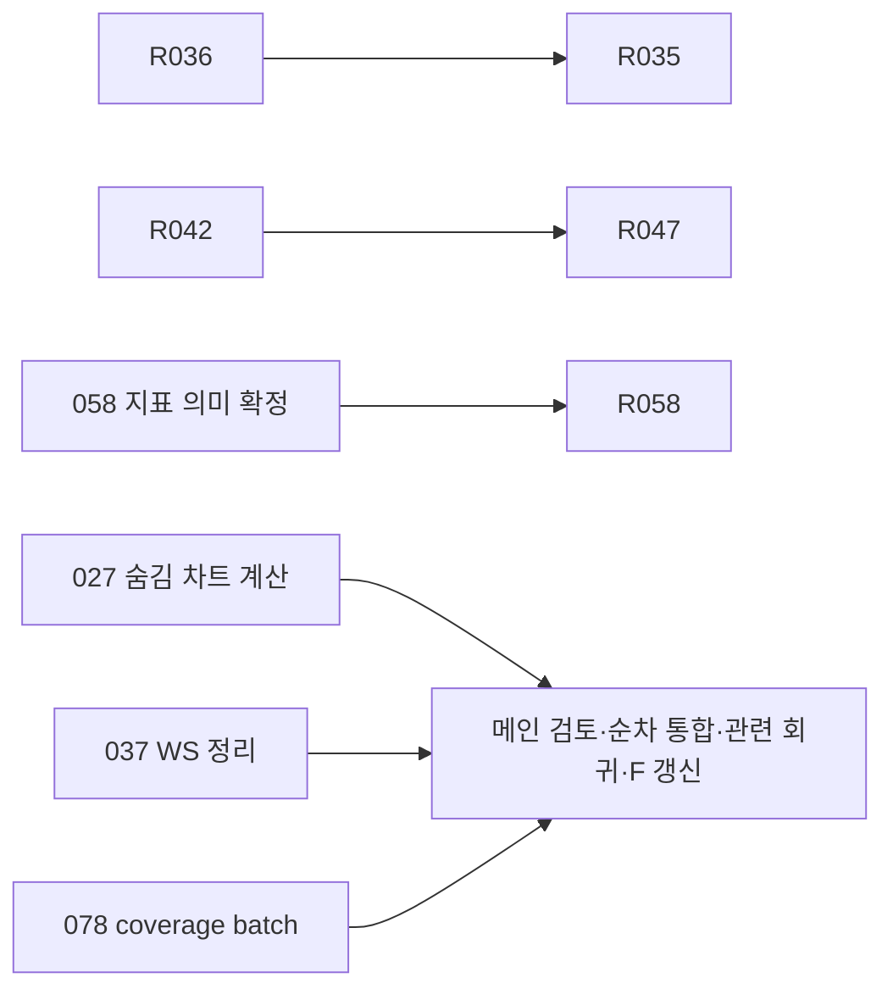

# 실행 비용·구조·기능 연결 리팩토링 백로그

- **커밋 정책(2026-10-23 사용자 정정):** 이후 로컬 커밋은 명시 요청 시에만 실행한다. 제품·검사 커밋 `066d2de`는 정정 전에 생성됐으며, 이번 남은 문서는 후속 명시 승인에 따라 커밋한다. 이번 승인을 이후 작업의 자동 커밋 권한으로 해석하지 않는다.

- **현재 열일곱번째 병렬 통합(2026-10-23):** 제품·검사 `066d2de1f71e52f1b3507a42e6a80153a092cd53`. R033의 공개 DI no-writer 호환 실패/재시도·종료 경계와 별도 bootstrap retention 합류를 독립 범위로 보완했다. R050 Risk 읽기 취소 수명과 R032 일지 동기화의 자식 종료 수명도 기존 owner에서 보완했으며 등록 전체 잔여와 미확정 실패는 보존한다. 동일 통합소스의 수락 합집합 관련35모듈·고유642건 PASS (worker 686.059초/실행 누적경과 484.140초). 계획=발견=실행=통과ID, 전체1160파일 LF `2d7bcaec5d267862237c84bc03da20844c4522db584eac43f88e9acd326b56fb`와 병합 함수를 대조했고 35worker/tree종료·성공TEMP 실제부재를 확인했다. 증분51기록/6192정의(추가11·수정1·삭제0), 이전50기록/미결49보존. 구조1364site·위반0, QueryStore소비/실행증거gate PASS. 기존 owner·native transaction/시계·SQL/ACK·실패 원문과 로컬 부분 수락 범위를 보존한다. R023 등록 완료는 유지하며 bootstrap retention의 기존 kst_wall 시계 연결 잔여는 R033에 남긴다. DDL/schema·새 worker/manager/queue/clock TR/poll/임의 cutoff·승인/주문 정책 추가0이다. 실제 PG5 미실행은 PC 증거로 대체하지 않는다. 최종 제품5파일의 DB/I/O AST·QueryStore consumer identity/서명 delta0, guard·consumer baseline 변경0을 독립 대조했다. 재개후제품/검사/ledger추가수정0이며현재51기록6192정의를그대로수락한다. 최초 2026-10-21의642건은641PASS/신규Risk marker1FAIL이었다. source·fixture·3초제한을바꾸지않고2026-10-23에해당 모듈 전체21건을단독1회재검증한결과를별도로연결했다. 34최초성공모듈621+해당21의합집합이며최초642전체PASS나원인해결이아니다. 최초실패/TEMP·단계관측1ID는별도보존하고진단PASS를수락에합산하지않았다.

- **현재 배정·경계:** 독립 담당14개를 4개 변경 범위(033 fallback/033 bootstrap/050 Risk/032 journal)와 별도 연결·수명 검토에 배정했다. 실제 보조 한도30(메인 포함31), WT native4 slot과 root 통합2 lane을 구분한다. 두033은 함수·상태 owner/실패 정책이 독립이고 bootstrap 변경은 기존032 setup try/cleanup 순서를 보존해 순차 통합한다. 새 대기 작업/기능을 만들거나 완료075/076·R023을 재개하지 않는다. 14는 이번 배정수이며 상시 14개의 동시 실행이나 native 4개의 실제 동시 peak를 뜻하지 않는다. 2026-10-23 재개 때 실패 단계 진단과 보존 증거 대조를 추가2agent에독립배정했다(누적16,새제품범위0).

- **현재/다음:** 전체85 / 검증 완료63 / 진행17 / 대기1 / 명시 보류4, 미완료22. 다음 국소 범위는 R3-033 bootstrap retention의 기존 kst_wall_now를 기존 키움 보정 시계로 연결하는 경계다. 실제 clock owner/기동 fallback·cutoff 계약을 먼저 해당 범위만 확인하고 새 TR/poll/state owner를 추가하지 않는다. fallback의 지속 cutoff/history·empty fence와 legacy 무날짜 입력은 미검증으로 유지한다. 독립 R3-050의 recovery/CAS 두 await 계약, R3-032의 선택 외 setup/cleanup·parent 강제종료는 선행 계약이 확정된 범위만 이어간다. 기존 완료023/075/076·명시 보류4는 재개하지 않는다. R3-083은 확인된 파일 단위 검사 확장 비용의 선택 정밀화만 별도 검토하며 GitHub 전체 CI 범위는 유지한다. 실제PG필수5(039/043/079)미실행, 053 CLI exit109·기존provider95중1FAIL·condition정체원인미확정, wave16 최초277PASS/기존marker2FAIL와 같은소스 두전체모듈76PASS를 분리 보존한다. 이번 push·hostedCI·NAS/배포/운영DB·실계좌·전체로컬회귀는 미실행이다.

- **이전 열여섯번째 병렬 통합(2026-10-21):** 제품·검사 `7d0b8e108893c649e1e56e127eb06f29151779a5`. R3-033 gap·빈 이력 metadata의 cutoff 재삽입을 보완하고, 032 기동 읽기 오류와 050 admission 조회 취소의 수명을 보완했다. 081 새 후보는 전체 paint CPU 이득 미확정으로 미채택, 기존 075/076 완료는 보존한다. 현재 통합소스 관련13모듈·고유279건 PASS (수락 worker 693.313초/실제 전체 worker 1110.040초/실행 누적경과 369.900초). 계획=발견=실행=통과ID, 전체1160파일 LF `2a2ee01b92d025801f49e7dd996b70af19d3f71fed1ba0c97c54370a1b62b86f`, 6제품/검사파일 병합·기존assertion보존, 13worker/tree종료·성공TEMP실제부재를대조했다. 증분50기록/6181정의 (추가3·수정0·삭제0),이전49기록/미결49보존. 구조1364site/위반0·QueryStore소비/실행증거gate PASS,guard/소비baseline변경0. 첫4lane279건은277PASS/기존2ID실패였다. 소스·fixture·2초/3초제한을바꾸지않고실패한두전체모듈76건을2lane에서1회재검증해PASS한같은소스수락합집합이다. 단일최초279전부PASS나원인해결이아니다. provider는runtime교체전schema/첫snapshot/investor marker이전,activation은recovery첫control조회뒤marker기한실패로실제대기단계미확정이며4lane원인도확정하지않는다. 첫실패원문·두TEMP와11최초성공+2재검증성공의정리근거를별도보존했다. `related-v1/run.json`·`related-v2/run.json`·`accepted-v1/run.json`·`first-failure-summary.json` 참조.

- **이전 열여섯번째 배정·경계:** 보조30/런타임31한도 안에서13agent에4개 독립격리제품범위와review/소비자/계약/선정/통합·문서초안을배정했다. 상시13동시실행을뜻하지않는다. native WT최대4slot을모두반납한뒤root첫통합도4lane으로실행했고,기존2ID실패뒤두전체모듈은2lane1회로재검증했다.각완료패킷은다른작업을기다리지않고선통합했다. 계약담당의capacity turn실패1은같은모델1회재개후회복했고검증실패나제품성공으로바꾸지않았다. 준비조건없는차단/완료경계를동시수채우기로재개하지않았다.

- **이전 열여섯번째 현재/다음(당시):** 전체85 / 검증 완료63 / 진행17 / 대기1 / 명시 보류4, 미완료22. 다음은 R3-033 no-writer 호환 fallback·별도 bootstrap retention의 실제 실행 여부/종료 책임을 기존 등록 범위에서 제한 확인한다. legacy market:()의 무날짜 확장과 미래 cutoff/clock 역행은 미검증으로 유지한다. 독립 후속032 앞선 setup/start·cleanup/journal 수명,050 다음 native await3곳,081 다른 명확한 비용 경계는 범위를 먼저 확정한다. DAG 준비0·잔여검토11·외부/계약대기7·명시보류4이며 완료/명시보류 재개·전수 재조사를 하지 않는다. 다음 root 관련 실행은 기존2lane부터 시작하며, agent30 한도와 WT native4 예산은 그대로다. 첫4lane 실패 원인은 계측 전 미확정으로 남긴다. 실제PG필수5(039/043/079)미실행,053 CLI exit109/기존provider95중1FAIL/condition정체원인미확정은보존한다. 새push·hostedCI·NAS/배포/운영DB·실계좌·전체로컬회귀는미실행이며현재로컬PASS와구분한다.

- **이전 열다섯번째 병렬 통합(2026-10-21):** 제품·검사 `7fe20f325d462242de3390c50d678c585e6f0161`. 033/032/050/075 네 작업 통합,075등록범위 로컬완료·081후보미채택. 현재 통합 소스 관련18모듈·고유369건 통과(590.543 worker초/297.813초 경과). 계획=발견=실행=통과 ID, 전체1160파일 LF `154853226f8bc4e12f6ac887a18abac62890ec9f78fa23016b6881d5ae7ab250`, 7파일·44함수 AST/기존267함수·검사78개 assertion/분기 보존,18worker/tree 종료·성공 TEMP 실제 부재를 대조했다. 증분49기록/6178정의(추가8·수정1·삭제0), 이전48기록·미결49 보존. 구조1364site/위반0/retirable0·QueryStore 소비 계약·이번 실행증거 gate 통과. guard/소비 baseline 변경0이다.

- **이전 열다섯번째 배정·경계:** 보조 한도30/런타임31 안에서 기존15agent를5개 격리 후보 구현·독립 검토·ACK 소비자/계약/선정/통합확인에 배정했다. 충돌 없이 확정한 네 작업만 통합했고081후보는 실측 역효과로 미채택했다. 상시15개 동시실행을 뜻하지 않는다. native 검사는 WT 최대4슬롯·root 통합2lane으로 분리했으며 agent 수를 채우려 완료/차단 범위를 중복 실행하지 않았다.

- **이전 열다섯번째 현재/다음(당시):** 전체85 / 검증 완료63 / 진행17 / 대기1 / 명시 보류4, 미완료22. 다음은 R3-033의 gap/empty-only metadata 저장이 같은 cutoff를 우회하는지 제한 재현·범위 확정이다. 동일 writer의 native COMMIT 후 예외는 이번에 확인했으며, 영구 GUI 신호 미소비·process kill은 별도 미검증이다. 독립 잔여는032 setup/start·앞선 finally 예외/journal 수명,050 나머지 resume native await4곳,081 별도 가격범위/grid/geometry/general annotation이다. 전체 재조사·완료/명시보류 재개 없이 DAG 준비0·잔여검토11·외부/계약대기7·명시보류4를 따른다. 실제PG 필수5건(039/043/079) 미실행,053 CLI 진단1FAIL과 기존 provider95중1FAIL·condition worker 정체 원인 미확정은 보존한다. 현재 로컬 성공으로 이를 해결 처리하지 않는다. 새 push/hosted CI/NAS/배포·운영DB/실계좌/전체 로컬회귀는 미실행이다.

- **이전 열네번째 병렬 통합(2026-10-21):** 제품·검사 `fbbb96a0cdbab65d476dd352a90745ba30a1eae4`. R3-076 등록 개선을 검증 완료로 전환하고, 032/033/050/075/081은 국소 보완만 통합했다. 현재 통합 소스 관련 25모듈·고유448건 통과, 584.411 worker초/295.539초 경과. 계획·발견·실행·통과 ID와 전체1160파일 LF `44e415e88b1b8f56173861dd36a13ebbdd550fd9a900589fceda291c308f2f3d`, 11파일·46함수 병합, 25worker/tree 종료·성공 TEMP 실제 부재를 대조했다. 증분48기록/6170정의(추가9·보강3·삭제0), 원래47기록·미결49 보존. 구조1364site/위반0/retirable0·QueryStore 소비 계약·이번 변경의 실행증거 gate 모두 통과했다.

- **이전 열네번째 배정·경계:** 보조 한도30/런타임31 안에서 기존 agent 22개를 재사용해 6개 격리 구현과 독립 검토·계약·선정을 배정했다. 상시22개 동시 실행이라는 뜻은 아니다. 네이티브 검사는 WT 최대4슬롯·root 통합2슬롯으로 분리했다. 017/047/048/049/062 후보는 효과·계약 근거에 따라 제품 변경 없이 기각/미채택했다.

- **이전 열네번째 현재/다음(당시):** 전체 85개: 검증 완료 62 / 진행 18 / 대기 1 / 명시 보류 4, 미완료 23개. 다음은 R3-033의 upsert 자체 COMMIT 후 예외/ACK 손실 경계의 제한 재현·범위 확정이다. 독립 후속 032 content/journal 수명·050 나머지 resume native await·075 필수복사·081 annotation은 미검토 잔여 함수만 확인한다. DAG 준비0·잔여검토12·외부/계약대기7·명시보류4로 관리하며 완료/명시보류 재개나 전수 재조사는 하지 않는다. 기존 실제PG 필수5건(039/043/079)은 미실행 그대로이며, 053 CLI 진단1FAIL·기존 provider/condition 정체 원인 미확정도 보존한다. 이번 로컬 gate 통과가 이 잔여의 해결은 아니다. 새 push·hosted CI·NAS/운영·실계좌·전수 로컬 회귀는 미실행이다.

- **이전 열세번째 병렬 통합(2026-10-21):** 제품·검사 `b16c386d107b08218b2f97dc4d305f3d55ebc632`. R3-039부터13개국소개선을통합했고053은제품없이Windows진단만수행했다. 현재 통합 소스 관련62개 실제 모듈·고유1301건/1113.091 worker초 PASS(경과1143.775초, native2lane·모듈별격리). 계획=발견=실행=통과 ID, 전체1160파일 LF `6c4bb027723a56fa9dd07a5f79f9b409c1792eab43b3434c0990da6912dbaa7c`·변경44파일/159함수AST·47번째증분원장·62worker/tree종료·성공TEMP실제부재를 대조했다. 6128→6161/추가33·수정6·삭제0, 이전46기록/미결49/394모듈·77세부경로·F25감사깊이를 보존했다. packet/역사 관련1245+root비용1에 기존 발견건수 계약이 있는 관련3모듈38건과 기존QueryStore/구조검사17건을 보강했다. 정적 증분검토47기록과 구조1364site/위반0/retirable0은 통과했지만 전체 실행증거 gate는 실제PG 필수5개 미실행으로 실패 상태다. 누락ID를 대체·skip·제외하거나 로컬PASS로 숨기지 않았다. 최초root1284계획은1265PASS/condition19worker를467초정체로중단한불완전실행이다. 소스·기대값·내부deadline을전혀바꾸지않고해당전체19를독립재검증해통과한유일완료worker와계약17을수락합집합으로선택했다. 최초raw실패/보존TEMP는그대로이고정체원인은미확정이며해결됐다고보고하지않는다.

- **이전 열세번째 배정·경계:** 기존 보조30개를 보존·재사용했고 런타임 총31slot(root1+보조30) 범위에서 이번 독립 구현12경계와 검토/계약/통합확인11개, 고유23agent를 배정했다. 30개 상시동시실행을 주장하지 않으며 차단/완료 경계를 중복 실행해 자리를 채우지 않았다. native 자원은 개별WT 단계최대4·root통합단계2lane으로 별도 배정했고, 긴 publication 모듈을 먼저 실행했다. 전체85/검증 완료61/미완료24(진행19·대기1·명시보류4)는 유지한다. 13개 국소 제품 개선과053진단을 전체 R3 완료로 올리지 않았다. DAG 완료61·준비1(076 UI 공통 탐색 순서)·잔여검토12·외부/계약대기7(039/043/079 실제PG,058 의미,068 출처이행,084 BODY cut,085 주문 소유)·명시보류4(006/008/020/024). 다음은076 resolve_unmatched_theme_rows/_resolve_unmatched_new_rows의 공통 순서이며 서로 다른 재입력·alias승인 UX는 유지한다. 독립 잔여017 조립/032 content·theme·journal/050 resume·status/075 필수복사/081 annotation은 해당 미완료 함수만 범위를 확정한다. 실제PG5개는필수미실행,053CLI진단1FAIL은보존한다. 전체 재조사·완료/명시보류 재개·NAS중간배포는 하지 않는다.

- **이전 열두번째 병렬 통합(2026-10-21):** `7e4fb607ceb09479f6b9c9ed2c03cbf6cdc42bbb`. 18개 등록범위/slice를 통합했고 013/019/027/041/057/059/071/077만 검증 완료로 전환했다. 나머지10개는 부분 개선·진행이다. 현재 통합 소스 관련62개 실제 모듈·고유1060건/825.210 worker초 통과(경과415.748초, native2개 독립 lane·모듈별 격리). 계획=발견=실행=통과 ID, 전체1154파일/변경41파일·46번째 증분원장·worker/tree 종료·native TEMP 제거를 대조했다. 6073→6128/추가55·수정7·삭제0이며 기존45기록/미결49는 보존한다. packet972ID에서 역사 검토5개를 보강하고 변경검사 모듈 전체를 포함해 중복 없는1060으로 선정했다. 구조1373site/위반0이며 adoption/rules를 초기화하지 않고 exact review3개만 추가했다. 최초 root adoption 수정은 실제 gate가 거절했고 append-only review로 바로잡은 실패 기록도 보존했다. 전체85/검증 완료61/미완료24(진행19·대기1·명시보류4). DAG 완료61·준비2(039/079 동결제출, 실제PG 경계 별도)·잔여검토13·선행/계약대기5(043 실제PG/058 의미/068 출처이행/084 BODY cut/085 주문 소유)·명시보류4(006/008/020/024). 다음 준비 작업은 R3-039 최근거래일 reader의 root 통합(QueryStore/구조·capture/replay 계약 정확 갱신)이고, R3-079가 뒤따른다. 실제PG 미실행·실행증거 gate 실패는 별도 보존하며 완료로 숨기지 않는다. 독립 후속은 R3-062 저장ACK 실패/종료 계약, R3-075 필수봉복사/no-op 저장 의미, R3-076 catalog 소비자 책임부터 작은 범위를 확정해 배정한다. R3-033의 만료 실패재시도는 별도 native 반례부터 이어간다. 새 전수조사나 같은 prepare/상태/transaction의 동시 변경은 하지 않는다. 공유 백로그/F·계약·검사원장은 root만 갱신한다.

- **재시작 한도 적용:** 재시작 후 config agents.max_concurrent_threads_per_session=30 재조회, 런타임 총31slot(root1+보조30) 확인·보조30개 생성 모두 성공. 25개 미완료R3별 경계+독립 review5개를 배정하고 완료된 agent를 후속 구현/검토에 재사용했다. 30개가 항상 동시에 실행 중이었다는 뜻은 아니다(최초 생성후 snapshot27실행/3완료). 이전 세션의 총4slot 거절/설정 검증 실패를 덮어쓰지 않았고 기존 worktree/커밋/미커밋·원본 실패를 보존했다. agent 한도와 native 검사 자원 배정은 별개다. native 시간초과·Qt abort를 보존하고 root는 모듈별 독립 worker로 검증했다.

- **이전 열한번째 병렬 통합(2026-10-20):** `736fce8`. 042/044/051/056/074 등록범위 검증 완료,068 직접모드 개선은 부분 완료/진행. 최종 검증2026-10-21: 현재 통합 소스 관련42개 실제 모듈·고유533건/398.798 worker초 통과. 최초483건 뒤 증분 gate가 같은 파일의 기존7ID 누락을 감지해 MainWindow61을 보강했고, 중복11실행을 포함한 aggregate도 거절해 유일한 완료 worker로 선택했다. 이어 root의 검토기록2개(Drive snapshot→056, statistics→074) 분류 오류를 수정하고 제품/검사 본문 변경 없이 수정 원장까지 동결한 현재533건을 다시 실행했다. 이전483+61·최초 gate 실패/중복 거절/수정 전 검증은 예비 기록으로 보존한다. 최종 증분45기록/6073개·추가36개/기존 메서드 변경·삭제0, 전체 소스/계획·실행·통과 ID, 동결22파일/함수별 병합, worker/tree 종료·native TEMP 제거가 일치한다. 구조1374site/위반0/기준 변경0. 별도 WT 비용·반례는 현재 root533과 구분한다. 전체85/검증 완료53/미완료32(진행11·대기17·명시보류4). DAG 완료53·준비0·계약/영향 확인26(독립작업/검토3포함)·선행/외부대기2(043 실제PG/058 의미)·명시보류4(006/008/020/024). 실제보조3개는047 Runner JSON중복slice·075 숨김live일지순수read/render slice·041독립통합검토에배정했다. 033관련112/별도비용1·041관련54/별도비용1·039로컬82/별도비용1·076 preview slice관련48/별도비용1·079 PC관련61은동결제출·root통합대기다. 039신규PG1/079변경PG1은미실행,047/075/076전체책임·복사/matcher잔여는진행유지. 공유원장/F/계약·통합은메인만갱신한다.

- **이전 열번째 병렬 통합(2026-10-20):** `8cc2d19`의028/029/045/082등록범위검증완료. 통합 현재 소스 관련11개 실제모듈 고유107건/75.253 worker초 통과. 계획/실행/통과 ID·전체지문·동결8파일·worker/tree 종료/native TEMP 제거를 대조했다. 증분44기록/6037건(추가3·기존보강1·삭제0), 구조1374site/위반0/기준변경0. WT의 별도 원본/후속 비용2·legacy seed1은 보존하되 root107에 합산하거나 재실행했다고 보고하지 않는다. 전체85/완료48/미완료37. 준비후보3(042/044/074 검증제출), 계약/영향확인27(051 선택write·085 identity 포함), 선행/외부대기3(043 실제PG/047←042/058 의미), 명시보류4(006/008/020/024). 실제 보조3개는056 Drive ACK·051 선택write 경고/실패·068 NXT 증분 고가를 격리 개발한다. 메인은042/044/074 제출본을 순차 검토·통합하며 공용 백로그/F/계약을 단독 갱신한다.

- **이전 아홉번째 병렬 통합(2026-10-20):** `d6da121`의051 N+1 slice·055 등록범위 통합. 통합 현재 소스 관련15모듈 고유185건/104.818 worker초 통과. 별도 기존 native 진단5건도 통과했다. 계획/실행/통과 ID·전체 소스 지문·함수별 병합·worker/tree 종료와 native TEMP 제거를 대조했다. 증분43기록/6034건·추가4/fixture2·삭제0, 구조1374site/위반0/기준변경0. 전체84/완료44/미완료40. 준비후보3(028/074/082), 계약/영향확인30(051 선택write 오류정책 포함), 선행/외부대기3(043 실제PG/047←042/058 의미), 명시보류4(006/008/020/024). 029·045·028·082·042는 격리 검증제출/메인통합대기, 실제 보조3개는044 동기화ACK·074 렌더비용·068 NXT 증분 고가를 독립 진행한다. 공유 백로그/F/계약은 메인만 갱신한다.

- **이전 여덟번째 병렬 통합(2026-10-20):** `017bb03`의052/054/060/061등록경계검증완료. 현재 통합 소스 관련17개실제모듈 고유212건/307.507 worker초 통과(일지118/catalog65/외부시장29). 별도현재MainWindow→두QThread→row editor/name lookup/preview 진단1건·8상태도29.698초통과/원본관측JSON동일. 변경16ID·계획/실행/통과·전체지문/동결7파일·worker/tree종료/nativeTEMP제거를대조했다. 전체84/완료43/미완료41. 준비후보5(028/051/055/074/082),계약/영향확인29,선행/외부대기3(043실제PG/047←042/058의미),명시보류4(006/008/020/024). 051N+1 slice는검증제출/메인통합대기이며선택write오류정책은미결유지,055는필수custom봉복사보존을검증해재수정중이다. 실제보조3개는029→045동일테마owner직렬·042bundle/Runner수명·055분리차트를진행한다. 042/029/045의추가계약검증은동시에공유상태를수정하는후속작업으로확대하지않는다. 메인포함4slot·공유원장/F는메인만갱신한다. 실제환경미검증은보존한다.

- **이전 일곱번째 병렬 통합(2026-10-20):** `964ddbe`의063/067/072등록경계검증완료. 현재 통합 소스 관련20모듈 고유231건/317.202 worker초 통과(연구153·뉴스65·기존구조차단13). 변경8 ID·전체 계획/실행/통과, 현재 전체지문/동결9파일, worker/tree종료·nativeTEMP제거를 대조했다. 전체84/완료39/미완료45. 준비후보9(054실제경로확인후제출포함), 계약/영향확인29, 선행/외부대기3(043실제PG/047←042/058의미), 명시보류4(006/008/020/024). 보조3개는052리뷰저장·055분리차트·060→061외부시장동일owner직렬을 진행하며054미사용helper제거는검증제출·메인통합대기다. 052/055는같은파일의서로다른함수·리뷰상태/차트상태를소유하고메인이함수별병합한다. 실제세션4slot(메인+보조3),공유원장/F는메인만갱신한다. 실제PG/CI/운영미실행과과거report/원격취소잔여는상세를따른다.

- **이전 여섯번째 병렬 통합(2026-10-20):** `0a54c35`의030/064/065/066등록경계검증완료. 현재 통합 소스 관련 27개 실제 모듈 고유394건/431.634 worker초 통과(journal167/index112/real115). 변경14 ID·계획/실행/통과, 전체 소스 지문, 동결9파일과035 기존본문을 보존한065 추가2메서드 병합, worker/자식 종료·native TEMP 제거를 대조했다. 전체84/완료36/미완료48. 준비후보11(개발·검증제출 포함), 계약/영향확인30(027 잔여·054 실제caller 확인·084 포함), 선행/외부대기3(043 실제PG/047←042/058 의미), 명시보류4(006/008/020/024). 063·067·072는 격리검증 제출/메인 통합대기, 보조3개는060→061 같은owner직렬·054실제연결재평가·052리뷰저장을 독립 진행한다. 실제 세션은 메인 포함4slot이며 공용원장/F는 메인만 작성한다. 실제환경과043PG잔여는별도다.

- **이전 다섯번째 병렬 통합(2026-10-20):** `64a74e0`. 035/046 등록경계 검증완료,043 PC통합·실제PG대기. 현재 통합 소스 관련 20개 실제 모듈, 고유 305건/124.603 worker초 통과(index107/news113/research85). 계획·실행·통과 ID, 변경 로컬14 ID, 전체 소스 지문·동결12파일, worker/자식 종료와 native TEMP 제거를 대조했다. 전체84/완료32/미완료52. 준비후보16(개발·검증제출 포함), 계약/영향확인29(027 잔여·084 포함), 선행/외부검증 대기3(043 실제PG/047←042/058 의미), 명시보류4(006/008/020/024). 030·064·065·066은 격리 검증제출/메인 통합대기, 063·067·072는 독립 격리개발 중이다. 실제 세션 한도는 메인 포함4이며 보조3 슬롯을 연속 배정하고 공유 원장/F는 메인만 갱신한다. R3-043 실제 PostgreSQL 변경2 ID 및 해당87건 모듈은 미실행이다. 전용 diagnostic DSN 부재로 증분 실행 증거 검사는 누락을 감지해 실패했으며 성공 처리하지 않았다. 기존 push/PR의 필수 postgres-integration이 postgres_required 전체 모듈을 실행하고 실패·누락을 required 증거로 전달하는 본문만 확인했다. 현재 hosted CI 실행은 없다.

- **이전 네번째 병렬 통합(2026-10-20):** `539cbad`의031/080등록경계로컬검증완료. 현재통합소스 관련8개실제모듈 **고유121건/79.524 worker초 통과**(journal/controller85+실제MainWindow기존signal1+OCR/controller/theme35). 11개변경ID·계획/실행/통과·현재전체지문/frozen7파일·worker/tree종료/nativeTEMP제거를대조했다. 완료30/미완료53. 준비후보18(실행/제출포함),계약/영향확인29(027잔여포함),선행·의미대기2(047/058),명시보류4(006/008/020/024)다. 035는036선행충족후격리개발/검증제출,043은뉴스native claim CAS개발,046은CLI원본보호검증제출·root통합대기다. 030은031새실패payload보존경계를승계한worktree에서실제개발중이다. 메인포함실제4slot을계속활용하며공유원장/F는root만작성한다. 현재CI/NAS/전수회귀미실행.

- **이전 세번째 병렬 통합(2026-10-20):** `8f3bade` 036/038/073개선·040안전조회유지검증완료. 현재 통합소스 관련21모듈 **고유479건/428.669 worker초 통과**(index90+ingest/app241+gateway90+news58,중복0). 계획/실행/통과·14개변경ID/현재전체지문·frozen7파일·worker/tree종료/nativeTEMP제거를대조했다. 완료28/미완료55. 준비후보20(실행/제출포함),계약/영향확인29(027잔여포함),선행·의미대기2(047/058),명시보류4(006/008/020/024)다. 036완료로035를실행가능으로해제했다. 031은native실패값/종료보존개발·재검증,046은CLI원본보호개발,080은검증제출·root통합대기다. 실제총4slot(메인+보조3)을개발/교차검토에사용하고공유원장은root만쓴다. 현재CI/NAS/전수회귀미실행.

- **이전 두번째 병렬 통합(2026-10-20):** `9955a24`의034/069/070검증완료,027은숨김chart slice만완료하고전체진행유지. 현재 소스 관련7모듈 **고유157건/79.485 worker초 통과**(수집/과거자료/테마74+화면83, 중복0). 계획=실행=통과ID·현재 소스/frozen worktree SHA·worker/자식 종료·native TEMP 제거를 대조했다. 완료24/미완료59. 준비후보23(실행/검증제출포함),계약/영향확인29(027잔여포함),선행·의미대기3,명시보류4(006/008/020/024)다. root는036보완/040안전조회유지/073저장조건의제출결과를검토·통합하고,보조3개는031실패저장/038page범위/080OCR중복을독립개발한다. 036이최종통합되기전035는대기,042→047과058지표의미선행은그대로다. CI/NAS/전수회귀미실행.

- **이전 병렬 통합 완료(2026-10-20):** `fba8994`의 **R3-037·078 검증 완료(등록 코드·로컬 관련검증)**. 현재 소스 관련4모듈 **고유89건/12.839 worker초 통과**(WS51+reconciliation38, 중복0). 계획/실행/통과ID·5개 변경ID·현재 소스와 frozen worktree SHA·worker/자식 종료·native TEMP 제거를 대조했다. 037구독잔류해소/078 SELECT44→5(20code)·409→9(201code),F04/F24·F09 및책임/비용계약갱신. 의존성 준비큐를 유지한다. 완료21/미완료62이며 준비후보27(검증제출/실행 포함), 계약/영향확인28, 선행/의미대기3, 명시보류4다. 027숨김chart slice·034·036·069는격리검증 제출/통합대기,070은개발중이다. 027전체와035(036선행)는 아직 완료/준비 승격하지 않는다. worker slot은 개발/다른 작성자 교차검토에 연속 배정하며 root만 원장/F·통합을 맡는다. 실제CI/NAS/전수회귀는미실행이다.

- **이전 등록 개선 완료(2026-10-20):** `47e780d`에서 **R3-012 검증 완료(등록 코드·로컬 관련검증)**. 현재 소스 관련 **9모듈·고유152건/127.308 worker초 통과**(독립2묶음 병렬). 계획/발견/실행/통과 ID·변경7개 ID·소스 불변·worker/자식 종료·native TEMP 정리를 대조했다. 기본16열 동일 저장 반영행32→0·한 열32→2, 명시 reset/최초 등록과 폭 revision의 기존 의미는 유지했다. [최신 범위/한계](#r3-012-열-설정-변경행revision-저장-완료--2026-10-20)·F01(간접)/F22/F23/F24·책임 계약 갱신. 후속은 **의존성 DAG 준비큐**이며 push/CI/NAS/전수회귀는 미실행이다.

- **이전 등록 개선 완료(2026-10-20):** `aeb63c6`에서 **R3-011 검증 완료(등록 코드·로컬 관련검증)**. 현재 소스 관련 **14모듈·고유175건/140.776 worker초 통과**(독립2묶음 병렬). 계획/발견/실행/통과 ID, 변경8개 ID, 소스 불변, worker/자식 종료와 native TEMP 제거를 대조했다. 같은4키 반영행8→0·geometry/Alert의 연결/COMMIT/시계4→1이며 cache 세대·최초 version 등록·동기화 편집 의미를 검증했다. [최신 범위/한계](#r3-011-설정-no-opcacheui-batch-완료--2026-10-20)와 F01(간접)/F22/F23/F24·책임 계약을 갱신했다. 다음 **R3-012**이며 push/CI/NAS/전수회귀는 미실행이다.

- **이전 등록 개선 완료(2026-10-20):** `fc21038`에서 R3-010의 stage 비교/append·scoped latest binding과 SQLite 종료 경계 잔여를 검증했다. 현재 소스 관련17모듈 **고유 546건/440.307 worker초 통과**(두 묶음 병렬). 계획/발견/실행/통과 ID와 변경6개 ID·소스 불변·worker/자식 종료·TEMP 정리를 대조했다. stage연결3→2/SELECT3유지·binding1031→1; 별도 owned-crash2건. **010 검증 완료(등록 코드·로컬 관련검증)**, 다음 **R3-011**이다. 전체PG/운영·CI/NAS/전수회귀는 미실행이며 최신 말미/F/책임 계약을 따른다.

- **이전 선택 경계 검증(2026-10-20):** 제품·검사 `2bd43df`의 per-key 불변 insert/충돌·ACK와 native Shadow 쌍 저장을 검증했다. 신규 연결3→1·SELECT2→1, 기존 동일 문서는 read-only/첫 receipt 유지. 관련18모듈 **고유 739건 통과**(worker 소요 합계 629.437초, 두 묶음 병렬 실행). 변경10개 검사ID·발견/실행ID·현재 소스 일치·worker/자식 종료·TEMP 정리를 대조했다. **R3-010 전체는 진행**, 다음은 서로 다른 stage revision CAS·binding history 범위 및 commit 경계 OS crash 검증이다. 아래 상세/말미010과 F 원장을 정본으로 따른다. 실제 PG·CI/NAS/운영·로컬 전체 회귀는 미실행.

- **직전 선택 작업 완료(2026-10-19):** 로컬 제품·검사 `4841f7a`에서 기존 CandidateMonitor의 정책 기준선 조회를 현재 KST 거래일과 정책 window의 교집합으로 제한했다. SQL은 cut.floor 기준 start 포함/end 제외이며 기존 (cut-2초).floor/commit token 캐시는 그대로다. 빈 교집합·미설정·subminute는 조회하지 않는다. 실제 native 반환의 nested metadata는 기존 codec로 품질/출처/가용시각4필드에 연결해, 정상 완결봉도 UNAVAILABLE이던 입력 연결을 복구했다. 20종목×450분 fixture의 실제 native 반환9,000→100(5분×20), SELECT20·연결20 유지/분봉 쓰기0이다. 같은 cache key의 추가 read0/commit token 변경 뒤 추가20이다. 정상 native UNAVAILABLE→COMPLETE는 연결 복구에 따른 의도한 동작 변화이고, 이를 포함한 정규화 full-day oracle와 bounded reference/observation hash는11조건에서 동일하다. 관련5모듈 **361건/127.269초 통과**. R3-005 검증 완료(로컬)와 F12/F08/F24·책임 계약을 함께 갱신했다. 이번 push/GitHub CI·NAS 배포·로컬 전수 회귀·실제 키움/장중·운영 DB/주문·실제 PostgreSQL/외부 네트워크 수락은 미실행이다. PG는 기존 실제 SQL 생성·인자/decoder의 fake-connection 계약으로만 검증했다. 분봉으로 가짜 틱을 만들거나 미정 매매 조건/주문 승인을 추가하지 않았고 F 부모의 부분/확인불가 상태는 유지한다.

기준: 2026-10-18, 제품 2.1.0, 로컬 `main`/HEAD `6cf3d4c` + 조사 시작 시 미커밋 변경.
이 문서가 이번 전수 감사와 후속 “다음”의 정본이다. 과거 종료 계획이나 R1/R2 완료 기록을 다시 실행하지 않는다.

## 현재 작업과 이어가기

- **현재 열일곱번째 인계:** 전체85 / 검증 완료63 / 진행17 / 대기1 / 명시 보류4, 미완료22. 다음 국소 범위는 R3-033 bootstrap retention의 기존 kst_wall_now를 기존 키움 보정 시계로 연결하는 경계다. 실제 clock owner/기동 fallback·cutoff 계약을 먼저 해당 범위만 확인하고 새 TR/poll/state owner를 추가하지 않는다. fallback의 지속 cutoff/history·empty fence와 legacy 무날짜 입력은 미검증으로 유지한다. 독립 R3-050의 recovery/CAS 두 await 계약, R3-032의 선택 외 setup/cleanup·parent 강제종료는 선행 계약이 확정된 범위만 이어간다. 기존 완료023/075/076·명시 보류4는 재개하지 않는다. R3-083은 확인된 파일 단위 검사 확장 비용의 선택 정밀화만 별도 검토하며 GitHub 전체 CI 범위는 유지한다. 실제PG필수5(039/043/079)미실행, 053 CLI exit109·기존provider95중1FAIL·condition정체원인미확정, wave16 최초277PASS/기존marker2FAIL와 같은소스 두전체모듈76PASS를 분리 보존한다. 이번 push·hostedCI·NAS/배포/운영DB·실계좌·전체로컬회귀는 미실행이다.

- **이전 열여섯번째 인계(당시):** 전체85 / 검증 완료63 / 진행17 / 대기1 / 명시 보류4, 미완료22. 다음은 R3-033 no-writer 호환 fallback·별도 bootstrap retention의 실제 실행 여부/종료 책임을 기존 등록 범위에서 제한 확인한다. legacy market:()의 무날짜 확장과 미래 cutoff/clock 역행은 미검증으로 유지한다. 독립 후속032 앞선 setup/start·cleanup/journal 수명,050 다음 native await3곳,081 다른 명확한 비용 경계는 범위를 먼저 확정한다. DAG 준비0·잔여검토11·외부/계약대기7·명시보류4이며 완료/명시보류 재개·전수 재조사를 하지 않는다. 다음 root 관련 실행은 기존2lane부터 시작하며, agent30 한도와 WT native4 예산은 그대로다. 첫4lane 실패 원인은 계측 전 미확정으로 남긴다. 실제PG필수5(039/043/079)미실행,053 CLI exit109/기존provider95중1FAIL/condition정체원인미확정은보존한다. 새push·hostedCI·NAS/배포/운영DB·실계좌·전체로컬회귀는미실행이며현재로컬PASS와구분한다.

- **이전 열다섯번째 인계(당시):** 전체85 / 검증 완료63 / 진행17 / 대기1 / 명시 보류4, 미완료22. 다음은 R3-033의 gap/empty-only metadata 저장이 같은 cutoff를 우회하는지 제한 재현·범위 확정이다. 동일 writer의 native COMMIT 후 예외는 이번에 확인했으며, 영구 GUI 신호 미소비·process kill은 별도 미검증이다. 독립 잔여는032 setup/start·앞선 finally 예외/journal 수명,050 나머지 resume native await4곳,081 별도 가격범위/grid/geometry/general annotation이다. 전체 재조사·완료/명시보류 재개 없이 DAG 준비0·잔여검토11·외부/계약대기7·명시보류4를 따른다. 실제PG 필수5건(039/043/079) 미실행,053 CLI 진단1FAIL과 기존 provider95중1FAIL·condition worker 정체 원인 미확정은 보존한다. 현재 로컬 성공으로 이를 해결 처리하지 않는다. 새 push/hosted CI/NAS/배포·운영DB/실계좌/전체 로컬회귀는 미실행이다. 아래최초CI·감사/번호순기록은당시이력이다.

- **추가 CI 시간 단축 검증 완료:** `a325e31`을 main에 push한 [CI39118437411](https://github.com/jhimm3/kiwoom-realtime-monitor/actions/runs/39118437411)이 **9job 전체 성공/13분59초**, Windows320worker·463모듈·5581검사/고유ID 전부 통과했다. 직전33ce833의20분10초보다6분11초(30.7%) 단축했고, 더 빨랐던d5bec26의15분38초보다도1분39초 짧았다. 전체 범위·고정 관찰 시간·native 격리/종료·source/ID·required 실패 전파는 유지한다. Windows 총job사용은19분19초→22분54초로 늘었으며 VM 편차/관찰 한계는083 말미에 구분한다. 다음 제품002+023을 유지한다.

- **R3-083 실제 CI 검증 완료:** 보강 `c7a6cef`와 확인된 CI fixture/출력·실행근거 후속 `d5bec26`를 main에 커밋·push했다. [후속 전체 CI39115204095](https://github.com/jhimm3/kiwoom-realtime-monitor/actions/runs/39115204095)는 **전체7job 성공·15분38초**, Windows320worker·463모듈·5577건 전부 통과했다. 계좌 worker는 이전1800초 timeout→3.518초/8건 통과, native crash 재발0. 최초 실패/누락 기록과 남은 설계·운영 한계는083 말미에 보존했다. R3-083은 기반 최종 검증 완료/후속 R3별 계약 반영 **진행**이며 다음 제품002+023을 유지한다.

- **2026-10-18 구조 퇴행 방지 기반 적용(R3-083):** [기능별 책임 계약](docs/architecture/r3-ownership.md)과 source-site/계층·cycle delta 검사·기존 비용 회귀·CI 연결을 추가했다. R3 감사·개선은 계속하며 다음 제품 구현은 아래 **R3-002+023** 순서다. 기계 채택 목록은 기존 결함/타 작업의 승인이나 리팩토링 종료가 아니다. 최종 종료 체크리스트는083에 둔다.

- **최신: 잔여 코드 정밀 감사 종결.** 고정 `src/kiwoom_monitor` 394모듈 중 직전 완료25개를 근거·해시 대조로 승계하고, 부분175개와 정적만194개의 미검토 책임을 보완했다. 현재 **코드 정밀 완료394 / 부분0 / 정적만0 / 코드 미검토0**. 운영 분기 전수 실행이나 앱 전체 정상 연결을 뜻하지 않는다.
- **통합 결과:** 기존 R3-001~062와 구현·77개 세부 경로·모듈별 이전 판정을 보존했다. 신규 **R3-063~082(20개, 모두 대기)** 및 기존010/023/025/027/032 등의 추가 근거를 기록했다. 실제 호출·소비 근거로 F01~F25 매핑을 보완했으며 기능 운영 상태를 일괄 정상으로 승격하지 않았다.
- **이번 변경:** 백로그·기존 모듈 원장과 소유 진단 산출물만 작성했다. 제품 소스394개는 시작/종료 SHA256 동일. 코드 리팩토링·운영 DB/주문·NAS/배포·commit/push·전수 회귀는0이다. 기준 증거: `data/diagnostics/refactor-r3-final-audit-20261018/verification.json`.
- **이전 단계 현재:** 2026-10-18 **2차 정밀 코드 감사와 백로그 보완 완료**. 기존 R3-001~029와 구현은 보존했고, 기존 항목 보강 및 신규 **R3-030~050(21개)**를 등록했다. 아래 2차 장의 세부 경로77개는 호출 본문/상태 owner/저장·소비/실패·동시·종료를 나눠 기록한다. 모든 함수·환경의 실행 검증 완료라는 뜻은 아니다. 이번 제품 리팩토링은0이다.
- **이전 열세번째 현재/다음(당시):** 전체85/검증 완료61/미완료24(진행19·대기1·명시보류4)는 유지한다. 13개 국소 제품 개선과053진단을 전체 R3 완료로 올리지 않았다. DAG 완료61·준비1(076 UI 공통 탐색 순서)·잔여검토12·외부/계약대기7(039/043/079 실제PG,058 의미,068 출처이행,084 BODY cut,085 주문 소유)·명시보류4(006/008/020/024). 다음은076 resolve_unmatched_theme_rows/_resolve_unmatched_new_rows의 공통 순서이며 서로 다른 재입력·alias승인 UX는 유지한다. 독립 잔여017 조립/032 content·theme·journal/050 resume·status/075 필수복사/081 annotation은 해당 미완료 함수만 범위를 확정한다. 실제PG5개는필수미실행,053CLI진단1FAIL은보존한다. 전체 재조사·완료/명시보류 재개·NAS중간배포는 하지 않는다.
- **이전 검증 이력:** 기존 R3-002 transaction 관련140건/후속12건 부분 재실행, R3-004 native9000→200/고유58건 및 후속 부분 실행은 **그 당시 검증 범위**로 보존한다. 직전 **2차 진단21조건 + 관련 기존 회귀21건**과 그 뒤 깊이대조 진단14조건은 각각 당시 결과로 보존하며, 아래 최종 감사의 진단과 구분한다. 진단 통과는 현재 문제/비용의 재현 성공이며 해결 완료가 아니다. 모든 신규 ID는 대기다.
- **차단/미검증:** 운영 DB/NAS/실제 PG·wait/장중 TR·0B/실제 주문·외부 AI/설치 앱 전체 수락은 실행하지 않았다. 미확인 운영 영향은 추정으로 남긴다. 감사 문서에는 차단 없이 반영했으며 신규 구현은 이번 범위 밖이다.
- **정적 계약 잔여:** 기존 QueryStore source/audit1실패(병행 뉴스 `load_news_history(before_revision_id)`3서명)는 유지한다. R3-004 reader3서명 제한 갱신과 별개이며 이번에 baseline을 승인하거나 테스트 로딩 실패를 성공 처리하지 않았다.
- 기존 다른 작업의 미커밋 소스/테스트를 되돌리지 않았다. commit/push/CI 실행/배포/전수 회귀 없음. 최신 증거는 `data/diagnostics/refactor-r3-final-audit-20261018/`이며 이전 audit2/coverage 진단도 보존한다.
- 상태: **대기 / 진행 / 검증 완료 / 보류**, 분류: **제거 / 통합 / 유지 / 재설계**. `유지·검증 완료`는 기존의 명시된 계층 필요성 평가 범위다. 내부 책임 적절성·연결 회복·운영 수락은 별도 열/후속 ID에서 판단한다.
- 우선순위 P1=확인된 연결·정합성 오류 또는 장중 실행 경로 부하, P2=국소 비용/책임 개선, P3=부가·추가 측정 후보, P4=낮은 유지보수 비용. 실제 효과·회귀 위험·선행 계약을 함께 비교한다.

### 새 대화에서 “다음”

1. 이 문서의 현재/다음 항목, `git status`, 최신 HEAD, `CURRENT_STATUS`, guardrails와 해당 모듈 지도를 읽는다.
2. 아래 ID의 관련 파일/호출자/테스트만 현재 코드와 대조한다. 최신 감사 지문은 `data/diagnostics/refactor-r3-final-audit-20261018/source-end.json`과 같은 디렉터리의 `verification.json`, 모듈별 범위는 `docs/workstreams/refactor-module-coverage-20261018.json`이며 초기 비교용 `data/diagnostics/refactor-r3-20261018/source-before.json`/`scripts-before.json`도 보존한다. **파일 해시 차이는 재검토 범위를 고르는 신호이며, 전체 재감사나 작업 차단 조건이 아니다.** 관련 함수·조립/소비 경계가 달라졌는지 판단한다.
3. 관련 경로가 바뀌었을 때만 그 부분의 근거를 갱신한다. 새 발견은 기존 ID/O 항목과 중복을 대조하고 새 ID를 뒤에 붙인다. ID를 재사용/재정렬하지 않는다.
4. 한 작은 경로의 기준 → 변경 → 관련 통합/계약 회귀 → 비용/내용 대조 순으로 진행한다. 결과·실패·미검증·실제 commit 또는 `미커밋`을 해당 ID에 쓴다. **각 R3 항목 완료 시 영향받은 F01~F25 행도 같은 변경에서 반드시 갱신한다(2026-10-18 사용자 추가 지시).** 실제 호출/데이터 경로·검증 근거·미완성/미검증 범위를 기록하며, 상태가 그대로여도 확인 범위와 관련 R3 ID를 갱신한다. 코드 수정이나 단위 테스트만으로 전체 정상 연결로 승격하지 않는다.
5. 현재/다음/차단을 갱신한다. `all-local`은 별도 사용자 요청 때만 실행한다. 필요한 업무·안전·자료 조건을 새로 만들지 않는다.
6. 2026-10-18 사용자 승인: 기능뿐 아니라 상태·transaction·수명·공유 파일의 변경 소유권이 겹치지 않는 항목은 에이전트로 나눠 병렬 진행한다. 같은 reader/저장 계약의 변경은 의존을 먼저 확인한다. 에이전트별 범위/파일을 고정하고 공유 백로그와 F 원장의 최종 통합은 주 담당자가 맡는다. 독립 조사·fixture와 제품 코드 동시 변경을 구분한다.

## 감사 범위와 증거의 수준

- 실제 `src` **394개 Python 모듈**, 정의 **6,806개**의 AST/해시/호출 표현/SQL/이벤트 등록을 전수 목록화했다. 별도 `scripts` **174개**도 목록화했다. 문자열상 호출 수는 중첩 정의의 중복과 동적 이름을 포함하므로 실행 횟수/연결 증명으로 사용하지 않는다.
- 기존 감사 도구를 현재 코드에 실행했다. QueryStore **107개 메서드**, 검토된 store 접근380곳, 전달 연결61곳, 미확정 동명 후보39곳, 구문 오류0. 기존 승인 baseline 대비 소비/전달 delta0. PostgreSQL 직접 연결 승인60/60 일치. 이는 **정적 계약/목록 검사**이며 모든 함수 실행이나 PG 상태를 검증한 것이 아니다.
- 주요 앱·서버 조립, Qt signal/작업 수명, TOP20/0B/봉/writer, 판단/Shadow/계좌·주문, 뉴스/연구/동기화의 실제 호출 본문을 아래 연결 원장과 항목별로 추적했다. 단순 파일 크기나 클래스 수는 개선 판단 기준으로 사용하지 않았다.
- `source-before.json`, `scripts-before.json`, `query-store-consumers.json`, `postgres-access.json`, `storage-paths.json`, `git-status-before.txt`를 위 진단 디렉터리에 보존한다. `storage-paths` 최초 출력은 디렉터리 준비 순서로 실패했고 준비 뒤 재실행했다. 도구 실패를 제품 실패/통과로 섞지 않는다.
- `measure_costs.py`는 운영 연결 없이 임시 SQLite·고정 KST·20종목 fixture를 사용한다. `cost-before.json`: 분봉 연결1/SELECT40/COMMIT1, 가격·고가·시총 묶음 연결3/COMMIT3, 동일 시총 재적용 SQLite `total_changes=20`. `total_changes`는 SQL 반영 계수이며 물리 디스크/WAL 쓰기량이나 장중 지연 측정값이 아니다.
- 변경 후 관련 검사 총 **317건**: R3-001의23+5+30=58건, 서버 연결 계약258건(broker21/Collector33/CandidateMonitor185/0B·분봉 전환19), create_app·SQLite 조립 ASGI1건. 실패/오류/skip0, 각 worker 종료코드0·자식 종료·임시자료 정리 확인. 서버 계약에는 실제 app lifespan의 명시 RAM binding 조립/해제, 공유 입력 fan-out, checkpoint 실패/복구, 선택/인증 API가 포함된다. 실제 네트워크/브로커/PG/PC 화면 전체 수락은 아니다.
- 직전 순위표 읽기 정리는 이미 `ranking-cache-cleanup-20261018/verification.json`에 있다. R3-026으로 승계하고 다시 구현하지 않는다. 이전 테스트 결과의 소스 지문을 대조하며 변경 후 통과로 무조건 재사용하지 않는다.

## 기능별 실제 연결 원장

상태는 **정상 연결 / 부분 연결 / 미연결 / 확인 불가**다. 정적 조립이 보여도 현재 실행 검증이 없으면 `확인 불가`로 둔다. 아래 경로는 실제 코드에서 발견한 연결이며 설계 문서만의 화살표가 아니다. `미연결`은 호출자 검색 결과0만으로 확정하지 않는다. 신규 실계좌/운영 쓰기 없이 검증 가능한 경로를 우선한다.

| 경로 | 실제 진입·조립 → 실행·저장 → 소비 | 현재 연결 상태 / 검증과 남은 범위 | 연결 항목 |
|---|---|---|---|
| F01 PC 시작/실행모드 | `__main__ → bootstrap.main/build_api_runtime → MainWindow → AppController.configure_*` | **열일곱번째 현재 판정:** 확인 불가(전체 기동), 부분 경로 검증: R033 bootstrap direct exec 반환/예외의 기존 finally에서 이미 parent-owned retention native를 기다리는 범위다. 정상 close 추적은 원래 있었고 새 registry/worker는 없다. setup/cleanup 전체 및 설치 앱 기동 수락으로 확대하지 않는다. root642/35모듈·WT 진단 분리. **이전근거(당시):** **이전 열여섯번째 판정(당시):** 확인 불가(전체 기동), 부분 경로 검증: 실제 saved mode→bootstrap→content SQLite/HTTP 중 setup all_by_name AUTH 오류→기존 finally 합류→server stop/restore lease 해제를 확인했다. window 생성 전 한 오류 경계이며 앞선 setup/start·다른 lexical 실패·운영 기동은 미검증이다. root279/13모듈·WT진단분리. **이전근거(당시):** **이전 열다섯번째 판정(당시):** 확인 불가(전체기동); 부분경로 정상검증: 실제bootstrap→기존content Thread→SQLite/HTTP→finally join→server stop/restore lease 해제를 확인했다. setup/start/앞선finally예외·운영기동은별도다. root369/18모듈·WT/native비교구분. **이전근거(당시):** 확인 불가(전체 기동): 본문 P01/P11/S23. bootstrap plain daemon 작업은 controller/restore lease 종료 대기에서 제외돼 있다(R3-032, 미재현). 초기 조립과 설정 sync cache 무효화 경합(R3-011)은 구분한다. 실제 앱 시작/복원 전체 미실행; **누락범위추가:** update helper 실패053와strictrestore body를추가했다;기동전체 수락은 별도이며 own-body 감사는 이번에 종결  **최종 코드감사 보완:** 전체 own-body 감사는 종결했고 기동/복원 운영 수락은 별도다.  023 Window/legacy 후속: JournalWindow 초기 날짜는 query-client의 KST 현재일로 선택한다. strict startup restore는 API 조립 전 공통 KST fallback이며 동기화 완료로 표시하지 않는다. 전체 앱 기동/복원 수락은 미검증.  023 task 후속: 실제 Window 생성에서 API 조립 전 복구는 명시 KST fallback으로 기존 순서를 유지하고, 이후 task 등록은 기존 client 시계를 소비함을 native로 확인했다. fallback을 키움 동기화 완료로 표시하지 않으며 전체 앱 기동 수락은 별도다. **011 간접 연결:** 기존 SettingsRepository 조립·bootstrap sync→clear_cache와 Drive restore→clear_cache 호출을 확인했다. 실제 Qt 재시작 복원/Controller 관련검사는 통과했으나 앱 전체 bootstrap/timer/daemon 종료는 미실행이며032는 유지한다. **012 간접 연결:** 기존 열 repository 조립/기본16열과 MainWindow restore owner를 유지했고 실제 Qt 재개방 복원을 검증했다. 전체 bootstrap/daemon/운영 기동 수락은 별도다. **열한번째 통합:** 044기동 delta 확인·056최초백업/strictrestore/후속 debounce를 관련 실제 owner 경로로 검증했다. 전체 앱 기동 수락은 별도다. **열두번째 통합/반례:** 032 설정sync만 기존 Qt producer drain/실제 outer restore lease에 연결했다. 053 ordinary file failure는 전체old/복원실패자료보존·postcommit cleanup은new전체/no restart. 앱전체 기동·다른daemon/강제종료·installer 수락은 별도다.  **열세번째 현재:** 017 daily relay 제거·032 retention 기존 producer drain/실제 restore lease·053 실제Win32wait를 확인했다. helper CLI는conhost109로formalFAIL, 앱전체수명은부분연결을유지한다. | R3-011/017/025/032/053 ; R3-023 ; R3-012; R3-044/056; R3-017; R3-032; R3-053  **열네번째 현재:** 032 테마 dispatcher 본문 close 합류를 검증했다. 전체 bootstrap/content daemon 기동·종료 수락은 아니다. 관련 root448/WT 진단 구분. |
| F02 PC 순위 | MainWindow 설정/타이머 → AppController.request_ranking/handle_ranking_response → RankingWorkerController → loader → apply_ranking/후속 구독 | 확인 불가: 실제 연결 확인, 이번 턴 전체 순위 응답·30초 경계 동작 검증은 관련 fixture로만 구분  **최종 코드감사 보완:** 연결 모듈의 미독 책임 종결, 기존 실행/운영 한계는 그대로 유지. **070 로컬연결복구:** 실제MainWindow설정→제외종목검색/선택/저장→기존테마소비/정렬·재오픈을확인했다. 순위TR·30초경계/운영전체수락으로승격하지않는다. **열두번째 통합/반례:** 027 표 표시기간/모드와 quality의 call-local 재사용·테마live기준을 검증했다. 013 unused11getter만 삭제/실소비31유지. collector·표120ms/테마200ms 주기와 새tick/분경계/설정·gap 소비는 유지한다. |R3-014/025/026; 신규 R3-070; R3-070 |
| F03 NAS 순위/TR | `app.create_app → CentralRestBroker(...MarketDataIngestor.ingest) → AutonomousTop20Service.refresh_ranking_once → RAM membership → dataset 저장 → market API` | 부분 연결: S15~S18 본문 및 실제 index loop/native SQLite blocked fixture에서 membership RAM 공개 후 collector_lock 대기로 구독후속이 멈춤(R3-035). broker 송신/후처리 분리는 유지. 실제 NAS TR/PG 지연 미측정  **최종 코드감사 보완:** 연결 모듈의 미독 책임 종결, 기존 실행/운영 한계는 그대로 유지.  023 시계 후속: 실제 create_app→broker 적재 callback과 TOP20 refresh→RAM/native dataset까지 고정 naive KST/aware UTC 두 시각으로 연결 검증. 보정 시계 주입 누락을 복구했다. 실제 NAS/TR 수락은 별도.  023 봉 시계 후속: Ingestor의 기존 provider를 분/일봉 관측에 인계하고 실제 적재/저장 관련 회귀를 확인했다. 유효 epoch0/과거값은 보존, 결측/invalid만 보정 시계 사용. 실제 NAS/TR 수락은 별도. **036/038 통합:** 기존ranking후속index flush는같은cutnative2→1/caller진입cut완료·최신payload유지,REST분봉후속은COMPLETE/진행관측과SOR기존range로수신page만소비한다. 실제app/broker/native/replay관련검증과live순위수락을구분한다. **035 통합:** 실제 index-loop native/outbox 대기 중에도 ranking prepare/Hub subscription이 lock을 획득해 먼저 완료된다. frozen record/120억·시장60·60/native 비용·R036 진입cut을 보존, 실제NAS/TR 수락은 별도다. | R3-006/007/035/036 ; R3-023; R3-036/038; R3-035 |
| F04 0B 수신/PC 소비 | `app collector._receive/_publish_parsed → RealtimeHub → realtime_routes → CentralRealtimeTradeWorker → RealtimeWorkerController.trade_received → MainWindow._on_trade_tick` | **열다섯번째 현재 판정:** 부분경로 정상검증: 기존0B→Controller→writer 실패·pending복원/close gate를유지했다. 원문수집·구독/시계변경0,전체실시간운영수락은별도다. root369/18모듈·WT/native비교구분. **이전근거(당시):** 부분 연결: S01~S04/S21. actual route+Hub/fake socket에서 sender 예외 후 disconnect를 건너뛰고 구독1/code가 남음(R3-037). membership 공개 후 구독후속 대기(R3-035)도 재현했다. 상류 ACK/generation·실제 PC worker 조립은 확인했으나 실제 socket/failover/운영 재구독은 미실행; **누락범위추가:** condition진단저장await062의본문인과추가/실제recv지연미실측  **최종 코드감사 보완:** 연결 모듈의 미독 책임 종결, 기존 실행/운영 한계는 그대로 유지.  002/023 후속: 실제 tick의 기존관측시각을 high날짜로전달하고 controller/writer/native 저장·retry 관련128건으로 확인. 원격socket전체 수락/R3-033 날짜RAM gate는 별도. **037 통합:** actual router의send실패재await에서도nestedfinally로disconnect를보장했다. 기존실제app WebSocket검사와오류주입endpoint에서ready/snapshot/ping·gap/일반send·receive종료·cancel·다른healthy구독union보존확인. sender단독죽음중receive대기는별도가설이며운영수락은승격하지않는다. **035 연결 보완:** collector save await를 RAM lock 밖으로 옮겨 실제 후속 Hub 구독 완료를 확인했다. membership은 원래도 선공개였으며 실제 upstream ACK/PC socket 전체 수락으로 확대하지 않는다. **열두번째 통합/반례:** 033 첫0B/날짜rollover→RAM고가날짜검증→dirty분봉 뒤 FIFO retention/실패cutoff재시도·종료를 검증했다. 062 native진단은 recv/heartbeat진행·decode/admit/publish대기를 구분했으며 비동기복구 제품은 미완료다.  **열세번째 현재:** 033 기존실패대기/latehistory가samecutoff뒤재삽입되는반례를성공job후직렬재정리로보완,062 diagnostic native대기중actual0B진행·실패/reconnect를확인했다. 실수신운영은별도다. | R3-007/014/025/035/037/062 ; R3-002 ; R3-023; R3-037; R3-035; R3-033; R3-062 |
| F05 로컬 0B 분봉 저장 | `_on_trade_tick → MinuteTradeValueAggregator.ingest → AppController.queue_minute_bar/flush_minute_cache → MarketCacheWriter → MinuteBarRepository._upsert_many → minute_bars + observation meta` | **열일곱번째 현재 판정:** 부분 경로 검증: repo-only 공개 DI의 동기 minute/market 실패가 기존 pending merge·open 재시도·명시 close retry/cache_failed gate를 따른다. 표준 bootstrap writer 경로·원본 payload/metadata/authority/시계·native ACK 위치는 보존하고 첫 native 시도 SQL/clock은 같다. bootstrap wait는 저장 정책 변경이 아니다. root642/35모듈·WT 진단 분리. **이전근거(당시):** **이전 열여섯번째 판정(당시):** 부분 경로 검증: 실제 writer gap·빈 이력 native 성공/COMMIT 후 예외 뒤 만료 metadata1→0, 원 실패·숫자 봉0·keeper/시계 보존을 확인했다. legacy 날짜 없는 입력의 미래 cutoff/clock 역행·no-writer fallback은 잔여다. root279/13모듈·WT진단분리. **이전근거(당시):** **이전 열다섯번째 판정(당시):** 부분경로 정상검증: 실제history/stock/index COMMIT뒤반환예외에도원래failure/ACK0→동일cutoff정리를확인했다. 성공GUIACK미소비가writerpurge를막지는않으며gap/empty-only·영구실패신호미소비는잔여다. root369/18모듈·WT/native비교구분. **이전근거(당시):** **정상 연결(격리 PC fixture)**: 공유 시계 변경의 naive/aware 비교 실패를 재현·비교2곳만 `as_kst`로 보완하고 legacy 분 키/값·이전분/현재분·metadata 유/무와 실제 Qt→writer→DB→종료·재조회 경로를 관련140건 중 분봉24/writer7/controller35로 재검증했다. 실제 Kiwoom/설치 앱/운영 DB는 미검증  **최종 코드감사 보완:** 연결 모듈의 미독 책임 종결, 기존 실행/운영 한계는 그대로 유지.  023 봉 시계 후속: gap/빈 분 확인 metadata에 기존 writer→repository 시계를 연결. native 키·품질·원본과 COMMIT 후 ACK를 검증했다. 기존 정상 upsert의 receipt 정책은 바꾸지 않았다. **열두번째 통합/반례:** 033 dirty→writer retention과 metadata/cutoff/원래실패 재시도·queuedACK 종료를 검증했다. 017 minute완료의normal/forced 후속분기를 기존Controller로 직접연결해relay1단계를 없앴다.  **열세번째 현재:** 033 원본분봉/시장지수·COMMIT/ACK·cutoffkeeper와재정리실패/명시restart를검증했다. 실패partialcommit/gap-only/no-writer는포괄fence아니다. | R3-001/002/023 ; R3-023; R3-033  **열네번째 현재:** 033 history 봉 COMMIT 후 sync 실패의 만료행만 같은 cutoff로 재정리한다. 원오류/ACK0·keeper와0B 원문을 유지한다. 관련 root448/WT 진단 구분. |
| F06 PC 현재가/시총/고가 | `_on_trade_tick → queue_price_cache → 기존1초 timer → MarketCacheWriter._save_prices → StockRepository.update_price_cache → 단일 transaction → load_ranking_cache/표`; 실제 저장소를 쓰는 writer 없는 호환 경로도 같은 메서드 사용 | 부분 연결: 기존 단일 transaction/최신 같은 날 재시도 검증은 보존. 이번 actual controller fallback→native SQLite에서 실패 payload 원일 고가가 다음 거래일로 저장됨(R3-002/023). 원거래일 실패/실제 writer 자정 경계는 후속이며 실제 장중/설치 앱 미검증  **최종 코드감사 보완:** 연결 모듈의 미독 책임 종결, 기존 실행/운영 한계는 그대로 유지.  002/023 후속 로컬검증: 원일120/다음날90 분리·같은날MAX120·늦은실패 뒤최신price/cap·원batch시각 보존. 정상COMMIT1/SELECT0·종료재시도128건 통과. R3-033 RAM gate 후보와 실제장중은 미검증으로 부분판정 유지.  003 완료(622c2d9): 실제 0B queue→controller의 writer/native fallback→기존 단일 transaction 연결을 유지하고 cap/파생값 동일행만 생략했다. 고정20종목 반영20→0/UPDATE시도20·COMMIT1·SELECT0, 같은 가격 receipt는20반영 유지. 실제 writer와 원자실패/retry/최신값/원일·종료 및 새연결 reader 관련회귀를 확인했으며 실제 장중은 미측정. **070 간접소비:** 제외설정저장후동일RAM종목의테마합계140억/제외40억·정렬40을실제창에서확인했다. 현재가/시총writer·원계좌데이터변경은없다. **열한번째 통합:** 068 native 고가/evidence/checked_on 성공 뒤 version6만 ACK, 실패 후 명시 재시도·당일skip/다음날/restart를 확인했다. NAS→직접 전환 provenance는 미해결이다. **열두번째 통합/반례:** 033 warm high에 source날짜를 보존하고 새날 reset/전일history 오승격을 막았다. 068 기존직접모드 개선은 보존하되 NASauthority→direct provenance/확인시각 계약은 여전히 미해결이다.  **열세번째 현재:** 033 늦은history9999가현재high60을잘못승격하지않고원본자료/확인시각을보존한다. 068 provenance전환은미해결이다. |R3-002/003/023/026; 신규 R3-070 ; R3-033 ; R3-003; R3-070; R3-068 |
| F07 NAS 0B RAM/봉 저장 | Collector._observe_ram_trade/_minute_bars → `_save_snapshots/_flush_snapshot_cycle → store.save_minute_bars/finalize_minute_bars → metadata/revisions` | 부분 연결: S05~S11. native snapshot/op-ID/authority/owned drain은 유지. actual0g130 저장중140→실패복원130→retry DB130/RAM140 재현(R3-034). account-entry 유사대입은 본문만 확인, FILL 원장 손실 증거는 아님. 실제 PG/원본 운영 검증 미실행; **누락범위추가:** conditioncohort/native ACK와수신062의분기추가/원본보존운영미검증  **최종 코드감사 보완:** 연결 모듈의 미독 책임 종결, 기존 실행/운영 한계는 그대로 유지.  023 봉 시계 후속: Collector flush→minute observation의 기존 provider 인계 및 주기/종료·실패 관련 fixture를 확인. 유효updated_at·원본 값/metadata 권한은 유지하며034 재시도/운영 PG 잔여는 그대로다. **034 통합:** 0g/00실제수신→pending cut→native예외/ACK유실중새도착→setdefault복원→retry/credential drain/close를검증했다. 최신reference와원거래일별entry를보존하며FILL/봉delta정책변경은없다.  **열세번째 현재:** 062 condition상태snapshot→기존background/tail→native순차저장/원오류poll1회→기존3초reconnect·close합류를검증했다. 변경PG1은미실행이며새cap/drop은없다. | R3-006/007/034/062 ; R3-023; R3-034; R3-062 |
| F08 봉 화면/복구 | NAS `market_read_routes.load_display_minute_bars → collector.load_live_minute_bars → store(DB+RAM delta)`; PC history worker → writer → ACK → aggregator/UI | **열일곱번째 현재 판정:** 부분 경로 검증(기존 전체 판정 유지), 이번 보존 경계: 이번 직접 변경은 저장 실패/종료 수명이며 원래 history·gap/empty ACK·UI 표시/복구 정책은 보존 대상이다. repo-only minute 저장 실패의 실제 Window/controller 관련 검사는 연결했지만 전체 queued GUI·history/legacy 날짜·운영 복구를 새로 수락하지 않는다. root642/35모듈·WT 진단 분리. **이전근거(당시):** **이전 열여섯번째 판정(당시):** 부분 경로 검증: empty 실제 committed tuple()/generation/empty=True ACK·원 history_failed를 보존하고 cleanup 실패는 기존 retention pending/retry/close gate로 전달한다. empty 자체 실패에는 전용 gate가 없다는 기존 차이를 유지했다. 실제 worker native와 기존 UI slot 검사를 구분하며 coverage callback부터 queued GUI 소비까지 전체 실행은 미검증이다. root279/13모듈·WT진단분리. **이전근거(당시):** **이전 열다섯번째 판정(당시):** 부분경로 정상검증: 033부분COMMIT/cleanup실패·동일writer재시도와075confirmed범위조회/rollback/일지소비를확인했다. gap/empty-only·no-writer·운영복구는잔여다. root369/18모듈·WT/native비교구분. **이전근거(당시):** 확인 불가(전체 운영): S11~S14. 기존 R3-004 range/overlay 계약은 보존. 이번 native SQLite에서1행page10회 metadata1200/SOR1200행(R3-038), 빈이력 최근2일 API31native reads(R3-039)를 확인했다. 운영/실제PG·장후coverage·실제PC복구 미검증; **누락범위추가:** 숨김분리chart의read6/aggregate12를055로추가/실제SQL·paint미측정  **최종 코드감사 보완:** 숨김 live page075와 paint081은 비용 미실측 후보로 분리. R3-083: 기존 Runtime→Collector→SQLite 검사 보강으로 native400→200 반환/무쓰기·close 관련16건 확인. 전체PG/GUI수락은 별도. 최종R3-083: full-day변이400행을기존200행계약이거절하고복원재통과(실제PG/GUI별도). d5bec26 전체CI에서 native200행·range/reader 비용 계약 재통과. 실제PG/GUI 운영 수락과는 별도.  a325e31 병렬전체CI에서도 동일 reader/Shadow 비용검사 실행·320worker/5581고유ID 합류 검증. 운영 수락은 유지.  023 후속: history high가 이미받은 now를datedpending으로전달하고 finalization의aware/legacy/UTC 재시도5분경계를 검증. 실제PG/전체GUI복구 수락은 기존판정 유지.  023 시계 후속: app 소유 Ingestor의 조회분봉 updated_at이 공통 보정 시계를 소비함을 native SQLite로 확인. 봉 key/값·이미 유효한 원본 시각·기존 복구 계약을 유지하며 전체 운영 판정은 그대로다.  023 봉 시계 후속: PC gap/empty commit→별도 native 연결 read→ACK의 available_at과 서버 관측/revision 저장·가용시각 reader 경계를 관련 실행으로 확인. 기존 source/권한·세대·rollback 유지, 전체 GUI/PG 수락은 별도.  023 Window/legacy 후속: backfill 수신→원자 저장→refresh와 live/detached import→native metadata를 검증했다. 과거 조회일/원본·partial confirmed_at=NULL·기존 확정 metadata 권한은 보존한다. 전체 GUI/PG 수락은 미검증.  023 사후분석 일봉 후속: 실제 JournalWindow 생성→수동 분석·동일 preparer QThread→native 일봉 metadata/reader를 검증했다. 원래 거래일과 OHLCV·daily effective_at을 보존한다. 전체 차트/장중 수락은 미검증.  023 판정/revision 후속: 같은 일봉 수락·원일/effective_at 입력에서 수동 UI와 자동 QThread의 setup/revision 저장·reader를 확인했다. 봉 원본/조회일·전체 차트 운영 상태는 그대로다.  023 task 후속: minute/daily 보완의 task 상태·retry/partial 시각은 같은 서비스 시계를 따른다. 원래 봉/조회일/품질 계약은 그대로이고 당시 별도 backfill 실패 receipt 미주입은 아래 현재 후속에서 해소했다. 실제 PG/전체 차트 수락은 미검증.  023 history/backfill 완료(4ac627a): 실제 실패 callback→native 상태 저장→task fail/retry5분→독립 status/bar reader를 naive KST/UTC로 검증했다. 상태/message500·원일/기존 분봉은 보존하며 invalid day0회·unmapped task·시계/SQL 실패의 무변경을 확인했다. 전체 차트/PG·운영 수락은 기존 부분 판정 유지.  005 관련계약(4841f7a): 기존 SQLite/PG half-open reader를 CandidateMonitor도 사용하며 full-day API·RAM overlay/metadata authority는 변경하지 않았다. 실제 SQLite 반환 범위와 PG SQL/인자/decoder fixture를 확인했고 원자료/metadata 무변경·비현재일 자료 추가조회0을 검증했다. 실제 PG·전체 봉 복구/화면 운영 상태는 그대로다. **038 통합:** broker→분봉ingestor→기존ACTUAL사전보호/native권한→page범위SOR→componentmerge→API/replay계약확인. native120행fixture metadata120→1/0·SOR120→2,최종봉/metadata/문서동일;필수prefilter실패/저장뒤SOR실패·23:59/UTC-KST보존. 비교owner전체조회·sparse범위중간행/실제PG는잔여다. **051/055 통합:** 055 hidden custom 원본 분·일봉/metadata 복사를 유지하고 원본 purge 뒤 journal 소비·show/reopen·선택시장 backfill 요청을 확인했다. 실제 backfill망응답/075 전체주기는 미검증이다. **열두번째 통합/반례:** 075 필수live봉복사 성공후 숨김read/render만 생략하고 visible/history/retry/날짜/confirmed자료를 보존했다. 081 MA만동일rows/period에서 재사용하고 다음rows/warmup/view/style은현재값을 소비한다. 반복copyDML·geometry와039actualPG는 별도다.  **열세번째 현재:** 039 실제거래일recent read/COMBINED/RAM-only를native1read로연결,075 raw동일행만생략하고metadatareceipt유지,081nearestindex재사용을검증했다. 실제PG/남은geometry는미수락이다. |R3-002/004/016/025/038/039/055; 신규 R3-075/081; R3-083 ; R3-023 ; R3-005; R3-038; R3-051/055; R3-039; R3-081  **열네번째 현재:** 033 실패 후 retention·075 필수봉 변환 재사용·081 표시시각 cache의 저장→읽기→표시를 관련 검사로 확인했다. gap/no-writer 등 잔여는 유지한다. 관련 root448/WT 진단 구분. |
| F09 TOP20 지수/장후 | AutonomousTop20 `_advance → _queue_index/JsonRecordOutbox → _flush_pending_indexes/_write_index → dataset → API/PC 그래프`; 프로그램수급은 별도 `ProgramSnapshotWriter` | 부분 연결: S17~S19. actual index 저장 대기 중 구독후속 차단(R3-035), 두 flush가 동일 payload native2회/final1행(R3-036)을 재현. 숨김PC 그래프 동일cut120행×4 재집계도 확인(R3-027). 실제 장후/PG 및 kernel 전체 수치 수락은 미검증  **최종 코드감사 보완:** outbox 읽기실패 원본교체065 재현, 장후 coverage SELECT078 실측.  023 시계 후속: 공통 provider의 실제 TOP20 RAM saved_at/observed_at·DB payload/receipt를 연결 검증. RAM 게시와 DB 저장은 별도 샘플시점이며 운영에서 값 일치를 강제하지 않는다. outbox/장후/실제PG 잔여는 유지.  023 봉 시계 후속: PC 시장지수 분봉 metadata의 host 우회를 제거하고 native 키/값/품질·배치 시각을 검증. NAS outbox/장후 문제를 해결한 것으로 확대하지 않는다. **078 통합:** native publicreader→같은cursor/snapshot의coverage200code batch→reconciliationinput/payload/generation→runtime/API/client/GUI를기존38건으로검증했다. 20code SELECT44→5,201code409→9·native내용/반환행/연결·transaction동일,실제PG·장후운영수락별도. 035/036/027전체는이완료로해결하지않는다. **027 일부통합:** collector수집/완료native저장/cohort구독은계속하고숨김periodic집계/렌더4→0(480처리행→0). 실제열기/date/mode/재오픈최신연결확인. 늦은NAScallback렌더는유지·표/테마잔여와035/036은별도다. **036 통합:** 같은cutwriter2→1·연결/BEGIN/COMMIT/clock각2→1,caller새cut은반환전영속화한다. 취소후actualsave task/thread소유·동일key최신identity/outbox·실패/명시retry/start복구확인. close강제retry추가0/035collector lock은미해결이다. **035 완료/036 보완:** 동일 지수record의 값·metadata·native 비용을 유지하며 RAM lock 대기를 제거했다. replay lost-ACK raw 관측은 thread/task 각각1(총2), native save2회와 file복구를 함께 확인했다. 과거036 관련90건의 replay 소비자 검사 누락을 보완,065 읽기실패 작업은 통합대기다. **065 통합:** 실제outbox start/read/put/ACKremove→ownednative/index→명시retry/start복구에서오류원본bytes/RAMpending을보존한다. 정상dict/replace/memberfiltering유지,오류write/replace1→0. 실제ACL/NAS수락은별도다. |R3-006/007/027/035/036; 신규 R3-065/078 ; R3-023; R3-078; R3-027; R3-036; R3-035/036; R3-065 |
| F10 기본정보/NXT/신고가 | ranking 후속 → 전용 controllers/workers → NAS DB 또는 직접 모드 loader → MainWindow 수신 → writer/StockRepository/DailyBarRepository → RAM/가격 표시 | 부분 연결: 기존 PC batch의 고가MAX/유통시총/기본정보시각 보존 근거는 유지. reference retry 구값 영속화(R3-034)와 실패고가 날짜 유실(R3-023)은 이번 재현. 실제 daily/NXT/장후 기본정보 수락은 미실행; **누락범위추가:** catalog busy일때OCR후속callback0의054및조건검색F10.1추가  **최종 코드감사 보완:** cached include_nxt 누락068 actual service 재현; 첫 이미지 OCR080 호출수 확인.  002/023 후속: 일별고가/시총 native저장·기존reader값/확인시각·latefail최신값과flat/dated호환 재검증. NXT/기본정보갱신·034/시계잔여는 별도.  023 시계 후속: 실제 broker 적재 callback→fundamentals observed_at이 보정 시계를 소비하고 TOP20의 기존 _now도 같은 closure를 쓰도록 연결. 기존 stale fundamentals 회귀를 관련 실행에 포함하며 장중/실제PG 수락은 별도.  023 봉 시계 후속: 중앙 일봉 helper 및 로컬 daily helper의 유효 epoch/명시 시각 보존·기존 일봉 저장 회귀를 확인. 기본정보/NXT/고가 정책과 실제 장중 갱신은 별도다.  023 Window/legacy 후속: daily worker 수신 및 monitor daily 복사에 별도 observed_at을 전달했다. native daily cutoff/receipt는 검증했고 기존 거래일은 보존한다. 당시 별도 온라인 TradeAnalysisPreparationService daily caller는 미주입이었으며 아래 사후분석 후속에서 해소했다.  023 사후분석 일봉 후속: 기존 monitor read-only→journal daily 복사에 prepare당 KST receipt1회를 전달했다. cutoff 이후 미래행 제외·과거2거래일 보존 및 metadata/confirmed_at을 native reader로 확인했고 이 caller의 미주입 잔여는 해소했다. 다른 기본정보/NXT 정책은 그대로다.  023 판정/revision 후속: 기존 일봉 receipt1회를 판정/revision에도 공유하며 추가 시계 조회 없이 원래 daily 값·cutoff 입력을 유지했다. 다른 기본정보/NXT 정책·운영 수락은 이번 범위 밖이다.  023 task 후속: 자동 분석 daily task의 partial30분·정확한 retry 경계를 native callback/state reader로 확인했다. 실제 일봉 값/metadata·기본정보/NXT 정책은 변경하지 않았다.  003 완료(622c2d9): 현재 DB float_ratio의 후행 변경·circcap NULL/ratio0 보정과 ratioNULL 기존값 보존, 기본정보 timestamp/day gate·load_fundamentals/load_ranking_cache 재조회 값을 native로 확인했다. 기존 기본정보/NXT/중앙 API 정책은 변경하지 않았고 전체 운영 판정은 유지. **034 통합:** KRX/NXT양방향새reference가저장대기중도착후실패해도최신pending을유지한다. native원인반례/재시도·구독/종료관련37건확인,실제provider수락은별도다. **080 통합:** 기존OCRimport→실제worker/controller→page인계→row/badge/merge→기존dialog관련35건확인. 기본이미지추론N+1→N/필수badge N,3mode정상출력·검사한오류/취소를보존했다. 실제모델정확도/latency·054catalogbusy연결과미비교오류순서는별도다. **054 통합:** 초기catalog busy/OCR callback단절추정은현재실제경로에서반증됐다. 미사용helper만제거하고실제manual/daily catalog와OCR→row검토는현재Qt8상태/원본동일로확인했다. 모델정확도/운영import전체수락과새OCR복구는아니다. **028/029/045/082 통합:** 029테마export/import소유catalog와시장관측을분리하고실제catalog/profile/alias편집CAS는보존했다. 045생성시각만의전송을제거하되실제변경/이력/완료표식은그대로다. **열한번째 통합:** 068 직접 NXT 증분·first-max/동일key max evidence와 기존 NAS authority 우선·factory/API reload 연결을 확인했다. authority900/evidence200→direct cache 전환은 진행이다. **열두번째 통합/반례:** 017 normalFalse→fundamentals/forcedFalse→종료 차이를 보존,027 strength/quality·테마소비를 검증했다. 076 preview batch는같은profile만읽고alias/수동승인·FK/atomicapply유지. catalog/matcher통합과068출처이행은 잔여다.  **열세번째 현재:** 017 daily→cleanup→fundamentals/NXT/catalog의원래순서·062등록정책/재연결·076 catalog단일owner와FK/alias/current-first를검증했다. 승인UX와068출처는별도다. |R3-002/003/015/023/026/034/054/062; 신규 R3-068/076/080 ; R3-023 ; R3-003; R3-034; R3-080; R3-054; R3-028/029/045/082; R3-068; R3-017; R3-062; R3-076  **열네번째 현재:** 076 OCR/Excel/수동 unmatched→공통 탐색→각 최종UX→승인/취소 연결을 확인했다. 이 UI경계는 로컬 정상 연결이며 F10 전체 신고가/운영 상태를 승격하지 않는다. 관련 root448/WT 진단 구분. |
| F11 완료봉 후보 Shadow | `app operational settings → CandidateMonitor.from_json/start → run_once → observation cursor → family_for_config(config).evaluate_bar → save_shadow_evaluation/checkpoint → research_read_routes → CandidatePollWorker/UI` | 확인 불가(전체 운영): R6/T03/T09에서 app설정→monitor/cursor→공유Family→Shadow저장/게시 근거와 Runner소비 본문을 대조했다. 이번 모든Family/실제minute→Risk→intent 통합은 미실행. 새0B정책과 기존봉정책을 혼용하지 않음  **최종 코드감사 보완:** PG Shadow immutable silent ACK는010 추가 범위, 실제 PG 미재현.  023 간접 입력: 공통 관측/revision available_at·UTC 저장·가용시각 reader 계약을 검증했다. CandidateMonitor의 모든 cursor/판단·계좌 통합을 이번에 새로 검증한 것은 아니다. 010 로컬: monitor→native Shadow→reader의 기존 통합 회귀와 SQLite2store 충돌·pair rollback/첫 monitor·expiry를 확인했다. PG는 SQL fixture이며 모든Family/실제PG·운영 상태는 유지한다. |R3-018/024/047/048; R3-010 보강 ; R3-023 |
| F12 주도주 0B 후보 | app `collector.set_breakout_trade_listener → operational_state.candidate_monitor.observe_trade → RAM baseline/queue → run_once → save_shadow_evaluation → UI` | 부분 연결: S10/R6/T10에서0B source/baseline→queue→공유판단·보호/저장 소비 본문을 확인했다. 정책필수조건 미정은 유지한다. 실제kernel+queue/drop+주문상태 통합/장중운영은 이번 미실행  **최종 코드감사 보완:** PG Shadow 동일 ID 충돌은010 추가 범위이며 실제0B 정상 수락으로 확대하지 않음.  005 완료(4841f7a): 실제 UI/설정→operations/collector→monitor/pending 저장/API 연결(reader는 기존 flat fixture)과 별도 native SQLite→bounded read→metadata 품질/가용시각→기준선/관측을 경계별로 검증했다. native metadata가 nested인데 flat필드로 소비하던 누락은복구(정상UNAVAILABLE→COMPLETE), 정책/원본·flat/research 계약과 WAIT/orderfalse는 유지했다. source/cut/close·token/retry 경계와11조건 full-day oracle 동등/9000→100을 확인했고 정책 미정·실제 장중 수락은 부분 판정 그대로다. 010 로컬: 같은 native Shadow 저장 owner의 INSERT 충돌 후 canonical 비교·재시도와 candidate pair rollback을 검증했다. 0B 정책/상류 수신·주문 권한은 변경하지 않았으며 장중 연결 수락으로 확대하지 않는다. |R3-005/018/024/047; R3-010 보강 |
| F13 시장·테마 RAM Shadow | `app RAM 선택 복원/게시 → MarketThemeShadowRuntime.start → hub event → _snapshot/_dispatch → shared evaluator → result/선별 기록 → API/관찰창` | 확인 불가(전체 운영): R3-004 실제 Runtime→Collector→SQLite reader에 기존10분 range를 적용했고 최종200행 값/metadata 동일·native9000→200을 확인했다. 고유58건은 실제 app binding·선택 저장/재시작/종료·공유 read/TTL·core 비차단/close·자정/UTC/2초 fence를 포함한다. PG는 SQL/transaction 계약 fixture만 확인, 실제 PG/PC 관찰창/장중은 미검증  **최종 코드감사 보완:** 연결 모듈의 미독 책임 종결, 기존 실행/운영 한계는 그대로 유지. R3-083: 20종목 native10행씩=200, 무제한 양성대조400,8소비자/100회조회/close 추가read0을 기존검사로 확인. 실제장중/PG수락은 별도. 최종R3-083: 격리native full-day변이400행거절·복원200행과구독/close동일검사재통과. d5bec26 전체CI에서 관련 Shadow/reader 통과 ID 확인. 전체 운영 확인불가 판정은 유지.  a325e31 병렬전체CI에서도 동일 reader/Shadow 비용검사 실행·320worker/5581고유ID 합류 검증. 운영 수락은 유지.  023 시계 후속: 상류 TOP20 live projection의 clock 주입과 dataset epoch receipt를 보완했다. Shadow의 saved_at→UTC same-instant/cutoff 소비 본문은 정적으로 확인하고 기존 canonical UTC 경계는 유지. 전체 Shadow/실제PG 운영 수락으로 승격하지 않는다.  023 간접 입력: 공유 봉 metadata의 유효 epoch/원본 시각과 결측 시계 계약을 보존·검증했다. 기존 runtime cut/kernel·실제 PG/장중 전체 수락 판정은 유지한다. | R3-004/018/022; R3-083 ; R3-023 |
| F14 현재 비중/포지션 | `position_account_source → owner ACK RAM → runtime._borrow_position_account → comparison/allocation → 선택 결과/API/UI` | **열다섯번째 현재 판정:** 부분경로 정상검증: 050spec-read 반복취소중계좌lock/runtime/store수명을native종료까지유지했다. 포지션계산/Risk정책/실계좌수락은변경0·별도다. root369/18모듈·WT/native비교구분. **이전근거(당시):** 부분 연결: T16/T21 및 S10의 ACK된 RAM관측/실제price소비·read-only계좌owner 분리 본문을 확인하고 선택된accountRAM/real-read회귀 각2건을 실행했다. 모든모델의양의지원/운용승인·실제계좌자료/위험전체문서는 미검증  **최종 코드감사 보완:** 연결 모듈의 미독 책임 종결, 기존 실행/운영 한계는 그대로 유지. **085 조사(미해결):** AUTO실행중publiccredential prepare가activation UUID해석에서거절되고기존owner/Runner/revision/control은유지됨을native관측했다. 성공회전이나금지정책으로단정하지않는다. **열한번째 통합:** 042 owner 교체 callback→Supervisor old Runner 철회/owned close→bundle lease 순서를 native로 확인했다. 성공 AUTO credential 회전085/실제계좌 수락은 별도다. **열두번째 통합/반례:** 049 exact native FILL→Risk net의순서불변fold만정렬제거했다. 085 credential UUID 후보는AUTO 잔여주문대사/취소소유공백이실증돼 root미통합이다. 기존042/주문경계는 그대로다.  **열세번째 현재:** 049 BUY의버릴Fraction기본값생성만제거,정확FIFO/ownedbasis/UNKNOWN을보존했다. 085 credential회전후잔여주문소유는계속차단이다. | R3-009/024/049; R3-085; R3-042; R3-049  **열네번째 현재:** 050 resume 첫 control-read 취소 때 native 종료 전 account lock/owner를 유지한다. 포지션 계산·실계좌 수락은 확대하지 않는다. 관련 root448/WT 진단 구분. |
| F15 연구→판단 | `research_process.execute_process_request → research_families registry/evaluator → repository/후보 게시 → MockAutomationSpecification/선택 → Runner` | 부분 연결: R6/R7/T02/T03에서 실제Family공유·immutable계보/Shadow근거→게시→Runner 소비 본문을 확인했다. 일반연구규칙을자동live/주문승인으로승격하는범용연결은 없으며 모든Family·계좌activation통합은 미검증; **누락범위추가:** feedback/context/thesis builder의producer연결미확정과stored-input평가consumer를024로구분  **최종 코드감사 보완:** MDD ppm067 실제 helper 재현; 연구→범용 live 적용 미정024 유지.  023 간접 입력: 연구에 전달되는 revision의 bar_start/close·원시updated_at·UTC available_at과 가상시각 reader 계약을 확인. 일반 연구규칙→실행 연결/승인 검증으로 확대하지 않는다. 010 로컬: 연구 후보 게시→native immutable→typed reader/spec/admission 소비의 기존 실제 publication fixture를 검증했다. 불변 key 충돌/ACK만 개선했고 연구 PASSED를 주문 승인으로 바꾸지 않는다. 010 완료 후속: 실제 authenticated 후보/spec 게시→stage native 원자 비교와 fresh latest binding1행→typed reader/admission 경계를 회귀했다. 같은 이전 단계의 상이 revision은 둘다 승인되지 않고 rotation을 계좌/revision 필터로 숨기지 않는다. 일반 연구→live 승인으로 확대하지 않는다. **067 통합:** 새report의원화/상대낙폭을분리하고불변저장/재조회→후보적격성연결을검증했다. 과거package자동재평가나일반연구→live정책완료가아니다. **열두번째 통합/반례:** 041 실제게시수요때만선택candidate/currentbinding/event→workerfinished/token→review→기존server승인을연결했다. 일반refresh의Shadow전량조회0; 연구→범용실행 정책024/실제게시망 수락은 별도다. |R3-018/024/041/047; 신규 R3-067 ; R3-023; R3-010; R3-067 |
| F16 모의 주문/취소 | `mock_order_routes → ManualMockOrderGateway.refresh/owned command → ExecutionRuntime → OrderLifecycle → ExecutionRepository → execution store → transport` | 확인 불가(실제 주문): T12~T15. Gateway/Runtime/Lifecycle/nativeclaim은 실제 안전 책임. actual gateway 동일요청 load2/두 번째 event-loop 동기 read 재현(R3-040), 선택된 claim/UNKNOWN/drain 관련 회귀 통과. 실제 주문 송신/PG·모든동시조합은 미검증  **최종 코드감사 보완:** 연결 모듈의 미독 책임 종결, 기존 실행/운영 한계는 그대로 유지. 010 관련: 기존 최신 Risk recheck/계보 거절 시 두 write 경로0·native claim/STOP과 admission·publication 회귀를 검증했다. 불변 문서 저장이 주문 권한이 아니며 실제 주문·PG는 미검증이다. 010 완료 후속: spec/후보의 각 최신binding·계보/Risk/STOP/native claim 보호 확인과 거절 후 무주문 회귀를 유지했다. 신규 stage 비교는 실행 권한을 만들지 않으며 실제 주문·PG 수락은 별도다. **040 유지:** actualnative독립apply가첫read뒤account/run JSON을바꾸면둘째scope검증이거절하며그read제거음성대조는2assertion실패한다. 제품변경0/SELECT2/동기read와기존첫record반환·submit/refresh0유지. 실주문/PG·legacyHTTP매핑·042/047은별도다. **열두번째 통합/반례:** 049 net fold는FIFO/ownedbasis/UNKNOWN·저장ACK를 유지하고047은같은Risk의JSON변환만재사용한다. 반복DB/주문0이며전체Risk history/cost 최적화완료가아니다.  **열세번째 현재:** 047 samecut판정재사용과050STOP repeated-cancel nativejoin을검증했다. 승인/controlCAS/receipt·주문0·현재042/085식별자정책은유지한다. | R3-009/010/040/050; R3-010; R3-040; R3-047; R3-050 |
| F17 자동 모의/보호 | `mock_publication/control API → Supervisor → Runner/monitor recovery → latest Risk/control → Runtime/native claim → Lifecycle; Gateway는 manual/자동취소 명령 경계` | **열일곱번째 현재 판정:** 부분 경로 검증: 실제 off/on caller가 switch/refresh 뒤 읽는 Risk native await1의 취소 수명을 합류한다. typed Risk/STOP/control/receipt·승인·주문 정책을 유지하며 성공 resume 또는 나머지 CAS/recovery 수락이 아니다. root642/35모듈·WT 진단 분리. **이전근거(당시):** **이전 열여섯번째 판정(당시):** 부분 경로 검증: 실제 HTTP STOP→resume control/spec→저장 admission 조회→반복 취소/close의 native 합류·문서/receipt/revision·주문0을 확인했다. 승인 발급·판단·주문 정책은 변경0이고 후속3await/085·운영 수락은 잔여다. root279/13모듈·WT진단분리. **이전근거(당시):** **이전 열다섯번째 판정(당시):** 부분경로 정상검증: 실제HTTP STOP→resume→spec loader→반복취소→close의소유순서/원조회1회·STOPPED/revision/receipt·주문0을확인했다. 후속4await·085잔여다. root369/18모듈·WT/native비교구분. **이전근거(당시):** 부분 연결: T01~T12/T18~T20. 실제 owner/bundle/runtime/supervisor/runner 조립에서 설정 교체 후 구runner map이 새MANUAL bundle과 불일치해 restore skip/재개 UI불가 재현(R3-042). runner task/실제승인·송신은 미실행, stale 주문권한 생존으로 단정하지 않음. status의 Shadow전량조회/ACK후오류 R3-041, 내부 책임 R3-047~050 남음  **최종 코드감사 보완:** MDD067은 candidate eligibility 입력에 연결됨; 실제 주문 수락은 미실행. 010 관련: 동일 QueryStore를 조립하는 Runner의 immutable reader·가변 checkpoint ACK/STOP·session 재시작 소비 회귀를 확인했다. Supervisor fake 조립/수명 검사를 native 저장 증거로 혼용하지 않고 실제 주문 상태는 유지한다. 010 완료 후속: route→native stage/binding→기존 Runner/admission·session/restart 소비를 관련 검사로 검증했다. route와 spec 저장의 서로 다른 안전시점 read2는 유지하고 Supervisor fake 조립 검사를 native 저장 증거와 구분한다. **067 통합:** 실제저장report→candidate의같은ppm한도비교에500000ppm이전달된다. 후보적격은실행승인/Risk/주문허가로승격하지않고과거불변수치/임계값은유지한다. **085 조사(미해결):** AUTO실행중publiccredential prepare가activation UUID해석에서거절되고기존owner/Runner/revision/control은유지됨을native관측했다. 성공회전이나금지정책으로단정하지않는다. **열한번째 통합:** 042 current-bundle identity·activate/resume/restore/close의 기존 계좌lock·closing fence와 실패drain/map/checkpoint 보존을 확인했다. 새 승인/STOP정책0·047결합/050취소·085 identity 잔여. **열두번째 통합/반례:** 041운용ACK/후속조회실패구분·047동일입력hash/Risk재사용·050activate native종료까지계좌lock/drain을검증했다. resume/stop/status와Runner책임잔여·085잔여주문소유미해결은분리한다.  **열세번째 현재:** 047 helper3→2,048 exactframe복사/20ACK,049Fraction생성감소,050STOP accountlock수명을검증했다. 048nestedfallbackCPU증가와resume/status잔여를보존한다. |R3-008/009/024/041/042/047/048/049/050; 신규 R3-067; R3-010; R3-067; R3-085; R3-042; R3-047; R3-048; R3-049; R3-050  **열네번째 현재:** 050 실제HTTP STOP→resume read의 반복취소/원래조회1회·STOPPED/revision/receipt·주문0을 확인했다. 후속5await·085는 잔여다. 관련 root448/WT 진단 구분. |
| F18 체결·잔고→상태 | 계좌00/04 → MockAccountMonitor.handle_realtime/recovery → native ledger/reconciliation → Risk snapshot ACK → listener → Runner FILL/position RAM | **열일곱번째 현재 판정:** 부분 경로 검증(기존 전체 판정 유지), 이번 보존 경계: 실제 일지 Window 소비와 dirty review Window.shutdown은 보존 경계다. journal background INSERT 종료 수명은 F22의 직접 영향이며 체결/FILL/잔고 원장·Risk 판단·일지 전체 표시를 새로 수락한 것으로 쓰지 않는다. root642/35모듈·WT 진단 분리. **이전근거(당시):** **열다섯번째 현재 판정:** 부분경로 정상검증: 075main선택/livecopy→raw/metadata→confirmed/history chart소비·정정/삭제복원·backup·close를현재검사로보존했다. 081후보미채택,원체결/계좌Risk/FIFO변경0이다. root369/18모듈·WT/native비교구분. **이전근거(당시):** 부분 연결: T07/T16/T17/T21 및 T20의 종료 보존. 상세FILL→원장→Runner만position 갱신, monitor RAM/real-read 분리 본문과 선택 회귀 확인. owner 교체가 supervisor에 조정되지 않는 R3-042 및 journal backfill 저장예외 R3-031 재현. 실제00/04·전체FILL/Risk ACK/PG 경합은 미검증; **누락범위추가:** 일지 readside051/복기종료052/분리chart055/팩출처057/사후입력058/draft재조회059추가;FILL원장과별개  **최종 코드감사 보완:** snapshot 재전달064·real 종료미저장066·summary/statistics074·hidden live075·paint081 추가. FILL 원장 전체 손실로 일반화하지 않음.  023 후속: 주입된aware시계의 실제controller 체결signal→MainWindow pressure→snapshot enqueue8경계 통과. 상세FILL/계좌/원장·native entry전체저장은이번범위아님.  023 Window/legacy 후속: 기존 account-scoped history·원본 조회일·분 확인 3초/dedup을 관련 회귀로 확인했다. legacy source fingerprint와 원본 타임스탬프는 보존한다. 실제 체결/계좌·전체 분석 수락은 미실행.  023 사후분석 일봉 후속: Window의 수동 분석과 자동 보완 worker가 같은 지연 clock binding을 사용한다. 실제 UI 소비/native 저장·cached DB오류 경로와 기존 분석/수동유형 보존을 관련 회귀로 확인했다. 당시 판정 setup/revision 시각은 미주입이었으며 아래 판정 후속에서 해소했다. 실제 계좌/FILL 수락은 별도다.  023 판정/revision 후속: legacy/scoped 판정·수동 cycle 이전의 같은 transaction/계좌 경계를 보존해 KST updated_at을 전달했다. 새 revision의 created_at과 동일 ID 최초 시각 보존, 실제 창/자동 worker 소비를 검증했다. 실제 체결·계좌/주문 수락은 아니다.  023 task 후속: 등록/실행/부분/완료/실패 원장·계좌/task ID를 유지하고 명시시각/주입시계·재시도를 검증했다. 실제 창/기존 QThread와 제어된 worker 신호/native callback 검사를 구분한다. 당시 history 비용 confirmed_at 미주입은 아래 현재 후속에서 해소했고 FILL/주문 수락은 아니다.  023 history/backfill 완료(4ac627a): 실제 history callback→계좌 검증→수신 receipt1회→원자 fill/cost 저장→독립 reader/account refresh→기존 task/설정/reload를 actual/지연/비용오류/모의추정으로 검증했다. 원체결·정산일·금액/scope와 partial30/fail5를 보존한다. clock 오류는 이제 저장 전 기존 실패 callback으로 보내 데이터0이며 그 callback 후속 task 정책의 전체 앱 수락은 별도다. 010 간접: 계좌 snapshot callback→Risk/recovery 불변 문서 저장 소비와 bundle/monitor 회귀를 확인했다. FILL/잔고 원장 저장과 실제 체결은 이번 변경/실행 수락 범위가 아니다. 010 간접 후속: 기존 전체binding history/계좌 rotation·scope와 snapshot→Risk 소비 회귀를 확인했다. 새 latest조회만 추가했으며 기존 계좌원본/체결/FILL 저장과 실제 broker 대사는 변경·수락 범위가 아니다. **031 통합:** 기존snapshot→actualQThread→native원본/보완→독립reader의실패payload·scope/뉴스/수급/0w보존과명시retry/후속row중복0을확인했다. 체결signal기존1ID도실제MainWindow로재사용했으며FILL/주문/계좌원장정책은변경·수락하지않는다. **030/064/066 통합:** 실제QThread/APIsetter교체후원래job provenance를보존하며옛결과의새cache게시를차단했다. 빈snapshot재전달에보완news와원래가용시각을보존한다. real00/04계좌event는native멱등저장/readback·diagnostic소비까지검증,초기journal/read API소비표현은미확인으로정정한다. FILL/실주문/실계좌수락은변경·승격하지않는다. **052 통합:** 실제editor→기존debounce→원래origin/canonical native복기저장→계좌/episode교체·실패/명시retry를확인했다. 원본체결/snapshot/주문계약은변경0이며강제종료RAM내구성은별도다. **051/055 통합:** 051 snapshot별 계좌·48h/+5m/최대10/provenance와 native write/receipt는 유지,055 봉원본 보존을 확인했다. 유효read와 선택write오류 정책분리는 미결이다. **열한번째 통합:** 042 bundle/Runner drain 연결과051 수동 optional-write 경고/자동 fail→retry·immutable receipt,074 fresh statistics/batch 비용을 검증했다. 다른 read-empty/실제FILL 전체 수락은 별도다. **열두번째 통합/반례:** 057실제선택manifest→prepare→Window→표시와059prepare내draft관측,071동일자료전송생략·075필수copy보존/숨김read0·081MA재사용을검증했다. 049원본FILL/FIFO·계좌범위/immutable revision을보존,085후보는미통합이다.  **열세번째 현재:** 047/048/049의native입력·FIFO·checkpointACK및050STOP원래receipt·075metadatareceipt/복구·081체결nearest표시를같은계약으로검증했다. 실계좌/실제PG수락아니다. |R3-008/009/025/031/042/049/051/052/055/057/058/059; 신규 R3-064/066/071/074/075/081 ; R3-023; R3-010; R3-031; R3-030/064/066; R3-052; R3-051/055; R3-042/051/074; R3-047; R3-048; R3-049; R3-050; R3-075; R3-081  **열네번째 현재:** 075 일지봉 ISO/source 재사용과081 fill표시의 시각파싱·좌표/픽셀을 검증했다. 원체결·계좌Risk·FIFO 의미는 변경0이다. 관련 root448/WT 진단 구분. |
| F19 뉴스 수집/분석 | `app → CentralNewsService.refresh_once → TOP20 저장 membership → _collect → revision/job → BODY/RULE/AI → stored-page/history → news_process.StockNewsWindow` | 부분 연결: N1~N7. 현재 수집→source/body revision→BODY/RULE/AI→저장/PC 근거 소비 본문 추적. actual SQLite stale claim A→B완료→A retry가 새 COMPLETED를 PENDING으로 되돌림(R3-043). 실제 공급자/AI/과금·PC 전체GUI·PG claim은 미실행; F19.1 일지 뉴스 read-side051은 별도소비 경로로 추가  **최종 코드감사 보완:** legacy schema069·NAS 수동 AI 버튼072·동일기사 쓰기073 추가, 모든 NAS AI 미연결로 일반화하지 않음. **069 통합:** 역사뉴스archive initializer의URL업그레이드→기존index→저장/reader경계를legacy/fresh/native실패·재시도로검증했다. 실제중앙news수집/AI/동기화정책은변경·수락하지않는다. **073 통합:** 실제search→native조건부11field UPSERT→receipt/retention→prepare→창/기존content소비연결유지. 동일5기사총반영6→1(receipt1),원행/first_seen/발행·NULL·평가정정·pin/limit·rollback/retry확인. 운영공급자/AI/PG수락과구분한다. **043 PC 통합·PG 대기:** 실제 runner의 모든 terminal이 claim attempts를 넘겨 native 상태/attempt CAS로 늦은 완료·실패를 거절한다. 동일 retry SELECT1→0, 기존 source/body/RULE/AI 정책 유지. 실제PG2건 미실행으로 전체완료 승격하지 않는다. **084 추가:** accepted job ref/latest body/per-article assessment의 소비 cut 차이를 별도 등록했으며 source 신선도·실제API/GUI 판단 영향은 아직 미검증이다. **072 통합:** NAS-only가용성은기존자동predicate를수동/start/finished와공유한다. 실제Qt→기존worker→제어인증POST2→nativeusage/결과표시·중복/한도0추가를검증했다. 실NAS키/permission/provider/원격취소및043PG/084정합성은별도다. **051/055 통합:** 051한episode의 native 뉴스입력만 code별1회로 재사용하고 각체결 cut/기존뉴스/순서/시간대를 유지한다. raw기사/중앙job/실제provider는 변경·수락한것이 아니다. **열한번째 통합:** 044 뉴스/AI/link의 전송중 편집·부분실패·재시작·pending retry/echoPOST0과051 뉴스보완 경고의 구분을 확인했다. 파일signature 한계/실제망·AI/043PG는 별도다. **열두번째 통합/반례:** 019공급자→article/syncACK→owner AI입력과일반fresh검색을분리보존·오류로그/다음종목진행을검증했다. 084역순RULE시Qt최종판단+2와손실확대BODY혼합·latefailed/AIcut차이를실제재현했고정책미확정/제품미수정이다. 043CAS/immutableBODY원본은보존한다. |R3-019/020/043/051; 신규 R3-069/072/073; R3-069; R3-073; R3-043/084; R3-072; R3-051/055; R3-044/051 |
| F20 장전 연구 입력 | 설정/예약 → `MorningMarketBrief → AI research → raw/result 보존 → latest/context → PC dialog` | 부분 연결: P13의 실제UI설정→HTTP→예약/claim→AI→원문·결과보존→latest/context→UI/close 본문을 확인했다. context는명시consumer_binding=not_connected/advisory_only다. 같은run무단재요청없음/재표시timer복원본문은 확인했으나 실제07:55·AI·GUI종료/재시작은 이번미실행; **누락범위추가:** F20.1 외부지연시세→월물→native/API060/061별도추가;장전AI자동입력으로확정안함  **최종 코드감사 보완:** 연결 모듈의 미독 책임 종결, 기존 실행/운영 한계는 그대로 유지. **060/061 통합:** F20.1외부지연시세의기존poll은회차DB오류뒤다음기존주기로회복하고결측월물은이전state를보존한다. 실제native/API기존2ID와정상·실패·0·재시작을검증,장전AI나실시간판단으로새연결한것은아니다. | R3-024/025/060/061; R3-060/061 |
| F21 연구 실행/재시작 | PC 연구 dialog → research child request → research_process → data source/registry → research repository/worker claim → 결과/복구 snapshot/UI | 부분 연결: R1~R7. child/lease/registry/immutable 결과→UI의 본문 연결과 generic CLI request=result 오류출력 원본교체 재현(R3-046). 일반 UI는 별도경로를 만들어 해당trigger 증거 없음. 모든campaign/storage/family·실제child중단복구는 미실행  **최종 코드감사 보완:** 일반 run terminal race063와 MDD067, legacy schema069 추가. owned final/search 전체 fence와 구분.  023 간접 입력: native revision/가상시각 reader의 입력 계약과 기존 연구 replay 관련 검사를 확인. 연구 child/lease/전체 재시작 수락은 이번 범위 밖이다. 010 간접: feedback/report/profile 및 연구 후보 publication의 기존 producer/typed loader 계약을 재검증했다. 일반 연구 child/terminal·입력정책의 미결은 유지하며 전체 연구 정상 판정으로 확대하지 않는다. 010 간접 후속: 기존 연구 후보 publication의 stage/계좌binding·frozen spec 소비를 실제 fixture로 회귀했다. 연구 child/terminal/final 정책 자체는 변경하지 않고 기존 미결을 유지한다. **069 간접복구:** 연구용과거뉴스archive 초기화가URL열없는legacy에서기존index를먼저참조하던실패를복구했다. 기존행/논리schema/시각·재시도확인,연구child/전략전체수락과구분한다. **046 통합:** 일반 CLI의 request/result/cancel·선언DB/dataset alias 원본을 보존하고 정상 독립 result/error 게시·실제 child4개 종료/취소·재개를 확인했다. 일반UI 충돌 발생 증거·전체연구/063terminal/미정live adapter 수락은 별도다. **063/067 통합:** 실제run4전이SELECT~DML은nativewriter잠금으로직렬화하고final/campaign/child·immutable결과를유지했다. 새report낙폭→불변저장→candidate도검증,일반옛generation의새fail호출/과거수치자동복구는별도다.  **열세번째 현재:** 048원래checkpointpayload/clock/ACK·복원,049정확분수→실제연구/재생소비의관련회귀를확인했다. 연구정책/현재매매규칙추가0이다. |R3-017/018/024/046; 신규 R3-063/067/069 ; R3-023; R3-010; R3-069; R3-046; R3-063/067; R3-048; R3-049 |
| F22 일지/뉴스·테마 동기화 | journal/news process→CentralContentSyncService identity/hash delta→content API/document store→pull/merge/UI; 테마는 CentralThemeSyncDispatcher→CentralContentSyncService→ThemeBackupService expected_revision import | **열일곱번째 현재 판정:** 부분 경로 검증: CentralJournalSyncRunner의 실제 INSERT 작업이 자식 PID/outer lease 정리보다 먼저 끝나도록 기존 단일 Thread 수명을 소유하는 직접 영향이다. 통제 exec·한 process의 별도 lease handle에서 순서를 대조했다. 기존 dirty review Window.shutdown·071 merge/전송·500ms/60초 schedule·시계·parent2초 kill 정책은 유지한다. root642/35모듈·WT 진단 분리. **이전근거(당시):** **이전 열여섯번째 판정(당시):** 부분 경로 검증: setup read 실패에서도 기존 content native 본문이 끝난 뒤 server/복구 lease를 해제한다. journal sync 수명은 잔여이고 차트081 새 후보는 CPU 이득 미확정으로 root 미반영, 기존075/076 완료와 일지 연결은 보존한다. root279/13모듈·WT진단분리. **이전근거(당시):** **이전 열다섯번째 판정(당시):** 부분경로 정상검증: 032content 본문settle→종료/lease와075live/history저장소연결을확인했다. journal sync수명·전체운영동기화는잔여다. root369/18모듈·WT/native비교구분. **이전근거(당시):** 부분 연결: N8/P06/P07. 실제 sync scheduling 본문이 전송 뒤 생긴 로컬 edit도 clean ACK(R3-044), 동일 theme created_at만으로2차전송1행(R3-045), actual writer backfill 예외 뒤 queue1/failed0 상태에서도 controller ready(R3-031)를 재현. 기존 delta/테마revision R3-029 유지. 실제 Qt/network/다중PC/PG 미검증; **누락범위추가:** snapshot뉴스051/복기052/catalog054/DriveACK056/팩출처·복기입력057~059추가;실제다중PC미검증  **최종 코드감사 보완:** journal fullsync071·native 기사073·일지074·catalog076·미사용 profile077·OCR080 추가.  023 후속: 체결시점pressure TypeError로 entrysnapshot enqueue가끊기던 경계를 실제window signal검사로복구. 일지DB저장/031·동기화 수락은 그대로부분.  023 Window/legacy 후속: CentralJournalSync의 새 legacy 수락만 client clock1회, 동일 source 재수락0회와 실패 rollback/retry를 검증했다. MainWindow→Drive v1/v2→SettingsBackup→native stocks는 transport mock/실제 SQLite로 확인했다. archive/provenance는 보존, 실제 Drive/NAS 동기화는 미실행.  023 사후분석 일봉 후속: 일지 분석이 읽는 daily 값·원일 및 기존 revision 입력/링크는 보존했다. daily receipt 연결은 로컬 native로 확인했다. 당시 setup updated_at/revision created_at은 host fallback이었으며 아래 판정 후속에서 해소했다. 실제 중앙/다중PC sync 검증은 아니다.  023 판정/revision 후속: setup/cycle updated_at·v2 revision created_at의 기존 sync 버전 계약과 원본 ID/hash를 유지했다. 동일 입력 재처리로 기존 revision 시각을 승격하지 않음을 native로 확인하고 mixed-offset/scoped/tombstone 기존 sync 회귀를 재실행했다. legacy revision 전송·실제 다중PC sync나 daily/metadata 자체 전송을 검증한 것은 아니다.  023 task 후속: local enrichment ledger의 원래 완료 row·ID/hash와 전체 DB backup/restore 계약을 관련 검사로 확인했다. task ledger의 중앙 전송/다중PC sync를 새로 연결하거나 검증한 것은 아니다. 당시 별도 history 업무 receipt는 아래 현재 후속에서 해소했다.  023 receipt 완료(4ac627a): 비용 confirmed_at/+09와 기존 native cost reader를 검증하고 기존 central_journal_sync 모듈을 관련 회귀로 재실행했다. confirmed_at의 sync 버전 소비와 기존 경계를 유지하며 backfill/task 중앙 전송을 새로 연결하지 않았다. 실제 네트워크/다중PC 동기화 수락은 미실행이다.  003 완료(622c2d9): 실제 cap-only 쓰기→ThemeBackup export/revision→dispatcher/content→native remote import는 불변 revision/성공·retry0이다. 실제 테마/종목name·market 편집은 CAS충돌·로컬편집/pending/retry를 유지한다. 가격 receipt의 광범위 revision 결합029는 남으며 다중PC/network 운영 수락은 미실행. **011 설정 동기화 연결:** 기존 CentralSettingsSyncService+격리 SQLite로 같은 값 revision 보존/최초 공유 등록·mixed-offset 최신 원격 편집 수락·실제 로컬 편집 업로드와 중복0을 검증했다. cache 늦은 게시를 차단하고 backup/명시 Drive restore 경계를 유지했다. 일지/뉴스 전체·다중PC 수락과032/056은 별도다. **012 열 동기화:** actual CentralSettingsSync+native SQLite로 동일 save의 revision 보존→새 원격 edit 수락·partial pull·로컬 layout/폭 edit·최초 등록·명시 reset 전파·반복 sync0을 확인했다. width는 비공유이나 폭 edit도 revision 승격하는 기존 결합과032/056·실제 다중PC 수락은 유지한다. **069/070 간접경계:** 069는historical archive초기화만,070은공유설정native저장·기존reader/테마소비만변경/검증했다. 원격content/다중PC/Drive동기화는미실행이며정상연결로승격하지않는다. **073 통합:** 같은article반영0이어도raw기사/일지pin/checked_at·naverreceipt와기존sync입력은유지한다. native receipt실패시기사변경도rollback하며재시도한다. 로컬관련news/content/Qt검증으로외부content/Drive/다중PCsync완료를주장하지않는다. **031/080 통합:** 일지원본/backfill native실패도currentjob/관측값·뒤FIFO를보존,providerNone뒤외부loader재호출0로명시retry한다. OCR기존row/badge결과·dialog소비는related35건확인,실제원격sync/운영import/전체054연결수락은아니다. **084 간접 조사:** 일지의 latest-body 소비는 중앙 job 완료 ref와 별도이며, 이번에는 두 관측의 source 신선도나 사후 일지 표시를 변경하지 않았다. 기본 목록 판단 projection의 소비 cut 계약은084에서 선행 확인한다. **030/064 통합:** 같은일지writer와원래job/계좌scope를유지,중복snapshot이후episode/preparer/출처표시에보완news를보존한다. retained metadata11:30및실제asof cut불가11:00/가능11:30검증. 명시empty backfill/정정의기존metadata전반정책과051readside잔여는별도다. **052/054 통합:** 복기dirty는종료/account/episode교체전에원래scoped row에flush하고실패시draft/오류표시·외래row상태를보존한다. OCR는기존lookup/검토/preview경로유지·미사용helper제거만하며remote sync/승인전체수락은별도다. **051/055 통합:** 051N+1 slice와055필수custom복사를 실제로컬native소비까지 확인했다. 원격sync/Drive/다중PC와051선택write경고·task정책은 별도다. **028/029/045/082 통합:** 029거짓revision충돌/045생성시각만의전송을native dispatcher/content/readback·rollback/retry/restart까지확인했다. 028동기화native값·버전소비는그대로이며044scheduler/056DriveACK·실제다중PC수락은별도다. **열한번째 통합:** 044 pending ACK·056 두 세대 export→manifest→UI ACK·051 optional backfill·074 statistics/review/cost 배치 연결을 검증했다. daemon 종료/metadata-close/다중DB원자성·외부충돌 수락은 별도다. **열두번째 통합/반례:** 071wire collection/owner/key/full-document동등값만upload생략,merge/tombstone/v1v2/partial/ACKloss/복원후필수state1유지. 076preview요청bulk와077개별profileclose/wholebackup·CAS·Drive호환을검증했다. 057/059출처·draft·revision소비도연결. 실제다중PC/망·catalog통합은별도다.  **열세번째 현재:** 039저장/RAMrecent소비·076단일종목catalog와요청batch·081현재rows/fills투영을검증했다. profile별테마명결정과서로다른입력UX는독립책임이다. |R3-003/021/029/030/031/044/045/051/052/054/056/057/058/059; 신규 R3-069/070/071/073/074/076/077/080 ; R3-023 ; R3-011 ; R3-012; R3-069/070; R3-073; R3-031/080; R3-084(간접); R3-030/064; R3-052/054; R3-051/055; R3-028/029/045/082; R3-044/051/056/074; R3-039; R3-076; R3-081  **열네번째 현재:** 032 theme sync native/HTTP/CAS/pending 본문 settle→리스해제와076 별칭승인·profile/transaction을 보존했다. journal/content daemon 수명은 별도 잔여다. 관련 root448/WT 진단 구분. |
| F23 API/설정 교체 | `MainWindow → AppController API reload → producer drain → build_api_runtime → factory 교체/신호 → 후속 재구독` | **열다섯번째 현재 판정:** 부분경로 정상검증: 기존저장source설정→bootstrap local/personal-server content기동/disabled선택·MainWindow/Controller연결을확인했다. 실제API교체/승인정책전체수락으로확대하지않는다. root369/18모듈·WT/native비교구분. **이전근거(당시):** 부분 연결: P02/P03/T04/T22. actual controller API swap 중 old writer loader 결과가 cache 재삽입돼 다음요청 구provider cache 사용(R3-030), 실제 SettingsRepository clear 후 old read 재삽입(R3-011). advertised 재시작 필요 모드는 즉시전환 누락으로 단정하지 않음. 실제 credential/전체 재구독은 미실행; **누락범위추가:** Drive ACK056/catalog054/vault·operationalsettings 추가본문범위명시;보안실행미검증  **최종 코드감사 보완:** 제외종목찾기070 인자 연결 단절과 NAS 수동AI072, real 종료066 추가. 도달불가 옛 layout082는 실행비용0.  002/023 후속: 원batch context가 이후provider시각으로재생성되지않고 기존모의API교체 소비회귀가 관련128건에포함. 실제credential/전체재구독은미검증 유지.  023 Window/legacy 후속: 기존 MainWindow provider 바인딩에 Drive를 포함해 현재 loader clock 변경이 전달됨을 실제 창 테스트로 확인했다. 기존 API교체 관련 회귀를 재실행했으나 모든 Failover/Parallel clock 정책·NAS 운영 수락은 검증하지 않았다. **011 설정 연결:** 실제 MainWindow/Alert 저장→기존 set_many→native 값/version→cache/near_high 소비·재개방을 검증했다. 같은 값은 새 편집 시각이 아니며 최초 version은 유지한다. 기존 API/news/theme/journal 설정폼 관련검사를 재사용했고 실제 API 프로세스 교체/전체 운영 수락은 추가 주장하지 않는다. **012 열 설정:** 실제 header move/resize·표시와 embedded ColumnManager itemChanged→기존 save/apply→native 값/version→Qt 표시를 검증했다. 동일16열32→0/한 열32→2, unknown·empty·duplicate·실패 rollback/retry·명시 reset 계약 유지. 새 API교체 경로/운영 수락을 추가 주장하지 않는다. **070 통합:** actualMainWindow→Settings찾기modal→native종목조회→선택/중복/취소/없음→기존설정저장→표소비/재오픈의TypeError를parent명시로복구. APIcredential/provider교체전체수락은아니다. **031 좁은부가근거:** 실제publicsetter(None)뒤이미보존한backfill값은같은명시close에서조회없이저장된다. 미조회code의optionalNone/오류continue는유지한다. API교체전체·030providercachegeneration은별도다. **030/066 통합:** 실제AppControllerpublicsetter의성공/rollback이provider세대캐시를갱신하며Controller제품0. real close실패후에도closing/binding/settings/role/key gate는닫히고native미저장원본/의존owner를보존한다. 전체runtime교체원자성/remote키적용/운영수락은별도다. **072 통합:** 현재provider/localcredential/centralclient가detail/start/finished에서일치한다. midflight provider변경반영·서버거절/no localfallback을검증했지만client존재가실제서버권한을증명하지않는다. **054/060 통합:** catalog의기존실제manual/daily caller·singleworker계약을유지하고poll설정/disable/daily표식/동일owner회복을검증했다. 새로운API/설정/모델권한/자동승인정책은없다. **028/029/045/082 통합:** 028저장소본문/시계·native버전/rollback과082실제grouped설정UI/buttons/save/geometry계약유지. 029/045기존profile/state소유자는유지하고새중간계층은없다. **085 조사(미해결):** AUTO실행중publiccredential prepare가activation UUID해석에서거절되고기존owner/Runner/revision/control은유지됨을native관측했다. 성공회전이나금지정책으로단정하지않는다. **열한번째 통합:** 042 실제 app owner callback/verified bindings와068 factory/cache basis/UI receipt를 연결했다. 성공 AUTO credential085와 NAS→direct provenance는 미해결이다. **열두번째 통합/반례:** 032설정sync timer/worker를기존close에등록,013실소비별칭유지·041UI token/버튼과서버승인·076승인후저장을검증했다. 085AUTO성공회전 후보는주문소유공백때문에미통합이며새flat/STOP/승인정책을추가하지않았다.  **열세번째 현재:** 017closing/reload/priority cleanup-first·032종료후callback0·076기존Qt승인/취소와FK경계를검증했다. 실제API교체/운영환경전체수락은별도다. |R3-002/011/014/017/025/030/042/054/056/060; 신규 R3-066/070/072/076/082 ; R3-023 ; R3-011 ; R3-012; R3-070; R3-031; R3-030/066; R3-072; R3-054/060; R3-028/029/045/082; R3-085; R3-042/056/068; R3-017; R3-032; R3-076  **열네번째 현재:** 076 실제 세 UI 입력의 승인을 확인하고050 취소 중 runtime 교체/종료 수명을 유지했다. 일반 API교체·승인정책 수락을 확대하지 않는다. 관련 root448/WT 진단 구분. |
| F24 종료/재시작 | PC AppController producer stop→flush→writer drain→신호 대기; 서버 lifespan close_services→각 owned close/drain→store close | **열일곱번째 현재 판정:** 부분 경로 검증: bootstrap retention exact child wait, repo-only fallback 실패 close gate, Risk native 합류와 journal child runner join을 각각 기존 owner에서 다룬다. 서로 다른 pending/cutoff·실패 정책을 섞지 않는다. parent2초 kill/영구 신호 유실/강제 종료의 전체 안전 수락은 별도다. root642/35모듈·WT 진단 분리. **이전근거(당시):** **이전 열여섯번째 판정(당시):** 부분 경로 검증: setup 실패의 content join, admission 조회 반복 취소의 lock/owner 유지, gap/empty cleanup retention_failed→기존 pending/timer/close와 같은 writer 재시도를 확인했다. empty 자체 history_failed는 별도 gate가 없는 기존 경로다. cleanup 자체 실패/영구 GUI 유실/process kill·운영 종료는 미검증이다. root279/13모듈·WT진단분리. **이전근거(당시):** **이전 열다섯번째 판정(당시):** 부분경로 정상검증: contentjoin·resume native drain·writer원실패/retention실패 pending/timer/close·일지close경계를확인했다. setup/앞선finally예외·영구GUI유실/processkill/운영종료는미검증이다. root369/18모듈·WT/native비교구분. **이전근거(당시):** 부분 연결: P07/P11/S21/S23/T14/T20. 기존 owned native/transaction/drain 검증은 보존. journal queue 잔류인데 ready(R3-031), socket sender오류 뒤구독잔류(R3-037), owner↔runner불일치(R3-042) 재현. bootstrap plain daemon/lease R3-032는 정적 후보다. outer첫close실패시dependency보존은 명시계약. 실제NAS/강제중단 복구 미실행; **누락범위추가:** 복기dirty052/업데이트mixed053/DriveACK056/외부poll owner060추가;전종료검증완료아님; catalog 후속054/분리chart055의 실제 show·close 미검증  **최종 코드감사 보완:** 일반 run063/snapshot064/outbox065/realclose066의 잔여를 구분; 기존 수명 owner 유지 판단은 전체 안전 수락이 아님. R3-083:004의 close 추가read0 및 기존 도구/비용 관련회귀 확인. 다른종료미결은그대로이며 전수종료수락아님. 최종R3-083: scope후함수identity·정상검사복원/worker종료확인. 전기능수명수락아님. d5bec26 전체CI의5577건/320worker 종료·잔류0, sealed writer PID 종료→원래restore gate 및 최종required ID 대조를 확인. NAS·앱 운영 종료 수락은 별도.  a325e31 두구간320worker/5581건 native종료·누수0·두job성공/전체합류를 확인. 운영 수명 수락은 유지.  002/023 후속: native writer/없는fallback 모두반복실패4회에원일·원시각·retry유지/readyFalse→회복뒤명시종료 검증. 5worker종료·누수0. 다른ownedclose미결은부분판정유지.  023 봉 시계 후속: 실제 writer의 COMMIT 후 ACK·품질 저장 실패/종료 및 관련 worker 종료·임시 제거를 확인. 모든 runtime/운영 종료 수락으로 승격하지 않는다.  023 Window/legacy 후속: legacy 시계 오류의 기존 transaction rollback/retry, strict restore 회귀 및 14worker의 프로세스/자식 종료·TEMP 정리를 확인했다. 새 MainWindow 테스트 정리는 소유 창에만 한정했다. 전체 운영 복구/종료 상태는 기존 부분 판정 유지.  023 사후분석 일봉 후속: 같은 preparer의 QThread 완료/오류·기존 중단 계약, 관련 worker 종료와 임시 DB/TEMP 정리를 검증했다. 새 clock failure를 DB오류 cached 성공으로 감추지 않는다. 전체 앱 종료·복구는 기존 부분 판정 유지.  023 판정/revision 후속: 원자 판정 저장/실패·같은 preparer의 QThread 및 격리 worker 종료/임시 정리를 확인했다. 당시 별도 enrichment task 수명 시계는 미주입이었으며 아래 task 후속에서 해소했다. 모든 runtime 종료/복구 수락으로 승격하지 않는다.  023 task 후속: startup 복구·실패 rollback·retry5/10/partial30·완료 재등록/늦은 전이 거절·재시작 원래 create/start/review 보존을 native로 확인했다. worker/자식 종료·TEMP 정리를 확인하되 모든 앱 중단/종료/복구 수락으로 승격하지 않는다.  023 receipt 완료(4ac627a): history fill/cost SQL 실패의 전체 rollback·후속 성공/refresh 금지, 시계 실패의 데이터 무쓰기와 backfill SQL/시계 실패의 기존 row/실행 task 보존을 검증했다. mark 오류는 기존 전파/후속 task fail 미실행을 유지한다. 관련10worker/자식 종료·임시 정리를 확인하되 전기능 운영 종료/복구로 승격하지 않는다.  003 완료(622c2d9): native batch rollback/retry·프로세스 commit전후 종료/재시작과 controller 최신값 재병합·drain 관련회귀, actual writer의 동일/새 QThread 재시작·cap no-op/가격 receipt를 검증했다. 관련8worker/자식 종료·TEMP 제거를 확인하되 모든 앱/운영 복구 수락으로 승격하지 않는다.  005 관련수명(4841f7a): inflight source/cut/stop 변경 시 이전 기준선을 게시하지 않고 read 실패 뒤 cache미확정/retry·commit token 재조회·기존 worker close를 확인했다. 관련5worker/자식 종료·TEMP 정리를 확인하되 모든 앱/운영 종료·복구 수락으로 승격하지 않는다. 010 로컬: native commit 오류·JSON 왕복 거절·trigger abort·ACK loss/reopen retry/첫 receipt를 검증했다. 관련18worker/자식 종료·TEMP 정리를 확인했고 OS crash v4는 PID fixture 실패로 미검증이다. 여러 stage/문서 원자성·운영 close 문제는 남는다. 010 완료 후속: native stage trigger abort/retry·PG commit 오류 ACK와 관련17worker/tree/TEMP 정리를 확인했다. 별도 SQLite generic commit 전/후 owned-child 강제종료2건에서 미저장/원본·receipt 보존을 확인해 이전 v4 PID 미검증 범위를 보완했다. 실제PG·전원/스토리지·stage OS crash/앱 전체종료는 별도다. **011 설정 종료/실패 연결:** 실제 Qt350ms debounce·종료 최종 geometry batch·재개방 복원, Alert invalid 무쓰기·SQL 실패 rollback/미수락·retry를 확인했다. cache의 진행 중 read/늦은 ACK·commit/close 실패는 다음 read를 오염시키지 않는다. 관련14모듈175건 worker/tree 종료·TEMP 제거를 대조했으며 bootstrap daemon/restore032와 전체 앱 종료 수락은 별도다. **012 열 종료/복원:** 실제 종료 save/no-op→재개방·명시 reset2회와 기존 controller guard/worker 종료 검사를 확인했다. 관련9모듈의 ID·source·worker/tree 종료/native TEMP 제거를 대조했으며032/056/전체 앱 종료는 별도다. **037 정리:** 실패한sender합류뒤에도그route의subscriber만해제하고원래오류/cancel을관측한다. 관련WS3모듈51건과독립078을포함한root4모듈89건·worker/tree종료/TEMP제거를확인했다. 전체앱/다른owned수명미결은그대로다. **034 저장종료:** 저장실패중새도착/ACK유실후credential drain·close가최신pending/day key를보존하는실제collector경계를확인했다. root7모듈157건worker/tree/TEMP정리와전체앱운영종료수락을구분한다. **036/040 및038간접:** waiter취소후ownedtask/native종료·close join·outbox복구를검증했고040gateway close/runtime stop과038기존replay/app종료검사를재사용했다. 전체지문일치479ID/worker-tree종료/TEMP정리확인. 앱모든강제종료/PG/NAS/031·042다른수명문제는그대로다. **031/080 통합:** 저장실패를QThread밖으로잃지않고RAM pending으로ready를차단·명시retry후정상drain한다. OCRactualQThread완료/실패/cancel/deleteLater를검증했다. 현재121ID/전체지문/worker-tree/TEMP확인. 031중간Qt nativeabort정확원인은미확정·후속미재현을해결로주장하지않고processkill RAM복구/모든worker종료수락은별도다. **035/043/046·036 보완:** owned native 저장/취소합류·start복구와 CLI child종료를 관련305ID/전체소스·worker-tree/TEMP로 대조했다. 실제PG2건 누락을 증거 검사실패로 보존해043은진행,운영종료전체로승격하지 않는다. **030/064/065/066 통합:** 단일writer/native뉴스rollback·불가독outbox와계좌미저장close를명시실패/동일원본retry로구분한다. cancelled waiter는살아있는nativeowner에합류,모든context정지뒤dependency해제한다. 현재394ID/전체지문/worker-tree/TEMP제거확인. processkill RAM유실/직접task취소/실PG/전체앱종료수락과미확정031nativeabort원인은별도다. **063/072 통합:** 연구nativeCOMMIT거절·ACK유실/기존owner·child종료와뉴스실제QThread완료/제어shutdown합류를관련231ID/전체지문/worker-tree/TEMP로대조했다. 과거063묶음timeout은보존/동일소스분할재검증이며remotePOST취소·processkill/운영수락은아니다. **052/054/060 통합:** 복기저장실패는close/command exit ACK전에관측되고parent-loss는기존stop+명시UI retry를유지한다. 실제catalog/OCR두worker해제와외부poll/native회복·close를212ID+별도8상태/현재전체지문·worker-tree/TEMP로검증했다. 실제child/force-stop/kill/PG/전체운영종료수락은아니다. **051/055 통합:** 055실제창 hidden→show/reopen/선택signal/실패숨김복원/명시retry·close,051기존QThread task fail/retry관측을 확인했다. 052수명AST/공개chart·필수write는 보존, 실제child/kill/운영종료수락은 미검증이다. **028/029/045/082 통합:** 029dispatcherpending/CAS실패retry·045실패batch/restart/pull echo/native완료표식과기존strictrestore/Drive경계를관련107건으로확인했다. 실제강제종료/daemon드레인/네트워크운영수락은별도다. **085 조사(미해결):** AUTO실행중publiccredential prepare가activation UUID해석에서거절되고기존owner/Runner/revision/control은유지됨을native관측했다. 성공회전이나금지정책으로단정하지않는다. **열한번째 통합:** 042 cancelled waiter/실패drain/close경합/복원 오류,044 retry/restart,051 수동 경고·자동실패,056 취소/실패 후 새 dirty 복구,068 native 실패 재시도를 검증했다. 실제강제종료·cloud 완료/daemonjoin·망 수락은 별도다. **열두번째 통합/반례:** 032normalclose worker/lease順序·033purge실패pending(성공purge뒤expired dirty실패재전송은기존잔여)·017후속close/reload·041workerfinished/token·050반복취소nativejoin·071retry·075copy실패retry·077nativeclose·053rollback자료보존을검증했다. 전체daemon/directquit/강제종료·실주문이행/085는미해결이다.  **열세번째 현재:** 032retention은기존worker/drain에편입,033samewriter restart·실패pending/close,048checkpoint·050STOP native합류·062status close를검증했다. 다른daemon/directquit/UAC는미완료다. |R3-002/008/014/025/030/031/032/037/042/044/048/050/052/053/054/055/056/060; 신규 R3-063/064/065/066/071/075/077/080/081; R3-083 ; R3-023 ; R3-003 ; R3-005; R3-010 ; R3-011 ; R3-012; R3-037; R3-034; R3-036/038/040; R3-031/080; R3-035/043/046/036; R3-030/064/065/066; R3-063/072; R3-052/054/060; R3-051/055; R3-028/029/045/082; R3-085; R3-042/044/051/056/068; R3-017; R3-032; R3-033; R3-039; R3-048; R3-050; R3-053; R3-062; R3-075  **열네번째 현재:** 032 본문 drain과050 native read drain,033 실패/cleanup·075 receipt·081 view교체를 확인했다. OS Timer 전체join·processkill/운영은 미검증이다. 관련 root448/WT 진단 구분. |
| F25 진단/replay | 기존 writer/read 계측 → registry/trace → offline replay dedicated store/clock; 실제 order transport와 격리 | 확인 불가(운영/전체 재생): D1~D4의 진단run→capture→manifest/window→owned replay/restore 본문 추적. wrappers의 outcome분리·실제executor/lease소유 역할 유지. 기존 range/capture호환 근거 보존. OFF/ON비용·파일손상/용량·dedicatedPG복구·뉴스3서명 audit실패는 미해결  **최종 코드감사 보완:** 진단 모듈 코드 책임 완료. v4 clock 삭제 범위079는 조건부 가설/실제 PG 재현 필요. R3-083 hosted 보완: d5bec26의 실제 entry operator→sealed v1 baseline4/execution6→v2후속15→기존 restore fence·종료 및 required source/ID 대조 통과. writer backend 종료 간격0.012초 관찰과 fixture 완료 경계를 검증했으며079/운영·전체 재생 수락은 별도.  a325e31 실제9job/원래sealed→required source·ID연결 통과, 병렬전체결과5581건 정상 전달. 운영 재생 수락은 유지.  023 보존 경계: 기존 replay의 합성2099 updated_at은 유효 epoch여서 이번 fallback에 도달하지 않으며 이를 새 live clock 주입으로 보고하지 않는다. 기존 격리 replay 회귀를 확인했으며 실제 PG replay/079는 별도다. **036 replay 후속:** 실제 RuntimeScope는 unique incident가 아닌 failed owned work를 센다. thread OSError1+task OSError1=raw2와 실행실패·native save2·outbox복원을 함께 검증했다. 구 기대값1의 원본load/currentload 동일실패를 보존하며 진단제품/중복제거 정책은변경0,전체PG/replay/운영수락은별도다. **열두번째 통합/반례:** 039 capture/replay등록·079v4 clock projection의동결packet 읽기/해시/경로검토만수행했다. 두제품은이번root에미통합,039새PG1과079nas_operator_owned PG1은미실행이며기존PC/statement증거와구분한다.  **열세번째 현재:** 039capture reader/recorded executor·consumer2/서명3,062owned context/strictTOP20의기존ME불허,079v4clock projection을보존했다. 실제PG5·전체replay/운영은미실행이다. |R3-004/022; 신규 R3-079; R3-083 ; R3-023; R3-036; R3-039; R3-062 |

### 최종 감사의 세부 연결 상태

부모 F01~F25의 상태를 유지하면서 이번에 원인이 드러난 분기를 세분화한다. 아래 상태는 실제 코드 경로와 명시한 격리 검증에 한정한다.

| 세부 경로 | 실제 호출·소비 | 연결 상태·검증 한계 | R3 |
|---|---|---|---|
| F09.1 index outbox 복구 | queue_index→outbox.load/put→native 저장→remove→재시작 pending | 부분 연결: unreadable→빈 dict→원본 교체2조건 재현. 실제 NAS·전원장애 미검증 |065|
| F18.1 real event 종료 ACK | real00/04→pending/writer→native row; closing→drain→bundle 퇴역 | 부분 연결: 실패+stop+closing의 잔여검사 공백은 본문 근거. 실제 계좌·저장실패 종료 재현 미실행 |066|
| F18.2 snapshot 중복·보강 | order_execution→writer→same-key upsert; news enrichment→native→일지 | 부분 연결: 보강news1→0 native 재현. 후속 재보강의 복구·실제 중복 빈도 미확인; aware enqueue 차단023도 남음 |023/064|
| F19.2 NAS 수동 AI 버튼 | 뉴스선택→manual enable→central AI worker; 자동·doubleclick·완료후 경로 별도 | 부분 연결: NAS-only predicate manualFalse/autoTrue. 전체 AI 미연결 아님; 실제 GUI/AI 미실행 |072|
| F21.1 일반 연구 terminal | start→append/report→finish/fail/cancel→결과표/비교 | 부분 연결: 지연 fail이 completed를 덮는 native 반례. owned final/search fence와 구분 |063|
| F22.1 journal sync | timer/runner→load_all→merge→SELECT*→전체 upload→다른 PC/일지 | 부분 연결: actual service 3행 동일자료도 두번째 업로드3. remote는 대역, 실제 다중PC 충돌 미실행 |071|
| F23.1 제외종목 찾기 | 기본설정→종목찾기→SimilarStockDialog→제외목록 저장→테마합계 | 부분 연결: 실제 caller 인자 binding과 join TypeError 확인. QWidget/GUI 클릭 미실행 |070|

## 우선순위 목록

상태는 상세의 최신 **현재 판정/후속 실행**과 맞춘다. 검증 완료의 로컬 기능·정적 유지 판단·운영 수락 범위를 구분하며, 이전 실패/미커밋 표현은 당시 이력으로 보존한다. 항목 상태를 바꿀 때 같은 변경에서 해당 요약행·상세 현재 판정·현재/다음 작업·영향받은 F행을 함께 갱신한다. 과거 실행 원문은 보존한다. 2026-10-18 요약 정합화: 002/023/083만 수정, 다른80행 상태는 유지했다.

| ID | 대상 | 분류 | 우선순위 / 상태 | 선행·비고 |
|---|---|---|---|---|
| R3-001 | 로컬 분봉 메타데이터 동일 행 중복 SELECT | 제거 | P1 / 검증 완료 | SELECT40→20, 내용 동일, 관련58건 |
| R3-002 | 가격·시총·고가 한 queue job의 3개 transaction | 통합 | P1 / 검증 완료(로컬) | 연결/COMMIT3→1 유지; 원일·원시각·최신값/고가MAX·종료 보완128건/전후5조건, `c0cf7ce`; 운영 수락 별도 |
| R3-003 | 동일 시총·가격 UPDATE와 확인시각 의미 | 제거 | P1 / 검증 완료(로컬) | `622c2d9` cap/파생값 동일행20→0·UPDATE시도20/COMMIT1 유지; 가격 확인시각·편집 fence/실패·재시작 검증 |
| R3-004 | RAM Shadow의 종목별 하루 전체 분봉 직렬 읽기 | 재설계 | P1 / 검증 완료 | native9000→200·최종값동일/기능58통과, 전체 정적 감사는 별도 뉴스1실패 |
| R3-005 | 0B 후보 기준선의 종목별 일전체 분봉 조회 | 재설계 | P1 / 검증 완료(로컬) | `4841f7a` native9000→100/SELECT20 유지·metadata 연결 복구, 정규화 full-day 대비11조건 동일·실제 PG 미실행 |
| R3-006 | PG 호출별 연결 및 flush 비용 | 재설계 | P1 / 보류 | 실제 wait/연결 비용 미측정 |
| R3-007 | 중앙 저장 직렬화·REST ingest 분리·retry | 유지 | P1 / 검증 완료 | 정적 책임 평가. 운영 보존은 미검증 |
| R3-008 | 게시 binding 중 runner 없는 계좌의 자동복원 조회 | 재설계 | P2 / 보류 | 외부 control/기동 후 binding 발견에 현재 polling 필요 |
| R3-009 | control/Risk/계좌 재검증과 실행 계층 | 유지 | P1 / 검증 완료 | 안전 경계의 재조회는 제거하지 않음 |
| R3-010 | 불변 승인 문서 native 저장·stage/binding 경계 | 재설계 | P2 / 검증 완료 | 등록 코드·로컬 관련검증 완료; 실제PG/운영 별도·보호조회 유지 |
| R3-011 | 설정 no-op·cache 세대·UI batch | 재설계 | P3 / 검증 완료 | 등록 코드·로컬 관련검증 완료; 최초 version 유지·실제 운영 별도 |
| R3-012 | 열 설정 변경행·revision no-op | 통합 | P3 / 검증 완료 | 등록 코드·로컬 관련검증 완료; 명시 reset/폭 revision 보존·운영 별도 |
| R3-013 | MainWindow의 controller 별칭/전달 접근 | 제거 | P3 / 검증 완료 | 등록범위 현재소스 통합검증/운영 별도 |
| R3-014 | AppController 수명·순위·종료 owner | 유지 | P2 / 검증 완료 | 크기나 전달 signal 수로 제거하지 않음 |
| R3-015 | 개별 worker controller의 실제 수명 책임 | 유지 | P3 / 검증 완료 | 공통 추상 controller 추가하지 않음 |
| R3-016 | QueryStore aggregate와 DB mixin/좁은 계약 | 유지 | P2 / 검증 완료 | aggregate 삭제보다 실제 wide 소비를 검토 |
| R3-017 | 조립 dict/다중 책임의 국소화 | 재설계 | P2 / 진행 | 국소개선통합검증/등록전체잔여진행 |
| R3-018 | 연구/Shadow/Runner evaluator 공유 | 유지 | P2 / 검증 완료 | 단위/시점 adapter는 계산 중복과 구분 |
| R3-019 | 뉴스 _collect 반환 뒤 캐시 재조회/오류 은폐 | 재설계 | P2 / 검증 완료 | 등록범위 현재소스 통합검증/운영 별도 |
| R3-020 | 뉴스 BODY/RULE/AI의 서버 프로세스 결합 | 재설계 | P2 / 보류 | 기존 OPEN_ITEMS O19 승계, 중복 신규 과제 아님 |
| R3-021 | 콘텐츠 delta/no-op 저장·동기화 | 유지 | P2 / 검증 완료 | 이미 해결된 전량 반복 업로드를 재등록하지 않음 |
| R3-022 | 진단/owned thread·capture wrapper | 유지 | P2 / 검증 완료 | 실익 없는 wrapper와 구분, 오버헤드 미측정 |
| R3-023 | 등록된 host clock/fallback 시계 경계 | 재설계 | P2 / 검증 완료 | `4ac627a`까지 등록 코드·로컬 관련검증 완료; history/backfill receipt 포함, 운영·앱 전체 시계 수락은 별도 |
| R3-024 | 연구 결과/새 주도주 전략의 부분 연결 | 재설계 | P2 / 보류 | 기존 A03/주도주 미정 정책. 임의 매매 조건 생성 금지 |
| R3-025 | 앱/서버 시작·교체·종료 순서 | 유지 | P1 / 검증 완료 | 정적 수명 평가. 실제 재시작은 별도 |
| R3-026 | 직전 순위표 다섯 저장값 조회 통합 | 통합 | P1 / 검증 완료 | 기존 작업 승계. 연결5→1/SELECT5→2 |
| R3-027 | 순위표/테마 합계의 같은 cut 반복 계산 | 재설계 | P2 / 검증 완료 | 등록범위 현재소스 통합검증/운영 별도 |
| R3-028 | 사용하지 않는 시간 import | 제거 | P4 / 검증 완료 | 등록범위·현재소스로컬통합완료/실환경별도 |
| R3-029 | 테마 import revision과 실시간 stocks 전체 열의 결합 | 재설계 | P2 / 검증 완료 | 등록범위·현재소스로컬통합완료/실환경별도 |

| R3-030 | API 교체 중 일지 수급 enrichment cache의 구 provider 결과 재삽입 | 재설계 | P1 / 검증 완료 | 등록경계·로컬통합검증완료; 명시잔여는상세 |
| R3-031 | 일지 backfill 저장 예외와 잔여 queue의 종료 판정 누락 | 재설계 | P1 / 검증 완료 | 등록경계·로컬통합검증완료; 명시한잔여/실제환경별도 |
| R3-032 | bootstrap plain daemon 작업의 종료·restore lease 수명 누락 | 재설계 | P2 / 진행 | 열일곱번째 국소검증/등록잔여 진행 |
| R3-033 | 첫 틱/거래일 변경의 GUI 동기 retention DELETE | 재설계 | P2 / 진행 | 열일곱번째 국소검증/등록잔여 진행 |
| R3-034 | Collector 실패 복원이 최신 reference pending을 덮음 | 재설계 | P1 / 검증 완료 | 등록 코드·로컬 통합검증 완료; 실제환경 별도 |
| R3-035 | TOP20 collector lock 안의 outbox/native 저장 await | 재설계 | P1 / 검증 완료 | 등록경계·로컬 통합완료; 실제환경 한계는 상세 |
| R3-036 | TOP20 두 flush caller의 같은 payload 중복 native 저장 | 통합 | P1 / 검증 완료 | 등록코드·로컬통합검증완료; 실제환경/잔여문제별도 |
| R3-037 | WebSocket sender 예외 뒤 Hub 구독 해제 누락 | 재설계 | P1 / 검증 완료 | 등록 코드·로컬 통합검증 완료; 실제환경 별도 |
| R3-038 | 분봉 작은 page ingest의 하루 전체 metadata/SOR read | 제거 | P2 / 검증 완료 | 등록코드·로컬통합검증완료; 실제환경/잔여문제별도 |
| R3-039 | 최근 거래일 API의 빈이력31회 직렬 read | 통합 | P2 / 진행 | PC통합검증/실제PG필수대기 |
| R3-040 | manual 동일 요청의 중복 load와 event-loop DB read | 유지 | P2 / 검증 완료 | 등록코드·로컬통합검증완료; 실제환경/잔여문제별도 |
| R3-041 | 운용 UI refresh의 Shadow 전량조회와 명령ACK/후속오류 결합 | 재설계 | P2 / 검증 완료 | 등록범위 현재소스 통합검증/운영 별도 |
| R3-042 | 계좌 owner 교체 후 Supervisor의 구 Runner 연결 잔류 | 재설계 | P1 / 검증 완료 | 등록범위·현재소스 로컬 통합완료/실환경 별도 |
| R3-043 | 뉴스 stale claim의 옛 retry/finish가 새 실행 상태 갱신 | 재설계 | P2 / 진행 | PC 구현통합; 실제PG2건/필수 CI 미실행 |
| R3-044 | 뉴스 sync 중 로컬 편집의 거짓 clean ACK | 재설계 | P1 / 검증 완료 | 등록범위·현재소스 로컬 통합완료/실환경 별도 |
| R3-045 | 테마 created_at만 달라 생기는 불필요 delta | 제거 | P2 / 검증 완료 | 등록범위·현재소스로컬통합완료/실환경별도 |
| R3-046 | generic research CLI 오류출력의 원요청 파일 덮어쓰기 | 통합 | P2 / 검증 완료 | 등록경계·로컬 통합완료; 실제환경 한계는 상세 |
| R3-047 | Runner 입력·체결·미체결·보호·시계·checkpoint 책임 결합 | 재설계 | P2 / 진행 | 국소개선통합검증/등록전체잔여진행 |
| R3-048 | 변경 prefix마다 전체 checkpoint 복사·직렬화 | 재설계 | P2 / 진행 | 국소개선통합검증/등록전체잔여진행 |
| R3-049 | Risk 갱신에서 누적 history 반복 filter/sort/재계산 | 재설계 | P3 / 진행 | 국소개선통합검증/등록전체잔여진행 |
| R3-050 | async Supervisor의 동기 Runner 조립·status read | 재설계 | P2 / 진행 | 열일곱번째 국소검증/등록잔여 진행 |

| R3-051 | 일지 snapshot별 같은 뉴스 재조회와 optional 저장 실패의 표시 전파 | 재설계 | P2 / 검증 완료 | 등록범위·현재소스 로컬 통합완료/실환경 별도 |
| R3-052 | 복기 debounce 편집을 종료 경계에서 저장하지 않음 | 재설계 | P1 / 검증 완료 | 등록경계·현재소스로컬통합완료;초기054영향추정정정/실환경별도 |
| R3-053 | 업데이트 순차 파일 교체 실패 뒤 혼합 버전 잔류 | 재설계 | P2 / 진행 | 제품0·Windows진단1PASS/1FAIL·잔여유지 |
| R3-054 | catalog 실행 중 OCR 요청의 후속 callback 유실 | 제거(재평가) | P2 / 검증 완료 | 등록경계·현재소스로컬통합완료;초기054영향추정정정/실환경별도 |
| R3-055 | 숨김 분리차트의 조회와 같은 source/interval 반복 집계 | 제거 | P2 / 검증 완료 | 등록범위·현재소스로컬통합완료/필수custom복사유지 |
| R3-056 | 이전 Drive 업로드 ACK가 이후 편집 dirty를 지움 | 재설계 | P1 / 검증 완료 | 등록범위·현재소스 로컬 통합완료/실환경 별도 |
| R3-057 | 전략팩 이름 prefix로 출처·규칙 수를 오복원 | 통합 | P2 / 검증 완료 | 등록범위 현재소스 통합검증/운영 별도 |
| R3-058 | 진입분 전체 거래대금을 매수 직전 충족 근거로 표시 | 재설계 | P2 / 대기 | 사후 복기와 당시 가용 입력 구분; 새 전략조건 금지 |
| R3-059 | 복기 prepare의 전체·회차·표시별 동일 draft 재조회 | 제거 | P3 / 검증 완료 | 등록범위 현재소스 통합검증/운영 별도 |
| R3-060 | 외부 시세 metadata 오류가 poll owner를 종료 | 재설계 | P2 / 검증 완료 | 등록경계·현재소스로컬통합완료;초기054영향추정정정/실환경별도 |
| R3-061 | active 월물 수집 실패를 거래량0으로 롤 판단 | 재설계 | P2 / 검증 완료 | 등록경계·현재소스로컬통합완료;초기054영향추정정정/실환경별도 |
| R3-062 | condition 진단 저장 ACK가 단일 수신의 다음0B를 지연 | 재설계 | P2 / 진행 | 국소개선통합검증/등록전체잔여진행 |

| R3-063 | 연구 실행의 지연 실패·취소가 완료 상태를 덮어쓸 수 있음 | 재설계 | P1 / 검증 완료 | 등록경계·현재소스로컬통합완료;안전비용/미검증은상세 |
| R3-064 | 체결 스냅샷 재전달이 이미 보강한 뉴스를 비움 | 재설계 | P2 / 검증 완료 | 등록경계·로컬통합검증완료; 명시잔여는상세 |
| R3-065 | outbox 읽기 실패를 빈 상태로 삼아 기존 pending 파일 교체 | 재설계 | P1 / 검증 완료 | 등록경계·로컬통합검증완료; 명시잔여는상세 |
| R3-066 | real account event 종료 실패가 정상 close로 반환 | 재설계 | P1 / 검증 완료 | 등록경계·로컬통합검증완료; 명시잔여는상세 |
| R3-067 | 최대 낙폭 ppm을 낙폭 시점의 peak가 아닌 이후 최고자산으로 나눔 | 재설계 | P2 / 검증 완료 | 등록경계·현재소스로컬통합완료;안전비용/미검증은상세 |
| R3-068 | NXT 포함 사상고가의 캐시 증분 경로가 KRX만 조회 | 재설계 | P2 / 진행 | 소유 이행 계약 선행/unsafe 후보 root미통합 |
| R3-069 | 기존 과거뉴스 스키마의 후행 열을 먼저 참조하는 index | 재설계 | P2 / 검증 완료 | 등록 코드·로컬 통합검증 완료; 실제환경 별도 |
| R3-070 | 제외종목 찾기의 부모 인자가 themes로 전달됨 | 재설계 | P2 / 검증 완료 | 등록 코드·로컬 통합검증 완료; 실제환경 별도 |
| R3-071 | JournalSync의 동일 자료 전량 왕복 | 제거 | P2 / 검증 완료 | 등록범위 현재소스 통합검증/운영 별도 |
| R3-072 | NAS-only AI의 수동 버튼과 실행 경로 가용성 불일치 | 통합 | P2 / 검증 완료 | 등록경계·현재소스로컬통합완료;안전비용/미검증은상세 |
| R3-073 | PC 뉴스의 동일 기사 재수신도 전체 article 행 UPDATE | 제거 | P2 / 검증 완료 | 등록코드·로컬통합검증완료; 실제환경/잔여문제별도 |
| R3-074 | 일지 summary·statistics가 같은 복기와 비용 분모를 반복 조회·계산 | 통합 | P2 / 검증 완료 | 등록범위·현재소스 로컬 통합완료/실환경 별도 |
| R3-075 | 표시하지 않는 오늘 일지 페이지가 초마다 하루 봉을 복사·저장·재표시 | 재설계 | P2 / 검증 완료 | 숨김read/render·동일raw·변환·confirmed반환행 개선/필수복사 보존(로컬) |
| R3-076 | 테마와 종목 저장소의 catalog 판단 중복 및 import 행별 조회 | 통합 | P3 / 검증 완료 | 단일catalog·공통UI순서/승인·취소 계약 검증(등록범위·로컬) |
| R3-077 | 사용되지 않는 개별 테마 프로필 백업 경로의 종료 오류·중복 구현 | 제거 | P3 / 검증 완료 | 등록범위 현재소스 통합검증/운영 별도 |
| R3-078 | TOP20 장후 reconciliation coverage 2N SELECT | 통합 | P2 / 검증 완료 | 등록 코드·로컬 통합검증 완료; 실제환경 별도 |
| R3-079 | account-context/v4 clock projection의 삭제 범위 불일치 | 재설계 | P2 / 진행 | PC통합검증/실제PG필수대기 |
| R3-080 | OCR 첫 이미지의 준비와 본처리에서 동일 predict 반복 | 제거 | P3 / 검증 완료 | 등록경계·로컬통합검증완료; 명시한잔여/실제환경별도 |
| R3-081 | 차트 paint의 전체 원본 MA/좌표 재계산 | 통합 | P3 / 진행 | paint 높이계산 후보도 전체CPU이득 미확정으로 미채택/기존잔여 진행 |
| R3-082 | 기본설정의 unreachable 구형 layout | 제거 | P4 / 검증 완료 | 등록범위·현재소스로컬통합완료/실환경별도 |
| R3-083 | R3 이후 책임·비용·기능 연결 퇴행 방지 | 통합 | P1 / 진행 | 기반·로컬 차단·hosted 전체 CI 검증 완료; 후속 R3별 책임·비용·F 계약 갱신 지속, 후속 DAG 준비큐 |
| R3-084 | 동일 기사 body 선택과 판단 projection의 revision 정합성 | 재설계 후보 | P2 / 진행 | 새 native/실제소비 반례 확보·제품미해결 |
| R3-085 | AUTO credential prepare의 activation UUID와 execution run ID 혼용 | 재설계 후보 | P2 / 진행 | 소유 이행 계약 선행/unsafe 후보 root미통합 |

## 항목별 근거·변경·검증 계약

### R3-001 — 분봉 권한/품질의 중복 메타데이터 읽기

- 경로: F05. `presentation/main_window.py::_on_trade_tick` → `AppController.flush_minute_cache` → `MarketCacheWriter._save_minute` → `infrastructure/persistence/minute_bar_repository.py::_upsert_many`.
- 원인/근거: 같은 `BEGIN IMMEDIATE` 안에서 `_has_complete_minute_authority`가 `(kind, code, minute)`의 completeness/origin/source를 SELECT한 직후, `_upsert_many`가 같은 행의 completeness/origin을 다시 SELECT한다. 두 읽기 사이 DB 변경은 없다. QUERY 저장이나 gap/empty coverage의 별도 권한 검사와 혼동하지 않는다.
- 실측/가설: 20종목 열린0B 봉의 **SELECT40**, 연결/BEGIN/COMMIT 각1, 반영40(값20+metadata20). 장중 실행빈도·wall time·lock wait 개선치는 미측정이다.
- 방법/범위: 이 경로에서는 기존 행3필드를 한 번 읽고 권한/품질 판단에 공유한다. 권한 predicate는 기존 helper와 공유한다. RAM cache·별도 계층·새 transaction·writer·schema를 추가하지 않는다.
- 효과/위험: 해당 비권한0B 봉당 SELECT2→1. complete query/backfill/NAS realtime 보호, partial/missing 유지, 동일 key 중복 입력의 순차 상태를 깨뜨리면 데이터 손상 위험이 있다.
- 의존/완료: 독립. 수정 전/후 fixed clock의 값·metadata 전체 동일, SQL40→20, 기존 BEGIN IMMEDIATE/COMMIT1·rollback/재시도 유지, Qt signal→writer→DB→재조회 통합과 직접 관련 회귀. 종료/구독·0B 집계 기준은 유지한다.
- 변경: `_upsert_many`의 한 SELECT 결과를 authority/quality 양쪽에 재사용한다. 기존 gap/empty coverage의 `_has_complete_minute_authority`도 같은 순수 predicate를 호출한다. 같은 key가 한 batch에 여러 번 나오면 매회 현재 transaction의 metadata를 읽어 앞선 갱신을 반영한다. 호출 경로/핵심 파일 수·writer/시계/transaction은 그대로이며 predicate는 같은 파일 안에 있다.
- 결과: `cost-before.json`/`cost-after.json`의 **SELECT40→20**, 연결/BEGIN/COMMIT 각1·반영40 유지, **분봉 모든 열/metadata 모든 열이 동일**. 기존 세 모듈 분리 실행55건 → 새3건 포함58건 통과. `test_minute_bar_repository`23 / `test_market_cache_writer`5 / `test_app_controller`30. 네이티브 종료코드0·worker/자식 전체 종료 확인·소유 임시 폴더 정리 완료.
- 통합 근거: AppController의 `test_close_waits_for_late_trade_to_reach_app_buffers_and_real_database`, `test_main_window_realtime_signals_feed_app_buffers_and_saved_signal_keeps_repair_receiver`, `test_final_minute_failure_blocks_close_and_retries_without_duplicate_commit`는 실제 Qt 수신/후속·실제 writer·DB 값/실패 재시도/종료를 확인한다. 외부 Kiwoom·실제 NAS/PG·실제 앱/장중·전수 회귀는 미검증이다.
- 최초 실패: 세 모듈 합동 baseline worker가 AppController 첫 GUI 검사에서 native exit `3221226505`로 종료돼 결과 JSON을 만들지 못했다. `r3-001-before-tests/execution.json`/로그/임시 자료를 보존했다. 같은 소스의 모듈별 독립 worker는 모두 통과했다. QCoreApplication을 만드는 writer 검사와 QApplication이 필요한 UI 검사의 합동 구성을 확인했으나 native 실패의 내부 원인은 확정하지 않았고 제품 결함으로 수정하지 않았다.
- 상태/commit: **검증 완료 / 미커밋**. `before-test_*`, `after-test_*`의 result/execution/log에 최초·재실행을 구분했다. 실제 운영 성능 개선치나 전체 R3 완료로 확대하지 않는다.

### R3-002 — 한 가격 캐시 job의 다중 transaction

**현재 판정:** 검증 완료(로컬 기능/원일 재시도·종료 보완). 후속 제품 커밋 `c0cf7ce1b870afeb41f6dc130c235605b06da03f`, 관련128건/동일native전후5조건 검증. 아래 과거 검증/미커밋/다음003 표현은 당시 이력이다. 이번 변경·계약·한계는 문서 말미 「R3-002·023 후속 실행」을 따른다.

- 경로/근거: F06, `MarketCacheWriter._save_prices`가 `StockRepository.update_last_prices/update_last_market_caps/update_intraday_highs`를 순서대로 호출하고 각 메서드가 독립 connect/commit한다. fallback `AppController.flush_price_cache`도 같은 순서다.
- 실측: 20종목 세 값이 있는 job에서 연결3/BEGIN3/COMMIT3·반영60. 운영 빈도·디스크 대기 미측정. 값 중 하나가 비면 해당 메서드는 저장을 생략한다.
- 권장: 기존 저장소가 같은 cache job의 SQL을 한 업무 transaction으로 처리하게 통합한다. 새 service/writer를 만들지 않는다. 기존 timestamp/동기화 의미를 먼저 확인한다.
- 효과/위험: 묶음당 연결/commit 감소 예상. 중간 성공 뒤 전체 실패 재전달이라는 현재 의미가 원자 rollback으로 바뀔 수 있으므로 최신 실패 병합·부분 입력·종료 drain·재시작을 검증한다.
- 의존/완료: R3-001 뒤 첫 대상. writer/caller/조회·재시도 전후 결과와 connection/COMMIT, 첫/중간/마지막 SQL 실패 및 종료 시 보존을 비교한다. 새 기록 경로가 생기면 기존 registry도 동반 확인한다.
- 변경: `StockRepository.update_price_cache`가 기존 세 SQL과 기존 고가35일 정리를 `sqlite_transaction` 한 번으로 처리한다. 원래 개별 메서드는 같은 구현을 사용하는 standalone/legacy 호환 진입점이다. 실제 writer와 실제 StockRepository를 가진 writer 없는 호환 경로가 batch를 사용하며, 일부 메서드만 제공하는 외부 lookup은 기존 분기를 보존한다. 새 writer/파일/DB/schema·반복 주기·동일 값 차단은 없다. 저장 책임과 기존 실패 신호/최신값 병합·drain은 같은 owner에 유지한다.
- 구조 비교: controller→writer→repository의 업무 owner3개와 비동기 전달 깊이는 유지한다. 저장 본문 이해에는 기존 `sqlite_connections.py`의 transaction/close helper1파일 참조가 추가되지만 새 service/클래스/파일은0이며 세 개별 저장 호출을1개로 줄인다. helper는 rollback/close를 소유하는 기존 구현을 재사용한 것으로 단순 전달 계층을 새로 넣은 것이 아니다.
- 시계: AppController가 기존 `ranking_now`를 writer에 주입하고, batch는 caller의 시각을 `as_kst` ISO(+09:00)로 세 timestamp 필드에 명시 저장한다. `stocks.last_price_updated_at`, 시총의 `stocks.updated_at`, `intraday_highs.updated_at` 대상이며 기본정보 확인시각은 바꾸지 않는다. 별도 TR/HTTP/polling 없음. standalone/legacy 메서드·clock 없는 격리 writer만 공통 KST fallback을 사용하며 키움 동기화 완료로 보고하지 않는다. 기존 저장 자료를 일괄 변환하지 않는다.
- 실측: 현재 소스 재측정과 `price-comparison.json`에서 20종목 **연결3→1/BEGIN3→1/COMMIT3→1/SELECT0 유지/반영60 유지**. 이전 세 함수(고정 commit6cf3d4c)와 새 함수를 같은 fixture·같은 순간의 통제된 UTC/KST 시계로 비교해 숫자·기본정보 확인시각·유통시총·고가 MAX/정리·timestamp 실제 순간이 일치했다. 실패 시 앞선 필드가 부분 commit되는 동작은 전체 rollback으로 바뀌며 의도한 원자성 변경이다.
- 검증: 변경 전15+5+30=50건, 변경 후 저장소19/writer7/controller32=58건과 순위 화면52/기본정보 서비스2=54건, 총 **112건 통과**(실패/오류/skip0). 실제 SQL trigger로 각 단계/정리 실패를 재현했고, 실제 child 프로세스의 commit 전후 종료·재시작 재적용, orphan 고가/비어 있는 부분 배치, float_ratio null, GUI 비차단 enqueue, 최종 실패 복구와 최신 peer 보존, 교체 loader 시계와 실제 저장/readback을 검증했다. worker/자식 종료·임시 자료 정리 확인. 근거는 `data/diagnostics/refactor-r3-20261018/r3-002/`.
- 이후 공유 소스 변경: 위112건 뒤 다른 시계 보완이 같은 작업 트리에 반영됐다. `current-linked`의 writer7건 중2실패/controller33건 중5실패를 보존했다. 실제 분봉 writer가 aware `available_at`과 naive KST `bar.minute`를 비교해 저장 실패/종료 재시도를 일으키는 원인을 로그와 두 비교문으로 확인했다. 비교 시 `as_kst(bar.minute)`만 적용해 기존 거래일/분 key·metadata 권한·값·transaction은 유지하고, injected UTC clock+legacy naive 봉의 이전/현재분과 metadata 유/무 회귀1건을 추가했다. 이 보완을 R3-023 전체 완료로 확대하지 않는다.
- 재검증 기록: `final-linked`는 stock19/writer7/controller33/MainWindow53/기본정보2 통과, minute24 중1실패다. 이1건은 새 TOP20 repair fixture가 2035년 clock·2026년 자료/전체 cache count1을 혼용한 기대값 불일치다. 실행 중 MainWindow/controller 검사 등 공유 소스도 바뀌어 해당 결과를 최종 동일 소스 통과로 쓰지 않는다. 다른 작업에서 fixture clock/대상 날짜 조회가 바로잡힌 현재 소스의 재검증은 `stable-linked`에 별도 보존한다.
- 최종: `stable-linked`의stock19/minute24/writer7/MainWindow53/기본정보2 통과. controller는실행 중 공유 교체 로직 보완 뒤 불완전 Mock cache에서 `Mock.keys() returned a non-iterable`이 발생해 오류창/180초 timeout으로 끝났고 프로세스 전체 종료·자료 보존을 확인했다. `runtime-fixture-diagnosis`가 실제 오류 메시지를 확인했다. 해당 검사만 실제 `EntrySnapshotWriter`+메서드 spy와 예상치 않은 warning 부재 검사로 바꿨다. `controller-final` **35건 통과/실패·오류·skip0/소스 변경0**이다. 최종 고유 관련 합계 **140건**이며 각 통과 worker/자식 종료·임시 자료 정리를 확인했다. MainWindow 변경은 해당 worker 시작 전임과 최종 hash 동일을 대조했고 PC 핵심6파일의 현재 hash를 `verification.json`에 고정했다. 실행 중 변경/timeout을 통과로 덮지 않는다.
- 이후 공통 시계 연결: 다른 작업이 `MarketCacheWriter.run`의 minute/daily repository에도 기존 `self._now`를 주입한2줄을 추가했다. 이전140건은 해당 수정 전 근거로 보존하고, 변경 후 실제 writer7건+Qt 연결/분봉 이력/가격·종료5건을 `post-clock-review/user`에서 재검증했다. **12건 전부 통과/소스8파일 변경0/자식 종료·임시 자료 정리**다. 기존140건의 부분 재실행이며152고유검사로 합치지 않는다. 최초 sandbox TEMP 접근 실패는 별도 보존했다. 독립 읽기 전용 검토에서도 R3-002의 새 회귀·데이터 유실·불필요 계층 findings는 없었다. 가격 batch/SQL/주기는 동일하다.
- 연결/한계: F01/F05/F06/F08/F10/F23/F24를 같은 변경에서 갱신했다. 전체 순위 지연·물리 I/O/실제 운영 lock wait·장중/설치 앱·NAS/PG는 미측정이다. RAM 대기열의 crash 내구성은 이전과 같다. 운영 자료/계좌/주문·전수 회귀/새CI/배포/commit/push 없음.
- 상태/commit: **검증 완료 / 미커밋**. 다음은 R3-003. 동일 시총 재적용20건의 UPDATE는 그대로이며 R3-003의 효과로 중복 보고하지 않는다.

- **2차 정밀 감사 보완(2026-10-18):** 단일 transaction 구현·기존140건/후속12건 부분 재실행 근거는 보존한다. 다만 `on_price_cache_failed`가 payload의 `_trade_date`를 버리고 code별 고가만 pending에 합치며 `flush_price_cache`는 현재 거래일을 다시 붙인다. 실제 controller→실제 StockRepository→임시 SQLite의 날짜 경계 재현에서 10/16 고가120이 10/17에 저장됐다(`date-retry-measurements.json`). R3-023의 미검증 가설이 재현된 것이다. **현재 상태는 진행(후속 날짜 계약)**으로 재개한다. batch SQL을 재구현하지 않고 원거래일 고가·현재가 수신시각을 구분한 실패 재전달과 실제 writer/종료 경계를 다음에 검증한다. 아래 과거 ‘다음 R3-003/검증 완료’는 그 당시 transaction 범위의 기록이다.

### R3-003 — 변하지 않은 시총/가격 쓰기

**현재 판정:** 검증 완료(로컬). `622c2d9`에서 기존 cap UPDATE만 조건부로 바꾸고 가격 receipt/기본정보 gate·원자 transaction/후속 reader·편집 보호/수명을 유지했다. 관련8모듈 **165건/101.115초 통과**. 동일 시총20종목의 SQLite 반영행20→0, UPDATE시도20·연결1·SELECT0·BEGIN1·COMMIT1은 그대로다. 같은 가격20개의 후속 확인시각 갱신/반영20은 유지한다. 물리 I/O·WAL/lock wait·실제 장중 지연은 미측정이다. 아래 조사/후보는 당시 이력이며 최신 변경·F·근거는 말미 R3-003 완료 후속을 따른다. 003 완료 당시 다음은005였으며 현재005도 로컬 검증 완료했다. 현재 다음010과006/008 보류는 맨 위 정본을 따른다. 기존 항목과 R3-004 reader 범위에서 이어가며 전체 감사·완료한001/002/003/004/023은 반복하지 않는다. R3-029의 가격 receipt와 테마 revision 결합·R3-033 RAM gate 등 별도 미결은 유지한다. 새 차단 요인은 없다. 이번 push/GitHub CI·NAS 배포·로컬 전수 회귀·실제 키움/장중·운영 DB/주문·PostgreSQL·다중PC/외부 동기화 수락은 미실행이다. F 부모의 부분 연결/확인 불가를 전체 정상으로 승격하지 않는다.

- 경로/근거: F06, MainWindow는 유효 시총·현재가를 매0B마다 pending에 넣고 StockRepository는 조건 없는 UPDATE를 한다. 고가는 이미 `previous_high`보다 클 때만 enqueue하므로 같은 문제로 재등록하지 않는다.
- 실측: 같은 시총20개 재적용도 UPDATE 반영20/COMMIT1. `last_price_updated_at`과 `stocks.updated_at`은 실제 수신/변경 중 무엇을 뜻하는지 별도 확인이 필요하다. 물리 쓰기량/디스크 원인은 아직 모른다.
- 권장/효과: freshness 역할이 없는 값만 SQL no-op으로 줄인다. ACK 전 RAM 캐시에 저장 완료로 표시하거나 재조회 SELECT를 추가하지 않는다.
- 위험/의존/완료: R3-002의 transaction 의미와 별개로 timestamp/기본정보 갱신·시총소비를 추적한다. 동일 값·변경 값·float_ratio 후행 변경·시총결측·실패재시도·재시작을 검증하고 값/확인시각/반영행을 대조한다.
- 조사/측정: `data/diagnostics/refactor-r3-20261018/r3-003-parallel/REPORT.md`, `measurement.json`.진단 SQL 후보는 cap 또는 현재 DB의 float_ratio로 계산한 유통시총이 다른 행만 null-safe 조건으로 UPDATE한다. 동일cap20의 SQLite `total_changes20→0`, UPDATE시도20/연결1/SELECT0/COMMIT1은 그대로다. 가격은 같은 값의 후속 수신도 `last_price_updated_at`을 유지 갱신하고, `fundamentals_updated_at`은 기본정보 당일 gate이므로 유지한다. 실제 재오픈 reader `load_last_prices/load_fundamentals/load_ranking_cache/fundamentals_to_refresh`의 값·가격 확인/기본정보 시각은 동일했다. 물리 WAL/장중 비용은 미측정이다.
- 연결/계약: `stocks.updated_at`을 명시 이름으로 읽는 freshness 소비자는 찾지 못했으나 ThemeBackupService의 `SELECT *` revision hash가 간접 소비함을 확인해 '소비자 없음' 가설을 반증했다(R3-029). 후보는 같은 cap의 일반 `updated_at`과 테마 revision/충돌 결과를 바꾸므로 관측 가능한 변경이다. 해당 필드가 수신 확인시각이라는 명시 계약은 아직 확인되지 않았다. 이 사실을 자동 차단 조건이나 새 TTL로 만들지 않고 최소 구현 때 의도/회귀로 명시한다.
- 검증/위험: SQL fixture5조건(동일cap/동일가격 후속시각/NULL·비율 후행·부분배치/NULL·0비율/rollback·retry·새연결)과 실제 테마 dispatcher→service→import2조건, 관련 기존3건 통과. 최종11파일 hash 안정이다. 최초 fixture/TEMP 실패를 보존했으며 진단 후보만 검증한 것으로 제품 no-op 구현 완료가 아니다.
- 다음 최소안/완료: 가격 확인시각은 유지하고 cap 조건부 UPDATE만 기존 batch 안에 적용하는 안을 우선한다. cap값만 비교해서는 후행 float_ratio/유통시총 보정이 누락되므로 파생값도 비교한다. 새 SELECT/RAM ACK 캐시/계층은 필요 없다. 실제 writer의 실패·최신값 병합/종료와 R3-029의 테마 충돌/편집 보호를 관련 회귀로 검증한다. R3-029 전면 해결을 필수 선행 차단으로 두지 않는다.
- 초기 조사 상태/commit(당시): **대기 / 없음**. 독립 조사/진단 측정 완료·제품 미변경이었다. 현재 판정과 제품 커밋은 위 현재 판정 및 말미 후속을 따른다.

### R3-004 — RAM Shadow 분봉의 하루 전체 범위/직렬 read

- 경로/근거: F08/F13, `MarketThemeShadowRuntime._market_minute_key/_market_minutes` → `collector.load_live_minute_bars` → store는 종목/거래일 전체를 읽고 runtime이 최근10분만 선별한다. wanted 최대200개를 순차 await한다. 분/commit token cache는 이미 있으므로 “매틱 전체 조회”로 과장하지 않는다.
- 실측/가설: 운영 row/연결/대기 미측정. 실제 Runtime→Collector→SQLite reader의20종목·450분 KRX/NXT fixture에서 native main 반환9000/overlay후9001/최종채택200행. 같은 key 재호출 추가 연결0. 진단 SQL range prototype은 native/반환200행·모든 최종 값/metadata 동일, 연결20/SELECT22 유지다. 단회127.122→59.389ms는 운영 효과가 아니다.
- 권장/효과: 필요한 시간 범위·여러 종목 read를 기존 reader 경계에서 좁히는 안부터 비교한다. 무제한 gather나 새 pool을 먼저 넣지 않는다.
- 위험/의존/완료: late commit, inflight/retry/RAM delta overlay, venue/당일·최근10분/결측 상태 보존. R3-005와 공유 가능성, PG 전용 fixture에서 결과/행수/연결/대기·후행 봉 반영을 비교한다.
- 병렬 조사: `data/diagnostics/refactor-r3-20261018/r3-004-parallel/FINDINGS.md`, `cost-results.json`과 fixture1건/기존 연결10건 통과 기록. 기존 `load_minute_bars`의 optional half-open 범위를 backend/Protocol/Collector에 전달하고 Runtime만 opt-in하는 최소안을 제안했다. retry/inflight/pending 동결·lost ACK/op dedup·query authority·단일 snapshot, F08 full-day 기본값과 midnight/venue/date·capture signature 보존이 필수다. 새 pool/무제한 gather/reader 계층을 추가하지 않는다.
- 구현/구조: 기존 SQLite/PG reader와 두 Protocol에 `start_minute` 포함/`end_minute` 제외 optional 인자를 추가했다. Collector가 기존 동결 delta에도 같은 범위를 적용해 같은 native snapshot/overlay로 전달하고 Runtime만 기존10분 window와 KST 거래일의 교집합을 opt-in한다. 무범위 caller는 새 kwargs 없이 기존 당일 전체를 읽는다. Runtime→Collector→native 세 실행 owner/파일·비동기 호출 깊이·cache/commit token/owned close는 그대로며 신규 service/클래스/파일/pool/index/task는0이다.
- 제품 실측: `cost-after-product.json`은 proxy 없이 실제 product Runtime→Collector→SQLite reader에서 native SELECT9000→200/overlay후9001→200/최종채택200값·metadata hash 동일을 확인했다. 연결20/SELECT22·같은 key 추가 연결0 유지. 기존 index의 실제 EXPLAIN은 code/day 탐색에서 code/day/minute 범위 탐색으로 좁아졌다. 단회151.798→93.727ms는 호스트 fixture 관찰이며 운영 성능 개선율로 쓰지 않는다. PG 실제 planner/connect/wait는 미측정이다.
- 기능 검증: **고유58건 통과**. Collector34+제품비용1, 관련16개 중15통과/선택복원1실패 후 해당 helper9+실제appbinding1을 재검증했다(중복 제외). query authority·op dedup/lost ACK·부분/빈 범위·metadata, PG SQL/REPEATABLE READ 선언, 자정/UTC/2초 fence·8소비자 공유/TTL·보호 판단 비차단/close·full-day API/RAM/COMBINED와 capture 호환을 포함한다. source4/test4 검사 전후 해시 동일, 성공 worker/자식 종료·TEMP 제거 확인. `IMPLEMENTATION.md`, `product-core-v1-*`, `product-related-v1-*`, `selection-recheck-v1-*`, `final-source-check.json`에 기록했다.
- 최초 실패/보완: 선택 PUT422는 새 reader 호출0회/고정cut시점 snapshot0개였다. 병행 시계 변경 후 기존 helper의 time patch가 writer의 주입 시계에 적용되지 않아 자료가 고정cut 이후로 저장된 원인을 `selection-failure-evidence.json`으로 확인했다. helper에 기존 `_now_provider`로 같은 고정 시계를 주입하고 실패/직접 연결만 재검증했다. 별도 probe의 TestCase import 노출로 추가 실행된 실패도 보존하며 성공으로 섞지 않았다. 제품 시계 우회/정책은 추가하지 않았다.
- 정적 계약: 기존 baseline의 reader3서명·Collector의 동일 callable 중복2→1만 제한 갱신했다. 이후 site/candidate/forward delta0·parse/stale0이다. 기존 source/audit9건은 **8통과/1실패**로, 남은 차이는 병행 `load_news_history(before_revision_id)`3서명뿐이다. 뉴스 서명은 승인/흡수하지 않았고 전체 정적 gate 통과로 보고하지 않는다. `query-store-contract-tests-*`, `query-store-after-r3-004-baseline.json`, `query-store-baseline-r3-004-delta.json`을 보존한다.
- 상태/commit: **검증 완료(로컬 기능) / 미커밋**. F08/F13/F25를 동반 갱신했다. 실제 PG/장중/NAS/PC 관찰창·전수 회귀/CI/배포는 미검증이다. R3-005의 다른 cut/window나 R3-006 pool/batch는 적용하지 않았다. 전체 정적 감사의 뉴스-only 잔여는 R3-016/019에 연결한다.

- 후속 공유 fixture 변경: 위58건 검증 후 candidate 테스트 파일이 다른 작업에서 다시 바뀌었다. 제품4파일은 동일하며 관련 선택복원 helper9+실제 app binding1+자정/fence1만 `post-shared-fixture`에서 다시 실행했다. **11건 통과/제품4+관련test1 해시 변경0/worker·자식 종료·TEMP 정리**다. 기존58건의 부분 재실행이며 변경 후58건 전체를 재실행했다고 보고하지 않는다. 첫 `final-source-check.json`과 후속 `post-shared-fixture/source-check.json`을 구분해 보존했다.

- **R3-083 성능 퇴행 방지 보강:** 기존 native reader 통합검사1개에 무제한 조회 양성 대조400행(`[20]*20`) 뒤 실제 Runtime→Collector→SQLite 반환200행(`[10]*20`) assertion을 추가했다. 8소비자·100회 조회·close의 추가 read0/무쓰기도 유지했다. 이번 관련16건 통과이며 과거9000→200 전체 fixture를 재실행했다는 뜻은 아니다. `data/diagnostics/structure-regression-20261018/r3-costs-user-v1/`에 현재 실행을 보존하며 F08/F13/F24를 동반 갱신했다. 전체 운영·PG 수락은 그대로 미검증이다.

### R3-005 — 주도주 후보 기준선의 일전체 read

**현재 판정:** 검증 완료(로컬 native·PG SQL 계약 범위). `4841f7a`에서 bounded read와 실제 native metadata 입력 연결을 함께 보완했다. 관련5모듈 **361건/127.269초 통과**. 20종목×450분 fixture의 실제 native 반환9,000→100(5분×20), SELECT20·연결20 유지/분봉 쓰기0이다. 같은 cache key의 추가 read0/commit token 변경 뒤 추가20이다. 정상 native UNAVAILABLE→COMPLETE는 연결 복구에 따른 의도한 동작 변화이고, 이를 포함한 정규화 full-day oracle와 bounded reference/observation hash는11조건에서 동일하다. 아래 초기 감사의 미실측/대기는 당시 이력이고 최신 범위·F·원문은 말미005 후속을 따른다. 다음 미보류 대기 항목은 **R3-010(불변 승인 문서 조회·저장·재조회)**이다. 앞선 R3-006/008은 기존 근거대로 보류, 007/009는 검증 완료를 유지한다. 실제 PG wait 근거 없이 pool/새 계층을 만들거나 완료 항목·전수 감사를 다시 시작하지 않는다. 이번 push/GitHub CI·NAS 배포·로컬 전수 회귀·실제 키움/장중·운영 DB/주문·실제 PostgreSQL/외부 네트워크 수락은 미실행이다. PG는 기존 실제 SQL 생성·인자/decoder의 fake-connection 계약으로만 검증했다. 분봉으로 가짜 틱을 만들거나 미정 매매 조건/주문 승인을 추가하지 않았고 F 부모의 부분/확인불가 상태는 유지한다.

- 경로/근거: F12, `CandidateMonitor._refresh_document_observations` → 종목별 `store.load_minute_bars` → `document_breakout_reference`. 날짜/분/commit token별 cache가 있고 0B callback 자체에는 DB read가 없다.
- 실측/가설: 일전체 read 후 계산 범위를 좁히는 구조 확인, 실제 부하 미측정. R3-004와 같은 reader를 쓰지만 cut/2초 fence/정책 window는 다르다.
- 권장/효과: 정확히 필요한 구간을 읽게 개선하되 입력 cut이 바뀌거나 source가 교체된 뒤 결과를 적용하지 않는 현재 검사를 보존한다.
- 위험/의존/완료: R3-004 reader 검토 후 별도 fixture. 다른 종목·정책 window·시간 이동·commit 갱신·source 교체/종료 동안 동일 baseline과 read 비용을 비교한다.
- 초기 감사 상태/commit(당시): 대기 / 없음. 현재 상태/제품 커밋은 위 판정 및 말미 후속을 따른다.

### R3-006 — PG 연결/flush 지연의 원인 분리

- 경로/근거: 모든 backend mixin → `database.PostgresQueryStore._connect → psycopg.connect`. Collector flush, TOP20 dataset, 뉴스/Shadow는 독립 transaction을 소유한다. 공통 관측 wrapper가 있고 pool은 없다.
- 실측/가설: 현재 연결 site 승인60/60만 확인. 실제 connect/query/commit/wait owner·순위 지연의 비율은 미측정이다. per-call 연결 자체를 장애 원인으로 확정하지 않는다.
- 권장/효과: 기존 단계시간/wait 계측으로 active 경로를 먼저 재현하고, 필요할 때만 pool/업무batch를 비교한다.
- 위험/의존/완료: 격리 PG에서 독립 commit/rollback·advisory lock/해제·동시 reader/프로세스 종료·자격증명·리플레이 격리를 검증해야 한다. 실제 wait 증거 전 구조 변경 보류.
- 상태/commit: 보류 / 없음. 기존 COMMON_DB_ACCESS_OBSERVABILITY_REVIEW/KIWOOM_STORAGE_WRITE_AUDIT 승계.

### R3-007 — 중앙 직렬화/후처리의 유지 판단

- 경로/근거: broker `_run`은 TR 우선 queue, `_run_persistence`는 후처리 queue다. Collector `_flush_serialized`는 owned task+flush lock, 종류별 pending/retry 복원과 commit 뒤 완료 상태를 소유한다.
- 사실/가설: 이미 TR 송신과 DB 후처리를 분리했다. “DB 때문에 broker worker 전체가 항상 직렬 대기”는 현재 구현에 맞지 않는다. 원호출 future가 저장 ACK를 기다리는 경로와 전송 queue를 구분해야 한다.
- 방법/효과: 유지. 운영 병목의 원인 비율은 R3-006에서 계측한다. 이미 고정 fixture로 원인을 확인한 R3-034~036은 각 완료 기준에 따라 별도로 진행할 수 있다. 잠금/transaction을 통째로 합치거나 제거하지 않는다.
- 위험/완료: retry에서 최신값/원본/분봉 finalization 순서·close drain이 핵심이다. 정적 수명 책임 확인 완료, 이번 PG/장중 보존 검증 없음.
- 상태/commit: 검증 완료(유지 판단) / 없음.

- **2차 정밀 감사 보완(2026-10-18):** broker 송신/후처리 task 분리·Collector flush_lock/op ID·ProgramSnapshotWriter owned save는 유지할 실제 수명이 있다. 그 안의 reference 최신값 복원(R3-034), TOP20 잠금 범위/중복 flush(R3-035/036)는 각각 재현됐다. 유지 판정은 이 내부 경로의 완료를 뜻하지 않는다.

### R3-008 — 자동복원 스캔의 주기적 조회

- 경로/근거: app가 같은 store/mock_owner/server_now로 Supervisor를 조립한다. `_restore_loop/_restore_once`는 시작 즉시/회차 후 최대2초 대기하며, owner의 RAM `_bundles` 중 binding/account_queries가 게시되고 runner가 없는 계좌만 영속 control을 조회한다. 모든 휴면/과거 DB 계좌 스캔이 아니다. retry_after/이미 실행 중 runner 제외는 존재한다.
- 실측/가설: 실제 supervisor+fake owner/repository/runner11조건에서 binding 없음30scan=0control calls, 미설정/STOPPED3binding×30scan=90calls, 기존 runner30scan=0calls. 외부 None→RUNNING/새 supervisor/기동 후 binding 게시의 다음scan은3calls+settings1(스캔/activate 최신확인/status 각각). PG SQL/latency·운영 binding 수는 미측정이다.
- 판단/방법: **현재 polling 유지**. owner on_change는 app.state/position listener 갱신이며 supervisor 알림은 없다. SQLite/PG control CAS에도 외부 change channel이 없다. negative cache나 event만으로 치환하면 외부 process 변경과 기동 후 게시 binding 발견을 잃는다. 임의 간격/TTL·승인 조건을 추가하지 않는다. 효과가 입증되면 외부 변경 보존 또는 같은 경계 batch 가능성을 검토한다.
- 위험/의존/완료: R3-009 보호 경계 보존. cold start·다른 프로세스 control 변경·owner교체·실패재시도·종료를 검증하고 idle/active 조회량을 비교한다. 임의 polling 간격 변경으로 숨기지 않는다.
- 검증: `data/diagnostics/refactor-r3-20261018/r3-008-parallel/REPORT.md`, `measurement.json`. 11조건과 기존 supervisor3건 통과. 기존30초 retry 이전0재조회/기한 후 재시도·orders false, double start/close·owned drain을 확인했다. admission/recovery/runner는 fake, 실제 FILL/Risk/주문·PG/NAS 재시작은 미검증이다. sandbox asyncio 초기화 대기와 중단 기록은 보존하고 사용자 문맥의 exit0/잔여 프로세스0만 성공으로 기록했다.
- 상태/commit: **보류 / 없음**. R3-009 최신 승인 경계는 유지하며 외부 변경 보존과 운영 비용 증거 확보 후 재개한다. F17/F18/F24를 검증 범위에 맞춰 갱신했다. 제품 변경 없음.

- **2차 정밀 감사 보완(2026-10-18):** 외부 control·늦은 binding 발견 역할과 polling 보류는 유지한다. 현재 runner가 있다는 이유만으로 새 bundle과 identity가 일치하는지는 확인되지 않았고 실제 owner 교체에서 불일치가 재현됐다(R3-042). polling 제거와 owner 조정 복구는 다른 작업이다.

### R3-009 — 계좌/Risk/control 재검증·주문 계층 유지

- 경로/근거: 자동 신규 주문은 Runner/monitor.refresh_recovery → stored control/Risk·dispatch_from_risk → Runtime.submit_automation_intent/lock·lease → OrderLifecycle/native intent claim으로 간다. Gateway는 manual 명령과 자동 취소의 refresh/owned command에 재사용한다. FILL만 position/cooldown 상태를 소유한다.
- 사실/가설: 반복처럼 보이는 조회 중 일부는 STOP/control revision·동시 계좌 변경·취소 직전 체결 fence다. RAM 관측을 영속 승인과 동등하게 취급할 수 없다. 기존 status/preflight no-op 개선도 이미 있다.
- 방법/효과: 유지. 실제로 같은 보호 시점의 중복임이 입증되는 부분만 R3-010 등에서 좁힌다.
- 위험/완료: stale 승인/중복 주문/UNKNOWN 자동 재송신 위험. 정적 책임 검토 완료, 실제 주문·모의 계좌 수락은 하지 않았다.
- 상태/commit: 검증 완료(유지 판단) / 없음.

- **2차 정밀 감사 보완(2026-10-18):** Gateway의 인증 명령/drain, Runtime의 불변 계좌/run·lease/operation lock, Lifecycle의 UNKNOWN/멱등/FILL, native 같은 transaction의 control/claim fence는 유지한다. 내부 중복 load R3-040, owner 연결 R3-042, Runner 결합 R3-047, checkpoint 구성 R3-048, Risk 재계산 R3-049, async 조립 R3-050은 별도 미완료다. latest Risk/control 재검증은 같은 안전시점의 중복으로 입증되지 않았으므로 삭제하지 않는다.

### R3-010 — 불변 문서 저장 경계

**현재 판정(2026-10-20): 검증 완료(등록 코드·로컬 관련검증).** `fc21038`에서 stage current-stage 비교/append·binding 최신1행과 SQLite 종료 진단을 마쳤다. 현재 소스 관련17모듈 **고유 546건/440.307 worker초 통과**(두 묶음 병렬). 계획/발견/실행/통과 ID와 변경6개 ID·소스 불변·worker/자식 종료·TEMP 정리를 대조했다. **R3-010은 검증 완료(등록 개선 코드·로컬 관련검증 범위)**다. 이전2bd43df의 per-key/Shadow 검증을 승계하고 이번 stage predecessor·binding 범위·SQLite commit 경계 진단으로 등록 잔여를 마쳤다. context 재사용은 같은 안전시점 중복이 입증되지 않아 기존 R3-009처럼 보호 조회를 **유지**한다. 여러 문서 publication은 기존 ordered/idempotent 계약을 유지하며 전체 원자성을 새로 구현하거나 완료로 주장하지 않는다. 다음 미보류 대기 작업은 **R3-011(설정값과 revision의 no-op)**이다. 아래 초기 감사·이전 단계의 대기/진행/미측정은 당시 이력이다.

- 경로/근거: `ForwardEvaluationRepository._save_immutable`은 load_document → upsert_documents → load_document를 하고 본문 충돌과 ACK를 확인한다. `save_stage_revision`은 선행 existing 확인도 한다.
- 사실/가설: 신규 일반 저장에 read2/write1 호출, stage 경로에는 추가 read가 있다. 실제 SQL/PG 시간·동시 충돌 안전성은 이번 미측정. 이전 R2의 좁은 lineage read 최적화와 다른 쓰기 경계다.
- 권장/효과: 불변 insert/동일값 no-op/충돌 결과와 ACK를 native transaction에서 반환하는 계약을 비교한다. 마지막 확인 read를 삭제하는 정도로 끝내지 않는다.
- 위험/의존/완료: 두 backend의 동시 다른 문서·같은 문서·ACK실패·commit 전후 종료, stage CAS/기존 gate/승인 lineage를 대조한다. schema/ownership 변경이 필요하면 이 ID 안에서 범위를 다시 정한다.
- 상태/commit: 검증 완료(등록 코드·로컬 관련검증) / 이전 `2bd43df` + 이번 `fc21038`, 최신 후속 참조.

- **2차 정밀 감사 보완(2026-10-18):** 이미 저장된 immutable 문서의 early-return/no-op은 존재한다. `ForwardEvaluationRepository.save_mock_automation_spec`는 profile 확인 및 binding 전체 history 읽기→profile/env 필터→최대 revision 후 immutable 저장을 한다. `_validated_risk_metrics→_load_context`의 admission/recovery 재조회도 본문에서 확인했으나 중간 STOP/Risk writer가 있어 동일 안전시점 중복인지는 미검증이다. 현재 binding 범위 축소와 immutable context 재사용을 기존 항목의 세부 조사로 남기며 마지막 ACK/control read는 기계적으로 제거하지 않는다. 완료 시 scope 변경/동시 immutable/ACK 유실/STOP·Risk 갱신/native claim 및 backend parity를 대조한다.

- **최종 잔여 감사 보완:** 실제 native SQLite의 read→upsert 사이 두 writer를 겹치면 둘 다 성공하고 B 내용이 A로 덮인다(`root/observations.json:native_forward_immutable_interleave`). 기존 atomic immutable 계약의 실측 보강이며 새 ID 없음. PG Shadow native table은 선행SELECT→INSERT DO NOTHING에서 첫 값 보존/다른 내용 loser silent ACK가 가능한 별도 SQL 경로다(`server/REPORT.md:S-F01`, PG 미재현). 각 backend/table의 conflict/ACK를 따로 검증한다. 근거 디렉터리: `data/diagnostics/refactor-r3-final-audit-20261018/`. 제품 변경·해결 검증·새 commit 없음.

### R3-011 — 설정값과 revision의 no-op

**현재 판정(2026-10-20): 검증 완료(등록 코드·로컬 관련검증).** `aeb63c6`. 현재 소스 관련 **14모듈·고유175건/140.776 worker초 통과**(독립2묶음 병렬). 계획/발견/실행/통과 ID, 변경8개 ID, 소스 불변, worker/자식 종료와 native TEMP 제거를 대조했다. **R3-011은 검증 완료(등록 개선 코드·로컬 관련검증)**다. 다음 미보류 대기 작업은 **R3-012(열 설정 저장의 변경셋)**이다. R3-032의 bootstrap daemon/restore 수명과 R3-056의 전송 중 편집 ACK 문제는 별도 미결로 유지한다. [변경·실측·검증/한계](#r3-011-설정-no-opcacheui-batch-완료--2026-10-20). 아래 감사의 미측정/미확정·대기는 변경 전 이력이다.

- 경로/근거: `SettingsRepository.set_many`는 모든 입력을 settings와 central_setting_versions에 쓰고 cache를 commit 후 갱신한다. get은 RAM cache가 있으므로 매호출 DB 재조회 문제는 없다.
- 사실/가설: 동일 값도 두 UPSERT·version 변경. 실제 hot 호출/쓰기량은 미측정이고 “값 동일”과 “사용자의 새 동기화 의사”가 같은지는 미확정이다.
- 권장/효과: 소비자인 중앙 동기화/복원 계약을 확인하고 의미 없는 같은 값 갱신만 줄인다. 실패 전 cache 갱신 금지.
- 위험/완료: 다른 프로세스 변경·cache invalidation·mixed-offset revision/사용자 편집 보호·실패 rollback을 검증한다. R3-012와 timestamp/변경셋 의미 비교.
- 상태/commit: **검증 완료(등록 코드·로컬 관련검증)** / `aeb63c6`.

- **2차 정밀 감사 보완(2026-10-18):** `SettingsRepository.get`의 DB fetch→finally close→cache 삽입과 `clear_cache` 사이 경합을 실제 SQLite로 재현했다. 다른 connection이 new를 commit하고 clear_cache한 뒤 지연된 old read가 cache를 다시 채워 다음 get도 old다(`settings-measurements.json`). 동기화의 write→clear 경로와 연결되나 전체 remote sync는 미실행이다. 같은 설정 UPSERT/revision 의미와 별개로 기존 cache의 무효화 세대/삽입 경계를 바로잡아야 한다. 실제 account native/owner의 same-settings no-op은 이미 존재해 재구현하지 않는다. 첫 진단 v1의 WinError32는 진단 fixture connection 미종료였고 명시 close한 v2만 성공 근거다.

- **최종 잔여 감사 보완:** MainWindow._save_window_geometry5138~5141의4개 settings.set와 AlertSettingsDialog의4개 set을 추가 확인했다. 값/version no-op·기존 geometry debounce·프로세스 간 cache invalidation과 별개로 batch 가능성을 기존 항목에서 평가한다. 이번 실제 UI 저장 빈도/물리 I/O는 미측정. 근거 디렉터리: `data/diagnostics/refactor-r3-final-audit-20261018/`. 제품 변경·해결 검증·새 commit 없음.

### R3-012 — 열 설정 저장의 변경셋

**현재 판정(2026-10-20): 검증 완료(등록 코드·로컬 관련검증).** `47e780d`. 현재 소스 관련 **9모듈·고유152건/127.308 worker초 통과**(독립2묶음 병렬). 계획/발견/실행/통과 ID·변경7개 ID·소스 불변·worker/자식 종료·native TEMP 정리를 대조했다. **R3-012 검증 완료(등록 코드·로컬 관련검증)**. 후속은 사용자 지정 **의존성 DAG 준비큐**로 전환했다. R3-027·037·078은 격리 worktree 개발 배정, 다른 후보는 기존 근거의 상태/계약 충돌 분류 후 배정한다. 번호순013 강제 대기는 해제하되006/008/020/024의 명시 보류는 유지한다. [변경/실측/미검증](#r3-012-열-설정-변경행revision-저장-완료--2026-10-20)을 정본으로 보며 아래 미측정·대기는 변경 전 감사 이력이다.

- 경로/근거: MainWindow `_save_columns` → `ColumnSettingsRepository.save`는 모든 열을 UPDATE하고 각 version도 기록한다. reset은 별도 명시 동작이다.
- 사실/가설: 전체 열 쓰기 구조 확인, 실제 resize/move signal 빈도·COMMIT 비용 미측정.
- 권장/효과: 실제 변경 열 또는 기존 debounce의 적합성을 확인하고 불필요 UPDATE/version만 줄인다. reset/동기화 소유권은 유지한다.
- 위험/의존/완료: R3-011의 revision 의미 확인. 위치·폭·표시·재시작 복원·서버 pull과 사용자의 변경 보존, SQL 반영행/COMMIT 대조.
- 상태/commit: **검증 완료(등록 코드·로컬 관련검증)** / `47e780d`.

### R3-013 — MainWindow controller 별칭 정리 후보

**현재 상태(2026-10-21): 검증 완료(등록범위·로컬).** 소비 없는 worker getter 11개와 전용 import 이름5개를 제거했다. 유지31개 property/동적 owner/Qt parent·종료는 보존했다. 관련17ID WT 통과와 AST 비교를 보존한다. 새 계층·실제 호출 깊이·DB 비용 변화0이며 속도 개선을 주장하지 않는다. `7e4fb607ceb09479f6b9c9ed2c03cbf6cdc42bbb`. root 현재소스 고유1060/62모듈과 개별 WT/비용은 구분한다. 검증 원본·테스트 ID·소스·정리는 열두번째 통합 증거를 따른다.

- 경로/근거: MainWindow `_ranking_execution/_ranking_timer/_*_worker_controller/_market_cache_writer` 등은 AppController 필드를 반환한다. 반면 실제 slot/rendering/설정 접근은 별도 역할이다.
- 사실/가설: 전달-only 접근자는 확인했지만 속성별 소비/호환/test monkeypatch 의미를 전부 검증하지 않았다. 비용 문제로 주장하지 않는다.
- 권장/효과: 이미 controller 소유로 확정된 직접 접근은 caller 단위로 별칭 제거를 검토한다. 새 facade나 대체 Manager를 추가하지 않는다.
- 위험/완료: Qt parent/신호/동적 worker교체·shutdown 테스트를 보존하고 한 기능 이해 파일수/호출깊이가 줄었는지 확인한다.
> **이전 감사/배정 기록(현재 상태 아님):** - 상태/commit: 대기 / 없음.
### R3-014 — AppController 유지 판단

- 경로/근거: MainWindow configure_ranking/runtime/shutdown → AppController는 ranking revision/후속 1회 실행, producer 중단, API 교체, writer drain/신호 대기와 cache 실패 합류를 실제로 소유한다.
- 사실/가설: 단순 이벤트 relay 클래스가 아니다. `App*Actions` callback들은 UI 동작을 controller 수명에서 호출하는 경계다. 크기만으로 재분할하지 않는다.
- 방법/효과: 이 수명 owner는 유지한다. 구체적으로 혼합된 책임은 R3-017/R3-013의 한 경로에서 판단한다.
- 위험/완료: 정상/실패/종료 중 늦은 signal, 새 factory, 재시도/최신 값 보존이 핵심. 정적 책임 평가 완료, 현재 관련 fixture 실행 결과는 R3-001에 기록한다.
- 상태/commit: 검증 완료(유지 판단) / 없음.

- **2차 정밀 감사 보완(2026-10-18):** AppController의 producer 정지→flush→writer drain→종료 조정은 필요한 책임이다. 그러나 EntrySnapshotWriter의 private loader/cache를 직접 교체하고(R3-030) 잔여 queue를 drain 완료 조건으로 확인하지 않는(R3-031) 내부 결합은 미해결이다. 외부 owner 유지와 내부 책임 적절성을 분리한다.

### R3-015 — worker controller 유지 판단

- 경로/근거: Fundamentals/DailyHigh/Realtime 등의 controller.start는 실행 중 중복 방지, worker type/factory, Qt parent, 신호 연결, finished 후 참조 해제/deleteLater를 소유한다. Realtime은 REG ACK·failover와 동적 구독도 다룬다.
- 사실/가설: 일부 형식 중복은 있으나 결과/완료 신호와 수명 계약이 다르다. 공통 base 도입이 실행 비용을 낮춘다는 근거는 없다.
- 방법/효과: 유지. 진짜 동일한 순수 변환만 별도 비교하며 수명 로직을 MainWindow로 되돌리거나 generic controller를 추가하지 않는다.
- 위험/완료: thread affinity·late signal/종료·반복 start 및 객체 파괴. 정적 역할 검토 완료, 전체 worker UI/NAS 실행은 미검증.
- 상태/commit: 검증 완료(유지 판단) / 없음.

- **2차 정밀 감사 보완(2026-10-18):** worker controller는 한 live worker/parent/signal 등록·typed 확인/release·deleteLater를 소유하므로 유지한다. 반면 상태 없이7개 callable을 전달하는 SecondaryDataFollowupCoordinator와 AppSecondaryActions/MainWindow 왕복은 R3-017의 통합 후보다. 공통 base controller를 새로 추가할 근거는 없다.

### R3-016 — QueryStore 및 저장소 인터페이스 재평가

- 경로/근거: `app.create_app → create_query_store → SQLiteQueryStore/PostgresQueryStore` 조립; backend mixin은 실제 SQL/연결/transaction을 소유하고 QueryStore는 aggregate다. `QueryCacheStore`는 두 메서드, Collector/MarketIngest/라우터별 좁은 Protocol이 실제로 쓰인다.
- 사실/가설: 107 메서드라는 폭과 61 전달 연결은 조사 단서다. Protocol은 새 런타임 서비스 호출 계층이 아니며 파일 분리만으로 I/O가 줄지도 않는다. 최초 감사의 source baseline delta0 뒤 R3-004의 optional reader3서명/중복 호출1개 제거를 제한 갱신했다. 현재 site/candidate/forward delta0·parse/stale0이나 병행 뉴스의 `load_news_history`3서명 차이가 남아 전체 source/audit1건은 실패다. 기존 유지 판단과 현재 전체 계약 gate 통과 여부를 구분한다.
- 방법/효과: 조립 aggregate와 native DB owner를 유지한다. 넓은 `_store: Any` 소비는 실제 호출 subset·상태소유 변경이 필요할 때 좁힌다. 구조상의 전역 registry나 새 repository 계층을 만들지 않는다.
- 위험/완료: SQLite/PG parity, transaction·compat import와 API/stored document 계약. 정적 계약 검토 완료, 실제 PG 전체 검증은 미수행.
- 상태/commit: 검증 완료(유지 판단) / 없음.

- **2차 정밀 감사 보완(2026-10-18):** Protocol은 정적 계약이고 aggregate/mixin은 추가 runtime relay가 아니다. 내부 leaf는 `_lock/_connect/_connection/_now_provider/_observation_history_enabled` 및 revision/metadata helper를 공유한다. 따라서 aggregate 유지≠모든 leaf 책임 격리·107개 메서드 실행/PG parity 검증이다. 새 repository 수를 늘리는 대신 R3-038/039의 실제 native read 범위/권한/ACK 계약부터 좁힌다. 병행 뉴스3서명으로 남은 기존 source audit1실패는 승인하지 않는다.

- **394모듈 깊이 대조 보완:** 394모듈 대조에서 native leaf 전체와central_schema1~18은여전히미정밀이다. helper/aggregate유지를개별method완료로보지않는다. local metadata의 upsert helper는실제writer가소비하지만별도 MarketDataMetadataRepository class의production조립은현재확정못했다. 이름검색만으로삭제/미연결확정하지않고잔여G01/G09로남긴다.

- **잔여 감사 종결 보완:** 바로 위 문단은 직전 깊이 대조 당시의 판정으로 보존한다. 이번에는 native leaf·central_schema1~18·로컬 metadata 모듈의 미검토 본문과 책임을 보완해 G01/G09의 코드 미독을 종결했다. 개별 모듈의 실제 caller·소비·실패 경계는 현재 모듈 원장에 기록한다. 별도 class의 생산 조립이나 실제 PG/운영 실행을 확인하지 못한 범위는 그 원장의 운영 미검증으로 남으며, 코드감사 완료를 사용 중·정상 연결의 근거로 삼지 않는다.

### R3-017 — 광범위한 조립/state 책임의 실제 경계

**열네번째 후보 판단(제품 변경0):** 조립 dict는 같은 client/factory 묶음·실패 rollback에 필요하다. UI에 문자열만 넘기는 후보는 실행비용 변화0이라 이번에 구현하지 않았다. `tmp/r3-wave14/scope017.json` 참조. 기존 진행 상태·완료된 개선·미확정 검증은 유지한다.

**현재 상태(2026-10-21): 진행(열세번째 국소 개선/미완료 범위 보존).** daily 완료의 마지막 relay를 기존 AppController.start_fundamentals_phase로 직접 연결하고 coordinator 전용 인자·필드·메서드·sole injection을 제거했다. 기존 finalize/program backfill/RAM·settings cleanup 뒤 호출, normal/forced False·closing/reload/priority 및 NXT/catalog 순서는 유지한다. **실제 근거:** WT 관련74+원본/현재 probe1 PASS. 실제 QThread 호출깊이5→4/파일4→3, daily·fundamentals 각1회로 동일. **남은 범위:** AppController의 조립 dict·서버/연구 조립 책임은 잔여다. 제품·검사 `b16c386d107b08218b2f97dc4d305f3d55ebc632`. root 현재소스1301/62모듈은개별WT결과와구분하며 실제PG5/053진단실패는미수락이다. 선택증거: `data/diagnostics/r3-parallel-20261021/wave13/verification.json`, 각WT manifest. 원본9항목/과거실패는아래이력에보존한다.

> **이전 상태 이력(현재 판정 아님):** **현재 상태(2026-10-21): 진행(등록범위·로컬).** minute history 완료의 stateless coordinator relay만 기존 AppController owner로 통합했다. normal False→fundamentals, forced False→종료와 실패·close/reload 계약을 유지한다. 실제 QThread normal frame6→5/forced5→4, 경로 파일4→3. 관련58+단계진단1+비용1 WT 통과. 최초 비동기 close fixture 오류와 기존 provider2s 실패는 보존했고 후자는 재현되지 않아 원인 미확정이다. daily relay/조립 dict·서버·연구 조립 책임은 잔여다. `7e4fb607ceb09479f6b9c9ed2c03cbf6cdc42bbb`. root 현재소스 고유1060/62모듈과 개별 WT/비용은 구분한다. 검증 원본·테스트 ID·소스·정리는 열두번째 통합 증거를 따른다.

- 경로/근거: bootstrap `build_api_runtime`의 dict를 MainWindow/AppController가 factory별로 적용한다. app.create_app은 credential/계좌/Collector/Shadow/서비스/라우터와 교체 closure를 조립한다. research_process는 여러 실행 모드/복구/게시를 공유한다.
- 사실/가설: 여러 기능의 변경이 같은 조립자에 닿는 결합은 확인. 파일길이만으로 결함이나 추가 service 필요성을 판단하지 않는다. 구체적인 새 기능 변경 범위의 전후 실측은 아직 없다.
- 권장/효과: API runtime 교체처럼 수명/입출력이 정해진 한 계약부터 필드 소유와 stale 참조를 좁힌다. 필요 없는 조립 단계 제거를 먼저 검토한다.
- 위험/의존/완료: F01/F21/F23, R3-014/016/025 유지. 같은 실행 source/설정 복원/교체 후 실제 factory와 종료를 통합 검증하고 이해에 필요한 파일/호출깊이 및 무관 변경수를 비교한다.
> **이전 감사/배정 기록(현재 상태 아님):** - 상태/commit: 대기 / 없음.

- **2차 정밀 감사 보완(2026-10-18):** 실제 후속은 minute history 완료→AppController→SecondaryDataFollowupCoordinator→AppController.start_daily_high_phase→AppSecondaryActions lambda→MainWindow→worker controller, daily high 완료도 다시 coordinator→controller→MainWindow로 간다. stateless callback relay를 기존 owner로 통합할 후보이며 길이만으로 분리하지 않는다. readonly MainWindow compatibility property는 별도 mutable 상태가 아니다. API 설정 UI는 일부 모드의 전체 적용에 재시작 필요를 명시하므로 bootstrap에서 한 번 조립된 content/candidate client를 새 hot-reload 결함으로 단정하지 않는다. 실제 부분 교체 범위는 F23에 남긴다. Runner 내부·UI status 책임은 R3-041/047/050으로 별도 관리한다.
### R3-018 — 판단/변환 중복과 기존 공유 계산 구분

- 경로/근거: `research_families.FAMILY_REGISTRY/get_research_family`의 evaluator를 연구·CandidateMonitor·Runner가 소비한다. RAM Shadow는 한 snapshot/계좌 cut과 market 계산을 여러 monitor에 공유한다. market metadata의 저장/조회 codec도 이미 공통이다.
- 사실/가설: 기존 Family evaluator 재구현/동일 market 계산의 매monitor 중복은 현재 경로에서 이미 줄어 있다. 분봉 연구와 0B live의 관측 시점 adapter는 무조건 동일 함수로 합칠 대상이 아니다.
- 방법/효과: 유지. 새 중복은 같은 입력/단위/상태/실패 의미인지 먼저 증명한다. 구형 명시 비교 Family/ID를 새 정책으로 자동 대체하지 않는다.
- 위험/완료: 같은 input의 같은 decision/FILL 소유·정책 scope 유지. 정적 공유 연결 확인, 모든 Family의 실제 연구/운용 수락은 미검증.
- 상태/commit: 검증 완료(유지 판단) / 없음.

- **2차 정밀 감사 보완(2026-10-18):** `scripts/run_research:304`, `candidate_monitor:509`, `mock_automation_runner:2431`은 같은 Family evaluator를 소비한다. 연구 비용/FILL·Shadow cursor·Runner 계좌/Risk owner와 단위/가용시점 adapter는 유지한다. 이 공유가 모든 Family 운영 연결/내부 orchestration 검증은 아니다. Collector/MarketEvents가 같은0g를 각각 parse하는 본문은 확인했으나 공유 가능성·비용은 P3 미측정 가설로 남긴다. Risk 누적 재계산은 R3-049로 관리한다.

### R3-019 — 뉴스 수집 결과와 재조회/조용한 오류

**현재 상태(2026-10-21): 검증 완료(등록범위·로컬).** refresh만 _collect(owner_only=True)로 호출해 article/sync ACK 뒤 native owner를 한 번 읽는다. 일반 검색의 fresh+confirmed·A→B→A 검색A/자동AI B, confirmed-only 성공/AI0·빈 실패·날짜/assessment·부분실패와 다음 종목 진행을 유지한다. 기존 catch에 오류 로그를 남긴다. publication 조회3→1, fresh/recent/empty/partial 전체연결9→7/7→5/8→6/9→7, 전체 공급자 실패7→7. 관련48+native2 WT 통과, 원본 신규7실패. 쓰기·공급자·AI 호출 동일, R084 body cut은 별도다. `7e4fb607ceb09479f6b9c9ed2c03cbf6cdc42bbb`. root 현재소스 고유1060/62모듈과 개별 WT/비용은 구분한다. 검증 원본·테스트 ID·소스·정리는 열두번째 통합 증거를 따른다.

- 경로/근거: `CentralNewsService.refresh_once`는 `_collect`의 목록 반환을 쓰지 않고 `_load_cached(...since)`를 다시 읽는다. `_collect` 자체도 저장 뒤 cached/fresh/confirmed를 병합해 반환한다. `_auto_analyze`는 별도 저장 AI 이력을 읽는다. 종목 loop는 광범위 `except Exception: continue`다.
- 사실/가설: 성공 경로의 재조회와 오류 원인 미노출은 코드로 확인. _collect 반환과 owner cache가 완전히 같은 집합/순서라는 보장은 아직 검증하지 않았다. 운영 오류율/비용 미측정.
- 권장/효과: 동일 반환 계약을 확인한 뒤 기존 반환을 사용하거나 필요한 저장 ACK 결과를 전달한다. confirmed/fresh/source revision을 지우지 않는다. 필요한 기존 로그/상태로 원인을 드러낸다.
- 위험/완료: 일부 공급자 실패·저장 실패·confirmed만 존재·자동 분석 설정/본문 revision·날짜 필터·중복 기사와 actual store call 비용을 비교한다.
- 공유 변경 관찰: R3-004 정적 감사 시 현재 뉴스 작업의 `load_news_history(before_revision_id)` native2/Protocol1 서명이 기존 승인 baseline과 달라 `test_repository_connections_match_reviewed_baseline`1건이 실패했다. R3-004 reader 계약과 별개로 보존했으며 뉴스 변경 경계에서 실제 소비자/기존 호환과 승인 baseline을 대조해야 한다. 이를 R3-004 기능 실패로 숨기거나 무관한 뉴스 서명을 자동 승인하지 않는다.
> **이전 감사/배정 기록(현재 상태 아님):** - 상태/commit: 대기 / 없음.
### R3-020 — 뉴스 서버 프로세스 결합

- 경로/근거: app lifespan에서 NewsService/job runner/AIService를 API/Collector와 함께 조립한다. BODY/RULE lane·claim/wakeup은 기존 DB가 소유한다.
- 사실/가설: 동일 프로세스 결합 확인. 과거 처리량·기아 수치는 OPEN_ITEMS O19의 과거 관측이며 현재 수치로 재사용하지 않는다.
- 권장/효과: O19의 실제 지연/CPU/DB wait를 먼저 갱신하고 독립 worker의 credential 전달/설정/lease 소유권을 정한다. 새 프로세스만 추가해 해결로 보고하지 않는다.
- 위험/의존/완료: credential owner·PG claim/중복 작업·업무 예약/종료를 보호해야 한다. O19를 같은 항목의 외부 원장으로 연결하며 별도 이중 구현하지 않는다.
- 상태/commit: 보류 / 없음.

### R3-021 — 이미 구현된 콘텐츠 delta 유지

- 경로/근거: news_process background → CentralContentSyncService `_upload_changed` identity/content hash manifest → API upsert의 동일 JSON WHERE → pull cursor/merge. 정상 NAS 모드는 전체 뉴스 catalog 복제를 사용하지 않는다.
- 사실/가설: no-op·pending·echo 억제 코드 확인. `_read_news/_read_themes`의 로컬 자료 준비 비용은 여전히 별도 측정 후보이나 전량 업로드가 반복된다는 결론은 아니다.
- 방법/효과: 기존 delta 경계의 역할은 유지한다. R3-044/045의 ACK·false delta를 후속으로 해결하고 source staging 비용은 별도로 측정한다.
- 위험/완료: pull/no-op manifest/cursor, 사용자 편집/삭제·journal scope 보호. 계층 필요성의 정적 유지 판단이며 내부 R3-044/045는 대기다. 운영 자료를 이번에 동기화하지 않았다.
- 상태/commit: 검증 완료(유지 판단) / 없음.

- **2차 정밀 감사 보완(2026-10-18):** manifest/cursor/no-op WHERE/echo 억제·두 DB 적용 후 cursor는 실제 역할이다. 그런데 그 바깥 news_process가 전송하지 않은 동시 편집도 clean으로 ACK하는 R3-044, export created_at만 달라 false delta를 만드는 R3-045가 재현됐다. 전량 업로드 해결을 중복 등록하지 않고 해당 내부 후속을 분리한다. staging 전체 read 비용은 미측정이다.

### R3-022 — 진단/capture/owned 경계 유지

- 경로/근거: broker/Collector/DB wrapper는 context/행수/단계시간/trace parent, replay native 작업의 cancel/close drain을 연결한다. 단순 이름만 다른 전달 Service와 역할이 다르다.
- 사실/가설: 역할/호출 연결 확인, 현재 실행 오버헤드 미측정. 모든 wrapper가 불필요하다는 근거는 없다.
- 방법/효과: 유지. master OFF일 때 실제 비용을 먼저 계측하고 필요하면 그 경로에서만 빠른 반환을 개선한다. replay/원본 또는 주문 격리를 삭제하지 않는다.
- 위험/완료: 취소 중 native 종료, trace 실패/용량/TTL/진단 pause 복구. 정적 역할 평가 완료, 실제 NAS I/O 진단은 미수행.
- 상태/commit: 검증 완료(유지 판단) / 없음.

- **2차 정밀 감사 보완(2026-10-18):** capture wrapper는 원 DB outcome과 관측 실패를 분리하고 replay scope는 취소된 waiter 대신 실제 executor 종료/restore lease를 소유한다. 따라서 단순 forwarding으로 제거하지 않는다. OFF/ON input_token·freeze/thaw·큰 payload/window/manifest 비용, 실제 PG restore/동시성은 미측정이며 내부 전체가 적절하다는 완료 판정이 아니다.

### R3-023 — 시계 연결의 남은 host fallback

**현재 판정:** 검증 완료(등록된 정밀 코드감사·로컬 관련검증 범위). 기존 c0cf7ce/4e97fe1/4280ca5/f72a85f/442a83e/2c4addf/0abc062 후속을 승계하고 마지막 업무 receipt2곳을 `4ac627a`에서 완료했다. 관련10모듈 **128건/81.536초 통과**. 요약표와 같은 판정이며 최신 전후·F·미검증은 말미 history/backfill 후속을 따른다. 아래 초기·직전 단계의 가설/잔여는 그 당시 이력이고 현재 미완료 목록이 아니다. 023 완료 당시 다음은003이었고 현재003도 로컬 검증 완료했다. 현재 다음005는 맨 위 정본을 따른다. R3-033 등 별도 미결은 유지하며 완료한 경계·전체 감사를 반복하지 않는다. 이번 push/GitHub CI·NAS 배포·로컬 전수 회귀·실제 키움/장중·운영 DB/주문·PostgreSQL·외부 동기화 수락은 미실행이다. API 조립 전 startup/offline KST fallback과 기존 저장자료 전환·운영 수락은 별도 time-basis 범위이며 키움 동기화 완료로 표시하지 않는다.

- 초기 감사 경로/근거(후속 현재 판정 우선): app는 server_now를 주입하지만 `database_realtime_snapshot.load_realtime_snapshots`의 stale cutoff는 `time()`이고 `market_observations._bar_available_at`/`market_ingest.fundamentals_document_is_current`에는 host now fallback이 남아 있다. PC AppController는 loader.server_now 또는 공통 KST fallback을 쓴다.
- 사실/가설: 정적 fallback 존재와 호출 경계 확인. 해당 fallback이 현재 운영에서 실제 실행되는지/clock skew 영향은 미측정. 이미 수행된 DB KST 변환을 다시 수행할 근거가 아니다.
- 권장/효과: 기존 `now_provider`를 각 실제 소비 경계까지 전달하고 fallback이 합당한 offline/bootstrap인지 구분한다. epoch에9시간을 가감하지 않는다.
- 위험/의존/완료: 기존 `docs/workstreams/time-basis-kst.md`에 잔여 연결을 합친다. UTC/KST·expired/신선/동기화 전·과거 봉 시각·replay 고정시계 대조. 별도 HTTP/TR/polling 추가 금지.
- R3-002에서 발견한 별도 경계: 기존 `AppController.on_price_cache_failed`는 `_trade_date`를 소비하지 않고 code별 pending high에 합친다. 날짜를 넘겨 재시도하면 원래 거래일 대신 새 flush 날짜를 쓸 가능성이 있다. 이번 batch는 받은 거래일을 보존하며 이 기존 실패 재병합 정책은 바꾸지 않았다. 실제 날짜 경계 재현/완료 기준은 이 ID에서 후속 확인한다. 현재 미재현 가설이며 R3-002의 개선 효과나 새 운영 차단 조건으로 쓰지 않는다.
- R3-002 연결 재검증에서 공유 시계 변경의 naive/aware 분봉 비교 오류를 재현하고 해당2곳만 `as_kst`로 보완했다. fixed clock·현재분/이전분·metadata 유/무·실제 writer/controller 저장/종료 회귀로 구분하며 이 작은 보완으로 다른 host fallback이나 시계 경계 전체가 해결됐다고 하지 않는다.
- 초기 감사 상태/commit: 대기 / 없음. 현재 선택 완료/잔여 판정과 커밋은 위 현재 판정 및 말미 후속 원장을 따른다.

- **2차 정밀 감사 보완(2026-10-18):** R3-002의 거래일 유실 가설을 actual controller→native SQLite로 재현했다: 원일 고가 없음/다음일 high120. 우선 원거래일 고가와 실제 수신 timestamp를 구분하고 실패/종료 재전달을 검증한다. snapshot read cutoff는 현재 주입 시계로 바뀌어 옛 host-clock 근거를 그대로 쓰지 않는다. `database_datasets.save_dataset_snapshots:58`의 `time()` saved_at은 본문에 남아 time-basis 원장과 대조할 범위다. 기존 날짜 key/원본 시각 일괄 변환은 하지 않는다.

- **394모듈 깊이 대조 보완:** 추가read에서local_bar_observations의명시available_at없을때hostfallback,SettingsBackup legacy테마SQL/일지legacyledger의CURRENT_TIMESTAMP를확인했다. 기존time-basis범위로보강하며새R3로중복등록하지않는다. 실제일괄자료보정/새시계조회는안했다.

- **최종 잔여 감사 보완:** actual aware ranking_now→finalization_retry_allowed의 빈 retry map/default naive datetime.min TypeError를 격리 재현했다(`root/observations.json:R3_023_aware_finalization`). MainWindow._execution_pressure_at_entry3863도 같은 기본값 비교를 하고 _on_order_execution3749 enqueue 전에 호출된다(후자는 본문 확인, GUI 미실행). 원거래일 payload 복구와 이 비교 경계를 같은 시계 항목의 별도 작은 범위로 관리한다. 근거 디렉터리: `data/diagnostics/refactor-r3-final-audit-20261018/`. 제품 변경·해결 검증·새 commit 없음.

- **직전 단계 잔여 재대조(이번 시계 보완 전):** realtime snapshot stale cutoff는SQLite/PG 모두이미store `_now_provider().timestamp()-300`이고app의server_now주입→realtime route→reader로연결돼있다. 최초host-time근거는해당경로에더이상적용하지않는다. `_bar_available_at`은유효updated_at epoch를KST로읽지만invalid/결측fallback은host KST이며offline한정/provider가없다. `fundamentals_document_is_current`의query route는checked_at=보정시계를명시하나AutonomousTop20은app생성시now_provider누락으로constructor host default를쓴다. 같은app의MarketDataIngestor 생성도provider누락으로query분봉updated_at이host에서생길수있다. `database_datasets`의SQLite/PG save_dataset_snapshots saved_at은아직time()이며같은함수의observation revision provider와별개다. 본문/실제constructor·caller를확인한정적사실이며운영clock skew는미측정이다. 이번선택경로외제품은수정하지않고다음023잔여작업으로남긴다. legacySettingsBackup/일지CURRENT_TIMESTAMP 등광범위잔여도미완료를유지한다.

### R3-024 — 실제 부분 연결과 전략 미완성

- 경로/근거: F12/F14/F15/F17/F20. Registry는 live/research 입력을 명시하고 현재0B 가격 관측과 Runner/Shadow 연결은 존재한다. 임의의 연구 결과를 live 전략/모델로 승인하는 범용 adapter는 없다. 장전 context 제공과 자동 campaign/주문 연결도 별개다.
- 사실/가설: 코드에 미정 정책·지원 범위 차단과 기존 A03 잔여가 있다. 이를 “리팩토링 때문에 끊긴 기능”이나 무조건 미사용 코드로 판단하지 않는다. 실제 운영 설정의 활성/지원 상태는 미확인이다.
- 권장/효과: OPEN_ITEMS의 주도주 연구/Shadow 방향·기존 A03과 연결하여 정의된 규칙의 consumer만 복구한다. 보존된 구형 비교 경로는 명시 이력으로 둔다.
- 위험/의존/완료: 사용자 전략/미정 조건을 만들거나 fallback Family로 자동 대체하지 않는다. 필요한 정의가 정해졌을 때 UI 선택→저장/재시작→자료 공급→판단→위험/기록의 같은 기준을 통합 검증한다.
- 상태/commit: 보류 / 없음.

- **394모듈 깊이 대조 보완:** 추가body/caller대조에서feedback revalidation/context뉴스가설build·advance/thesis생성helper와evaluate_realtime_breakout은src/scripts의명시적앱producer연결을확정못했다. 단위fixture/capability존재만으로자동적용완료라고하지않는다. thesis평가consumer는실제RAMShadow에연결돼생성과소비를분리한다. learning/review의CLI·GUI artifact는retrospective경로이며generic연구→live/LLM학습으로승격하지않는다.

### R3-025 — 시작/중지/교체·재시작 수명

- 경로/근거: PC AppController `_advance_shutdown/_advance_api_reload`는 producer→pending flush→writer drain→queued signal/실패 대기; 서버 lifespan은 부분 시작 실패/반복 cancel에도 owned close_services를 기다린다. Collector·각 서비스의 close는 자체 native 작업을 소유한다.
- 사실/가설: 명확한 안전/격리 역할이 있어 유지한다. 종료가 길다는 증상만으로 wait를 삭제하지 않는다. 실제 NAS 장시간/다른 PC 수락은 OPEN_ITEMS O12와 별도다.
- 방법/완료: 관련 fixture에서 정상/실패/늦은 signal/중단 재요청과 마지막 데이터 보존을 검증한다. 실제 restart/구독 해제는 별도 미검증으로 남긴다.
- 상태/commit: 검증 완료(유지 판단) / 없음. 신규 shutdown 계층을 만들지 않는다.

- **2차 정밀 감사 보완(2026-10-18):** outer lifespan의 첫 close 실패 뒤 dependency/store close 중단은 명시 테스트 계약으로 확인돼 결함 후보에서 제외했다. 모든 dependency를 무조건 닫는 수정은 하지 않는다. 반면 entry queue 종료 판정 R3-031, bootstrap plain daemon 수명 R3-032, route local sender 정리 R3-037, owner/runner 교체 R3-042는 내부 미완료다. actual native join/lease는 유지하며 실제 강제 종료/NAS 복구를 검증했다고 하지 않는다.

- **394모듈 깊이 대조 보완:** 누락추가감사에서일지review dirty종료052,helper설치부분교체053,Drive ACK056,external owner종료060을분리했다. MainWindow수동일지복원은child정지/wait뒤DB대체지만 main EntrySnapshotWriter까지같은복원경계에서drain되는지는미확인으로G02에남겼다. actual유실로단정하거나운영DB복원실험하지않았다.

- **최종 잔여 감사 보완:** 전체 수명 코드 감사는 종결했으나 운영 수락은 별도다. validation_client의 중지 없는 daemon, CentralRealtimeWorker의 stop 실패 뒤 참조 해제, journal sync daemon/ThemeDispatcher timer-only close를 정적 보강했다. StrategyPackManager 추출 중 row 삭제/재추출/닫기와 captured-row callback은 통제된 worker barrier로 추가 검증할 후보(D-F07)이며 실제 파괴/유실은 미재현. real account close의 구체 잔여검사 공백은 신규066으로 분리한다. 근거 디렉터리: `data/diagnostics/refactor-r3-final-audit-20261018/`. 제품 변경·해결 검증·새 commit 없음.

### R3-026 — 이미 완료한 순위표 저장값 읽기 통합 승계

- 경로/근거: bootstrap는 실제 StockRepository를 주입하고 `_apply_ranking_view → load_ranking_cache → RAM/표`로 연결된다. 기존 개별 read는 다른 소비자와 부분 lookup 호환에 남는다.
- 실측: 직전 fixture 연결5→1/SELECT5→2, 쓰기0. 관련94건·SQL 결과/Qt 신호·NXT 미확인/Y/N 표시를 별도 검증했다. 해당 지문/검증은 `data/diagnostics/ranking-cache-cleanup-20261018/verification.json`.
- 방법/효과: 기존 구현 유지. 일봉/역사적 신고가를 이 batch로 무조건 합치거나 모든 앱 DB read가2회라고 주장하지 않는다.
- 위험/완료: 시장-only 고정 구성·현재 표시 종목·동일 날짜/누락값과 다시 읽은 변경값 보존. source가 변경되면 이 ID 범위만 재확인한다.
- 상태/commit: 검증 완료(직전 로컬 변경) / 미커밋. 이번 신규 개선 개수로 중복 집계하지 않는다.

### R3-027 — 표/테마 합계의 반복 계산 후보

**현재 상태(2026-10-21): 검증 완료(등록범위·로컬).** 표는 실제 표시할 기간·live/completed 합계와 같은 기간 quality만 계산하고, 일반/제외 테마는 호출 안의 entries만 공유한다. 테마는 계속 live이며 callback간 캐시·주기 변경0. 20종목×120봉의 표 순회16800→9600(live full)/7200(completed)/2400(live_only), 테마35→20·제외 단독15유지. 금액·강도·quality·알림·style,16표시모드/80테마조합과 다음 tick/분경계/history ACK/gap을 대조했다. 기존 숨김TOP20 개선을 보존하며 관련 canonical121+비용1 WT 통과다. 운영 CPU·paint 지연은 미측정이다. `7e4fb607ceb09479f6b9c9ed2c03cbf6cdc42bbb`. root 현재소스 고유1060/62모듈과 개별 WT/비용은 구분한다. 검증 원본·테스트 ID·소스·정리는 열두번째 통합 증거를 따른다.

> **이전 감사/배정 기록(현재 상태 아님):** **현재 판정(2026-10-20): 진행(숨김chart slice만완료).** R3-027 일부: MainWindow의 숨김 TOP20 주기 처리만 collector.advance→완료 native 저장→cohort 구독 이후에 종료한다. 실제 Qt timeout4회에서 동일120행의집계4회/처리480행/렌더4회→0, NAS periodic set_series/data4→0이며 네트워크요청은원래도0이다. 완료분60억·시장별30/30·구독·열기/날짜/모드·재오픈 최신값은유지한다. 이미진행중인 NAS callback은숨김에서도렌더할수있다. 표/테마 same-cut·기간계산의남은027은미완료다. 현재 소스 관련7모듈 **고유157건/79.485 worker초 통과**(수집/과거자료/테마74+화면83, 중복0). 계획=실행=통과ID·현재 소스/frozen worktree SHA·worker/자식 종료·native TEMP 제거를 대조했다.

> **이전 감사/배정 기록(현재 상태 아님):** **현재 배정(2026-10-20): 진행.** 의존성 준비큐에서 격리 worktree에 배정했다. [범위/소유/한계](#의존성-기반-병렬-실행-원장--2026-10-20)를 따르며 초기 감사의 대기는 이력이다. 미통합/미검증 범위를 완료로 처리하지 않는다.

- 경로/근거: MainWindow `_on_trade_tick`는 원본 RAM/분봉을 즉시 갱신하고 `_flush_trade_tick_updates`로120ms 표시를 합친다. `_render_trade_values`는 1/5/60분·당일 값을 읽고 테마 합계 경로도 aggregator를 소비한다.
- 사실/가설: 표시 합치기는 이미 있다. 같은 cut의 합계/강도 계산을 얼마나 중복하는지·Qt 렌더링 vs 계산 비용은 미측정이다.
- 권장/효과: 실제 한 flush/테마 갱신의 계산횟수를 계측하고 같은 cut에서만 값 공유를 검토한다. 신호 관측·알림/품질·분 경계/시장 변동을 별도로 보존한다.
- 위험/의존/완료: 잘못된 cache가0B 최신/분 전환·설정/테마 변경을 가릴 수 있다. 고정 tick replay에서 값/알림/표·계산횟수를 대조하며 UI 주기를 임의로 늦추지 않는다.
> **이전 감사/배정 기록(현재 상태 아님):** - 상태/commit: 대기 / 없음.

- **2차 정밀 감사 보완(2026-10-18):** MainWindow250ms timer→`_update_top20_trade_value_index`→`_aggregate_top20_rows`→chart.set_data/set_series 본문을 확인했다. 실제 MainWindow/chart 메서드와 고정 collector120행을 이용한 숨김 창 동일 cut4회에서 aggregate4/처리480행/set_data4회다(`pc-measurements.json.hidden_chart`). 실제 timer를4회 자동 기다린 것이 아닌 handler 직접 호출이며 CPU/paint/장중 latency는 미측정이다. collector advance/봉 저장·구독은 유지하고 기존 변화/표시 경계에서 불필요 render·집계만 줄이는 안을 먼저 검증한다.

- **최종 잔여 감사 보완:** MainWindow._render_trade_values:4454~4464가 live_only 표시에서도 다른 기간을 포함한 집계/quality를 수행하는 본문을 확인했다. 기존 same-cut 재계산 항목의 추가 소비자 범위이며 이 branch 자체의 CPU/운영 호출빈도는 미측정. 차트 paint081과 owner/trigger가 다르다. 근거 디렉터리: `data/diagnostics/refactor-r3-final-audit-20261018/`. 제품 변경·해결 검증·새 commit 없음.
### R3-028 — 불필요한 import의 낮은 우선순위 제거

**현재 상태(2026-10-20): 검증 완료(등록범위·로컬).** `8cc2d19`. 두 저장소의 비참조 datetime/UTC import 각1줄만 제거했다. 본문/SQL/시그니처/type hints·기존 kst_now/as_kst·native값/버전/rollback/동기화는 불변이다. 등록 소비자의 incidental module.datetime/UTC 사용은 발견하지 못했으며 외부 미등록 소비자는 미검증이다. 실행비용 개선을 주장하지 않는다.

- 경로/근거: `settings_repository.py`, `column_settings_repository.py`의 `datetime.UTC/datetime` import는 현재 본문에서 참조하지 않고 실제 시계는 kst_now/as_kst 경로다.
- 사실/가설: AST/본문상 비참조 import. 실행/DB 비용 개선 근거는 없으며 장중 최적화로 보고하지 않는다.
- 권장/효과: 관련 파일을 실제 수정할 때 함께 최소 제거하거나 별도 저우선 정리. 파일/클래스 분할 불필요.
- 위험/완료: annotation/동적 소비·import 호환 여부와 관련 import/설정 검사를 확인한다. 시간 동작 변경을 끼워 넣지 않는다.
> **이전 감사/배정 기록(현재 상태 아님):** - 상태/commit: 대기 / 없음.

### R3-029 — 테마 revision의 시장 자료/저장 시각 결합

**현재 상태(2026-10-20): 검증 완료(등록범위·로컬).** `8cc2d19`. ThemeBackupService의 기존 revision SELECT에서 stocks만 export/import 소유필드 code/name/market으로 좁혔다. 다른표/active profile/alias/승인편집·BEGIN IMMEDIATE CAS/rollback·dispatcher generation/pending/retry는 유지한다. 실제 가격/시총/receipt 변경의 거짓충돌을 제거하고 실제 catalog/theme 편집 충돌은 보존했다. stocks hash입력21→3열/188→30bytes·거짓retry1→0/연결3동일; 수락된 native import SELECT18→23/COMMIT1→2는 원래 필요한 작업의 복구다. 가격/시총·전용receipt는 유지하며 일반 stocks.updated_at의 기존 legacy SQL 재작성은 이 범위에서 변경하지 않았다.

> **이전 감사/배정 기록(현재 상태 아님):** **현재 상태(2026-10-20): 진행.** 기존owner안의해당계약만격리검토/개발중이다. 029→045는동일테마export/manifest상태를공유해같은agent직렬진행,042는bundle교체와ownedRunner close·기존RUNNING복원만다루며새STOP/승인/키정책을만들지않는다.

- 대상/경로: F06/F22. `StockRepository.update_price_cache`→`stocks`의 시장값/시각; `CentralThemeSyncDispatcher._run`→`ThemeBackupService.revision/_revision`→원격 snapshot 취득→`CentralContentSyncService.apply_theme_snapshot`→`ThemeBackupService._import_all_profiles(expected_revision=...)`.
- 원인/코드 근거: `infrastructure/persistence/theme_backup.py::_revision`은 stocks 포함7테이블을 `SELECT * ... ORDER BY rowid`로 해시한다. 반면 같은 service의 export `stock_catalog`는 code/name/market만 담는다. 따라서 테마/종목 catalog 내용과 관계없는 현재가·시총·확인시각까지 테마 import의 편집 충돌 fence에 포함된다. `_import_all_profiles`는 적용 전 같은 revision을 대조하고 dispatcher는 충돌 시 pending을 보존/재시도한다. 이름 검색만으로 `updated_at` 소비가 없다고 판단하면 놓치는 간접 소비다.
- 실측/미확정: R3-003의 실제 DB→저장소→export/revision→실제 dispatcher/service/import 격리 fixture에서 동일 cap의 timestamp만 갱신해 export(생성시각 제외)는 동일/revision은 변경/flush False·충돌 재시도1·pending 유지가 재현됐다. 진단 cap no-op 후보는 export 동일/revision 불변/flush True·재시도0·pending 삭제다. 외부 client.load_all과 재시도 timer만 fake다. 운영 충돌 빈도·테마 동기화 지연/PG 비용은 미측정이다.
- 권장/변경 범위: 먼저 테마 import/export가 실제 보존하는 종목 catalog/사용자 편집 필드를 대조해 revision의 책임을 정한다. 실시간 저장의 수신 확인시각을 임의 제거하거나 충돌 검사를 통째로 끄지 않는다. schema/새 revision 저장소·서비스를 먼저 늘리지 않는다. 현재 제품 수정 없음.
- 효과/회귀 위험: 테마 적용과 무관한 시장 갱신 때문에 생기는 넓은 hash 재계산/불필요 충돌을 줄일 수 있다. 필드를 지나치게 제외하면 이름/시장/alias/프로필·할당/사용자 편집을 덮어쓸 수 있다. export 복원 의미·트랜잭션 snapshot/잠금·pending/generation 재시도는 보존해야 한다.
- 의존/우선순위: P2 / R3-003의 관측 가능한 영향으로 연결한다. R3-021 뉴스/콘텐츠 delta의 이미 해결된 문제와 다른 테마 import fence다. R3-011/012의 설정 revision과도 별도다. R3-003 no-op은 이 결합을 관련 회귀로 검증하며 이 항목의 전면 완료를 자동 선행 조건으로 삼지 않는다.
- 완료 기준/검증: 실제 local 편집·catalog 이름/시장/alias/프로필 변경·원격 적용 도중 변경은 충돌/보존하고, 시장 값/확인시각만 변할 때 테마 내용의 계약에 맞는 동일 결과를 보인다. 실제 dispatcher→service→import/end-to-end 격리 회귀, 동일 fixture hash/SQL/충돌·재시도 횟수, 원자 rollback/재시작 pending을 전후 비교한다. 관련 F06/F22와 백로그를 동반 갱신한다.
> **이전 감사/배정 기록(현재 상태 아님):** - 상태/commit: **대기 / 없음**. `data/diagnostics/refactor-r3-20261018/r3-003-parallel/theme-revision-measurement.json`의 조사 근거 승계. 운영 쓰기/배포 없음.

- **2차 정밀 감사 보완(2026-10-18):** 기존 stocks 전체열 revision 결합 발견/진단은 보존한다. R3-045는 export의 volatile created_at만 달라진 별도 false delta 원인이므로 중복 ID가 아니다. 두 항목은 같은 theme export/동시 편집·remote_completed_at 계약을 공유해 구현 소유권을 조정한다.

- **R3-003 완료 영향:** `622c2d9`의 동일 cap/파생값 no-op은 cap-only timestamp 충돌을 없애고 실제 import를 허용한다. 같은 가격의 last_price_updated_at은 계속 revision에 들어가며 hash 책임 결합은 여전히 남는다. 실제 테마/종목 catalog 사용자 편집은 기존 CAS 충돌·pending/retry로 보존됨을 관련 native 통합에서 검증했다. R3-029 자체는 대기이며 hash 열/정책을 변경하거나 전체 해결로 승격하지 않았다.

## 이번 실행 기록

1. 구조/연결 전수 선별 및 현재 주요 owner 호출 본문 대조, 백로그 작성.
2. 임시 SQLite 비용 기준 확보: `cost-before.json`.
3. 전체 후보 목록 작성 뒤 R3-001을 한 제품 파일에서 수정했다. 관련 테스트3건을 기존 모듈에 추가하고, 모든 관련 모듈을 독립 worker로 검증했다. 변경 후58건/실패0/오류0/skip0, fixed fixture의 값·metadata 전체 동일과 SELECT40→20을 확인했다.
4. 실제 create_app→SQLite QueryStore→인증된 coverage API의 직접 ASGI 검사1건과 서버 연결 계약258건이 통과했다. `connection-contracts/{result,execution}.json`, `composed-asgi/{result,execution}.json`에 기록했다. 후자1건은 lifespan을 실행하지 않고, 전자258건 안의 실제 app lifespan/binding/시작 실패 검사가 그 수명을 따로 검증한다. 외부 Kiwoom/실제 PG 수락은 아니다.
5. 다음은 R3-002. 이번 요청의 첫 작은 경로는 완료했으며, 이후 “다음”은 해당 항목부터 범위를 확인해 이어간다. commit/push/CI/NAS 배포/운영 DB 변경은 없다.
6. 후속 “다음”으로 R3-002를 완료했다. 기존 범위만 재확인하고 제품3파일과 직접 관련 검사를 수정했다. 관련112건과 연결/COMMIT3→1·timestamp 순간 대조, native rollback/commit 전후 자식 종료·재시작을 검증했다. 영향 F01/F06/F10/F23/F24를 갱신했고 다음은 R3-003이다.
7. 사용자 추가 지시를 반영했다. 모든 항목 완료 시 관련 F 행 동반 갱신을 이어가기 규칙에 명시했고, 기능·상태/transaction 소유권이 분리된 R3-004와 R3-008의 조사/fixture를 에이전트에 병렬 배정했다. 제품 코드·공유 문서는 주 담당자가 결과를 대조해 통합한다.
> **이전 감사/배정 기록(현재 상태 아님):** 8. 병렬 조사 결과를 통합했다. R3-004는 진단 fixture1건/연결10건으로 범위 축소 효과를 확인했으나 제품 구현은 대기, R3-008은11조건/기존3건으로 외부 변경/기동 복원 역할을 확인해 현재 polling 유지·보류다. F08/F13/F17/F18/F24를 동반 갱신했다. 공유 시계 변경 후 실패와 범위 한정 보완/최신 재검증은 R3-002 본문과 `current-linked`, `final-linked`, `stable-linked`에 구분한다.
9. 사용자 지속 병렬 요청으로 R3-004 최소 제품 구현과 R3-003 소비자/SQL·테마 통합 조사를 병렬 진행하고, R3-002를 독립 읽기 전용 검토했다. R3-002는 최종140건 후 공유 writer 시계 연결 보완에 대해12건을 부분 재실행해 통과했다. 원인 확정한 fixture의 실패/timeout·재실행을 모두 별도 보존했다.
10. R3-004 실제 product native 반환9000→200/최종값·metadata 동일/기능58건을 검증했다. full-day API/RAM overlay/권한·수명·capture와 source4/test4 해시를 확인했고 F08/F13/F25를 동반 갱신했다. 기존 source/audit9건은8통과·병행 뉴스-only1실패다. R3-004의 제한 baseline 갱신 후에도 남은 뉴스3서명 차이는 R3-016/019에 명시했다.
11. R3-003은 SQL5조건·실제 테마 dispatcher/service/import2조건·관련 기존3건으로 조사 완료/제품 대기다. 같은 시총 timestamp 갱신이 테마 revision/충돌 재시도를 바꾸는 결합을 R3-029로 추가했고 F06/F10/F22/F24를 갱신했다. 다음 작은 제품 작업은 가격 확인시각을 유지하는 cap 조건부 UPDATE다. R3-029 전면 완료를 새 차단 조건으로 만들지 않는다.

## 2차 정밀 감사 결과 — 2026-10-18

### 기준·방법·완료 범위

초기394모듈/174스크립트 목록을 다시 감사 완료의 근거로 삼지 않았다. 주 담당+독립 담당3명이 실제 앱/서버 조립, 호출 본문, 상태 갱신/ACK, native 저장·재조회, UI 소비, 실패·재시도·동시 실행·종료를 추적했다. 아래 **PC13 + 실시간23 + 매매22 + 뉴스·연구·진단19 = 77개 세부 경로**는 이번에 확인한 구간과 미확인 구간을 함께 남긴 증거 지도다. 모든 분기·함수·전략의 전수 실행 증명은 아니다. F01~F25 부모 상태는 세부 경로 중 알려진 단절/미검증을 포함한 상태이며 격리 진단 성공만으로 정상 연결로 승격하지 않았다.

- **본문 사실:** caller→실행 본문→상태 소유자→writer/reader→소비자 및 finally/close를 대조했다. 코드 행은 이 감사 시점 참고이며 다음 작업은 함수/관련 해시로 대조한다.
- **격리 실측/재현:** 실제 제품 메서드와 임시 native SQLite/고정 KST를 사용하고 외부 broker/socket/AI/transport·일부 upstream은 대역으로 제한했다. 각 ID에 대역/실제 경계를 명시한다. 진단21조건 통과는 **현재 비용 또는 결함이 존재한다는 재현**이다. 실제 서비스 장애빈도·ms·물리WAL·투자성과를 뜻하지 않는다.
- **가설:** 본문 패턴에서 추정되지만 운영 빈도/영향 또는 제거 안전성이 검증되지 않은 사항은 그대로 표시한다. R3-032/047/049/050은 특히 추가 계측/실행검증이 남아 있다.
- **기존 유지 재평가:** 계층이 필요한 이유와 내부 책임이 적절한지는 아래 표에서 별도로 판단한다. 기존 완료 이력은 삭제하지 않으며 미완료 내부 문제는 후속 ID를 연결했다.
- **경계:** 제품·공유 테스트·실행 script·DB/schema·승인 baseline 변경0. 운영 DB/NAS/외부API/실제 주문·AI/전수회귀·commit/push/배포 없음. 기존 다른 작업의 수정과 R3-001/002/004 구현은 보존했다. 신규 ID는 전부 **대기**다.
- **중복 관리:** 요청의 시작 번호029는 이미 테마 revision 결합 항목에 배정돼 있어 재사용하지 않았다. 신규는030~050, 기존011(설정 cache경합)/023(고가 거래일)/027(동일cut그래프)/017(후속callback)/010(binding read)로 같은 원인을 보강했다.

### 실제 상태 소유와 계층 재평가

| 기존 ID/구조 | 계층의 실제 역할·분류 | 내부 책임 적절성의 별도 평가 | 남은 검증/후속 |
|---|---|---|---|
| R3-007 Broker/Collector/Program writer | **유지**: 송신·후처리·원본/delta·dirty ACK·owned native 수명은 다름 | Collector reference 실패복원과 index flush/lock 정책이 불일치. live최신/RAM dirty dict를 무조건 통합하면 안 됨 | R3-034~036; 실제PG wait는006 |
| R3-009 Gateway/Runtime/Lifecycle/native | **유지**: command drain/lease/UNKNOWN·FILL/native fence | 필요성≠내부 적절성. 같은 intent load2, Runner다중상태, asyncDB·context재조립 존재 | R3-040/042/047~050,010; 안전 read 임의삭제 금지 |
| R3-014 AppController/MainWindow | **유지**: 비동기 producer/writer·종료 owner, UI와 상태별 소비 | controller의 writer private상태 교체/queue 실패소비 누락. MainWindow 첫틱retention/숨김차트계산과 statelesscallback왕복은 개선 후보 | R3-030~033/027/017 |
| R3-015 worker controllers | **유지**: 단일 worker·parent/signal/release | typed readonly alias는 별도 mutable state 아님. SecondaryDataFollowupCoordinator의 callable relay는 **통합 검토** |017/013; 공통 base추가 불필요 |
| R3-016 QueryStore/Protocol/mixins | **유지**: native계약/조립은 실행 relay가 아님 | private connection/lock/clock/revision 공유 범위는 넓음. aggregate유지가 각leaf 독립 책임을 증명하지 않음 |038/039 실제reader범위;107메서드/PG전체parity미검증 |
| R3-018 연구/Shadow/Runner evaluator | **유지**: 순수 Family 계산 공유와 서로 다른 FILL/cursor/권한 owner | 모든 orchestration/adapter가 독립·효율적이라는 뜻은 아님. Risk누적계산/Runner상태 결합은 별도 |047~049/024; 모든Family실행미검증 |
| R3-021 delta sync | **유지**: manifest·cursor·no-op·pull echo/다중DB ACK | news child clean ACK와 volatile theme staging identity는 불완전 |044/045;029 revision과 구분 |
| R3-022 capture/owned replay | **유지**: DB outcome격리/실제 executor종료/restore lease | 내부 freeze/thaw/window/manifest 비용 적정성은 확인불가 | OFF/ON계측/대용량/실제PG restore 남음 |
| R3-025 시작/교체/close | **유지**: 소비자→producer→native→dependency 순서 | outer정합성이 client-local 정리·rawthread·owner map까지 보장하지 않음 |031/032/037/042;첫close실패dependency보존은 명시계약 |
| R3-002/004 기존 완료 구현 | **유지**: transaction·범위read 비용감소/계약근거 보존 |002 caller의 날짜실패는 이번추가확인으로 진행 재개.004 다른caller의 daywide read를 해결한 것은 아님 |002+023 우선,038/039 분리 |

### 이어갈 순서와 병렬 소유권

1. **R3-002+023**의 원거래일 실패 재전달부터 이어간다. 기존 batch SQL/범위read를 다시 구현하지 않는다. 원일 고가와 receipt timestamp를 구분해 실제 writer→DB→readback→종료를 관련 검사로 확인한다.
2. 그 뒤 확인된 연결/정합성 오류 **034/031/042/044/037**, 설정cache **011**, runtimecache **030**를 작은 실행 경로로 처리한다. 서로 다른 파일·상태 owner면 병렬 가능하다.031↔030(entry writer),034↔Collector수명수정은 같은 owner라 직렬 통합한다.042는 새 자동재승인 정책을 만들지 않고 기존 수명/명시제어 계약을 먼저 고정한다.
3. 장중 경합/중복실행 **036→035**는 같은 TOP20 파일에서 동일payload flush 기준을 먼저 확보한 뒤 critical section을 줄인다. outbox/lateACK/close를 함께 보호한다. 이 순서는 lock을 밖으로 옮겨 중복flush 노출을 늘리지 않기 위한 것이다.
4. 비용이 확인된 **003/038/039/040/041/045/027**을 비교해 작은 경로로 진행한다.003의 cap no-op·수신시각 계약은 조사결과를 재사용한다.038/039는 native reader를 공유하므로 같은 인터페이스 동시변경 금지,044/045/029는 sync identity·완료표식을 공유하므로 직렬 합의한다.040 gateway와041 UI는 독립 범위일 때 병렬 가능하다.
5. **043** claim owner/046 CLI 원본보존은 격리재현 확보된 별도 P2다. **032/033/047~050/010**은 보존계약과 추가측정을 먼저 확인한다. 큰클래스 분리/PG pool/새Manager를 선행조건으로 만들지 않는다. 새 회귀나 코드변경이 없는 범위의 전체 재조사는 하지 않는다.

### PC 세부 연결 — P01~P13

| 세부 경로 / F | 실제 진입→소유→저장·소비 | 확인한 정상/실패/동시/종료 | 상태·미확인 |
|---|---|---|---|
| P01 F01/F24 | `__main__→bootstrap.main restore gate→_run_desktop→MainWindow/AppController→app.exec/finally` | 시작모드/lease/factory/Qt종료/daemon등록 본문 | 확인 불가(전체기동). rawthreadjoin누락032 정적후보 |
| P02 F23 | API settings dialog→controller producer drain→runtime factory→_apply_api_runtime→후속재구독 | 기존loader시계전달/rollback/drain본문; actualswap과oldload경합030재현 | 부분 연결. 실제credential/TR·전체모드교체 미실행; 재시작 명시모드 보존 |
| P03 F01/F23 | bootstrap settings sync write→SettingsRepository.clear_cache→UI get | 실제SQLite fetch/동시commit/clear/old재삽입011재현 | 부분 연결. 원격settings승인/실제thread스케줄 미실행 |
| P04 F02/F10 | ranking worker→controller response→MainWindow apply→history/daily/fundamental controllers | mutableowner/typedalias/statelesscallable왕복본문, callbackchain017 | 확인 불가(전체순위). 기존관련회귀 이력과 이번코드감사 구분 |
| P05 F04/F05/F06 | Qt0B→MainWindow aggregator/RAM/pending→controller timers→cache writer→native readback | 실제실패고가 원일→다음일023 재현; 기존분봉authority/transaction구현 보존 | 부분 연결(날짜실패). native QThread 자정/restart 후속 |
| P06 F18/F22/F23 | 일지enqueue→EntrySnapshotWriter enrichment loader/cache→repository | 실제oldloader/block→swap→oldcache030재현 | 부분 연결. Pythonthread barrier이며 nativeQThread/외부조회 미실행 |
| P07 F18/F22/F24 | program/investor backfill→writer.run→repo save→controller drain/ready | 실제run저장fault→exception/queue1/failed0/ready031재현 | 부분 연결. nativeQThread 종료형태/운영유실 미측정 |
| P08 F04/F05/F24 | 첫틱/날짜변경→_ensure_today_minute_bar_storage→native purge/commit | 실제메서드첫/같은/다음날→purge2/callingUIthread033확인 | 확인 불가(비용영향). nativeDELETE ms/대용량/오류재시도 미측정 |
| P09 F02/F09 | 250ms timer→indexupdate→aggregate120행→chart.set_data/set_series | 숨김·동일cut handler4호출→aggregate4/480행/set_data4(027) | 확인 불가(최적화전후). 실제자동timer/paint/CPU 미측정 |
| P10 F10 | minute완료→SecondaryFollowup→controller→AppSecondaryActions→MainWindow→worker | 각callback본문/signal연결/workerowner상태 대조017 | 확인 불가(전체후속). statelessrelay통합 후보; 신호제거 미실행 |
| P11 F01/F22/F24 | bootstrap timer→content/settings/retention daemon→native/file→finally/restorelease close | timer중단/dispatcher/serverclose에 rawthreadjoin없음032본문 | 확인 불가. 느린작업/종료/restore경합 추가fixture 필요 |
| P12 F24 | AppController stopproducers→flush→writerwait→_complete_shutdown→UIclose | cachewriter failedstate와 entryqueue 미소비 차이031재현 | 부분 연결. 모든producer/native/OS강제종료 조합 미검증 |
| P13 F20/F23/F24 | `MainWindow._show_morning_market_brief:1883 → MorningMarketBriefDialog.showEvent/load/save/run_now/refresh_report → CentralOperationalSettingsClient → morning_market_brief router → runtime request/_generate/latest → native documents/context/UI`; app:433/723/771 조립/start/close | 본문: 공통server_now주입,설정revision저장후RAM게시,request lock·claim-before-AI·same-run진행중병합/재시작불명자동재송신방지,raw/usage·완료/실패영속,read시보존응답복원·원기록불변,close shieldedjoin. AI는credential snapshot/acceptedtask·executionlock 사용. dialog는worker중닫기거부/close timer중단/showEvent재시작 | 부분 연결(명시advisory). `context_from_run:729`은 availability/expiry와consumer_binding=not_connected/auto_trade_eligible=False를분리한다. 실제scheduled/AI/DBfault·다중instanceclaim·취소/종료GUI통합은 미실행.5초예약확인/10초표시read비용은 미측정이며안전역할확인없이새cache/주기변경을권고하지않음 |

### 중앙 실시간 세부 연결 — S01~S23

아래 S행의 F 매핑: S01~04/S21=F04·F24(계좌 이벤트 S03은 F18 포함), S05~10=F07·F10·F13·F18, S11~14=F08·F07, S15~17=F03(S17 구독후속은 F04 포함), S18~19=F09, S20=F10, S22=F01·F08·F25, S23=F24. ‘본문’은 확인 불가(실제환경), 재현된 실패branch는 부분 연결이다. 전체 기능 정상 검증으로 해석하지 않는다. 코드파일은 `src/kiwoom_monitor/central_server` 기준이다.

표의 **본문**은 현재 caller와 구현을 직접 대조했다는 뜻이고 실행 통과가 아니다. **재현**은 이번6개 fixture, **기존 검사**는 해당 테스트 본문/이전 결과의 제한된 경계만 확인했으며 이번 전체 재실행하지 않았다. `미확인`을 정상 연결로 승격하지 않는다.

| 세부 경로 / 실제 caller→구현→소비 | 정상·데이터 계약 | 실패/재시도 | 동시/교체 | 종료/남은 검증 |
| --- | --- | --- | --- | --- |
| S01 상류 LOGIN/REG: `app Collector.start → _run:614 → _receive:649 → RegistrationProgress → _approve_incremental_subscription:829 → Hub READY` | 본문: token generation 확인, ACK 받은 sources만 승인; 요청접수와 READY 구분 | 본문: timeout/실패→gap·READY false→재연결, 등록 도중 target 변경은 superseded | 본문: recv/send owned task + generation fence; 실제 소켓/키움 ACK 타이밍 미확인 | `_receive finally:820`에서 recv/send cancel+gather; 정상/실패 구독 실제 NAS 미확인 |
| S02 source 교체: `_receive → _apply_trade_source_approval:552` | 유지 source의 연속성은 보존하고 신규/제거 source의 RAM reference·누적 baseline을 reset | gap 시 baseline/observations 제거, 알려지지 않은 값은 실패 사실 유지 | 본문: 승인 set 갱신과 세대 증가; venue별 RAM key 사용 | credential drain은 수신 정지 후 flush; 실제 다계좌/credential 전환 미확인 |
| S03 계좌 이벤트 전달: `_publish_parsed:1130 → resolver → _deliver_account_event/publish_account_event:1239` | 시장과 분리된 scope resolver, FILL parser 결과 전달, 매수종목은 수집용 별도문서 | callback 예외는 경고/로그, 수신 owner 전체를 쓰러뜨리지 않음 | account-entry pending은 같은(day,code)의 최신값; 실패 restore 대입의 R3-034 확장 가능성은 본문 근거만 있음 | 실제 FILL/잔고·Risk 반영은 이 영역에서 실행하지 않음; 주문 안전 경계를 합치지 않음 |
| S04 0B 팬아웃: `_receive → _publish_parsed:1130 → Hub.publish → Top20/Shadow/route` | 실제 파서 DTO→payload→한 event fan-out, 미승인 trade source 거름 | 불완전 REAL data는 parser의 기존 빈 batch 의미; callback 오류 로그 | 동일 mutable event를 여러 queue가 참조하지만 현재 확인한 Top20 소비는 재구성/읽기만 함; mutation 결함 근거 없음 | 실제 PC worker/화면은 별도 담당. source별 drop/혼합 venue 전체 운영 미확인 |
| S05 최신 snapshot: `_publish_parsed:1180 → pending/latest → save_realtime_snapshots → initial_realtime_snapshots:1275` | 현재 RAM은 즉시, durable checkpoint는 별도; native read는300초 cutoff | snapshot 저장 실패는 `setdefault` 복원으로 await 중 최신 pending을 보존 | live RAM overlay와 DB read 사이 갱신은 RAM으로 보정. 다른 buffer가 같은 복원 정책은 아님 | periodic에는 pending 유지, 최종 close에는 저장. 기존 Collector cadence/close 테스트 경계; 현재 PG crash 미확인 |
| S06 0B 분봉 delta: `_publish_parsed:1205 → minute_bars.add → flush:1395 → save_minute_bars` | op ID/원본 누적 의미, complete query 권한 보호, 현재분은 periodic2초 fence 이후 drain | `_merge_minute_retry:1491`가 op payload 동일성 확인; lost ACK는 ledger로 중복 차단 | `_inflight_minute_bars` reader overlay, flush_lock 직렬. R3-001 로컬 저장소 SELECT 중복은 이미 완료되어 재등록하지 않음 | close 최종 flush/owned native join; 실제 PG 동시 commit/fault 원본은 미확인 |
| S07 분봉 finalization: `_flush_snapshot_cycle:1452 → drain_closed → finalize_minute_bars(SQLite875/PG1230)` | delta 저장 성공 이후만 close 처리, closure 원래 관측시각/품질 보존 | 실패 closure key별 복원; 저장 실패 때문에 다음 분을 먼저 확정하지 않는 기존 검사 본문 확인 | native query authority/processed op가 같은 transaction 안에 있음 | 강제 프로세스 종료/PG rollback 실제검증은 이번 미실행 |
| S08 0g reference: `_publish_parsed:1220 → RAM tuple key/pending code key → flush:1438 → documents` | parser/Hub/RAM/DB의 실연결 존재 | **R3-034 재현:** 저장실패 복원에서 새 pending을 구값으로 덮고 다음 retry도 구값 저장 | await 중 새0g140은 RAM/대기에 도착했으나 실패 뒤 pending130. venue별 RAM과 code별 문서 identity 차이는 정책 영향 추가 확인 필요 | close flush도 같은 복원 규칙 사용. 실제 장중 장애 빈도 미확인 |
| S09 시장지수 원본: `_publish_parsed market_state → _pending_market_history[market] → save_dataset_snapshots` | 같은 시장 최신 history 대기, snapshot과 별도로 시각별 dataset 저장 | `setdefault`로 최신 pending을 보존; reference restore와 다른 점 확인 | await 중 새시장값 유지, 현재 수집 빈도와 DB 비용 미측정 | close 마지막 pending 저장, 별도 통합 fixture 이번 미실행 |
| S10 RAM cut: `_observe_ram_trade:890 → ram_observation_snapshot:970 → Shadow/automation price` | 시간·중복 signature·원누적·source/venue·retention 보존,1회 cut 복사; DB read 없음 | 관측 역행/누적역행/retention cap은 gap을 남김 | source reset/같은 event-loop cut; code tuple membership·매행 datetime 재해석 비용은 정적 확인만 | lifetime owner는 Runtime에 단일 부여. 기존 RAM 관련 검사 본문, 이번 전체계산/운영 처리량 미측정 |
| S11 live 분봉 read: `market_read_routes → Collector.load_live_minute_bars:1308 → native load_minute_bars(SQLite802/PG1148)` | full-day 기본값; Shadow만 선택10분 range; date/venue/metadata 보존 | 일관된 native read snapshot으로 pending/retry/inflight op의 중복/권한 검사 | bound 밖 delta도 제외, DB+op ledger+authority 같은 transaction. R3-004 기존 구현/진단과 대조 | 현재 source에서 새로운 회귀를 반복하지 않음. PG 실제 snapshot/lock/계획 미검증 |
| S12 최근일 read: `/recent-minute-bars → 31일 loop:99 → live reader` | 빈 날은 건너뛰고 실제 bars 있는 날짜 수로2~5일 채움; 가짜봉/TR 보완 없음 | **R3-039 재현:** 완전 빈 history도 native empty SELECT31회; 사용자 오류를0봉으로 추정하지 않음 | 연속일 read 동안 commit 도착 시 날짜별 결과는 서로 다른 snapshot; 기존 계약 유지 필요 | API 요청 취소/Collector change 동시 boundary 미확인 |
| S13 분봉 조회 ingest: `Broker persistence → MarketDataIngestor._ingest_minutes:143 → metadata range → replace_minute_bars` | actual/in-progress 보호와 query complete 교체를 구분; 원래 응답 추정 거래대금 유지 | 저장 실패는 broker recording_succeeded=false; 진단 비교 실패는 저장 성공을 되돌리지 않음 | native 권한/metadata/revisions transaction 유지. 외부 metadata 선행조회와 writer 내부 권한 검사는 무조건 중복 제거 불가 | **R3-038 재현:** 작은 page도 하루 meta 전량 read; 실제 PG writer 경합은 미확인 |
| S14 SOR 비교: `_ingest_minutes → _record_sor_trade_value_comparisons:217 → SOR/day read+document read → comparison documents → read API` | KRX/NXT components·SOR 실제값·비교시각·누락 유지; 소비는 `/trade-value-comparisons` | 비교 오류는 로그 후 기본 분봉 성공 유지 | **R3-038 재현:**1행 page10회에 SOR1200행 전달. page overlap/후속 NXT가 기존 components를 보존해야 함 | 원본 writer와 비교 writer를 통합 transaction으로 바꿀 필요는 없음. 비교 실패 재수행 정책은 별도 확인 |
| S15 broker 요청/캐시: `_request:370 → guard/cache/inflight → _resolve_cache_or_queue:431` | 같은 fingerprint 공유, deepcopy 반환; ka10001 시점/recording pending 특수계약 있음 | cache native lookup 실패는 future 예외; ingest 실패는 payload 전송 성공과 recording flag로 구분 | credential generation/ownership fence, 요청 cancel은 shared future abandon 안함 | `_close:333` lookup 합류→queue sentinel→persistence sentinel; 실제 지속요청 close 경합 미측정 |
| S16 broker 송신/저장: `_run:497 → transport_call → persist_queue → _run_persistence:564` | 송신worker와 DB 후처리worker는 분리되어 있음; ranking reservation requeue 후 yield | handler/cache 오류 별도 로그·recording flag; 오류만으로 성공 payload 철회 안함 | 송신은 다음 TR 진행, 원요청 ACK는 ingest/cache 후. '모든DB가TRworker를막음' 주장은 반증 | 원자 저장/계좌 계층을 제거할 근거 없음. 실제 queue/PG wait는 R3-006 |
| S17 TOP20 순위: `_schedule_loop:722 → _select_ranking_response:257(request_unrecorded) → refresh_ranking_once:301` | fresh20칸 검증→RAM membership pending 공개→collector prepare→subscription schedule→DB ACK persisted | 오래된/빈칸은 제한 재조회·미공개; 회원 저장 실패는 fresh projection을 철회 안함 | **R3-035 재현:** RAM 공개 다음의 collector_lock이 index DB 대기를 상속해 구독후속이 지연 | 실제 NAS TR 회차/복구 수락 미검증; known static code와 fixture까지만 |
| S18 TOP20 지수: `_index_loop:904 → _advance:920 → _save_index:937 → _queue_index/_flush_pending_indexes` | collection_open+upstream_ready/queue gap을 completeness에 반영 | index 오류는 pending/outbox 보존하고 loop 계속 | **R3-035/036 재현:** collector_lock 안에 native await; flush 두 진입이 같은payload2회write 가능 | outbox configured app는 restart load, 삭제/단순화가 아니라 lock/owned flush 책임을 먼저 좁혀야 함 |
| S19 프로그램수급: `_event_loop:868 → ProgramSnapshotWriter.enqueue → _index_loop.flush → save_dataset_snapshots` | subject별 최신 pending + 별도 detached batch | 실패 `setdefault` 복원, caller cancel은 native task abandon 안함 | 단일 owned save task가 중복flush 차단. Top20 index가 현재 이것과 다른 수명이라는 실질 대비 근거 | `Top20._close:254 → drain`은 진행batch합류 후 최신분 저장. 이 owner는 유지 |
| S20 일봉/기본정보/백필: ranking후 `_schedule_fundamentals → stage/day tokens → broker → ingest/native → marker` | KRX/NXT 단계·daily version 분리, 실제빈칸만 보완, source 불명0값으로 채우지 않음 | 코드/단계 재시도·부분 성공 보존, 마지막 marker read가 장마감 넘으면 조회생략 | 별도task가 main ranking에서 분리됨; `_daily_input_versions`는 thread lock 보유 | 이번 fixture는 이 경로를 실행하지 않음. 이전 test본문의분리/실패범위 확인, 실제 장후/캘린더자료 미확인 |
| S21 WebSocket 소비: `realtime_routes.realtime:33 → subscribe → native snapshot/RAM overlay → send_events` | 인증·ACK·snapshot·upstream readiness 순서, native Hub drop accounting | **R3-037 재현:** sender.send 예외 후 finally의 await가 hub.disconnect를 건너뜀 | dead subscriber/codes가 union에 남음. sender만 죽고 receive가 대기하는 더긴 유지시간은 가설 | 정상 disconnect는 기존 ASGI fixture가 확인하나 sender 실패 branch는 빠져 있음. 실제 socket 에러빈도 미측정 |
| S22 store aggregate: `create_query_store → SQLiteQueryStore/PostgresQueryStore → native mixins` | Protocol은 static typing/aggregate는 조립; leaf가 각 SQL/transaction 소유 | native exception 전파·caller retry ownership. 무차별 fallback backend 없음 | SQLite RLock은 같은 store 전기능 공유; PG per-call connect. 실제 쟁점은 숨은 private state와 대기 원인 | R3-016 유지와 내부 응집 미완료는 동시에 참. 모든107메서드의 실행/PG parity를 증명하지 않음 |
| S23 서버 close: `app.close_services:730 → services → collector → broker → store` | 소비자부터정지·owned drain 후 dependency release, 반복 cancel에도 shutdown 합류 | 첫 close 오류 뒤 후속 dependency close중단은 기존 **명시 계약**; 신규결함으로 등록하지 않음 | credential drain은 generation증가→수신중단→native합류→gap/flush, failedpending보존 | 실제 syscall/process강제종료·NAS 장시간은 별도. R3-037는 이 outerlifespan이 아닌 client route local cleanup 문제 |

### 매매·계좌 세부 연결 — T01~T22

상태의 ‘검증’은 아래 격리 범위에 한정한다. 실제 broker/운영 DB/설치 앱/NAS 확인을 의미하지 않는다. 코드 위치는 `function-lines.json`, 검사명/로그는 `checks.json`에 대응한다.

| 세부 경로 | 실제 파일:함수:행 / 상태 소유자 | 확인한 정상·실패·동시·종료 | 남은 확인 / 관련 F |
| --- | --- | --- | --- |
| T01 UI account/spec 선택 | `mock_automation_dialog.py:_request:410`, `_load_context:134`, `operation_availability:70` / dialog RAM+server revisions | policy7건: READY/정확active spec, 상태read실패, 복원오류, account permission/범위결측 차단 | 실제 Qt 시작→실제NAS response 미실행. F17/F23 |
| T02 candidate 준비/게시 | `mock_automation_dialog.py:_publish_selected_candidate:467`, `mock_publication_routes.py:publish_mock_automation_candidate:52`, `publish_mock_automation_spec:161` / repository 불변계보 | 본문상 현재binding·실제 Shadow event·구현hash 검증/게시와 시작 분리 확인 | 이번 실제파일 게시→재시작→Runner package 연결 fixture 미실행. F15/F17 |
| T03 Shadow→READY | `mock_automation_specification.py:publish_ready_mock_automation_spec:221` / forward/stage/spec | 실제 stored event를 다시 찾고 candidate/family/session/binding 조건 대조하는 본문 확인 | 모든Family/구형버전별 수락·중간단계저장실패 후재게시 미실행. F11/F12/F15/F17 |
| T04 계좌설정 UI→owner | `nas_credentials_dialog.py:428`, `central_credentials_client.py:update_account:285`, `credential_runtime.py:update_account_settings:592`, `mock_runtime.py:_update_settings:542` / owner+nativeCAS | R3-042 actual owner fixture에서 same settings rev2/bundle 유지, 변경rev3→다시허용rev4 검증 | 실제GUI→ASGI→현재owner까지 하나의 fixture는 아님. F17/F23/F24 |
| T05 계좌 settings no-op | `database_account_settings.py:_save_account_settings:229`, `mock_runtime.py:_update_settings:584`, `real_runtime.py:_update_settings:641` / native revision와applied revision | 기존 native no-op과 current credential 검증 후 owner no-op 확인, R3-042의 same settings에 실제close 없음 | 불필요한 vault/load 비용은 미측정. 권한검증 생략 안함. F23 |
| T06 AUTO 입장 | `mock_automation_supervisor.py:activate:131`, `mock_runtime.py:switch_execution_mode:634` / account lock+불변bundle | 이전R3-008 fake admission/runner3건을 승계하되 이번 actual bundle AUTO 전환과 new gate false 확인 | 새fixture의 Risk계산/control은fake, 실제 로컬SQLite lease/Runtime.start는 사용했다. 실제 admission/gate/transport 승인·운영 lease는 미검증. F17 |
| T07 owner 교체→runner 조정 | 같은 `_update_settings:589-612`, `supervisor._restore_once:431`, `activate:143-147` / 두 owner map | **R3-042 재현:** retired old runtime, newMANUAL, stale runner key skip, activate구runner반환, stop실패, 재허용후UI제어모두False | 영속control/실제task실행/실제주문안전은미검증. F17/F18/F24 |
| T08 restore idle/외부control | `supervisor._restore_loop:418`, `_restore_once:431` / supervisor task+retry map | 기존R3-00811조건: idle0/active0, STOPPED published3×30=90, 외부change/cold/latebinding/retry/close | 외부change channel 없음. 이번 비용 재측정 안함. owner교체조정이 새 보강. F17/F24 |
| T09 분봉→판단 | `runner.run_once:2018`, `_consume:2386`, registry.evaluate_bar / runner bars/universe/state | 실제run_once에 비거래consume seam으로20prefix/20checkpoint·idle0 확인 | 실제minute→evaluator→Risk→intent 통합은이번미실행. F11/F15/F17 |
| T10 0B leader→판단 | `runner.observe_leader_trade:502`, `_run_leader_page:577`, `_observe_leader_stop:540` / queue·source·pinnedproof | source/context/discontinuity·openposition proof·nativeRisk/claim 연결 본문 확인 | 이번 actualleader kernel+queue/drop/보호와order state통합fixture 없음. F12/F17 |
| T11 최신Risk→dispatch | `mock_automation_execution.py:_validated_risk_metrics:1054`, `dispatch...:647/734` / storedRisk/recovery | 현재storedRisk 다르면 dispatch거절 기존fixture1건 통과 | 모든동시 Risk/control갱신 시점·PG snapshot경합 미측정. F16/F17 |
| T12 nativeclaim | `execution_runtime.py:submit_automation_intent:181`, `database_execution.py:_require_execution_ownership:17` / native writer transaction | persistedSTOP이 oldcontrol claim거절하는 기존fixture1건 통과 | 실제PG lock/wait/프로세스중단 별도. F16/F17 |
| T13 manual same-request | `execution_runtime.py:_submit_limit:374`, `load:452` / gateway command lock | R3-040 실제 gateway2load, firstworker/secondloop, refresh0/transport0. 기존멱등/취소전refresh1건 통과 | immutable scope재사용후patch는미구현. F16 |
| T14 runtime/lease/drain | `execution_runtime.py:automation_decision_guard:170`, `_require_active:285`, `_command:347`, `begin_credential_change:324` | waiter취소뒤실제명령drain, transport대기중 heartbeat갱신/stop대기2건 통과 | livelease/postgres·모든동시cancel/reconcile 미실행. F16/F24 |
| T15 송신ACK/UNKNOWN | `order_lifecycle.py:submit:758/cancel:784`, `mock_execution.py:submit/cancel` / durableintent/event | UNKNOWN재시작자동재송신안함1건. fake transport만 사용 | broker실제ACK/지연/계좌수락미실행. F16 |
| T16 00/04→RAM/Risk | `mock_account_monitor.py:handle_realtime:498`, `_recover_once:563`, `_publish_risk:658` / monitorqueue+recoverylock | opt-in fullrecovery2sharedreads/RAMgetter0, 실행중query/ledger실패가empty승격안함2건 통과 | 실제WebSocket페이지/누락/비정상order번호전파미실행. F18 |
| T17 FILL→전략position | `order_lifecycle.py:reconcile:805`, `runner._apply_new_fills_core:2509` / 원장→fillcursor/dedup | close가진행중fillread join후checkpoint하는1건 통과, 상세fill만position변경 본문확인 | 이번full 상세/aggregate중복·잔고변화실계좌대조안함. F18/F24 |
| T18 미체결등록/후속관리 | `runner._dispatch_original_and_register:1302`, `_register_native_unfilled:1201`, `_produce_native_unfilled_inputs:1311` / rootanchor·checkpoint | dispatch뒤등록/checkpoint, 종료미해결oldanchor 보존·recovery discovery 본문확인 | dispatch성공→receipt/registration save실패→재시작의전체chain 새fixture 미실행. F16/F17/F24 |
| T19 clock/보호 | `runner._poll_session_clock:2199`, `_poll_first_protection_exit:756`, `_cancel_unfilled:1812` / clockdocument·protection/preflightcue | STOP/control/recovery/claim 재검증·ACK를flatproof로대체하지않는 본문확인 | 실제0B/시간동시·취소ACKloss·각plan재시작 조합은이번미실행. F17/F24 |
| T20 checkpoint ACK/restart | `runner._save_checkpoint:2736`, `_restore_or_bootstrap:2568`, `close:1950` / prefix·seenfills·lastACK | noop/forcedclose·commitACKloss재평가금지·pendingACK후속입력차단·closejoin 4건 통과 | fakeconsume20prefix측정은전략동등성아님. 운영process crash미실행. F17/F24 |
| T21 real read-only계좌 | `real_runtime.py:read_account:232`, `_read_account:250`, `_monitor_account_cycles:413`, `mock_account.py:_KiwoomAccountReader.read:107` / realcontext·readslots·binding | 실제owner/fakebroker 환경별route/scopes분리, close완료까지drain/새read거절2건 통과 | 실제계좌/TR/socket미실행. 이 경로에 mock gateway/runtime을 붙이지 않음. F14/F18/F24 |
| T22 global설정DB/cache | root `settings_probe.py` / SettingsRepository.cache+syncthread | 루트 별도fixture의 get-fetch→nativewrite/commit→clear_cache→old재삽입재현은 R3-011 보강으로 승계 | 이 감사 담당의재현/수정아님. 전체remote설정수락은검증하지않음. F23 |

### 뉴스·연구·진단 세부 연결 — N1~N8/R1~R7/D1~D4

F 매핑: N1~N7=F19, N8=F22·F19·F24, R1~R5=F21, R6=F11·F12·F15·F17, R7=F15·F17, D1~D4=F25·F24. 본문만 확인한 세부경로는 실제 실행의 확인 불가로 유지하며, 신규 재현된 실패branch는 부분 연결이다.

`본문`은 아래 owner/caller/store/consumer의 함수 본문을 읽고 실행 연결을 따라갔다는 뜻이며 운영 수락이나 관련 전체 테스트 통과를 뜻하지 않는다. `부분`은 경로 일부만 읽어 미확인 지점을 명시했다.

| Subroute | 진입 → 상태/이벤트 owner → 저장/조회/표시·후속 | 실패·복구·종료 확인 | 이번 수준/남은 범위 |
|---|---|---|---|
| N1 종목 뉴스 자동수집 | app.create_app → CentralNewsService.start/refresh_once/_collect → news_article/news_sync → cached+confirmed → auto_analyze | refresh 종목별 except/외부 공급자 오류 fallback, close의 owned collection join | 본문. R3-019 반환 버림/재조회/오류 continue를 재확인. 실제 비용·동일 반환 집합 미측정 |
| N2 query set | CentralNewsService → QuerySetNewsCollector.start/run_once/_collect_query → save_news_source_page → article/BODY/cursor | shielded _collecting/close, page별 cursor·pending/last_success, 오류 재기록 | 본문. SQLite/PG source-page native writer 진입 확인. 실제 공급자 pagination/PG 중간 장애는 미검증 |
| N3 시황/common/flash/world | service → MarketNewsCollector.run_once/_collect → date-scoped source page → GLOBAL/target/BODY | 429/5xx bounded retry, repeat/old-day/cap 상태, cursor/error 저장, close/loop | 본문. 02시 전날 보완 등의 실제 운영 시간은 미검증. host datetime/time 잔여는 R3-023로 귀속 |
| N4 BODY/RULE | NewsJobRunner.run_once/_run_body/_run_rule → immutable body+RULE enqueue/native event writer → news_assessment/event/membership | 요약 fallback/3회 실패, body와 다음 RULE enqueue 같은 store transaction·commit 후 wake | 본문+R3-043 SQLite 재현. claim 세대·실제 PG는 별도 |
| N5 자동 AI | service._auto_analyze → enqueue_news_ai_jobs → runner._run_ai → CentralAIService.analyze/_prepare_and_run/_run → news_ai+revision+usage | accepted/shield·동일입력 task 병합, execution lock/캐시, credential snapshot, native save_news_ai_results transaction | 본문. 실제 AI/provider·과금·계정 회전은 미실행. prompt/body adapter를 무조건 하나로 합치지 않음 |
| N6 PC 목록/본문 근거 | NewsWindowCoordinator child command → StockNewsWindow → NewsSearchWorker → CentralNewsClient.stored_page → service cache/confirmed → local repository → NewsPrepareWorker → table/group | Stored evidence worker cancellation/request ID, article/title/description·body_revision·membership/event ID 일치 후 표시, 실패 notice·shutdown | 본문. live Qt/HTTP 통합은 미실행. 병행 뉴스 history cursor 서명 변경의 reviewed baseline 승인은 이번에 하지 않음 |
| N7 수동 PC AI | AINewsWorker.run → central analyze 또는 local article fetch/분석 → 기존 AI repository/UI 결과 | 중앙 경로와 local grouped-article 입력 역할 분리, plan cancel event/worker 종료 대기 | 부분. worker본문 확인, 모든 UI queue/매뉴얼 재분석 소비자는 미전수 |
| N8 콘텐츠 push/pull | news_process timer → sync.push/read/manifest/upsert → sync.pull/cursors → news/theme writer → 완료signature | push 성공 batch별 manifest, 두 DB 적용 뒤 cursor, pull echo hash | 본문+R3-044/045 재현. UI 실제 동시 편집·다중프로세스/PG는 미검증 |
| R1 연구 child 진입 | ResearchDialog._start/_launch_campaign_worker → AuxiliaryProcessManager.start → research_process.main/CLI → load_request/input | StrictRestoreCoordinator child scope, fixed result/cancel, manager stop/exit wait, atomic result replacement | 본문+R3-046. 실제 새 child spawn/restore 잠금 실험은 미실행 |
| R2 limited search | execute_process_request → frozen input/identity → repository.enqueue/start_search_job → evaluate/record → commit_trial_result → cards/finish → UI poll/_apply_result | owner_token/generation renewal, interrupted attempt, slice/cancel, 기존 완료 job 재사용 | 본문. 모든 trial/장시간 lease·kill 복구는 미실행. 반복 load 비용은 이번에 계측하지 않음 |
| R3 campaign | UI claim → run_campaign_worker → discover inputs/hypothesis schedule/execute_campaign_cycle → search job → atomic result → UI retry | repository claim/renew/finish의 owner+generation/lease 검사, 부모·child의 idempotent 종료, loop lease 체크 | 본문. discover_campaign_inputs의 staging/NAS 전체 하위분기는 부분만 확인, 실제 NAS·disk cap·orphan cleanup은 미검증 |
| R4 independent/final | validation/final dialog child → execute_development_validation/execute_final_holdout_evaluation → locked dataset/code hash/run claim → research report → atomic progress/results | completed cache 검증·cancel·explicit final recovery 조건·immutable candidate set | 본문. 모든 fold/bucket 조합과 crash recovery native DB 동시성은 미실행 |
| R5 연구 관측 export | research_read_routes.research_observations → create_observation_export → fixed membership/watermark → native page → research_data_source FrozenResearchDataset | request parameters/watermark 대조, immutable revision member 목록, partition point-in-time | 본문. API route+SQLite/PG 구현 확인, 실제 ASGI/PG 동시 변경 fixture 미실행 |
| R6 evaluator 공유·Shadow/Runner | scripts/run_research.run_research의 family.evaluate_bar → paper engine; CandidateMonitor._consume → shared family → shadow save; MockAutomationRunner bar path → same family → fill/Risk/order owner | shared frame cache는 validated native page 한 round, Shadow state checkpoint/bootstrap, Runner fill-owned state 보존 | 본문. 모든 Family 동등성/실제 주문 수락 미검증. R3-018 유지 필요성은 해당 ID의 별도 평가 |
| R7 결과 게시/사용 | prepare_mock_automation_candidate CLI → readonly research evidence → package/eligibility → immutable output; mock_publication_routes → repository publish → 저장 spec/후속 Runner | current binding·scientific hash·size·immutable contract, 저장 응답 orders_started=False | 부분. 준비·route 본문/Runner evaluator 소비를 확인. CLI publish HTTP·repository 모든 CAS·supervisor 기동 승인 전체는 미전수, R3-024 범용 자동 활용으로 확대하지 않음 |
| D1 진단 API/run | app.create_app → diagnostic routers → DiagnosticRuns.start/_run → sampler/compare/replay → report/manifest/status | request_id/session/revision, run lock, quota/TTL, stop flag, report 저장 실패 상태·child 최종 join | 본문. 실제 OS sampling/PG latency/trace capture는 미실행 |
| D2 store capture | SQLiteQueryStore/PostgresQueryStore 생성 → install_store_capture → input_token/owner→freeze/payload → native call → receipt | OFF이면 original 직접호출; capture 실패는 원래 write 결과와 분리, native finally context 복원 | 본문. OFF 비용·대형 payload peak/프로덕션 capture 없음. wrapper 필요성과 내부 코드 비용은 별도 |
| D3 manifest/replay read | trace.stop/recover_interrupted → atomic manifest → recorded_events/window reader → plan | incomplete/old schema/drop/censored 거절, chunk/sequence/hash 검증, restart unknown_tail_loss | 본문. 소유 capture 파일 생성/손상 재생 실험은 미실행. checksum만으로 replay 준비 완료 판단 금지 |
| D4 owned replay/restore | offline run_owned_recorded_experiment → baseline lease → native operation/collector → runtime drain → exact restore → lease close | actual submitted executor thread를 finally에 retire, cancel waiter와 실제 종료 분리, advisory/process lock·outsider session·owned connections·generation | 본문. dedicated PG/actual restore/concurrency는 미실행. 운영 writer/주문 transport 대체 경로를 만들지 않음 |

### 새 개선 항목 — R3-030~050

아래 상대 코드파일명은 각 경로의 패키지(`presentation`, `infrastructure/persistence`, `infrastructure`, `central_server`)를 뜻한다. 실제 caller/owner/SQL/소비 본문과 대조했으며 상세 행 지도는 진단 report의 function-lines/source 해시에 보존한다. 신규 ID 모두 대기이고 제품 수정/완료 commit은 없다. 분류 ‘제거’는 명시한 중복 실행/데이터만, ‘통합’은 기존 owner 안의 중복 책임을 뜻한다. 안전 경계 전체 삭제를 뜻하지 않는다.

### R3-030 — API 교체 중 일지 수급 enrichment cache의 구 provider 결과 재삽입

**현재 상태(2026-10-20): 검증 완료(등록경계·로컬).** `0a54c35`. R3-030 검증 완료: 기존 EntrySnapshotWriter에 짧은 cache lock 하나로 loader/cache 동시 포착·setter의 dict 교체·현재dict/loader 확인후게시를 묶었다. provider/native I/O·signal·job/backfill은 lock 밖이다. 동일callable/None/A→B→A도 옛 in-flight 결과가 새cache를 채우지 못하고 원래job의 provenance는 보존한다. 실제 AppController의 기존 public setter 적용/rollback을 재사용(제품0). A→B old1/new0→old1/new1은 필요한 새조회 복구이며 이후cache hit 추가조회0, TTL60초/code-only/얕은copy·오류uncached 유지. Controller의 별도 private cache backup/update 전체를 새lock으로 원자화하거나 cross-date/global singleflight를 해결한 것은 아니다.

> **이전 감사/배정 기록(현재 상태 아님):** **현재 배정(2026-10-20): 진행.** 031의실패currentjob/원문보존을승계한`539cbad` worktree에서provider cache결과게시세대만수정한다. root통합검증전이며캐시TTL/optionalNone/기존job관측은유지한다.

- 분류/우선순위/상태: **재설계 / P1 / 대기**. 변경 범위는 아래 owner의 해당 경로와 관련 검사다.
- 현재 실행/소유 경로: `AppController._api_runtime_workers:548 → _apply_api_runtime:606(619~650) → EntrySnapshotWriter.set_investor_loader:45 → _investor_at_execution:145 → cache → 일지 저장`. F18/F22/F23/F24.
- 원인·코드 근거: API producer drain 목록에 entry writer가 없고 controller가 writer private loader/cache를 읽어 교체한다. cache clear 전 시작한 old loader가 나중에 code-only60초 cache를 다시 채운다.
- 측정/가설 구분: `pc_probe.py`의 실제 controller swap/실제 writer 메서드·Python thread barrier: new loader 설치됐지만 다음 요청 source=old-runtime/cached=true, old1/new0. 실제 QThread/HTTP·계좌정보 유출/주문 오류는 검증하거나 주장하지 않는다.
- 권장 방법/예상 효과: 기존 runtime 교체 경계에서 loader generation 또는 job별 provider 소유를 고정하고 old 결과가 새 cache를 채우지 못하게 한다. 기존 job 결과/provenance는 보존한다. 새 서비스/폴링은 불필요하다.
- 부작용·회귀 위험: origin_scope·old job 정상완료·교체 실패 rollback·cache hit/만료·backfill/close를 보존해야 한다.
- 의존 관계: R3-014/017/025, R3-031 같은 writer이므로 직렬.
- 완료 기준/검증: 실제 QThread에서 old loader 대기→성공/실패 교체→새 job/rollback/종료를 대조하고 새provider 사용/불필요TR0·cache출처를 확인한다.
- 연결: F18/F22/F23/F24. 변경 내용/해결 후 측정/관련 테스트/commit: **제품 변경 없음 / 미해결 / 없음**. 이번 진단은 재현 근거다.

### R3-031 — 일지 backfill 저장 예외와 잔여 queue의 종료 판정 누락

**현재 판정(2026-10-20): 검증 완료(등록저장/추론경계).** `539cbad`. R3-031 완료(등록저장/종료경계): 기존단일FIFO에서실패한현재job·단계/이미관측한backfill값만보존한다. native저장실패는failed를전달하고후속queue를소비하지않고멈춘다. AppController는기존cache_failed/안내를재사용해거짓ready를막고새명시close만멈춘writer를재시작한다. base5회재시도·정상scope/뉴스/수급/0w원문·optional loader오류/None continue는그대로다. 이미조회한값은setter(None)뒤에도저장하고명시retry의외부loader재호출0/논리중복행0(기존native후보조회는유지)·prefix commit/후속원본을보존한다. 새queue/schema/relay/자동restart·poll/durability는없다. 영구저장오류면다음job도명시retry까지RAM에대기하며process kill/전원복구를제공하지않는다. R030provider cache/R064snapshot덮어쓰기는별도다. 현재통합소스 관련8개실제모듈 **고유121건/79.524 worker초 통과**(journal/controller85+실제MainWindow기존signal1+OCR/controller/theme35). 11개변경ID·계획/실행/통과·현재전체지문/frozen7파일·worker/tree종료/nativeTEMP제거를대조했다. 031의중간동일소스Qt native abort3221226505는보고된통과0/원문ERROR traceback미확보·정확원인미확정으로실패TEMP/로그를보존한다. 이후단독/모듈·계측86건과root현재121건에는재현되지않았지만원인해결로보고하지않는다. investor의legacy0/partial0후보는backfilled뒤에도다시포함되어같은cached prefix를재UPDATE할수있고모든prefix쓰기0은아니다. 080은provider를통제한실제parser/Qt검증이며WT필수6모델파일이없어실제모델정확도/추론latency를수락하지않았다. 아래초기감사/배정은당시이력이며[네번째통합](#r3-031080-네-번째-병렬-통합--2026-10-20)을따른다.

**현재 배정(2026-10-20): 진행.** 독립worktree에서031/038/080실제개발,040/073검증제출·root최종통합대기이며완료로선처리하지않는다.

- 현재 상태/분류/관련 commit: **검증 완료(등록 경계·로컬 관련검증) / 등록 경계 개선 / `539cbad`**. 변경·측정·검사·잔여는이절최신판정과연결된통합근거를따른다.
> **초기 감사 기록(현재 상태 아님):** - 분류/우선순위/상태: **재설계 / P1 / 대기**. 변경 범위는 아래 owner의 해당 경로와 관련 검사다.
- 현재 실행/소유 경로: `MainWindow` snapshot enqueue/장후 program·investor backfill → `EntrySnapshotWriter.run:52 → _backfill_program:98/_backfill_investor:119 → repository.save_*`; `AppController._drain_writers:955 → _complete_shutdown:1006`.
- 원인·코드 근거: backfill loader 오류는 처리하지만 repository save 오류는 run 밖으로 나가며 다음 job/실패 payload ACK가 없다. failed는 MainWindow에서 로그만 받고 controller는 실행중 여부 외에 잔여 일지 queue를 확인하지 않는다.
- 측정/가설 구분: actual run 직접 호출+저장fault: 예외 escape/queue1/failed signal0. 실제 controller completion은 이 잔여 queue인데 ready를 게시한다(`pc-measurements.json`). native QThread crash/운영 자료 손실은 미실행이다. base save 최종실패를 로그 후버리는 경계도 본문 확인만 했다.
- 권장 방법/예상 효과: 기존 writer 안에서 job 단위 실패·미저장 payload/잔여 작업을 소유하고 controller가 그 결과를 종료 판정에 소비하도록 연결한다. 새 durablequeue/Manager를 임의 도입하지 않는다.
- 부작용·회귀 위험: 정상 snapshot과 enrichment/backfill의 실패 의미·기존 retry 한도·중복삽입/정지/다음job 처리·DB close 전 native완료를 보존한다.
- 의존 관계: R3-014/025, R3-030과 파일·상태 공유.
- 완료 기준/검증: 실제 writer/QThread에서 initial/backfill save 오류·뒤따르는job·retry·close를 주입해 무음잔류0/원문보존/ready거짓게시0·readback/중복0을 확인한다.
- 현재 상태/분류/관련 commit: **검증 완료(등록 경계·로컬 관련검증) / 등록 경계 개선 / `539cbad`**. 변경·측정·검사·잔여는이절최신판정과연결된통합근거를따른다.
> **초기 감사 기록(현재 상태 아님):** - 연결: F18/F22/F24. 변경 내용/해결 후 측정/관련 테스트/commit: **제품 변경 없음 / 미해결 / 없음**. 이번 진단은 재현 근거다.

### R3-032 — bootstrap plain daemon 작업의 종료·restore lease 수명 누락

**현재 상태(2026-10-23): 진행(열일곱번째 국소 보완).** CentralJournalSyncRunner가 기존 단일 실행의 실제 Thread 참조·closed admission·Lock을 소유하고 state lock 밖에서 같은 Thread를 합류한다. 자식 _run_journal_process의 app.exec finally는 matching-PID 정리와 outer lease 반환 전에 runner.close를 호출한다. 정상 dirty review 저장 실패 때 창을 유지하는 Window.shutdown에는 close를 추가하지 않았다. **실측·검증:** 원본 통제 exec의 Window close/exec error 1ID·2subcase에서 실제 일지 INSERT 대기 중 PID/공유 lease가 먼저 정리되어 독점 복구를 얻는 두 FAIL을 보존했다. 현재 WT 79PASS=등록78+ignored probe1, 87.203초이며 계획/발견/실행/통과 ID와 1154파일 source 불변·worker/tree 종료·성공 TEMP 부재를 대조했다. 두 조건의 HTTP14/SQL36/COMMIT1/서비스 연결종료1·최종 native row·Thread1/daemon은 전후 동일하고 native 종료→PID/lease 정리로 순서만 회복했다. 실제 검증은 통제한 exec와 한 Windows worker process의 별도 lease handle이며 완전한 OS 자식 앱 수락은 아니다. **잔여/한계:** 부모의 기존 2초 terminate/kill이 child join을 끊을 수 있는 정책·선택 밖 constructor/setup/cleanup 실패·강제 종료는 별도다. 기존 Window.shutdown의 dirty review 거절/창 유지, 500ms/60초 schedule, 071 merge/전송·시계는 변경0이다. child join을 전체 부모 종료/실제 OS 자식·운영 수락으로 확대하지 않는다. 제품·검사 `066d2de1f71e52f1b3507a42e6a80153a092cd53`. root현재642/35모듈과WT 원본/현재·진단은 별도다. `data/diagnostics/r3-parallel-20261021/wave17/verification.json` 및 WT manifest/review 참조.

> **이전 열여섯번째 판정(당시):** **현재 상태(2026-10-21): 진행(열여섯번째 국소 보완).** bootstrap._run_desktop의 기존 try를 theme_store.all_by_name() 바로 앞으로 옮기고 central_settings_timer=None 초기화 위치만 앞당겼다. 정상 실행 본문을 풀어 비교한 AST와 기존 finally/handler·종료 순서가 같고 새 cleanup helper/ExitStack/timeout은 없다. **실측·검증:** 실제 ThemeRepository all_by_name SQLite authorizer AUTH 오류와 content news BEGIN 대기로 원본 1FAIL을 보존했다. 원본은 content가 살아 있는 동안 server.stop 미도달·lease 해제·독점 복구 진입을 관측했다(false,true,true). 보완한 현재4모듈96ID PASS(120.458 worker초), 이전95+신규1/기존 검사 method 변경0. 대기 중 세 관측 false, setup.failed→content.done→server.stop→lease.released, 원 AUTH 오류 identity/code·거부 read1·window 생성0을 확인했다. 해당 read의 connection은 finally로 닫힌 뒤 content를 기다려 native lock 대기 cycle을 추가하지 않는다. 비교 조건 HTTP11/연결5/SQL27 동일이며 I/O 절감 주장은 없다. **잔여/한계:** 문법상 보호 범위는 MainWindow 생성/show·타이머 설정을 포함한 약89줄로 넓어지지만 실행 수락은 window 생성 전 실제 read 실패1과 기존95 검사에 한정한다. 모든 새 lexical 실패 분기를 수락하지 않는다. 앞선 setup/Thread.start 실패·cleanup 자체 실패의 오류 우선순위·journal 수명·강제 종료는 잔여다. app.exec/외부HTTP/server.stop은 통제 경계이며 전체 프로세스/운영 기동 수락은 아니다. 제품·검사 `7d0b8e108893c649e1e56e127eb06f29151779a5`. root현재279/13모듈과WT원본/현재진단은별도다. `data/diagnostics/r3-parallel-20261021/wave16/verification.json` 및각WT manifest·최종review참조. 원래9항목/과거실패·미채택근거는보존한다.

> **이전 열다섯번째 판정(당시):** **현재 상태(2026-10-21): 진행(열다섯번째 국소 보완).** bootstrap._run_desktop이 기존 startup central-content daemon Thread 참조를 보관하고 app.exec finally에서 theme.close 뒤/local_server.stop 앞에 실제 join한다. 기동시점·name/daemon·sync 본문은 동일하며 새worker/timeout/주기는 없다. **실측·검증:** 수정 전 실제 SQLite BEGIN 대기 중 server.stop/공유lease해제/독점복구진입이 모두 먼저 일어나는 반례를 재현했다. 최초001은 fixture Thread 계측·정리 간섭도 포함해 보존했고,002는 계측만 고쳐 같은 원본의 수명 assertion 실패1을 확인했다. 수정 뒤4모듈95건 PASS, SQLite normal/quit·HTTP exec/body error·완료thread·disabled6새검사 포함. content.done→server.stop→lease.released, 대기중3관측False. 원본/현재 HTTP11·연결5·SQL27 동일, I/O 절감 주장은 없다. **잔여/한계:** app.exec try 이전 setup/start 실패·앞선 theme.close 예외·journal sync 수명/강제종료는 별도다. MainWindow/AppController/SQLite/lease는 실제이며 app.exec·외부HTTP·server.stop은 통제 경계다. 전체프로세스/운영 종료 수락은 아니다. 제품·검사 `7fe20f325d462242de3390c50d678c585e6f0161`. root현재369/18모듈은WT/원본비교와구분한다. `data/diagnostics/r3-parallel-20261021/wave15/verification.json`·`tmp/r3-wave15/review032.json`·각WT manifest참조. 원래9항목·과거실패·운영미검증은아래이력보존.

> **이전 열네번째 판정(당시):** **현재 상태(2026-10-21): 진행(열네번째 국소 보완).** CentralThemeSyncDispatcher의 기존 상태 잠금에 active-run 수명만 더했다. close는 새 실행을 막고 revision 조회 전부터 HTTP·CAS 저장·pending marker 정리까지 들어온 본문이 끝나기를 기다린다. **실측·검증:** 원본 실제 SQLite revision 대기 중 close 반환·리스 조기 해제 1건을 재현했다. 수정 후 WT 6모듈 109건 통과. 서버 stop은 관측용 대역이며 실제 SQLite·리스와 구분한다. **남은 범위/한계:** 별도 startup content daemon과 journal 동기화 수명, 직접 quit/기동 실패 등은 남는다. active-run 0은 본문 정리 완료이며 모든 OS Timer 스레드 종료 수락이 아니다. 이전 provider 검사 실패 원인은 미확정으로 보존한다. 제품·검사 `fbbb96a0cdbab65d476dd352a90745ba30a1eae4`. root 현재소스448/25모듈과 WT 비용/원본 대조를 구분한다. `data/diagnostics/r3-parallel-20261021/wave14/verification.json` 및 해당 WT manifest·review 참조. 원래9항목·과거 실패·운영 미검증은 아래 이력에 보존한다.

> **이전 열세번째 판정(당시):** **현재 상태(2026-10-21): 진행(열세번째 국소 개선/미완료 범위 보존).** bootstrap retention의 기존 30초 callback에 closing guard를 두고 raw daemon을 기존 SettingsRequestWorker(parent=AppController)에 편입했다. purge와 daily250 본문·시계·실패 처리는 동일하다. **실제 근거:** 원본 실제 SQLite BEGIN 중 ready/outer lease 조기해제·exclusive 획득 반례를 보존했다. 신규2 PASS, native 연결2/SELECT2/DELETE6/BEGIN2/COMMIT2 동일. WT 예정95는94PASS+기존 provider-swap wait2s 1FAIL이며 별도 무수정 계측1ID PASS(4.117초), 최초 원인 미확정이다. **남은 범위:** 직접 quit/exec 예외/start 실패와 content/theme/journal 수명은 잔여다. 좁은 진단 통과를 최초95 전체통과로 바꾸지 않는다. 제품·검사 `b16c386d107b08218b2f97dc4d305f3d55ebc632`. root 현재소스1301/62모듈은개별WT결과와구분하며 실제PG5/053진단실패는미수락이다. 선택증거: `data/diagnostics/r3-parallel-20261021/wave13/verification.json`, 각WT manifest. 원본9항목/과거실패는아래이력에보존한다.

> **이전 상태 이력(현재 판정 아님):** **현재 상태(2026-10-21): 진행(등록범위·로컬).** bootstrap 설정 sync만 기존 SettingsRequestWorker(parent=AppController)와 producer drain에 편입하고 기존 종료 timer 목록에 등록했다. 원본003은 HTTP 중 ready→server.stop→outer restore lease 해제/실제 exclusive 획득을 재현했다. 원본001/002는 초기 DB 준비에 가린 timer만의 증거로 구분했다. 수정후65 WT 통과, 중복/실패·재시도/늦은 callback 차단을 검증했다. 직접 quit/exec 예외·start 실패 및 content/retention/theme/journal plain thread는 잔여다. `7e4fb607ceb09479f6b9c9ed2c03cbf6cdc42bbb`. root 현재소스 고유1060/62모듈과 개별 WT/비용은 구분한다. 검증 원본·테스트 ID·소스·정리는 열두번째 통합 증거를 따른다.

> **이전 감사/배정 기록(현재 상태 아님):** - 분류/우선순위/상태: **재설계 / P2 / 대기**. 변경 범위는 아래 owner의 해당 경로와 관련 검사다.
- 현재 실행/소유 경로: `bootstrap._run_desktop:128`의 content sync daemon:200, retention daemon:395/30초 callback:398, settings daemon:419/60초timer → native/file IO; `app.exec` 뒤 finally:430/outer restore gate:108~125.
- 원인·코드 근거: plain daemon Thread 참조/join이 없고 AppController producer 목록/findChildren(QThread)에 포함되지 않는다. 종료는 timer/dispatcher/server를 닫고 restore lease를 해제하지만 시작된 rawthread는 그 경계에 합류하지 않는다.
- 측정/가설 구분: 본문으로 소유 누락 확인. slow in-flight 실제 GUI/restore fixture·운영 중단/DB 손상은 **미재현 가설**이다. 동기화/retention이 반드시 종료 시 실행중이라는 주장은 하지 않는다.
- 권장 방법/예상 효과: 현재 bootstrap이 만든 작업의 참조/완료를 기존 shutdown/restore 경계에서 소유해 timer중지 후 해당 native 작업을 join/cancel 가능한 지점까지 기다린다.
- 부작용·회귀 위험: UI중지 deadlock/무한대기·HTTPtimeout·dependency닫힘·restore중외부쓰기. 새로운 전역 lifecycle manager는 필요하지 않다.
- 의존 관계: R3-011/021/025, 실제 기동격리검증 필요.
- 완료 기준/검증: 느린 fakeHTTP/실제임시DB 작업 중 앱종료/재시작/staged restore를 수행해 작업종료 전 dependency/lease해제0, 새 작업 시작0을 확인한다.
- 연결: F01/F22/F24. 변경 내용/해결 후 측정/관련 테스트/commit: **제품 변경 없음 / 미해결 / 없음**. 이번 진단은 재현 근거다.

- **최종 잔여 감사 보완:** bootstrap 외에도 CentralJournalSyncRunner.schedule의 plain daemon과 ThemeDispatcher.close의 timer cancel/진행작업 미join 경계를 확인했다(실제 종료 경합 미재현). 새 관리 계층 없이 기존 owner의 작업·restore lease 수명 계약으로 검증한다. journal의 동일자료 왕복 비용은 별도071이다. 근거 디렉터리: `data/diagnostics/refactor-r3-final-audit-20261018/`. 제품 변경·해결 검증·새 commit 없음.
### R3-033 — 첫 틱/거래일 변경의 GUI 동기 retention DELETE

**현재 상태(2026-10-23): 진행(열일곱번째 국소 보완).** 표준 bootstrap은 항상 writer를 조립하며 repo-only 공개 DI 호환 경로에서 AppController.flush_minute_cache가 기존 on_minute_cache_failed를 재사용하고 _complete_shutdown의 failure+pending 조건은 writer 없이도 기존 close gate를 지킨다. 새 writer·cutoff·retry 정책은 없다. 별도 bootstrap._run_desktop은 정상 close의 기존 Qt child 추적을 유지하고 direct exec 반환/예외 finally에서 같은 parent·exact objectName retention worker를 실제 wait한다(제품 +7줄). repo-only open 실패에도 기존 1초 single-shot 재시도를 예약하도록 실패 owner를 재사용한다. **실측·검증:** bootstrap 원본 실제 SQLite BEGIN 중 server.stop/lease 해제/독점 복구가 먼저 일어난 1FAIL을 보존했다. 최종 WT 5모듈·고유108PASS/120.610 worker초, 1154파일 source 불변·5 worker/tree 종료·성공 TEMP 부재를 대조했다. 정상 retention 연결2/SELECT2/DELETE6/BEGIN2/COMMIT2 전후 동일, SQL/HTTP/clock/worker 추가0이다. 최초106PASS/2ERROR는 historical Mock의 iterable Qt child 누락을 root 승인 helper findChildren=[] 한 줄로 보완한 뒤 한 번의108 재검증과 분리했다. fallback 원본 v4 1ID·10조건/20.344초 PASS는 결함 관측이며 제품 통과에 합산하지 않는다. 처음6 close에서 실패 pending이 남아도 ready로 끝나고 최신 입력이 없던 open 실패는 timer=False였으나, 보완 후 cache_failed·원본 pending 보존/명시 retry와 open 재시도·최신 입력 우선을 확인했다. 현재 등록9+aux probe1 PASS/35.394초(등록9만22.975초), 1154파일 source 불변·5 worker/tree 종료·성공 TEMP 부재다. 같은 첫 native 시도10조건의 SQL/clock 증감0이며 실제 재시도는 기존 native 쓰기 비용을 그대로 낸다. **잔여/한계:** fallback은 표준 제품 운영 조립의 관측 회귀가 아니라 공개 DI 호환 범위다. repository._path로 writer를 새로 추정하지 않는다. fallback의 지속 applied-cutoff/history·empty 전체 fence, legacy market:()의 자동 현재일·미래 cutoff/clock 역행, 영구 queued 신호 미소비/process kill은 잔여다. 기존 bootstrap retention kst_wall 시계를 키움 보정 시계에 연결하지 않은 잔여는 R033으로 남기고 R023 등록 완료를 재개하지 않는다. 전체033·운영 재발/lock latency는 완료로 확대하지 않는다. 제품·검사 `066d2de1f71e52f1b3507a42e6a80153a092cd53`. root현재642/35모듈과WT 원본/현재·진단은 별도다. `data/diagnostics/r3-parallel-20261021/wave17/verification.json` 및 WT manifest/review 참조.

> **이전 열여섯번째 판정(당시):** **현재 상태(2026-10-21): 진행(열여섯번째 국소 보완).** MarketCacheWriter.run의 gap/empty_coverage 두 분기에서 원래 native 호출과 성공·실패 신호 처리 뒤, 성공 적용 cutoff보다 이른 명시 입력 minute가 있으면 기존 purge를 직렬 재사용한다. 제품 +6줄만 추가했고 새 owner/시계/queue/schema/반환 정책은 없다. empty의 실제 committed tuple·generation·empty=True ACK와 원 실패 신호를 유지한다. **실측·검증:** 원본 실제 SQLite 관찰 1ID/29조건 PASS(32.754초)는 결함 관측 증거다. gap explicit COMMIT·empty의 C __exit__ COMMIT 뒤 예외와 정상 성공의 만료 4경계에서 metadata 1행이 재등장했고 보완 후 모두 0이다. 현재 canonical10+별도 probe1 PASS(61.348초), 기존 검사 본문 변경0. keeper 네 테이블·확정권한·실제 반환()/ACK·오류·rollback·clock을 대조했다. 성공 empty ACK 뒤 cleanup 실패도 ACK1/history_failed0을 유지하며 retention_failed를 별도 전달하고 같은 writer 재시도를 확인했다. 만료 6조건은 precommit rollback의 no-op을 포함해 연결/SELECT/DELETE/BEGIN/COMMIT +1/+1/+4/+1/+1, clock0이다. current/cutoff/cutoffNone 추가 I/O0. cutoff가 있으면 gap O(C+M)/empty O(M) any 날짜 검사 CPU는 정상 입력에도 추가되며, 만료 발견 시 short circuit한다. **잔여/한계:** 원 empty history_failed에는 기존 전용 pending·close gate가 없고, cleanup retention_failed만 기존 pending/timer/close 경로로 이어진다. gap은 positive ACK가 없다. writer 실제 native와 기존 소비 slot 검사는 확인했지만 worker coverage→queued GUI→UI 전체 연결은 실행 미검증이다. 날짜 없는 legacy market:()의 native 현재일 확장에 미래 cutoff/30일 이상 clock 역행을 적용한 보장은 없으며, 새 clock 조회·반환 정책을 만들지 않았다. no-writer 호환 fallback·별도 bootstrap retention·영구 신호 유실/process kill·운영 빈도/lock latency는 잔여다. 전체033 완료로 승격하지 않는다. 제품·검사 `7d0b8e108893c649e1e56e127eb06f29151779a5`. root현재279/13모듈과WT원본/현재진단은별도다. `data/diagnostics/r3-parallel-20261021/wave16/verification.json` 및각WT manifest·최종review참조. 원래9항목/과거실패·미채택근거는보존한다.

> **이전 열다섯번째 판정(당시):** **현재 상태(2026-10-21): 진행(열다섯번째 국소 보완).** MarketCacheWriter의 기존 history/minute 실패 handler에서 원래 failure를 먼저 보낸 뒤, 성공 적용 cutoff와 만료 payload가 있으면 같은 purge helper를 재사용한다. 정상 반환 flag로 COMMIT 여부를 추정하지 않는다. 원래 False·성공/quality ACK0·원본 pending 재시도를 유지한다. **실측·검증:** 원본 실제 SQLite COMMIT→in_transaction=False→raise와 stock COMMIT뒤 index INSERT 실패 등4경로×만료/cutoff/당일 및 precommit control15조건을 대조했다. 원본 만료 stock/index/meta 잔류1/0/1,1/0/1,1/1/2,1/0/1→모두0. 원본 관찰 probe1PASS는 결함 재현이지 제품 수락이 아니다. 수정 canonical13+비교1 PASS; cleanup 실패/같은writer 재시도·keeper·원오류/순서/ACK0 유지. 만료 실패시도당 연결/SELECT/DELETE/BEGIN/COMMIT +1/+1/+4/+1/+1·clock0이며 실제 precommit rollback에도 필요한 no-op purge 비용이다. 현재일/cutoff일/적용cutoff없음은 추가purge0. 기존 cost분기1곳만1→2로 갱신하고 다른 assertion은 보존했다. **잔여/한계:** gap/empty-only metadata·no-writer/bootstrap 모드, 강제 process kill·영구 GUI queued 신호 미소비는 미검증. retention은 positive ACK가 없고 실패신호 수신 때만 Controller pending/timer/close gate를 복구한다. 성공 GUI ACK 미소비만으로 writer의 후속purge가 생략되지는 않는다. 실제앱은같은writer를재사용하고새Window는첫tick/history입력전cutoff를다시넣는다. 새persistent ACK정책은 추가하지 않았다. 추가lock대기/운영 빈도·latency 미측정. 제품·검사 `7fe20f325d462242de3390c50d678c585e6f0161`. root현재369/18모듈은WT/원본비교와구분한다. `data/diagnostics/r3-parallel-20261021/wave15/verification.json`·`tmp/r3-wave15/review033.json`·각WT manifest참조. 원래9항목·과거실패·운영미검증은아래이력보존.

> **이전 열네번째 판정(당시):** **현재 상태(2026-10-21): 진행(열네번째 국소 보완).** history 봉 upsert가 정상 반환한 뒤 별도 sync-log 저장이 실패하면 원래 history_failed를 먼저 보내고, 만료 봉이 있는 경우에만 같은 writer의 성공 적용 cutoff로 기존 purge를 재사용한다. 원래 False·ACK 0을 유지한다. **실측·검증:** WT 관련 5건과 원본/수정 native 비교 1건 통과. 만료 부분 COMMIT의 잔류 1→0, 원래 오류·payload·keeper 네 테이블·당일 receipt 동일. 이 조건에서만 연결/SELECT/DELETE/BEGIN/COMMIT +1/+1/+4/+1/+1, 시계 추가 0. 현재일·cutoff일·봉 저장 자체 실패에는 SQL 추가 0. **남은 범위/한계:** upsert 자체의 COMMIT 후 예외, minute/index 부분 실패, gap/empty-only·no-writer·bootstrap 경계는 남는다. 원본 대조는 보존한 _save_history 본문을 사용한 실제 저장소 진단이며 운영 빈도 측정은 아니다. 제품·검사 `fbbb96a0cdbab65d476dd352a90745ba30a1eae4`. root 현재소스448/25모듈과 WT 비용/원본 대조를 구분한다. `data/diagnostics/r3-parallel-20261021/wave14/verification.json` 및 해당 WT manifest·review 참조. 원래9항목·과거 실패·운영 미검증은 아래 이력에 보존한다.

> **이전 열세번째 판정(당시):** **현재 상태(2026-10-21): 진행(열세번째 국소 개선/미완료 범위 보존).** 기존 writer가 성공 적용한 cutoff 하나만 보존한다. 성공한 late-expired minute/history job의 원래 COMMIT·ACK 뒤 같은 cutoff의 purge를 직렬 재적용한다. 원본 payload/metadata/authority/시계는 바꾸지 않고 cleanup 실패는 기존 retention_failed→pending/timer/close gate로 보낸다. **실제 근거:** 기존 조건부 반례2는 원본/현재 모두 재삽입을 관측한 결과이며 수락이 아니다. 수정 WT129 PASS, cutoff keeper stock/index/sync/meta 전체동일·원본 ACK·precommit/lostACK·동일 writer restart를 확인했다. normal/cutoff SQL·clock 추가0, expired 성공 job만 필요한 purge 연결/SELECT/DELETE/BEGIN/COMMIT +1/+1/+4/+1/+1, 최종 expired1→0. **남은 범위:** 부분 COMMIT 후 실패 job·gap/empty-only·no-writer fallback·별도 bootstrap은 포괄 fence가 아니다. 운영 재발 빈도는 미측정이다. 제품·검사 `b16c386d107b08218b2f97dc4d305f3d55ebc632`. root 현재소스1301/62모듈은개별WT결과와구분하며 실제PG5/053진단실패는미수락이다. 선택증거: `data/diagnostics/r3-parallel-20261021/wave13/verification.json`, 각WT manifest. 원본9항목/과거실패는아래이력에보존한다.

> **이전 상태 이력(현재 판정 아님):** **현재 상태(2026-10-21): 진행(등록범위·로컬).** 첫 tick/거래일 변경의 purge를 기존 FIFO MarketCacheWriter에 dirty minute 뒤 enqueue하고 Controller가 실패 cutoff를 보존·재시도·종료 차단한다. RAM 고가는 source 날짜로만 warm하고 새날 reset/지연 전일 history 오승격을 막는다. GUI DELETE4→0/worker0→4, 연결·SELECT·DELETE·COMMIT1/1/4/1은 유지하고 late dirty 잔류1→0이다. 기존 cutoff/metadata·API 교체·실제 Qt/native 실패·종료 계약을 보존했다. WT canonical112+비용1 통과, root에서는 기존056 추가검사도 함께 유지한다. no-writer 호환 동기 fallback/bootstrap retention·운영 수락은 별도다. 추가 코드검토에서 expired dirty 저장실패→purge성공→later retry 또는 늦은 old history가 만료행을 다시 저장할 수 있는 기존 잔여를 확인했다. 정상0B는통상30일안쪽이며 장기실패대기/날짜도약/old REST응답 조건이필요하다. native교차재현·운영발생은미확인이다. 정상FIFO·purge실패재시도·날짜RAM slice만수락하고 모든실패복구후만료행0으로확대하지않아 전체033은진행유지한다. 잔여 재개 위치: AppController.flush_minute_cache/on_minute_cache_failed → MarketCacheWriter.run/_save_minute_bars, MainWindow._ensure_today_minute_bar_storage/_on_history_received와 history_for_storage. 다음 검증은 격리 native expired write 실패→purge 성공→retry 및 old REST history이며 원본과 비교한다. 근거 wave12/r3-033-existing-retry-residual.json(읽기검토/실제 교차실행 미수행). `7e4fb607ceb09479f6b9c9ed2c03cbf6cdc42bbb`. root 현재소스 고유1060/62모듈과 개별 WT/비용은 구분한다. 검증 원본·테스트 ID·소스·정리는 열두번째 통합 증거를 따른다.

> **이전 감사/배정 기록(현재 상태 아님):** **현재 상태(2026-10-20): 진행(격리 개발/최종 통합 전).** 기존 FIFO MarketCacheWriter retention 작업·Controller 원래 cutoff 재시도와 MainWindow 일중고가 날짜 경계의 WT 관련112/별도비용1을 통과했다. 원본 GUI native DELETE4→0·worker0→4, native 연결1/SELECT1/DELETE4/COMMIT1·metadata는 같다. 제어된 olddirty 재삽입1→0/FIFO 순서·전일high100→새날50/날짜 없는warm승격금지를 확인했다. actual Qt/native 실패·재시도·종료까지 제출했으나 root통합 전이며 no-writer 호환 동기 경로/기존 bootstrap retention은 보존한다. 현재 root 반영·완료 판정은 하지 않았다.

> **이전 감사/배정 기록(현재 상태 아님):** - 분류/우선순위/상태: **재설계 / P2 / 대기**. 변경 범위는 아래 owner의 해당 경로와 관련 검사다.
- 현재 실행/소유 경로: `MainWindow._on_trade_tick:3046 → _ensure_today_minute_bar_storage:3028 → flush/discard → MinuteBarRepository.purge_before:627 → commit`.
- 원인·코드 근거: 기동 초기 `_minute_bar_storage_date=None` 또는 날짜 변경 시 GUI callback 안에서 minute_bars/meta/history_sync/index 테이블 DELETE를 직접 수행한다. background bootstrap retention도 있으나 이 별도 경로가 남는다. 오류여도 storage_date를 새날로 설정한다.
- 측정/가설 구분: 실제 MainWindow 메서드/fake repository에서 첫날/동일날/다음날3호출에 purge2·호출 GUI thread 확인. nativeDELETE시간/DB규모/실제0B 지연·오류후재시도 영향은 미측정이다.
- 권장 방법/예상 효과: 날짜별 RAM reset과 저장소 retention 소유를 구분하고 기존 background retention/writer 경계로 불필요 GUI I/O를 옮길 수 있는지 작은 범위를 검토한다.
- 부작용·회귀 위험: 날짜 partition/dirty분봉 ACK·집계discard·gap/meta/source·retention cutoff/실패재시도 의미 보존.
- 의존 관계: R3-025/027; 새 주기/폴링 추가 없이 기존 owner 재사용.
- 완료 기준/검증: 첫틱·동일날·자정·purge실패·close 중 실제 임시DB readback/누락0, GUI callback nativeDELETE0 및 같은 retention결과를 검증한다.
- 연결: F04/F05/F24. 변경 내용/해결 후 측정/관련 테스트/commit: **제품 변경 없음 / 미해결 / 없음**. 이번 진단은 재현 근거다.

- **002·023 후속의 별도 연결 후보:** MainWindow `_today_high_prices`의 전일 RAM값과 `_on_trade_tick`/history의 `new_high > previous_high` gate 때문에 다음날 첫 낮은 고가가 controller로 전달되지 않을 가능성이 있다. 구체 caller 본문/기동·reader update와 날짜별 분봉 정리 경계는 확인했으나 실제 자정 앱 실행은 미검증이다. 날짜 RAM reset/retention owner를 다루는 본 항목에서 F06/F04와 함께 후속 검증하고, 이번002의 원거래일 실패 저장 수정에 끼워 넣지 않는다. 이 후보만으로 전체 reset 누락/운영 데이터 누락을 확정하지 않는다.
### R3-034 — Collector reference/entry 실패 복원에서 최신 pending 손실

**현재 판정(2026-10-20): 검증 완료(등록 코드·로컬 통합검증).** `9955a24`. R3-034 완료: Collector의 stock-reference와 account-day entry 저장실패 복원에 기존 다른 snapshot과 같은 setdefault를 사용한다. awaited native 저장중 도착한 최신pending은그대로두고없는key만복원한다. KRX/NXT 양방향·precommit/ACK유실·원거래일/다음날·credential drain/close의원본9개실패반례가통과하며, writer호출2/3과기존arrival순서·day key를보존한다. 원본FILL원장/봉delta coalescing정책은변경하지않았다. 현재 소스 관련7모듈 **고유157건/79.485 worker초 통과**(수집/과거자료/테마74+화면83, 중복0). 계획=실행=통과ID·현재 소스/frozen worktree SHA·worker/자식 종료·native TEMP 제거를 대조했다. 아래대기/배정/초기감사는당시이력이며[두번째통합](#r3-034069070027일부-두-번째-병렬-통합--2026-10-20)을따른다.

**현재 배정(2026-10-20): 진행.** 의존성 준비큐에서격리worktree에배정했다. 034/036/069는검증제출·root통합대기,070개발중이며[현재준비큐](#의존성-기반-병렬-실행-원장--2026-10-20)를따른다. 완료로선처리하지않는다.

- 연결/위치: `realtime_collector.py:_publish_parsed:1220~1238 → _flush_snapshot_cycle:1438~1450`; `database_documents.py:upsert_documents`; 조회/소비는 `content_routes`의 `stock_price_references`, `market_events.py:_ensure_symbol:748~757`의 상한가 복원. F07/F10/F24 및 현재 RAM/영속 reference 연결에 영향.
- trigger/원인: old reference를 detach→native write await 중 새 같은 code 도착→native 실패→`self._pending_stock_references[owner] = old`가 최신 pending을 덮음. 정상 RAM은 새 값이며 재시도는 구값을 저장한다. 계층이 필요한지와 별개인 **상태 복원 책임의 불일치**다.
- 확정/실측: `reference-retry.json`: actual0g130→저장중140→during pending140/failed pending130/latest RAM140/retry SQLite130. 새140이 DB까지 전달되지 않았다. 같은 buffer의 실제 동시 실패 재현이며 운영 장애율은 미측정.
- 연관 가설: `:1434` account-entry restore도 같은 대입 패턴. 동일(day,code) 새 문서의 `last_executed_at`이 덮일 가능성은 본문상 확정 경로지만 실제00 parser→복원은 이번 미재현. 계좌 거래/FILL 레저 손실로 확대하지 않는다. RAM tuple(code,venue)/영속 code identity차이도 확인됐으나 올바른 venue정책은 이번 미확정.
- 분류/우선: **재설계(기존 복원 몇 줄의 최신값 병합) / P1**. R3-007의 outer owner 유지 결론을 보강하되 독립 후속 ID로 관리할 수 있다. R3-003/가격 writer retry와 코드/owner가 다르다.
- 최소 방법/효과: snapshot/market_history/ProgramSnapshotWriter가 이미 사용하는 `setdefault` 방식과 대조해 old restore가 새 pending을 덮지 않게 한다. 공통 Manager/새queue/새clock/추상화는 불필요하다. op-ID minute delta에는 같은 key 정책을 무조건 적용하지 않는다.
- 범위/의존/위험: Collector 두 복원구간과 해당 기존 테스트만. 최신보존 기준은 이미 arrival-last dict이므로 새 timestamp정책 금지. 새 값이 없다면 old retry는 남겨야 하며 source/day/venue와 close/credential drain 중 실패도 보존해야 한다. 계좌승인/원주문 경계는 건드리지 않는다.
- 완료/검증: 이 fixture를 본래 요구 assertion(latest140 persisted)으로 전환, 새값없음/여러실패/동시새값/기동후read/close실패·재시도, account-entry 별도고정fixture, 정상원문/시각 동일. 이번은 **대기: 원인·재현 확보, 제품 미수정**.

- 현재 상태/분류/관련 commit: **검증 완료(등록 경계·로컬 관련검증) / 등록 경계 개선 / `9955a24`**. 변경·측정·검사·잔여는이절최신판정과연결된통합근거를따른다.
> **초기 감사 기록(현재 상태 아님):** - 확정 분류/우선순위/상태: **재설계 / P1 / 대기**. 변경 내용/해결 후 측정/관련 commit: **제품 변경 없음 / 미해결 / 없음**. 진단 통과를 수정 완료로 해석하지 않는다.

### R3-035 — TOP20 collector_lock이 index DB/파일 await까지 보호

**현재 상태(2026-10-20): 검증 완료(등록경계·로컬).** `64a74e0`. R3-035 검증 완료: 실제 index loop에서 collector advance와 frozen record 추출만 기존 RAM lock 안에 두고, 같은 outbox/native save await를 밖으로 옮겼다. 제어 native/outbox 100ms 대기에서 lock 보유 true→false, 실제 ranking prepare/Hub subscription의 barrier 해제 전 완료 false→true. RAM membership은 원래도 먼저 공개됐으며 신규 개선으로 세지 않는다. 동일120억/시장60·60/cohort와 native 연결3/SELECT2/BEGIN·COMMIT2/INSERT5/DELETE2/save1을 유지한다. R036 caller-cut/owned task·실패·취소·close/start 복구를 보존하고 새 queue/계층/transaction은 없다.

> **이전 감사/배정 기록(현재 상태 아님):** **현재 배정(2026-10-20): 진행.** 035는collector lock내저장await범위만,043은기존claimattempt와terminal CAS만격리개발/검증하며root최종통합전이다.

> **이전 감사/배정 기록(현재 상태 아님):** **현재 선행(2026-10-20): R3-036 통합검증완료로실행가능.** collector lock범위는그대로남아있다. 본항목은구현완료가아니며소유권/transaction·구독/스냅샷완료순서를확인해배정한다.

- 연결/위치: `autonomous_top20.py:_index_loop:904~918`의 `async with _collector_lock` 안 `_save_index`; `:937 → _queue_index:941(outbox.put) → _flush_pending_indexes:951 → _write_index:960 → database_datasets.save_dataset_snapshot`. 경쟁 caller는 `refresh_ranking_once:340~350`의 같은 lock과 그다음 `_schedule_subscription_update`다. F03/F09/F04.
- trigger/인과: 분 경계 완료record 저장/파일put이 늦을 때 lock을 계속 보유해 새 순위의 collector prepare/구독 갱신이 대기한다. RAM fresh membership은 lock 전에 공개되어 그 부분까지 차단됐다고 말하지 않는다.
- 실측: `index-lock.json`: native index writer blocked 상태에서 `lock_held=true`, fresh membership published=true, refresh_done=false, subscription_scheduled=false, advance1회. 실제 indexloop→owned native writer와 competing refresh를 호출했다. `_advance`의 완료 record와 상류 순위 응답은 고정했다. 실제 loop/lock/outbox/native write의 경합을 검증했으며 순수 index kernel·실제 TR 수락의 새 검증은 아니다. 특정PG가 실제로몇ms늦는지·매일발생빈도는 미측정이다.
- 분류/우선: **재설계(critical section 축소) / P1**, R3-006 wait원인 조사 및 R3-007 내부책임에 연결. 막연한 pool도입과 다른 구체적인 lock await 경로다.
- 최소 방법/효과: collector state의 advance/완료record 추출만 lock 안에 두고 이미 만들어진 record의 outbox/native await는 밖에서 수행하는 안을 우선 비교한다. 새 reader/writer layer보다 현재 실행 경계 이동을 먼저 검토한다.
- 위험/의존: 분경계 record 유실·중복·membership실패 전 outbox 등록 순서·반복close/cancel을 보호한다. R3-036가 같은 method를 소비하므로 동시 flush도 같이 관찰하되 한 번에 광범위한 owner 재구성을 하지 않는다. DB transaction들을 하나로 합치지 않는다.
- 완료/검증: 동일 blockedwriter에서 collector lock 획득/구독후속이 가능한지, 기존 index값/품질/구간clock 동일, outbox put→DB→remove/restart/partial membership 실패·늦은 native commit·close를 확인. **대기: 원인·재현 확보**.

> **이전 감사/배정 기록(현재 상태 아님):** - 확정 분류/우선순위/상태: **재설계 / P1 / 대기**. 변경 내용/해결 후 측정/관련 commit: **제품 변경 없음 / 미해결 / 없음**. 진단 통과를 수정 완료로 해석하지 않는다.

### R3-036 — index pending 두 caller가 같은 payload를 동시에 native 저장

**현재 판정(2026-10-20): 검증 완료(040은유지).** `8f3bade`. R3-036 완료: 기존지수pending의caller진입key cut을전용flush lock으로직렬화하고동일service의shield save task가실제native수명을소유한다. 같은cut의native/연결/BEGIN/COMMIT/provider각2→1·INSERT/DELETE각4→2·반영행4→2,최종snapshot동일. 새caller는진입cut의최신payload를저장한뒤반환하고진입후다른key를무한drain하지않는다. 원본barrier PASS→중간합류-only FAIL→최종PASS를보존했다. 취소/실패합류/명시retry/ACK유실/outbox제거실패/start복구·실제RuntimeScope task/thread drain을검증했다. close는진행owner join만하고새강제retry0,collector/outbox lock범위와기존11메서드는그대로다. 현재 통합소스 관련21모듈 **고유479건/428.669 worker초 통과**(index90+ingest/app241+gateway90+news58,중복0). 계획/실행/통과·14개변경ID/현재전체지문·frozen7파일·worker/tree종료/nativeTEMP제거를대조했다. 아래초기대기/배정/이전미측정은당시이력이며[세번째통합](#r3-036038040073-세-번째-병렬-통합--2026-10-20)을따른다.

**현재 배정(2026-10-20): 진행.** 의존성 준비큐에서격리worktree에배정했다. 034/036/069는검증제출·root통합대기,070개발중이며[현재준비큐](#의존성-기반-병렬-실행-원장--2026-10-20)를따른다. 완료로선처리하지않는다.

- 위치/경로: `refresh_ranking_once:393 → _flush_pending_indexes:951`와 `_index_loop:907/_save_index:937 → 같은 flush`. pending items snapshot을 잡고 `_write_index`하는 부분에는 save task/flush lock이 없으며 `_index_outbox_lock`은 put/remove만 보호한다.
- trigger/원인: 첫 flush가 write await중이면 pending entry가 남아 두번째 flush가 같은 entry를 읽어 저장한다. 마지막 identity 확인은 **RAM/outbox에서 최신payload를 지우지 않기 위한 것**이며 DB 중복 실행을 막지 않는다.
- 실측: `index-duplicate.json`: 같은(kind,subject,key)의 native writer 진입2회/실제SQLite canonical1행/pending0·outbox정리. 두 실제 flush 메서드 진입을 직접 겹친 재현이다. 실제 loop가 얼마나 자주 겹치는지·PG WAL/CPU/추가revision 비용은 미측정. DB의UPSERT final1행을 비용0으로 취급하지 않는다.
- 분류/우선: **통합(기존 동일 flush 소유/직렬화) / P1~P2**, R3-007 보강 또는 별도후속. R3-035보다 먼저/함께 핵심동시성 기준을 확보한다. ProgramSnapshotWriter는 동일문제가 없으므로 다시구현하지 않는다.
- 방법/범위: 기존 service 안의 owned flush 또는 좁은flush serialization으로 동일batch를 한 번만 native 처리하는 안을 비교한다. 새 service/file/pool이 선행필수는 아니다. pending/outbox lock을 native 전체에 무작정 넓혀 R3-035를 악화시키지 않는다.
- 위험/완료: old/new same-minute payload 동시갱신, 쓰기실패·lostACK·retry·cancel·outbox remove도중신규값·restart·close가 보호돼야 한다. 최신payload가 비동기로 들어온 경우 후속flush까지 보존. 기준fixture2native→1과 최종동일/순서확인. **대기: 재현 확보**.

- 현재 상태/분류/관련 commit: **검증 완료(등록 경계·로컬 관련검증) / 등록 경계 개선 / `8f3bade`**. 변경·측정·검사·잔여는이절최신판정과연결된통합근거를따른다.
> **초기 감사 기록(현재 상태 아님):** - 확정 분류/우선순위/상태: **통합 / P1 / 대기**. 변경 내용/해결 후 측정/관련 commit: **제품 변경 없음 / 미해결 / 없음**. 진단 통과를 수정 완료로 해석하지 않는다.

### R3-037 — client sender 예외가 Hub disconnect를 건너뛰어 구독이 남음

**현재 판정(2026-10-20): 검증 완료(등록 코드·로컬 통합검증).** `fba8994`. 현재 소스 관련4모듈 **고유89건/12.839 worker초 통과**(WS51+reconciliation38, 중복0). 계획/실행/통과ID·5개 변경ID·현재 소스와 frozen worktree SHA·worker/자식 종료·native TEMP 제거를 대조했다. 아래초기감사/배정의대기·진행·미측정은당시이력이며[첫통합근거](#r3-037078-첫-병렬-통합--2026-10-20)를따른다.

**현재 배정(2026-10-20): 진행.** 의존성 준비큐에서 격리 worktree에 배정했다. [범위/소유/한계](#의존성-기반-병렬-실행-원장--2026-10-20)를 따르며 초기 감사의 대기는 이력이다. 미통합/미검증 범위를 완료로 처리하지 않는다.

- 위치/연결: `realtime_routes.py:realtime:33`, `send_events:45`, `finally:104~108`의 `await sender` 뒤 `realtime_hub.disconnect`; `RealtimeHub.requested_codes:151 → Collector._receive:697`이 남은code를 상류대상으로 쓴다. F04/F24.
- trigger/원인: sender task의 `websocket.send_json`이 OSError/RuntimeError로 끝난 뒤 수신route가 종료되면 finally가 이미실패한 sender를 await한다. suppress는 CancelledError뿐이라 기존send예외가 다시나와 다음줄disconnect가 실행되지 않는다.
- 실측: `websocket-disconnect.json`: actual route endpoint+Hub/fakeWebSocket에서 sender실패 후 정상receive disconnect를 줬지만 client_count1/requested_codes005930이 남았다. fake socket의 오류주입은 실제transport 빈도 증거가 아니다.
- 분류/우선: **재설계(기존 local task cleanup) / P1**, R3-025 outer수명유지와 별개 내부미완료. Hub계층삭제로 해결되지 않음.
- 최소 방법: sender합류에서 예외가 발생해도 hub.disconnect가 수행되도록 route의 nested finally 경계를 보장한다. 원래송신오류를조용히성공처리하지 않는다. sender만죽고receive가대기하는경우 양방향task감시 필요성은 별도가설로 표시하고 이재현범위먼저고친다.
- 범위/의존/위험: realtime_routes와기존ASGI/socketfixture,구독union·REGtarget변화 소비확인. 정상disconnect·authfail·snapshot실패·ping/ready실패·queue gap전송실패·cancel/repeatedclose에서구독누수0. 계좌/Collector원본수신구독을지우면안됨.
- 완료: 같은failurefixture에서client0/codes빈값, 다른정상subscriber는보존되고별도오류가원래대로관측됨. **대기: 재현 확보**.

- 현재 상태/분류/관련 commit: **검증 완료(등록 경계·로컬 관련검증) / 등록 경계 개선 / `fba8994`**. 변경·측정·검사·잔여는이절최신판정과연결된통합근거를따른다.
> **초기 감사 기록(현재 상태 아님):** - 확정 분류/우선순위/상태: **재설계 / P1 / 대기**. 변경 내용/해결 후 측정/관련 commit: **제품 변경 없음 / 미해결 / 없음**. 진단 통과를 수정 완료로 해석하지 않는다.

### R3-038 — 작은 분봉 page도 전체일 metadata/SOR/비교문서를 다시 읽음

**현재 판정(2026-10-20): 검증 완료(040은유지).** `8f3bade`. R3-038 완료: 분봉COMPLETE-only page는불필요한ACTUAL사전조회없이기존native권한판단을따르고,IN_PROGRESS는기존metadata 시간범위로좁힌다. SOR는실제소비page의기존start/end reader를쓴다. 동일120행 fixture에서metadata반환120→1(혼합)/0(완결),SOR120→2;완결연결5→4/SELECT4→3,Python commit호출5→4지만실제BEGIN/COMMIT각2→2다. 최종전체봉/meta/비교문서·반영행/시계동일,UTC-KST/23:59/lateSOR/component merge/필수사전조회실패와저장뒤SOR실패를구분했다. 다른venue component가필요한기존owner문서전체조회와sparse범위내중간행은남는다. 현재 통합소스 관련21모듈 **고유479건/428.669 worker초 통과**(index90+ingest/app241+gateway90+news58,중복0). 계획/실행/통과·14개변경ID/현재전체지문·frozen7파일·worker/tree종료/nativeTEMP제거를대조했다. 아래초기대기/배정/이전미측정은당시이력이며[세번째통합](#r3-036038040073-세-번째-병렬-통합--2026-10-20)을따른다.

**현재 배정(2026-10-20): 진행.** 독립worktree에서031/038/080실제개발,040/073검증제출·root최종통합대기이며완료로선처리하지않는다.

- 위치/소비: `market_ingest.py:_ingest_minutes:169~194`가 first_day~last_day 하루범위metadata를 읽음; `:217~279`에서각day의SOR분봉전체와비교문서최대2000개를읽고이번page분만사용. broker._run_persistence의 실제handler이며 비교API `market_read_routes.py:142`가소비한다.
- 실측: `ingest-day-reads.json`: 실제120분×KRX/SOR fixture에서1행page10회→metadata조회10/1200행, SOR조회10/1200행, 비교문서조회10회. 값/row이운영상동일빈도로중복수신된다는주장은아니다. 이 fixture는 native querypage이후 재계산/진단비용의 고정기준이다.
- 원인/분류/우선: input page 키보다read범위가날짜전체로확대됨. **제거(불필요한행전달)/P2**. Shadow R3-004나Candidate R3-005와다른 ingestorcaller이므로 완료항목을재등록하지않는다. R3-016 leafreader 재사용평가에연결.
- 권장: 기존range reader로 SOR범위를 실제page에필요한분으로제한하는 작은안부터비교. metadata는 actual/in-progress보호용필요키만보는안/기존range범위를좁히는안검토. comparisons는 components후속KRX/NXT병합을보존해야하므로비교문서read를단순삭제하면안된다.
- 위험/의존: 중첩/불연속page·날짜교차·completequery권한·emptySOR·늦은SOR·원본저장성공/진단실패독립·available_at/value_kind·replay를보호한다. `_replace_bars`의native권한검사는transaction시점보호라선행metadata와기계적중복이아니다. 새batch/pool/schema금지.
- 완료: 고정page같은최종분봉/meta/비교문서(비교시각정책포함), 실제반환행/쿼리수/연결을전후대조;PGSQL계약과가능시격리PG확인. **대기: 비용재현확보,개선안미구현**.

- 현재 상태/분류/관련 commit: **검증 완료(등록 경계·로컬 관련검증) / 등록 경계 개선 / `8f3bade`**. 변경·측정·검사·잔여는이절최신판정과연결된통합근거를따른다.
> **초기 감사 기록(현재 상태 아님):** - 확정 분류/우선순위/상태: **제거 / P2 / 대기**. 변경 내용/해결 후 측정/관련 commit: **제품 변경 없음 / 미해결 / 없음**. 진단 통과를 수정 완료로 해석하지 않는다.

### R3-039 — 최근2거래일 API가 빈이력에서31개날짜를 직렬native조회

**현재 상태(2026-10-21): 진행(열세번째 국소 개선/미완료 범위 보존).** recent API의31일 직렬 read를 기존 QueryStore의 한 multi-day reader로 통합했다. 전체 RAM/retry를 먼저 동결하고 native 날짜선택·operation/authority overlay를 같은 read owner로 처리한다. 31달력일 범위/실제1~5거래일/COMBINED 날짜키/SOR·빈이력·RAM-only 현재일을 보존한다. capture readers/recorded executor 등록·3owner 서명·consumer2site를 함께 갱신했다. **실제 근거:** 동결 WT82+비용1 PASS. 실제 SQLite 빈이력 연결/SELECT31→1, 저장2일4→1, COMBINED5→1, RAM연결4→1/SELECT6→3·BEGIN/COMMIT1 유지·전체응답 동일. root에서 같은 비용을 재현한다. **남은 범위:** 신규 실제PG1 미실행. physical I/O/WAL/운영 latency·writer wait와 실제 NAS/키움 수락은 별도다. 제품·검사 `b16c386d107b08218b2f97dc4d305f3d55ebc632`. root 현재소스1301/62모듈은개별WT결과와구분하며 실제PG5/053진단실패는미수락이다. 선택증거: `data/diagnostics/r3-parallel-20261021/wave13/verification.json`, 각WT manifest. 원본9항목/과거실패는아래이력에보존한다.

- **기능 연결 인계 정정:** 039의직접소비는F08/F22(일지차트)/F24/F25이며F18계좌사건을일지차트의주기능으로표기하지않는다. 아직root통합전이므로해당부모F를정상/완료로승격하지않는다.

> **이전 상태 이력(현재 판정 아님):** **현재 상태(2026-10-20): 진행(격리 개발/최종 통합 전).** 기존 QueryStore/native owner의 recent reader를 같은 snapshot에서 한 번 사용한 WT 로컬82ID/13모듈·별도비용1이통과했다. 빈 이력 native 연결/SELECT31→1, 두날4→1·COMBINED5→1·RAM연결4→1/SELECT6→3·BEGIN/COMMIT1유지와전체응답동일을확인했다. 최초예산실패/HTTP spy의store생성후바인딩fixture오류와등록누락2의실제거절을보존하고,기존capture/replay허용목록각1등록·최종native결과digest검사를연결했다. 7제품/6검사파일은동결제출이며 실제PG신규1은DSN부재로미실행이다. root통합·기존2store소비site/시그니처1·새I/Osite1의정확guard갱신은대기,기준선초기화없음/전체039완료판정없음. 현재 root 반영·완료 판정은 하지 않았다.

- 연결/위치: `market_read_routes.py:recent_minute_bars:95~124 → load_display_minute_bars → Collector/native load_minute_bars`; PC의최근분봉복구/차트소비. F08.
- 실측: `recent-minute-reads.json`: actualrouterendpoint와빈임시SQLite에서요청2거래일·bars0에native31회read.31은현재기존scan상한이며새차단조건이아니다. 사용자실제빈symbol호출빈도와PG대기·총latency는미측정.
- 원인/분류/우선: 날짜별단건reader만조립해read가능한거래일을찾는다. **통합(기존native조회범위)/P2~P3**,R3-004분범위개선과다른경로. R3-038와reader변경owner를겹치게동시구현하지않는다.
- 권장: native기존읽기경계에서실제저장된최근날짜/여러날을한번에선별할수있는지검토한다. current-dayRAM에만봉이있는경우·market공백/COMBINED·limit2~5날짜선정은별도보존해야한다. 단순캘린더로거래일을추정하거나없는날0봉을생성하지않는다.
- 위험/완료: 빈DB/주말·긴휴장/신규종목/당일RAM만있음/2개venue/SOR·최신commit/read중취소·정렬/기존HTTP계약동일. nativecall31→적은묶음조회와최종날짜/행동일성. **대기: 기준확보,정책·제품변경없음**.

> **이전 감사/배정 기록(현재 상태 아님):** - 확정 분류/우선순위/상태: **통합 / P2 / 대기**. 변경 내용/해결 후 측정/관련 commit: **제품 변경 없음 / 미해결 / 없음**. 진단 통과를 수정 완료로 해석하지 않는다.

### R3-040 — manual 동일 request 경로의 중복 load와 event-loop 동기 I/O

**현재 판정(2026-10-20): 검증 완료(040은유지).** `8f3bade`. R3-040 유지·검증완료: 제품변경0. 첫read뒤기존offline unowned apply가native JSON의account/run을바꿀수있고reader가그JSON을소비하므로두번째최신scope read를제거하지않았다. frozen DTO는native불변성을보장하지않는다. 실제활성lease/독립두store의normal/state/account/run반례와둘째read제거음성대조2assertion실패로지속검사를보강했다. 정상/state는기존첫record반환·추가transport/refresh0,scope변경은거절한다. SELECT2/실행loop동기I/O는그대로이며제거완료나지연개선으로보고하지않는다. R3-009안전조회근거에연결하고042owner/047runner·legacyHTTP오류매핑은별도다. 현재 통합소스 관련21모듈 **고유479건/428.669 worker초 통과**(index90+ingest/app241+gateway90+news58,중복0). 계획/실행/통과·14개변경ID/현재전체지문·frozen7파일·worker/tree종료/nativeTEMP제거를대조했다. 아래초기대기/배정/이전미측정은당시이력이며[세번째통합](#r3-036038040073-세-번째-병렬-통합--2026-10-20)을따른다.

**현재 배정(2026-10-20): 진행.** 독립worktree에서031/038/080실제개발,040/073검증제출·root최종통합대기이며완료로선처리하지않는다.

- 현재 상태/분류/관련 commit: **검증 완료(등록 경계·로컬 관련검증) / 유지 / `8f3bade`**. 변경·측정·검사·잔여는이절최신판정과연결된통합근거를따른다.
> **초기 감사 기록(현재 상태 아님):** - 확정 분류/우선순위/상태: **제거 / P2 / 대기**.
* `execution_runtime.py:ManualMockOrderGateway._submit_limit:382-387`: command lock 안에서 `await to_thread(repository.load,intent_id)`가existing을반환하면 곧바로 `self.load(intent_id)`를다시호출하고, 요청일치는첫existing으로검증하여반환한다. 두번째load의목적은scope확인이지새mutableorderstate소비가아니다. `self.load:452`는repository.load동기호출이다.
* `measure_trading_paths.py`가실제publicgateway.submit_limit을fakeimmutableexistingrecord로실행했다. 같은명령1회에load2, 첫asyncio_0/둘째MainThread의실행중eventloop, brokerrefresh0/transport0을확인했다. SQL/PG시간·실제요청빈도미측정.0B마다실행되는비용이아니다.
* **제거 후보 / P2 / R3-009 보강**, risk중간: immutableintent범위검증을이미읽은record에적용할수있다면중복SELECT1회와eventloopDB호출1회를없앨수있다. 다만외부row교체/기존scope거절과요청충돌동작을대조해야한다. 취소전accountrefresh와Runtimenativeclaim은이개선대상이아니다.
* 완료: same-request동일/충돌,다른account/run/environment,UNKNOWN/취소중/종료/동시재요청,credentialdrain을기존gateway/lifecycle/nativefixture에서검증하고load2→1/transport불변을측정. F16/F24.

- 현재 상태/분류/관련 commit: **검증 완료(등록 경계·로컬 관련검증) / 유지 / `8f3bade`**. 변경·측정·검사·잔여는이절최신판정과연결된통합근거를따른다.
> **초기 감사 기록(현재 상태 아님):** - 변경/해결 검증/commit: **제품 변경 없음 / 미해결 / 없음**. 관련 세부 coverage T표 및 진단 원장 참조.

### R3-041 — 운용 상태 refresh에 publication용 Shadow 전량 조회 결합

**현재 상태(2026-10-21): 검증 완료(등록범위·로컬).** 운용 refresh/명령 후 상태 읽기에서 Shadow 전량조회를 제거하고 실제 게시 선택 때 기존 worker로 fresh candidate/binding/event를 검증한 뒤 review를 연다. ACK 뒤 조회 실패는 ACK와 독립 표시하고 stale 제어를 닫는다. worker/token/finished/close drain과 서버 승인·100페이지 제한을 유지한다. refresh2회 Shadow10페이지/10000행→0, 다른5조회각2동일. WT54+비용1 통과. 이미 열린 modal에서 stop 후 Accept 가능한 기존 잔여는 명시 보존, 실제 HTTP/SQL·운영 수락은 아니다. `7e4fb607ceb09479f6b9c9ed2c03cbf6cdc42bbb`. root 현재소스 고유1060/62모듈과 개별 WT/비용은 구분한다. 검증 원본·테스트 ID·소스·정리는 열두번째 통합 증거를 따른다.

> **이전 감사/배정 기록(현재 상태 아님):** **현재 상태(2026-10-20): 진행(격리 개발/최종 통합 전).** 일반 context의 publication 전용 Shadow 전량 read를 기존 worker의 명시 prepare_publication operation으로 옮긴 제출본을 동결했다. 원본2개 반례5 assertion 실패·일반 refresh2회 Shadow10페이지/10000행→0을 확인했고 WT 관련54/별도비용1은 통과했다. 실제 Qt finished/cleanup 후 modal·정확POST/ACK 후 read 실패·close/reopen/stop/token 폐기를 확인했으나 root 통합·exec site 정확이관1은 대기다. 새 worker/자동승인/선택 정책0. 현재 root 반영·완료 판정은 하지 않았다.

> **이전 감사/배정 기록(현재 상태 아님):** - 확정 분류/우선순위/상태: **재설계 / P2 / 대기**.
* `mock_automation_dialog.py:MockAutomationWorker._load_context:134-184`는credentials→accountsettings→candidatepublication→**Shadowhistory전체**→specs→status를순서대로호출한다. `_load_shadow_events:187`는cursor0에서최대100페이지×1000을읽는다. 실제events소비는 `_publish_selected_candidate:476`의matching_shadow_events와publicationdialog에있고start/stop/resume가이근거를다시승인하는것은아니다.
* 실제workercontextmethod/fakecontent로5000events×refresh2회에서Shadow10pages/10000dicts, candidates/specs/status각2,credentials/accountsettings각2를확인했다. Shadow페이지를재사용하는cache는없다. 실제HTTP·서버SELECT/latency·GUIthreadblocking을측정한것은아니다. worker는QThread이므로메인GUI동기정지라고보고하지않는다.
* `worker.run:119-131`은start/stopAPI를먼저실행한뒤전체context를읽고, 후속실패도operationfailed하나로전달한다. 실제runmethod/fakeAPIfixture에서stopACK기록후context실패→failed만emit을확인했다. `_failed:519`는안전하게상태미확인으로만들어버튼을닫지만문구는‘요청실패’다. 실제STOP실패로오인하면안된다.
* 서버게시도 `mock_publication_routes.py:find_shadow_candidate:145`에서eventID를찾기위해cursor0부터최대100000events를검색한다. UI전량조회와서버검증은서로다른authority이므로서버검증을삭제하지않는다. 이검색의실측은이번없다.
* **재설계/제거 후보 / P2 / R3-017·024 보강**, 위험중간. 최소방향은운용status읽기와게시근거읽기를기존worker/UI조작안에서분리하고, 실제게시시현재account/binding/event를검증하는것이다. 새cacheTTL/새전략조건/게시자동선택을만들지않는다. demandload또는기존저장key기반조회가능성을확인한뒤좁힌다.
* 완료: 시작/STOP/재개ACK후publicationhistory실패를독립표시,동일현재status/버튼,게시에서실제선택candidate/event/binding재검증,100페이지경계/커서오류/프로필교체/닫기drain,normalrefresh의Shadow조회0을측정. F15/F17/F23/F24.

> **이전 감사/배정 기록(현재 상태 아님):** - 변경/해결 검증/commit: **제품 변경 없음 / 미해결 / 없음**. 관련 세부 coverage T표 및 진단 원장 참조.

### R3-042 — 계좌설정 교체 뒤 Supervisor/Runner 소유 참조 조정 누락

**현재 상태(2026-10-20): 검증 완료(등록범위·로컬).** 기존 owner callback을 sync/awaitable 겸용으로 기다리고 app 조립에서 Supervisor bundle_changed로 연결했다. 현재 Runner map 철회와 실제 shielded close 소유를 구분해 cancelled waiter/실패 drain 뒤에도 수명을 보존한다. activate/resume/close가 기존 계좌 lock·current bundle·closing fence를 확인하며 일반 종료 실패 시 기존 map/오류/checkpoint1을 유지한다. 원본 실제 앱은 교체 후 old Runner가 살아 있었고 현재 native drain/lease/복원 실패/닫기 경합을 검증했다. 새 승인·STOP/AUTO 승격 정책은 없으며 성공 AUTO credential 회전은085·일반 activate to_thread 취소는050 잔여다. 반복 조회 절감 수치나 실제 주문 안전 전체 수락을 주장하지 않는다. `736fce8`. 최종 검증2026-10-21: 현재 통합 소스 관련42개 실제 모듈·고유533건/398.798 worker초 통과. 최초483건 뒤 증분 gate가 같은 파일의 기존7ID 누락을 감지해 MainWindow61을 보강했고, 중복11실행을 포함한 aggregate도 거절해 유일한 완료 worker로 선택했다. 이어 root의 검토기록2개(Drive snapshot→056, statistics→074) 분류 오류를 수정하고 제품/검사 본문 변경 없이 수정 원장까지 동결한 현재533건을 다시 실행했다. 이전483+61·최초 gate 실패/중복 거절/수정 전 검증은 예비 기록으로 보존한다. 최종 증분45기록/6073개·추가36개/기존 메서드 변경·삭제0, 전체 소스/계획·실행·통과 ID, 동결22파일/함수별 병합, worker/tree 종료·native TEMP 제거가 일치한다. 구조1374site/위반0/기준 변경0. 별도 WT 비용·반례는 현재 root533과 구분한다.

> **이전 감사/배정 기록(현재 상태 아님):** **현재 상태(2026-10-20): 진행.** 기존owner안의해당계약만격리검토/개발중이다. 029→045는동일테마export/manifest상태를공유해같은agent직렬진행,042는bundle교체와ownedRunner close·기존RUNNING복원만다루며새STOP/승인/키정책을만들지않는다.

> **이전 감사/배정 기록(현재 상태 아님):** - 확정 분류/우선순위/상태: **재설계 / P1 / 대기**.
* 연결/trigger: 자동 모의운용 계좌에서 계좌 감시/주문허용 설정을 변경. `mock_runtime.py:_update_settings:584-612`의 no-op이 아니면 기존 AUTO bundle을 map에서 제거/on_change(None)→old.close→settings CAS→`MockAccountBundle(... runtime_mode/context 미전달)`→new.start→map재게시/on_change(new). bundle 기본은 MANUAL. `app.py:publish_mock_bundle:307`은 app.state/verifiedbindings/position listener만 바꾸고 supervisor map은 조정하지 않는다. Supervisor._restore_once:434는 account key가 있으면 즉시 skip, activate:143은 spec ID만 같으면 구runner status를 반환한다.
* 원인/경계: credential/settings owner는 bundle 수명을 소유하고 supervisor는 runner map을 별도로 소유한다. map membership이 **현재 bundle과 일치하는지** 확인하는 연결이 없다. 기존 R3-008의 ‘runner 있으면 비용0’은 이 identity 불일치까지 건강하다는 증거가 아니었다.
* 실측: `measure_owner_replacement.py`/`owner-replacement.json`. 실제 owner/bundle/runtime/supervisor/runner를 사용했고 fake client/Risk계산/controlrepository로 네트워크·주문을 차단했다. AUTO→설정orders off에서 old runtime retired=True/active=False, newMANUAL/contextNone, restore control reads0, runner는oldbundle. activate는구runner반환, stop은 `MOCK_AUTOMATION_RUNTIME_NOT_ACTIVE`. orders를다시켜revision4가되어도newMANUAL+oldrunner, 실제 UI operation_availability의start/stop/resume 모두False였다. 같은설정rev2는owner/bundle교체없이보존됐다.
* 한계: Runner의task는시작하지않았다. 영속 RUNNING control은fake이며 실제admission/주문/계좌/타iming safety를검증하지않았다. **계좌교체후 stale주문권한이살아있다는안전결함으로단정하지않는다.** 오히려oldruntime.retired와nativelease가실행을막는기존보호가있다. 입증한것은참조/복원/제어연결불일치다.
* 분류/우선/의존: **재설계 또는 연결복구 / P1 / R3-008·009·025 보강**. nativeowner/claim은유지. 설정변경시AUTO전략을자동재승인하거나MANUAL을임의AUTO로전환하는정책을만들지않는다.
* 최소개선방향: 기존owner change callback와Supervisor의runner수명경계를대조해, 교체된bundle에묶인runner를기존drain/close로조정하고현재control/명시재개정책을따르게한다. 새Manager나새polling추가보다현재등록/해제연결을우선한다. 명시STOP/재개와설정변경의기존의미가불명확한부분은분리기록한다.
* 완료검증: 실제app조립의on_change→Supervisor, active runner중settings off/on·credential rotation·실패rollback·partialpublish·close/restart, openposition/UNKNOWN경우auto승격없음, oldrunnernativeworkdrain, 최신binding/control/Risk유지, UI정확상태를검증한다. F17/F18/F24 갱신.

- 변경/해결 검증/commit: **제품 변경 없음 / 미해결 / 없음**. 관련 세부 coverage T표 및 진단 원장 참조.

### R3-043 — stale 뉴스 작업의 옛 실행이 새 완료 상태를 되돌린다

**현재 상태(2026-10-20): 진행.** `64a74e0`. R3-043 진행(PC 구현통합·실제PG 대기): 기존 claim attempts를 필수 keyword로 모든 finish/retry caller와 QueryStore/CentralNewsStore 계약에 전달한다. native WHERE job_key/RUNNING/attempt 일치 때만 상태·output_ref를 갱신하고 실제 matched PENDING commit 뒤에만 깨운다. 정상 retry SELECT1→0, UPDATE/연결/BEGIN/COMMIT 각1 유지. 120초 stale/3회 FAILED/None 반환·immutable 원문과 결과는 보존한다. old/new 성공·실패 역순, ACK 유실/취소복구를 native SQLite와 PG SQL/rollback fixture로 확인했다. 행 삭제 후 같은 key 재생성 ABA는 보장 범위 밖이다. R3-043 실제 PostgreSQL 변경2 ID 및 해당87건 모듈은 미실행이다. 전용 diagnostic DSN 부재로 증분 실행 증거 검사는 누락을 감지해 실패했으며 성공 처리하지 않았다. 기존 push/PR의 필수 postgres-integration이 postgres_required 전체 모듈을 실행하고 실패·누락을 required 증거로 전달하는 본문만 확인했다. 현재 hosted CI 실행은 없다.

> **이전 감사/배정 기록(현재 상태 아님):** **현재 배정(2026-10-20): 진행.** 035는collector lock내저장await범위만,043은기존claimattempt와terminal CAS만격리개발/검증하며root최종통합전이다.

- 판정: **재설계 / P2**, 기존 R3-020의 프로세스 결합과 구분되는 job 소유권 결함. 같은 O19를 새 worker 분리 과제로 중복 등록할 필요는 없지만 이 완료 검증은 추가해야 한다.
- 실제 진입/owner: `central_server/app.py:create_app:369`가 `jobs_parallelism=3`으로 서비스를 조립한다. `news_jobs.py:NewsJobRunner.start:54`의 BODY/BODY/RULE lane은 hard stage 제한이 아닌 preferred 정렬로 `run_once:98`에서 같은 native claim을 사용한다. `run_once`가 body/rule/AI를 실행하고 성공 시 finish, 실패 시 retry를 호출한다.
- 정확한 저장 경계: `central_server/database_news_jobs.py:SQLiteNewsJobStoreMixin.claim_news_jobs:67`는 RUNNING의 `updated_at < now-120`을 PENDING으로 복구한 뒤 attempts를 증가시킨다. `finish_news_job:103`, `retry_news_job:110`은 `WHERE job_key=?`만 사용한다. 반환된 attempts/실행 세대를 finish/retry 조건으로 소비하지 않는다. PostgreSQL도 `claim_news_jobs:173`의 recover_stale와 `finish_news_job:347`, `retry_news_job:365`가 같은 소유권 의미다.
- 재현: 첫 claim → 121초 뒤 같은 key 재claim → 두 번째 실행 finish → 첫 실행의 늦은 retry. 실제 임시 SQLite는 `COMPLETED, attempts=2, output_ref=new-owner-output`에서 **`PENDING, attempts=2, output_ref=''`**로 되돌아갔다. `observations.json:news_stale_attempt`와 진단 `test_old_news_attempt_retries_completed_reclaimed_attempt`.
- 원인/영향: 오래된 실행의 상태 쓰기를 현재 실행과 구분할 수 없다. 완료 job이 다시 claim되거나 옛 실패가 새 attempts를 사용해 terminal FAILED로 바꿀 수 있는 경계다. 본문/사건의 불변·멱등 revision 보호는 따로 있으며 이 fixture에서 revision 삭제나 실제 AI 중복 과금을 입증한 것은 아니다.
- 실제 trigger의 한계: 기본 BODY timeout은 각 URL 15초이고 AI 기본 timeout은90초이지만 claim 이후 DB 대기/RULE 처리/AI 실행 lock 대기는 별도다. `ai_service.py:CentralAIService.analyze:128`은 accepted 요청을 shield하고, `_prepare_and_run:256`은 프로세스 내부 동일입력 중복을 합친다. 따라서 모든 지연이 곧 중복 외부 POST라는 주장은 틀리다. **현재 운영에서120초를 넘기는 빈도·다중 서버 동시 실행은 미측정**이다. 재현은 stale 처리 이후의 무조건 상태 쓰기 자체를 확인했다.
- 최소 범위: 기존 claim 반환의 실행 식별/attempt와 finish/retry CAS를 같은 owner에서 연결하는 범위부터 검토한다. 새 service·별도 queue·무조건 timeout 증가는 근거가 없다. immutable 결과 저장 뒤 ACK 유실도 별도로 보존해야 한다.
- 의존/부작용: SQLite/PG 동일 계약, NewsJobRunner 모든 terminal 호출, 재시작 stale 복구와3회 실패 정책. 오래된 ACK를 거절하되 정상 복구 작업을 영구 RUNNING으로 남기면 안 된다.
- 완료 검증: 두 실행의 성공/실패 순서 양방향, 오래된 retry 후 새 COMPLETED 유지, stale finish가 새 RUNNING을 완료하지 못함, commit ACK 유실/재시작/동일입력 멱등 revision, native PG 동시 claim을 격리 DB로 검증한다.

> **이전 감사/배정 기록(현재 상태 아님):** - 확정 분류/우선순위/상태: **재설계 / P2 / 대기**. 변경 내용/해결 후 측정/관련 commit: **제품 변경 없음 / 미해결 / 없음**. 진단 통과를 수정 완료로 해석하지 않는다.

### R3-044 — 동기화 중 생긴 로컬 편집을 업로드 완료로 ACK한다

**현재 상태(2026-10-20): 검증 완료(등록범위·로컬).** 기동 때 기존 delta manifest를 한 번 확인하고 before/after push signature가 같고 outbound pending이 없을 때만 ACK한다. pull 뒤 최신 signature를 clean으로 덮지 않는다. 기존60초/1초/Event/daemon·범위·시계를 유지했다. 원본3검사6 assertion 실패, concurrent news/AI/link 편집·partial/restart·unsupported-v2·echo POST0을 확인했다. 필요한 startup/purepull 후속 확인은 연결8→9/SELECT8→12/capabilityGET8→9/POST0, 그 뒤 steady는 동일하다. WAL-only/동일 파일 signature·daemon 종료join·실제 원격 same-key 충돌은 미검증이다. `736fce8`. 최종 검증2026-10-21: 현재 통합 소스 관련42개 실제 모듈·고유533건/398.798 worker초 통과. 최초483건 뒤 증분 gate가 같은 파일의 기존7ID 누락을 감지해 MainWindow61을 보강했고, 중복11실행을 포함한 aggregate도 거절해 유일한 완료 worker로 선택했다. 이어 root의 검토기록2개(Drive snapshot→056, statistics→074) 분류 오류를 수정하고 제품/검사 본문 변경 없이 수정 원장까지 동결한 현재533건을 다시 실행했다. 이전483+61·최초 gate 실패/중복 거절/수정 전 검증은 예비 기록으로 보존한다. 최종 증분45기록/6073개·추가36개/기존 메서드 변경·삭제0, 전체 소스/계획·실행·통과 ID, 동결22파일/함수별 병합, worker/tree 종료·native TEMP 제거가 일치한다. 구조1374site/위반0/기준 변경0. 별도 WT 비용·반례는 현재 root533과 구분한다.

- 판정: **재설계 / P1**, R3-021의 delta 유지 판단에 추가할 실제 누락 경계다. 콘텐츠 delta 자체를 제거할 이유가 아니다.
- 실제 연결: `presentation/news_window_coordinator.py:NewsWindowCoordinator.ensure_started:90` → `news_process.py:_run_news_process:201` → 같은 함수 내부 `schedule_content_sync:398`. local_server/personal_server 모드에서60초 timer와 기동1초 callback이 실행한다. personal_server는 catalog 복제를 끄지만 journal news link 등 허용 컬렉션의 push/pull은 유지한다.
- 정확한 위치: `news_process.py:395`가 기동 시 현재 파일signature를 이미 처리한 값으로 둔다. `schedule_content_sync:400-403`에서 outbound 전 signature로 local_changed를 판단한 뒤, 내부 `run:409-418`은 push → pull → **그 시점의 최신 파일signature**를 last_content_signature에 저장한다. 이것은 push가 읽은 snapshot의 ACK가 아니다.
- 재현: 실제 nested scheduling 함수의 AST를 현재 소스에서 가져와 함수 본문을 그대로 compile했다. 외부 UI·thread launch·network client만 대역이고 `_news_content_signature`는 실제 함수다. 첫 push는 `local-before-push`를 읽고, pull 중 별도 로컬 편집을 모사해 `local-unuploaded-edit-after-push`를 기록했다. 두 번째 tick에서는 push가 호출되지 않는다. 기동 초기값과 같은 현재signature로 재bind한 뒤에도 push가 호출되지 않는다. 서버에 보낸 snapshot은 첫 값 하나뿐이다. `observations.json:news_sync_concurrent_edit`.
- 사실/한계: 실제 scheduling 본문에서 전송하지 않은 edit을 clean으로 판정하는 제어 흐름을 실행했다. 실제 Qt 이벤트루프·SQLite 사용자 편집과 네트워크의 병렬 timing은 미실행이다. 로컬 DB가 삭제되는 결함은 아니다. 이후 다른 쓰기가 있으면 재발견될 수 있으나 **추가 쓰기나 명시 push가 없으면 중앙 전파가 누락**되며 재시작만으로 복구되지 않는다.
- 최소 범위: 기존 push manifest/전송snapshot을 완료 기준으로 삼고, sync 진행 중 로컬 변경은 다음 outbound 작업으로 남기는 범위다. pull로 발생한 echo 억제는 유지한다. 단순히 signature를 무조건 이전 값으로 두면 pull 자체가 다시 push되는 역효과가 있으므로 원인별 소유를 구분해야 한다. 새 polling task·전량 catalog 복제는 필요하지 않다.
- 의존/부작용: 같은 `CentralContentSyncService`의 push manifest·pull cursor·서버 echo 억제, 뉴스 프로세스 재시작·종료, local_server/personal_server별 scope. 기존 R3-021 완료 설명은 이 경계를 포함한 전체 성공으로 쓰면 안 된다.
- 완료 검증: push snapshot 이후/pull 도중/최종 ACK 직전 사용자·AI·journal link 편집, pull-only 변화, push/pull 실패, 재시작 후 미전송 자료 발견을 실제 임시 DB와 대역 HTTP에서 검증한다. 전송내용/manifest/DB·cursor를 함께 비교한다.

> **이전 감사/배정 기록(현재 상태 아님):** - 확정 분류/우선순위/상태: **재설계 / P1 / 대기**. 변경 내용/해결 후 측정/관련 commit: **제품 변경 없음 / 미해결 / 없음**. 진단 통과를 수정 완료로 해석하지 않는다.

### R3-045 — unchanged theme_metadata의 created_at이 매번 delta를 만든다

**현재 상태(2026-10-20): 검증 완료(등록범위·로컬).** `8cc2d19`. 현재 full theme backup format/version/profiles를 가진 theme_metadata 컬렉션의 최상위 created_at만 manifest hash 입력에서 제외한다. 실제 전송 backup 생성시각/중첩timestamp·편집필드/effective/history/remote 완료표식은 보존하고 push/ACK/seed/pull echo가 같은 helper를 사용한다. generation-only metadata 업로드1→0/manifest쓰기1→0/중앙 연결·SELECT·INSERT·COMMIT·반영행 각1→0, 로컬연결2/SELECT14 동일. 기존 manifest는 최초1회 재전송 후 restart/no-op0이며 새초기화/이관은 없다. 서비스 수준 다음편집/실패retry를 확인했으나 news_process ACK R044나 실제 다중PC/원격 충돌정책을 해결했다고 하지 않는다.

> **이전 감사/배정 기록(현재 상태 아님):** **현재 상태(2026-10-20): 진행.** 기존owner안의해당계약만격리검토/개발중이다. 029→045는동일테마export/manifest상태를공유해같은agent직렬진행,042는bundle교체와ownedRunner close·기존RUNNING복원만다루며새STOP/승인/키정책을만들지않는다.

- 판정: **제거 / P2**, 기존 R3-021의 구체적 no-op 잔여. R3-029의 `ThemeBackupService.revision()`이 stocks의 실시간 전체열에 결합된 문제와는 다른 원인이다. 둘은 theme export 책임에서 만나므로 같은 변경에서 중복 정책을 만들지 않아야 한다.
- 정확한 위치: `infrastructure/central_content_sync.py:CentralContentSyncService.push:68`는 뉴스 변경을 계기로도 `_read_themes:394`를 호출한다. `_read_themes:424-429`는 `ThemeBackupService.export_document()`로 full metadata를 만든다. `infrastructure/persistence/theme_backup.py:ThemeBackupService.export_document:70`의 `created_at`은 호출 때마다 새로 생성된다. `central_content_sync.py:_manifest_hash:677`는 document 전체를 hash하고 `_upload_changed:251`는 이 hash가 다르면 upsert한다.
- 재현: 동일한 초기화 DB, 동일 테마/종목/alias, 고정 KST clock만60초 전진해 두 번 실제 push를 호출했다. 두 번째 전송은 **theme_metadata 1행**, document의 차이는 **created_at 1개 필드뿐**이다. 실제 client transport는 대역이며 네트워크를 사용하지 않았다. `observations.json:theme_metadata_noop`.
- 저장/후속 확인: `central_server/database_documents.py:SQLiteDocumentStoreMixin.upsert_documents:34`와 PG counterpart의 JSON 비교에는 이 시간값이 포함된다. `content_routes.py:persist_content:206`의 theme 변경 callback도 연결된다. `CentralContentSyncService.load_theme_snapshot:123`는 metadata의 서버 updated_at을 완료표식으로 사용한다. **테마 historical snapshot은 `_append_sqlite_theme_snapshot:399`/PG:425의 content_hash 동일 비교로 추가 방어한다.** 따라서 snapshot 이력이 반드시 중복된다는 결론은 내리지 않는다. 불필요 metadata 전송·현재문서 갱신 후보를 확인했으며 실제 NAS write/lock 비용과 충돌 영향은 미측정이다.
- 최소 범위: backup 파일의 생성시각과 동기화 내용의 식별/완료표식을 구분하여 기존 delta 경계에서 no-op을 처리한다. created_at 전체 삭제나 실제 변경의 effective_at 덮어쓰기는 요구 범위가 아니다.
- 의존/부작용: R3-029의 revision 범위 검토, full/프로필 backup 호환, theme_metadata pull echo, CentralThemeSyncDispatcher의 remote_completed_at 비교·동시 편집 보존.
- 완료 검증: 동일 DB를 다른 clock으로 export/push해 두 번째 업로드/서버 UPDATE0, 실제 테마 변경은1회, backup 생성시각·effective_at·history 의미 유지, 재시작 manifest/pull/복수 PC 동시 편집을 대조한다.

> **이전 감사/배정 기록(현재 상태 아님):** - 확정 분류/우선순위/상태: **제거 / P2 / 대기**. 변경 내용/해결 후 측정/관련 commit: **제품 변경 없음 / 미해결 / 없음**. 진단 통과를 수정 완료로 해석하지 않는다.

### R3-046 — 일반 research CLI가 오류 결과로 자신의 요청 파일을 덮어쓴다

**현재 상태(2026-10-20): 검증 완료(등록경계·로컬).** `64a74e0`. R3-046 검증 완료: 일반 research CLI의 request/result/cancel resolved alias를 parsing/오류 게시 전에 보호하고, 기존 request 경로 helper로 선언된 DB/dataset도 보존한다. 정상 독립 오류 envelope/atomic result·등록/leader/final/validation/comparison 기존 분기는 유지한다. 기존 보호계약을 재사용했고 새 path 계층/설정/시계/DB 호출은 없다. 원본20 subcase 실패→수정 후 통과; 실제 child4개 conflict/success/cancel/resume 종료2/0/2/0과 원본 bytes·결과 소비를 확인했다. 일반 GUI가 평소 충돌한다는 증거는 없고 전체 ResearchDialog 클릭·동시 파일교체 보안 경계의 수락으로 확대하지 않는다.

> **이전 감사/배정 기록(현재 상태 아님):** **현재 배정(2026-10-20): 진행.** 독립CLI원본보호경계에격리배정했고root최종통합/검증은아직이다.

- 판정: **통합 / P2**, R3-017의 프로세스 조립/모드별 경계에서 별도 확인할 데이터 보존 결함. R3-024의 미정 전략/연구 실시간 adapter와 다른 문제다.
- 정확한 위치: `research_process.py:_run_research_process:2191`. final exposure/evaluation, development validation, compare에는 각각 request/database/dataset 등 보호경로 검사가 있다(`2214` 이후). 일반 `--request`는 `2263-2277`에서 mode가 leader_breakout일 때만 output 충돌을 검사한다. 일반 모드는 `2299`에서 load/실행하고, 잡힌 오류도 `2314-2317`에서 같은 `_write_result(args.result, result)`로 게시한다. `_write_result:2382`는 임시파일을 지정 target으로 원자 교체한다.
- 재현: 임시 `request.json`에 `{"mode":"limited_search","audit_source_marker":"preserve-this-input"}`를 저장하고 `--request request.json --result request.json`으로 실제 `_run_research_process`를 호출했다. 유효하지 않은 요청이므로 정상적으로 exit1이지만, 그 오류 envelope `{"status":"failed","reason":"ValueError: research request strategy must be an object"}`가 **원래 요청을 교체**했다. `observations.json:research_request_overwrite`.
- 한계: 실제 CLI 함수와 파일 교체를 실행했으나 별도 child 실행/정상 연구 완료를 이 fixture에서 돌리지는 않았다. ResearchDialog는 결과경로를 별도 state 파일로 구성하므로 보통의 UI 클릭이 이 충돌을 만든다는 증거는 없다. 사용자가 명시한 CLI 경로 충돌이 trigger이며 유효하지 않은 요청에서조차 원본이 보존되지 않는 점을 확인했다. 실제 운영 DB를 덮어쓰는 실험은 하지 않았다.
- 최소 범위: 이미 다른 실행 모드에서 갖고 있는 request/result/cancel 보호 계약을 일반 모드에도 일관되게 적용한다. 새 실행 엔진/범용 경로 계층을 만드는 제안이 아니다. 잘못된 입력을 파싱하다 실패했어도 최소한 원래 request 자체를 error sink로 사용하지 않아야 한다.
- 의존/부작용: CLI 모드 전체, error envelope의 정상 별도 출력, ResearchDialog fixed 경로, request/database/runs/dataset 보호의 기존 차이. legitimate 결과파일 교체 계약은 보존한다.
- 완료 검증: malformed/valid 일반 요청과 result/cancel=request/database/frozen input 충돌을 임시 파일에서 검증하고 원본 bytes 불변을 확인한다. 모드별 기존 안전검사와 정상 UI child 게시·취소·재시작을 관련 검사로 대조한다.

> **이전 감사/배정 기록(현재 상태 아님):** - 확정 분류/우선순위/상태: **통합 / P2 / 대기**. 변경 내용/해결 후 측정/관련 commit: **제품 변경 없음 / 미해결 / 없음**. 진단 통과를 수정 완료로 해석하지 않는다.

### R3-047 — Runner 내부의 여러 상태 수명 결합

**열네번째 후보 판단(제품 변경0):** 독립 state 복사를 유지하는 대안은 순수4case에서 더 느려 기각했다. 다른 Risk 변환의 효과·subtype 보존은 미검증으로 남겼다. `tmp/r3-wave14/scope047.json` 참조. 기존 진행 상태·완료된 개선·미확정 검증은 유지한다.

**현재 상태(2026-10-21): 진행(열세번째 국소 개선/미완료 범위 보존).** await가 없는 같은 native cut 안에서 이미 계산한 judgment/judgment_at을 재사용한다. pre-await readiness 재검사는 유지한다. **실제 근거:** WT108 PASS, actual helper3→2/SQL 연결44·SELECT38·BEGIN/COMMIT/INSERT 각7 동일. 별도 고정 RAM-source fixture에서 입력7296B/의미응답44561B bytes·hash 동일. 초기 UUID 차이·원본 budget 실패를 보존하며 perf_counter latency를 포함한 전체 API bytes 동일은 주장하지 않는다. **남은 범위:** 전체 runner/입력/Risk 책임·다른 반복 계산은 잔여다. 제품·검사 `b16c386d107b08218b2f97dc4d305f3d55ebc632`. root 현재소스1301/62모듈은개별WT결과와구분하며 실제PG5/053진단실패는미수락이다. 선택증거: `data/diagnostics/r3-parallel-20261021/wave13/verification.json`, 각WT manifest. 원본9항목/과거실패는아래이력에보존한다.

> **이전 상태 이력(현재 판정 아님):** **현재 상태(2026-10-21): 진행(등록범위·로컬).** offer_unfilled_execution_inputs에서 기존 직렬화된 Risk 문서를 재사용하는 JSON 변환 중복만 제거했다. snapshot deepcopy·동일입력/hash/계좌/run/시계/ACK/FILL/재시도/drain은 유지한다. 101알림 asdict707→606/Risk202→101/encoded4612bytes·hash동일, DB/checkpoint/주문0. WT108 통과. Runner의 입력/미체결/보호/시계/checkpoint 책임 전체는 잔여다. `7e4fb607ceb09479f6b9c9ed2c03cbf6cdc42bbb`. root 현재소스 고유1060/62모듈과 개별 WT/비용은 구분한다. 검증 원본·테스트 ID·소스·정리는 열두번째 통합 증거를 따른다.

- **추가 WT slice(2026-10-21, root미통합):** offer_unfilled_execution_inputs의private JSON encoding에서Risk asdict/to_dict 중복2줄만정리했다. 원본native1은bytes/hash독립기대가같고호출budget만실패,현재동일native+pure2는통과했다. 101통지asdict707→606/Risk202→101/to_dict202→101·encoded4612B/hash동일·DB/checkpoint/order0,외부RAM deep copy/타입·scope/time·budget·충돌/wake는불변. 기존관련108/3모듈을현지문에서선정/실행중이며전체047구조완료가아니다.

> **이전 감사/배정 기록(현재 상태 아님):** **현재 상태(2026-10-20): 진행(격리 개발/최종 통합 전).** 선행042가현재제품커밋에통합되어기존Runner내부책임감사근거를승계한작은중복경로계측을배정했다. 별도WT r3-047/base736fce8에서입력context/상태복제의실제caller·owner·비용을좁혀최소제안후승인받으며제품수정/해결검증은0이다. 새Manager/전면분할·per-prefixACK/FILL소유/Risk/주문·close계약변경과048/049/050확장은금지한다. 현재 root 반영·완료 판정은 하지 않았다.

> **이전 감사/배정 기록(현재 상태 아님):** - 확정 분류/우선순위/상태: **재설계 / P2 / 대기**.
* 본문상 Runner는 (a)minute/frame/bootstrap입력cursor·bars/universe (b)leader0Bqueue/source/pinnedproof (c)FILL-ownedposition/dedup (d)Risk/protectionreview/firstexit (e)nativeunfilledregistration/preflight/reprice/cancelrecovery (f)sessionclock (g)checkpoint/status/latency를동시에소유한다. 생성자80-238, run_once2018, close1950, `_save_checkpoint2736`에서같은bundle/status/checkpoint에합류한다.
* `_unfilled_preflight_lock`은공개preview만이아니라run_once전체를감싸고DB·brokerawait동안유지한다. 보호·미체결·일반평가·종료native작업이같은checkpoint와gate순서를공유하기때문이다. 이lock이필요하다는것과모든정책state가한객체에퍼져있어야한다는것은다르다. 단순라인수/메서드수는결함근거로쓰지않았다.
* **재설계 후보 / P2 / R3-009·017·018·025 보강**. 실제기능추가시수정파급/실행지연은미측정이다. 기존application의sessionclock/unfilled/protection순수정책을재사용하면서, 먼저상태소유·mutable공유필드·ACK전후경계를명시하고불필요한status/state복제나같은context조립이있는한경로부터줄인다. 새Service/Handler묶음을반사적으로추가하지않는다.
* 완료: 선택한한episode에서필요파일/호출깊이·수정필드수·복제/직렬화횟수를전후비교하고,원래FILL만position소유·anchor/예산·protection우선·UNKNOWN/ACK회복·clock독립·cancelrace·closejoin을통합검증한다. 유지판정이었던R3-009를‘내부구조검증완료’로확대하지않는다.

> **이전 감사/배정 기록(현재 상태 아님):** - 변경/해결 검증/commit: **제품 변경 없음 / 미해결 / 없음**. 관련 세부 coverage T표 및 진단 원장 참조.
- 측정 전제: 비용 존재와 제거 가능성은 다르다. 아래 보존 계약을 만족하는 작은 경로를 고른 뒤 실행시간/복제·읽기 수를 추가 측정한다. 책임 분할 자체를 완료 기준으로 삼지 않는다.

### R3-048 — 입력마다 전체 checkpoint 직렬화/저장

**열네번째 후보 판단(제품 변경0):** legacy 완결 복구 receipt 11scalar 재구성 후보는 ACK/복구 책임을 넓히므로 이번에 구현하지 않았다. 빈도·중간상태 필요성은 미확정이다. `tmp/r3-wave14/scope048.json` 참조. 기존 진행 상태·완료된 개선·미확정 검증은 유지한다.

**현재 상태(2026-10-21): 진행(열세번째 국소 개선/미완료 범위 보존).** 정확한 KrxMinuteBarFrame의 원자 필드만 fields/is로 복사하고 subclass/nested/slots/None 등 호환 경계는 기존 asdict에 위임한다. 최초 metaclass equality 우회는 독립검토에서 재현해 is로 수정했다. **실제 근거:** WT56+native비용1 PASS. native20bars/20ACK payload229183B 동일, 연결/UPSERT/COMMIT/JSON/시계/ACK 각20·idle0·force1 동일. 7paired 정상 구성+JSON CPU197.917→177.083µs(-10.53%), nested20 fallback213.542→270.833µs(+26.83%). 순수250722B fixture와 native를 구분한다. **남은 범위:** 정상 정확타입의 좁은 CPU 개선이며 fallback 비용증가를 수용한다. 전체 checkpoint 구성·저장 비용 제거/운영 개선율은 미검증이다. 제품·검사 `b16c386d107b08218b2f97dc4d305f3d55ebc632`. root 현재소스1301/62모듈은개별WT결과와구분하며 실제PG5/053진단실패는미수락이다. 선택증거: `data/diagnostics/r3-parallel-20261021/wave13/verification.json`, 각WT manifest. 원본9항목/과거실패는아래이력에보존한다.

> **이전 상태 이력(현재 판정 아님):** **현재 상태(2026-10-21):** 진행(최적화 후보 기각·제품미수정). 정상24경우 payload bytes/hash 동일·순수CPU 절감은 관측했지만 bare vars.copy는 extra attribute/slots/nested-list 복원의 ACK snapshot alias 의미를 바꿨다. nested mutation의 기존저장2→후보1을 재현해 적용하지 않았다. 운영오염/실제mutator는 미확인, 새로운 fast path/저장주기 정책은 만들지 않았다. WT tmp/r3-048-pure/result-v2.json·원본측정 보존, native/DB0.

> **이전 감사/배정 기록(현재 상태 아님):** - 확정 분류/우선순위/상태: **재설계 / P2 / 대기**.
* `runner.run_once:2109-2115`는각consume뒤cursor전진→`drain_thread_call(_save_checkpoint)`를기다린다. `_save_checkpoint:2747-2815`는bars/universe/dedupIDs와여러episode문서를매번dict/deepcopy/asdict/sort하고sameACKcontent와비교한다. cursor가바뀌면전체content도달라no-op아니다.
* 실제run_once+nativeSQLiteQueryStore에**비거래consume seam**을써20rows→20checkpointupsert,serializedJSON합19183bytes,그다음idle추가0을측정했다.값/전략평가동등성·물리I/O/PG연결/장중손실측정은아니다. 현재noop와forcedclose는이미구현돼있으므로‘idle매poll중복저장’으로재등록하지않는다.
* **재설계/통합 조사 / P2 / R3-009·025 보강**. per-prefixACK는실패후재평가/중복주문을막는다. batch마다1저장으로바꾸거나close만저장하는수정은권고하지않는다. 먼저같은ACK문서구성중중복복사·복원불필요필드·immutableframe표현을살피고성능을재측정한다. DBcheckpoint내용을줄이려면복구계약을별도로확정해야한다.
* 완료: commitACKloss의consumedprefix재평가0,후속입력ACK차단,상태/보호cue/seenfill복원,동시FILL·closejoin·강제최종저장,같은자료의bytes/calls/CPU비교. 이번관련4건은이보호의현재통과근거다.

> **이전 감사/배정 기록(현재 상태 아님):** - 변경/해결 검증/commit: **제품 변경 없음 / 미해결 / 없음**. 관련 세부 coverage T표 및 진단 원장 참조.
- 측정 전제: 비용 존재와 제거 가능성은 다르다. 아래 보존 계약을 만족하는 작은 경로를 고른 뒤 실행시간/복제·읽기 수를 추가 측정한다. 책임 분할 자체를 완료 기준으로 삼지 않는다.

### R3-049 — 계좌 Risk 복구의 누적 history 재계산

**열네번째 후보 판단(제품 변경0):** 동일일 fill_days 생략 후보는 decoder 허용 year1/year9999 aware 불완전FILL에서 원본 OverflowError 대신 비용조회/Risk저장·확정손익0으로 달라져 기각했다. 순수 재현이며 새 guard/정책·제품변경은 없다. `tmp/r3-wave14/scope049.json` 참조. 기존 진행 상태·완료된 개선·미확정 검증은 유지한다.

**현재 상태(2026-10-21): 진행(열세번째 국소 개선/미완료 범위 보존).** position_cost_fifo BUY default의 버릴 Fraction(0) 생성만 정수0으로 바꿨다. 정확한 Fraction 결과/FIFO/부분청산·owned basis/UNKNOWN·ACK는 동일하다. **실제 근거:** WT299/5모듈 PASS, 12cut 전체문서·독립 분수 oracle 동일. 10000 FILL의 Fraction 생성44444→37777. 마지막 publication32의303.779초를 보존하며 잘못 알린180초와 실제 기존상한1800초를 정정했다. **남은 범위:** 누적 history/과거정정·지연비용/날짜·부분읽기 전체 cut과 운영 빈도는 잔여다. 제품·검사 `b16c386d107b08218b2f97dc4d305f3d55ebc632`. root 현재소스1301/62모듈은개별WT결과와구분하며 실제PG5/053진단실패는미수락이다. 선택증거: `data/diagnostics/r3-parallel-20261021/wave13/verification.json`, 각WT manifest. 원본9항목/과거실패는아래이력에보존한다.

> **이전 상태 이력(현재 판정 아님):** **현재 상태(2026-10-21): 진행(등록범위·로컬).** _run_positions의 정수 net 합산 앞 sorted만 제거했다. exact-fill dedup/scope, FIFO의 시각순 정렬·owned basis의 접수순 정렬, 양수필터·공개정렬/Risk 저장ACK를 유지한다. 역순/mixed run/부분청산/oversell/음수·0 독립 oracle와267 WT 통과. 합성10000FILL fold7879→1516us/builder74771→65444us, I/O감소0. 누적 history 전체 filter·일별 비용/지연정정과 운영량 cut은 잔여다. `7e4fb607ceb09479f6b9c9ed2c03cbf6cdc42bbb`. root 현재소스 고유1060/62모듈과 개별 WT/비용은 구분한다. 검증 원본·테스트 ID·소스·정리는 열두번째 통합 증거를 따른다.

> **이전 감사/배정 기록(현재 상태 아님):** - 확정 분류/우선순위/상태: **재설계 / P3 / 대기**.
* `MockAccountMonitor._publish_risk:658-736`은deltaevents를`_risk_events`에누적하지만매recovery전체tuple·FILL날짜리스트를만들고`build_mock_automation_risk_snapshot`에전체events/costs를전달한다. `mock_automation_risk.py:build_mock_automation_risk_snapshot:420` 및 helpers573-615는여러filter/sort/ownedbasis/position계산을한다. cost는당일자료를매복구다시조회하고처음/날짜변경시fullperiod다.
* **반복계산 조사 / P3 / R3-009·018 보강**, 위험높음. 이는0B마다무조건실행되는경로가아니라계좌복구/행동판단의갱신경계다. 현재data량/실행비용/회복빈도미측정. 최신brokercost와Risk재계산을중복이라는이유로끄지않는다.
* 최소방향은기존riskstate/비용source와당일/누적ownership회계의입력을계측하여같은cut계산을재사용할수있는범위를먼저확인하는것이다.새상시cache/잘못된zero/임의재조회주기추가는없다. 원본ledger와UNKNOWN을보존한다.
* 완료: delta없음/체결추가/과거정정·비용지연·날짜경계·부분read/lease교체에서기존Risk전체문서와동일, latestACK/RAMpublication순서동일, 누적event수별CPU/읽기횟수측정.

> **이전 감사/배정 기록(현재 상태 아님):** - 변경/해결 검증/commit: **제품 변경 없음 / 미해결 / 없음**. 관련 세부 coverage T표 및 진단 원장 참조.
- 측정 전제: 비용 존재와 제거 가능성은 다르다. 아래 보존 계약을 만족하는 작은 경로를 고른 뒤 실행시간/복제·읽기 수를 추가 측정한다. 책임 분할 자체를 완료 기준으로 삼지 않는다.

### R3-050 — async supervisor의 동기 조립/상태 조회

**현재 상태(2026-10-23): 진행(열일곱번째 국소 보완).** resume의 load_latest_mock_automation_risk await 한 곳만 기존 drain_thread_call로 바꿔 accepted native 조회가 끝날 때까지 account lock/runtime/store 소유 수명을 유지한다. 실제 HTTP STOP→기존 settings off/on→MANUAL→resume의 switch/refresh 뒤 Risk typed loader 경계다. 승인 발급·Risk 판단·주문/085 정책은 변경하지 않는다. **실측·검증:** 첫 원본 entry marker 3초 FAIL은 원인 미확정이며 수명 반례가 아니었다. root 승인 단계 관측에서 2.345초에 실제 target Risk에 도달한 뒤 native pending인데 request/account lock이 해제되고 owner closing·current runtime retired를 FAIL로 관측했다(store close0). 이 원본 관찰을 진단 PASS나 현재 수락으로 세지 않는다. 현재 WT 4모듈·고유55/55 PASS, 117.488초이고 직접 canonical1 PASS/12.383초는 중복 제외한다. 실제 monitor post-refresh ACK의 typed Risk·원조회1·STOPPED revision2/receipt1·주문0·CancelledError를 유지했고 1154파일 source 불변과 5개 현재 worker/tree·성공 TEMP 부재를 확인했다. root642의신규Risk entry3초FAIL1은별도로보존하고,같은소스단독1모듈21건재검증과최초34성공모듈의수락합집합을구분한다. 단계진단1ID는Risk까지1.746초/원native57ms를보였지만원실패지연단계는미확정이다. **잔여/한계:** 후속 recovery 기록과 최종 실제 resume CAS 두 native await는 남는다. recovery fixture의 lease receipt 정당성과 accepted mutation/cancellation 계약을 별도로 판단한다. mode switch·constructor/listener/partial construction·status 동기 fresh read/실제 loop latency 및 R047/R048/R085는 별도다. 최초 Risk marker와 기존 activation marker 원인은 미확정으로 보존한다. 제품·검사 `066d2de1f71e52f1b3507a42e6a80153a092cd53`. root현재642/35모듈과WT 원본/현재·진단은 별도다. `data/diagnostics/r3-parallel-20261021/wave17/verification.json` 및 WT manifest/review 참조.

> **이전 열여섯번째 판정(당시):** **현재 상태(2026-10-21): 진행(열여섯번째 국소 보완).** resume의 저장된 admission 조회 await 한 곳만 기존 drain_thread_call로 바꿨다. 기존 control/spec drain 뒤 원래 admission loader가 끝날 때까지 계좌 lock/runtime/store 수명을 유지한다. 승인 발급·Risk·주문·R3-085 소유 정책은 변경0이다. **실측·검증:** 실제 HTTP STOP→resume의 bound admission loader 직전 barrier에서 cancel3/close로 원본 수명 이탈1FAIL을 보존했다. 현재3모듈46고유ID PASS(100.136 worker초), 직접 새 canonical1PASS는 중복 합산하지 않았다. 원래 typed admission 조회1·spec/control/admission/STOP receipt/revision 동일·주문0·CancelledError와 종료 순서를 확인했다. 실제 열린 DB connection을 막는 대역이 아니라 원래 query 직전 경계다. 제품1줄·기존19검사 AST 보존/신규1이며 새 native query나 I/O 감소는 없다. QueryStore protocol/optional 실제 후보 밖이라 consumer baseline 변경0이다. **잔여/한계:** 후속 resume Risk 조회/recovery/실제 resume native await3곳과 mode switch·constructor/listener/status 동기 I/O, 085 주문 소유는 남는다. 전체 자동매매·실계좌/PG driver/운영 종료 수락으로 확대하지 않는다. 제품·검사 `7d0b8e108893c649e1e56e127eb06f29151779a5`. root현재279/13모듈과WT원본/현재진단은별도다. `data/diagnostics/r3-parallel-20261021/wave16/verification.json` 및각WT manifest·최종review참조. 원래9항목/과거실패·미채택근거는보존한다.

> **이전 열다섯번째 판정(당시):** **현재 상태(2026-10-21): 진행(열다섯번째 국소 보완).** resume의 control 확인 다음 spec-read await 한 곳만 기존 drain_thread_call로 바꿨다. 반복 취소에도 native 본문이 끝날 때까지 기존 계좌lock/runtime/store 소유 수명을 유지한다. **실측·검증:** 실제HTTP STOP→resume의 기존 bound spec loader 직전 barrier에서 cancel3·close를 실행해 원본 수명 이탈1FAIL을 보존했다. 수정3모듈45PASS. 원래query1·typed decode/spec/control/revision/receipt·주문0/CancelledError 동일. 실제 열린 DB연결을 막은 대역이 아니라 query직전 통제 경계다. 기존18검사AST 보존/새1. **잔여/한계:** 후속 resume native await4곳, mode/constructor/listener/status 동기I/O 및085 주문소유는 그대로다. spec loader는현재QueryStore/optional 후보목록밖이어서 소비 identity·baseline 수정0, 새전달계층0. 제품·검사 `7fe20f325d462242de3390c50d678c585e6f0161`. root현재369/18모듈은WT/원본비교와구분한다. `data/diagnostics/r3-parallel-20261021/wave15/verification.json`·`tmp/r3-wave15/review050.json`·각WT manifest참조. 원래9항목·과거실패·운영미검증은아래이력보존.

> **이전 열네번째 판정(당시):** **현재 상태(2026-10-21): 진행(열네번째 국소 보완).** resume의 첫 control 조회 await 한 곳만 기존 drain_thread_call로 바꿨다. 반복 취소에도 원래 native 조회가 끝날 때까지 계좌 잠금과 runtime/store 소유 수명을 유지한다. **실측·검증:** 실제 HTTP STOP→resume에서 원본 수명 이탈 1건을 재현했다. 수정 후 WT 3모듈 44건 통과. 취소 3회·원래 조회 1회·STOPPED/revision/receipt 동일·주문 0. query 앞 barrier이며 실제 열린 DB 연결을 막았다는 뜻은 아니다. **남은 범위/한계:** resume의 후속 native await 5곳, mode switch·constructor/listener·status 동기 I/O 및 다른 수명은 남는다. 승인·식별자·R3-085 주문 소유 정책은 바꾸지 않았다. 제품·검사 `fbbb96a0cdbab65d476dd352a90745ba30a1eae4`. root 현재소스448/25모듈과 WT 비용/원본 대조를 구분한다. `data/diagnostics/r3-parallel-20261021/wave14/verification.json` 및 해당 WT manifest·review 참조. 원래9항목·과거 실패·운영 미검증은 아래 이력에 보존한다.

> **이전 열세번째 판정(당시):** **현재 상태(2026-10-21): 진행(열세번째 국소 개선/미완료 범위 보존).** stop의 native await2곳만 기존 drain_thread_call로 바꿔 반복 취소에도 실제 native 완료까지 account lock과 소유 수명을 유지한다. STOPPED/control CAS/주문 gate/receipt·승인·085 식별자 정책은 동일하다. **실제 근거:** 원본 actual HTTP STOP에서 native pending 중 request 종료/account lock 해제/owner closing을 관측했다(runtime retired=False/store close0까지는 조기해제 아님). 현재 WT43/3모듈 PASS, 반복cancel3·revision+1/receipt1/주문0 확인. **남은 범위:** resume/mode-switch/constructor/listener/status 동기 I/O·다른 수명은 잔여다. 제품·검사 `b16c386d107b08218b2f97dc4d305f3d55ebc632`. root 현재소스1301/62모듈은개별WT결과와구분하며 실제PG5/053진단실패는미수락이다. 선택증거: `data/diagnostics/r3-parallel-20261021/wave13/verification.json`, 각WT manifest. 원본9항목/과거실패는아래이력에보존한다.

> **이전 상태 이력(현재 판정 아님):** **현재 상태(2026-10-21): 진행(등록범위·로컬).** activate의 기존 native await6개만 기존 drain_thread_call로 바꿔 반복 취소에도 native 종료까지 같은 계좌lock을 유지한다. 원본은 작업 진행 중 owner closing/runtime retired를 재현했다. 신규 실제앱 취소 oracle 통과, 최초 관련55는52PASS/3ERROR, 동일 소스·원래 제한의 실패3개 개별 재실행은 통과했다. 이를 한 번의55 전체통과나 timeout 원인 해결로 보고하지 않는다. constructor/listener/status sync I/O, resume/stop·mode switch는 잔여다. `7e4fb607ceb09479f6b9c9ed2c03cbf6cdc42bbb`. root 현재소스 고유1060/62모듈과 개별 WT/비용은 구분한다. 검증 원본·테스트 ID·소스·정리는 열두번째 통합 증거를 따른다.

> **이전 감사/배정 기록(현재 상태 아님):** - 확정 분류/우선순위/상태: **재설계 / P2 / 대기**.
* `Supervisor.activate:224`의Runner생성자는package/read/checkpointrestore/bootstrap등동기DB작업을실행한다. `activate:236/stop:266/resume:362`의`return self.status(...)`도`status:364`에서control을동기read한다. HTTP GET status(`mock_automation_routes.mock_automation_status:55~62`)는 async route가 명시적으로 `await asyncio.to_thread(supervisor.status, ...)`를 사용한다. 반면 activate/stop/resume의 이 return들은 async method 내부에서 동기 실행된다.
* **실행경계 조사 / P2 / R3-009·017·025 보강**. 문서화된동기I/O사실이며eventloop지연시간은미측정이다. eventloop밖으로생성자전체를옮기면monitorlistener등록/asyncioowner접근·checkpoint복원이threadboundary를넘으므로일괄to_thread를먼저추가하지않는다. 이미읽은control을안전한responseprojection으로쓸수있는지도lateststatus계약과대조해야한다.
* 완료: 실제생성/복원에서각DB단계와eventloop진행을격리계측하고partialconstructorfailure의listener해제·runner등록순서·close/drain·현행response필드/freshness를검증한다.

> **이전 감사/배정 기록(현재 상태 아님):** - 변경/해결 검증/commit: **제품 변경 없음 / 미해결 / 없음**. 관련 세부 coverage T표 및 진단 원장 참조.
- 측정 전제: 비용 존재와 제거 가능성은 다르다. 아래 보존 계약을 만족하는 작은 경로를 고른 뒤 실행시간/복제·읽기 수를 추가 측정한다. 책임 분할 자체를 완료 기준으로 삼지 않는다.

### 검증 결과·실패 이력·검증되지 않은 범위

| 실행 묶음 | 현재 소스에서 확인한 결과 | 실제/대역 경계·한계 |
|---|---|---|
| PC counterexample4 + settings1 + date1 | **6조건 통과**. `pc-probe-v1`, `settings-probe-v2`, `date-retry-v1`의 result/execution/worker.log | actual메서드/임시SQLite, thread interleave. nativeQThread/실제HTTP미실행. bootstrap032는 이6조건에 포함되지 않음 |
| realtime fixtures-v3 | **6조건 통과**. reference최신손실/lock/중복write/sender해제누락/ingestread/recentdaysread | 실제Collector/loop/route/nativeSQLite. socket/상류순위/advance는 명시대역. v1/v2 반복을 합산하지 않음 |
| trading measurements + owner replacement | **5조건 통과**. gateway2load/UI전량read/ACK후후속실패/prefix20checkpoint/owner교체 | actualgateway/worker/runner.run_once/owner/bundle/runtime/supervisor. consume·broker·Risk/control대역, ownerfixture runner task시작 안함/transport0 |
| news-research user-final | **4조건 통과**. stale claim/cleanACK/themefalseDelta/requestoverwrite | 실제SQLite/CLI/sync. sync scheduler는현재nested AST본문compile/실제signature, UI/threadlaunch/network대역 |
| trading bounded related checks | **21건/7개 독립process 통과**: UI7/Runner4/Runtime2/nativegate2/Lifecycle2/accountRAM2/realreads2 | 선택된기존회귀만. 전체주문/실제계좌/전수회귀아님. `trading/checks.json`의정확선택/로그 |

각 성공 worker의 nativeexit0/소유 자식종료/임시자료 정리를 확인했다. 진단 **21조건**과 기존회귀 **21건**은 성격이 달라 합쳐 ‘42기능 정상’이라고 하지 않는다. 첫 settings v1은 진단 자체 sqlite connection close 누락의 WinError32 정리실패를 보존하고 v2 명시close 뒤 성공했다. trading owner 최초 fixture는 고정spec시각이 계좌검증보다 이른 입력오류로 실패했고 fixed KST를 맞춘 별도재실행만 성공근거다. 제품검사를 바꾸거나 실패를 숨기지 않았다.

**미검증 원장:** 실제 설치PC/Qt 전체 이벤트루프·KiwoomLOGIN/REG/0B/00/04·모든Family/전략파라미터·generic연구→live적용의 미정정책·뉴스모든parser/실제AI/과금·discover_campaign_inputs 모든storage/NAS분기·역사뉴스 준비/봉인/전송hold·실제PG/planner/lock wait/WAL·장후캘린더/장시간backfill·capture대용량/파일손상/ownedPGrestore·OS강제종료와operational crash 내구성은 검증하지 않았다. 해당 기능을 전부 미연결이라 단정하거나 가짜tick/zero자료/새전략조건으로 채우지 않는다. 기존 NAS transfer hold와 원본/주문 authority는 보존한다.

**제외한 결함 가설:** server첫close실패 뒤 dependency보존은 명시계약; Protocol은 runtime계층이 아님; live최신/dirty ACK/RAM observation은 다른수명; 설정UI의 재시작명시는 hotreload범위; stale 뉴스job상태오류가 실제중복AI과금을 증명하지 않음; CLIpath충돌은 일반UI기본값 발생증거가 아님. 유지할 이유와 내부개선 필요를 함께 기록했다.

**지속 관리:** 다음은002의날짜실패계약 하나다. 신규문제 구현에 앞서 해당 ID의 완료검증을 actual caller/consumer/close까지 수행하고 영향F부모/세부행을 같은변경에서 갱신한다. 이미완료된SELECT/transaction/range개선은 재구현하지 않는다. 신규코드변경이 이감사근거를 무효화한부분만 다시 읽는다. source전후·문서검증은 같은진단root의`verification.json`에 보존하며 진단파일이없어도 이문서의 원인/방법/완료기준으로 이어갈 수 있다.

### 최종 교차 검토와 공유 작업 트리 변화

독립 담당3명이 통합 정본을 각 담당 REPORT/실제 경로와 다시 대조했다. 자동 신규주문과 Gateway 수동/취소 분기, GET status의 명시 to_thread 경계, fixture의 고정 upstream/advance 조건, F04/F18 매핑, 과거 ‘유지’ 설명과 신규 미완료 ID의 충돌을 바로잡았다. 문서 생성 진단의 첫 실행 두 번은 누락된 ID/표 행 assertion으로 저장 전에 중단됐고 식별자 추출/공백 행 인식만 고친 뒤 통합했다. 제품/검사 오류로 처리하지 않는다.

감사 시작→최종 비교에서 **제품 src의 Python은 변경0**이다. 한편 다른 작업의 `scripts/run_postgres_access_integration.py`, `scripts/run_regression.py`, `tests/unit/test_candidate_monitor.py`, `tests/unit/test_run_regression.py` 해시가 바뀌고 `scripts/check_test_changes.py`, `tests/unit/test_test_change_review.py`가 추가됐다. 이 감사 담당은 해당 파일을 수정하지 않았다. 현재 diff의 변경은 검사 실행/개별ID 증거와 fixture 보강이며 본문 감사의 제품 caller/owner에는 변화가 없다. 제품 사실 재감사는 필요하지 않다. 다만 이번 격리 실행/21건 관련회귀는 **각 실행 시점의 runner·test 해시/로그에 대한 결과**로 유지하며 이후 바뀐 검사 도구의 현재 통과를 주장하지 않는다. 다른 작업의 검사 보강을 이 감사 성과나 제품 변경으로 합치지 않는다. 전체 tree 안정 assertion 최초 실패도 이 외부변화 탐지로 기록하며 무조건 ‘전체 소스 동일’로 덮지 않는다.

장전 연구 경로를 P13/F20으로 추가 대조했다. schedule/claim/AI request/usage·raw보존/최신context·UI설정/worker/재표시/close의 본문을 확인했고 이를 새 연결 완료로 승격하지 않았다. ‘닫았다 다시 열면 timer가 복구되지 않는가’라는 후보는 `showEvent:96~100`의 `_timer.start()`로 반증돼 신규 ID를 부여하지 않았다. 입력가용성과 명시 consumer_binding=not_connected를 구분해 기존 R3-024의 미정 엔진활용을 임의로 구현하지 않는다. 추가 실행 fixture/유료호출은0이다.

## 394개 모듈 감사 깊이 대조 — 2026-10-18

### 판정 기준과 정정

이 절은 1·2차의394개 AST 목록과77개 주요 경로를 **모듈 전체 정밀 감사 완료로 읽지 않도록** 실제 지속 근거에 대조한 결과다. 파일 열기·해시·함수명 검색·테스트 수·import/AST edge는 정밀 완료 근거가 아니다. 과거에 읽지 않았다고 소급 단정하지도 않는다. 과거 기록이 특정 함수/경로까지만 증명하면 그 범위만 승계한다.

- **정밀 검토 완료:** 이 모듈 자체의 업무본문, 실제 caller·소비/저장, 실패·상태 소유·동시/종료(해당 시)를 전체 책임 범위에서 확인했다. 다른 모듈/상속 mixin·전체 기능·실제 환경 수락까지 완료라는 뜻은 아니다. docstring-only/export-only initializer도 별도 표시한다.
- **부분 정밀(잔여 미검토):** 일부 함수·실행 경로는 깊이 확인했지만 모듈 전체는 미완료다. 이를 정적 분석만 했다고 낮춰 쓰거나, 모듈 전체 완료로 올리지 않는다. 요청한 세 상태에 이 구분을 추가했다.
- **정적 분석만 수행:** 초기 AST/목록/구문·정적 계약은 있으나 caller→본문→소비/실패의 충분한 심층 근거가 없다. 기능이 미연결이라는 뜻이 아니다.
- **미검토:** 정적 목록조차 없는 모듈. 현재 집합은 최초394개와 같아서0개다. **정밀 미완료는 부분 정밀+정적만의 합**으로 따로 계산한다.

| 기준 | 정밀 검토 완료 | 부분 정밀·잔여 미검토 | 정적 분석만 수행 | 목록도 미검토 | 합계 |
|---|---:|---:|---:|---:|---:|
| 1·2차 지속 근거만 엄격 승계 | 0 | 106 | 288 |0|394|
| 직전 누락 범위 추가 감사 후(보존) | 25 | 175 | 194 |0|394|
| 잔여 책임 정밀 감사 종결(현재) | **394** | **0** | **0** |**0**|**394**|

과거 모듈 전체 완료0은 과거 모든 코드를 안 읽었다는 뜻이 아니라 **모듈 전체 완료를 입증하는 지속 근거가 없었다**는 뜻이다. 직전 대조 시점에는 **정밀 미완료369개**가 남았고, 이번 후속에서 그 잔여 책임을 검토해 코드감사를 종결했다. 기존77개 부분경로의 의미 있는 실패·성능 측정은 그대로 보존한다. 직전 결과를 전체394개 정밀 완료로 확대하지 않았다. 현재의394개 코드감사 완료 역시 앱 전체 운영 정상을 뜻하지 않는다.

직전 단계에서 추가 본문 범위를 확인한 모듈은110개였으며, 기존 부분검토 모듈의 빠진 분기도 포함한다. 전수 재조사 없이 미확인 범위만 더 읽었다. 아래394행과 [상세 기계 원장](docs/workstreams/refactor-module-coverage-20261018.json)은 같은 변경의 산출물이다. **진행·우선순위·R3/F 상태의 정본은 이 문서**이고 JSON은 모듈별 함수/범위·잔여·근거를 보존한다. `actual_functions`/`inventory_functions` 등 AST 잔여 목록은 다음 범위 선택용이다.

### 기능별 대조

아래 수량은 각F에 실제 연결 근거가 기록된 모듈의 집합이다. 한 모듈은 여러F에 속하며 합산하면394가 되지 않는다. 기능 매핑이 비어 있으면 파일명으로 자동 추정하지 않았다. 모든 표 행은 부모F의 운영 연결 상태와 별개다. 본문/모듈 코드감사 완료가 실제 기능 연결 정상/외부 환경 수락을 뜻하지 않는다.

| 기능 | 기존에 확인한 범위 | 이번 추가·부족한 깊이 | 연관 모듈: 완료/부분/정적만 |
|---|---|---|---|
| F01 | P01/02·앱/서버 조립 | 미검토 본문은 종결; 전체 own-body 감사는 종결했고 기동/복원 운영 수락은 별도다. | 35/0/0 |
| F02 | P04/P09·순위 수신/표 갱신 | 미검토 본문은 종결; 실제 caller/소비/실패 책임 검토, 운영 수락은 별도. | 34/0/0 |
| F03 | S15~17·broker/TOP20 | 미검토 본문은 종결; 실제 caller/소비/실패 책임 검토, 운영 수락은 별도. | 26/0/0 |
| F04 | S01~04/S21·등록/팬아웃 | 미검토 본문은 종결; 실제 caller/소비/실패 책임 검토, 운영 수락은 별도. | 29/0/0 |
| F05 | P05/S06~07·0B봉 권한/저장 | 미검토 본문은 종결; 실제 caller/소비/실패 책임 검토, 운영 수락은 별도. | 18/0/0 |
| F06 | R3-002/003/026 해당batch/read | 미검토 본문은 종결; 실제 caller/소비/실패 책임 검토, 운영 수락은 별도. | 16/0/0 |
| F07 | S05~11·native/opID/overlay | 미검토 본문은 종결; 실제 caller/소비/실패 책임 검토, 운영 수락은 별도. | 23/0/0 |
| F08 | S11~14·live/recent/ingest | 미검토 본문은 종결; 숨김 live page075와 paint081은 비용 미실측 후보로 분리. | 61/0/0 |
| F09 | S17~19/P09·index/program | 미검토 본문은 종결; outbox 읽기실패 원본교체065 재현, 장후 coverage SELECT078 실측. | 33/0/0 |
| F10 | P04/P10/S20·기본정보 후속 | 미검토 본문은 종결; cached include_nxt 누락068 actual service 재현; 첫 이미지 OCR080 호출수 확인. | 65/0/0 |
| F11 | N/R6/T03/T09·Family 봉소비 | 미검토 본문은 종결; PG Shadow immutable silent ACK는010 추가 범위, 실제 PG 미재현. | 37/0/0 |
| F12 | S10/T10·0B leader 관측 | 미검토 본문은 종결; PG Shadow 동일 ID 충돌은010 추가 범위이며 실제0B 정상 수락으로 확대하지 않음. | 20/0/0 |
| F13 | 기존Runtime range/sharedcut | 미검토 본문은 종결; 실제 caller/소비/실패 책임 검토, 운영 수락은 별도. | 22/0/0 |
| F14 | T16/T21·RAM계좌·실전read | 미검토 본문은 종결; 실제 caller/소비/실패 책임 검토, 운영 수락은 별도. | 32/0/0 |
| F15 | R6/R7·지원Family/게시계보 | 미검토 본문은 종결; MDD ppm067 실제 helper 재현; 연구→범용 live 적용 미정024 유지. | 32/0/0 |
| F16 | T11~15/T18·Risk/nativeclaim/UNKNOWN | 미검토 본문은 종결; 실제 caller/소비/실패 책임 검토, 운영 수락은 별도. | 29/0/0 |
| F17 | T01~12/T18~20·Supervisor/Runner | 미검토 본문은 종결; MDD067은 candidate eligibility 입력에 연결됨; 실제 주문 수락은 미실행. | 47/0/0 |
| F18 | T16/17/21·FILL/RAM | 미검토 본문은 종결; snapshot 재전달064·real 종료미저장066·summary/statistics074·hidden live075·paint081 추가. FILL 원장 전체 손실로 일반화하지 않음. | 99/0/0 |
| F19 | N1~7·news revisions/jobs/AI | 미검토 본문은 종결; legacy schema069·NAS 수동 AI 버튼072·동일기사 쓰기073 추가, 모든 NAS AI 미연결로 일반화하지 않음. | 87/0/0 |
| F20 | P13·장전AI/context | 미검토 본문은 종결; 실제 caller/소비/실패 책임 검토, 운영 수락은 별도. | 19/0/0 |
| F21 | R1~7·연구 child/claim/final | 미검토 본문은 종결; 일반 run terminal race063와 MDD067, legacy schema069 추가. owned final/search 전체 fence와 구분. | 67/0/0 |
| F22 | N8·delta/theme/journal sync | 미검토 본문은 종결; journal fullsync071·native 기사073·일지074·catalog076·미사용 profile077·OCR080 추가. | 96/0/0 |
| F23 | P02/03/T04/05/22·API/settings | 미검토 본문은 종결; 제외종목찾기070 인자 연결 단절과 NAS 수동AI072, real 종료066 추가. 도달불가 옛 layout082는 실행비용0. | 92/0/0 |
| F24 | P12/S23/T14/20·owned close | 미검토 본문은 종결; 일반 run063/snapshot064/outbox065/realclose066의 잔여를 구분; 기존 수명 owner 유지 판단은 전체 안전 수락이 아님. | 137/0/0 |
| F25 | D1~4·진단/capture/replay 일부 | 미검토 본문은 종결; 진단 모듈 코드 책임 완료. v4 clock 삭제 범위079는 조건부 가설/실제 PG 재현 필요. | 54/0/0 |

직전에는 **기능 매핑 미확인194개**가 있었으며, 이번에는 실제 검토한 caller/consumer와 책임에 따라 기능 매핑을 보완했다. 독립 업무가 없는 namespace/docstring만의 모듈은 그 이유를 기록하고 기능 단절로 취급하지 않는다. 미매핑은 미연결 확정이 아니며 export-only module도 포함한다. 기능별 표를 분모394개에 대한 완전한 실행범위 증명으로 사용하지 않는다.

### 기존77개 세부 경로와 모듈 대조

아래 모듈 집합은 기존 보고서에 명시된 연결의 최소 집합이며 새 importgraph 추정이 아니다. 같은 이름의 함수 검색으로 검토완료를 생성하지 않았다. 원래 호출/상태/실패/미확인 내용은 앞77행을 보존하고 상세 JSON의 `prior_documented_routes`에도 같은 원문을 넣었다. 직전에는 경로 근거를 모듈 전체 완료로 확장하지 않았다. 이번에는 그 모듈의 미검토 책임까지 별도로 보완했으므로 현재 열은 모두 코드완료다. 기존77경로의 실행 한계는 보존하며 실제환경 수락으로 승격하지 않는다.

| 기존 경로 | 명시된 연관 모듈(패키지 기준) | 모듈전체 완료/부분/정적만 | 남은 깊이 |
|---|---|---|---|
| P01 | `__main__.py`, `bootstrap.py`, `presentation/main_window.py`, `presentation/app_controller.py`, `infrastructure/persistence/strict_restore.py` | 5/0/0 | 기존 실행 근거·한계 보존. 모듈 own-body 미독0; 실제환경은 JSON runtime_unverified/관련 R3에 유지 |
| P02 | `presentation/api_settings_dialog.py`, `presentation/app_controller.py`, `bootstrap.py`, `infrastructure/kiwoom_rest/client_factory.py`, `infrastructure/persistence/entry_snapshot_writer.py` | 5/0/0 | 기존 실행 근거·한계 보존. 모듈 own-body 미독0; 실제환경은 JSON runtime_unverified/관련 R3에 유지 |
| P03 | `bootstrap.py`, `infrastructure/central_settings_sync.py`, `infrastructure/persistence/settings_repository.py` | 3/0/0 | 기존 실행 근거·한계 보존. 모듈 own-body 미독0; 실제환경은 JSON runtime_unverified/관련 R3에 유지 |
| P04 | `presentation/main_window.py`, `presentation/app_controller.py`, `presentation/ranking_worker_controller.py`, `infrastructure/kiwoom_rest/ranking_worker.py` | 4/0/0 | 기존 실행 근거·한계 보존. 모듈 own-body 미독0; 실제환경은 JSON runtime_unverified/관련 R3에 유지 |
| P05 | `presentation/main_window.py`, `presentation/app_controller.py`, `application/minute_trade_value.py`, `infrastructure/persistence/market_cache_writer.py`, `infrastructure/persistence/minute_bar_repository.py`, `infrastructure/persistence/stock_repository.py` | 6/0/0 | 기존 실행 근거·한계 보존. 모듈 own-body 미독0; 실제환경은 JSON runtime_unverified/관련 R3에 유지 |
| P06 | `presentation/main_window.py`, `infrastructure/persistence/entry_snapshot_writer.py`, `infrastructure/persistence/journal_snapshot_repository.py` | 3/0/0 | 기존 실행 근거·한계 보존. 모듈 own-body 미독0; 실제환경은 JSON runtime_unverified/관련 R3에 유지 |
| P07 | `infrastructure/persistence/entry_snapshot_writer.py`, `infrastructure/persistence/journal_snapshot_repository.py`, `presentation/app_controller.py` | 3/0/0 | 기존 실행 근거·한계 보존. 모듈 own-body 미독0; 실제환경은 JSON runtime_unverified/관련 R3에 유지 |
| P08 | `presentation/main_window.py`, `infrastructure/persistence/minute_bar_repository.py` | 2/0/0 | 기존 실행 근거·한계 보존. 모듈 own-body 미독0; 실제환경은 JSON runtime_unverified/관련 R3에 유지 |
| P09 | `presentation/main_window.py`, `presentation/top20_trade_value.py`, `application/top20_trade_value_collector.py` | 3/0/0 | 기존 실행 근거·한계 보존. 모듈 own-body 미독0; 실제환경은 JSON runtime_unverified/관련 R3에 유지 |
| P10 | `presentation/app_controller.py`, `presentation/main_window.py`, `presentation/daily_high_worker_controller.py`, `presentation/fundamentals_worker_controller.py` | 4/0/0 | 기존 실행 근거·한계 보존. 모듈 own-body 미독0; 실제환경은 JSON runtime_unverified/관련 R3에 유지 |
| P11 | `bootstrap.py`, `infrastructure/central_content_sync.py`, `infrastructure/central_settings_sync.py` | 3/0/0 | 기존 실행 근거·한계 보존. 모듈 own-body 미독0; 실제환경은 JSON runtime_unverified/관련 R3에 유지 |
| P12 | `presentation/app_controller.py`, `infrastructure/persistence/market_cache_writer.py`, `infrastructure/persistence/entry_snapshot_writer.py` | 3/0/0 | 기존 실행 근거·한계 보존. 모듈 own-body 미독0; 실제환경은 JSON runtime_unverified/관련 R3에 유지 |
| P13 | `presentation/main_window.py`, `presentation/morning_market_brief_dialog.py`, `infrastructure/central_operational_settings.py`, `central_server/morning_market_brief.py`, `central_server/ai_service.py`, `application/morning_market_brief.py` | 6/0/0 | 기존 실행 근거·한계 보존. 모듈 own-body 미독0; 실제환경은 JSON runtime_unverified/관련 R3에 유지 |
| S01 | `central_server/app.py`, `central_server/realtime_collector.py`, `central_server/realtime_hub.py`, `infrastructure/kiwoom_rest/realtime_registration.py` | 4/0/0 | 기존 실행 근거·한계 보존. 모듈 own-body 미독0; 실제환경은 JSON runtime_unverified/관련 R3에 유지 |
| S02 | `central_server/realtime_collector.py` | 1/0/0 | 기존 실행 근거·한계 보존. 모듈 own-body 미독0; 실제환경은 JSON runtime_unverified/관련 R3에 유지 |
| S03 | `central_server/realtime_collector.py`, `central_server/mock_account_monitor.py` | 2/0/0 | 기존 실행 근거·한계 보존. 모듈 own-body 미독0; 실제환경은 JSON runtime_unverified/관련 R3에 유지 |
| S04 | `central_server/realtime_collector.py`, `central_server/realtime_hub.py`, `central_server/autonomous_top20.py`, `central_server/market_theme_shadow_monitor.py`, `central_server/realtime_routes.py` | 5/0/0 | 기존 실행 근거·한계 보존. 모듈 own-body 미독0; 실제환경은 JSON runtime_unverified/관련 R3에 유지 |
| S05 | `central_server/realtime_collector.py`, `central_server/database_realtime_snapshot.py` | 2/0/0 | 기존 실행 근거·한계 보존. 모듈 own-body 미독0; 실제환경은 JSON runtime_unverified/관련 R3에 유지 |
| S06 | `central_server/realtime_collector.py`, `central_server/minute_bars.py`, `central_server/database_market_bars.py` | 3/0/0 | 기존 실행 근거·한계 보존. 모듈 own-body 미독0; 실제환경은 JSON runtime_unverified/관련 R3에 유지 |
| S07 | `central_server/realtime_collector.py`, `central_server/database_market_bars.py` | 2/0/0 | 기존 실행 근거·한계 보존. 모듈 own-body 미독0; 실제환경은 JSON runtime_unverified/관련 R3에 유지 |
| S08 | `central_server/realtime_collector.py`, `central_server/database_documents.py`, `central_server/market_events.py` | 3/0/0 | 기존 실행 근거·한계 보존. 모듈 own-body 미독0; 실제환경은 JSON runtime_unverified/관련 R3에 유지 |
| S09 | `central_server/realtime_collector.py`, `central_server/database_datasets.py` | 2/0/0 | 기존 실행 근거·한계 보존. 모듈 own-body 미독0; 실제환경은 JSON runtime_unverified/관련 R3에 유지 |
| S10 | `central_server/realtime_collector.py`, `central_server/market_theme_shadow_monitor.py`, `central_server/market_theme_shadow_inputs.py` | 3/0/0 | 기존 실행 근거·한계 보존. 모듈 own-body 미독0; 실제환경은 JSON runtime_unverified/관련 R3에 유지 |
| S11 | `central_server/market_read_routes.py`, `central_server/realtime_collector.py`, `central_server/database_market_bars.py` | 3/0/0 | 기존 실행 근거·한계 보존. 모듈 own-body 미독0; 실제환경은 JSON runtime_unverified/관련 R3에 유지 |
| S12 | `central_server/market_read_routes.py`, `central_server/realtime_collector.py`, `central_server/database_market_bars.py` | 3/0/0 | 기존 실행 근거·한계 보존. 모듈 own-body 미독0; 실제환경은 JSON runtime_unverified/관련 R3에 유지 |
| S13 | `central_server/rest_broker.py`, `central_server/market_ingest.py`, `central_server/database_market_bars.py`, `central_server/database_market_metadata.py` | 4/0/0 | 기존 실행 근거·한계 보존. 모듈 own-body 미독0; 실제환경은 JSON runtime_unverified/관련 R3에 유지 |
| S14 | `central_server/market_ingest.py`, `central_server/market_read_routes.py`, `central_server/database_documents.py` | 3/0/0 | 기존 실행 근거·한계 보존. 모듈 own-body 미독0; 실제환경은 JSON runtime_unverified/관련 R3에 유지 |
| S15 | `central_server/rest_broker.py`, `infrastructure/kiwoom_rest/client.py`, `central_server/database_query_cache.py` | 3/0/0 | 기존 실행 근거·한계 보존. 모듈 own-body 미독0; 실제환경은 JSON runtime_unverified/관련 R3에 유지 |
| S16 | `central_server/rest_broker.py`, `central_server/market_ingest.py` | 2/0/0 | 기존 실행 근거·한계 보존. 모듈 own-body 미독0; 실제환경은 JSON runtime_unverified/관련 R3에 유지 |
| S17 | `central_server/app.py`, `central_server/autonomous_top20.py`, `central_server/realtime_collector.py`, `central_server/database_datasets.py` | 4/0/0 | 기존 실행 근거·한계 보존. 모듈 own-body 미독0; 실제환경은 JSON runtime_unverified/관련 R3에 유지 |
| S18 | `central_server/autonomous_top20.py`, `central_server/persistent_outbox.py`, `central_server/database_datasets.py` | 3/0/0 | 기존 실행 근거·한계 보존. 모듈 own-body 미독0; 실제환경은 JSON runtime_unverified/관련 R3에 유지 |
| S19 | `central_server/autonomous_top20.py`, `central_server/program_snapshot_writer.py`, `central_server/database_datasets.py` | 3/0/0 | 기존 실행 근거·한계 보존. 모듈 own-body 미독0; 실제환경은 JSON runtime_unverified/관련 R3에 유지 |
| S20 | `central_server/autonomous_top20.py`, `central_server/rest_broker.py`, `central_server/market_ingest.py` | 3/0/0 | 기존 실행 근거·한계 보존. 모듈 own-body 미독0; 실제환경은 JSON runtime_unverified/관련 R3에 유지 |
| S21 | `central_server/realtime_routes.py`, `central_server/realtime_hub.py`, `central_server/realtime_collector.py` | 3/0/0 | 기존 실행 근거·한계 보존. 모듈 own-body 미독0; 실제환경은 JSON runtime_unverified/관련 R3에 유지 |
| S22 | `central_server/app.py`, `central_server/database.py`, `central_server/postgres_access.py` | 3/0/0 | 기존 실행 근거·한계 보존. 모듈 own-body 미독0; 실제환경은 JSON runtime_unverified/관련 R3에 유지 |
| S23 | `central_server/app.py`, `central_server/realtime_collector.py`, `central_server/rest_broker.py`, `central_server/autonomous_top20.py` | 4/0/0 | 기존 실행 근거·한계 보존. 모듈 own-body 미독0; 실제환경은 JSON runtime_unverified/관련 R3에 유지 |
| T01 | `presentation/mock_automation_dialog.py` | 1/0/0 | 기존 실행 근거·한계 보존. 모듈 own-body 미독0; 실제환경은 JSON runtime_unverified/관련 R3에 유지 |
| T02 | `presentation/mock_automation_dialog.py`, `central_server/mock_publication_routes.py`, `infrastructure/persistence/forward_evaluation_repository.py` | 3/0/0 | 기존 실행 근거·한계 보존. 모듈 own-body 미독0; 실제환경은 JSON runtime_unverified/관련 R3에 유지 |
| T03 | `application/mock_automation_specification.py`, `central_server/mock_publication_routes.py` | 2/0/0 | 기존 실행 근거·한계 보존. 모듈 own-body 미독0; 실제환경은 JSON runtime_unverified/관련 R3에 유지 |
| T04 | `presentation/nas_credentials_dialog.py`, `infrastructure/central_credentials_client.py`, `central_server/credential_runtime.py`, `central_server/mock_runtime.py` | 4/0/0 | 기존 실행 근거·한계 보존. 모듈 own-body 미독0; 실제환경은 JSON runtime_unverified/관련 R3에 유지 |
| T05 | `central_server/database_account_settings.py`, `central_server/mock_runtime.py`, `central_server/real_runtime.py` | 3/0/0 | 기존 실행 근거·한계 보존. 모듈 own-body 미독0; 실제환경은 JSON runtime_unverified/관련 R3에 유지 |
| T06 | `central_server/mock_automation_supervisor.py`, `central_server/mock_runtime.py`, `central_server/execution_runtime.py` | 3/0/0 | 기존 실행 근거·한계 보존. 모듈 own-body 미독0; 실제환경은 JSON runtime_unverified/관련 R3에 유지 |
| T07 | `central_server/mock_runtime.py`, `central_server/mock_automation_supervisor.py`, `central_server/mock_automation_runner.py`, `central_server/app.py` | 4/0/0 | 기존 실행 근거·한계 보존. 모듈 own-body 미독0; 실제환경은 JSON runtime_unverified/관련 R3에 유지 |
| T08 | `central_server/mock_automation_supervisor.py` | 1/0/0 | 기존 실행 근거·한계 보존. 모듈 own-body 미독0; 실제환경은 JSON runtime_unverified/관련 R3에 유지 |
| T09 | `central_server/mock_automation_runner.py`, `application/research_families.py` | 2/0/0 | 기존 실행 근거·한계 보존. 모듈 own-body 미독0; 실제환경은 JSON runtime_unverified/관련 R3에 유지 |
| T10 | `central_server/mock_automation_runner.py`, `application/leader_breakout.py` | 2/0/0 | 기존 실행 근거·한계 보존. 모듈 own-body 미독0; 실제환경은 JSON runtime_unverified/관련 R3에 유지 |
| T11 | `application/mock_automation_execution.py`, `infrastructure/persistence/forward_evaluation_repository.py` | 2/0/0 | 기존 실행 근거·한계 보존. 모듈 own-body 미독0; 실제환경은 JSON runtime_unverified/관련 R3에 유지 |
| T12 | `central_server/execution_runtime.py`, `central_server/database_execution.py`, `infrastructure/persistence/execution_repository.py` | 3/0/0 | 기존 실행 근거·한계 보존. 모듈 own-body 미독0; 실제환경은 JSON runtime_unverified/관련 R3에 유지 |
| T13 | `central_server/execution_runtime.py`, `infrastructure/persistence/execution_repository.py` | 2/0/0 | 기존 실행 근거·한계 보존. 모듈 own-body 미독0; 실제환경은 JSON runtime_unverified/관련 R3에 유지 |
| T14 | `central_server/execution_runtime.py`, `central_server/mock_runtime.py` | 2/0/0 | 기존 실행 근거·한계 보존. 모듈 own-body 미독0; 실제환경은 JSON runtime_unverified/관련 R3에 유지 |
| T15 | `application/order_lifecycle.py`, `infrastructure/kiwoom_rest/mock_execution.py` | 2/0/0 | 기존 실행 근거·한계 보존. 모듈 own-body 미독0; 실제환경은 JSON runtime_unverified/관련 R3에 유지 |
| T16 | `central_server/mock_account_monitor.py`, `central_server/database_execution.py`, `application/mock_automation_risk.py` | 3/0/0 | 기존 실행 근거·한계 보존. 모듈 own-body 미독0; 실제환경은 JSON runtime_unverified/관련 R3에 유지 |
| T17 | `application/order_lifecycle.py`, `central_server/mock_automation_runner.py`, `infrastructure/persistence/execution_repository.py` | 3/0/0 | 기존 실행 근거·한계 보존. 모듈 own-body 미독0; 실제환경은 JSON runtime_unverified/관련 R3에 유지 |
| T18 | `central_server/mock_automation_runner.py`, `application/mock_automation_execution.py` | 2/0/0 | 기존 실행 근거·한계 보존. 모듈 own-body 미독0; 실제환경은 JSON runtime_unverified/관련 R3에 유지 |
| T19 | `central_server/mock_automation_runner.py`, `application/mock_automation_risk.py` | 2/0/0 | 기존 실행 근거·한계 보존. 모듈 own-body 미독0; 실제환경은 JSON runtime_unverified/관련 R3에 유지 |
| T20 | `central_server/mock_automation_runner.py`, `central_server/database_documents.py` | 2/0/0 | 기존 실행 근거·한계 보존. 모듈 own-body 미독0; 실제환경은 JSON runtime_unverified/관련 R3에 유지 |
| T21 | `central_server/real_runtime.py`, `central_server/account_query.py`, `infrastructure/kiwoom_rest/mock_account.py` | 3/0/0 | 기존 실행 근거·한계 보존. 모듈 own-body 미독0; 실제환경은 JSON runtime_unverified/관련 R3에 유지 |
| T22 | `infrastructure/persistence/settings_repository.py`, `bootstrap.py` | 2/0/0 | 기존 실행 근거·한계 보존. 모듈 own-body 미독0; 실제환경은 JSON runtime_unverified/관련 R3에 유지 |
| N1 | `central_server/app.py`, `central_server/news_service.py`, `central_server/news_sources.py` | 3/0/0 | 기존 실행 근거·한계 보존. 모듈 own-body 미독0; 실제환경은 JSON runtime_unverified/관련 R3에 유지 |
| N2 | `central_server/news_sources.py`, `central_server/database_news_sources.py` | 2/0/0 | 기존 실행 근거·한계 보존. 모듈 own-body 미독0; 실제환경은 JSON runtime_unverified/관련 R3에 유지 |
| N3 | `central_server/market_news_sources.py`, `central_server/database_news_sources.py` | 2/0/0 | 기존 실행 근거·한계 보존. 모듈 own-body 미독0; 실제환경은 JSON runtime_unverified/관련 R3에 유지 |
| N4 | `central_server/news_jobs.py`, `central_server/database_news_jobs.py`, `central_server/database_news_job_writes.py` | 3/0/0 | 기존 실행 근거·한계 보존. 모듈 own-body 미독0; 실제환경은 JSON runtime_unverified/관련 R3에 유지 |
| N5 | `central_server/news_service.py`, `central_server/news_jobs.py`, `central_server/ai_service.py`, `central_server/database_news_revisions.py` | 4/0/0 | 기존 실행 근거·한계 보존. 모듈 own-body 미독0; 실제환경은 JSON runtime_unverified/관련 R3에 유지 |
| N6 | `presentation/news_window_coordinator.py`, `news_process.py`, `presentation/stock_news_window.py`, `presentation/news_workers.py`, `infrastructure/central_news_client.py`, `central_server/news_service.py`, `infrastructure/persistence/stock_news_repository.py` | 7/0/0 | 기존 실행 근거·한계 보존. 모듈 own-body 미독0; 실제환경은 JSON runtime_unverified/관련 R3에 유지 |
| N7 | `presentation/news_workers.py`, `infrastructure/news_ai.py`, `infrastructure/persistence/news_ai_repository.py` | 3/0/0 | 기존 실행 근거·한계 보존. 모듈 own-body 미독0; 실제환경은 JSON runtime_unverified/관련 R3에 유지 |
| N8 | `news_process.py`, `infrastructure/central_content_sync.py`, `infrastructure/central_theme_sync.py`, `infrastructure/persistence/theme_backup.py` | 4/0/0 | 기존 실행 근거·한계 보존. 모듈 own-body 미독0; 실제환경은 JSON runtime_unverified/관련 R3에 유지 |
| R1 | `presentation/research_dialog.py`, `presentation/process_control.py`, `research_process.py`, `infrastructure/persistence/strict_restore.py` | 4/0/0 | 기존 실행 근거·한계 보존. 모듈 own-body 미독0; 실제환경은 JSON runtime_unverified/관련 R3에 유지 |
| R2 | `research_process.py`, `application/research_search.py`, `infrastructure/persistence/research_repository.py` | 3/0/0 | 기존 실행 근거·한계 보존. 모듈 own-body 미독0; 실제환경은 JSON runtime_unverified/관련 R3에 유지 |
| R3 | `presentation/research_dialog.py`, `research_process.py`, `application/research_hypotheses.py`, `infrastructure/persistence/research_repository.py` | 4/0/0 | 기존 실행 근거·한계 보존. 모듈 own-body 미독0; 실제환경은 JSON runtime_unverified/관련 R3에 유지 |
| R4 | `presentation/research_dialog.py`, `research_process.py`, `application/research_evaluation.py`, `infrastructure/persistence/research_repository.py` | 4/0/0 | 기존 실행 근거·한계 보존. 모듈 own-body 미독0; 실제환경은 JSON runtime_unverified/관련 R3에 유지 |
| R5 | `central_server/research_read_routes.py`, `central_server/database_research_export.py`, `infrastructure/research_data_source.py` | 3/0/0 | 기존 실행 근거·한계 보존. 모듈 own-body 미독0; 실제환경은 JSON runtime_unverified/관련 R3에 유지 |
| R6 | `application/research_families.py`, `central_server/candidate_monitor.py`, `central_server/mock_automation_runner.py` | 3/0/0 | 기존 실행 근거·한계 보존. 모듈 own-body 미독0; 실제환경은 JSON runtime_unverified/관련 R3에 유지 |
| R7 | `application/mock_automation_candidate.py`, `central_server/mock_publication_routes.py`, `infrastructure/persistence/forward_evaluation_repository.py` | 3/0/0 | 기존 실행 근거·한계 보존. 모듈 own-body 미독0; 실제환경은 JSON runtime_unverified/관련 R3에 유지 |
| D1 | `central_server/app.py`, `central_server/diagnostic_run_routes.py`, `central_server/diagnostic_runs.py`, `central_server/diagnostic_sampling.py` | 4/0/0 | 기존 실행 근거·한계 보존. 모듈 own-body 미독0; 실제환경은 JSON runtime_unverified/관련 R3에 유지 |
| D2 | `central_server/database.py`, `central_server/diagnostic_replay_contract.py` | 2/0/0 | 기존 실행 근거·한계 보존. 모듈 own-body 미독0; 실제환경은 JSON runtime_unverified/관련 R3에 유지 |
| D3 | `central_server/diagnostic_trace.py`, `central_server/diagnostic_trace_ram.py`, `central_server/diagnostic_replay.py` | 3/0/0 | 기존 실행 근거·한계 보존. 모듈 own-body 미독0; 실제환경은 JSON runtime_unverified/관련 R3에 유지 |
| D4 | `central_server/diagnostic_replay_runtime.py`, `central_server/diagnostic_replay_baseline.py`, `central_server/diagnostic_recorded_execution.py` | 3/0/0 | 기존 실행 근거·한계 보존. 모듈 own-body 미독0; 실제환경은 JSON runtime_unverified/관련 R3에 유지 |

### G01~G09 조사 계획과 현재 종결 상태

기존에 확인한 함수를 다시 전수 조사하지 않는다. 다음 목록은 직전의 **감사 잔여 G01~G09 계획(보존)**이며 발견된 제품문제 R3-001~062와 구분한다. 모듈마다 정확한 함수/분기는 아래394행 및 상세JSON에 있다. ‘본문을 읽지 못함’과 ‘실제환경 실행이 필요함’을 구분하여 전자는 추가 코드감사, 후자는 격리 검증/환경 수락으로 진행한다.

| 종전 잔여 | 우선 | 종전 조사 계획·현재 상태 |
|---|---|---|
| G01 native 저장/스키마 | P1 | QueryStore의 모든leaf/table consumer·revision/ACK/동시성, central_schema1~18 data repair와 local journal v5~7/legacy repair. 이미확인한 _upsert_many/batch/range는 제외. 각 책임의writer→reader→API/restore와 rollback 근거 확보; **현재 코드 책임 검토 종결**, 실제 환경·장애 조합은 runtime_unverified와 관련 R3 완료 기준으로 이관 |
| G02 일지 worker/복원 | P1 | History/confirm/enrichment/backfill/marketindex의 전체cancel·wait timeout·최종ACK, mainentrywriter와수동일지복원 격리, review최종저장. 새051/052/055 기준이 확보된 부분은 재조사 없이 fixture전환; **현재 코드 책임 검토 종결**, 실제 환경·장애 조합은 runtime_unverified와 관련 R3 완료 기준으로 이관 |
| G03 승인/transport/settings | P1 | 계좌query 내부paging/credential, 모든client endpoint·failover 세대/재구독, vault/profile/activation·secureproxy/각hook의 failure matrix. 기존control/Risk/nativeclaim read는 증거없이제거하지 않음; **현재 코드 책임 검토 종결**, 실제 환경·장애 조합은 runtime_unverified와 관련 R3 완료 기준으로 이관 |
| G04 연구/Family/state | P2 | 모든config/kernel/entry/exit/FILL·연구discovery/storage/budget/final partition·lease crash; context/thesis producer/feedback dispatcher의명시등록. registry가공유됐다는근거를전체연결로확장하지 않음; **현재 코드 책임 검토 종결**, 실제 환경·장애 조합은 runtime_unverified와 관련 R3 완료 기준으로 이관 |
| G05 진단/replay | P2 | diagnostic_account/archive/context/top20 experiments/sampler/window/chunk/manifest 전체본문·소비, baseline thread/nativePG restore 소유. 기존D1~4 wrapper 부분은재사용, 파일수/캡처hash만으로정상판정금지; **현재 코드 책임 검토 종결**, 실제 환경·장애 조합은 runtime_unverified와 관련 R3 완료 기준으로 이관 |
| G06 뉴스 원본/이력 | P2 | 모든공급자parser·article/body/AI adapter/계정회전·historical archive준비·봉인/hold/import·이력cursor/오류복구. 기존claim043/ACK044/CLI046은반복발견안함; **현재 코드 책임 검토 종결**, 실제 환경·장애 조합은 runtime_unverified와 관련 R3 완료 기준으로 이관 |
| G07 theme/OCR/catalog/backup | P2 | OCR native 실행과뒤parser·모든themeprofile/alias/exclusion/import원자성, Drivev2components/legacy/다중PC·복원실패. callback054/ACK056은 기존재현으로 이어감; **현재 코드 책임 검토 종결**, 실제 환경·장애 조합은 runtime_unverified와 관련 R3 완료 기준으로 이관 |
| G08 UI/표시·설정 | P3 | MainWindow/StockNewsWindow/JournalWindow/ResearchDialog 나머지화면·paint/mouse/layout·저장설정/숨김재표시·변경영향. 파일분리자체를목표로하지 않음; **현재 코드 책임 검토 종결**, 실제 환경·장애 조합은 runtime_unverified와 관련 R3 완료 기준으로 이관 |
| G09 정적만/미매핑 | P2~P4 | 아래 정적만인 모듈과 기능미매핑의 caller/body/consumer를 우선도별로 확정. 순수helper/contract도 실제입력·소비/예외경계를확인하기전완료금지; 이름검색0으로deadcode제거금지; **현재 코드 책임 검토 종결**, 실제 환경·장애 조합은 runtime_unverified와 관련 R3 완료 기준으로 이관 |

구현 이어가기는 기존 **R3-002+023**의 원거래일 실패 재전달부터다. 이번에 G01~G09 코드 미독 잔여는0으로 종결했다. 앞으로는 해당 R3의 반례·완료 기준과 관련 소스 지문만 확인하며, 실제 수정으로 근거가 무효화된 범위만 다시 감사한다. 둘 다 이 원장과 관련 코드 지문만 대조하고 전체394개를 재목록화하지 않는다.

### 새 발견의 우선순위와 검증

R3-051~062는 모두 **대기/미해결/제품미변경/commit없음**이다. 원인·caller/consumer·방법·위험·의존·완료기준은 아래각ID에 쓴다. 052/056은 사용자편집보존, 054는미연결후속,060/061은수집수명/결측의미 오류다.062는본문상await인과만확인해 **blocked-store 계측부터**이며운영병목으로단정하지않는다. journal_process(051/052/055/057~059), MainWindow(054/056), external collector(060/061), Collector/MarketEvents(062)는각각공유상태/파일소유를직렬조정하고그룹이겹치지않으면계속병렬진행한다.

이번 오프라인 진단은 **root5 + application3 + desktop4 + server2 = 14조건**이다. 현재문제/비용재현과migration보호확인으로, 제품수정회귀14건이나전기능정상수락이아니다. root/application/server의boundedworker는exit0·worker/자식종료·임시자료정리를확인했고desktop4조건은QApplication/DB/network없는actualmethod+fakeowner의단일process assertion이다. root최초sandbox TEMP접근거부2오류/보존자료는같은진단의사용자TEMP재실행과구분한다. 서버원장생성기최초path계산assert실패도제품오류로세지않는다.

현재 QueryStore 정적계약도읽기전용재확인했다: `audit_query_store_consumers.py --check`는 **exit1/review_required**(107protocol/379reviewedsites/39same-name/61forwarding,parse0/stale0·site/candidate/forwarddelta0,contractsignature차이)다. 이결과는정적 계약이며depth완료를생성하지않는다. 승인baseline을이번에변경하거나실패를성공으로덮지않았다. 이전통과/실패는역사로보존하고최신근거는`query-store-current.json`이다.

제품394개 source before/after와집합동일성,기존 R3-001/004 구간보존,ID/394행/77경로/F25중복·누락검증및diff check는`data/diagnostics/refactor-r3-coverage-20261018/verification.json`에기록한다. 운영DB/NAS/실제GUI·Kiwoom/AI/주문/전수회귀/commit/push/배포는실행하지않았다.

### 추가 정밀 범위의 실행 경로·근거

1. **일지 진입 스냅샷 소비**: JournalWindow.__init__:138~151의 snapshot loader 주입 → `_show_trade_analysis` → TradeAnalysisPreparationService.prepare:136~290 → load_episode_entry_snapshots → JournalRepository.load_entry_snapshots/StockNewsRepository.load → 비어 있는 뉴스만 backfill → prepared entry_snapshots → analyze_trade_cycles/build_trade_analysis_view_model. 기존 P06/P07은 writer측만 다뤘으므로 이 read-side 반복/선택쓰기 오류는 새 범위다.
2. **복기 편집·닫기**: `_review_changed`:2039 → dirty+700ms timer → `_save_active_review`:2046 성공 후 dirty 해제. closeEvent:2258 → shutdown:2244 → app.exit, child command/parent loss도 같은 shutdown을 쓴다. 저장 대기 처리 누락은 entry snapshot queue R3-031과 다른 사용자 편집 책임이다.
3. **업데이트 적용**: desktop update worker/서비스 → helper CLI → wait PID → apply_archives:153 → extract/path+manifest 검증 → changed 순차 copy2/deleted unlink → archive 제거 → cleanup → 재실행. 이전 P01/P11의 앱 시작/종료 본문과 별개의 설치파일 실패 경계다.
4. **Drive 백업·다음 기동 복원**: worker/controller → GoogleDriveSyncService.upload(원 native snapshot→immutable generation→legacy aliases→manifest 최종 게시), stage_restore→download(stage_only)→StrictRestoreCoordinator.stage(검증/동결)→bootstrap.enter_main(독점 lease)→before image→PREPARED/APPLYING→settings/theme/news AI→COMMITTED. crash APPLYING은 before-image 검증 후 rollback. child lease는 apply 중 진입을 막는다. legacy direct download의 partial DB applied 표식도 확인했다. v2 download 전체/OAuth·실제 Drive 경합은 남는다.
5. **설정 백업의 경계**: SettingsBackupService는 DB 변경을 한 transaction으로 확정한 뒤 자산/naver_news 설정을 기록한다. 뒤 단계 실패는 `local_database_applied=True`로 caller에 알린다. StrictRestore는 이를 전체 before-image로 되돌릴 수 있지만 standalone import의 부분 적용은 명시 계약이다. 단순히 서로 다른 저장 경계가 있다는 이유로 새 결함으로 등록하지 않았다.
6. **native schema helper**: main/journal/news/research initialization → SQLiteMigrationRunner.plan/prepare/ensure_compatible → 각 savepoint/marker → release/rollback. 해당 모듈의 전체 본문과 실제 caller를 확인했지만 각 DB의 모든 migration 함수를 완료 처리하지 않았다. journal schema v5~7 계좌 이전/legacy repair는 잔여다.
7. **메타데이터·관측 helper**: local minute/daily observation의 관측시각/complete/value kind/source → 같은 writer transaction의 upsert guards → reader codec; 별도 MarketDataMetadataRepository class 자체의 production 조립은 발견하지 못했다. import 이름 검색만으로 미연결 기능이라고 확정하지 않는다. optional clock fallback/legacy SQL CURRENT_TIMESTAMP는 기존 R3-023에 보강한다.
8. **일지 백업**: MainWindow._import_journal_backup은 child에 shutdown을 보내고 wait 성공 뒤 SQLite backup으로 대체한다. main의 EntrySnapshotWriter/native job까지 같은 복원 경계에서 멈추는지는 확인되지 않았다. 실제 동시 복원 시나리오의 미검증으로 R3-025에 남기며 실제 유실로 단정하지 않는다.

아래 경로의 `src/kiwoom_monitor/` 접두어는 생략했다. 정확한 모듈별 읽기 범위는 JSON에 있다. 상태 owner와 최종 소비를 구분하며 전체 기능을 정상 연결로 승격하지 않는다.

|경로|실제 entry→본문→상태/저장→소비|확인한 성공·실패·동시·종료|잔여/연결 상태|
|---|---|---|---|
|D01 KRX→OCR/import, F10/F22/F23/F24|`MainWindow._start_image_theme_ocr:2315→_with_krx_stock_catalog:2359→KrxStockCatalogWorkerController.start:30→StockCatalogWorker.run:18→stock_lookup.upsert_many/settings 성공표시→completed→OCR worker→검토 rows→기존 theme change writer`|catalog HTML parser 정규화·빈결과/헤더 오류, fetch 실패 callback, 성공 날짜, optional KIND 실패, worker interruption, OCR 검토/저장 caller, native OCR 종료 대기 본문 확인. busy start에서 새 continuation 미등록을 actual method로 재현|**부분 연결**. G-D1. OCR 엔진 초기화/predict/run 및 뒤쪽 parser 미확인; 실제 Paddle/native 종료·파일 import/store 원자성·실제 KRX 미실행|
|D02 분리 차트, F08/F18/F24|`JournalWindow._sync_detached_charts:1726→선택종목/일봉/지수 repo reads→DetachedChartWindow.set_data:274→6Panel.set_data:115/_apply_source:162→MinuteChart.set_rows:230/set_interval:246→aggregate_chart_rows→뷰`|분리창 source/interval/shared 상태, export의 선택 패널·HTML escaping·파일오류, QSettings close body 전부 확인. 숨김창+미선택 지수라도 read6, 동일 source6패널 aggregation12회 actual method 재현. 일봉 worker 완료의 code/target identity와 latest pending 인접 consumer 확인|**부분 연결**. G-D2. chart paint/mouse/geometry·전체 분석/실시간 갱신 트리거 주기·native DB 비용·GUI hidden/show/reopen 수락 미실행|
|D03 복기 수정/저장/닫기, F18/F24|`JournalWindow._review_changed:2039→dirty+700ms timer→_save_active_review:2046→repo.save_trade_review`; close→`shutdown:2244/closeEvent:2258`|저장 본문은 성공 뒤 dirty 해제. shutdown worker stop/wait와 close QSettings/자식창 닫기 본문에 dirty 복기 flush 없음을 확인. ViewModel summary/cost와 AnalysisEnrichmentWorker success/item_failed/interruption도 일부 확인|**부분 연결**. root의 R3-052 통합 대상이며 여기서 새 ID/별도 구현 없음. 전체 trade_review_view_model/episode enrichment·DB 실패·실제 editor close 타이밍은 root/잔여|
|D04 Google Drive, F22/F23/F24|`MainWindow._schedule_google_drive_upload:1466→dirty/settings marker/debounce→_start_google_drive_sync→GoogleDriveWorkerController→background GoogleDriveSyncWorker.run→service.upload/download/stage_restore→_on_google_drive_sync_completed:1609→설정cache/layout/ranking/UI 재적용`|UI dirty owner, staged restore 차단의 기존 역할, busy/start/finished release, download partial 실패시 메모리 재적용 경로, 충돌 선택·첫백업 후 초기순위 연계 본문. 이전 ACK가 이후 dirty/pending을 지우는 실제 caller 메서드 재현|**부분 연결**. G-D3. persistence 서비스 export snapshot·원격 전송/실제 손실은 이 fixture 미확인(root 별도 담당). 다운로드/restore 데이터 보존·native QThread completion/close 실제 경합 미실행|
|D05 설정/테마/일지 backup UI, F18/F22/F23/F24|`MainWindow:2028-2152→파일 선택→기존 settings/theme/journal backup repository→settings._apply_downloaded_google_drive_data/프로필 적용/일지창 재시작`|동기 native backup UI caller, JSON 로컬키 제외, import 뒤 cache/layout/display refresh, 테마프로필 검증·변경 판단, 일지프로세스 stop/wait5초 실패경고 확인|**부분 정밀**. root persistence/strict restore의 계약과 연결해 읽음. 전체 backup store 구현/DB fault/복원 도중 동시 writer/실제 프로세스 중단은 여기서 검증하지 않음|
|D06 앱 업데이트, F01/F24|`MainWindow:1240-1378→UpdateCheckWorker→build_update_plan→UpdateWorkerController→UpdateDownloadWorker→zip.part/hash/replace→helper runas launch→close`|release 정렬·버전·draft/prerelease 제외·모든 중간 archive 필요·checksum 부재, HTTP 오류 caller, chunk interruption/hash 불일치 part 삭제, controller 종료 해제, helper 누락/launch 실패 UI 본문 확인|**부분 정밀**. planner만 모든 정적 책임 범위 완료. 실제 다운로드/사용자 권한/GUI 종료·helper 원자교체/부분실패 복구는 root의 updater 감사와 R3-053에 연결|
|D07 local/remote/failover, F01/F03/F04/F08/F10/F18/F23/F24|`client_factory.build...→remote/local/failover/parallel→FailoverKiwoomRestClient.request/stored readers/read_account_snapshot→remote transport 또는 local→상위 consumer`; local config/binding과 realtime controller/sender도 일부 연결|CentralServerUnavailable만 local fallback, order TR 차단, stored API None sentinel 계약, 계좌 batch fallback은 첫page부터 재시작, local account binding scope 불일치 실패, factory 모드 분기, realtime LOGIN/REG 승인필터·deadline/retry/cancel gather body 확인|**부분 정밀**. 모든 remote/client endpoint, DPAPI save/기존profile 전체, binding load/full동시성, 실제 local→remote 전환/재구독/계좌수락은 미실행. 안전계층은 제거 대상으로 간주하지 않음|
|D08 historical news archive/review/readiness, F15/F19/F21/F24|`HistoricalNewsArchiveDialog→archive client capabilities/v1-v2/search/page/detail→requestid+dataset generation 검증→표시`; `HistoricalNewsReviewDialog→CSV human_save→immutable decisions→development inputs/split`; readiness caller→`historical_research_readiness`|archive와 live endpoint 구분, 최신 요청/종목 검증, page queue 병합·실패 cursor 보존, review dirty-save 실패 close ignore, frozen decisions/source hash/split matching·OOS 제외 본문. readiness의 frozen candidate/date·연속 봉 pair·부족사유·모르는 입력을 보존하는 본문 확인|**부분 정밀**. archive 마지막 상세표시/close, review queue/profile/event split 중간, archive/import 저장소·CLI readiness consumer본문 미확인. minute 구현 범위를 연구 전체 요구 충족으로 확대하지 않음|
|D09 parser/표시/SSL 보조|xlsx 첫sheet/sharedstrings/inline/header parser→반환 rows; exchange date ZIP/HTML 명시시각 parser→script caller; `system_ssl.ssl_context→content/credentials/article client`|parser 전체 본문·오류 전파와 SSL default trust/Windows cert fallback 분기는 확인; `time_display.format_kst_time→archive/trade 화면`과 badge 색→MainWindow는 모든 정적 책임 범위 확인|xlsx 실제 import consumer, exchange dates script 소비본문, SSL 모든 client 실패 lifecycle은 잔여. 작은 모듈도 consumer 미확인이면 완료false 유지|

| 누락되었던 경로 | 추가로 읽은 본문/실제 caller·consumer | 실패/상태/종료 확인 | 잔여 |
|---|---|---|---|
| 복기 자동판정 | `journal_process.JournalWindow._show_trade_analysis:1926 → TradeAnalysisPreparationService.prepare:136 → classify_with_strategy_packs:47 → generic_strategy_evaluator.evaluate_strategy_pack:14 → save_trade_analysis_setup/analysis_revision → analyze_trade_cycles:33 → build_trade_analysis_view_model` | 일봉 import 오류 무시 후 저장분 사용, draft 누락·disabled·unapproved 제외, legacy/manual cycle override, 계산 후 자동판정 저장, snapshot/revision 후속. 순수 분석기는 독립 task/close 없음 | 실제 Qt 전체/DB저장 실패·각 account scope 경합은 미실행. snapshot/news N+1은 root 담당으로 중복 등록하지 않음 |
| 사용자 전략팩 추출/검토/복원 | `StrategyPackExtractionWorker → extract_strategy_draft → merge/extend/review → JournalStrategySettingsRepository save draft/version → manifest 승인 → JournalWindow settings reload/preparer` | worker failed signal, 검토취소/승인 상태 분리, 추가강의 version 보관/restore. raw source 이동 시 DB source_texts 보존 | PDF/docx 추출 helper 전체·대용량·실제 창 종료 경합/불완전 저장복구는 미검증 |
| 복기 규칙의 출처/표시 | `strategy_pack_for_result → strategy_review_reference → view_model format_cycle_analysis_block` | 선택 pack와 default 강의 분기. prefix 출처 오인 G-A1 | 실제 QWidget 렌더/모든 source pack 조합은 미검증 |
| 복기 당시/사후 가격 경계 | `analyze_trade_episode`의 held_prices 경계와 `entry_context`/설정 거래대금 판정 → view model | MFE/MAE는 입·청산 분의 전체 OHLC 사용을 제한하는 기존 보호가 있음. 별도 진입분 거래대금 조건은 G-A2 | 모든 분할/재진입·미확인 분봉·timezone 조합은 미검증 |
| 개인 강의 원칙 | JournalWindow init/settings reload → personal rules Markdown/docx 추출 → journal_settings fallback → lesson/source count/참고문장 | 누락/읽기 실패/손상 시 빈 추출, 저장된 원칙 소비 경계 확인 | 모든 문서 style/한글 heading 변형·복구 소비는 미전수 |
| 과거 learning/review | `prepare_historical_learning_cases CLI → build/write/load_historical_learning_cases → prepare_historical_news_review_queue CLI → queue → HistoricalNewsReviewDialog sheet/decision freeze/development input action` | 사후 종목선택·retrospective 뉴스·outcome 분리 유지, hash/count/immutable staging 검증, UI가 모델학습 미완료를 표시 | learning outcome helper, 모든 archive parser/계획/OOS/봉인/hold·실제 학습은 미검증 |
| feedback 재검증 | `dispatch_feedback_revalidation`의 version/request 저장→campaign enqueue→exact spec readback→receipt 저장 본문 | final template 금지·입력 계약 대조·부분단계 실패 가능 경계 확인 | src/scripts의 명시적 caller는 확인 못했고 unit fixture에서만 dispatcher 호출 발견. 자동 앱 적용 완료 아님. cross-store 실패 재실행은 미검증, 기존 R3-024 연결 범위 |
| Context/Thesis | `build_context_hypothesis/build_news_hypotheses/advance_context_hypothesis`; `build_entry_thesis/evaluate_entry_thesis`; 실제 `market_theme_shadow._stock_thesis_result → evaluate_entry_thesis` 소비 | 대상/가용시점/venue/terminal 상태 보존, unknown leadership HOLD·order_authorized=False | Context builder/advance 및 thesis builder의 src/scripts 직접 producer caller는 확인 못함. stored input을 받는 shadow 소비와 별개. 모든 생성/전이/설정 UI는 미검증 |
| 보존 Family 내부 | `evaluate_breakout_bar → compute_rolling_high_breakout → evaluate_factor_entry_bar`, pullback adapter→같은 공통 evaluator | available_at/분 coverage/session/실제 reference/미확인 factor를 구분하는 rolling 경로를 추가 확인 | `_decide`/청산·전체 rank/pullback 계산·비용/FILL·모든 Family 동등성은 미검증. registry 공유가 내부 전체 감사와 같지 않음 |
| 새 leader 입력 | LeaderBreakoutContext/Policy/ExecutionContract, document_breakout_reference/observation | explicit ref/필수 미정·이전 완료분 범위·0B availability/source continuity/WAIT 보존 | 실제 crossing/확인수/포지션 kernel 전체 및 모든 연구/live adapter는 미검증. 미정 조건 생성 없음 |
| domain/parser/calculation | theme header/rows/text → 실제 ThemeDialog import/preview/save, ranking code/label·strength badge 소비, field provenance/entry_context observation/metadata availability, bounded realtime gap·TOP20 cohort prefix | 검증 오류 표시/저장 전 preview, unknown/missing/TypeError availability 실패 보존; 순수 helper 수명 역할 확인 | 전체 입력조합/저장 rollback/정확한 snapshot export caller·후속 canonical hash/TOP20 전체 reconcile는 미검증 |

| 경로 | actual caller→body→owner/native→consumer | 정상·실패/재시도 | 동시·종료와 남은 범위 |
| --- | --- | --- | --- |
| **G1 외부 시세** | `app.create_app:410~416 → YahooDelayedMarketCollector → start:93/_run:269 → collect_once:144/_tracked_collect_once:158/_collect_once:181 → _fetch/parse_yahoo_chart → database_external_market.save_external_bars + documents roll/status → market_read_routes.external_bars:286` | 정상은 active/next5m+당일미완료1d별 저장, 일봉계약별성공 RAM mark, 실패계약 다음poll재시도. 저장소는 unchanged OHLCV에 no-op WHERE가 이미 있어 동일bar 무조건UPDATE로 재등록하지 않음. G-S1/S2 두 누락분기를 실제코드/fake상류로 재현 | collection은shared task/shield, include_daily escalation은기존작업합류후 새cycle. settings_lock이stop/drain후새설정start, close가업데이트task+collection합류. 실제공급자/모든cancel/자정·정렬·NaN/Inf·PG 계약은미완료 |
| **G1 futures helper** | collector의active/next rows→`trailing_volume/common_end`, `latest_price/previous_daily_close/change_percent`, `evaluate_roll`→native roll-state | 모든helper body와quarter/month/year코드 계산을 읽음. 기존confirmation임계값을변경하지않음. 공급자실패를0volume으로바꾸는문제는helper단독정책이아니라caller의자료누락경계 G-S2 | latest_bar_date/latest_session_volume 활성caller는현재증거로확정못함. 이두함수를미연결이라고단정하지않으며invalidtimezone·nonfinite 숫자 등실행미검증 |
| **G1 native bars/read** | collector→SQLite/PG external-bar UPSERT, API→instrument/timeframe LIMIT→contract필드포함 반환 | unique identity(provider,instrument,contract,timeframe,bar_time), no-op의값비교와updated_at보존 의미 확인. API는계약별row를그대로전달 | 한instrument에같은시각두contract가함께읽히는것은코드사실. PC consumer의선택/차트정책까지확인하지않아오류로등록하지않음. 실제PG/순서·LIMIT parity 잔여 |
| **G2 운영 설정** | `app operational_state → operational_settings_routes.PUT:173 → state.lock/CAS → native server_operational_settings → condition/external/AI/news/Shadow apply → applied_revision/status` | DB저장실패는기존runtime유지, 적용중실패는revision저장/applied불일치503, 같은rev요청으로recovery_required 재적용. no-op은DB쓰기생략. 후보Shadow replacement는저장전검증 | state.lock과각service settings/close owner는역할유지. 여러service부분적용/모든설정필드·provider model조회·condition runtimephase 조합은이번미실행. 이부분확인으로운영설정모듈전체완료false |
| **G3 condition 등록** | `Collector._receive:789 → market_events.handle_ws_message:357 → poll/list/register/clear:257~630 → signal/metadata queue → _retry_cohort_input/_run_cohort_work → native cohort revision/current → _cohort/Hub subscription → condition/read API` | seq/policy revision fence,오래된초기응답/잘못된cursor/queue상한은RECOVERY_REQUIRED,수락된신호는nativeACK이후RAM게시. 같은cursor/현재snapshot이retry동안고정된다. G-S3의receive-await경계추가발견 | state_lock은ELIGIBILITY/signal/expiry의oldsnapshot덮기를막고ownednative/retry/drain은정지전접수입력을보존. close는signal→후손metadata→fact native순서로합류. VI/모든session/factadmission/실제ACKdrop·PG는잔여 |
| **G3 cohort native** | `_save_cohort_revision → database_market_events.record_hot_cohort_revision → revision unique key/current UPSERT → load_hot_cohort → app restore/read API` | SQLite와PG의같은업무transaction·nullableNXT coalesce를대조. native동일revision은멱등성을보유 | 모든VI/fact/nativehistory helper나stale concurrentrevision의current순서는미검토. metadata의알수없는NXT응답이False가되는현재식은관찰했으나정확한요구계약/consumer영향은잔여로남기고별도ID를임의확정하지않음 |
| **G4 vault 경계** | `app:120~124 → CredentialStore/compose → Runtime.prepare/apply/recover → vault.load/save/marker → native metadata activation → provider owner` | file commitpoint,marker후행실패는다음load조정,허용provider/profile·expectedrevision/AAD·credentials field검사,unconfigured와damaged의env fallback차이를읽음. damagedprovider는복구필요·다른provider계속 | threadRLock/processlease/fsync/atomicrename/close는실제역할로유지. **vault/key/secret/OS보안조작은실행하지않음**. symlink/권한/디스크fault·암호화commit/DBACK경합을확인했다고말하지않음 |
| **G4 credential runtime/HTTP** | secure/bounded routes→prepare/dedupe/TTL/guard→validatecandidate→drain→begin_commit→encrypted save→native finalize→publish/resume→safe operation.document/status | `_Operation.document`에secret/digest없음,repr에서credential/candidate제외,body허용키/크기/중복JSON검사,query scrub·HTTPS/trustedproxy와safeerrorcode확인. commit전실패resume와commit불명RECOVERY_REQUIRED 구분 | op task/shield,close는prepare의민감자료해제와진행apply합류. provider별hooks전체·모든cancel/deadline·secure proxy 실제요청·임시후보release·rollback의실행미검증. 보안수락완료로보고하지않음 |
| **G4 activation native/privacy** | Runtime/compose→database_credentials helpers→profile requestHMAC/activationmetadata/account binding/settings 동일cursor→safe receipt/currentowner | DBcolumns는메타/operationdigest·UUIDscope이고vault암호화원문키를저장하는새SQL은없음. profile불변성·replay가뒤에변경된accountsettings를되돌리지않는분기·disableoldprofile보호확인 | wrapper별native transaction/PGlock/모든archive/rename/profilelimit·ACKloss 조합은미완료. 개인정보나실제DB를조회하지않음 |
| **G5 account/market role** | account_settings_routes GET/PUT 및 credential nested PUT→admitted real/mockowner→real_runtime.change_market_role:513/_change:526→native account/marketsettings CAS→drained broker swap→monitor/collector resume→stored/applied status | typedverifiedscope·profilebinding·revisionCAS/no-op,모의주문허용은mock+monitor조건,role commit불명은old-keyrollback주장없이fence. 저장settings와appliedrevision을구분 | 같은owner/no-op상세는기존trading근거재사용. 추가role변경의accountreads/brokers/Collector drain→nativecommit→swap→resume본문읽음. 실제계좌/보안실행금지. contextmanager/모든bindingguard와동시credential조합은잔여 |
| **G6 schema/native초기화** | nativeSQLite initialize(outertransaction/keeper)·PG observedconnection→central_schema_migrations→MigrationRunner.validate/savepoint/apply/ledger→release/rollback→app | plan1부터연속/name불일치/미지원신규버전fail,실패rollbacksavepoint,batch plan원자보존본문확인. credential19/five-minute20/PGshadow21 schemahelper만추가대조 | migration1~18의모든DDL/datarepair/원본자료변환미전수. 실제PG DDL/savepoint/동시기동/권한·migration실행은없음. schema파일존재·SQL목록을무손실전환증거로쓰지않음 |

G2/G4/G5/G6는 **실행검증이 아닌 추가 본문 정밀 범위**다. 추가 실행은 G1의 fake상류·메모리metadata2개 분기뿐이며 보안/vault·계좌·DB·외부네트워크를 실행하지 않았다. `external-{result,execution}.json`:2건,exit0/worker·자식종료/TEMP제거. 이통과는현재문제를재현한것이지수정통과가아니다.

### 사용 중인 경로와 구현만 있는 capability의 구분

- Journal 기본 Mimosa/사용자 strategy pack은 **실제 복기 분류/표시 연결**이다. 자동매매의 research Family와 이름이 비슷하다는 이유로 같은 전략 owner로 합치지 않는다. 활성·승인된 사용자 pack만 자동분류하는 기존 정책을 유지하며 예시 기준을 사용자 live 전략으로 승격하지 않는다.
- `breakout_strategy.evaluate_realtime_breakout`는 src/scripts의 명시적 호출을 확인하지 못했고 단위 fixture에서만 호출을 찾았다. registered `evaluate_breakout_bar`의 실제 연구/Shadow/Runner 연결과 구분한다. 이 사실만으로 삭제하지 않으며 명시 비교용 경로인지 이전 계약과 대조할 잔여다.
- Context 뉴스/장중 가설 builder/advance와 feedback revalidation dispatcher는 **함수·저장소 capability 및 테스트만으로 앱 자동연결 완료를 인정하지 않는다.** exact-name caller search와 해당 함수 본문 확인을 했지만 동적 외부 caller 부재까지 증명한 것은 아니다. 기존 R3-024의 부분 연결 보강이며 새 UI/자동학습 구현 승인이 아니다.
- thesis 평가는 실제 RAM Shadow 결과 생성에서 호출된다. thesis **생성** helper가 앱에서 자동 생성·영속·복원된다는 것은 별도다. explicit stored thesis 입력을 받아 검사하는 consumer를 generic 연구→live 자동승격으로 부르지 않는다.
- retrospective learning/review의 CLI·GUI artifact 경로를 확인했다. 이 경로는 publication-time/collected-time·posthoc 모집단/모델 입력/outcome을 구분하며 실제 LLM 학습·live 규칙 적용은 확인하지 않았다. NAS transfer hold/봉인을 변경하지 않았다.

### 새 R3 상세 — 051~062

### R3-051 — 일지 episode snapshot 뉴스 read의 N+1 및 선택 backfill 쓰기와 표시의 결합

**현재 상태(2026-10-20): 검증 완료(등록범위·로컬).** 이전 N+1 개선(d6da121)을 보존하고 optional backfill 저장의 known OSError/SQLite 오류만 호출별 callback으로 전달한다. 수동 분석은 성공 prefix와 원본 tail을 표시하고 첫 오류 뒤 쓰기0·기존 두 label에 경고를 유지하며 명시 재시도 성공 시 해제한다. 자동 작업은 기본 strict 예외→기존 item_failed/task.fail/retry를 그대로 사용한다. 원본 실제 summary 선택은 native trigger IntegrityError로 중단됐고 현재 수동 표시·immutable revision/receipt/계좌 격리와 자동 실패→재시도/거짓완료0을 확인했다. 핵심 native 비용은 전후 연결4/SELECT3/UPDATE2/BEGIN2/COMMIT1/ROLLBACK1/receipt2로 같다. 수동 필수 분석 저장 복구를 전체 쓰기 감소로 보고하지 않는다. 기존 read-empty/뉴스0 정책은 이 등록 write 경계 밖에 보존한다. `736fce8`. 최종 검증2026-10-21: 현재 통합 소스 관련42개 실제 모듈·고유533건/398.798 worker초 통과. 최초483건 뒤 증분 gate가 같은 파일의 기존7ID 누락을 감지해 MainWindow61을 보강했고, 중복11실행을 포함한 aggregate도 거절해 유일한 완료 worker로 선택했다. 이어 root의 검토기록2개(Drive snapshot→056, statistics→074) 분류 오류를 수정하고 제품/검사 본문 변경 없이 수정 원장까지 동결한 현재533건을 다시 실행했다. 이전483+61·최초 gate 실패/중복 거절/수정 전 검증은 예비 기록으로 보존한다. 최종 증분45기록/6073개·추가36개/기존 메서드 변경·삭제0, 전체 소스/계획·실행·통과 ID, 동결22파일/함수별 병합, worker/tree 종료·native TEMP 제거가 일치한다. 구조1374site/위반0/기준 변경0. 별도 WT 비용·반례는 현재 root533과 구분한다.

> **이전 감사/배정 기록(현재 상태 아님):** **현재 상태(2026-10-20): 진행(N+1 slice 통합 완료/선택write 계약 미결).** `d6da121`. 한 load_episode_entry_snapshots 호출 안에서 기본 news.load(code,limit=50)를 코드별1회만 수행한다. 순수 snapshot별 48h~+5m/최대10/순서·timezone·계좌/기존news·custom loader 의미와 native write/metadata/clock/예외는 유지한다. missing10 뉴스 연결·SELECT10→1, 전체연결21→12, journal연결11/SELECT11/UPDATE·BEGIN·COMMIT·receipt각10 유지. 기존 read오류 empty와 write오류전파는 그대로이며 유효read/선택write 실패 UI·자동task 정책분리는 미결로 진행 유지한다. 실제 preparer→QThread→native task failed/retry/complete와 수동 메서드 예외를 관측했으나 실제 child 전체진입/운영전파 수락은 아니다.

> **이전 감사/배정 기록(현재 상태 아님):** **현재 상태(2026-10-20): 진행.** 한호출code별뉴스입력재사용N+1 slice만검증제출했다. 선택backfill write실패는자동worker의기존task.fail/error/retry로관측·수동은crash log/예외전파를유지한다. 유효read와선택write의UI/작업정책분리는미결이며전체완료로승격하지않는다.

- 분류/우선순위/상태: **재설계 / P2 / 대기**.
- 실제 경로/파일: 위1번, `infrastructure/persistence/journal_snapshot_service.py:news_at_execution:41/load_episode_entry_snapshots:81`, `journal_snapshot_repository.py:load_entry_snapshots:120/save_snapshot_news_backfill:223`, `journal_process.py:145/_show_trade_analysis`.
- 원인: 같은 code/같은 한 번의 episode 준비에서 snapshot마다 동일 limit50 뉴스 목록을 다시 읽는다. 시간 필터는 snapshot별이지만 입력 SQL 집합은 동일하다. 또한 표시용 loader가 optional enrichment를 DB에 저장하고 그 오류를 처리하지 않아 유효 snapshot의 반환까지 막는다.
- 실제 측정/가설: 실제 임시 JournalRepository와 StockNewsRepository, 같은 code 빈뉴스 snapshot10개에서 native news.load10회/최종 snapshot10개. 별도 실제 service+주입 save OperationalError에서는 유효 snapshot1개가 있어도 read 결과 대신 예외 전파. 실제 Qt 분석 오류 표시/GUI 지연·운영 DB크기/SQL시간은 미측정이다.
- 권장: 기존 함수 한 호출 범위에서 code별 뉴스 입력을 한 번 가져와 각 실행시각으로 필터한다. writer/save 실패와 read-side 표시 결과의 계약을 나눠 기존 backfilled provenance와 오류 관측을 보존한다. 전역 cache/TTL/새 서비스는 불필요하다.
- 효과/위험: 같은 episode의 반복 native read를 줄이고 선택쓰기 실패가 분석을 막는 경계를 줄일 수 있다. 48시간~직후5분 창·뉴스 정렬/최대10·계좌 scope/기존 스냅샷 원본은 유지해야 한다. 선택쓰기 무조건 생략이나 오류 무음성공으로 바꾸지 않는다.
- 의존: R3-031은 writer 실패, R3-019는 서버 뉴스 수집으로 다른 owner다. 준비·draft load R3 신규 후보와 같은 prepare에서 만나므로 공용 fixture는 순서 조정한다.
- 완료: 빈/있는 뉴스 snapshot1/10·서로 다른 실행시각·기존뉴스 보존·실패후 재시도/재조회·계좌별 결과를 대조, native load10→1, 저장실패 때 정확한 분석/오류 계약과 GUI 실제 소비를 검증한다. F18/F19/F22.
- 변경/해결 결과/commit: 제품 변경 없음, counterexample2조건 통과, 미해결/없음.

> **이전 감사/배정 기록(현재 상태 아님):** - 정본 판정: **재설계 / P2 / 대기**. 영향 F18/F19/F22. 의존: R3-031은 writer, 이번은 read-side; R3-059와 prepare 상태 직렬. 변경 내용/해결 후 측정/관련 commit: **제품 변경 없음 / 미해결 / 없음**. 위 진단은 현재 조건의 재현이며 해결 회귀가 아니다.

### R3-052 — 700ms debounce 복기 편집이 종료 경계에서 저장되지 않음

**현재 상태(2026-10-20): 검증 완료(등록경계·로컬).** `017bb03`. 기존dirty/active/debounce owner를재사용해account/다른episode교체와shutdown전에원래scope복기를저장하고동일identity dirty refresh의재로드를막았다. 실패는원draft/origin·canonical계좌/의존객체·예외를보존하고실패표시를남긴다. close는성공전ignore,process shutdown/sync ACK는flush뒤다. parent-loss는기존command timer정지를유지해자동retry0·UI명시retry만가능하다. dirty-close 저장0→1/700ms debounce1→1/clean추가0/계좌전환1/실패retry2. 기존native schema/시계·chart·분봉·비용·parent force-stop정책은변경0,영구실패/kill에는RAM유실위험이남는다. 최초account findData fixture오류는제품원인에서제외했고corrected원본6메서드음성대조로유실을검증했다. 기존chart/account fake의편집없음계약2필드만명시해옛assertion을유지했다.

> **이전 감사/배정 기록(현재 상태 아님):** **현재 상태(2026-10-20): 진행.** 기존owner안에서격리검토·개발중이다. 060→061은동일collector상태/파일을공유하여같은agent가직렬진행하며각검증을분리한다. 052는별도리뷰dirty/저장수명이다.

- 분류/우선순위/상태: **재설계 / P1 / 대기**.
- 실제 경로: `JournalWindow._review_changed:2039 → _review_save_timer(700) → _save_active_review:2046`; UI closeEvent:2258/command shutdown/parent loss → shutdown:2244 → app.exit.
- 원인: shutdown은 다른6개 timer만 중단하고 review timer/dirty 상태를 처리하지 않는다. close는 저장 확인 없이 종료를 승인한다.
- 측정/가설: actual shutdown 메서드에 dirty=True·save spy·timer를 공급하면 save0/dirtyTrue/reviewtimer.stop0. 전체 native Qt close/700ms 이전 이벤트 실제배달/프로세스 종료 뒤 DB 유실은 이번 미실행이다. 호출 본문에 최종 저장이 없고 app.exit으로 끝나는 정적 근거와 구분한다.
- 권장: 기존 `_save_active_review`와 shutdown owner 안에서 pending 편집 저장/실패 결과를 소비한다. 새 저장 서비스/별도 파일·DB는 추가하지 않는다.
- 효과/위험: 종료 시 사용자가 마지막에 입력한 복기 보존. 잘못된 account/group 저장·중복 저장·DB 오류를 무시한 종료 승인·현재 에피소드 교체와 debounce timer 경합을 보호해야 한다.
- 의존: R3-025·기존 review 저장 scope, parent/command 종료 모두 같은 owner. entry writer R3-031과 합쳐 구현하지 않는다.
- 완료: 임시 실제 DB와 Qt 사용자 편집→700ms 내 close/정상700ms 경과/episode 변경/parent·command 종료/저장실패→재시도 fixture, final readback·계좌 scope·거짓 저장표시0. F22/F24.
- 변경/해결 결과/commit: 제품 변경 없음, 좁은 actual shutdown 재현1조건 통과, 미해결/없음.

> **이전 감사/배정 기록(현재 상태 아님):** - 정본 판정: **재설계 / P1 / 대기**. 영향 F18/F22/F24. 의존: R3-025; R3-031과 별개 편집 dirty owner. 변경 내용/해결 후 측정/관련 commit: **제품 변경 없음 / 미해결 / 없음**. 위 진단은 현재 조건의 재현이며 해결 회귀가 아니다.

### R3-053 — 업데이트 순차 copy 실패 후 혼합 버전 설치 상태

**현재 상태(2026-10-21): 진행(열세번째 국소 개선/미완료 범위 보존).** 제품·등록검사0. 현재 helper 소스를 WT의 별도 onefile/windowed EXE로 빌드하고 실제 Win32 parent wait·CLI→archive 적용→temp target 재시작을 진단했다. 기존 resources EXE/설치/runas/UAC는 미접촉이다. **실제 근거:** v1의 고정 멤버수 가정 실패2를 보존하고 실제 owned probe의 System32/conhost 자식을 확인했다. 최종 v2는2건중1PASS/1FAIL: parent/helper/restart exit0,6멤버 active0·강제정리0이지만 restart conhost exit109로 CLI formal FAIL을 유지한다. 원인/정상성 미확정이며 기대값 완화0. **남은 범위:** CLI 진단 exit109 의미와 실제 UAC/설치·강제종료 복구는 미수락. 성공 TEMP 삭제/실패 TEMP 보존과 소스·바이너리 대응을 별도 manifest로 남긴다. 제품·검사 `b16c386d107b08218b2f97dc4d305f3d55ebc632`에변경없음(진단만). root 현재소스1301/62모듈은개별WT결과와구분하며 실제PG5/053진단실패는미수락이다. 선택증거: `data/diagnostics/r3-parallel-20261021/wave13/verification.json`, 각WT manifest. 원본9항목/과거실패는아래이력에보존한다.

> **이전 상태 이력(현재 판정 아님):** **현재 상태(2026-10-21): 진행(등록범위·로컬).** update helper apply_archives에 전 ZIP 사전검증·union 원본1회 보존·동일폴더 atomic replace·ordinary copy/delete 실패 전체 old rollback을 적용했다. 복원 오류에도 나머지 복원을 계속하고 원본/설명자료를 보존한다. postcommit ZIP정리 실패는 new전체·남은ZIP/자료·오류·재시작0이다. 원본 copy/delete 반례와 WT18+비용1을 보존한다. backup0→2/11bytes·atomicreplace0→4, 설치copy4/12bytes유지, staging표본peak106→208bytes(전체diskpeak아님). 강제종료 복구·실제 잠긴Windows/UAC/helper EXE 재빌드/재기동은 잔여다. `7e4fb607ceb09479f6b9c9ed2c03cbf6cdc42bbb`. root 현재소스 고유1060/62모듈과 개별 WT/비용은 구분한다. 검증 원본·테스트 ID·소스·정리는 열두번째 통합 증거를 따른다.

> **이전 감사/배정 기록(현재 상태 아님):** - 분류/우선순위/상태: **재설계 / P2 / 대기**.
- 경로/근거: update worker/서비스가 helper 실행 → `update_helper.apply_update → apply_archives:153 → shutil.copy2` 순차 실행. 각 파일 이전상태 보존/실패 rollback 없이 finally가 staging을 제거한다. archive는 성공 뒤만 삭제한다.
- 실제 측정/가설: 임시 install a/b와 ZIP에서 두번째 copy2만 OSError 주입. 실제 helper 결과 a=new/b=old, archive는 남았다. 실제 설치EXE/잠긴Windows파일/중간 프로세스 강제종료·재실행 실패는 미실행이다.
- 권장: 기존 staging/application 경계에서 변경·삭제 대상의 실패 복원 또는 재개 계약을 명시하고 최소 단위의 원자 교체를 적용한다. 새 범용 installer/관리계층은 만들지 않는다.
- 효과/위험: 확인된 ordinary copy failure 뒤 혼합버전 남김을 줄임. 디스크공간/기존파일 삭제·여러 archive 순서/최종 실행파일/로그·성공 archive 삭제/진행화면 계약을 보존해야 한다.
- 의존: self_update package hash/manifest 검증은 유지한다. 런타임 writer drain(R3-025)과 helper 설치파일 원자성은 구분한다.
- 완료: 실제 임시 파일에서 첫/중간/마지막 copy/delete 오류 및 archive2단계, 최종 old전체 또는 new전체/명시재개 가능상태·사용자파일보존, 실제 helper CLI/Windows 대기·재기동은 별도 격리 수락. F01/F24.
> **이전 감사/배정 기록(현재 상태 아님):** - 변경/해결 결과/commit: 제품 변경 없음, 재현1조건 통과, 미해결/없음.

> **이전 감사/배정 기록(현재 상태 아님):** - 정본 판정: **재설계 / P2 / 대기**. 영향 F01/F24. 의존: 기존 update planner/hash/manifest 보존. 변경 내용/해결 후 측정/관련 commit: **제품 변경 없음 / 미해결 / 없음**. 위 진단은 현재 조건의 재현이며 해결 회귀가 아니다.

### R3-054 — catalog 실행중 진입한 OCR 후속 callback 유실

**현재 상태(2026-10-20): 검증 완료(등록경계·로컬).** `017bb03`. 초기감사의helper직접fixture를실제OCR진입으로판정한근거를정정했다. 실제이미지선택→OCRworker→row검토/name lookup/preview는catalog helper를호출하지않고catalog실제caller는수동sync와daily/secondary다. 미사용private _with_krx_stock_catalog16줄만제거(메서드294→293/나머지전체AST동일),controller/두실제caller/공개계약/기존검사변경0. 실제Qt manual/daily×성공/실패/취소·OCR취소8상태의원본/현재JSON동일,fetch1/predict1/검토1(취소0)/추가검토0·두worker해제. 새조회/실제호출깊이변화/실행비용절감/새OCR복구주장0. 초기진단의API설정dialog timeout240·trace15는fixture loaderNone원인확정/0통과로보존하고기존FakeRankingLoader정상구성으로대조했다.

> **이전 감사/배정 기록(현재 상태 아님):** **현재 재평가(2026-10-20): 제거 / 진행·격리검증제출.** 실제이미지선택→OCRworker→row review/name lookup/preview는catalog helper를호출하지않는다. catalog실제caller는수동sync와daily/secondary두경로다. 초기helper직접fixture의callback유실을실제OCR경로로판정한근거는정정한다. private미사용helper16줄만제거하고controller.start/실제caller는유지하는제출안이며메인통합전이다. 실제Qt수동/daily×성공/실패/취소·OCR취소8상태전후측정동일,새fetch/기능복구로보고하지않는다. 원본fixture의자동API설정dialog timeout은0통과/정리·원인을보존한다.

> **이전 감사/배정 기록(현재 상태 아님):** **현재 상태(2026-10-20): 진행.** 054는현재실제OCR진입이helper를호출하지않는본문근거가발견되어실제caller/동적등록/후속review를추가확인중이다. helper직접fixture를실제OCR복구완료로해석하거나새catalog fetch를연결하지않는다.

1. **대상/분류:** `MainWindow._with_krx_stock_catalog:2359`와 `KrxStockCatalogWorkerController.start:30`; **재설계**, 기존 singleworker 격리는 유지.
2. **경로/상태 경계:** 일일/수동 catalog worker가 controller의 `_worker`를 소유한 동안 이미지 OCR을 선택하면 새 UI 후속 `continuation`이 필요하다.
3. **코드 원인:** caller가 continuation을 completed/failed closure로 전달하지만 controller는 `is_running`이면 callback 연결 전에 True 반환한다. 작업 중복 방지 성공과 새 요청 후속 연결 성공을 같은 bool로 표현한다.
4. **측정/가설:** actual caller/controller fixture에서 busy=True, 등록/실행 continuation0 확인. 실제 클릭·QThread callback 스케줄은 미실행. 무조건 매번 발생한다고 하지 않는다.
5. **최소 방법:** 기존 worker의 완료/실패 결과에 새 continuation을 합류시키거나, busy 결과를 caller가 받아 기존 완료 뒤 재시도하도록 한 owner에서 처리한다. 새 worker/manager/polling을 추가하지 않는다. 정확히 한 번 실행/실패후 저장목록 fallback 계약을 먼저 고정한다.
6. **효과/위험:** 필요 catalog fetch 중복 없이 OCR 다음 단계 복구. 완료/실패 경합 시 callback 중복, 취소된 OCR 후속 부활, 종료 중 dialog 생성 위험을 기존 수명 안에서 검증해야 한다.
7. **의존/중복:** R3-014 controller 수명 경계와 연계하지만 기존 broad 유지 판단과 다른 구체적 연결 누락이다. R3-015 기본정보 bulk와는 다른 caller. 정본 R3-054.
> **이전 감사/배정 기록(현재 상태 아님):** 8. **우선/상태/영향:** P2/대기 제안; 조사·재현 완료/제품 변경0. F10/F22/F23/F24의 부분 연결 근거. OCR 기능전체 정상으로 승격하지 않음.
9. **완료 기준:** 실제 controller에 격리 signal worker를 넣어 idle/busy→success/failure/cancel/close별 continuation 한번 또는 기존 취소계약 준수 확인. native catalog DB/실제 network 없이 consumer까지 검증하고 기존 한 worker 제한 유지.

> **이전 감사/배정 기록(현재 상태 아님):** - 정본 판정: **재설계 / P2 / 대기**. 영향 F10/F22/F23/F24. 의존: R3-014/015의 single-worker는 유지. 변경 내용/해결 후 측정/관련 commit: **제품 변경 없음 / 미해결 / 없음**. 위 진단은 현재 조건의 재현이며 해결 회귀가 아니다.

### R3-055 — 숨김 분리차트의 조회와 같은 source 중복집계

**현재 상태(2026-10-20): 검증 완료(등록범위·로컬).** `d6da121`. 숨긴 분리창의 순수 read/render와 미선택 index read·중복 aggregate만 생략한다. 필수 custom 분·일봉 native 복사/metadata/기존 선택시장 backfill 요청은 유지한다. show/reopen은 최신 자료를 읽고 실패시 기존 숨김과 원예외를 복원한다. checkbox→기존 source_changed, daily→raw setter 순서와 caller의 동일interval 중복만 제거, 공개 MinuteChart bytes/forced-reapply 의미는 불변이다. hidden custom 연결12→4/SELECT19→3/집계10→0·필수 INSERT4/BEGIN2/COMMIT2/clock1 동일; custom없는 hidden6→0/13→0/10→0, visible현재종목6→2/13→3/10→4. 원본PASS→중간숨김전체skip FAIL0행→최종PASS(원본purge뒤journal/metadata유지)와 원본/최종54 source상태 동일을 재사용 진단으로 확인했다. R052 dirty/close/account/episode 나머지AST·공개chart는 보존하고 필수 같은값 복사UPSERT/075 주기정책은 바꾸지 않는다.

> **이전 감사/배정 기록(현재 상태 아님):** **현재 상태(2026-10-20): 진행.** 차트source/visibility/interval함수만격리개발한다. 052가소유한review/active계좌선택·_show_selected_summary/shutdown/close/poll은수정금지,불가분공통상태가필요하면leaf중복집계범위부터분리한다.

1. **대상/분류:** `journal_process.py:JournalWindow._sync_detached_charts:1726`, `presentation/detached_chart_window.py:DetachedChartWindow.set_data:274/DetachedChartPanel._apply_source:162`, `presentation/journal_chart_widget.py:MinuteChart.set_rows:230/set_interval:246`; **제거/통합** 후보.
2. **경로/상태 경계:** active episode/data refresh가 분리창 객체 존재만 확인한 뒤 repository read와6패널 재계산. 패널 source/interval은 각 panel 소유, 창 열림 여부와 데이터 세대 동기화는 window/journal owner가 책임진다.
3. **코드 원인:** caller는 visibility/선택 지수에 관계없이 KOSPI/KOSDAQ 분·일봉을 읽고 set_data가 모든 패널에 동일 입력을 재전달한다. panel은 set_rows로 현 interval 집계 뒤 set_interval로 같은 집계를 다시 한다.
4. **측정/가설:** 숨김·추가선택0에서 read메서드6,동일6패널 aggregate12 확인. SQL/물리I/O/장중 부하·중복 전체row크기 미측정. 자동 timer 호출 빈도는 이번 fixture로 추정하지 않는다.
5. **최소 방법:** 기존 source/visible owner에서 필요한 데이터만 읽고 같은 source/interval 집계를 한 번 적용한다. 숨김 중 refresh를 생략한다면 show/reopen에서 최신 data를 즉시 적용하는 기존 consumer를 함께 검증한다. 새 캐시/타이머/중간층을 바로 추가하지 않는다.
6. **효과/위험:** 미소비 DB reader 호출과 동일변환 감소 예상; 수치효과는 관련 전후 fixture로 확정. hidden→show stale, custom 비교종목, index backfill 재시도/빈데이터, interval 변경, 주석/뷰 count 보존 위험.
7. **의존/중복:** R3-027은 메인 TOP20의250ms index chart caller이며 이번은 journal 분리창 repo/source/6패널 경로라 별도 후보가 적절하다. R3-038/039는 서버봉조회 내부와 달라 대체하지 않음. 정본 R3-055; journal_process는 root와 변경 직렬 조율.
> **이전 감사/배정 기록(현재 상태 아님):** 8. **우선/상태/영향:** P2/대기 제안; F08/F18/F24. 조사/4조건 중2개 재현 완료, 제품 미변경.
9. **완료 기준:** 동일 fixture의 hidden read수/aggregate수 전후 비교와 actual show/reopen/source/interval/custom/index 변경의 최종 데이터/annotations 동일성, 실패뒤 재시도, 닫기/재시작 계약을 제한 회귀로 확인. 물리I/O 감소로 과장하지 않는다.

> **이전 감사/배정 기록(현재 상태 아님):** - 정본 판정: **제거 / P2 / 대기**. 영향 F08/F18/F24. 의존: R3-027은 별도 TOP20 caller; 052와 journal 소유 조정. 변경 내용/해결 후 측정/관련 commit: **제품 변경 없음 / 미해결 / 없음**. 위 진단은 현재 조건의 재현이며 해결 회귀가 아니다.

### R3-056 — 이전 Drive 업로드 ACK가 이후 로컬 변경 표식을 지움

**현재 상태(2026-10-20): 검증 완료(등록범위·로컬).** 기존 pending_target을 업로드 시작 후 편집 표식으로 재사용한다. start 전 pending을 local로 이동하고 false/예외 시 reentrant 새 요청을 덮지 않으며, 이전 ACK는 새 pending이 없을 때만 dirty/unsynced를 해제한다. 이전 성공 receipt와 새 changed_at을 분리하고 기존 debounce1.5초/close_after/target/복원/최초백업을 유지했다. 실제 native export→fake Drive manifest→owner-thread ACK 두 세대·동일초 편집·busy debounce·실패/취소/재시작을 확인했다. 필요한 두 번째 전송으로 전체 연결25→33/SELECT40→63/COMMIT9→10, 첫 ACK 연결2→1/행4→2다. 별도 metadata-close 경계/실제 종료 cloud 완료·다중DB 원자 snapshot·외부 Drive 수락은 보장하지 않는다. `736fce8`. 최종 검증2026-10-21: 현재 통합 소스 관련42개 실제 모듈·고유533건/398.798 worker초 통과. 최초483건 뒤 증분 gate가 같은 파일의 기존7ID 누락을 감지해 MainWindow61을 보강했고, 중복11실행을 포함한 aggregate도 거절해 유일한 완료 worker로 선택했다. 이어 root의 검토기록2개(Drive snapshot→056, statistics→074) 분류 오류를 수정하고 제품/검사 본문 변경 없이 수정 원장까지 동결한 현재533건을 다시 실행했다. 이전483+61·최초 gate 실패/중복 거절/수정 전 검증은 예비 기록으로 보존한다. 최종 증분45기록/6073개·추가36개/기존 메서드 변경·삭제0, 전체 소스/계획·실행·통과 ID, 동결22파일/함수별 병합, worker/tree 종료·native TEMP 제거가 일치한다. 구조1374site/위반0/기준 변경0. 별도 WT 비용·반례는 현재 root533과 구분한다.

1. **대상/분류:** `presentation/main_window.py:MainWindow._schedule_google_drive_upload:1466/_on_google_drive_sync_completed:1609`; **재설계** 후보. GoogleDrive worker/controller와 persistence의 원격송신 격리는 유지.
2. **경로/상태 경계:** dirty/pending/changed_at은 UI가 기록, upload service는 별도 worker에서 snapshot 전송, 완료신호가 UI의 현재 dirty를 ACK한다.
3. **코드 원인:** 완료 handler는 어떤 edit/snapshot을 보낸 완료인지 대조하지 않고 upload라면 `_google_drive_dirty=False`,unsynced='0',현재 last_upload_success_at을 기록한다. 이전 전송중 새 edit가 있어도 같은 분기다.
4. **측정/가설:** 실제 schedule+completion에 고정시계를 주입해 새 edit dirty가 old ACK로 clean으로 바뀜을 확인. 실제 snapshot 시점/원격 자료유실은 미재현이며 root persistence 조사와 결합해야 확정한다. fake에서 upload가 먼저 진행 중이었다는 전제는 명시한다.
5. **최소 방법:** 기존 업로드 요청에 연결된 로컬 변경 기준과 ACK를 대응시키고, 그 뒤 변경은 pending으로 남겨 기존 debounce/retry 흐름에서 보낸다. 새 관리계층/임의 동기화 주기/차단정책을 만들지 않는다.
6. **효과/위험:** 편집 후 자동재전송/종료 재시도 의도 보존 예상. settings/themes/both 대상별 ACK, 업로드가 기록하는 marker의 자기 재trigger, restore staged/첫backup/종료업로드와의 정합성 위험.
7. **의존/중복:** R3-044는 `news_process→CentralContentSyncService` local content signature ACK이고, 이번은 MainWindow Google Drive settings/theme cloud backup owner의 별도 경로다. 같은 원칙을 검증하되 같은 구현이라고 합치지 않는다. R3-021 delta/029 theme revision 및 root strict restore와 계약 연계; 정본 R3-056.
> **이전 감사/배정 기록(현재 상태 아님):** 8. **우선/상태/영향:** P1/대기 제안(실제 저장성 우선, snapshot 계약 확인 후 확정), F22/F23/F24 부분 연결; 제품 변경0.
9. **완료 기준:** 실제 격리 service export→fake upload transport→새 edit→old ACK→기존 재시도까지 old payload와new payload 순서/dirty marker 검증. target별 실패/취소/close/restart와 staged restore 보존, 관련 설정·테마 소비자 regression이 필요하다.

> **이전 감사/배정 기록(현재 상태 아님):** - 정본 판정: **재설계 / P1 / 대기**. 영향 F22/F23/F24. 의존: R3-044와 다른 MainWindow/Drive owner; snapshot/ACK 검증. 변경 내용/해결 후 측정/관련 commit: **제품 변경 없음 / 미해결 / 없음**. 위 진단은 현재 조건의 재현이며 해결 회귀가 아니다.

### R3-057 — 전략팩 이름 prefix로 잘못된 출처/규칙 수를 표시

**현재 상태(2026-10-21): 검증 완료(등록범위·로컬).** coordinator의 같은 평가에서 실제 선택 manifest를 Prepared.cycle_selected_packs→Window→viewmodel에 전달한다. 이름/prefix 역추정을 실제 화면에서 제거하고 기존 반환2tuple/동률·모드·판정객체·수동유형·revision identity를 유지한다. 생략한 과거 직접caller만 legacy helper를 사용한다. 원본 short출처/count1→실제 long출처/count3, 조회총5/판정·revision동일. WT105+반례1 통과이며059후행 변경은 순차 통합했다. `7e4fb607ceb09479f6b9c9ed2c03cbf6cdc42bbb`. root 현재소스 고유1060/62모듈과 개별 WT/비용은 구분한다. 검증 원본·테스트 ID·소스·정리는 열두번째 통합 증거를 따른다.

1. **분류·우선순위:** 통합 / P2. 표시용 문자열로 판단 원본 owner를 역추론하는 좁은 책임 결합이다. 이 절의 R3 ID로 관리한다.
2. **실제 경로/owner:** `application/trade_strategy_coordinator.py:strategy_pack_for_result:125` → `TradeAnalysisPreparationService.prepare`의 draft_rule_counts, `presentation/trade_review_view_model.py:build_trade_analysis_view_model` → `strategy_review_reference` → `format_cycle_analysis_block`. 원본 manifest/draft 소유는 journal 설정 저장소다.
3. **원인·본문 근거:** `result.subtype.startswith(pack.name)`으로 첫 enabled non-mimosa pack을 고른다. evaluator는 `subtype=f'{manifest.name} · ...'`로 결과를 만든다. 이름은 식별자와 달리 prefix 충돌이 가능하고, UI manifest 입력은 유일한 UUID pack_id와 자유로운 name을 따로 만든다.
4. **실측/추정 구분:** 실제 helper에 승인 enabled 이름 `전략`(id short), `전략확장`(id long)와 subtype `전략확장 · 1/1개 진입조건 일치`를 넣으면 **short**를 선택한다. 실제 `strategy_review_reference`도 **short source**를 반환한다(`application/observations.json`의 `G-A1`(정본 R3-057)). viewmodel의 이 반환값 소비는 본문 확인, 실제 QWidget은 미실행. 주문/매매 선택이 바뀌었다는 주장은 아니다.
5. **최소 방법·범위:** 실제 선택 pack의 식별자를 기존 결과/prepare 전달 안에서 유지하여 reference를 찾는 안을 검토한다. 이름 제한/새전략 조건/새 service는 필요 없다.
6. **예상 효과:** 긴 이름 결과에 짧은 이름 pack의 출처·규칙 수가 붙는 오류 제거. 자동판정 자체의 전략 의미는 보존한다.
7. **부작용·회귀:** 기본분석/사용자팩/구형 저장 subtype, duplicate display names, manual override 시 참고자료의 역할, version restore의 같은 pack_id.
8. **의존:** 실제 journal prepare/viewmodel/strategy_review_context, 원본 draft와 manifest 등록. root snapshot N+1 및 기존 R3-018의 trading Family registry와 다른 기능이다.
9. **완료 검증:** prefix/동명이름/비활성·미승인팩/기본분석/구형결과를 실제 prepare→viewmodel에서 대조하고 selected pack_id/source/rule_count/판정 결과 보존을 확인한다.

> **이전 감사/배정 기록(현재 상태 아님):** - 정본 판정: **통합 / P2 / 대기**. 영향 F18/F22. 의존: R3-059와 prepare 전달 계약 직렬. 변경 내용/해결 후 측정/관련 commit: **제품 변경 없음 / 미해결 / 없음**. 위 진단은 현재 조건의 재현이며 해결 회귀가 아니다.

### R3-058 — 사후 완결 진입분 거래대금으로 ‘매수 직전5분 충족’을 판단

1. **분류·우선순위:** 재설계 / P2. 복기 기준의 가용시점/표시 의미를 일치시키는 범위이며 새 매매전략 조건이 아니다.
2. **실제 경로/owner:** `JournalWindow._show_trade_analysis → analyze_trade_cycles → application/trade_review_analysis.py:analyze_trade_episode:81` → user_setting_matches/warnings/verdict → 실제 review view model.
3. **원인·본문 근거:** `entry_context:185`가 `minute <= start_minute`를 선택하고 마지막5개 분의 **전체 완결 거래대금**을 사용한다. 결과 문장은 `매수 직전 5분 중 ...`이다. 같은 함수의 MFE/MAE는 intraminute 입·청산 OHLC의 미확인 경로를 제한하지만 거래대금 분기는 별도다.
4. **실측/추정 구분:** 실제 매수09:05:30·청산09:06:40, 이전 완료분 데이터는 동일하게 두고 **09:05 전체분 거래대금만1→100억**으로 바꾸면 10억 기준의 결과가 matches없음→`매수 직전 5분 중 1개 분봉 ... 충족`으로 바뀐다(`G-A2`, 정본 R3-058). 09:05:30 이전에100억을 관측했다는 자료는 fixture에 없다. 실제 장중 영향·자동주문 적용은 확인하지 않았다. 이는 연구 수익/실시간 타점 판정의 결함으로 확대하지 않는다.
5. **최소 방법·범위:** 당시 확인된 입력과 사후 진입분 전체값의 의미를 분리한다. 본래 ‘직전’ 기준을 유지할지 사후 복기 지표로 표시할지는 기존 계약/사용자 의도를 확인하고 같은 분석/표시 소비를 함께 바꿔야 한다. 가짜 초봉·틱이나 임의 분내량을 만들지 않는다.
6. **예상 효과:** 매수 후 같은 분의 거래가 매수 전 기준을 충족한 사실로 표시되는 문제 제거.
7. **부작용·회귀:** 정확한 분 경계 진입, 미완결/누락 봉, 다일/분할/재진입 회차, 기존 사용자 threshold·원본 자료 보존, posthoc 지표와 당시 가용 정보 구분.
8. **의존:** trade_episode_analysis_service/viewmodel/formatting 및 실제 분봉 공급. 기존 R3-023 clock 출처 문제와 구분하되 시각 표현 호환을 같이 확인한다.
9. **완료 검증:** 분 정각/분 중간 진입에서 직전 완료분과 진입분 전체값을 독립 변경하여 판정·설명·데이터 상태를 비교하고 관련 UI 저장/readback을 확인한다. 기존 MFE/MAE 경계 회귀도 보존한다.

- 정본 판정: **재설계 / P2 / 대기**. 영향 F18/F22. 의존: 사후 복기와 당시 가용 입력 구분; 새 전략조건 금지. 변경 내용/해결 후 측정/관련 commit: **제품 변경 없음 / 미해결 / 없음**. 위 진단은 현재 조건의 재현이며 해결 회귀가 아니다.

### R3-059 — 한 복기 prepare에서 같은 전략 draft를 전체·회차·표시별 재조회

**현재 상태(2026-10-21): 검증 완료(등록범위·로컬).** prepare 지역의 lazy dict가 실제 요청된 key의 draft와 None을 한 번 읽어 전체/회차/count가 공유한다. 최초읽기 예외·미요청 key·다음 prepare의 새값/재시도·계좌/수동유형·불변revision을 유지한다. pack 전체 원자 snapshot이나 장기 cache가 아니다. 단일pack N1/2/8 SELECT3/4/10→1,2pack·2회차7→2/연결13→8, BEGIN/INSERT/COMMIT각2·시계1 동일. 최종71+비용1 WT 통과. 최초 Qt abort·동일version draft편집 fixture의 revision충돌 오류를 보존하고 실제 version2 갱신 경로로 보강했다. 원래 동일version 충돌도 그대로 검증한다. `7e4fb607ceb09479f6b9c9ed2c03cbf6cdc42bbb`. root 현재소스 고유1060/62모듈과 개별 WT/비용은 구분한다. 검증 원본·테스트 ID·소스·정리는 열두번째 통합 증거를 따른다.

1. **분류·우선순위:** 제거 / P3. 비용·관측 일관성 후보. 운영 시간 지연은 미측정이다.
2. **실제 경로/owner:** `JournalWindow._show_trade_analysis → TradeAnalysisPreparationService.prepare:136 → classify_with_strategy_packs:47`의 overall·각 cycle; 이후 `prepare`의 draft_rule_counts loop. native `JournalStrategySettingsRepositoryMixin.load_strategy_pack_draft`는 호출마다 새 connection/SELECT를 만든다.
3. **원인·본문 근거:** 같은 prepare 호출에 넘긴 manifest 집합에 대해 draft_loader를 overall1회 + 각cycle1회 + 최종 선택 pack의 표시 rule count1회 실행한다. method는 외부 storage read를 매번 수행하는 계약이며 prepare 안에 공유된 draft snapshot이 없다.
4. **실측/추정 구분:** actual prepare/coordinator/generic evaluator와1개 custom pack·2개 실제 episode cycle을 사용한 repository seam probe에서 **같은 key draft_loader 4회**를 확인했다(`G-A3`, 정본 R3-059). seam은 draft 반환/호출 횟수만 대역이다. 실제 SQL trace/connection·실제ms·실패/동시편집 중 혼합판정은 이번 측정이 아니다. N회차 시 호출 증가가 있다는 본문 사실과 운영 병목을 구분한다.
5. **최소 방법·범위:** 한 prepare 안에서 필요한 draft 한 벌을 읽고 전체/회차/표시가 공유하는 범위부터 비교한다. 장기 RAM cache·새 repository 계층·다른 조회를 무조건 묶는 안은 필요 없다.
6. **예상 효과:** 동일 read 반복 감소와 한 화면의 동일 draft 관측. 효과 수치는 native 재측정 후 확정한다.
7. **부작용·회귀:** draft 없음/손상/미승인, prepare 중 사용자편집·version restore, 실패 재시도·서로 다른 pack·manual override의 표시 근거.
8. **의존:** journal preparer/coordinator/settings repository만. root가 따로 확인한 snapshot별 linked-news N+1과 다른 read다. R3-057 식별자 전달과 같은 prepare 상태를 쓰므로 수정 시 직렬 통합을 검토한다.
9. **완료 검증:** actual native SQLite로 pack수/회차수별 SELECT·연결을 전후 대조하고 모든 classification/source/count 및 실패 시 동작이 같음을 확인한다. 병행 편집은 단일 prepare 관측 계약을 정한 후 검증한다.

> **이전 감사/배정 기록(현재 상태 아님):** - 정본 판정: **제거 / P3 / 대기**. 영향 F18/F22. 의존: R3-057 및051과 prepare 상태 조정. 변경 내용/해결 후 측정/관련 commit: **제품 변경 없음 / 미해결 / 없음**. 위 진단은 현재 조건의 재현이며 해결 회귀가 아니다.

### R3-060 — 외부 시세의 DB read/status 오류가 poll owner를 종료

**현재 상태(2026-10-20): 검증 완료(등록경계·로컬).** `017bb03`. 같은poll owner의await collect_once 경계에서escaped회차오류를기존diagnostic/warning으로관측하고원래poll주기로회복한다. 정상연결7/SELECT1/BEGIN6/INSERT8/COMMIT6/provider6/fetch4/sleep60동일. native readfault에서원본1회후task종료/close오류→동일owner2회·sleep[60,60]뒤정상fetch/close. 기존TypeError/ValueError잘못된입력과cancel은전파,새task/간격/즉시retry/상태추가쓰기없음. daily성공표식·설정disable/close합류는유지한다. 최초to_thread proxy/비용진단release순서오류는수정된제품근거와분리보존했다.

> **이전 감사/배정 기록(현재 상태 아님):** **현재 상태(2026-10-20): 진행.** 기존owner안에서격리검토·개발중이다. 060→061은동일collector상태/파일을공유하여같은agent가직렬진행하며각검증을분리한다. 052는별도리뷰dirty/저장수명이다.

1. **고유 임시 ID/대상:** R3-060, `external_market_collector.py:_run:269`, `_collect_once:181~193`, `_save_status:286`.
2. **현재 경로:** app/settings→start→_run→collect_once/sharedtask→_collect_once의roll-state metadata load/최종statuswrite→diagnostic/runtime/API. F20/F23/F24(외부지연시장자료 경로).
3. **원인/코드 근거:** `_run`에는 개별cycle 예외를수집하고다음poll로가는분기가없다. `_load_roll_state`와계약코드계산이innertry밖이며, 마지막failedstatus저장도다시실패하면예외가빠져나간다. 정상수집기주석의“다른중앙서비스격리”와별개로이수집owner가그대로종료된다.
4. **실측/가설 구분:** actualstart/_run/sharedcollect에fakeStore metadata read1회OSError→task_done true/load_calls1/operational_enabled true/running false. `external-poll-failure.json`. 현재close도이미실패한task를await해OSError가전파됨을fixture가관찰. 실제DB장애빈도·운영누락기간은미측정이다.
5. **권장 방법/분류:** **재설계/P2**. 기존poll owner안에서cycle실패관측·기존poll주기재시도를소유하는작은안을검토한다. 정상close/cancel을오류재시도로바꾸거나새worker/service/간격을추가하지않는다.
6. **효과/위험:** 일시metadata장애뒤자동수집회복가능. 영구설정오류를무한무음루프로숨기면안되며diagnostics/실패상태를보존해야한다. outerlifespan의dependency보존계약을이유없이변경하지않는다.
7. **의존:** 기존R3-023(host시간잔여)·R3-025(ownedclose)/operational설정applied상태와대조. R3-019뉴스continue나R3-035Top20lock과다른owner다.
> **이전 감사/배정 기록(현재 상태 아님):** 8. **우선순위/상태:** P2/대기,제품변경없음·미해결·commit없음.
9. **완료 기준/검증:** 첫read/후속save/statuswrite각fault→동일owner의다음cycle성공,정상disable/설정변경/close·cancel/진행중native합류·일봉계약별성공표식보존. 실제운영실측은별도.

> **이전 감사/배정 기록(현재 상태 아님):** - 정본 판정: **재설계 / P2 / 대기**. 영향 F20.1/F23/F24. 의존: R3-061과 같은 collector 직렬. 변경 내용/해결 후 측정/관련 commit: **제품 변경 없음 / 미해결 / 없음**. 위 진단은 현재 조건의 재현이며 해결 회귀가 아니다.

### R3-061 — active 월물 수집 실패를 volume0으로 바꿔 롤 근거로 사용

**현재 상태(2026-10-20): 검증 완료(등록경계·로컬).** `017bb03`. 기존trailing_volume은사용가능한window행이없으면None,실제0행은0,기존부분유효합/공통24h window를유지한다. 필요한active/next가미확인이면비교·roll-state쓰기를하지않고이전count/price/reference/rolled_at전체row를보존하며기존failedstatus로관측한다. 정상float evaluate_roll/임계값/확인횟수·auto-off의명시(0,0)평가는그대로다. native14상태/재시작/회복과unknown5반례19assertion실패→통과;unknown의잘못된rollstate1회쓰기제거로connection/BEGIN/COMMIT/INSERT반영각-1,정상on/off비용동일. 미조회candidate의기존nullable필드는JSONnull이며float계산유입0. 원본bars/daily성공은보존하고과거bad state자동수정·새coverage/같은window연속count정책은추가하지않았다.

> **이전 감사/배정 기록(현재 상태 아님):** **현재 상태(2026-10-20): 진행.** 기존owner안에서격리검토·개발중이다. 060→061은동일collector상태/파일을공유하여같은agent가직렬진행하며각검증을분리한다. 052는별도리뷰dirty/저장수명이다.

1. **고유 임시 ID/대상:** R3-061, `external_market_collector.py:_collect_once:226~255`, `futures_roll.py:trailing_volume:37/evaluate_roll:91`의caller경계.
2. **경로:** active/nextfetch→실패계약을intraday_by_contract에넣지않음→`get(active,[])`→trailing_volume0→next거래량우위confirmation→active_contract교체/roll문서→외부bars/statusconsumer. F20(외부시장관측의roll reference).
3. **원인/코드 근거:** 없는자료와실제0거래량을구분하지않아active월물비교입력이없는데도next-only양수자료가dominance로평가된다. provider오류를status failed로기록해도roll-state는이미교체될수있다.
4. **실측/가설 구분:** actualcollect_once2회, 기존roll_confirmations=2,activefetch항상OSError,nextvalidrows100. 첫회active NQU26/count1/active_volume0,두번째active NQZ26로교체. `external-roll-missing-active.json`. 네트워크0/메모리metadata만사용. 실제시장월물선택오류·손익·발생률은입증하지않았다.
5. **권장/분류:** **재설계/P2**. 기존입력availability/비교의의미를보존해없음과실제0을구분하는범위로검토. 새roll임계값/전략조건/봉해상도를임의로만들지않는다.
6. **효과/위험:** 공급자일시실패를실제거래량열세로위장하지않음. 양쪽정상0·한쪽실제0·불완전기간·계약별daily성공·기존유효reference를보존해야한다. 원본bar삭제·null덮어쓰기가목표가아니다.
7. **의존:** R3-060재시도수명과같은파일이므로구현소유직렬조정. R3-024의주식전략미정규칙과다른지연선물roll관측경로다. 시간표현잔여는R3-023을중복등록하지않는다.
> **이전 감사/배정 기록(현재 상태 아님):** 8. **우선/상태:** P2/대기,제품변경0/미해결/commit없음.
9. **완료/검증:** active실패/next실패/둘다실패/실제0/정상역전/일시회복/동일window/날짜교차/재시작persistedconfirmation을기존정상규칙과대조;각계약bar/상태/오류/roll선택동반확인. 기존임계값유지.

> **이전 감사/배정 기록(현재 상태 아님):** - 정본 판정: **재설계 / P2 / 대기**. 영향 F20.1. 의존: R3-060; 입력결측과 실제0 구분. 변경 내용/해결 후 측정/관련 commit: **제품 변경 없음 / 미해결 / 없음**. 위 진단은 현재 조건의 재현이며 해결 회귀가 아니다.

### R3-062 — condition 목록 진단 저장을 single WebSocket receive가 기다림

**열네번째 후보 판단(제품 변경0):** 58case/7회 순수 composition에서 그룹 분류안은 일부0B 개선과 달리 mixed/pending/disabled 비용·할당이 늘어 기각했다. 운영 입력 분포는 미확인이고, 최초 진단 하네스 오류는 별도 보존했다. `tmp/r3-wave14/scope062.json` 참조. 기존 진행 상태·완료된 개선·미확정 검증은 유지한다.

**이번 통합의 미확정 검증 잔여:** 최초 root 조건검색19모듈은467초 정체로 확인한 worker만중단했다. 같은소스/기대값/내부제한을바꾸지않은 전체19의독립재검증은15.920초PASS였다. 한검사관찰1.488초·독립본문검토도원인을확정하지못해제품/fixture를수정하지않았고,원본불완전실행/실패TEMP를보존한다. fake이벤트의인공의존만으로취소장기대기를설명하지않는다. 재발시실제taskstack/DB대기owner를확보한뒤판정한다. `wave13/blocked-worker-stop.json`, `condition-runtime-rerun-v1/wrapper.json`, `tmp/r3-wave13/review062-hang.json` 참조.

**현재 상태(2026-10-21): 진행(열세번째 국소 개선/미완료 범위 보존).** _condition_list가 승인한 문서를 즉시 고정하고 기존 background owner/tail로 native status save를 직렬 처리한다. cancel/close는 실제 native에 합류하고 첫 미전달 원오류는 poll1회로 기존 readiness 해제/3초 reconnect에 전달한다. 새 queue/pool/drop/coalescing/재시도 정책은 없다. **실제 근거:** WT39/2모듈 PASS. snapshot당 native1·동시1,2revision native2·동시1. 선행 실패 전에 후행 승인한 반례·actual0B 비차단·원오류/ACK/cancel/close를 확인했다. 기존 task-name lane/context·writer registry 유지. **남은 범위:** 변경PG loopjoin1 미실행. strict TOP20는 market_events를 기존대로 불허하며 condition capture 전체재생/운영 latency/RSS/processkill은 별도다. DB 지연 중 승인 snapshot closure가 남는 비용은 숨기지 않는다. 제품·검사 `b16c386d107b08218b2f97dc4d305f3d55ebc632`. root 현재소스1301/62모듈은개별WT결과와구분하며 실제PG5/053진단실패는미수락이다. 선택증거: `data/diagnostics/r3-parallel-20261021/wave13/verification.json`, 각WT manifest. 원본9항목/과거실패는아래이력에보존한다.

> **이전 상태 이력(현재 판정 아님):** **현재 상태(2026-10-21):** 진행(원인 재현·제품미해결). 실제REG ACK→CNSRLST SQLite저장 barrier 중 next recv/독립 heartbeat는 진행하고0B decode/admission/publish만 대기했다. release→native ACK 뒤 publish1. 진단1+기존4=5PASS/6.136s, 종료·TEMP/전체1154동결을 확인했다. barrier15.413ms/recv→publish33.399ms는 합성조건이며 운영지연 아님. 실패전파/늦은revision/종료를 보존할 비동기 저장 소유 계약은 후속이다.

1. **고유 임시 ID/대상:** R3-062, `realtime_collector.py:_receive:789`, `market_events.py:handle_ws_message:357/_condition_list:530~573`.
2. **경로:** singleCollectorrecv→admittedmessage→awaitMarketEvents.handle_ws_message→CNSRLST→awaitto_thread(upsertcondition_search_status)→return뒤에다음recv/0Bparse. F04/F07/F10.
3. **원인/근거:** condition목록선택/등록packet후진단document저장까지같은messagehandler의await에포함된다. Python eventloop전체가block되는주장이아니라그수신owner가DBACK를기다리는동안다음message소비를하지못하는호출관계다.
4. **실측/가설:** **현재본문의인과는확정,지연실측/blocked-store통합fixture는미실행**. actualsocket상0B가쌓이는량/PG대기/장중재등록빈도는모른다. 앞선2개externalfixture와합쳐3개실행통과로세지않는다.
5. **권장/분류:** **재설계/P2(우선 계측)**. 등록/seq/revision admission과부가status저장의수명을구분할수있는지기존ownedbackground/drain경계에서검토한다. 새Manager/새수신기/독립pool을먼저만들지않는다.
6. **효과/위험:** protocol상태와무관한DB대기를quote수신에서줄일가능성. lateolderpolicy-status덮기/상류ACK순서·저장오류표시·close미저장누락을막아야한다. 부가진단이라고무조건fire-and-forget/예외은폐하지않는다.
7. **의존:** R3-007의REST송신/persistence분리와다른WSconditionbranch이며R3-035indexlock과도별도다. 동일Collector/MarketEvents파일수정과직렬통합. 먼저blocked-statusstore+fakeWS인과fixture확보.
> **이전 감사/배정 기록(현재 상태 아님):** 8. **우선/상태:** P2(우선 계측)/대기,제품0·미재현실행분기·commit없음. 실제운영병목으로단정하지않음.
9. **완료:** actualCollector/fakeWS로CNSRLST statuswrite를막은상태에서다음0B소비시점전후비교,정상/실패/정책교체·clearACK/재연결/close에condition정합성·진단ACK소유보존. DB쿼리횟수/receive지연분리.

> **이전 감사/배정 기록(현재 상태 아님):** - 정본 판정: **재설계 / P2 / 대기**. 영향 F04/F07/F10.1. 의존: 미실측: blocked-store fixture 먼저; R3-007/034와 소유 조정. 변경 내용/해결 후 측정/관련 commit: **제품 변경 없음 / 미해결 / 없음**. 이 항목은 본문상 await 인과 확인이며 실행 재현·해결 회귀는 미실행이다. 담당 제안 P1(추가 계측 후)을 주 담당자가 P2(우선 계측)로 조정했다.

### 394개 모듈별 범위 원장

경로 접두어 `src/kiwoom_monitor/` 생략. 직전25/175/194 판정과 당시 범위는 상세 JSON의 `previous_depth_assessment`에 원형 보존했다. 아래는 **현재 own-body 코드감사 상태**다. 함수군은 수동 본문 추론의 요약이며 AST inventory는 탐색용으로만 남긴다. 각 행의 caller/state/consumer·실패·동시/종료·운영 미검증 상세는 같은 JSON에 있다. 기능 태그는 실제 연결 대응이며 운영 정상 판정이 아니다.

| 모듈 | 직전 코드 판정 | 이번 보완 또는 승계 근거 | 현재 코드 판정·F | 코드 잔여 / 실행 미검증 |
|---|---|---|---|---|
| `__init__.py` | 정밀 검토 완료 | Prior whole-module own-body evidence retained without replay: 본문 전체: version2.1.0 선언, import 부작용 없음. bootstrap/패키지 소비와 대조 | 정밀 검토 완료; F01,F24 | 코드 잔여0. 기존 모듈 코드완료 근거 승계. 실제 앱/외부환경 수락은 별도 미실행. |
| `__main__.py` | 정밀 검토 완료 | Prior whole-module own-body evidence retained without replay: 본문 전체: bootstrap.main import와 __name__ guard 호출; P01 실제 진입에 대응 | 정밀 검토 완료; F01,F24 | 코드 잔여0. 기존 모듈 코드완료 근거 승계. 실제 앱/외부환경 수락은 별도 미실행. |
| `application/__init__.py` | 부분 정밀(잔여 미검토) | prior entire five-line exports RankingService/MinuteChartService/StockFundamentalsService | 정밀 검토 완료; F02,F08,F10 | 코드 잔여0. No live AI/provider/account/network/operating database, GUI/PG/OS acceptance execution in this code audit |
| `application/account_identity.py` | 정적 분석만 수행 | protocol boundaries18-25; async verify->prepare/store/binding/mirror28-95; local alias immutable scope98-134 | 정밀 검토 완료; F16,F17,F18,F23 | 코드 잔여0. No live AI/provider/account/network/operating database, GUI/PG/OS acceptance execution in this code audit |
| `application/breakout_strategy.py` | 부분 정밀(잔여 미검토) | config/session policy/deadline+typed DTO validation1-288; prior evaluate_breakout_bar/evaluate_factor_entry_bar289-430; _decide/open/candidate/cooldown/dedup/session/rank/capital433-563; universe/hash/logical_document/time566-604; realtime policy/RAM windows/s…(상세 JSON) | 정밀 검토 완료; F11,F15,F17,F21 | 코드 잔여0. No live AI/provider/account/network/operating database, GUI/PG/OS acceptance execution in this code audit |
| `application/context_candidates.py` | 부분 정밀(잔여 미검토) | typed session/evidence/carryover/response/hypothesis hash guards27-174; prior build/news/global evidence177-322; carryover calendar predecessor325-367; prior intraday/advance370-464; merge status/source union467-524; unique canonical documents/time/hash527-551 | 정밀 검토 완료; F13,F14,F15,F21 | 코드 잔여0. No live AI/provider/account/network/operating database, GUI/PG/OS acceptance execution in this code audit |
| `application/daily_bar_coverage.py` | 정적 분석만 수행 | source_integer/normalize/fingerprint; DailySourceWindow all continuation/order/overlap/bounds/exhaustion/evidence; assess/choose prefix/date/scope validation | 정밀 검토 완료; F08,F10 | 코드 잔여0. Actual broker/GUI/production calendar/native contention unexecuted |
| `application/daily_high_service.py` | 정적 분석만 수행 | DailyBar/targets DTO19-49; from_daily_bars52-103; service ctor/load/NXT eligibility106-150; coverage targets152-170; stored/direct paged source172-211; stored conversion214-217; KRX/NXT merge221-244 | 정밀 검토 완료; F10 | 코드 잔여0. No live AI/provider/account/network/operating database, GUI/PG/OS acceptance execution in this code audit |
| `application/feedback_strategy_revision.py` | 부분 정밀(잔여 미검토) | DTO strategy/request/receipt validators+serialization30-175; protocol store boundaries178-192; prior build/spec/dispatch195-365; decoders/content identity/awaretime367-448 | 정밀 검토 완료; F15,F21 | 코드 잔여0. No live AI/provider/account/network/operating database, GUI/PG/OS acceptance execution in this code audit |
| `application/forward_evaluation.py` | 정적 분석만 수행 | forward gates/report and feedback outcome/evidence/review/proposal DTO39-436; history group/episode/cost/research timing evidence439-648; review assessment/registered one-parameter proposals651-853; feedback->forward evidence856-893; all decoders/policy/select…(상세 JSON) | 정밀 검토 완료; F11,F15,F17,F21 | 코드 잔여0. No live AI/provider/account/network/operating database, GUI/PG/OS acceptance execution in this code audit |
| `application/generic_strategy_evaluator.py` | 부분 정밀(잔여 미검토) | prior evaluate_strategy_pack/strategy_metrics/_mapped/_matches14-96 all bodies; added import/operator/header1-13 | 정밀 검토 완료; F18,F22 | 코드 잔여0. No live AI/provider/account/network/operating database, GUI/PG/OS acceptance execution in this code audit |
| `application/high_price_policy.py` | 정적 분석만 수행 | merge fundamentals with adjusted verified250/source fallback; all selected_high periods/todaymax/missing | 정밀 검토 완료; F10,F18 | 코드 잔여0. Actual broker/GUI/production calendar/native contention unexecuted |
| `application/historical_high_service.py` | 정적 분석만 수행 | evidence/target/cache DTO18-39; stored/cache/fresh load51-82; incremental84-130; whole market132-173; year/month/day refinement175-202; bounded pages204-224; date/month/adjustment/evidence/price227-253 | 정밀 검토 완료; F10 | 코드 잔여0. No live AI/provider/account/network/operating database, GUI/PG/OS acceptance execution in this code audit |
| `application/historical_learning_cases.py` | 부분 정밀(잔여 미검토) | prior build model_input/outcome separation1-174; immutable artifact IO177-236; publication cutoff/dedup evidence239-295; future observed outcome1m preferred5m fallback298-368 | 정밀 검토 완료; F19,F21 | 코드 잔여0. No live AI/provider/account/network/operating database, GUI/PG/OS acceptance execution in this code audit |
| `application/historical_news_blind_validation.py` | 정적 분석만 수행 | allowlist/recursive target denial/build39-104; directory publish/load107-158; exact request/source/count/hash binding168-257 | 정밀 검토 완료; F19,F21 | 코드 잔여0. No live AI/provider/account/network/operating database, GUI/PG/OS acceptance execution in this code audit |
| `application/historical_news_development_inputs.py` | 정적 분석만 수행 | source exact coverage/event role/model target separation33-136; staging write/hash checked load139-194; record/source binding204-273; dataset count/hash/role/disjoint event guards276-361 | 정밀 검토 완료; F19,F21 | 코드 잔여0. No live AI/provider/account/network/operating database, GUI/PG/OS acceptance execution in this code audit |
| `application/historical_news_event_split.py` | 정적 분석만 수행 | reviewed relevant event grouping/chronological partition23-129; write/read/validate132-165; event publication/source validation168-240; exact plan fields/atomic events/counts/hash243-341 | 정밀 검토 완료; F19,F21 | 코드 잔여0. No live AI/provider/account/network/operating database, GUI/PG/OS acceptance execution in this code audit |
| `application/historical_news_method_evaluation.py` | 정적 분석만 수행 | sample binding/opaque pair clustering/normalized theme exact sets64-196; immutable report IO199-226; source/method/metrics/hash/boundary validation229-297; label/ratio/F1/hash300-320 | 정밀 검토 완료; F19,F21 | 코드 잔여0. No live AI/provider/account/network/operating database, GUI/PG/OS acceptance execution in this code audit |
| `application/historical_news_method_results.py` | 정적 분석만 수행 | exact coverage/method identity/results30-96; directory writer/loader99-150; prediction normalization/method contract157-199; full dataset/hash/count guards202-291 | 정밀 검토 완료; F19,F21 | 코드 잔여0. No live AI/provider/account/network/operating database, GUI/PG/OS acceptance execution in this code audit |
| `application/historical_news_review_decisions.py` | 정적 분석만 수행 | CSV export/load/source binding53-109; editable field update temp replacement112-144; human decision freeze/build146-267; immutable directory write/hashchecked load270-338; source/sheet/review/type/hash helpers341-450 | 정밀 검토 완료; F19,F21 | 코드 잔여0. No live AI/provider/account/network/operating database, GUI/PG/OS acceptance execution in this code audit |
| `application/historical_news_review_queue.py` | 부분 정밀(잔여 미검토) | prior article dedup/case link rule hint build1-184; immutable writer/hashchecked loader187-255; article identity/doc/hash encoding258-289 | 정밀 검토 완료; F19,F21 | 코드 잔여0. No live AI/provider/account/network/operating database, GUI/PG/OS acceptance execution in this code audit |
| `application/historical_research_split.py` | 정적 분석만 수행 | case-date chronological plan24-99; immutable writer/read validation102-181; case date/time/hash helpers184-200 | 정밀 검토 완료; F21 | 코드 잔여0. No live AI/provider/account/network/operating database, GUI/PG/OS acceptance execution in this code audit |
| `application/investor_flow_service.py` | 정적 분석만 수행 | stored/SOR/KRX load17-57; request59-63; signed integer66-70; same-day filter73-80 | 정밀 검토 완료; F18,F22 | 코드 잔여0. No live AI/provider/account/network/operating database, GUI/PG/OS acceptance execution in this code audit |
| `application/journal_chart_layout.py` | 정적 분석만 수행 | price grid15-33; fills36-37; chart_close_information40-77; callout80-82; value formatting85-96; time step/ticks99-126; daily grouping129-148; average label151-158 | 정밀 검토 완료; F08,F18,F22 | 코드 잔여0. No live AI/provider/account/network/operating database, GUI/PG/OS acceptance execution in this code audit |
| `application/journal_enrichment.py` | 정적 분석만 수행 | scope/task/revision/link/projection DTO42-156; repository/source protocols159-196; register/can_start/start/finish/fail/recover199-330; fingerprint/id/revision/research link333-423; evidence timing426-446; page validation449-498; bounded sync501-541; event nor…(상세 JSON) | 정밀 검토 완료; F18,F22,F24 | 코드 잔여0. No live AI/provider/account/network/operating database, GUI/PG/OS acceptance execution in this code audit |
| `application/leader_breakout.py` | 부분 정밀(잔여 미검토) | prior explicit context/policy/document reference/observation/execution contract1-341; config hashes/missing/session345-430; kernel observed cross/continuity/confirm/pinned hardstop433-565; final minute authority/research rows568-606; shadow recomputation/posit…(상세 JSON) | 정밀 검토 완료; F12,F15,F17,F21 | 코드 잔여0. No live AI/provider/account/network/operating database, GUI/PG/OS acceptance execution in this code audit |
| `application/market_data_coverage.py` | 정적 분석만 수행 | state/report16-54; evaluate57-118; missing intervals121-150; floor153-156; safe between159-163 | 정밀 검토 완료; F08,F21 | 코드 잔여0. No live AI/provider/account/network/operating database, GUI/PG/OS acceptance execution in this code audit |
| `application/market_data_finalization.py` | 정적 분석만 수행 | all target/business-date/ready-cut/attempt/map/candidate/minute proof/outcome policies | 정밀 검토 완료; F08,F10,F24 | 코드 잔여0. Actual broker/GUI/production calendar/native contention unexecuted |
| `application/market_index_chart_service.py` | 정적 분석만 수행 | minute load19-39; daily load41-62; request64-69; records72-75; value78-80 | 정밀 검토 완료; F08,F18,F22 | 코드 잔여0. No live AI/provider/account/network/operating database, GUI/PG/OS acceptance execution in this code audit |
| `application/market_research_features.py` | 정적 분석만 수행 | member/frame/feature/price DTO34-208; second/0B candidate windows215-361; immutable minute inputs+1m/5m candidates364-537; context changes/candidate history540-813; market features/classification816-1006; strategy assessment/frame adapter1009-1080; turnover/hi…(상세 JSON) | 정밀 검토 완료; F11,F12,F13,F15,F21 | 코드 잔여0. No live AI/provider/account/network/operating database, GUI/PG/OS acceptance execution in this code audit |
| `application/market_session_schedule.py` | 정적 분석만 수행 | verified delayed dates/enum/window/session policy27-170; session and mock order entry174-262; full-day/research allowed/profile/key265-410; KRX/NXT windows+eligibility413-498; realtime target/boundary/pause/TOP20 collection501-604 | 정밀 검토 완료; F08,F10,F11,F16,F17,F21 | 코드 잔여0. No live AI/provider/account/network/operating database, GUI/PG/OS acceptance execution in this code audit |
| `application/market_theme_shadow.py` | 부분 정밀(잔여 미검토) | input DTO/version/resolution/thesis parse34-119; shared market/price cache+quality135-286; candidate relation/hash/scope289-316; market quality/change319-379; stock+batch isolation382-430; prior request/thesis validation433-488; missing/conflicting ref guard48…(상세 JSON) | 정밀 검토 완료; F12,F13,F15 | 코드 잔여0. No live AI/provider/account/network/operating database, GUI/PG/OS acceptance execution in this code audit |
| `application/minute_chart_service.py` | 정적 분석만 수행 | coverage authoritative/load_today/load completion21-71; recent/two days73-100; stored two days102-131; stored today133-158; stored normalize161-192; direct page194-204; paged completion206-228; request/records230-244; raw parse247-279; combine282-316; last two…(상세 JSON) | 정밀 검토 완료; F05,F08 | 코드 잔여0. No live AI/provider/account/network/operating database, GUI/PG/OS acceptance execution in this code audit |
| `application/minute_trade_value.py` | 정적 분석만 수행 | MinuteOhlcv/estimate20-37; aggregator state43-56; ingest58-156; gap mark/state/confirm/failure/empty/storage158-239; range/bucket/recent quality244-274; estimate correction276-295; source reset297-316; delta/volume318-353; sum/buckets355-381; seed383-452; day …(상세 JSON) | 정밀 검토 완료; F04,F05,F08,F09 | 코드 잔여0. No live AI/provider/account/network/operating database, GUI/PG/OS acceptance execution in this code audit |
| `application/mock_automation_admission.py` | 부분 정밀(잔여 미검토) | control/admission/lease DTO1-148; protocols151-199; deterministic run202-205; builder208-254; admit257-334; codecs337-394; final verification397-441 | 정밀 검토 완료; F17 | 코드 잔여0. No live AI/provider/account/network/operating database, GUI/PG/OS acceptance execution in this code audit |
| `application/mock_automation_candidate.py` | 부분 정밀(잔여 미검토) | policy/package/receipt DTO and identities28-188; build final lineage191-219; evaluate222-264; codecs267-315; publication size318-321; canonical family/execution/session/evidence324-376; unsafe field/path/type/hash/time379-430 | 정밀 검토 완료; F11,F15,F17,F21 | 코드 잔여0. No live AI/provider/account/network/operating database, GUI/PG/OS acceptance execution in this code audit |
| `application/mock_automation_execution.py` | 부분 정밀(잔여 미검토) | DTO metrics/gate/dispatch/stop1-325; protocols328-404; deterministic intent407-411; safety context414-523; assess526-644; dispatch647-780; replacement bundle783-887; frozen policy890-906; replacement dispatch909-1045; risk validation1054-1090; stop/resume1093-…(상세 JSON) | 정밀 검토 완료; F16,F17,F18 | 코드 잔여0. No live AI/provider/account/network/operating database, GUI/PG/OS acceptance execution in this code audit |
| `application/mock_automation_recovery.py` | 정적 분석만 수행 | metrics/decision33-138; protocols141-171; assess174-298; record301-376; codecs379-423; scope/risk validation426-458; fingerprint461-499 | 정밀 검토 완료; F17 | 코드 잔여0. No live AI/provider/account/network/operating database, GUI/PG/OS acceptance execution in this code audit |
| `application/mock_automation_risk.py` | 부분 정밀(잔여 미검토) | stop/leader proof33-80; triggers83-125; protection workflow128-191; protection limits194-243; risk snapshot DTO246-348; account-scoped FIFO351-417; build snapshot420-534; codec537-568; exact fills/aggregate/run holdings/basis571-646 | 정밀 검토 완료; F14,F17,F18 | 코드 잔여0. No live AI/provider/account/network/operating database, GUI/PG/OS acceptance execution in this code audit |
| `application/mock_automation_session_clock.py` | 정적 분석만 수행 | session_clock_assessment and session_clock_exit_decision1-109 including policy/deadline/open position/price freshness and content id | 정밀 검토 완료; F17 | 코드 잔여0. No live AI/provider/account/network/operating database, GUI/PG/OS acceptance execution in this code audit |
| `application/mock_automation_specification.py` | 부분 정밀(잔여 미검토) | strategy refs/default criteria/build profile+stage+operating publication1-197; protocol207-218; publish_ready221-373: package/eligibility/final lineage/family/session/stages/shadow/binding/readiness/stored conflict plus ordered saves; mapping200-204 | 정밀 검토 완료; F11,F15,F17,F21 | 코드 잔여0. No live AI/provider/account/network/operating database, GUI/PG/OS acceptance execution in this code audit |
| `application/morning_market_brief.py` | 정적 분석만 수행 | prompts/settings/schema and strict evidence/calendar/market/fact/event/theme/stock/hypothesis/research DTO14-390; schema compaction393-412; prompts415-454; hash425-427; aware457-461; validate_output464-686 (all ref/time/numeric/source/market/research branches)…(상세 JSON) | 정밀 검토 완료; F20,F21 | 코드 잔여0. No live AI/provider/account/network/operating database, GUI/PG/OS acceptance execution in this code audit |
| `application/news_analysis.py` | 정적 분석만 수행 | assessment and complete lexical/pattern registries7-253; direction/direct-company/body scopes256-317; extractive summary320-431; price reaction434-475; assess relevance/category/direction478-553 | 정밀 검토 완료; F19 | 코드 잔여0. No live AI/provider/account/network/operating database, GUI/PG/OS acceptance execution in this code audit |
| `application/news_auto_analysis.py` | 정적 분석만 수행 | auto_candidate_identities10-34; unanalyzed_groups37-47; next_auto_groups50-69 complete body | 정밀 검토 완료; F19 | 코드 잔여0. No live AI/provider/account/network/operating database, GUI/PG/OS acceptance execution in this code audit |
| `application/news_grouping.py` | 정적 분석만 수행 | group31-73; cached features76-128; reaction131-137; URL dedup140-164; legacy same_event167-187; normalize/ngram/set190-210; anchor extraction/conflict213-240; legacy window243-250; timestamps/representative/source/stage/republication254-294 | 정밀 검토 완료; F19 | 코드 잔여0. No live AI/provider/account/network/operating database, GUI/PG/OS acceptance execution in this code audit |
| `application/news_rules.py` | 정적 분석만 수행 | supply regex/constants20-32; evidence/result DTO36-72; classifier75-180; group candidates183-197; input hash200-206; certainty/money/counterparty/event key209-268; span/item/identity271-297 | 정밀 검토 완료; F19 | 코드 잔여0. No live AI/provider/account/network/operating database, GUI/PG/OS acceptance execution in this code audit |
| `application/nxt_eligibility_service.py` | 정적 분석만 수행 | stored/direct strict Y/N is_enabled14-25 complete | 정밀 검토 완료; F10 | 코드 잔여0. No live AI/provider/account/network/operating database, GUI/PG/OS acceptance execution in this code audit |
| `application/order_lifecycle.py` | 부분 정밀(잔여 미검토) | protective cancel recovery31-71; native attempt seal/validation/projection80-213; preflight216-320; policy/evidence324-481; assessment484-516; management decision519-695; document parser698-731; OrderLifecycle construction/queue/submit/cancel739-803; reconcile…(상세 JSON) | 정밀 검토 완료; F16,F17,F18 | 코드 잔여0. No live AI/provider/account/network/operating database, GUI/PG/OS acceptance execution in this code audit |
| `application/personal_trade_rules.py` | 부분 정밀(잔여 미검토) | new lesson/structured DTO1-43 and role/target heuristics46-74; prior load markdown/docx rules/structured/applicable77-196 full bodies | 정밀 검토 완료; F18,F22 | 코드 잔여0. No live AI/provider/account/network/operating database, GUI/PG/OS acceptance execution in this code audit |
| `application/position_target.py` | 정적 분석만 수행 | dynamic EV/full-exit/policy/candidate contracts26-177; allocation180-384; document387-432; account/Runner/study DTO435-459; portfolio462-497; Runner state500-550; broker exposure553-566; reconciliation569-652; primitives655-668; sizing671-700; target request70…(상세 JSON) | 정밀 검토 완료; F14,F15,F17,F21 | 코드 잔여0. No live AI/provider/account/network/operating database, GUI/PG/OS acceptance execution in this code audit |
| `application/program_trade_service.py` | 정적 분석만 수행 | load_day17-45; request47-50; signed integer53-57 | 정밀 검토 완료; F18,F22 | 코드 잔여0. No live AI/provider/account/network/operating database, GUI/PG/OS acceptance execution in this code audit |
| `application/pullback_reacceleration_strategy.py` | 부분 정밀(잔여 미검토) | config validations/to_dict45-113; prior factor evaluator adapter116-151 | 정밀 검토 완료; F11,F15,F17,F21 | 코드 잔여0. No live AI/provider/account/network/operating database, GUI/PG/OS acceptance execution in this code audit |
| `application/ranking_execution.py` | 정적 분석만 수행 | outcome/state ctor24-40; flags/schedule42-61; timer/worker due63-79; response81-111; take deferred113-116 | 정밀 검토 완료; F02 | 코드 잔여0. No live AI/provider/account/network/operating database, GUI/PG/OS acceptance execution in this code audit |
| `application/ranking_schedule.py` | 정적 분석만 수행 | archive KST window; rank/signature/changes; partial response two retries/modal defer; every query nextcut+250ms/preparation | 정밀 검토 완료; F02 | 코드 잔여0. Actual broker/GUI/production calendar/native contention unexecuted |
| `application/ranking_service.py` | 정적 분석만 수행 | construct/config/server clock24-46; stored stale/partial retry48-95; direct bounded retry97-138; parse/upsert/log provenance139-199; snapshot freshness201-219; partial count222-239; retry delay242-248; parse clock251-264; numeric/current price267-288 | 정밀 검토 완료; F02 | 코드 잔여0. No live AI/provider/account/network/operating database, GUI/PG/OS acceptance execution in this code audit |
| `application/realtime_subscription.py` | 정적 분석만 수행 | all Coordinator state/reset/properties/plan and commit; closing/available/session/signature/start-stop-update | 정밀 검토 완료; F02,F04,F23 | 코드 잔여0. Actual broker/GUI/production calendar/native contention unexecuted |
| `application/research_evaluation.py` | 정적 분석만 수행 | historical context cutoff/validate/replay29-120; outcome DTO/source scientific identity124-371; unfilled/legacy/target exact event replay374-710; study case/native-policy replay720-942; cohort/conditional/prepare+decode publication945-1316; allocationEV/native…(상세 JSON) | 정밀 검토 완료; F14,F15,F21 | 코드 잔여0. No live AI/provider/account/network/operating database, GUI/PG/OS acceptance execution in this code audit |
| `application/research_execution.py` | 부분 정밀(잔여 미검토) | full-exit scenario/policy+stress simulation41-208; cost/execution DTO exact decimal/period/portfolio/event212-399; engine initialization/legacy pending+intrabar risk402-583; target valuation/order target585-638; pending gap/session limit/unfilled action640-728…(상세 JSON) | 정밀 검토 완료; F14,F15,F21 | 코드 잔여0. No live AI/provider/account/network/operating database, GUI/PG/OS acceptance execution in this code audit |
| `application/research_factors.py` | 부분 정밀(잔여 미검토) | factor DTOs/parameter validators/registry1-260; theme leadership wrapper263-293; prior+remaining rolling window296-371; pullback window/peak-trough374-464; rank residency warmup/gap467-543; market regime546-575; coverage/session/missing/hash578-637; minute the…(상세 JSON) | 정밀 검토 완료; F11,F15,F17,F21 | 코드 잔여0. No live AI/provider/account/network/operating database, GUI/PG/OS acceptance execution in this code audit |
| `application/research_families.py` | 부분 정밀(잔여 미검토) | labels/immutable registry three config/evaluator/contracts; get/parse/config-family validation; shadow monitor identity | 정밀 검토 완료; F11,F15,F17,F21 | 코드 잔여0. No live AI/provider/account/network/operating database, GUI/PG/OS acceptance execution in this code audit |
| `application/research_hypotheses.py` | 정적 분석만 수행 | immutable DevelopmentEvidenceSnapshot/ref/ID41-132; hypothesis exact schema/config normalization/single field/id136-283; generation/followup request guards286-383; deterministic single parameter generation386-480 | 정밀 검토 완료; F21 | 코드 잔여0. No live AI/provider/account/network/operating database, GUI/PG/OS acceptance execution in this code audit |
| `application/research_implementation.py` | 정적 분석만 수행 | legacy fallback/profile validation/hash path list16-48 | 정밀 검토 완료; F21 | 코드 잔여0. No live AI/provider/account/network/operating database, GUI/PG/OS acceptance execution in this code audit |
| `application/research_queue.py` | 정적 분석만 수행 | decision campaign/spec decode/count17-88; policy validation/serialization/backoff100-168; job identity/hypothesis experiment171-229; worker delay/card signature232-265 | 정밀 검토 완료; F21 | 코드 잔여0. No live AI/provider/account/network/operating database, GUI/PG/OS acceptance execution in this code audit |
| `application/research_replay.py` | 정적 분석만 수행 | candidate normalization/asof replay53-104; strict minute authority/session/revision selection107-188; UTC cutoff/revision/time parsers191-289; cursor offset/latest/bycode day/universe199-265 | 정밀 검토 완료; F21 | 코드 잔여0. No live AI/provider/account/network/operating database, GUI/PG/OS acceptance execution in this code audit |
| `application/research_resources.py` | 정적 분석만 수행 | budget validation/Windows RSS/Linux proc33-59; guard check/checkpoint/preflight62-101 | 정밀 검토 완료; F21 | 코드 잔여0. No live AI/provider/account/network/operating database, GUI/PG/OS acceptance execution in this code audit |
| `application/research_search.py` | 정적 분석만 수행 | ExperimentSpec validation/canonical ID31-186; trial/outcome/card DTO189-242; bounded deterministic baseline/grid/ablation/cost generation245-301; search resume/budget/cancel/record326-376; evidence/outcome constraints/card/hash304-421 | 정밀 검토 완료; F21 | 코드 잔여0. No live AI/provider/account/network/operating database, GUI/PG/OS acceptance execution in this code audit |
| `application/research_splits.py` | 정적 분석만 수행 | fold/evaluation chronological gap/access validation26-132; final batch exact fields/hash/window135-207; symbol hash partition/development partition210-293; interval purge/warmup/time303-336 | 정밀 검토 완료; F21 | 코드 잔여0. No live AI/provider/account/network/operating database, GUI/PG/OS acceptance execution in this code audit |
| `application/secondary_data_schedule.py` | 정적 분석만 수행 | all callback ordering/start/finalization/afterhours; candidate force/loaded/refreshed/NXT/catalog filters | 정밀 검토 완료; F02,F10,F23 | 코드 잔여0. Actual broker/GUI/production calendar/native contention unexecuted |
| `application/stock_fundamentals_service.py` | 정적 분석만 수행 | positive integer7-12; dstr stock multiplier18; stored/direct load25-49 | 정밀 검토 완료; F10 | 코드 잔여0. No live AI/provider/account/network/operating database, GUI/PG/OS acceptance execution in this code audit |
| `application/strategy_pack.py` | 부분 정밀(잔여 미검토) | result mode registry14-19 plus prior select candidate/manifest/default personal pack22-102 complete | 정밀 검토 완료; F18,F22 | 코드 잔여0. No live AI/provider/account/network/operating database, GUI/PG/OS acceptance execution in this code audit |
| `application/strategy_pack_extraction.py` | 부분 정밀(잔여 미검토) | metric/comparison registries12-24; prior rule/draft DTO and extract/merge/extend/file dispatch28-150; docx153-158; pdf161-182; paragraph/category/required/automatable185-215; metric mapping218-237; data burden240-247 | 정밀 검토 완료; F18,F22 | 코드 잔여0. No live AI/provider/account/network/operating database, GUI/PG/OS acceptance execution in this code audit |
| `application/strategy_review_context.py` | 부분 정밀(잔여 미검토) | new protocols/reference DTO/lesson mapping11-35; prior strategy_review_reference38-58 complete | 정밀 검토 완료; F18,F22 | 코드 잔여0. No live AI/provider/account/network/operating database, GUI/PG/OS acceptance execution in this code audit |
| `application/theme_leadership.py` | 부분 정밀(잔여 미검토) | all typed 0B/second/minute DTO conversion1-330; row/snapshot conversion333-412; leadership cutoff/quality/window/rank/state415-599; prior thesis builder/evaluator602-676; unavailable display preservation678-724; leader confirmation/trend/expansion/limit727-842…(상세 JSON) | 정밀 검토 완료; F12,F13,F15,F21 | 코드 잔여0. No live AI/provider/account/network/operating database, GUI/PG/OS acceptance execution in this code audit |
| `application/theme_matching.py` | 정적 분석만 수행 | StockLookup duck shape/MatchedThemeRow/match_theme_rows; glued names DP pos+cost with editdistance1; partial coverage DP and unknown gaps | 정밀 검토 완료; F22 | 코드 잔여0. Actual broker/GUI/production calendar/native contention unexecuted |
| `application/theme_preview.py` | 정적 분석만 수행 | ThemeChange frozen row; all preview beforelookup/casefold-set comparison | 정밀 검토 완료; F22 | 코드 잔여0. Actual broker/GUI/production calendar/native contention unexecuted |
| `application/theme_ranking.py` | 정적 분석만 수행 | visible normalized frequency; aggregate totals; sortable string tie-key; top themes exclusions/limit | 정밀 검토 완료; F02,F04,F09,F18 | 코드 잔여0. Actual broker/GUI/production calendar/native contention unexecuted |
| `application/theme_suggestions.py` | 정적 분석만 수행 | all frozen input/profile evidence DTOs and key property | 정밀 검토 완료; F19,F22 | 코드 잔여0. Actual broker/GUI/production calendar/native contention unexecuted |
| `application/top20_trade_value_collector.py` | 정적 분석만 수행 | minute record/metadata/observation29-62; update66-71; state77-89; prepare/subscription91-109; advance111-140; partial/value/count142-162; roll164-185; cohort activate187-201; record/clear/gap/market203-235 | 정밀 검토 완료; F04,F09 | 코드 잔여0. No live AI/provider/account/network/operating database, GUI/PG/OS acceptance execution in this code audit |
| `application/trade_analysis_preparation_service.py` | 부분 정밀(잔여 미검토) | new repository/pack/snapshot/news protocols37-103; PreparedTradeAnalysis DTO106-118; ctor121-134; prior prepare136-276 all body incl source loads/revisions/links | 정밀 검토 완료; F18,F22 | 코드 잔여0. No live AI/provider/account/network/operating database, GUI/PG/OS acceptance execution in this code audit |
| `application/trade_chart.py` | 정적 분석만 수행 | DailyTradeChartService load13-56; target59-72; cache reuse75-87; aggregate90-119 | 정밀 검토 완료; F08,F18,F22 | 코드 잔여0. No live AI/provider/account/network/operating database, GUI/PG/OS acceptance execution in this code audit |
| `application/trade_cost_service.py` | 정적 분석만 수행 | all scope DTOs/estimated closed cost/scoped proportional actual allocation; verified query context/settlementrange; grouped page parser and record/date/code/number converters | 정밀 검토 완료; F17,F18,F22 | 코드 잔여0. Actual broker/GUI/production calendar/native contention unexecuted |
| `application/trade_episode_analysis_service.py` | 부분 정밀(잔여 미검토) | new analyzer/snapshot protocols13-30; prior analyze_trade_cycles33-72 full body | 정밀 검토 완료; F18,F22 | 코드 잔여0. No live AI/provider/account/network/operating database, GUI/PG/OS acceptance execution in this code audit |
| `application/trade_group_edit_service.py` | 정적 분석만 수행 | all merge/split/reset same stock/account policy; keys/scopes; UUID/result/error behavior | 정밀 검토 완료; F18,F22 | 코드 잔여0. Actual broker/GUI/production calendar/native contention unexecuted |
| `application/trade_history_query_service.py` | 정적 분석만 수행 | protocol/results/reconciliation DTO20-119; episode/fill selection122-166; scoped loads/filter169-253; backfill cutoff/select/state/incomplete/selection256-323; reconciliation326-412; identity/evidence parser415-490; totals/status493-526 | 정밀 검토 완료; F18,F22 | 코드 잔여0. No live AI/provider/account/network/operating database, GUI/PG/OS acceptance execution in this code audit |
| `application/trade_history_service.py` | 부분 정밀(잔여 미검토) | TradeFill/account scope/TradeHistoryBatch23-53; constructor/load_day/load_day_batch56-80; raw record normalization82-115 | 정밀 검토 완료; F18,F22 | 코드 잔여0. No live AI/provider/account/network/operating database, GUI/PG/OS acceptance execution in this code audit |
| `application/trade_journal_statistics.py` | 정적 분석만 수행 | all stat DTO ratios + day/weekISOyear/month aggregation/order | 정밀 검토 완료; F18,F22 | 코드 잔여0. Actual broker/GUI/production calendar/native contention unexecuted |
| `application/trade_journal_summary.py` | 부분 정밀(잔여 미검토) | new summary/episode/review DTO14-72; prior account-aware fill key/grouping/cycles/summary75-230; final result231-238 | 정밀 검토 완료; F18,F22 | 코드 잔여0. No live AI/provider/account/network/operating database, GUI/PG/OS acceptance execution in this code audit |
| `application/trade_review_analysis.py` | 부분 정밀(잔여 미검토) | new analysis DTO/display13-49 and buy/sell cycle counts52-78; prior analyze_trade_episode81-231 fullbody | 정밀 검토 완료; F18,F22 | 코드 잔여0. No live AI/provider/account/network/operating database, GUI/PG/OS acceptance execution in this code audit |
| `application/trade_setup_classification.py` | 정적 분석만 수행 | setup normalization/DTO/session contexts24-163; lecture limitations166-213; cycle composition216-267; single-cycle270-601: missing buys/bars, preentry price context, listing/close session, consolidation/W/triangle, limit-up/listing/closing/oversold/breakout/pu…(상세 JSON) | 정밀 검토 완료; F18,F22 | 코드 잔여0. No live AI/provider/account/network/operating database, GUI/PG/OS acceptance execution in this code audit |
| `application/trade_snapshot_context.py` | 부분 정밀(잔여 미검토) | prior complete1-87 snapshot protocol/select_entry_snapshot/matching entry/resolve_unverifiable_items and provenance checks | 정밀 검토 완료; F18,F22 | 코드 잔여0. No live AI/provider/account/network/operating database, GUI/PG/OS acceptance execution in this code audit |
| `application/trade_strategy_coordinator.py` | 부분 정밀(잔여 미검토) | new protocol/type/CycleTypeSelection22-44; prior classify_with_strategy_packs/resolve_cycle_type_selection/strategy_pack_for_result47-132 all bodies | 정밀 검토 완료; F18,F22 | 코드 잔여0. No live AI/provider/account/network/operating database, GUI/PG/OS acceptance execution in this code audit |
| `application/trade_strength.py` | 정적 분석만 수행 | all DTO unit-preserving floatcap reference/current shares/current marketcap fallback + strength zeroNone | 정밀 검토 완료; F02,F04,F06,F10 | 코드 잔여0. Actual broker/GUI/production calendar/native contention unexecuted |
| `bootstrap.py` | 부분 정밀(잔여 미검토) | main actual dispatch central/journal/news/research vs desktop; resources/taskbar; strict restore lease; Desktop database/config/local server/central clients/news migration/content sync initial daemon; API runtime factories all market services + credential prov…(상세 JSON) | 정밀 검토 완료; F01,F03,F10,F22,F23,F24 | 코드 잔여0. Actual GUI/bootstrap/credentials; NAS failure/Drive/child lifecycle |
| `central_server/__init__.py` | 정밀 검토 완료 | 기완료 승계: docstring/config re-export/__all__와 package caller 근거를 보존. 새 실행 검증 없음. | 정밀 검토 완료; F01,F23,F24 | 코드 잔여0. 실제 PG/운영DB/NAS/외부 provider·네트워크·vault/계좌·주문 실행 없음; 코드 분기 검토를 운영 수락으로 승격하지 않음; OS/crash/장중 부하/모든 branch runtime는 미실행; 각 모듈 manual evidence의 범…(상세 JSON) |
| `central_server/__main__.py` | 부분 정밀(잔여 미검토) | 이전 감사의 main/_log_retention_days/_ensure_standard_streams/_stop_with_parent/_process_is_alive 본문 근거를 승계한다. 진입 guard는 main만 실행한다. 환경설정→logging→uvicorn app startup, 부모 PID 감시 daemon이 server.should_exit에 반영하는 수명 경계이며 process 존재 검증은 OS 분기다. 기존 본문을 반복 조사하지 않았다. 코드 잔…(상세 JSON) | 정밀 검토 완료; F01,F23,F24 | 코드 잔여0. 실제 PG/운영DB/NAS/외부 provider·네트워크·vault/계좌·주문 실행 없음; 코드 분기 검토를 운영 수락으로 승격하지 않음; OS/crash/장중 부하/모든 branch runtime는 미실행; 각 모듈 manual evidence의 범…(상세 JSON) |
| `central_server/account_query.py` | 정적 분석만 수행 | - 함수군/역할: _Session과AccountQuerySessionManager 전체. endpointallowlist/bodyhash/binding·pageindex·cursor/TTL를RAMsession에동결,첫pageUUID·256session/32task상한,queryownedtask/shield로HTTPcancel뒤작업합류. _query는lock안에서brokerrequest를기다려동일ownerpage순서를보존하고선택limiter를공유한다. - 연결/실…(상세 JSON) | 정밀 검토 완료; F14,F18,F23 | 코드 잔여0. 실제 PG/운영DB/NAS/외부 provider·네트워크·vault/계좌·주문 실행 없음; 코드 분기 검토를 운영 수락으로 승격하지 않음; OS/crash/장중 부하/모든 branch runtime는 미실행; 각 모듈 manual evidence의 범…(상세 JSON) |
| `central_server/account_query_routes.py` | 정적 분석만 수행 | - 함수군/역할: scoped_context와contexts/router의모든Pydantic·endpoint·errorbranch. v2legacy와v3scoped계약구분,profilelabel은archived제외,expectedbinding과응답context를대조한다. - 연결/실패: appauthorize/selected_account→manager→typedcontext→PC. v3는invalid/busy/context/upstream를409/503/502…(상세 JSON) | 정밀 검토 완료; F18,F23 | 코드 잔여0. 실제 PG/운영DB/NAS/외부 provider·네트워크·vault/계좌·주문 실행 없음; 코드 분기 검토를 운영 수락으로 승격하지 않음; OS/crash/장중 부하/모든 branch runtime는 미실행; 각 모듈 manual evidence의 범…(상세 JSON) |
| `central_server/account_settings_routes.py` | 부분 정밀(잔여 미검토) | - 함수군/역할: 기존라우터전체body근거승계,Protocoltyping계약과app/router/native/owner연결을대조. storedrevision과appliedrevision/recovery_required가같다고가정하지않는다. - 연결/실패: 인증GET/PUT→selectedreal/mockowner→CAS/drain/native→readstatus. route는새stateowner/commit을소유안함. code residual 없음;실제계좌set…(상세 JSON) | 정밀 검토 완료; F14,F18,F23 | 코드 잔여0. 실제 PG/운영DB/NAS/외부 provider·네트워크·vault/계좌·주문 실행 없음; 코드 분기 검토를 운영 수락으로 승격하지 않음; OS/crash/장중 부하/모든 branch runtime는 미실행; 각 모듈 manual evidence의 범…(상세 JSON) |
| `central_server/ai_credentials.py` | 정적 분석만 수행 | - 함수군/역할: candidate/owner의init/hooks/prepare/drain/begin_commit/publish/resume/release전체. 유료검증호출없이UNVERIFIEDcandidate를준비,기존servicepause/drain후commit시구키를무효화,게시성공시revision/validation반영·candidatekey해제. - 연결/실패: app→CredentialRuntimeHooks→vaultcommit→AIservice. co…(상세 JSON) | 정밀 검토 완료; F19,F23,F24 | 코드 잔여0. 실제 PG/운영DB/NAS/외부 provider·네트워크·vault/계좌·주문 실행 없음; 코드 분기 검토를 운영 수락으로 승격하지 않음; OS/crash/장중 부하/모든 branch runtime는 미실행; 각 모듈 manual evidence의 범…(상세 JSON) |
| `central_server/ai_service.py` | 부분 정밀(잔여 미검토) | 기존 analyze/prepare_and_run/run을 승계하고 credential snapshot/accepted task drain·settings/job version·research_market/_research_market·body preparation/helper를 검토했다. lock은 수락/신원 고정, execution lock은 provider inference+usage 한계의 단일 owner다. plan 실패는 pause 후 명시 resume…(상세 JSON) | 정밀 검토 완료; F19,F20,F23,F24 | 코드 잔여0. 실제 PG/운영DB/NAS/외부 provider·네트워크·vault/계좌·주문 실행 없음; 코드 분기 검토를 운영 수락으로 승격하지 않음; OS/crash/장중 부하/모든 branch runtime는 미실행; 각 모듈 manual evidence의 범…(상세 JSON) |
| `central_server/app.py` | 부분 정밀(잔여 미검토) | - 함수군/역할: 기존lifespan/start/close/RAMprepare/apply6개지속근거승계+create_app의모든나머지조립/restore/errorbranch/AccountTarget/auth/health/capabilities/selectedaccount・mock/모든router등록·clockmiddleware·diagnosticinternaldispatch추가. real/mock/native/vault/news/AI/external/market…(상세 JSON) | 정밀 검토 완료; F01,F03,F04,F07,F09,F10,F11,F12,F13,F14,F16,F17,F18,F19,F20,F22,F23,F24,F25 | 코드 잔여0. 실제 PG/운영DB/NAS/외부 provider·네트워크·vault/계좌·주문 실행 없음; 코드 분기 검토를 운영 수락으로 승격하지 않음; OS/crash/장중 부하/모든 branch runtime는 미실행; 각 모듈 manual evidence의 범…(상세 JSON) |
| `central_server/autonomous_top20.py` | 부분 정밀(잔여 미검토) | 기존 live ranking/event/index/program/flush/close/ensure fundamentals를 승계하고 전체 잔여를 보완했다. entrant recovery는 documents+membership snapshot/revision을 합쳐 partial commit을 회복하며 한도 도달은 실패다. catalog/task callback·revision subscription loop·NXT cache→Hub universe→Collect…(상세 JSON) | 정밀 검토 완료; F03,F04,F09,F10,F13,F24 | 코드 잔여0. 실제 PG/운영DB/NAS/외부 provider·네트워크·vault/계좌·주문 실행 없음; 코드 분기 검토를 운영 수락으로 승격하지 않음; OS/crash/장중 부하/모든 branch runtime는 미실행; 각 모듈 manual evidence의 범…(상세 JSON) |
| `central_server/candidate_monitor.py` | 부분 정밀(잔여 미검토) | 기존 run_once/consume/leader publication/document reference refresh를 승계하고 constructor/config/required inputs/quality/start/observe_trade/close·safe page consume·restore/bootstrap/checkpoint·shared delivery를 보완했다. 개별 worker와 shared delivery는 동시 작동을 막고 monitor_id …(상세 JSON) | 정밀 검토 완료; F11,F12,F17,F24 | 코드 잔여0. 실제 PG/운영DB/NAS/외부 provider·네트워크·vault/계좌·주문 실행 없음; 코드 분기 검토를 운영 수락으로 승격하지 않음; OS/crash/장중 부하/모든 branch runtime는 미실행; 각 모듈 manual evidence의 범…(상세 JSON) |
| `central_server/central_schema.py` | 부분 정밀(잔여 미검토) | - 역할/함수군: baseline SQLite/PG table/index DDL, central_schema_migrations의1~21 조립 전체를 추가 읽음. v3만 기존 T88:88 snapshot/meta를 saved_at의 KST 분으로 INSERT/충돌 UPDATE 후구키 DELETE하는 repair이며 같은 migration transaction 안에 있다. v4초봉/v5theme/v6~11뉴스/v12observation/v13export/v14op…(상세 JSON) | 정밀 검토 완료; F01,F03,F07,F08,F09,F11,F16,F18,F19,F22,F23,F25 | 코드 잔여0. 실제 PG/운영DB/NAS/외부 provider·네트워크·vault/계좌·주문 실행 없음; 코드 분기 검토를 운영 수락으로 승격하지 않음; OS/crash/장중 부하/모든 branch runtime는 미실행; 각 모듈 manual evidence의 범…(상세 JSON) |
| `central_server/chatgpt_sessions.py` | 정적 분석만 수행 | - 함수군/역할: nas_chatgpt_auth의POSIX+secretDir지원경계,라우터전체status/models/select/disconnect/resume와change/owned_change. asynciochangeslock→servicecredentialpause→storelockedactiveaccount/generation변경또는models검증→pause_analysis/resume→finallycredentialresume. owned task는…(상세 JSON) | 정밀 검토 완료; F19,F23,F24 | 코드 잔여0. 실제 PG/운영DB/NAS/외부 provider·네트워크·vault/계좌·주문 실행 없음; 코드 분기 검토를 운영 수락으로 승격하지 않음; OS/crash/장중 부하/모든 branch runtime는 미실행; 각 모듈 manual evidence의 범…(상세 JSON) |
| `central_server/config.py` | 정적 분석만 수행 | - 함수군/역할: CentralServerSettings모든field/default/from_environment/parsed_*·configured/property/ai_key를추가. 환경값별필수token/port/env/numericclamp/budget분할·shadow구성·모의monitor/order의종속·identityHMAC32byte·trustedproxyIP를검사하고query/provider목록dedup상한을적용한다. - 연결/실패: __main__…(상세 JSON) | 정밀 검토 완료; F01,F03,F19,F23 | 코드 잔여0. 실제 PG/운영DB/NAS/외부 provider·네트워크·vault/계좌·주문 실행 없음; 코드 분기 검토를 운영 수락으로 승격하지 않음; OS/crash/장중 부하/모든 branch runtime는 미실행; 각 모듈 manual evidence의 범…(상세 JSON) |
| `central_server/content_routes.py` | 부분 정밀(잔여 미검토) | model/collection allowlist·journal v1/v2 identity+alias·read/upsert/replace·theme notification/history 전체를 검토했다. native store가 데이터 소유자이며 route는 namespace/account policy를 맡는다. theme metadata write는 drain_thread_call로 실제 thread settle 뒤 callback을 보장하되 commit 실패라…(상세 JSON) | 정밀 검토 완료; F10,F13,F19,F22,F23,F24 | 코드 잔여0. 실제 PG/운영DB/NAS/외부 provider·네트워크·vault/계좌·주문 실행 없음; 코드 분기 검토를 운영 수락으로 승격하지 않음; OS/crash/장중 부하/모든 branch runtime는 미실행; 각 모듈 manual evidence의 범…(상세 JSON) |
| `central_server/contracts.py` | 부분 정밀(잔여 미검토) | - 함수군/역할: 이전as_document/health승계,모든ServerCapabilitiesflag를app실제service조건/router와대조. DTO는機能지원광고이며health는serverclock/build와partialcoverage를반환한다. - 연결/실패: apphealth/capabilities→PCfeature선택;가동중개별worker정상증명이아님. code residual 없음;실제모든PCflagconsumer운영수락별도. 순수contract…(상세 JSON) | 정밀 검토 완료; F01,F03,F19,F23,F25 | 코드 잔여0. 실제 PG/운영DB/NAS/외부 provider·네트워크·vault/계좌·주문 실행 없음; 코드 분기 검토를 운영 수락으로 승격하지 않음; OS/crash/장중 부하/모든 branch runtime는 미실행; 각 모듈 manual evidence의 범…(상세 JSON) |
| `central_server/credential_runtime.py` | 부분 정밀(잔여 미검토) | - 함수군/역할: 이전34개body승계+constructor/register/provider/OperationError·DTO/Hookdefaults,routebody의boundedstream16KiB/duplicateJSONkey·allowedrequiredset/operationerrorJSON까지추가. 모든prepare/apply/recover/cancel/TTL/close와secureproxy/queryscrub의지속근거를native/helpers/pro…(상세 JSON) | 정밀 검토 완료; F19,F23,F24 | 코드 잔여0. 실제 PG/운영DB/NAS/외부 provider·네트워크·vault/계좌·주문 실행 없음; 코드 분기 검토를 운영 수락으로 승격하지 않음; OS/crash/장중 부하/모든 branch runtime는 미실행; 각 모듈 manual evidence의 범…(상세 JSON) |
| `central_server/credential_store.py` | 부분 정밀(잔여 미검토) | - 함수군/역할: 모든17개함수/compose의기존명시body근거승계. 이번에는caller_native_activation/providerhooks와commit/filemarker·fallback의소유를양방향대조하여이전runtime미검증을code잔여와분리했다. vaultfile/key/secret은열거나실행하지않음. - 연결/실패: composebootstrap→encryptedload/import→Runtimeprepare/save→activationmetad…(상세 JSON) | 정밀 검토 완료; F19,F23,F24 | 코드 잔여0. 실제 PG/운영DB/NAS/외부 provider·네트워크·vault/계좌·주문 실행 없음; 코드 분기 검토를 운영 수락으로 승격하지 않음; OS/crash/장중 부하/모든 branch runtime는 미실행; 각 모듈 manual evidence의 범…(상세 JSON) |
| `central_server/database.py` | 부분 정밀(잔여 미검토) | - 역할/함수군: QueryStore의모든정의는ellipsis Protocol임을확인, 별도실행wrapper없음. SQLite/Postgres MRO는각기능mixin을합치며constructor의clock/history/delivery/capture설치, create_query_store의sqlite URLunquote/PGscheme분기를추가검토. initialize/_connect/_connection/close는기존S22/S23/G6의명시본문근거승계. - 연…(상세 JSON) | 정밀 검토 완료; F01,F03,F07,F08,F09,F11,F16,F18,F19,F22,F23,F24,F25 | 코드 잔여0. 실제 PG/운영DB/NAS/외부 provider·네트워크·vault/계좌·주문 실행 없음; 코드 분기 검토를 운영 수락으로 승격하지 않음; OS/crash/장중 부하/모든 branch runtime는 미실행; 각 모듈 manual evidence의 범…(상세 JSON) |
| `central_server/database_account_identity.py` | 정적 분석만 수행 | - 역할/함수군: scope/binding/alias value·row·identity helper 전부, SQLite/Postgres register_account_identity/append_account_binding/load_account_bindings/register_account_scope_alias/resolve_account_scope의 전체 본문. broker/environment와 UUID·ka00001 증명 검사→registry unique…(상세 JSON) | 정밀 검토 완료; F16,F17,F18,F23 | 코드 잔여0. 실제 PG/운영DB/NAS/외부 provider·네트워크·vault/계좌·주문 실행 없음; 코드 분기 검토를 운영 수락으로 승격하지 않음; OS/crash/장중 부하/모든 branch runtime는 미실행; 각 모듈 manual evidence의 범…(상세 JSON) |
| `central_server/database_account_settings.py` | 부분 정밀(잔여 미검토) | - 역할/함수군: 기존 scope/write fence/recovery/event/save helpers를 승계하고 _load_market_profile_settings의 strict key·revision·profile 형식, default legacy role 및 SQLite/PG 모든 wrapper를 추가 검토. recovery/event는 settings_revision·active profile과 verified binding으로 stale write를…(상세 JSON) | 정밀 검토 완료; F14,F18,F23 | 코드 잔여0. 실제 PG/운영DB/NAS/외부 provider·네트워크·vault/계좌·주문 실행 없음; 코드 분기 검토를 운영 수락으로 승격하지 않음; OS/crash/장중 부하/모든 branch runtime는 미실행; 각 모듈 manual evidence의 범…(상세 JSON) |
| `central_server/database_codec.py` | 정적 분석만 수행 | - 역할/함수군: bar_columns/bar_value_rows/bar_result_rows 및 five/second codecs는 고정 column 순서와 strict zip을 공유한다. 시간 native형은 isoformat 경계에서 변환한다. bounded_limit/offset, document_select_query는 owner/updated_after 조건과 안정 정렬을 파라미터로 만든다. document/dataset/observation 결과는 …(상세 JSON) | 정밀 검토 완료; F03,F07,F08,F09,F11,F16,F18,F19,F22,F23 | 코드 잔여0. 실제 PG/운영DB/NAS/외부 provider·네트워크·vault/계좌·주문 실행 없음; 코드 분기 검토를 운영 수락으로 승격하지 않음; OS/crash/장중 부하/모든 branch runtime는 미실행; 각 모듈 manual evidence의 범…(상세 JSON) |
| `central_server/database_credentials.py` | 부분 정밀(잔여 미검토) | - 역할/함수군: 이전 profile create/rename/archive/find/finalize/claim helpers 전체 근거 승계. 추가로 SQLiteCredentialStoreMixin/PostgresCredentialStoreMixin의 8개 public wrapper씩 읽어 모든 mutation이 같은 transaction·credential-activation lock에서 helper를 호출하고 reader가 별도 read context를 쓰…(상세 JSON) | 정밀 검토 완료; F19,F23,F24 | 코드 잔여0. 실제 PG/운영DB/NAS/외부 provider·네트워크·vault/계좌·주문 실행 없음; 코드 분기 검토를 운영 수락으로 승격하지 않음; OS/crash/장중 부하/모든 branch runtime는 미실행; 각 모듈 manual evidence의 범…(상세 JSON) |
| `central_server/database_datasets.py` | 부분 정밀(잔여 미검토) | - 역할/함수군: 양backend단건→batch/reader전체는S09/S17~19이전본문승계. _uses_async_dataset_commit와두kind집합을추가대조하여동일batch의모든kind가허용일때만asynccommit선택함을확인; batch문자budget은PGstatement조각경계다. - 연결/실패: ingestor/top20outbox/programwriter→snapshot+metadata+revision/cacheinvalid같은transacti…(상세 JSON) | 정밀 검토 완료; F03,F07,F09,F10,F13 | 코드 잔여0. 실제 PG/운영DB/NAS/외부 provider·네트워크·vault/계좌·주문 실행 없음; 코드 분기 검토를 운영 수락으로 승격하지 않음; OS/crash/장중 부하/모든 branch runtime는 미실행; 각 모듈 manual evidence의 범…(상세 JSON) |
| `central_server/database_documents.py` | 부분 정밀(잔여 미검토) | - 역할/함수군: 기존upsert/load4개승계. 양backend replace/singleload/themehistory와_theme_source/append/result·article_source/newsappend모두추가. replace는collection전체DELETE+INSERT,themefull일때만snapshotchain,news동일(stock,identity,collector,hash)는historyskip하고새BODYjob을같은cursor에넣는…(상세 JSON) | 정밀 검토 완료; F07,F10,F13,F19,F22,F23 | 코드 잔여0. 실제 PG/운영DB/NAS/외부 provider·네트워크·vault/계좌·주문 실행 없음; 코드 분기 검토를 운영 수락으로 승격하지 않음; OS/crash/장중 부하/모든 branch runtime는 미실행; 각 모듈 manual evidence의 범…(상세 JSON) |
| `central_server/database_execution.py` | 부분 정밀(잔여 미검토) | - 역할/함수군: _require_execution_ownership이전승계에leaderdecision재현·replacementchildfixedbinding/parentcancel·protectionworkflow/Risk/stopproof·cancelretry의모든claimhelper,retainclaim/value/immutablelineageUNION,SQLite/PG publicledger/control/lease/read전체를추가읽음. QUEUED직전…(상세 JSON) | 정밀 검토 완료; F16,F17,F18,F24 | 코드 잔여0. 실제 PG/운영DB/NAS/외부 provider·네트워크·vault/계좌·주문 실행 없음; 코드 분기 검토를 운영 수락으로 승격하지 않음; OS/crash/장중 부하/모든 branch runtime는 미실행; 각 모듈 manual evidence의 범…(상세 JSON) |
| `central_server/database_external_market.py` | 부분 정밀(잔여 미검토) | 이전 감사에서 모든 SQLite/PG save/load와 values/result codec 본문을 확인한 근거를 승계한다. collector→canonical external bars UPSERT→bounded instrument/timeframe reader→external HTTP 소비다. backends는 연결 context commit/rollback이며 별도 polling/retry/task가 없다. 신규 코드 잔여 없음; 실제 PG/provider …(상세 JSON) | 정밀 검토 완료; F20,F23,F24 | 코드 잔여0. 실제 PG/운영DB/NAS/외부 provider·네트워크·vault/계좌·주문 실행 없음; 코드 분기 검토를 운영 수락으로 승격하지 않음; OS/crash/장중 부하/모든 branch runtime는 미실행; 각 모듈 manual evidence의 범…(상세 JSON) |
| `central_server/database_historical_news.py` | 정적 분석만 수행 | - 역할/함수군: 양backendexternalclaim/complete/importbatch와sourcepagebuilder/_complete_external_news_job전체. stage/scope/exclusion과attempt lease를확인하고BODYhash/size/status→revision/publication/RULEjob, RULEbodyhash/target/version→assessment/event→COMPLETED가같은transactio…(상세 JSON) | 정밀 검토 완료; F19 | 코드 잔여0. 실제 PG/운영DB/NAS/외부 provider·네트워크·vault/계좌·주문 실행 없음; 코드 분기 검토를 운영 수락으로 승격하지 않음; OS/crash/장중 부하/모든 branch runtime는 미실행; 각 모듈 manual evidence의 범…(상세 JSON) |
| `central_server/database_market_bars.py` | 부분 정밀(잔여 미검토) | - 역할/함수군: 기존overlay/load/save/finalize/replace 본체9개승계. 추가로secondtrade검증/정규화·limit+1완전창,minuteoperation/hash/authority/finalobservation,SQLite/PGlatestrevisionbatch lookup/insert,정렬advisoryscope/dayscope,metadatachangedkey/no-op분기,duplicatepartition/multirowups…(상세 JSON) | 정밀 검토 완료; F07,F08,F09,F11,F13 | 코드 잔여0. 실제 PG/운영DB/NAS/외부 provider·네트워크·vault/계좌·주문 실행 없음; 코드 분기 검토를 운영 수락으로 승격하지 않음; OS/crash/장중 부하/모든 branch runtime는 미실행; 각 모듈 manual evidence의 범…(상세 JSON) |
| `central_server/database_market_events.py` | 부분 정밀(잔여 미검토) | - 역할/함수군: cohortnative기존승계에VI/factappend/history양backend와모든tuple/row/table허용목록helper추가. VI event_key/fact_key UNIQUE의ONCONFLICTskip,count는실제rowcount합;cohortnullableNXT를현재row에서복원하며document보다native열을우선한다. - 연결/실패: MarketEventsownedqueue→samecursorhistory/current…(상세 JSON) | 정밀 검토 완료; F04,F07,F10 | 코드 잔여0. 실제 PG/운영DB/NAS/외부 provider·네트워크·vault/계좌·주문 실행 없음; 코드 분기 검토를 운영 수락으로 승격하지 않음; OS/crash/장중 부하/모든 branch runtime는 미실행; 각 모듈 manual evidence의 범…(상세 JSON) |
| `central_server/database_market_metadata.py` | 부분 정밀(잔여 미검토) | - 역할/함수군: range본체기존승계,_metadata_from_range_row/_metadata_time_key및양backend save/load추가. invalidtime은None으로제외,range는실제순간비교하며시간문자열정렬대체가아님. 저장upsert는bar/dataset의sharedhelper와같다. - 연결/실패: ingestor/coverageAPI→native metadata→CoverageObservation/consumer. 독립task없고w…(상세 JSON) | 정밀 검토 완료; F07,F08,F10,F11 | 코드 잔여0. 실제 PG/운영DB/NAS/외부 provider·네트워크·vault/계좌·주문 실행 없음; 코드 분기 검토를 운영 수락으로 승격하지 않음; OS/crash/장중 부하/모든 branch runtime는 미실행; 각 모듈 manual evidence의 범…(상세 JSON) |
| `central_server/database_news_job_writes.py` | 정적 분석만 수행 | - 역할/함수군: _insert_sqlite/_postgres_news_job의stablejobkey(stage,target,inputrevision/hash/version),conflictDO NOTHING과postcommit_notify callback실패logging을전부검토. - 연결/실패: source/doc/body/AIenqueuewriters→samecursorjob→serviceEvent. notification실패가성공commit을실패로되돌리지…(상세 JSON) | 정밀 검토 완료; F19 | 코드 잔여0. 실제 PG/운영DB/NAS/외부 provider·네트워크·vault/계좌·주문 실행 없음; 코드 분기 검토를 운영 수락으로 승격하지 않음; OS/crash/장중 부하/모든 branch runtime는 미실행; 각 모듈 manual evidence의 범…(상세 JSON) |
| `central_server/database_news_jobs.py` | 부분 정밀(잔여 미검토) | - 역할/함수군: claim/finish/retry이전승계에enqueue양backend및bodylatestlookup,requestbudget양backend와callbacksetter/rowdecode,PGphasewait/explain/read-onlyanalyze를추가. queue우선순위는preferredstage/선택stock/BODY/AI,stale120s복구,claimlimit<=4. budget은SQLiteBEGIN IMMEDIATE/PGexclusi…(상세 JSON) | 정밀 검토 완료; F19 | 코드 잔여0. 실제 PG/운영DB/NAS/외부 provider·네트워크·vault/계좌·주문 실행 없음; 코드 분기 검토를 운영 수락으로 승격하지 않음; OS/crash/장중 부하/모든 branch runtime는 미실행; 각 모듈 manual evidence의 범…(상세 JSON) |
| `central_server/database_news_revisions.py` | 정적 분석만 수행 | - 역할/함수군: 양backend모든publicbody/AI/event/history/singleexact/confirmedlookup와모든SQL/decoder helper를읽음. bodyinsert→article조회/target별RULEenqueue;AIresult+usage는같은commit;event는동일入力멱등후identity/eventkeychain·noveltyUPDATE/REPUBLICATION·membership을원자보존한다. PGeventtable…(상세 JSON) | 정밀 검토 완료; F19 | 코드 잔여0. 실제 PG/운영DB/NAS/외부 provider·네트워크·vault/계좌·주문 실행 없음; 코드 분기 검토를 운영 수락으로 승격하지 않음; OS/crash/장중 부하/모든 branch runtime는 미실행; 각 모듈 manual evidence의 범…(상세 JSON) |
| `central_server/database_news_sources.py` | 정적 분석만 수행 | - 역할/함수군: publiccursor/page/diagnostics/feed양backend및모든page/sourceitem/hash/target/reuse/RULEenqueue/cursor/summary/feedSQL·decodehelper전부. publisher명/domain만hash에서제외,동일source혹은GLOBALlatestcontenthash재사용,processing_excluded는원본observation보존·후속job만생략,confirmedta…(상세 JSON) | 정밀 검토 완료; F19 | 코드 잔여0. 실제 PG/운영DB/NAS/외부 provider·네트워크·vault/계좌·주문 실행 없음; 코드 분기 검토를 운영 수락으로 승격하지 않음; OS/crash/장중 부하/모든 branch runtime는 미실행; 각 모듈 manual evidence의 범…(상세 JSON) |
| `central_server/database_observation_readers.py` | 정적 분석만 수행 | - 역할/함수군: ObservationDeliveryState.advance의version/epoch/highregression/pendingowner집합과safe advancement,normalizer/pagehelper,양backend모든reader를추론. SQLite동일lock에서max+page; PG17/sequencecache1/increment1/no2PC/readcommitted/primary조건을검사하고sequenceowner lock소멸뒤saf…(상세 JSON) | 정밀 검토 완료; F07,F09,F11,F17,F21 | 코드 잔여0. 실제 PG/운영DB/NAS/외부 provider·네트워크·vault/계좌·주문 실행 없음; 코드 분기 검토를 운영 수락으로 승격하지 않음; OS/crash/장중 부하/모든 branch runtime는 미실행; 각 모듈 manual evidence의 범…(상세 JSON) |
| `central_server/database_observation_writes.py` | 정적 분석만 수행 | - 역할/함수군: 모든metadata UPSERT/append/insert/valuehelper추가. distinct WHERE는available_at만변한경우freshness를다시쓰지않고semantic열만비교한다. source logicalkey별latestpayloadhash동일이면historyskip,변경이면UUID·revision_ofchain,received_at은주입시계와SQLiteISO/PGnative형으로출력한다. - 연결/실패: bar/datas…(상세 JSON) | 정밀 검토 완료; F07,F09,F11,F17,F21 | 코드 잔여0. 실제 PG/운영DB/NAS/외부 provider·네트워크·vault/계좌·주문 실행 없음; 코드 분기 검토를 운영 수락으로 승격하지 않음; OS/crash/장중 부하/모든 branch runtime는 미실행; 각 모듈 manual evidence의 범…(상세 JSON) |
| `central_server/database_query_cache.py` | 정적 분석만 수행 | - 역할/함수군: StoredQuery/QueryCacheStore와SQLite/PG load/save전체,_cache_wall_time. 키·expiry로읽고성공fetch결과UPSERT뒤만료DELETE를같은transaction에둔다. PGencode/connect/upsert/cleanup/commit별계측은기존writercontext에연결되고계측실패는명시best-effort. - 연결/실패: CentralRestBroker RAMmiss→durablecach…(상세 JSON) | 정밀 검토 완료; F03,F10,F18,F23,F24 | 코드 잔여0. 실제 PG/운영DB/NAS/외부 provider·네트워크·vault/계좌·주문 실행 없음; 코드 분기 검토를 운영 수락으로 승격하지 않음; OS/crash/장중 부하/모든 branch runtime는 미실행; 각 모듈 manual evidence의 범…(상세 JSON) |
| `central_server/database_realtime_snapshot.py` | 부분 정밀(잔여 미검토) | - 역할/함수군: 기존양backendsave/load/latestcap6개body승계. _latest_market_cap_rows추가:JSONdocument→payload.market_cap_eok float,invaliddecode/형식skip,빈code·nonpositive제외,receivedepoch KST표현. RAM없는restore/API의durable관측adapter다. - 연결/실패: Collectorflush→latesttable→API/stock…(상세 JSON) | 정밀 검토 완료; F04,F07,F10 | 코드 잔여0. 실제 PG/운영DB/NAS/외부 provider·네트워크·vault/계좌·주문 실행 없음; 코드 분기 검토를 운영 수락으로 승격하지 않음; OS/crash/장중 부하/모든 branch runtime는 미실행; 각 모듈 manual evidence의 범…(상세 JSON) |
| `central_server/database_research_export.py` | 부분 정밀(잔여 미검토) | - 역할/함수군: create기존승계,양backendpage·input/manifest/value/SQL/resulthelper추가. awarestart<end<=24h·허용kind검사→고정revisionID집합/hash→ordinalpage(limit+1,nextcursor)이며후행revision추가가회원집합을바꾸지않음. UTCmanifest는외부canonical경계다. - 연결/실패: research_read_routes→storemanifest/member…(상세 JSON) | 정밀 검토 완료; F15,F21,F25 | 코드 잔여0. 실제 PG/운영DB/NAS/외부 provider·네트워크·vault/계좌·주문 실행 없음; 코드 분기 검토를 운영 수락으로 승격하지 않음; OS/crash/장중 부하/모든 branch runtime는 미실행; 각 모듈 manual evidence의 범…(상세 JSON) |
| `central_server/database_shadow_state.py` | 정적 분석만 수행 | - 역할/함수군: decision/candidatecanonical동일ID내용검사·INSERT멱등,모든state/evaluation/candidate양backend reader/writer와pagehelper추가. PGcheckpoint는featureflag에따라framescodec또는wholeJSON+clearframes;성공뒤writerdiagnostic을기록한다. cursor/highwatermark는expiry를수신consumer가해석하도록그대로반환. -…(상세 JSON) | 정밀 검토 완료; F11,F12,F17 | 코드 잔여0. 실제 PG/운영DB/NAS/외부 provider·네트워크·vault/계좌·주문 실행 없음; 코드 분기 검토를 운영 수락으로 승격하지 않음; OS/crash/장중 부하/모든 branch runtime는 미실행; 각 모듈 manual evidence의 범…(상세 JSON) |
| `central_server/database_storage_diagnostics.py` | 정적 분석만 수행 | - 역할/함수군: _storage_category의table/collection분류,_storage_breakdown_rows의shared document논리byte별물리크기비례배분과잔여마지막할당,양backend size/breakdown전체. SQLite COUNT각table+dbstat(없으면size0),PG live tuple추정/total relation size+document합계가서로다른추정값이다. - 연결/실패: resource/diagnosticA…(상세 JSON) | 정밀 검토 완료; F25 | 코드 잔여0. 실제 PG/운영DB/NAS/외부 provider·네트워크·vault/계좌·주문 실행 없음; 코드 분기 검토를 운영 수락으로 승격하지 않음; OS/crash/장중 부하/모든 branch runtime는 미실행; 각 모듈 manual evidence의 범…(상세 JSON) |
| `central_server/database_top20_reconciliation.py` | 정적 분석만 수행 | - 역할/함수군: _series raw/reconciledbasis선택,_inputs cohortsegments→200codebatchbars/meta/NXT/catalog→code*venue coverage,_statistics 역사일cache/advisorylock/display분모,양backend3개public본문추가. 입력읽기는SQLiteBEGIN/PGrepeatableread readonly,displaystatistics는read명칭이나cache쓰기t…(상세 JSON) | 정밀 검토 완료; F09 | 코드 잔여0. 실제 PG/운영DB/NAS/외부 provider·네트워크·vault/계좌·주문 실행 없음; 코드 분기 검토를 운영 수락으로 승격하지 않음; OS/crash/장중 부하/모든 branch runtime는 미실행; 각 모듈 manual evidence의 범…(상세 JSON) |
| `central_server/database_top20_statistics.py` | 정적 분석만 수행 | - 역할/함수군: aggregate/group/day/cachekey/merge/marketvalues전체와양backendcachemiss경로추가. realtime_complete만집계·08~20시간/09~15:31일합·시장trde_prica/100억단위,weightedmerge는samplecount로합성한다. 완료일cache만영속화하고당일은재계산,PGdaylocks는정렬획득. - 연결/실패: marketAPI→durabletop20/indexchart→stat…(상세 JSON) | 정밀 검토 완료; F09 | 코드 잔여0. 실제 PG/운영DB/NAS/외부 provider·네트워크·vault/계좌·주문 실행 없음; 코드 분기 검토를 운영 수락으로 승격하지 않음; OS/crash/장중 부하/모든 branch runtime는 미실행; 각 모듈 manual evidence의 범…(상세 JSON) |
| `central_server/deployment_check.py` | 정적 분석만 수행 | result/check_http/check_realtime/run_check/get_json/CLI 전체를 검토했다. 명시 operator CLI→health unauthenticated·capabilities/content authenticated read→WebSocket ready 확인이며 resource/context는 with로 닫힌다. HTTP/JSON/timeout 예외는 실패 exit로 전달한다. realtime=true는 ready 수신만 뜻하며…(상세 JSON) | 정밀 검토 완료; F04,F23,F25 | 코드 잔여0. 실제 PG/운영DB/NAS/외부 provider·네트워크·vault/계좌·주문 실행 없음; 코드 분기 검토를 운영 수락으로 승격하지 않음; OS/crash/장중 부하/모든 branch runtime는 미실행; 각 모듈 manual evidence의 범…(상세 JSON) |
| `central_server/diagnostic_account_archive.py` | 정적 분석만 수행 | - 함수군: iter_index엄격chunk/key/hash/finiteupdated정렬,pack_index의rowbytebudgets와frontierseed전체. seed는recordednativeargs로유도한본문hash와initialindex교집합만복원하며없는원본을새로만들지않는다. - 연결/실패: accountcontextsnapshot→archiveindex→offlinebaselinepreflight. native문서helper는순수변환만빌리고DB/au…(상세 JSON) | 정밀 검토 완료; F25 | 코드 잔여0. 실제 PG/운영DB/NAS/외부 provider·네트워크·vault/계좌·주문 실행 없음; 코드 분기 검토를 운영 수락으로 승격하지 않음; OS/crash/장중 부하/모든 branch runtime는 미실행; 각 모듈 manual evidence의 범…(상세 JSON) |
| `central_server/diagnostic_account_context.py` | 정적 분석만 수행 | - 함수군: version/table/collectioncontract·digest/value/fingerprint·recordedcontextread·snapshotread·validate·seed/sealedcontract/_apply_account_context전체. readonlyrepeatablesnapshot의row/byte/10s예산과fingerprint대체·leasealias·JSONsizesafe CASE·sequence정의/nextvalue·l…(상세 JSON) | 정밀 검토 완료; F25 | 코드 잔여0. 실제 PG/운영DB/NAS/외부 provider·네트워크·vault/계좌·주문 실행 없음; 코드 분기 검토를 운영 수락으로 승격하지 않음; OS/crash/장중 부하/모든 branch runtime는 미실행; 각 모듈 manual evidence의 범…(상세 JSON) |
| `central_server/diagnostic_account_input.py` | 정적 분석만 수행 | - 함수군: allowedMETHODS/errors,source_execution_ownercontext,AccountInputProjectionproject/lease/HMACalias,resolve/validate/restore전체. 원ownertoken제거하고trace별HMACalias+runprefix참거짓만기록,restore는testauthority로만재구성·서로상충prefixchain거절. - 연결/실패: storecapture→accountproje…(상세 JSON) | 정밀 검토 완료; F25 | 코드 잔여0. 실제 PG/운영DB/NAS/외부 provider·네트워크·vault/계좌·주문 실행 없음; 코드 분기 검토를 운영 수락으로 승격하지 않음; OS/crash/장중 부하/모든 branch runtime는 미실행; 각 모듈 manual evidence의 범…(상세 JSON) |
| `central_server/diagnostic_collector_replay.py` | 정적 분석만 수행 | 전체 고정 360초 입력 생성·중복/late tick·ReplayClock·측정 store counter·run_input_replay/cleanup를 검토했다. 전용 DB의 빈 scope 확인 후 native Collector에만 입력하고 no_token은 외부 호출을 금지한다. measurement_done과 uncancellable drain 이후 값/metadata/최신·window를 검증하고 scoped DELETE+COUNT로 정리한다. 실제 DB/r…(상세 JSON) | 정밀 검토 완료; F25 | 코드 잔여0. 실제 PG/운영DB/NAS/외부 provider·네트워크·vault/계좌·주문 실행 없음; 코드 분기 검토를 운영 수락으로 승격하지 않음; OS/crash/장중 부하/모든 branch runtime는 미실행; 각 모듈 manual evidence의 범…(상세 JSON) |
| `central_server/diagnostic_control_routes.py` | 정적 분석만 수행 | - 함수군: capabilityDTO/설명·controlupdate·trace start/status/stop/manifest/chunk모두,_trace_start_phase. expectedsession/revision/masterTTL/busystate검사와conditionalcleanup,blockingcontrol/capture작업to_thread,historywrite실패는history_error_type으로응답한다. - 연결/실패: appauthori…(상세 JSON) | 정밀 검토 완료; F25 | 코드 잔여0. 실제 PG/운영DB/NAS/외부 provider·네트워크·vault/계좌·주문 실행 없음; 코드 분기 검토를 운영 수락으로 승격하지 않음; OS/crash/장중 부하/모든 branch runtime는 미실행; 각 모듈 manual evidence의 범…(상세 JSON) |
| `central_server/diagnostic_delivery_record.py` | 정적 분석만 수행 | - 함수군: _size/Context불변/DeliveryIdentity/DeliveryStageMapping,additional_charge/retain/release전체. 공유subscriber/sourcecontext를refs0→1때만charge하고마지막release에자식까지반환,preview는상태를안바꾼다. - 연결/실패: hubdelivery→traceadmissionlock→deferredstage→RAMwriter→release. underflow명시…(상세 JSON) | 정밀 검토 완료; F25 | 코드 잔여0. 실제 PG/운영DB/NAS/외부 provider·네트워크·vault/계좌·주문 실행 없음; 코드 분기 검토를 운영 수락으로 승격하지 않음; OS/crash/장중 부하/모든 branch runtime는 미실행; 각 모듈 manual evidence의 범…(상세 JSON) |
| `central_server/diagnostic_metrics.py` | 정적 분석만 수행 | - 함수군: capturelease refresh/token/clear/record DB·bar·writer/모든summary·percentile·rawcopy·commitdiagnostic/flush그룹전체. boundeddeque+dropcounts와capturegeneration으로lateDBcall의새세션혼입을막는다. phase/waitsample은표본횟수와duration구분,successfulwriter만count하며failed/zeroflush분모추정…(상세 JSON) | 정밀 검토 완료; F25 | 코드 잔여0. 실제 PG/운영DB/NAS/외부 provider·네트워크·vault/계좌·주문 실행 없음; 코드 분기 검토를 운영 수락으로 승격하지 않음; OS/crash/장중 부하/모든 branch runtime는 미실행; 각 모듈 manual evidence의 범…(상세 JSON) |
| `central_server/diagnostic_read_routes.py` | 정적 분석만 수행 | - 함수군: resources/gather·workloadsnapshot·bar/dbcall/writers/claimplan/read-onlyanalyze모든endpoint와Protocol. workloadconfigured/effective를구분하고external은operational+running으로실제owner상태까지계산,일반기능은지원여부이지실행수락아님. - 연결/실패: authenticatedAPI→store/metrics/control/service→P…(상세 JSON) | 정밀 검토 완료; F25 | 코드 잔여0. 실제 PG/운영DB/NAS/외부 provider·네트워크·vault/계좌·주문 실행 없음; 코드 분기 검토를 운영 수락으로 승격하지 않음; OS/crash/장중 부하/모든 branch runtime는 미실행; 각 모듈 manual evidence의 범…(상세 JSON) |
| `central_server/diagnostic_recorded_execution.py` | 부분 정밀(잔여 미검토) | 기존 run_owned_recorded_experiment 범위를 승계하고 _prepare/account bindings/result digest/source key/collector inputs/RecordedCollectorStore 및 _execute_recorded_operations 전체를 보완했다. v2/v3/v4 clock·actor·native method allowlist·signature와 prefix를 쓰기 전에 검증한다. actor 내부 순…(상세 JSON) | 정밀 검토 완료; F24,F25 | 코드 잔여0. 실제 PG/운영DB/NAS/외부 provider·네트워크·vault/계좌·주문 실행 없음; 코드 분기 검토를 운영 수락으로 승격하지 않음; OS/crash/장중 부하/모든 branch runtime는 미실행; 각 모듈 manual evidence의 범…(상세 JSON) |
| `central_server/diagnostic_replay.py` | 정적 분석만 수행 | profile compile·합성 seed·전용 DB resolver·ReplayStore 및 run_replay 전체를 검토했다. after-hours synthetic은 원본 동등성이 아니며 source fidelity false를 유지한다. native query recipe/호출 수 상한, 전용 DB/scope empty preflight, lane 실행·future 오류·measurement handshake·finally 검증/삭제 경로를 확인했다. …(상세 JSON) | 정밀 검토 완료; F25 | 코드 잔여0. 실제 PG/운영DB/NAS/외부 provider·네트워크·vault/계좌·주문 실행 없음; 코드 분기 검토를 운영 수락으로 승격하지 않음; OS/crash/장중 부하/모든 branch runtime는 미실행; 각 모듈 manual evidence의 범…(상세 JSON) |
| `central_server/diagnostic_replay_baseline.py` | 정적 분석만 수행 | - 함수군: URL/role/databaseidentity/config/hash/marker,OwnedConnectionclose,_ReplayStoreclock/nativefactory,ReplayDatabaseLease모든entry/retire/schema/sequence/tablehash/seal/restore/status/store/runtimebind/connect/provision본문추가. dedicatedDB명/role/no-superuser/noo…(상세 JSON) | 정밀 검토 완료; F24,F25 | 코드 잔여0. 실제 PG/운영DB/NAS/외부 provider·네트워크·vault/계좌·주문 실행 없음; 코드 분기 검토를 운영 수락으로 승격하지 않음; OS/crash/장중 부하/모든 branch runtime는 미실행; 각 모듈 manual evidence의 범…(상세 JSON) |
| `central_server/diagnostic_replay_comparison.py` | 정적 분석만 수행 | - 함수군: _encoded/_multiset_digest/_project_row/collect전체. 네명시table의storedcontent와generatedtimefield를따로hash,revisionUUID를validatedacceptedsequence/parentscope로투영하며identitypass도budget에포함한다. - 연결/실패: drainedofflineleasecursor→comparisonreport. timing/functional_eq…(상세 JSON) | 정밀 검토 완료; F25 | 코드 잔여0. 실제 PG/운영DB/NAS/외부 provider·네트워크·vault/계좌·주문 실행 없음; 코드 분기 검토를 운영 수락으로 승격하지 않음; OS/crash/장중 부하/모든 branch runtime는 미실행; 각 모듈 manual evidence의 범…(상세 JSON) |
| `central_server/diagnostic_replay_contract.py` | 부분 정밀(잔여 미검토) | - 함수군: 이전capture계약4scope승계에모든taggedfreeze/thaw/budget/enumDTOallowlist/secretfieldreject·collectorvalidate·operationclassification/accountclock·owner/actorsequence/capturewrapper·recordedwindowseal/compileplan/queuefrontier를추가검토. registry는capture가능성이지execution…(상세 JSON) | 정밀 검토 완료; F25 | 코드 잔여0. 실제 PG/운영DB/NAS/외부 provider·네트워크·vault/계좌·주문 실행 없음; 코드 분기 검토를 운영 수락으로 승격하지 않음; OS/crash/장중 부하/모든 branch runtime는 미실행; 각 모듈 manual evidence의 범…(상세 JSON) |
| `central_server/diagnostic_replay_database_cli.py` | 정적 분석만 수행 | parser와 provision/seal/restore/run 명령 전체, env-only URL/token, source hash/selection/origin/capture policy, v3 account-clock capsule, temporary observer env restore를 검토했다. preflight는 작업 실행 없이 검증하며 출력은 SQL bind/DB 비밀을 노출하지 않는다. 관리자가 명시 호출하는 전용 replay CLI이며 live …(상세 JSON) | 정밀 검토 완료; F25 | 코드 잔여0. 실제 PG/운영DB/NAS/외부 provider·네트워크·vault/계좌·주문 실행 없음; 코드 분기 검토를 운영 수락으로 승격하지 않음; OS/crash/장중 부하/모든 branch runtime는 미실행; 각 모듈 manual evidence의 범…(상세 JSON) |
| `central_server/diagnostic_replay_runtime.py` | 부분 정밀(잔여 미검토) | - 함수군: 이전ownedtask/thread2helper승계+payloadcredit/Scope의모든admit/activate/create/to_thread/shutdown/drain/require/status·close_resources추가. thread는실제invoke finally에만종료표시해취소future로drain오판안함. timeoutquarantine이후명시cleanup만허용하고errorreceipt유지한다. - 연결/실패: replayrunner…(상세 JSON) | 정밀 검토 완료; F24,F25 | 코드 잔여0. 실제 PG/운영DB/NAS/외부 provider·네트워크·vault/계좌·주문 실행 없음; 코드 분기 검토를 운영 수락으로 승격하지 않음; OS/crash/장중 부하/모든 branch runtime는 미실행; 각 모듈 manual evidence의 범…(상세 JSON) |
| `central_server/diagnostic_replay_sampling.py` | 정적 분석만 수행 | - 함수군: replay_process_usage/ActivitySampler전체/correlate. managementconnection을독점borrow하여readonly500ms/65rows/4096samples로backendidentity와wait표본을읽고threadnon-daemon종료까지join한다. commit인과는samepid+backendstart+전체queryinterval이commitwindow안에있을때만연결한다. - 연결/실패: offline…(상세 JSON) | 정밀 검토 완료; F25 | 코드 잔여0. 실제 PG/운영DB/NAS/외부 provider·네트워크·vault/계좌·주문 실행 없음; 코드 분기 검토를 운영 수락으로 승격하지 않음; OS/crash/장중 부하/모든 branch runtime는 미실행; 각 모듈 manual evidence의 범…(상세 JSON) |
| `central_server/diagnostic_rest_input.py` | 정적 분석만 수행 | request/catalog observer·group/link/effect scope·read_request_tape·RequestTapeClient/TaskTapeBindings 전체를 검토했다. native broker 정책은 그대로 두고 market allowlist 입력만 수집한다. request signature/ordinal/parent/shared ownership, transport/effect pair와 cache origin을 prefligh…(상세 JSON) | 정밀 검토 완료; F25 | 코드 잔여0. 실제 PG/운영DB/NAS/외부 provider·네트워크·vault/계좌·주문 실행 없음; 코드 분기 검토를 운영 수락으로 승격하지 않음; OS/crash/장중 부하/모든 branch runtime는 미실행; 각 모듈 manual evidence의 범…(상세 JSON) |
| `central_server/diagnostic_run_routes.py` | 정적 분석만 수행 | - 함수군: requestDTO/snapshot/runstart/status/cancel/reportlist/rawsummary/history전체. PG없는진단501,section/시간/limit제약,summary만rawsamples제거하고동일report원본은owner가다시읽도록한다. - 연결/실패: app→DiagnosticRuns/sampling→report→PC. native단계오류503/409/400 구분,runowner단일수명에위임하며route새task…(상세 JSON) | 정밀 검토 완료; F25 | 코드 잔여0. 실제 PG/운영DB/NAS/외부 provider·네트워크·vault/계좌·주문 실행 없음; 코드 분기 검토를 운영 수락으로 승격하지 않음; OS/crash/장중 부하/모든 branch runtime는 미실행; 각 모듈 manual evidence의 범…(상세 JSON) |
| `central_server/diagnostic_runs.py` | 부분 정밀(잔여 미검토) | 기존 start/close를 승계하고 init/recover/_run 전체/report quota·manifest·status/cancel/history를 검토했다. RLock/run lock이 current 소유자를 정하고 replay worker ready/start/drain 후 call_id/domain coverage 대조를 한다. 실패·보고서 생략·cleanup 누락은 incomplete, 기존 producer 재기동은 aborted로 기록한다. bo…(상세 JSON) | 정밀 검토 완료; F24,F25 | 코드 잔여0. 실제 PG/운영DB/NAS/외부 provider·네트워크·vault/계좌·주문 실행 없음; 코드 분기 검토를 운영 수락으로 승격하지 않음; OS/crash/장중 부하/모든 branch runtime는 미실행; 각 모듈 manual evidence의 범…(상세 JSON) |
| `central_server/diagnostic_sampling.py` | 정적 분석만 수행 | DB-call capture 경계·host/device delta·COMMIT sample correlation·optional PG statistics·read_postgres_snapshot/read_host_snapshot 전체를 검토했다. session/process/control revision·truncation·counter reset을 구분하고 같은 backend COMMIT 안의 표본만 연결한다. SQL은 read-only/2초 timeout이며…(상세 JSON) | 정밀 검토 완료; F25 | 코드 잔여0. 실제 PG/운영DB/NAS/외부 provider·네트워크·vault/계좌·주문 실행 없음; 코드 분기 검토를 운영 수락으로 승격하지 않음; OS/crash/장중 부하/모든 branch runtime는 미실행; 각 모듈 manual evidence의 범…(상세 JSON) |
| `central_server/diagnostic_top20_display_input.py` | 정적 분석만 수행 | - 함수군: _validate/_encoded/environment_scope/value,DisplayCapture/Replay와prepare_environment/result_digest전체. native가실제로소비한today/computed_at/cachepause/saved_at순서만기록,ordinal/hash/startendseq·resultprofile검증,재생은누락/과잉소비거절한다. - 연결/실패: storecapture→displaynativehel…(상세 JSON) | 정밀 검토 완료; F25 | 코드 잔여0. 실제 PG/운영DB/NAS/외부 provider·네트워크·vault/계좌·주문 실행 없음; 코드 분기 검토를 운영 수락으로 승격하지 않음; OS/crash/장중 부하/모든 branch runtime는 미실행; 각 모듈 manual evidence의 범…(상세 JSON) |
| `central_server/diagnostic_top20_execution.py` | 정적 분석만 수행 | source input prepare·store-clock binding·native session 조립·cold collector inventory·stop driver·execute session 전체를 검토했다. 실제 ingestor callback/Top20/Hub/Collector를 연결하고 외부 token은 금지한다. 새 subscription 승인으로 source 입력을 필터하고 peer operation mask를 검증한다. finally subs…(상세 JSON) | 정밀 검토 완료; F25 | 코드 잔여0. 실제 PG/운영DB/NAS/외부 provider·네트워크·vault/계좌·주문 실행 없음; 코드 분기 검토를 운영 수락으로 승격하지 않음; OS/crash/장중 부하/모든 branch runtime는 미실행; 각 모듈 manual evidence의 범…(상세 JSON) |
| `central_server/diagnostic_top20_experiment.py` | 정적 분석만 수행 | implementation hash·session plan·execute owned fixture 전체를 검토했다. TOP20/collector sink frontier를 닫고 peer owner/selection과 manifest clock을 native 쓰기 전에 확인한다. 기존 lease restore→cold seed→runtime bind→execute→drained table digest→finally DB/outbox restore다. file ch…(상세 JSON) | 정밀 검토 완료; F25 | 코드 잔여0. 실제 PG/운영DB/NAS/외부 provider·네트워크·vault/계좌·주문 실행 없음; 코드 분기 검토를 운영 수락으로 승격하지 않음; OS/crash/장중 부하/모든 branch runtime는 미실행; 각 모듈 manual evidence의 범…(상세 JSON) |
| `central_server/diagnostic_top20_flow_input.py` | 정적 분석만 수행 | capture decorator/marker/request/broker link/scope·candidate_flow_cycle·execute/owned experiment 전체를 검토했다. 첫 진입 marker/read→최대 두 request→ingest confirmed→marker write의 순서를 receipt와 baseline dependency로 검증한다. offline broker는 actual MarketDataIngestor를 호출하고 nati…(상세 JSON) | 정밀 검토 완료; F25 | 코드 잔여0. 실제 PG/운영DB/NAS/외부 provider·네트워크·vault/계좌·주문 실행 없음; 코드 분기 검토를 운영 수락으로 승격하지 않음; OS/crash/장중 부하/모든 branch runtime는 미실행; 각 모듈 manual evidence의 범…(상세 JSON) |
| `central_server/diagnostic_top20_input.py` | 정적 분석만 수행 | queue/dequeue/drop/consume fence·captured ranking cycle/request·compile delivery coverage와 offline broker를 모두 검토했다. 실제 소비 시 ContextVar cause를 전파하고 full sequence prefix/parent fragment/parser ordinal/subscriber order/consume end를 검증한다. observer 실패는 rejected inp…(상세 JSON) | 정밀 검토 완료; F25 | 코드 잔여0. 실제 PG/운영DB/NAS/외부 provider·네트워크·vault/계좌·주문 실행 없음; 코드 분기 검토를 운영 수락으로 승격하지 않음; OS/crash/장중 부하/모든 branch runtime는 미실행; 각 모듈 manual evidence의 범…(상세 JSON) |
| `central_server/diagnostic_top20_lifecycle_input.py` | 정적 분석만 수행 | v1 observer/record_*·read_realtime_tape·delivery_source·compile_lifecycle_descendants·SubscriptionTape 전체를 검토했다. topology 전이와 ACK 완결 뒤에만 READY가 유효하다. selected cause→native operation start/end ownership closure를 확인하고 shared/ownerless 경로는 preflight 실패다. match는 실…(상세 JSON) | 정밀 검토 완료; F25 | 코드 잔여0. 실제 PG/운영DB/NAS/외부 provider·네트워크·vault/계좌·주문 실행 없음; 코드 분기 검토를 운영 수락으로 승격하지 않음; OS/crash/장중 부하/모든 branch runtime는 미실행; 각 모듈 manual evidence의 범…(상세 JSON) |
| `central_server/diagnostic_top20_outbox.py` | 정적 분석만 수행 | JSON/schema/bounded data 검증과 owned directory seed/restore 전체를 검토했다. UUID child/.owner/inode/hardlink/symlink 경계 및 drained runtime 확인 후 원래 atomic outbox writer로 복원하고 hash 확인한다. DB와 파일의 독립 commit을 cleanup 결과에 구분한다. 실제 파일 장애 미실행; 코드 잔여 없음. | 정밀 검토 완료; F25 | 코드 잔여0. 실제 PG/운영DB/NAS/외부 provider·네트워크·vault/계좌·주문 실행 없음; 코드 분기 검토를 운영 수락으로 승격하지 않음; OS/crash/장중 부하/모든 branch runtime는 미실행; 각 모듈 manual evidence의 범…(상세 JSON) |
| `central_server/diagnostic_top20_seed.py` | 정적 분석만 수행 | cold RAM inventory·clock·baseline identity·seal/preflight 전체를 검토했다. 실제 Top20/Broker/Hub/ProgramWriter/Collector의 상태 목록을 검사하며 historical output/READY를 주입하지 않는다. fixture clock은 aware origin과 monotonic arm-once이며 manifest/hash 일치만 execution authorization으로 승격하지 않…(상세 JSON) | 정밀 검토 완료; F25 | 코드 잔여0. 실제 PG/운영DB/NAS/외부 provider·네트워크·vault/계좌·주문 실행 없음; 코드 분기 검토를 운영 수락으로 승격하지 않음; OS/crash/장중 부하/모든 branch runtime는 미실행; 각 모듈 manual evidence의 범…(상세 JSON) |
| `central_server/diagnostic_top20_subscription_v2.py` | 정적 분석만 수행 | capture observer들과 read_v2 전체를 검토했다. command start/sent/ACK/batch end/superseded, cold generation, retained approval topology, upstream_ready 한 번 사용, control event 현재 approval, gap과 market_operation을 sequence/epoch/byte bound로 검증한다. 실패 observer는 rejection; inc…(상세 JSON) | 정밀 검토 완료; F25 | 코드 잔여0. 실제 PG/운영DB/NAS/외부 provider·네트워크·vault/계좌·주문 실행 없음; 코드 분기 검토를 운영 수락으로 승격하지 않음; OS/crash/장중 부하/모든 branch runtime는 미실행; 각 모듈 manual evidence의 범…(상세 JSON) |
| `central_server/diagnostic_top20_transport.py` | 정적 분석만 수행 | OfflineSocket/Top20SubscriptionTransport 전체를 검토했다. 새 native desired registration을 SubscriptionTape에 대응하고 REG/REMOVE 및 기록 ACK/approval projection만 적용한다. gap은 승인 상태를 지우고 registered_message는 현재 구독·approval을 만족한 입력만 actual collector로 보낸다. LOGIN/token/network API는 …(상세 JSON) | 정밀 검토 완료; F25 | 코드 잔여0. 실제 PG/운영DB/NAS/외부 provider·네트워크·vault/계좌·주문 실행 없음; 코드 분기 검토를 운영 수락으로 승격하지 않음; OS/crash/장중 부하/모든 branch runtime는 미실행; 각 모듈 manual evidence의 범…(상세 JSON) |
| `central_server/diagnostic_trace.py` | 부분 정밀(잔여 미검토) | 기존 stop/recover_interrupted/recorded_events를 승계하고 나머지 전체 함수군을 검토했다. start의 TTL/generation/quota/symlink/account capsule 선검증 → run lock/RAM credit → nonblocking payload freeze → worker pack/bundle fsync/rename → chunk fsync/rename 뒤 RAM ACK → manifest 경로다. oper…(상세 JSON) | 정밀 검토 완료; F24,F25 | 코드 잔여0. 실제 PG/운영DB/NAS/외부 provider·네트워크·vault/계좌·주문 실행 없음; 코드 분기 검토를 운영 수락으로 승격하지 않음; OS/crash/장중 부하/모든 branch runtime는 미실행; 각 모듈 manual evidence의 범…(상세 JSON) |
| `central_server/diagnostic_trace_payload.py` | 정적 분석만 수행 | - 함수군: BlockPayloadReference.load/block_reference전체. checksummed manifest descriptor를privateblockreader로검증뒤joinJSON,잘못된encoding/JSONValueError. 참조생성시한번load하여검증한다. - 연결/수명: tracewindowreader→immutablepayloadreference→offlineoperationdecoder. producerpayload가아닌저…(상세 JSON) | 정밀 검토 완료; F25 | 코드 잔여0. 실제 PG/운영DB/NAS/외부 provider·네트워크·vault/계좌·주문 실행 없음; 코드 분기 검토를 운영 수락으로 승격하지 않음; OS/crash/장중 부하/모든 branch runtime는 미실행; 각 모듈 manual evidence의 범…(상세 JSON) |
| `central_server/diagnostic_trace_ram.py` | 정적 분석만 수행 | - 함수군: encode_payload_blocks/pack_records,Segment/PackedRow/BlockSegment/BlockRow모든method. JSONiterencode를byteboundblock으로나누고순증seq·header/frame길이검증,issued와committedcursor분리,rewind는미ACKprefix만되돌린다. payload없는metadatacharge와largeblockcharge를별도계산한다. - 연결/실패: trace…(상세 JSON) | 정밀 검토 완료; F25 | 코드 잔여0. 실제 PG/운영DB/NAS/외부 provider·네트워크·vault/계좌·주문 실행 없음; 코드 분기 검토를 운영 수락으로 승격하지 않음; OS/crash/장중 부하/모든 branch runtime는 미실행; 각 모듈 manual evidence의 범…(상세 JSON) |
| `central_server/diagnostic_workloads.py` | 정적 분석만 수행 | - 함수군: instance/controlfile/evaluate/status/pause/capture/tracehelpers·_set/_set_capture/_set_trace/_set_tool/_history와OSfilelock/runlock/write전체. parentinstance/session/revision+wall/monotonicTTL을한immutablefilegeneration으로해석,childTTL은parent안에둔다. atomictemp/fs…(상세 JSON) | 정밀 검토 완료; F25 | 코드 잔여0. 실제 PG/운영DB/NAS/외부 provider·네트워크·vault/계좌·주문 실행 없음; 코드 분기 검토를 운영 수락으로 승격하지 않음; OS/crash/장중 부하/모든 branch runtime는 미실행; 각 모듈 manual evidence의 범…(상세 JSON) |
| `central_server/diagnostic_writer_registry.py` | 정적 분석만 수행 | - 함수군: WRITERS전항목의metric_kind/tables/durability/commonobserved여부/개별scope설명과writer_registry의dictcopy본문을nativeDBWriterContext호출과대조. staticregistry는관측되는목록이며rawwriter전체측정주장이아님. - 연결/실패: diagnosticwritersAPI/tracecatalog→registry→PC/report분모. runtimeI/O/상태없음,동적kind…(상세 JSON) | 정밀 검토 완료; F25 | 코드 잔여0. 실제 PG/운영DB/NAS/외부 provider·네트워크·vault/계좌·주문 실행 없음; 코드 분기 검토를 운영 수락으로 승격하지 않음; OS/crash/장중 부하/모든 branch runtime는 미실행; 각 모듈 manual evidence의 범…(상세 JSON) |
| `central_server/execution_runtime.py` | 부분 정밀(잔여 미검토) | - 함수군/역할: 기존automationguard/submit/manualsubmit/load7개승계에Runtimeconstructor/state/observationrevision/lease/startstopheartbeat/submit/reconcile/cancel/cancelautomation·gatewaycommand/drain/cancel/error/intentid전체추가. lock순서operation→state/observation이며callback은…(상세 JSON) | 정밀 검토 완료; F16,F17,F18,F24 | 코드 잔여0. 실제 PG/운영DB/NAS/외부 provider·네트워크·vault/계좌·주문 실행 없음; 코드 분기 검토를 운영 수락으로 승격하지 않음; OS/crash/장중 부하/모든 branch runtime는 미실행; 각 모듈 manual evidence의 범…(상세 JSON) |
| `central_server/external_market_collector.py` | 부분 정밀(잔여 미검토) | 이전 감사의 전체 함수 본문과 실제 fake upstream/memory store 두 진단을 승계한다. settings update/collection 작업 identity·poll owner와 status/roll state→bar writer→API 소비·close drain 경계까지 확인된 범위다. R3-060 metadata 저장 오류의 poll owner 종료와 R3-061 active 실패의 잘못된0 volume 비교는 미해결로 유지한다. 코드 잔여…(상세 JSON) | 정밀 검토 완료; F20,F23,F24 | 코드 잔여0. 실제 PG/운영DB/NAS/외부 provider·네트워크·vault/계좌·주문 실행 없음; 코드 분기 검토를 운영 수락으로 승격하지 않음; OS/crash/장중 부하/모든 branch runtime는 미실행; 각 모듈 manual evidence의 범…(상세 JSON) |
| `central_server/futures_roll.py` | 부분 정밀(잔여 미검토) | 이전 감사 전체 순수 함수 근거를 승계한다. 월물 parser/다음 quarterly·session/trailing volume/latest price/previous close·confirmation 평가가 external collector의 rolling state 소비자다. 함수 자체는 입력 수치와 pure result만 처리하며 결측 active를0으로 만드는 문제는 caller R3-061이다. 코드 잔여 없음; 실제 제공자/계약 검증 미실행. | 정밀 검토 완료; F20,F23,F24 | 코드 잔여0. 실제 PG/운영DB/NAS/외부 provider·네트워크·vault/계좌·주문 실행 없음; 코드 분기 검토를 운영 수락으로 승격하지 않음; OS/crash/장중 부하/모든 branch runtime는 미실행; 각 모듈 manual evidence의 범…(상세 JSON) |
| `central_server/historical_news_archive.py` | 정적 분석만 수행 | Reader 전체를 검토했다. 앱 시작 시 sealed manifest/projection/schema와 pinned file identity를 확인하고 요청별 mode=ro/query_only SQLite를 열고 닫는다. v1/v2 signed cursor는 dataset/filter/order tuple에 묶이며 exact article/body/target/membership/context를 조회한다. 잘못된 cursor/ID mismatch/file 교체…(상세 JSON) | 정밀 검토 완료; F19,F24 | 코드 잔여0. 실제 PG/운영DB/NAS/외부 provider·네트워크·vault/계좌·주문 실행 없음; 코드 분기 검토를 운영 수락으로 승격하지 않음; OS/crash/장중 부하/모든 branch runtime는 미실행; 각 모듈 manual evidence의 범…(상세 JSON) |
| `central_server/historical_news_archive_routes.py` | 정적 분석만 수행 | factory와 모든 nested endpoint/helper를 검토했다. 앱이 소유한 pinned reader를 authorize+pause 뒤 to_thread로 호출하고 v1/v2 schema gate, dataset conflict, cursor400, missing404, unavailable503을 구분한다. wrapper는 HTTP 정책을 보유하므로 유지하며 native store를 복제하지 않는다. 코드 잔여 없음; ASGI 실행 미검증. | 정밀 검토 완료; F19,F24 | 코드 잔여0. 실제 PG/운영DB/NAS/외부 provider·네트워크·vault/계좌·주문 실행 없음; 코드 분기 검토를 운영 수락으로 승격하지 않음; OS/crash/장중 부하/모든 branch runtime는 미실행; 각 모듈 manual evidence의 범…(상세 JSON) |
| `central_server/historical_news_processing_routes.py` | 정적 분석만 수행 | request schema/claim/import/complete 전체를 검토했다. 인증→stage/scope/excluded 제한→native claim→exact article/body 전달, import는 aware publication의 KST target_date와 source/batch 검증 뒤 native atomic writer로 간다. completion은 attempt token을 native store가 검증한다. malformed/missi…(상세 JSON) | 정밀 검토 완료; F19,F24 | 코드 잔여0. 실제 PG/운영DB/NAS/외부 provider·네트워크·vault/계좌·주문 실행 없음; 코드 분기 검토를 운영 수락으로 승격하지 않음; OS/crash/장중 부하/모든 branch runtime는 미실행; 각 모듈 manual evidence의 범…(상세 JSON) |
| `central_server/market_dataset_read_routes.py` | 정적 분석만 수행 | 모든 query를 검토했다. latest-membership opt-in/limit1만 live RAM을 우선하며 나머지는 native snapshot/statistics/series를 to_thread로 읽는다. 날짜/기간/basis 검증을 route가 소유하고 Top20 수명을 소유하지 않는다. 코드 잔여 없음; 실제 API 미실행. | 정밀 검토 완료; F03,F09 | 코드 잔여0. 실제 PG/운영DB/NAS/외부 provider·네트워크·vault/계좌·주문 실행 없음; 코드 분기 검토를 운영 수락으로 승격하지 않음; OS/crash/장중 부하/모든 branch runtime는 미실행; 각 모듈 manual evidence의 범…(상세 JSON) |
| `central_server/market_events.py` | 부분 정밀(잔여 미검토) | 기존 start/condition FSM/metadata/cohort/fact writer/close를 승계하고 select_condition/상태진단·session boundaries/event loop·trade fact admission·VI backfill/live dedup·background/helper 잔여 전체를 보완했다. condition→cohort RAM/store revision→subscription, 0B upper-limit은 pric…(상세 JSON) | 정밀 검토 완료; F04,F07,F10,F24 | 코드 잔여0. 실제 PG/운영DB/NAS/외부 provider·네트워크·vault/계좌·주문 실행 없음; 코드 분기 검토를 운영 수락으로 승격하지 않음; OS/crash/장중 부하/모든 branch runtime는 미실행; 각 모듈 manual evidence의 범…(상세 JSON) |
| `central_server/market_ingest.py` | 부분 정밀(잔여 미검토) | 기존 ingest/minute/SOR 비교를 승계하고 daily/ranking/flow/program/high/fundamental/NXT 및 모든 date/number/parser/completeness helper를 검토했다. broker persistence owner→ingestor→native transaction→daily invalidation callback→Top20 ready version으로 연결한다. uncertain daily write도…(상세 JSON) | 정밀 검토 완료; F03,F07,F08,F09,F10 | 코드 잔여0. 실제 PG/운영DB/NAS/외부 provider·네트워크·vault/계좌·주문 실행 없음; 코드 분기 검토를 운영 수락으로 승격하지 않음; OS/crash/장중 부하/모든 branch runtime는 미실행; 각 모듈 manual evidence의 범…(상세 JSON) |
| `central_server/market_news_sources.py` | 부분 정밀(잔여 미검토) | 기존 close/run_once/collect를 승계하고 생성/start/settings/catalog/loop/article 변환을 보완했다. FLASH/WORLD 독립 날짜 cursor는 app-owned collector가 관리하고 pause/error는 loop에서 격리한다. catalog는 bounded current documents이며 시장 기사와 종목 query filter의 역할을 혼용하지 않는다. 코드 잔여 없음; 실제 endpoint 미검증. | 정밀 검토 완료; F19,F24 | 코드 잔여0. 실제 PG/운영DB/NAS/외부 provider·네트워크·vault/계좌·주문 실행 없음; 코드 분기 검토를 운영 수락으로 승격하지 않음; OS/crash/장중 부하/모든 branch runtime는 미실행; 각 모듈 manual evidence의 범…(상세 JSON) |
| `central_server/market_observations.py` | 정적 분석만 수행 | 모든 observation/revision payload/date/subject helper를 검토했다. ingestor/Top20/Collector→explicit effective/available/venue/unit/value-kind/origin/completeness→native canonical+revision reader로 연결한다. minute payload의 operation_id/session version은 중복/권한 판단 소비자 계약이며 q…(상세 JSON) | 정밀 검토 완료; F07,F08,F09,F11,F13 | 코드 잔여0. 실제 PG/운영DB/NAS/외부 provider·네트워크·vault/계좌·주문 실행 없음; 코드 분기 검토를 운영 수락으로 승격하지 않음; OS/crash/장중 부하/모든 branch runtime는 미실행; 각 모듈 manual evidence의 범…(상세 JSON) |
| `central_server/market_query_routes.py` | 부분 정밀(잔여 미검토) | 기존 stored/archive response body를 승계하고 factory 전체를 보완했다. account recovery TR은 scoped API로 배제, 첫 페이지 archive-first 다음 broker fallback, credential planned reconnect는503이다. 입력 continuation/response shape와 current app-selected collector를 확인했다. 코드 잔여 없음; 실제 broker/n…(상세 JSON) | 정밀 검토 완료; F03,F08,F10 | 코드 잔여0. 실제 PG/운영DB/NAS/외부 provider·네트워크·vault/계좌·주문 실행 없음; 코드 분기 검토를 운영 수락으로 승격하지 않음; OS/crash/장중 부하/모든 branch runtime는 미실행; 각 모듈 manual evidence의 범…(상세 JSON) |
| `central_server/market_read_routes.py` | 부분 정밀(잔여 미검토) | 기존 minute/recent/comparison/external read 근거를 승계하고 latest cap/event/cohort/current condition·daily coverage·generic coverage 및 combined/summary/helper 전체를 검토했다. native metadata와 explicit finalized day 증거를 구분하고 available_by/half-open date를 보존한다. COMBINED는 SOR 우…(상세 JSON) | 정밀 검토 완료; F08,F09,F10,F20 | 코드 잔여0. 실제 PG/운영DB/NAS/외부 provider·네트워크·vault/계좌·주문 실행 없음; 코드 분기 검토를 운영 수락으로 승격하지 않음; OS/crash/장중 부하/모든 branch runtime는 미실행; 각 모듈 manual evidence의 범…(상세 JSON) |
| `central_server/market_theme_shadow_inputs.py` | 부분 정밀(잔여 미검토) | 기존 RAM theme adapter를 승계하고 선택/모델 publication v1/v2 decode·position study goal binding·freeze bundle·allocation inputs·persisted thesis/source-check/read-input·RAM cut/index/price-trade/live membership 전체를 검토했다. bounded publication에서 paired outcomes/full-exit c…(상세 JSON) | 정밀 검토 완료; F13,F14,F15,F24 | 코드 잔여0. 실제 PG/운영DB/NAS/외부 provider·네트워크·vault/계좌·주문 실행 없음; 코드 분기 검토를 운영 수락으로 승격하지 않음; OS/crash/장중 부하/모든 branch runtime는 미실행; 각 모듈 manual evidence의 범…(상세 JSON) |
| `central_server/market_theme_shadow_monitor.py` | 부분 정밀(잔여 미검토) | 기존 minute key/read/dispatch/close 경계를 승계하고 selection/bindings/monitor latest pending/coalesced shared calculation/runtime sources·recording·position/allocation·snapshot/status/close 전체 잔여를 검토했다. validation은 명시 선택/같은 account/venue를 유지하고 monitor iteration/lifecy…(상세 JSON) | 정밀 검토 완료; F13,F14,F15,F24,F25 | 코드 잔여0. 실제 PG/운영DB/NAS/외부 provider·네트워크·vault/계좌·주문 실행 없음; 코드 분기 검토를 운영 수락으로 승격하지 않음; OS/crash/장중 부하/모든 branch runtime는 미실행; 각 모듈 manual evidence의 범…(상세 JSON) |
| `central_server/minute_bars.py` | 부분 정밀(잔여 미검토) | 기존 add/drain/pending/gap/source reset을 승계하고 dataclass/as_record·closed_observation_snapshot·increment/dedup/prune·RAM snapshot/retention을 보완했다. Collector 한 loop의 canonical accumulators가 owner, dirty와 RAM completed view는 분리돼 read가 drain하지 않는다. source approval/d…(상세 JSON) | 정밀 검토 완료; F07,F08,F13 | 코드 잔여0. 실제 PG/운영DB/NAS/외부 provider·네트워크·vault/계좌·주문 실행 없음; 코드 분기 검토를 운영 수락으로 승격하지 않음; OS/crash/장중 부하/모든 branch runtime는 미실행; 각 모듈 manual evidence의 범…(상세 JSON) |
| `central_server/mock_account_monitor.py` | 부분 정밀(잔여 미검토) | 기존 realtime handler/recover_once/publish_risk를 승계하고 공통 socket/real subclass·monitor constructor/listener/position cut/start/close/owned/queue/heartbeat/reconcile 전체 잔여를 검토했다. real 계좌는 verified resolver+00/04 filter와 LOGIN/REG ACK 이후만 전달한다. account monitor는 ser…(상세 JSON) | 정밀 검토 완료; F14,F17,F18,F24 | 코드 잔여0. 실제 PG/운영DB/NAS/외부 provider·네트워크·vault/계좌·주문 실행 없음; 코드 분기 검토를 운영 수락으로 승격하지 않음; OS/crash/장중 부하/모든 branch runtime는 미실행; 각 모듈 manual evidence의 범…(상세 JSON) |
| `central_server/mock_automation_routes.py` | 부분 정밀(잔여 미검토) | strict request model·status/control/error adapter·stream bounded native publication 전체를 검토했다. app-owned supervisor에 expected revision/credential/account/spec을 그대로 전달하고 raw JSON 상한·구조 오류를 HTTP로 변환한다. route가 주문 실행을 직접 소유하지 않는다. 코드 잔여 없음; 계좌/주문/HTTP 실행하지 않았다. | 정밀 검토 완료; F14,F17,F18,F23,F24 | 코드 잔여0. 실제 PG/운영DB/NAS/외부 provider·네트워크·vault/계좌·주문 실행 없음; 코드 분기 검토를 운영 수락으로 승격하지 않음; OS/crash/장중 부하/모든 branch runtime는 미실행; 각 모듈 manual evidence의 범…(상세 JSON) |
| `central_server/mock_automation_runner.py` | 부분 정밀(잔여 미검토) | 기존 strategy run_once/leader/dispatch/checkpoint/restore/fill-core/native-input build를 승계하고 나머지 전체 그룹을 보완했다. constructor의 package/family/session/cost parsing과 listener rollback; position state의 nonblocking borrow/revision fencing; native Risk→RAM protection cue…(상세 JSON) | 정밀 검토 완료; F11,F12,F14,F15,F17,F18,F23,F24 | 코드 잔여0. 실제 PG/운영DB/NAS/외부 provider·네트워크·vault/계좌·주문 실행 없음; 코드 분기 검토를 운영 수락으로 승격하지 않음; OS/crash/장중 부하/모든 branch runtime는 미실행; 각 모듈 manual evidence의 범…(상세 JSON) |
| `central_server/mock_automation_supervisor.py` | 부분 정밀(잔여 미검토) | 기존 activate/stop/resume/restore/close를 승계하고 constructor/price·trade forwarding/position enrichment/status/native population publication/close implementation을 보완했다. 계좌 lock 안 current bundle/control/run identity를 재대조하고 이미 등록된 Runner에만 자료를 전달한다. position cut은 원본 …(상세 JSON) | 정밀 검토 완료; F14,F17,F18,F23,F24 | 코드 잔여0. 실제 PG/운영DB/NAS/외부 provider·네트워크·vault/계좌·주문 실행 없음; 코드 분기 검토를 운영 수락으로 승격하지 않음; OS/crash/장중 부하/모든 branch runtime는 미실행; 각 모듈 manual evidence의 범…(상세 JSON) |
| `central_server/mock_order_routes.py` | 정적 분석만 수행 | - 함수군/역할: 모든legacy/scopedDTO/submit/get/cancel/events·mock_order_document/scoped_order_record를추가. selected_mock는기존bindinggate소비,scopedrecord는환경/account/run3중확인,quantity/price는v2strict,계약상v1coercion보존. - 연결/실패: app인증→선택bundle/gateway→Runtime→native→record/event…(상세 JSON) | 정밀 검토 완료; F16,F17,F18,F24 | 코드 잔여0. 실제 PG/운영DB/NAS/외부 provider·네트워크·vault/계좌·주문 실행 없음; 코드 분기 검토를 운영 수락으로 승격하지 않음; OS/crash/장중 부하/모든 branch runtime는 미실행; 각 모듈 manual evidence의 범…(상세 JSON) |
| `central_server/mock_publication_routes.py` | 부분 정밀(잔여 미검토) | 기존 publish candidate/spec evidence 검증을 승계하고 current binding/list/find-shadow/list specs 전체를 검토했다. mock verified binding을 native account reader로 대조하고 shadow pagination은 100k 상한, repository profile/stage로 readiness를 표시한다. 계층은 HTTP evidence policy와 기존 repository …(상세 JSON) | 정밀 검토 완료; F11,F12,F15,F17 | 코드 잔여0. 실제 PG/운영DB/NAS/외부 provider·네트워크·vault/계좌·주문 실행 없음; 코드 분기 검토를 운영 수락으로 승격하지 않음; OS/crash/장중 부하/모든 branch runtime는 미실행; 각 모듈 manual evidence의 범…(상세 JSON) |
| `central_server/mock_runtime.py` | 부분 정밀(잔여 미검토) | - 함수군/역할: _update_settings/switch_execution_mode기존승계,MockContext검증·Owner의constructor/bootstrap/prepare-disable/account/drain/publish/resume/release/close와Bundle전체추가. account/profilepending·계좌별lock·probe/bootlimiter가credential정체성과준비수명을소유한다. bundle는account/run/c…(상세 JSON) | 정밀 검토 완료; F16,F17,F18,F23,F24 | 코드 잔여0. 실제 PG/운영DB/NAS/외부 provider·네트워크·vault/계좌·주문 실행 없음; 코드 분기 검토를 운영 수락으로 승격하지 않음; OS/crash/장중 부하/모든 branch runtime는 미실행; 각 모듈 manual evidence의 범…(상세 JSON) |
| `central_server/morning_market_brief.py` | 정적 분석만 수행 | 전체 schedule/settings/request/generate/latest/router를 검토했다. lock+revision으로 설정 저장 후 RAM publish, daily scheduled durable claim이 inference보다 앞서며 shield join이 취소 후 claim owner를 유지한다. immutable run 입력/prompt/output hash, cutoff/TTL/context, failed raw recovery와 av…(상세 JSON) | 정밀 검토 완료; F19,F20,F23,F24 | 코드 잔여0. 실제 PG/운영DB/NAS/외부 provider·네트워크·vault/계좌·주문 실행 없음; 코드 분기 검토를 운영 수락으로 승격하지 않음; OS/crash/장중 부하/모든 branch runtime는 미실행; 각 모듈 manual evidence의 범…(상세 JSON) |
| `central_server/news_credentials.py` | 정적 분석만 수행 | - 함수군/역할: Naver/Dartowner와candidate전체. Naver최소search는기존budgetclaim사용,Dartvalidateerror는stablecode변환. 준비disabled는새client없음;pause/drain→commitinvalidate→replace/revision→resume/release가AI와같은commit의미를쓴다. - 연결/실패: app→Runtimehooks→Newsservice. provider별독립validatio…(상세 JSON) | 정밀 검토 완료; F19,F23,F24 | 코드 잔여0. 실제 PG/운영DB/NAS/외부 provider·네트워크·vault/계좌·주문 실행 없음; 코드 분기 검토를 운영 수락으로 승격하지 않음; OS/crash/장중 부하/모든 branch runtime는 미실행; 각 모듈 manual evidence의 범…(상세 JSON) |
| `central_server/news_jobs.py` | 부분 정밀(잔여 미검토) | 기존 claim/run_once/body/AI/rule/start/close를 승계하고 constructor/wake/metrics/loop를 검토했다. commit 후 callback은 loop.call_soon_threadsafe로 모든 wake event를 세우며 idle exponential delay 상한과 busy/failure/pause delay를 분리한다. worker끼리는 store SKIP LOCKED claim이 owner이고 stage m…(상세 JSON) | 정밀 검토 완료; F19,F24 | 코드 잔여0. 실제 PG/운영DB/NAS/외부 provider·네트워크·vault/계좌·주문 실행 없음; 코드 분기 검토를 운영 수락으로 승격하지 않음; OS/crash/장중 부하/모든 branch runtime는 미실행; 각 모듈 manual evidence의 범…(상세 JSON) |
| `central_server/news_read_routes.py` | 정적 분석만 수행 | Protocol과 세 endpoint 전체를 검토했다. history kind/limit/as_of/before_revision_id를 native reader에 전달하고 current body만 assessment를 추가한다. source diagnostics/market feed는 bounded read로 분리하며 route factory가 auth/HTTP 계약을 맡는다. 코드 잔여 없음; 실제 PG/HTTP 미검증. | 정밀 검토 완료; F19,F24 | 코드 잔여0. 실제 PG/운영DB/NAS/외부 provider·네트워크·vault/계좌·주문 실행 없음; 코드 분기 검토를 운영 수락으로 승격하지 않음; OS/crash/장중 부하/모든 branch runtime는 미실행; 각 모듈 manual evidence의 범…(상세 JSON) |
| `central_server/news_service.py` | 부분 정밀(잔여 미검토) | 기존 close/refresh_once/auto_analyze/collect 정밀 근거를 승계하고 생성·credential pause/replace/resume·settings·start·search/stored_page·cache merge/직렬화 전체를 보완했다. 앱이 단일 service/job runner/query/market collector를 소유하며 search 동시 요청은 code/name별 shield task를 공유한다. 저장 읽기는 bound…(상세 JSON) | 정밀 검토 완료; F19,F24 | 코드 잔여0. 실제 PG/운영DB/NAS/외부 provider·네트워크·vault/계좌·주문 실행 없음; 코드 분기 검토를 운영 수락으로 승격하지 않음; OS/crash/장중 부하/모든 branch runtime는 미실행; 각 모듈 manual evidence의 범…(상세 JSON) |
| `central_server/news_service_routes.py` | 정적 분석만 수행 | 모든 model과 search/stored-page/analyze endpoint를 검토했다. 앱의 동일 News/AI owner를 사용하고 입력 자동화 설정이 실제 service에 전달된다. unavailable/validation/provider/plan/runtime 오류를 HTTP로 변환하며 별도 inference owner를 만들지 않는다. 코드 잔여 없음; 실제 provider/ASGI 미검증. | 정밀 검토 완료; F19,F24 | 코드 잔여0. 실제 PG/운영DB/NAS/외부 provider·네트워크·vault/계좌·주문 실행 없음; 코드 분기 검토를 운영 수락으로 승격하지 않음; OS/crash/장중 부하/모든 branch runtime는 미실행; 각 모듈 manual evidence의 범…(상세 JSON) |
| `central_server/news_sources.py` | 부분 정밀(잔여 미검토) | 기존 start/close/run_once를 승계하고 credential drain·run_query/collect_query/error/catalog/budget/loop와 모든 filter helper를 검토했다. durable source cursor→페이지→targets/provider filter→save_news_source_page 원자 저장→다음 cursor이며 cap은 truncated/gap으로 명시한다. 오류는 최신 cursor 재조회 후 r…(상세 JSON) | 정밀 검토 완료; F19,F24 | 코드 잔여0. 실제 PG/운영DB/NAS/외부 provider·네트워크·vault/계좌·주문 실행 없음; 코드 분기 검토를 운영 수락으로 승격하지 않음; OS/crash/장중 부하/모든 branch runtime는 미실행; 각 모듈 manual evidence의 범…(상세 JSON) |
| `central_server/observation_frame_recovery.py` | 정적 분석만 수행 | 모든 trim/advance/receipt/drain_thread_call을 검토했다. CandidateMonitor/Runner legacy checkpoint→bounded native safe prefix→parse-all-before-RAM-publish→scratch frame→complete checkpoint ACK 후 authoritative frame 교체다. safe cursor/order/scope/no-progress 오류는 중단하며 과거 …(상세 JSON) | 정밀 검토 완료; F11,F12,F17,F24 | 코드 잔여0. 실제 PG/운영DB/NAS/외부 provider·네트워크·vault/계좌·주문 실행 없음; 코드 분기 검토를 운영 수락으로 승격하지 않음; OS/crash/장중 부하/모든 branch runtime는 미실행; 각 모듈 manual evidence의 범…(상세 JSON) |
| `central_server/operational_settings_routes.py` | 부분 정밀(잔여 미검토) | - 함수군/역할: 기존operationalread/PUT3개승계+모든DTOfield/Protocol/state,선택설정GET/PUT·allocationmodelPOST의락/expectedrevision/nullablefieldset·ownedjoin/에러분기를추가. state.lock하나가save/apply/close와RAM선택을직렬화한다. - 연결/실패: PCoperations/selection→revisionCAS→native→serviceapply/stat…(상세 JSON) | 정밀 검토 완료; F03,F10,F11,F12,F13,F19,F20,F23,F24 | 코드 잔여0. 실제 PG/운영DB/NAS/외부 provider·네트워크·vault/계좌·주문 실행 없음; 코드 분기 검토를 운영 수락으로 승격하지 않음; OS/crash/장중 부하/모든 branch runtime는 미실행; 각 모듈 manual evidence의 범…(상세 JSON) |
| `central_server/persistent_outbox.py` | 정적 분석만 수행 | JsonRecordOutbox 전체를 검토했다. Top20 constructor/start load→queue put→native save ACK→remove의 파일 owner이며 RLock은 같은 instance 재진입, _write는 sibling temp replace다. load는 FileNotFound뿐 아니라 IO/JSON/잘못된 최상위 타입도 빈 dict로 숨긴다. 이후 put/remove가 기존 미확인 내용을 덮을 수 있는 별도 오류 후보 S-F0…(상세 JSON) | 정밀 검토 완료; F09,F24 | 코드 잔여0. 실제 PG/운영DB/NAS/외부 provider·네트워크·vault/계좌·주문 실행 없음; 코드 분기 검토를 운영 수락으로 승격하지 않음; OS/crash/장중 부하/모든 branch runtime는 미실행; 각 모듈 manual evidence의 범…(상세 JSON) |
| `central_server/postgres_access.py` | 정적 분석만 수행 | - 역할/함수군: ContextVar source/request와DBWriterContext,ObservedDBCursor/Connection 전체,caller-ownedObservedExistingDBTransaction,openfactory connect-fault,tracepayload,waitsample/summary/probecapacity/SQLexecuteproxy를추가검토. rawexecute/commit/rollback/close의예외는재전파하고…(상세 JSON) | 정밀 검토 완료; F25 | 코드 잔여0. 실제 PG/운영DB/NAS/외부 provider·네트워크·vault/계좌·주문 실행 없음; 코드 분기 검토를 운영 수락으로 승격하지 않음; OS/crash/장중 부하/모든 branch runtime는 미실행; 각 모듈 manual evidence의 범…(상세 JSON) |
| `central_server/program_snapshot_writer.py` | 부분 정밀(잔여 미검토) | 기존 enqueue/flush/drain/save/write 전체 본문 근거를 승계하고 Protocol/constructor와 Top20 소비를 대조했다. latest pending per code와 detached batch 하나의 save task가 중복/실패 복원/취소 drain 경계를 보유하므로 단순 wrapper가 아니다. 모든 native batch는 같은 app store로 간다. 코드 잔여 없음; 운영 PG 비용/종료 미실행. | 정밀 검토 완료; F09,F24 | 코드 잔여0. 실제 PG/운영DB/NAS/외부 provider·네트워크·vault/계좌·주문 실행 없음; 코드 분기 검토를 운영 수락으로 승격하지 않음; OS/crash/장중 부하/모든 branch runtime는 미실행; 각 모듈 manual evidence의 범…(상세 JSON) |
| `central_server/real_runtime.py` | 부분 정밀(잔여 미검토) | - 함수군/역할: 기존read/cycles/update/rolefence8개승계에모든schedulepurehelper·Context/Plan·Owner준비/boot/예약contextmanager/rolevalidate/credentialdrain·publishresume/release/close/계좌eventmonitor/status를추가. market는기존collector/broker를공유하고다른계좌는조회전용context;accountquery·reads·mo…(상세 JSON) | 정밀 검토 완료; F03,F14,F16,F17,F18,F23,F24 | 코드 잔여0. 실제 PG/운영DB/NAS/외부 provider·네트워크·vault/계좌·주문 실행 없음; 코드 분기 검토를 운영 수락으로 승격하지 않음; OS/crash/장중 부하/모든 branch runtime는 미실행; 각 모듈 manual evidence의 범…(상세 JSON) |
| `central_server/realtime_collector.py` | 부분 정밀(잔여 미검토) | 기존 receive/registration FSM·parse/RAM aggregate·flush retry/read overlay/close·credential drain을 승계하고 constructor/status/reconnect deadline/start/replay/source approval helpers·capture receipt·account publish/automation price·snapshot schedule·subscription gro…(상세 JSON) | 정밀 검토 완료; F04,F07,F08,F10,F11,F12,F13,F14,F18,F23,F24 | 코드 잔여0. 실제 PG/운영DB/NAS/외부 provider·네트워크·vault/계좌·주문 실행 없음; 코드 분기 검토를 운영 수락으로 승격하지 않음; OS/crash/장중 부하/모든 branch runtime는 미실행; 각 모듈 manual evidence의 범…(상세 JSON) |
| `central_server/realtime_hub.py` | 부분 정밀(잔여 미검토) | 기존 connect/disconnect/update/requested/publish/ready를 승계하고 receipt dataclass·drop scope/date 해석·take_gap·priority/program sorting과 상태 getter를 보완했다. subscribers bounded queues가 owner이며 drop은 시간/venue 범위를 보존하거나 unknown으로 기록한다. signal/capture observer는 공개 dict와 별…(상세 JSON) | 정밀 검토 완료; F04,F07,F08,F09,F10,F11,F12,F13,F14,F18,F23,F24 | 코드 잔여0. 실제 PG/운영DB/NAS/외부 provider·네트워크·vault/계좌·주문 실행 없음; 코드 분기 검토를 운영 수락으로 승격하지 않음; OS/crash/장중 부하/모든 branch runtime는 미실행; 각 모듈 manual evidence의 범…(상세 JSON) |
| `central_server/realtime_routes.py` | 부분 정밀(잔여 미검토) | 기존 sender body를 승계하고 websocket auth/accept/connect/subscribe/initial snapshot/live overlay/readiness/finally 전체를 보완했다. Hub가 subscriptions owner이고 native durable snapshot 뒤 current Collector RAM overlay를 보낸다. sender cancel await 오류가 disconnect를 건너뛰는 R3-037은 그대로…(상세 JSON) | 정밀 검토 완료; F04,F24 | 코드 잔여0. 실제 PG/운영DB/NAS/외부 provider·네트워크·vault/계좌·주문 실행 없음; 코드 분기 검토를 운영 수락으로 승격하지 않음; OS/crash/장중 부하/모든 branch runtime는 미실행; 각 모듈 manual evidence의 범…(상세 JSON) |
| `central_server/research_read_routes.py` | 부분 정밀(잔여 미검토) | 기존 observations export를 승계하고 v1/v2 source-check·RAM Shadow/live+recorded·candidate expiration/status projector를 검토했다. DB await 뒤 현재 app monitor getter로 replacement를 반영하며 decision은 주문권한 false다. source-check 파라미터 단위 seconds/minutes를 기존 callback 분기로 전달한다. 만료/lead…(상세 JSON) | 정밀 검토 완료; F11,F12,F13,F14,F15,F21,F25 | 코드 잔여0. 실제 PG/운영DB/NAS/외부 provider·네트워크·vault/계좌·주문 실행 없음; 코드 분기 검토를 운영 수락으로 승격하지 않음; OS/crash/장중 부하/모든 branch runtime는 미실행; 각 모듈 manual evidence의 범…(상세 JSON) |
| `central_server/resource_usage.py` | 정적 분석만 수행 | 모든 OS helper/진입 함수를 검토했다. diagnostic_read_routes→bounded disk/RSS/cgroup read이며 Linux 실패는 Windows API fallback 또는 None, disk 실패는 cwd fallback이다. task/저장/계좌 상태를 소유하지 않고 측정 시각은 host diagnostic counter 영역이다. 코드 잔여 없음; 실제 Linux/cgroup/Windows API 실행 안 함. | 정밀 검토 완료; F25 | 코드 잔여0. 실제 PG/운영DB/NAS/외부 provider·네트워크·vault/계좌·주문 실행 없음; 코드 분기 검토를 운영 수락으로 승격하지 않음; OS/crash/장중 부하/모든 branch runtime는 미실행; 각 모듈 manual evidence의 범…(상세 JSON) |
| `central_server/rest_broker.py` | 부분 정밀(잔여 미검토) | 기존 request/cache lookup/transport/persist/run/close를 승계하고 credential prepare/drain/activate/swap/resume·start/publicrequest·reservation/TTL/prune/validate/fingerprint/wallclock 전체를 보완했다. 단일 priority transport worker와 별도 persistence owner는 정책/실제thread 수명 때문에 유지…(상세 JSON) | 정밀 검토 완료; F03,F04,F10,F18,F23,F24 | 코드 잔여0. 실제 PG/운영DB/NAS/외부 provider·네트워크·vault/계좌·주문 실행 없음; 코드 분기 검토를 운영 수락으로 승격하지 않음; OS/crash/장중 부하/모든 branch runtime는 미실행; 각 모듈 manual evidence의 범…(상세 JSON) |
| `central_server/schema_migrations.py` | 부분 정밀(잔여 미검토) | - 역할/함수군: 이전 runner전체body/SQLCursor와dataclass 근거승계. SQLCursor는 runtime전달층아닌typing계약, migration.statements가dialect선택; validate는연속버전·중복/name/빈plan을검증하고 appliedhistory를다룬다. - 연결/실패: backend initialize의caller-ownedcursor→savepoint단위plan→schema ledger; 예외rollback/r…(상세 JSON) | 정밀 검토 완료; F01,F03,F07,F08,F09,F11,F16,F18,F19,F22,F23,F24,F25 | 코드 잔여0. 실제 PG/운영DB/NAS/외부 provider·네트워크·vault/계좌·주문 실행 없음; 코드 분기 검토를 운영 수락으로 승격하지 않음; OS/crash/장중 부하/모든 branch runtime는 미실행; 각 모듈 manual evidence의 범…(상세 JSON) |
| `central_server/server_logging.py` | 정적 분석만 수행 | formatter/rotation/delete policy/config 전체를 검토했다. __main__→dictConfig→delayed daily file/console로 연결되고 UTC15:00 rotation을 KST 날짜 archive로 명명한다. 기존 날짜 collision은 suffix로 보존하고 retention은 날짜군 단위다. Python logging handler가 thread lock/close를 소유하며 이 모듈은 추가 task를 만들지…(상세 JSON) | 정밀 검토 완료; F01,F24,F25 | 코드 잔여0. 실제 PG/운영DB/NAS/외부 provider·네트워크·vault/계좌·주문 실행 없음; 코드 분기 검토를 운영 수락으로 승격하지 않음; OS/crash/장중 부하/모든 branch runtime는 미실행; 각 모듈 manual evidence의 범…(상세 JSON) |
| `central_server/shadow_checkpoint.py` | 정적 분석만 수행 | - 역할/함수군: CheckpointParts/split의ambiguousfallback,DDL/LOADSQL/restore의version·barorder·key·frame누락검사,save_frames의parentFORUPDATE/changedframeUPSERT/retaineddelete,clear/downgrade전체. unsupportedlogical문서는losslessinline,새schema는기존stateparent에FKcascade한다. - 연결/실패…(상세 JSON) | 정밀 검토 완료; F11,F12,F17 | 코드 잔여0. 실제 PG/운영DB/NAS/외부 provider·네트워크·vault/계좌·주문 실행 없음; 코드 분기 검토를 운영 수락으로 승격하지 않음; OS/crash/장중 부하/모든 branch runtime는 미실행; 각 모듈 manual evidence의 범…(상세 JSON) |
| `domain/__init__.py` | 부분 정밀(잔여 미검토) | prior entire three-line RankedStock export | 정밀 검토 완료; F02 | 코드 잔여0. No live AI/provider/account/network/operating database, GUI/PG/OS acceptance execution in this code audit |
| `domain/credential_contract.py` | 정적 분석만 수행 | provider exact credential-field map3-9 | 정밀 검토 완료; F23 | 코드 잔여0. No live AI/provider/account/network/operating database, GUI/PG/OS acceptance execution in this code audit |
| `domain/execution_activation.py` | 정적 분석만 수행 | criteria/forward spec49-147; unfilled frozen operating policy151-199; mock operating spec/TBD/identity203-347; readiness357-403; forward evidence406-467; stage transition map/revision470-527; all decoders/hash/int/time530-648 | 정밀 검토 완료; F11,F15,F17 | 코드 잔여0. No live AI/provider/account/network/operating database, GUI/PG/OS acceptance execution in this code audit |
| `domain/market_data_contract.py` | 부분 정밀(잔여 미검토) | prior enums/metadata/observation/available_at/legacy adapter1-155; venue alias and complete legacy state table159-185 | 정밀 검토 완료; F05,F07,F08,F11,F21 | 코드 잔여0. No live AI/provider/account/network/operating database, GUI/PG/OS acceptance execution in this code audit |
| `domain/news_observation.py` | 정적 분석만 수행 | extractor/schema/rule versions10-12; canonical document hash15-19; NUL framed job identity22-26 | 정밀 검토 완료; F19 | 코드 잔여0. No live AI/provider/account/network/operating database, GUI/PG/OS acceptance execution in this code audit |
| `domain/order_contract.py` | 정적 분석만 수행 | account scope/binding/alias14-100; order side/type/state/terminal103-124; intent/submission/fill/snapshot/account127-226; order event canonical identity/document245-290 | 정밀 검토 완료; F16,F17,F18 | 코드 잔여0. No live AI/provider/account/network/operating database, GUI/PG/OS acceptance execution in this code audit |
| `domain/ranking.py` | 부분 정밀(잔여 미검토) | prior entire1-25 RankedStock/new_high_label/normalize_stock_code | 정밀 검토 완료; F02,F04,F11 | 코드 잔여0. No live AI/provider/account/network/operating database, GUI/PG/OS acceptance execution in this code audit |
| `domain/realtime_gap.py` | 부분 정밀(잔여 미검토) | prior whole1-68 market_clock, GapRange/document and RealtimeGap parse/document including invalid shape/range bounds | 정밀 검토 완료; F04,F05,F08 | 코드 잔여0. No live AI/provider/account/network/operating database, GUI/PG/OS acceptance execution in this code audit |
| `domain/research_contract.py` | 부분 정밀(잔여 미검토) | ObservationRevisionSource.from_observation21-102 plus UTC aware validator105-110; prior ThemeSnapshotSource124-153 content hash excludes created_at; new record fields114-121 and source handling | 정밀 검토 완료; F03,F07,F09,F15,F21,F22 | 코드 잔여0. No live AI/provider/account/network/operating database, GUI/PG/OS acceptance execution in this code audit |
| `domain/snapshot_provenance.py` | 부분 정밀(잔여 미검토) | prior entire1-55 SnapshotLike, snapshot_field_origins, mark_news_backfilled, news/mapping origin | 정밀 검토 완료; F18,F21,F22 | 코드 잔여0. No live AI/provider/account/network/operating database, GUI/PG/OS acceptance execution in this code audit |
| `domain/strength_level.py` | 부분 정밀(잔여 미검토) | prior entire seven-line strength_badge threshold/None formatting | 정밀 검토 완료; F04,F09 | 코드 잔여0. No live AI/provider/account/network/operating database, GUI/PG/OS acceptance execution in this code audit |
| `domain/theme_import.py` | 부분 정밀(잔여 미검토) | prior entire1-22 ThemeImportRow and header/row validation | 정밀 검토 완료; F22 | 코드 잔여0. No live AI/provider/account/network/operating database, GUI/PG/OS acceptance execution in this code audit |
| `domain/theme_parser.py` | 부분 정밀(잔여 미검토) | prior entire1-19 theme_key and parse_themes | 정밀 검토 완료; F22 | 코드 잔여0. No live AI/provider/account/network/operating database, GUI/PG/OS acceptance execution in this code audit |
| `domain/theme_text_import.py` | 부분 정밀(잔여 미검토) | prior entire1-62 parse_theme_text heading/row extraction and stock-code/name patterns | 정밀 검토 완료; F22 | 코드 잔여0. No live AI/provider/account/network/operating database, GUI/PG/OS acceptance execution in this code audit |
| `domain/time_basis.py` | 부분 정밀(잔여 미검토) | KST/as_kst7-11; explicit fallback now/wall/today14-25; aware ISO KST28-33 | 정밀 검토 완료; F05,F06,F17,F21,F23 | 코드 잔여0. No live AI/provider/account/network/operating database, GUI/PG/OS acceptance execution in this code audit |
| `domain/top20_reconciliation.py` | 부분 정밀(잔여 미검토) | prior minute keys/coverage/input generations/weighted selected membership1-180; market allocation/output181-200; series selection/native raw fallback203-228; projection validity231-249; display statistics252-275 | 정밀 검토 완료; F03,F09 | 코드 잔여0. No live AI/provider/account/network/operating database, GUI/PG/OS acceptance execution in this code audit |
| `domain/trade_snapshot_observations.py` | 부분 정밀(잔여 미검토) | prior entire1-129 EntrySnapshotLike; entry_context_observations; presence/mapping/source/as_kst helpers | 정밀 검토 완료; F18,F21,F22 | 코드 잔여0. No live AI/provider/account/network/operating database, GUI/PG/OS acceptance execution in this code audit |
| `infrastructure/__init__.py` | 정밀 검토 완료 | 기존 whole-module 본문 근거 승계(해시 동일): 전체파일을열어 docstring-only임확인; 실행업무/caller/저장/실패책임 없음 | 정밀 검토 완료; 업무 실행 없는 namespace/docstring | 코드 잔여0. 실제 GUI/OS/HTTP/운영DB/계좌·주문 미실행; 정적 코드감사와 분리 |
| `infrastructure/app_paths.py` | 정적 분석만 수행 | 모든path properties/for_current_user/legacy copy/defaultsounds본문 | 정밀 검토 완료; F01,F24,F25 | 코드 잔여0. 실제 GUI/OS/HTTP/운영DB/계좌·주문 미실행; 정적 코드감사와 분리 |
| `infrastructure/article_text.py` | 정적 분석만 수행 | HTMLParser 모든state callbacks, clean/relatedsections/tail/photo판정, fetch/parse/publication 모든본문 | 정밀 검토 완료; F19 | 코드 잔여0. 실제 GUI/OS/HTTP/운영DB/계좌·주문 미실행; 정적 코드감사와 분리 |
| `infrastructure/central_ai_client.py` | 정적 분석만 수행 | analyze/_analysis와nested evidence decoder 전본문 | 정밀 검토 완료; F19 | 코드 잔여0. 실제 GUI/OS/HTTP/운영DB/계좌·주문 미실행; 정적 코드감사와 분리 |
| `infrastructure/central_content_client.py` | 부분 정밀(잔여 미검토) | health/load/load_all/upsert/replace/history/jobclaim/import/observations/candidates/shadow/sourcecheck endpoints 전체본문; publication/spec/control/nativeunfilled/dynamicallocation prepare/publish 전본문; capabilities/_request/errors/clock capture/helpers 전체 | 정밀 검토 완료; F03,F08,F09,F10,F11,F12,F13,F14,F15,F16,F17,F18,F19,F21,F22,F23 | 코드 잔여0. 실제 GUI/OS/HTTP/운영DB/계좌·주문 미실행; 정적 코드감사와 분리 |
| `infrastructure/central_content_sync.py` | 부분 정밀(잔여 미검토) | push/pull/themesnapshot/replace/apply·manifest/cursorload/save/seed/capability 전본문; read_news/read_themes SQLexport와write_news/write_themes nativeimport 전본문; scoped/legacy link identity/hash/tombstone/revisionmerge/upsert helpers 전체 | 정밀 검토 완료; F18,F19,F22,F24 | 코드 잔여0. 실제 GUI/OS/HTTP/운영DB/계좌·주문 미실행; 정적 코드감사와 분리 |
| `infrastructure/central_credentials_client.py` | 부분 정밀(잔여 미검토) | 전체source HTTPS/no-redirect request·profile/revision validators; load/create/delete/rename/prepare mock/real/global 및operation accept/status/apply/cancel; accountsettings/update_account target/context검증 전본문 | 정밀 검토 완료; F14,F16,F17,F23 | 코드 잔여0. 실제 GUI/OS/HTTP/운영DB/계좌·주문 미실행; 정적 코드감사와 분리 |
| `infrastructure/central_journal_sync.py` | 부분 정밀(잔여 미검토) | 모든TableSpec/v1-v2와revisioncompare; sync전체remote/load/merge/fullupload; account_scoped_document/syncstates/tombstones/legacyreceipts/hash/key/document/rows helpers; CentralJournalSyncRunner 전체event/schedule/daemon/run | 정밀 검토 완료; F18,F19,F22,F24 | 코드 잔여0. 실제 GUI/OS/HTTP/운영DB/계좌·주문 미실행; 정적 코드감사와 분리 |
| `infrastructure/central_news_client.py` | 부분 정밀(잔여 미검토) | 모든market_feed/search/stored_page/archivev1page/detail/archivev2page 및deserialize 전체본문 | 정밀 검토 완료; F19,F22 | 코드 잔여0. 실제 GUI/OS/HTTP/운영DB/계좌·주문 미실행; 정적 코드감사와 분리 |
| `infrastructure/central_operational_settings.py` | 부분 정밀(잔여 미검토) | 전체load/save·RAMrevision·ChatGPT·morningbrief endpoints/_request/apply_to_local_news | 정밀 검토 완료; F11,F12,F13,F14,F19,F20,F23 | 코드 잔여0. 실제 GUI/OS/HTTP/운영DB/계좌·주문 미실행; 정적 코드감사와 분리 |
| `infrastructure/central_server_config.py` | 정적 분석만 수행 | DataSourceSettings.validate와DataSourceConfig.load/save 전체본문 | 정밀 검토 완료; F01,F23 | 코드 잔여0. 실제 GUI/OS/HTTP/운영DB/계좌·주문 미실행; 정적 코드감사와 분리 |
| `infrastructure/central_server_process.py` | 정적 분석만 수행 | 전체init/start/stop/is_ready/port와환경설정전달본문 | 정밀 검토 완료; F01,F23,F24 | 코드 잔여0. 실제 GUI/OS/HTTP/운영DB/계좌·주문 미실행; 정적 코드감사와 분리 |
| `infrastructure/central_settings_sync.py` | 부분 정밀(잔여 미검토) | is_shared_setting/localkeys·모든sync native table/version/update/uploaddiff branches | 정밀 검토 완료; F01,F22,F23,F24 | 코드 잔여0. 실제 GUI/OS/HTTP/운영DB/계좌·주문 미실행; 정적 코드감사와 분리 |
| `infrastructure/central_sync_utils.py` | 정적 분석만 수행 | normalize_batch_size/upload_documents/central_document/table_names 전체본문 | 정밀 검토 완료; F22 | 코드 잔여0. 실제 GUI/OS/HTTP/운영DB/계좌·주문 미실행; 정적 코드감사와 분리 |
| `infrastructure/central_theme_sync.py` | 부분 정밀(잔여 미검토) | 이전_run·revision경로승계;notify/close/flush/retry/pending/token compatibility전체보완 | 정밀 검토 완료; F22,F24 | 코드 잔여0. 실제 GUI/OS/HTTP/운영DB/계좌·주문 미실행; 정적 코드감사와 분리 |
| `infrastructure/chatgpt_auth.py` | 정적 분석만 수행 | 전체safeerror/redaction/no-redirect/JSON/request helpers; credentialstore inprocess+OSlock/DPAPI/atomic/fsync; identityJWT/claims/tokenrecord; Auth discovery/status/select/connectloopbackPKCE/sessionrotation/welcome/disconnect 모든본문 | 정밀 검토 완료; F19,F20,F23,F24 | 코드 잔여0. 실제 GUI/OS/HTTP/운영DB/계좌·주문 미실행; 정적 코드감사와 분리 |
| `infrastructure/chatgpt_linux_store.py` | 정적 분석만 수행 | 전체directory/read/publish/locked/load/save와privatefile·symlink·owner·mode 검사 | 정밀 검토 완료; F19,F20,F23,F24 | 코드 잔여0. 실제 GUI/OS/HTTP/운영DB/계좌·주문 미실행; 정적 코드감사와 분리 |
| `infrastructure/chatgpt_plan.py` | 정적 분석만 수행 | reasoning/groundedevidence/modelcatalog/response/research 전본문; SSE completedresponse/최종text/usage/reconstruction/diagnosticshape 전본문 | 정밀 검토 완료; F19,F20,F23,F24 | 코드 잔여0. 실제 GUI/OS/HTTP/운영DB/계좌·주문 미실행; 정적 코드감사와 분리 |
| `infrastructure/dart_disclosures.py` | 정적 분석만 수행 | validate/search/list_disclosures/corpcodes/json 전체본문 | 정밀 검토 완료; F19 | 코드 잔여0. 실제 GUI/OS/HTTP/운영DB/계좌·주문 미실행; 정적 코드감사와 분리 |
| `infrastructure/excel/theme_repository.py` | 부분 정밀(잔여 미검토) | load/load_rows/load_header_and_rows/_key/_shared_strings 전체 | 정밀 검토 완료; F02,F10,F22 | 코드 잔여0. 실제 GUI/OS/HTTP/운영DB/계좌·주문 미실행; 정적 코드감사와 분리 |
| `infrastructure/exchange_effective_dates.py` | 부분 정밀(잔여 미검토) | 이전전체parser승계+scriptcollect90-147의실제rawfetch/cache/hash→parser→nativeevents 소비추가 | 정밀 검토 완료; F21 | 코드 잔여0. 실제 GUI/OS/HTTP/운영DB/계좌·주문 미실행; 정적 코드감사와 분리 |
| `infrastructure/historical_backfill.py` | 정적 분석만 수행 | 1-625 모든모델/candidate readonly/seed/nonstock/daily·rangeclaim; 626-1190 continuation claim/release/split/finish·publicationstate batchread/stock·historicalsearch parsers/fetch; 1191-1742 metadata/title/date parser·deadline/open/read/parse fetch 진단·전체DDL/migrati…(상세 JSON) | 정밀 검토 완료; F19,F21,F22,F24 | 코드 잔여0. 실제 GUI/OS/HTTP/운영DB/계좌·주문 미실행; 정적 코드감사와 분리 |
| `infrastructure/historical_reconstruction.py` | 정적 분석만 수행 | export전체candidate/bar/news SQLsnapshot→manifest→immutablepublish; load/hash/ordinal; adapt전체casepopulation/outcome1m→researchbar/closingauction·write; preferredinterval/jobstate/awaretime/readonlyUNC/path/hash/atomicexport helpers | 정밀 검토 완료; F21 | 코드 잔여0. 실제 GUI/OS/HTTP/운영DB/계좌·주문 미실행; 정적 코드감사와 분리 |
| `infrastructure/historical_research_readiness.py` | 부분 정밀(잔여 미검토) | 이전전체함수범위승계+CLI실제consumer assess_package/main본문추가 | 정밀 검토 완료; F15,F21 | 코드 잔여0. 실제 GUI/OS/HTTP/운영DB/계좌·주문 미실행; 정적 코드감사와 분리 |
| `infrastructure/kiwoom_rest/__init__.py` | 정적 분석만 수행 | 전체8행 reexport/import body와 __all__ | 정밀 검토 완료; 업무 실행 없는 namespace/docstring | 코드 잔여0. 실제 GUI/OS/HTTP/운영DB/계좌·주문 미실행; 정적 코드감사와 분리 |
| `infrastructure/kiwoom_rest/account_identity.py` | 정적 분석만 수행 | VerifiedAccountIdentity.__post_init__; reader init/verify/identity_from_payload; normalized number 및 HMAC fingerprint 전체본문 | 정밀 검토 완료; F14,F16,F18,F23 | 코드 잔여0. 실제 GUI/OS/HTTP/운영DB/계좌·주문 미실행; 정적 코드감사와 분리 |
| `infrastructure/kiwoom_rest/account_query.py` | 정적 분석만 수행 | 모든exception/dataclass __post_init__; LegacyAccountQueryAdapter pagination, BoundDirect delegation/scoping, as_account_batch_client | 정밀 검토 완료; F14,F18,F23 | 코드 잔여0. 실제 GUI/OS/HTTP/운영DB/계좌·주문 미실행; 정적 코드감사와 분리 |
| `infrastructure/kiwoom_rest/central_realtime_worker.py` | 부분 정밀(잔여 미검토) | constructor/update/run/_receive 전본문; _dispatch 각event·plannedgeneration/deadline; fallback/validation start/stop·coverage predicate; _from_payload 전본문 | 정밀 검토 완료; F04,F18,F24,F25 | 코드 잔여0. 실제 GUI/OS/HTTP/운영DB/계좌·주문 미실행; 정적 코드감사와 분리 |
| `infrastructure/kiwoom_rest/client.py` | 부분 정밀(잔여 미검토) | 52-217 credential prepare/token→verify→drain/fork/activate/disable/end 전본문; 219-456 clock/request/request_once/continuation/token/auth/post/retry/rate/expiry 전본문 | 정밀 검토 완료; F03,F04,F08,F10,F14,F16,F18,F23 | 코드 잔여0. 실제 GUI/OS/HTTP/운영DB/계좌·주문 미실행; 정적 코드감사와 분리 |
| `infrastructure/kiwoom_rest/client_factory.py` | 부분 정밀(잔여 미검토) | QueryClient, _with_verified_local_account/create_query_client 모든모드/credential 분기 | 정밀 검토 완료; F01,F23 | 코드 잔여0. 실제 GUI/OS/HTTP/운영DB/계좌·주문 미실행; 정적 코드감사와 분리 |
| `infrastructure/kiwoom_rest/daily_high_worker.py` | 정적 분석만 수행 | 전체 __init__/run/stop 본문; 입력 snapshot 보관, interruption 전후와 per-item 예외, 성공/실패 signal 및 wait 반환 | 정밀 검토 완료; F08,F10,F24 | 코드 잔여0. 실제 GUI/OS/HTTP/운영DB/계좌·주문 미실행; 정적 코드감사와 분리 |
| `infrastructure/kiwoom_rest/failover_client.py` | 부분 정밀(잔여 미검토) | request/request_with_continuation; 모든stored delegator/_stored_primary; account scope/querybatch/fallback 검증; clock/token 전본문 | 정밀 검토 완료; F03,F04,F08,F10,F14,F16,F18,F23 | 코드 잔여0. 실제 GUI/OS/HTTP/운영DB/계좌·주문 미실행; 정적 코드감사와 분리 |
| `infrastructure/kiwoom_rest/fundamentals_worker.py` | 정적 분석만 수행 | 전체 __init__/run/stop 본문; 입력 snapshot 보관, interruption 전후와 per-item 예외, 성공/실패 signal 및 wait 반환 | 정밀 검토 완료; F08,F10,F24 | 코드 잔여0. 실제 GUI/OS/HTTP/운영DB/계좌·주문 미실행; 정적 코드감사와 분리 |
| `infrastructure/kiwoom_rest/historical_high_worker.py` | 정적 분석만 수행 | 전체 __init__/run/stop 본문; 입력 snapshot 보관, interruption 전후와 per-item 예외, 성공/실패 signal 및 wait 반환 | 정밀 검토 완료; F08,F10,F24 | 코드 잔여0. 실제 GUI/OS/HTTP/운영DB/계좌·주문 미실행; 정적 코드감사와 분리 |
| `infrastructure/kiwoom_rest/local_account_binding.py` | 부분 정밀(잔여 미검토) | load_bindings/save_binding; _binding_document/_binding_from_document 모든분기 | 정밀 검토 완료; F14,F18,F23 | 코드 잔여0. 실제 GUI/OS/HTTP/운영DB/계좌·주문 미실행; 정적 코드감사와 분리 |
| `infrastructure/kiwoom_rest/local_config.py` | 부분 정밀(잔여 미검토) | DPAPI protect/unprotect와finally LocalFree; ApiProfiles/load_profiles/load/save_profiles 모든본문 | 정밀 검토 완료; F01,F23 | 코드 잔여0. 실제 GUI/OS/HTTP/운영DB/계좌·주문 미실행; 정적 코드감사와 분리 |
| `infrastructure/kiwoom_rest/minute_history_worker.py` | 정적 분석만 수행 | 전체 __init__/run/stop 본문; 입력 snapshot 보관, interruption 전후와 per-item 예외, 성공/실패 signal 및 wait 반환 | 정밀 검토 완료; F08,F10,F24 | 코드 잔여0. 실제 GUI/OS/HTTP/운영DB/계좌·주문 미실행; 정적 코드감사와 분리 |
| `infrastructure/kiwoom_rest/mock_account.py` | 부분 정밀(잔여 미검토) | reader constructor/read/read_trade_cost_pages/_pages/awareclock·mock/real 환경guard; 모든unfilled/filled/orderdetails/account/merge/execution/state/rows/symbol/nonnegative/time변환본문 | 정밀 검토 완료; F14,F16,F18 | 코드 잔여0. 실제 GUI/OS/HTTP/운영DB/계좌·주문 미실행; 정적 코드감사와 분리 |
| `infrastructure/kiwoom_rest/mock_execution.py` | 부분 정밀(잔여 미검토) | 전체transport init/submit/cancel/_send/make_mock_transport와ORDER_API_IDS | 정밀 검토 완료; F16 | 코드 잔여0. 실제 GUI/OS/HTTP/운영DB/계좌·주문 미실행; 정적 코드감사와 분리 |
| `infrastructure/kiwoom_rest/nxt_eligibility_worker.py` | 정적 분석만 수행 | 전체 __init__/run/stop 본문; 입력 snapshot 보관, interruption 전후와 per-item 예외, 성공/실패 signal 및 wait 반환 | 정밀 검토 완료; F08,F10,F24 | 코드 잔여0. 실제 GUI/OS/HTTP/운영DB/계좌·주문 미실행; 정적 코드감사와 분리 |
| `infrastructure/kiwoom_rest/ranking_worker.py` | 정적 분석만 수행 | 전체 __init__/run/stop 본문; 입력 snapshot 보관, interruption 전후와 per-item 예외, 성공/실패 signal 및 wait 반환 | 정밀 검토 완료; F02 | 코드 잔여0. 실제 GUI/OS/HTTP/운영DB/계좌·주문 미실행; 정적 코드감사와 분리 |
| `infrastructure/kiwoom_rest/realtime.py` | 정적 분석만 수행 | 전체불변event모델; parse_trade/order/balance/index/operation/program/reference/VI; code/market/number/decimal/cumulativefill helpers | 정밀 검토 완료; F04,F06,F07,F09,F10,F18 | 코드 잔여0. 실제 GUI/OS/HTTP/운영DB/계좌·주문 미실행; 정적 코드감사와 분리 |
| `infrastructure/kiwoom_rest/realtime_registration.py` | 정적 분석만 수행 | group_atoms/_limits/encode/all_atoms/trade_sources/ready_codes/filter_message 전본문; RegistrationCommand/Plan와 plan_registration 안정placement·remove-before-reg; RegistrationProgress start/sent/ack/commit 전본문 | 정밀 검토 완료; F04,F18 | 코드 잔여0. 실제 GUI/OS/HTTP/운영DB/계좌·주문 미실행; 정적 코드감사와 분리 |
| `infrastructure/kiwoom_rest/realtime_worker.py` | 부분 정밀(잔여 미검토) | 이전35-263 body승계+이번1-35/264-282 보완; session/intent/receive/diagnostics/subscriptionpacket/stop 전범위 | 정밀 검토 완료; F04,F18,F24 | 코드 잔여0. 실제 GUI/OS/HTTP/운영DB/계좌·주문 미실행; 정적 코드감사와 분리 |
| `infrastructure/kiwoom_rest/remote_client.py` | 부분 정밀(잔여 미검토) | 42-76 HTTP detail/plannedreconnect 검증; 81-251 계좌선택/모의명령 pending 동일request/ledger cursor/query 전본문; 253-555 저장minute/recent/cap/ranking/daily/flow/high/fundamental/NXT/index/TOP20 API 및schema/error 분기; 557-673 accountbatch context/batch/page validation·servercl…(상세 JSON) | 정밀 검토 완료; F03,F04,F08,F10,F14,F16,F18,F23 | 코드 잔여0. 실제 GUI/OS/HTTP/운영DB/계좌·주문 미실행; 정적 코드감사와 분리 |
| `infrastructure/kiwoom_rest/settings.py` | 정적 분석만 수행 | KiwoomSettings.base_url/from_env_file 전체; env parser/path/keys/environment 분기 | 정밀 검토 완료; F01,F23 | 코드 잔여0. 실제 GUI/OS/HTTP/운영DB/계좌·주문 미실행; 정적 코드감사와 분리 |
| `infrastructure/kiwoom_rest/validation_client.py` | 정적 분석만 수행 | metrics lock/count/percentile; ParallelValidationClient 모든query/stored/account/work/record/canonical 함수; RealtimeValidationRecorder observe/match/timeout/evict/duplicate/outoforder/reportqueue/writeloop; source_ref/clock/unit/helper 전본문 | 정밀 검토 완료; F03,F04,F24,F25 | 코드 잔여0. 실제 GUI/OS/HTTP/운영DB/계좌·주문 미실행; 정적 코드감사와 분리 |
| `infrastructure/krx/__init__.py` | 정밀 검토 완료 | 기존 whole-module 본문 근거 승계(해시 동일): 전체파일을열어 docstring-only임확인; 실행업무/caller/저장/실패책임 없음 | 정밀 검토 완료; 업무 실행 없는 namespace/docstring | 코드 잔여0. 실제 GUI/OS/HTTP/운영DB/계좌·주문 미실행; 정적 코드감사와 분리 |
| `infrastructure/krx/kind_name_history.py` | 정적 분석만 수행 | 모든decode/clean/list/formernames parser; Sync init/sync/search/loadformer/get/post본문 | 정밀 검토 완료; F02,F10,F22 | 코드 잔여0. 실제 GUI/OS/HTTP/운영DB/계좌·주문 미실행; 정적 코드감사와 분리 |
| `infrastructure/krx/stock_catalog.py` | 부분 정밀(잔여 미검토) | 전체 _KrxTableParser HTML tag/data/end와normalize_krx_market/parse_krx_stock_catalog/fetch_krx_stock_catalog | 정밀 검토 완료; F02,F10,F22 | 코드 잔여0. 실제 GUI/OS/HTTP/운영DB/계좌·주문 미실행; 정적 코드감사와 분리 |
| `infrastructure/krx/stock_catalog_worker.py` | 부분 정밀(잔여 미검토) | 전체init/run와completed/failed | 정밀 검토 완료; F02,F10,F22,F24 | 코드 잔여0. 실제 GUI/OS/HTTP/운영DB/계좌·주문 미실행; 정적 코드감사와 분리 |
| `infrastructure/local_storage_diagnostics.py` | 정적 분석만 수행 | 전체category/inspect_local_storage walk/entrylimit/symlink/error/retentionlabels | 정밀 검토 완료; F23,F25 | 코드 잔여0. 실제 GUI/OS/HTTP/운영DB/계좌·주문 미실행; 정적 코드감사와 분리 |
| `infrastructure/logging_config.py` | 정적 분석만 수행 | KSTFormatter.converter/configure_logging 전체본문 | 정밀 검토 완료; F01,F24,F25 | 코드 잔여0. 실제 GUI/OS/HTTP/운영DB/계좌·주문 미실행; 정적 코드감사와 분리 |
| `infrastructure/market_data_metadata_codec.py` | 정적 분석만 수행 | 모든document/fromdocument/storagevalues/fromrow/datetime/enum 변환본문 | 정밀 검토 완료; F05,F07,F08 | 코드 잔여0. 실제 GUI/OS/HTTP/운영DB/계좌·주문 미실행; 정적 코드감사와 분리 |
| `infrastructure/naver_news.py` | 정적 분석만 수행 | 모든settings/item/page dataclass; LocalNaverNewsConfig load/save/DPAPI/atomic파일·source/shortcut/filter 변환; NaverNewsClient search/pagination/search_page/hub→legacyauthfallback/requestclaim 및provider/html/time helpers | 정밀 검토 완료; F19 | 코드 잔여0. 실제 GUI/OS/HTTP/운영DB/계좌·주문 미실행; 정적 코드감사와 분리 |
| `infrastructure/naver_stock_market_news.py` | 정적 분석만 수행 | pageurl/publication/parse/fetch 전체; initialize/daystate/store_page/error/collect_day 전체SQLite·재개·callback·retry 분기 | 정밀 검토 완료; F19 | 코드 잔여0. 실제 GUI/OS/HTTP/운영DB/계좌·주문 미실행; 정적 코드감사와 분리 |
| `infrastructure/naver_stock_news.py` | 정적 분석만 수행 | StockNewsBatch와client init/update_endpoint/fetch/search 모든page/cluster/identity/date/cutoff branch | 정밀 검토 완료; F19 | 코드 잔여0. 실제 GUI/OS/HTTP/운영DB/계좌·주문 미실행; 정적 코드감사와 분리 |
| `infrastructure/news_ai.py` | 부분 정밀(잔여 미검토) | 모든AI결과/usage모델·bodyhash/prompts/providerdispatch/planJSONvalidation; HTTP3회429/5xxretry·researchwebsearchrequired·openai/gemini/claudeadapter·parse/parsemany/value 모든본문 | 정밀 검토 완료; F19 | 코드 잔여0. 실제 GUI/OS/HTTP/운영DB/계좌·주문 미실행; 정적 코드감사와 분리 |
| `infrastructure/ocr/__init__.py` | 정밀 검토 완료 | 기존 whole-module 본문 근거 승계(해시 동일): 전체파일을열어 docstring-only임확인; 실행업무/caller/저장/실패책임 없음 | 정밀 검토 완료; 업무 실행 없는 namespace/docstring | 코드 잔여0. 실제 GUI/OS/HTTP/운영DB/계좌·주문 미실행; 정적 코드감사와 분리 |
| `infrastructure/ocr/paddle_theme_ocr.py` | 부분 정밀(잔여 미검토) | 전체body: console suppression/token/badge regions+merge/theme rows/lazy engine/extract lines·rows/worker run | 정밀 검토 완료; F02,F10,F22,F24 | 코드 잔여0. 실제 GUI/OS/HTTP/운영DB/계좌·주문 미실행; 정적 코드감사와 분리 |
| `infrastructure/persistence/__init__.py` | 정밀 검토 완료 | Prior whole-module own-body evidence retained without replay: 본문 전체: SQLite 영속성 계층이라는 docstring 한 줄뿐임을 실제 read로 확인. 함수/상태/SQL/수명/실패 책임 없음; package namespace 유지 | 정밀 검토 완료; 업무 실행 없는 namespace/docstring | 코드 잔여0. 기존 모듈 코드완료 근거 승계. 실제 앱/외부환경 수락은 별도 미실행. |
| `infrastructure/persistence/backup_file.py` | 정밀 검토 완료 | Prior whole-module own-body evidence retained without replay: write_json_backup 전체: serialize→동일폴더temp→flush/fsync→replace→finally unlink. Settings/Theme/NewsAI export caller와 대조 | 정밀 검토 완료; F22,F23 | 코드 잔여0. 기존 모듈 코드완료 근거 승계. 실제 앱/외부환경 수락은 별도 미실행. |
| `infrastructure/persistence/column_settings_repository.py` | 부분 정밀(잔여 미검토) | ColumnSetting immutable DTO; __init__/list reconstruct ordered native rows; save/reset batch and _record_versions table ensure in same commit | 정밀 검토 완료; F02,F22,F23 | 코드 잔여0. actual settings dialog/UI close during SQLite lock; multi-process layout CAS semantics |
| `infrastructure/persistence/daily_bar_repository.py` | 부분 정밀(잔여 미검토) | load_targets PRAGMA optional legacy OHLCV→DailyHighTargets bars250 and high5/20 without certifying coverage; refreshed_today/refreshed_since/finalized_codes select actual collected/final markers; mark_finalized clears unconfirmed; mark_unconfirmed and table en…(상세 JSON) | 정밀 검토 완료; F05,F06,F08,F10 | 코드 잔여0. actual250day provider collection/calendar and failure timing; native multiwriter read snapshots/PG not this local store |
| `infrastructure/persistence/database.py` | 정적 분석만 수행 | Full v1 baseline/default columns and compatibility stock/minute/index/daily/sync/evidence DDL; initialize v1..8 migration registry and default alias/profile setup; theme profile one-time legacy copy; news suggestion/context/transfer ledger migrations; stock op…(상세 JSON) | 정밀 검토 완료; F01,F05,F06,F08,F10,F22,F23,F24 | 코드 잔여0. Production legacy schemas/restore; crash between compatibility DDL/migration marker |
| `infrastructure/persistence/entry_snapshot_writer.py` | 부분 정밀(잔여 미검토) | Reused030/031 run/backfill/investor cache bodies; constructor queue/injected loaders and scope; enqueue snapshot/news/flow command tuples; setters clear respective caches; stop_and_drain interruption+wait | 정밀 검토 완료; F05,F06,F08,F18,F24 | 코드 잔여0. Real QThread shutdown timing/DB locked |
| `infrastructure/persistence/execution_repository.py` | 부분 정밀(잔여 미검토) | ExecutionStore narrow native protocol; typed immutable record/event/page codecs; owner immutable bind + automation claim options; create/apply duplicate/conflict/load fallback; bounded active401/account events limit+1 and identity/time/lineage validation; clai…(상세 JSON) | 정밀 검토 완료; F16,F17,F18 | 코드 잔여0. Broker orders/reconciliation; PG and concurrent lease loss |
| `infrastructure/persistence/forward_evaluation_repository.py` | 부분 정밀(잔여 미검토) | Profile/spec/binding/risk snapshots and current head; mock-only verified binding contract; admission by-spec/lease by-admission; candidate policy anchored before package/receipt; recovery/gate/risk lineage and immutable approved/dispatch-by-intent/stop current…(상세 JSON) | 정밀 검토 완료; F15,F16,F17,F21 | 코드 잔여0. Concurrent writers/PG; live admission/execution gates |
| `infrastructure/persistence/google_drive_sync.py` | 부분 정밀(잔여 미검토) | Result/error partial-applied contract; config/client import/disconnect; metadata-only latest query; upload main DB read snapshot + separate news AI export; v2 immutable generations/legacy aliases/manifest last; legacy/v2 download full prevalidation/digest+size…(상세 JSON) | 정밀 검토 완료; F22,F23,F24 | 코드 잔여0. Actual OAuth/Drive retries/permissions; remote concurrent uploads and restore OS fence |
| `infrastructure/persistence/journal_backup.py` | 정밀 검토 완료 | Prior whole-module own-body evidence retained without replay: export/import 전체 및 MainWindow._export/_import_journal_backup: temp SQLite backup/replace, required tables/version 검사, child shutdown/wait 후 import; 예외UI 소비 | 정밀 검토 완료; F18,F22 | 코드 잔여0. 기존 모듈 코드완료 근거 승계. 실제 앱/외부환경 수락은 별도 미실행. |
| `infrastructure/persistence/journal_bar_repository.py` | 부분 정밀(잔여 미검토) | Reused prior minute source/metadata import code; missing daily import/load/upsert paths; atomic backfill values+completion and no-data failed status; confirmed/partial authority guards; readonly monitor live/daily/index/catalog imports; chart prior-day/range r…(상세 JSON) | 정밀 검토 완료; F08,F18,F22 | 코드 잔여0. GUI chart/actual TR coverage; multi-process import and confirmed metadata races |
| `infrastructure/persistence/journal_database.py` | 정밀 검토 완료 | Prior whole-module own-body evidence retained without replay: 모듈 자체 constructor→initialize_journal_database 및 remember_stock→scoped row upsert 전체; JournalWindow.set_stock→refresh/chart consumer | 정밀 검토 완료; F18,F22 | 코드 잔여0. 기존 모듈 코드완료 근거 승계. 실제 앱/외부환경 수락은 별도 미실행. |
| `infrastructure/persistence/journal_schema.py` | 부분 정밀(잔여 미검토) | Reused original migration baseline/enrichment scope review; Full v5 scoped trade/cost rebuild, v6 scoped snapshot/review/analysis/research indexes/table rebuild; v8 provenance upgrade, v9 event projection ledger; initialize compatibility DDL+marker+runner; leg…(상세 JSON) | 정밀 검토 완료; F18,F22 | 코드 잔여0. All historical migrations with production data; native crash/retry/lock timing |
| `infrastructure/persistence/journal_snapshot_repository.py` | 부분 정밀(잔여 미검토) | Reused prior snapshot serialization/read/backfill main bodies051/058; Additional full insert/upsert SQL investor backfilled CASE and unconditional news replacement; same-connection metadata; TradeEntrySnapshot scope post-init/effective_scope/scoped_execution_k…(상세 JSON) | 정밀 검토 완료; F18,F22 | 코드 잔여0. Actual broker fills capture; simultaneous process enrichments |
| `infrastructure/persistence/journal_snapshot_service.py` | 정밀 검토 완료 | Prior whole-module own-body evidence retained without replay: news_at_execution/load_episode_entry_snapshots 전체; JournalWindow inject→TradeAnalysisPreparationService.prepare→viewmodel. 반복native읽기/선택backfill쓰기 실패 전파 진단 | 정밀 검토 완료; F18,F19,F22 | 코드 잔여0. 기존 모듈 코드완료 근거 승계. 실제 앱/외부환경 수락은 별도 미실행. |
| `infrastructure/persistence/journal_strategy_settings_repository.py` | 부분 정밀(잔여 미검토) | Personal plain/structured rule JSON load/save; Packs default Mimosa seed onread and missing-default addition; enabled/priority sorting; draft source text/rule serialization; delete; version snapshot and prefix LIKE load; malformed row handling | 정밀 검토 완료; F18,F21,F22 | 코드 잔여0. UI restore/version workflow; write interruption and malformed hand-edited data |
| `infrastructure/persistence/journal_trade_repository.py` | 정적 분석만 수행 | Projection BEGIN IMMEDIATE cursor gap/replay/content hash/fill identity checks; account fill pages/date filtering/unresolved aggregate; setup/read batch/cycle overrides/analysis migration; same commit sync tombstones; fills+cost atomic history sync with scope …(상세 JSON) | 정밀 검토 완료; F18,F22 | 코드 잔여0. Concurrent journal owners/recoveries; live execution page delivery and actual broker costs |
| `infrastructure/persistence/local_bar_observations.py` | 정밀 검토 완료 | Prior whole-module own-body evidence retained without replay: local_minute/daily/_as_kst 전체; minute/daily/journal writer의 available_at/품질/source 보존 소비 대조 | 정밀 검토 완료; F05,F08,F10,F18 | 코드 잔여0. 기존 모듈 코드완료 근거 승계. 실제 앱/외부환경 수락은 별도 미실행. |
| `infrastructure/persistence/market_cache_writer.py` | 부분 정밀(잔여 미검토) | QThread constructor/enqueue every command copied; stop_and_drain; all queue dispatch branches; minute/index and history/bar+sync two-step saves/error payload; generation-aware quality callbacks; daily verified250 stock update then daily bars; fundamentals nati…(상세 JSON) | 정밀 검토 완료; F05,F06,F08,F10,F24 | 코드 잔여0. OS interruption at commit; native lock latency/live thread drain |
| `infrastructure/persistence/market_data_metadata_repository.py` | 정밀 검토 완료 | Prior whole-module own-body evidence retained without replay: upsert guard 및 class save/load 전체; journal bar/snapshot/minute writers의 동일transaction helper 소비 대조. standalone class의 production caller는 찾지 못해 API전체연결로 승격하지 않음 | 정밀 검토 완료; F05,F08,F10,F18 | 코드 잔여0. 기존 모듈 코드완료 근거 승계. 실제 앱/외부환경 수락은 별도 미실행. |
| `infrastructure/persistence/market_data_metadata_schema.py` | 정밀 검토 완료 | Prior whole-module own-body evidence retained without replay: create_market_data_metadata_table 전체DDL/key, main/journal migration→native writer/reader의 column/key 소비 대조 | 정밀 검토 완료; F01,F05,F08,F18 | 코드 잔여0. 기존 모듈 코드완료 근거 승계. 실제 앱/외부환경 수락은 별도 미실행. |
| `infrastructure/persistence/minute_bar_repository.py` | 부분 정밀(잔여 미검토) | Reused001 upsert_many/native authority/purge; gap partial/missing markers, empty confirmations, market complete-vs-realtime writes; market minute/daily/history replacements with same-transaction statistic invalidation; top20 capture state/splits/cohorts writer…(상세 JSON) | 정밀 검토 완료; F05,F06,F08,F09 | 코드 잔여0. All native multiwriter schedules; live cohort/capture gaps/calendar and index total correctness |
| `infrastructure/persistence/news_ai_backup.py` | 정밀 검토 완료 | Prior whole-module own-body evidence retained without replay: export/read/validate/import 전체: transaction/read snapshot/atomicbackup, v1/v2 조건/기존theme_candidates 보존 및 shared분석 동시commit; Drive/StrictRestore caller | 정밀 검토 완료; F19,F22,F23 | 코드 잔여0. 기존 모듈 코드완료 근거 승계. 실제 앱/외부환경 수락은 별도 미실행. |
| `infrastructure/persistence/news_ai_repository.py` | 부분 정밀(잔여 미검토) | StoredAINewsAnalysis prompt marker; identity key; load/load_many stock-specific analysis and name-matched company-impact shared fallback; save per-stock analysis+shared company impacts together; theme suggestion join/decoding; daily_count/log_request/daily_usa…(상세 JSON) | 정밀 검토 완료; F19,F22 | 코드 잔여0. Actual AI credentials/provider charges; legacy malformed manual DB contents |
| `infrastructure/persistence/news_database.py` | 부분 정밀(잔여 미검토) | initialize delegate to schema ownership; legacy copy destination transaction, verify counts, source tables drop+transfer ledger transaction; already completed requires destination exists/no reappeared legacy tables; DB v8 ledger required | 정밀 검토 완료; F01,F19,F22,F24 | 코드 잔여0. Actual historical DB data integrity; simultaneous legacy source writers |
| `infrastructure/persistence/news_schema.py` | 정적 분석만 수행 | initialize_news_schema version/name full-plan fast read path vs Runner; connection/mkdir lifetime; v1 all news/article/AI/shared/request/sync/link tables and legacy naver_checked_at addition; v2 account scope rebuild/legacy-unassigned migration, existing-scope…(상세 JSON) | 정밀 검토 완료; F01,F19,F22,F24 | 코드 잔여0. all historical schema variants/crash/native locked DB; user operational old DB data preservation |
| `infrastructure/persistence/research_repository.py` | 부분 정밀(잔여 미검토) | Full schema1..27 DDL and registry; readonly17..27 version boundary; Final window/access/event chronological UTC canonical keys, exposure vs active execution, recovery generation/owner consistency; Immutable scientific runs/independent owner history and orphan …(상세 JSON) | 정밀 검토 완료; F11,F15,F21,F24 | 코드 잔여0. actual NAS staging/disk timeout and crash/OS ownership; all production historical migrations and long-lived concurrent campaigns; live resea…(상세 JSON) |
| `infrastructure/persistence/schema_migrations.py` | 정밀 검토 완료 | Prior whole-module own-body evidence retained without replay: Runner 전체: plan 검증/metadata준비/버전확인/marker/각savepoint. main/journal/news/research initialize caller 대조, 실제SQLite 단계2실패 rollback 진단 | 정밀 검토 완료; F01,F21,F22,F24 | 코드 잔여0. 기존 모듈 코드완료 근거 승계. 실제 앱/외부환경 수락은 별도 미실행. |
| `infrastructure/persistence/settings_backup.py` | 정밀 검토 완료 | Prior whole-module own-body evidence retained without replay: export/read/validate/import/한transaction/legacythemes/assets/news settings 전체 본문; Drive import/staged restore→runtime 설정 소비. DB commit후파일실패 local_database_applied 표식/secret 보존/경로·size boundary 확인 | 정밀 검토 완료; F22,F23 | 코드 잔여0. 기존 모듈 코드완료 근거 승계. 실제 앱/외부환경 수락은 별도 미실행. |
| `infrastructure/persistence/settings_repository.py` | 부분 정밀(잔여 미검토) | __init__/database_path; existing get/clear_cache R3-011 reused; set delegates set_many; empty set skip; shared one KST stamp; version-table ensure+values+versions transaction then cache.update only after commit | 정밀 검토 완료; F22,F23 | 코드 잔여0. live multi-process sync conflicts; actual UI/native lock waits |
| `infrastructure/persistence/sqlite_connections.py` | 정밀 검토 완료 | Prior whole-module own-body evidence retained without replay: sqlite_read_connection/sqlite_transaction 전체; native close/commit/rollback과 기존 cache batch caller 소비 대조 | 정밀 검토 완료; F05,F06,F08,F19,F23 | 코드 잔여0. 기존 모듈 코드완료 근거 승계. 실제 앱/외부환경 수락은 별도 미실행. |
| `infrastructure/persistence/stock_aliases.py` | 부분 정밀(잔여 미검토) | Known dated alias data eight entries and seed SELECT known code -> pending namehistory -> DELETE only matching autoalias pending row | 정밀 검토 완료; F10,F22 | 코드 잔여0. Real KRX catalog names/current validity |
| `infrastructure/persistence/stock_news_repository.py` | 부분 정밀(잔여 미검토) | constructor/schema/load and UTC-legacy datetime conversion; recently_checked/last_naver_checked_at; upsert existing identities/all article fields/sync receipt/retention pin exclusion in one transaction; scoped journal link/reactivate/tombstone/load join; scope…(상세 JSON) | 정밀 검토 완료; F18,F19,F22 | 코드 잔여0. Live news provider pagination, GUI refresh and multi-process contention |
| `infrastructure/persistence/stock_repository.py` | 부분 정밀(잔여 미검토) | Reused026 ranking compound read and002/003 price/fundamental paths; catalog upsert+namehistory/alias pending/review/seed; exact/fuzzy/concatenated name and market reads; daily/historical highs plus evidence same commit/cache validity; NXT value-vs-receipt stam…(상세 JSON) | 정밀 검토 완료; F02,F05,F06,F08,F10,F22 | 코드 잔여0. Actual KRX rename chronology; UI fuzzy matching and KST migration production data |
| `infrastructure/persistence/strict_restore.py` | 정밀 검토 완료 | Prior whole-module own-body evidence retained without replay: AppDataLease/atomic_bytes/sqlite_backup/stage→enter_main/child→pointer/input 검증→before capture→PREPARED/APPLYING→COMMITTED/rollback 전체; Drive stage 및 bootstrap/child consumers | 정밀 검토 완료; F01,F22,F24 | 코드 잔여0. 기존 모듈 코드완료 근거 승계. 실제 앱/외부환경 수락은 별도 미실행. |
| `infrastructure/persistence/theme_backup.py` | 부분 정밀(잔여 미검토) | Reuse029 revision and045 created_at export issues; legacy/full-profile/single-profile format validation/export/import; transaction-owned all-profile apply vs expected revision BEGIN IMMEDIATE; decision/suggestion import/export and catalog/alias merge; foreign …(상세 JSON) | 정밀 검토 완료; F22,F23 | 코드 잔여0. Actual legacy backup restoration; cross-PC whole snapshot conflict |
| `infrastructure/persistence/theme_repository.py` | 부분 정밀(잔여 미검토) | Profile create/copy/select/delete/rename and case-insensitive theme merge; catalog exact/fuzzy/concatenated name/alias review duplicates; bulk stock-theme replace; name decisions recursive split/alias resolution with cycle/keep-separate guards; AI suggestion i…(상세 JSON) | 정밀 검토 완료; F02,F22,F23 | 코드 잔여0. UI profile changes/suggestion staging callback; remote import while local cache read |
| `infrastructure/research_data_source.py` | 부분 정밀(잔여 미검토) | development/final prepare와independentpartition validation 전체본문; CentralResearchDataSource page/watermark/ordinal/hash/capacity전체; frozen load/optionaltheme·bundlepath/manifest/write/load·observationorder/load_input·campaign fingerprint/encodedbytes 전체본문 | 정밀 검토 완료; F15,F21,F24 | 코드 잔여0. 실제 GUI/OS/HTTP/운영DB/계좌·주문 미실행; 정적 코드감사와 분리 |
| `infrastructure/research_storage.py` | 부분 정밀(잔여 미검토) | inspect/delete incomplete staging와redirect/path/knownentries검사; remainingbytes/textbytes/markerpublish·inventory의ownership/overlap/size nested함수 전본문 | 정밀 검토 완료; F21,F24 | 코드 잔여0. 실제 GUI/OS/HTTP/운영DB/계좌·주문 미실행; 정적 코드감사와 분리 |
| `infrastructure/system_ssl.py` | 부분 정밀(잔여 미검토) | system_ssl_context 전체 Windows/nonWindows/certificate 오류 분기 | 정밀 검토 완료; F03,F19,F22,F23 | 코드 잔여0. 실제 GUI/OS/HTTP/운영DB/계좌·주문 미실행; 정적 코드감사와 분리 |
| `infrastructure/time_display.py` | 정밀 검토 완료 | 기존 whole-module 본문 근거 승계(해시 동일): timestamp/date/naive/aware/epoch/missing/failure 표시 모든body; archive/trade review 사용; persistence 변환없음 | 정밀 검토 완료; F02,F06,F08,F18,F19,F20,F21 | 코드 잔여0. 실제 GUI/OS/HTTP/운영DB/계좌·주문 미실행; 정적 코드감사와 분리 |
| `infrastructure/update_planner.py` | 정밀 검토 완료 | 기존 whole-module 본문 근거 승계(해시 동일): version/assets/release sorting/intermediate steps/setup tradeoff 모든body와 BackgroundWorkers/MainWindow 소비·missingasset 분기 | 정밀 검토 완료; F01 | 코드 잔여0. 실제 GUI/OS/HTTP/운영DB/계좌·주문 미실행; 정적 코드감사와 분리 |
| `journal_process.py` | 부분 정밀(잔여 미검토) | Main imports/dispatch/strict child gate/parent JSON command and shutdown previously audited052; missing full UI constructor/widgets/signals/clock/timers/auto paths added; Account selection/context response guard; history fill+cost atomic native save and task c…(상세 JSON) | 정밀 검토 완료; F08,F18,F21,F22,F23,F24 | 코드 잔여0. actual GUI lifecycle/close/kill/parent loss; all native DB faults while callbacks queued; multiple simultaneous journal children/enrichment …(상세 JSON) |
| `news_process.py` | 부분 정밀(잔여 미검토) | Actual parser/strict child restore lease/account scope command validation; Taskbar/resource/windows docking/parent liveness/file signature; typed geometry bounds and visibility atomic replace; App/database/StockNewsWindow+MarketNewsWindow; 80ms command/100ms d…(상세 JSON) | 정밀 검토 완료; F19,F22,F24 | 코드 잔여0. Windows handle/PID reuse/real parent death; GUI docking/activation/close and network sync |
| `presentation/__init__.py` | 정밀 검토 완료 | 기존 whole-module 본문 근거 승계(해시 동일): 전체파일을열어 docstring-only임확인; 실행업무/caller/저장/실패책임 없음 | 정밀 검토 완료; 업무 실행 없는 namespace/docstring | 코드 잔여0. 실제 GUI/OS/HTTP/운영DB/계좌·주문 미실행; 정적 코드감사와 분리 |
| `presentation/api_settings_dialog.py` | 정적 분석만 수행 | 1~782 전체 UI/sourcevalues/validate/credentials/operational load-save/resources/connection/done | 정밀 검토 완료; F01,F03,F12,F19,F20,F23,F24 | 코드 잔여0. 실제 GUI/OS/HTTP/운영DB/계좌·주문 미실행; 정적 코드감사와 분리 |
| `presentation/app_controller.py` | 부분 정밀(잔여 미검토) | 1~1022 전체: init/signal조립/ranking/RT followups/APIreload/cachequeue/실패병합/shutdown stages | 정밀 검토 완료; F01,F02,F04,F05,F06,F08,F09,F10,F23,F24 | 코드 잔여0. 실제 GUI/OS/HTTP/운영DB/계좌·주문 미실행; 정적 코드감사와 분리 |
| `presentation/app_metadata.py` | 정밀 검토 완료 | 기존 whole-module 본문 근거 승계(해시 동일): 표시상수/frozen marker 전body; MainWindow/update worker 소비. I/O/lifecycle 없음 | 정밀 검토 완료; F01,F24,F25 | 코드 잔여0. 실제 GUI/OS/HTTP/운영DB/계좌·주문 미실행; 정적 코드감사와 분리 |
| `presentation/background_workers.py` | 부분 정밀(잔여 미검토) | 전체UpdateCheck/Download/GoogleDrive worker init/run/progress/metadata/operation분기 | 정밀 검토 완료; F01,F22,F23,F24 | 코드 잔여0. 실제 GUI/OS/HTTP/운영DB/계좌·주문 미실행; 정적 코드감사와 분리 |
| `presentation/candidate_monitor_dialog.py` | 부분 정밀(잔여 미검토) | 1~1468 전체 CandidatePoll/SettingsWorker/position preparation/settings·baseline·RAM선택·원본대조·결과render·stop | 정밀 검토 완료; F11,F12,F13,F14,F18,F21,F23,F24 | 코드 잔여0. 실제 GUI/OS/HTTP/운영DB/계좌·주문 미실행; 정적 코드감사와 분리 |
| `presentation/column_manager_dialog.py` | 정적 분석만 수행 | 전체constructor/embedded signals/bulk/move/_save_if_embedded/_save | 정밀 검토 완료; F02,F23,F24 | 코드 잔여0. 실제 GUI/OS/HTTP/운영DB/계좌·주문 미실행; 정적 코드감사와 분리 |
| `presentation/daily_high_worker_controller.py` | 정적 분석만 수행 | 전체 constructor/worker/available/is_running/set_factory/start/_release_finished_worker body; factory/type/busy 및 finished identity 분기 | 정밀 검토 완료; F08,F10,F24 | 코드 잔여0. 실제 GUI/OS/HTTP/운영DB/계좌·주문 미실행; 정적 코드감사와 분리 |
| `presentation/detached_chart_settings.py` | 정적 분석만 수행 | PanelSettings/SettingsDialog init/save/color/reset 전체body | 정밀 검토 완료; F08,F18,F24 | 코드 잔여0. 실제 GUI/OS/HTTP/운영DB/계좌·주문 미실행; 정적 코드감사와 분리 |
| `presentation/detached_chart_window.py` | 부분 정밀(잔여 미검토) | 전체397행 Panel init/selectmode/view/draw/settings/setdata/pin 및Window6panels/layout/update/close | 정밀 검토 완료; F08,F18,F24 | 코드 잔여0. 실제 GUI/OS/HTTP/운영DB/계좌·주문 미실행; 정적 코드감사와 분리 |
| `presentation/fundamentals_worker_controller.py` | 정적 분석만 수행 | 전체 constructor/worker/available/is_running/set_factory/start/_release_finished_worker body; factory/type/busy 및 finished identity 분기 | 정밀 검토 완료; F08,F10,F24 | 코드 잔여0. 실제 GUI/OS/HTTP/운영DB/계좌·주문 미실행; 정적 코드감사와 분리 |
| `presentation/google_drive_worker_controller.py` | 부분 정밀(잔여 미검토) | 전체 workerproperty/start/_release/_finish/_complete/_metadata/_fail | 정밀 검토 완료; F22,F23,F24 | 코드 잔여0. 실제 GUI/OS/HTTP/운영DB/계좌·주문 미실행; 정적 코드감사와 분리 |
| `presentation/historical_high_worker_controller.py` | 정적 분석만 수행 | 전체 constructor/worker/available/is_running/set_factory/start/_release_finished_worker body; factory/type/busy 및 finished identity 분기 | 정밀 검토 완료; F08,F10,F24 | 코드 잔여0. 실제 GUI/OS/HTTP/운영DB/계좌·주문 미실행; 정적 코드감사와 분리 |
| `presentation/historical_news_archive_dialog.py` | 부분 정밀(잔여 미검토) | 이전1-237범위승계;상세판본label/원문HTML/targetassessment와shutdown잔여추가 | 정밀 검토 완료; F19,F21,F24 | 코드 잔여0. 실제 GUI/OS/HTTP/운영DB/계좌·주문 미실행; 정적 코드감사와 분리 |
| `presentation/historical_news_review_dialog.py` | 부분 정밀(잔여 미검토) | 기존367-432/477-520/579-end승계+이번constructor/reload/queue/workingsheet/table/selection/profile/clear/open·eventsplit잔여본문 | 정밀 검토 완료; F19,F21,F24 | 코드 잔여0. 실제 GUI/OS/HTTP/운영DB/계좌·주문 미실행; 정적 코드감사와 분리 |
| `presentation/image_theme_ocr_worker_controller.py` | 부분 정밀(잔여 미검토) | 전체 factory/type/start/busy/finished/stop_for_shutdown | 정밀 검토 완료; F02,F10,F22,F23,F24 | 코드 잔여0. 실제 GUI/OS/HTTP/운영DB/계좌·주문 미실행; 정적 코드감사와 분리 |
| `presentation/journal_chart_widget.py` | 부분 정밀(잔여 미검토) | 1~834 전체 chart state/setrows·annotations/texteditor/view/paint/hover·drag·wheel/drawinghit/delete | 정밀 검토 완료; F08,F18,F24 | 코드 잔여0. 실제 GUI/OS/HTTP/운영DB/계좌·주문 미실행; 정적 코드감사와 분리 |
| `presentation/journal_delegates.py` | 정적 분석만 수행 | JournalCellMarkerDelegate.__init__/set_selected_cell/paint 전체 | 정밀 검토 완료; F18 | 코드 잔여0. 실제 GUI/OS/HTTP/운영DB/계좌·주문 미실행; 정적 코드감사와 분리 |
| `presentation/journal_settings_dialogs.py` | 정적 분석만 수행 | 전체 JournalSettings/ChartSettings init/reset/managepacks/movingaverages | 정밀 검토 완료; F08,F18,F21,F24 | 코드 잔여0. 실제 GUI/OS/HTTP/운영DB/계좌·주문 미실행; 정적 코드감사와 분리 |
| `presentation/journal_workers.py` | 부분 정밀(잔여 미검토) | 이전DailyChart/AnalysisEnrichment 범위승계; ConfirmWorker/MarketIndexBackfillWorker/HistoryWorker/BackfillWorker 전체init/run와interruption/error 분기추가 | 정밀 검토 완료; F08,F18,F19,F22,F24 | 코드 잔여0. 실제 GUI/OS/HTTP/운영DB/계좌·주문 미실행; 정적 코드감사와 분리 |
| `presentation/krx_stock_catalog_worker_controller.py` | 부분 정밀(잔여 미검토) | 전체 catalogworker start/busy/parent/completed/failed/finishedidentity | 정밀 검토 완료; F02,F10,F22,F24 | 코드 잔여0. 실제 GUI/OS/HTTP/운영DB/계좌·주문 미실행; 정적 코드감사와 분리 |
| `presentation/main_table_column_controller.py` | 정적 분석만 수행 | 전체restore/save/resize/hold/visibility/autofit/reset와properties | 정밀 검토 완료; F02,F23,F24 | 코드 잔여0. 실제 GUI/OS/HTTP/운영DB/계좌·주문 미실행; 정적 코드감사와 분리 |
| `presentation/main_table_formatting.py` | 정적 분석만 수행 | 모든format/color/background/digits/upperlimit 함수 전체 | 정밀 검토 완료; F02,F06,F09 | 코드 잔여0. 실제 GUI/OS/HTTP/운영DB/계좌·주문 미실행; 정적 코드감사와 분리 |
| `presentation/main_window.py` | 부분 정밀(잔여 미검토) | 282~1113 scopeparse/compat properties/전체 constructor: concrete AppController·시계주입·writer/controller/dialog/child명령·RAM/timer/toolbar/table/signal/수명조립; 1115~2484 settings/API/news/journal/backup/Drive/update/theme/OCR/catalog caller·완료·실패·reload (기확인1240~1378/…(상세 JSON) | 정밀 검토 완료; F01,F02,F04,F05,F06,F08,F09,F10,F11,F12,F13,F14,F16,F17,F18,F19,F20,F21,F22,F23,F24 | 코드 잔여0. 실제 GUI/OS/HTTP/운영DB/계좌·주문 미실행; 정적 코드감사와 분리 |
| `presentation/main_window_components.py` | 정적 분석만 수행 | NameChangeReview/ClickableLabel/AlertSettings/NxtMarkerDelegate 전체body | 정밀 검토 완료; F02,F06,F10,F22,F23 | 코드 잔여0. 실제 GUI/OS/HTTP/운영DB/계좌·주문 미실행; 정적 코드감사와 분리 |
| `presentation/main_window_layout.py` | 정적 분석만 수행 | 모든 rowheight/columnwidth/windowfit/position 함수 전체 | 정밀 검토 완료; F02 | 코드 잔여0. 실제 GUI/OS/HTTP/운영DB/계좌·주문 미실행; 정적 코드감사와 분리 |
| `presentation/market_news_window.py` | 정적 분석만 수행 | MarketNewsLoadWorker init/run/localpager/cache전체; Window setup/settingsload/tabconfigure/refresh/render/detail/open/shutdown/close 전본문 | 정밀 검토 완료; F19 | 코드 잔여0. 실제 GUI/OS/HTTP/운영DB/계좌·주문 미실행; 정적 코드감사와 분리 |
| `presentation/minute_history_worker_controller.py` | 정적 분석만 수행 | 전체 constructor/worker/available/is_running/set_factory/start/_release_finished_worker body; factory/type/busy 및 finished identity 분기 | 정밀 검토 완료; F08,F10,F24 | 코드 잔여0. 실제 GUI/OS/HTTP/운영DB/계좌·주문 미실행; 정적 코드감사와 분리 |
| `presentation/mock_automation_candidate_dialog.py` | 정적 분석만 수행 | 1~398 전체 fileworker execute 모든operation/publicationsummary/UIrequests/reviewinvalidate/close-stop | 정밀 검토 완료; F15,F17,F21,F24 | 코드 잔여0. 실제 GUI/OS/HTTP/운영DB/계좌·주문 미실행; 정적 코드감사와 분리 |
| `presentation/mock_automation_dialog.py` | 부분 정밀(잔여 미검토) | 1~665 전체 profiles/accountreasons/availability/worker context+shadowpaging/publication/dialog actions/render/stop | 정밀 검토 완료; F15,F16,F17,F18,F21,F23,F24 | 코드 잔여0. 실제 GUI/OS/HTTP/운영DB/계좌·주문 미실행; 정적 코드감사와 분리 |
| `presentation/morning_market_brief_dialog.py` | 정적 분석만 수행 | 1~306 전체 form/request/load/model·effort/CAS/save/run/refresh/reportHTML/close | 정밀 검토 완료; F20,F24 | 코드 잔여0. 실제 GUI/OS/HTTP/운영DB/계좌·주문 미실행; 정적 코드감사와 분리 |
| `presentation/nas_credentials_dialog.py` | 부분 정밀(잔여 미검토) | 1~439 전체 UI/profile/load/settings/prepare/apply/cancel/rename/delete/statuspoll/failure/done | 정밀 검토 완료; F14,F16,F17,F23 | 코드 잔여0. 실제 GUI/OS/HTTP/운영DB/계좌·주문 미실행; 정적 코드감사와 분리 |
| `presentation/news_execution.py` | 정적 분석만 수행 | FinishedWorker/dispose_finished_worker 및3개AI허용/표시함수 전체본문 | 정밀 검토 완료; F19,F24 | 코드 잔여0. 실제 GUI/OS/HTTP/운영DB/계좌·주문 미실행; 정적 코드감사와 분리 |
| `presentation/news_settings_dialog.py` | 부분 정밀(잔여 미검토) | 1~821 전체 UI/localNASsources/planOAuth/status/models/settingsload-save/failure/done | 정밀 검토 완료; F19,F20,F23,F24 | 코드 잔여0. 실제 GUI/OS/HTTP/운영DB/계좌·주문 미실행; 정적 코드감사와 분리 |
| `presentation/news_view_model.py` | 정적 분석만 수행 | 모든display/effectivejudgment/related/AI/detail/core/body/event/label/score/escape helpers와models | 정밀 검토 완료; F19 | 코드 잔여0. 실제 GUI/OS/HTTP/운영DB/계좌·주문 미실행; 정적 코드감사와 분리 |
| `presentation/news_window_coordinator.py` | 정적 분석만 수행 | 전체constructor/properties/is_visible/window_mode/ensure_started; show/send/windowgeometry sync/minimize restore/stop 전본문 | 정밀 검토 완료; F19,F22,F24 | 코드 잔여0. 실제 GUI/OS/HTTP/운영DB/계좌·주문 미실행; 정적 코드감사와 분리 |
| `presentation/news_workers.py` | 정적 분석만 수행 | NewsSearchWorker 전체source/knownload/upsert/completed/failed; NewsPrepareWorker load/filter/group/AIcache/recentcheck; NewsEvidenceWorker retry/cancel와load_stored_news_evidence의article/body/membership/event 엄격revision결합 및helpers; AINewsWorker 중앙/직접body fallback…(상세 JSON) | 정밀 검토 완료; F19,F22,F24 | 코드 잔여0. 실제 GUI/OS/HTTP/운영DB/계좌·주문 미실행; 정적 코드감사와 분리 |
| `presentation/nxt_eligibility_worker_controller.py` | 정적 분석만 수행 | 전체 constructor/worker/available/is_running/set_factory/start/_release_finished_worker body; factory/type/busy 및 finished identity 분기 | 정밀 검토 완료; F08,F10,F24 | 코드 잔여0. 실제 GUI/OS/HTTP/운영DB/계좌·주문 미실행; 정적 코드감사와 분리 |
| `presentation/process_control.py` | 정적 분석만 수행 | 전체AuxiliaryProcessManager, JsonCommandChannel/Inbox; PID alive/starttoken/identity read/state; atomiccommand, build/launch/stop helpers 전체본문 | 정밀 검토 완료; F01,F18,F19,F21,F24 | 코드 잔여0. 실제 GUI/OS/HTTP/운영DB/계좌·주문 미실행; 정적 코드감사와 분리 |
| `presentation/ranking_worker_controller.py` | 정적 분석만 수행 | 전체 constructor/worker/available/is_running/set_factory/start/_release_finished_worker body; factory/type/busy 및 finished identity 분기 | 정밀 검토 완료; F02 | 코드 잔여0. 실제 GUI/OS/HTTP/운영DB/계좌·주문 미실행; 정적 코드감사와 분리 |
| `presentation/realtime_worker_controller.py` | 부분 정밀(잔여 미검토) | 이전전체body승계; optionalreference/gap/sources signal 및subscriptionfollowup/finishedidentity 전분기대조 | 정밀 검토 완료; F04,F18,F24 | 코드 잔여0. 실제 GUI/OS/HTTP/운영DB/계좌·주문 미실행; 정적 코드감사와 분리 |
| `presentation/research_dialog.py` | 부분 정밀(잔여 미검토) | 1~2261 전체 ResearchDialog/campaign registration·policy·budget·sources·claim·retry/resultpoll/DevelopmentValidation/FinalHoldout/IndependentComparison/formatting | 정밀 검토 완료; F21,F24 | 코드 잔여0. 실제 GUI/OS/HTTP/운영DB/계좌·주문 미실행; 정적 코드감사와 분리 |
| `presentation/settings_dialog.py` | 정적 분석만 수행 | 1~1184 전체 init/layout/reset/lookup/icon·audio/size/API/source/save callbacks | 정밀 검토 완료; F02,F06,F10,F22,F23,F24 | 코드 잔여0. 실제 GUI/OS/HTTP/운영DB/계좌·주문 미실행; 정적 코드감사와 분리 |
| `presentation/settings_request_worker.py` | 정적 분석만 수행 | 전체worker init/start/run/release와atexitdrain | 정밀 검토 완료; F19,F20,F22,F23,F24 | 코드 잔여0. 실제 GUI/OS/HTTP/운영DB/계좌·주문 미실행; 정적 코드감사와 분리 |
| `presentation/similar_stock_dialog.py` | 정적 분석만 수행 | 전체 dialog init/reload150msdebounce/selected/cancelall/choose/confirm_pending_name_change | 정밀 검토 완료; F02,F10,F22 | 코드 잔여0. 실제 GUI/OS/HTTP/운영DB/계좌·주문 미실행; 정적 코드감사와 분리 |
| `presentation/stock_news_window.py` | 부분 정밀(잔여 미검토) | 전체constructor/delegate·setstock/prepare/search/refresh/pagination; renderchunk/select/detail/evidenceLRU/link/UI판단; AI후보/수동batch/완료저장/usage/failure·settings 적용; show/close/shutdown·windowmode/geometry/source/status helpers | 정밀 검토 완료; F19,F22,F24 | 코드 잔여0. 실제 GUI/OS/HTTP/운영DB/계좌·주문 미실행; 정적 코드감사와 분리 |
| `presentation/strategy_pack_dialogs.py` | 정적 분석만 수행 | 1~310 전체 extraction/draft/review/manager/sourceextension/versionrestore/remove/approve/packs | 정밀 검토 완료; F08,F18,F21,F24 | 코드 잔여0. 실제 GUI/OS/HTTP/운영DB/계좌·주문 미실행; 정적 코드감사와 분리 |
| `presentation/theme_colors.py` | 정밀 검토 완료 | 기존 whole-module 본문 근거 승계(해시 동일): RGB hue/밝기/invalid input fallback 모든body; MainWindow badge text_color consumer | 정밀 검토 완료; F02,F10,F22 | 코드 잔여0. 실제 GUI/OS/HTTP/운영DB/계좌·주문 미실행; 정적 코드감사와 분리 |
| `presentation/theme_dialogs.py` | 정적 분석만 수행 | 1~1302 전체: unmatched resolve/preferences/preview/image/text/edit/color/bulk/suggestion/manager profiles·search·import·asyncsave | 정밀 검토 완료; F02,F10,F19,F22,F23,F24 | 코드 잔여0. 실제 GUI/OS/HTTP/운영DB/계좌·주문 미실행; 정적 코드감사와 분리 |
| `presentation/top20_market_repair_worker_controller.py` | 정적 분석만 수행 | 전체 singleworker factory/type/startlowpriority/finished identity/delete/workerproperty | 정밀 검토 완료; F09,F24 | 코드 잔여0. 실제 GUI/OS/HTTP/운영DB/계좌·주문 미실행; 정적 코드감사와 분리 |
| `presentation/top20_trade_value.py` | 정적 분석만 수행 | 1~429 전체 chart series/placeholder/view/mouse/paint/windowgeometry/date/mode/close/repair·NAS workers | 정밀 검토 완료; F09,F24 | 코드 잔여0. 실제 GUI/OS/HTTP/운영DB/계좌·주문 미실행; 정적 코드감사와 분리 |
| `presentation/trade_review_formatting.py` | 정적 분석만 수행 | 모든 analysis/news/cycle/snapshot formatting와 Protocol전체 | 정밀 검토 완료; F18 | 코드 잔여0. 실제 GUI/OS/HTTP/운영DB/계좌·주문 미실행; 정적 코드감사와 분리 |
| `presentation/trade_review_view_model.py` | 부분 정밀(잔여 미검토) | 전체body build_history/build_analysis/_trade_setup_display/dataclasses | 정밀 검토 완료; F18 | 코드 잔여0. 실제 GUI/OS/HTTP/운영DB/계좌·주문 미실행; 정적 코드감사와 분리 |
| `presentation/update_worker_controller.py` | 부분 정밀(잔여 미검토) | 전체 check/download workers create/start/busy/progress/failed/finishedrefs/delete | 정밀 검토 완료; F01,F23,F24 | 코드 잔여0. 실제 GUI/OS/HTTP/운영DB/계좌·주문 미실행; 정적 코드감사와 분리 |
| `research_process.py` | 부분 정밀(잔여 미검토) | prior final execution claim/cached/run/recovery/progress264-426 and CLI2191-2414; request DTO/final candidate publication1-263; final prepare/load/execute/exposure429-628; general/leader request parse/development/search validation631-789; campaign registration…(상세 JSON) | 정밀 검토 완료; F15,F21,F24 | 코드 잔여0. No live AI/provider/account/network/operating database, GUI/PG/OS acceptance execution in this code audit |
| `update_helper.py` | 정밀 검토 완료 | Prior whole-module own-body evidence retained without replay: 모든함수: safe path/extract/manifest→archive순서copy/delete→cleanup→wait parent/restart. 실제copy2 두번째실패시mixed files 진단 | 정밀 검토 완료; F01,F24 | 코드 잔여0. 기존 모듈 코드완료 근거 승계. 실제 앱/외부환경 수락은 별도 미실행. |

### 이번 대조의 교차 검토

담당3명이 각 담당 원장과 통합 JSON을 다시 대조했다. application108행/desktop119행/server124행의 핵심 scope·잔여·완료 판정에 차이가 없었다. root의 persistence initializer가 상위 패키지와 같은 basename이라는 이유로 버전 선언 설명을 잘못 공유한1행은 실제 본문을 따로 확인해 **docstring 한 줄뿐**으로 바로잡았다. 이 정정은 파일 열기만으로 업무 모듈을 완료 처리한 것이 아니라, 해당 initializer에 함수/SQL/상태/수명 책임 자체가 없음을 확인한 범위다. 하위 저장소를 완료 처리하지 않는다. 이외 관측 JSON의 임시 key↔정본 ID, F24의054/055 참조, P13 합계, 미실행062의 증거 문구를 교정했다.

진단 관측 key는 원형을 유지한다: root는`root-measurements.json`의 episode_news_reads/optional_news_fault/review_shutdown/update_copy_failure/migration_boundary, application은`observations.json`의 G-A1/G-A2/G-A3(정본057/058/059), desktop은`probes.json`의 catalog_busy_continuation/hidden_detached_reads/detached_repeat_aggregation/drive_late_dirty_ack, server는 external-poll-failure/external-roll-missing-active다. R3-062에는 실행 JSON이 없다. 경로/상태를 숫자나 이름 검색으로 다시 추정할 필요 없이 이 대응을 사용한다.

## 잔여 정밀 감사 종결 — 2026-10-18

**완료394 / 부분0 / 정적만0 / 코드 미독0**. 기존 완료25는 같은 소스 지문/명시 근거를 승계했고 잔여369의 미검토 함수와 책임을 보완했다. 실제 모든 분기를 운영 환경에서 실행했다는 뜻은 아니다. 필요한 기능이 미연결이거나 실패 계약이 잘못돼도 해당 책임을 확인해 원인·후속을 기록하면 코드감사는 완료이고, 기능 상태·수정 완료는 별개다. `scripts`174개는 이전 보조 목록과 연결 caller 조사 범위이며 이394모듈 완료 분모에 포함하지 않는다.

| 담당 | 대상 | 직전 완료 승계 | 잔여 책임 보완 | 현재 코드 잔여 |
|---|---:|---:|---:|---:|
| root: 진입·로컬 persistence |43|16|27|0|
| server: native·수집·계좌·진단 |124|1|123|0|
| desktop: transport·worker·UI |119|8|111|0|
| application/domain/research process |108|0|108|0|
| 합계 |**394**|**25**|**369**|**0**|

root가 application14개 순수/정책 모듈을 명시 인수해 보완했고 application108에 중복 없이 합쳤다. 담당자는 실제 본문/소비·실패·동시/종료의 수동 근거를 남겼고, root가 동일 경로 집합·근거 존재·완료 판정·현재 해시·신규/기존 문제 중복을 대조했다. 전체 source394 SHA256 전후 동일이며 별도 관리 계층/제품 파일 추가0이다.

최종 독립 문서 검토에서 서버124행과 신규 항목의 근거·한계에 오류가 없음을 확인했다. application 검토에서 발견한63행의 이전 `Unverified` 현재 필드는 이번 수동 호출·실패 근거로 갱신하고 이전 값은 `previous_depth_assessment`에 보존했다. desktop 검토에서 발견한 R3-072 자동 실행 함수명은 실제 `_auto_analyze_next`와 helper 호출 구간을 구분해 바로잡았다. 교정·보존·소스 불변 검증은 최종 `verification.json`에 기록한다.

### 이번 진단과 한계

| 범위 | 확인한 실행/자료 | 결과와 한계 |
|---|---|---|
| root | 기존 Windows 격리 실행기로 임시 native DB/순수 함수 반례7건 | 최종7/7, exit0·worker/자식 종료·TEMP제거. forward 두성공/덮어쓰기010, snapshot news1→0(064), stale failed가completed 덮음063, 동일뉴스5건 changes6(073), 비용배분8episode/16fills에서9pass/144visit(074), unusedprofile NameError077, awarefinalization023. 해결 검증이 아닌 현행 반례/비용 기준 |
| server | 소유 outbox 파일2조건 + 실제 _inputs/in-memory SQLite2조건 | unreadable 원본교체065; coverage SELECT3code10/20code44(078). 실제 PG/운영 파일/장중 지연 미측정 |
| application | 실제 순수 helper/서비스 + 고정 source 대역2조건 | MDD250000 vs500000ppm(067); cached NXT100/fresh200(068). 네트워크·실제 가격/주문 수락 없음 |
| desktop | legacy native schema1 + service/인자/predicate/OCR5조건 | 구형 열/index 순서069, 동일3문서 반복sync071, 인자TypeError070, NAS manualFalse/autoTrue072, OCR1장2회·2장3회080. GUI/유료AI/실제모델 미실행 |

최초 실패는 보존했다. root sandbox DB/TEMP 접근 오류와 사용자 환경의 unusedprofile close 누락에 따른 정리 WinError32, desktop의 첫 누락열 기대값/빈OCR대역·fixture close 오류를 성공으로 덮지 않았다. 진단 fixture의 정리·기대만 보완했고 제품 코드는 바꾸지 않았다. 최종 실행의 임시 자료/프로세스 종료와 원본 실패 로그는 별도로 기록한다. 기존 감사의14/21조건이나 과거 회귀 건수와 이번 결과를 고유 회귀 수로 합산하지 않는다.

### 기존 항목 보강·중복 처리

- **R3-010:** 실제 SQLite generic 문서 `_save_immutable` interleaving에서 B와 A가 모두 성공했으나 B가 덮어써짐. 기존 atomic immutable/ACK 작업의 새 실측이다. 서버 S-F01은 PG Shadow의 다른 native table에서 선행SELECT→INSERT DO NOTHING의 **first-winner 보존/loser silent ACK** 정적 후보로 확장한다. 이 PG 경합은 미실행이며 generic 덮어쓰기와 결과를 혼용하지 않는다. 각 backend/collection 동시 내용충돌·같은내용·rollback·ACK 계약을 별도로 검증한다. 새 ID 중복 등록 없음.
- **R3-023:** actual corrected aware `ranking_now`→`finalization_retry_allowed`의 빈 retry map/default naive `datetime.min` TypeError를 재현했다. MainWindow `_execution_pressure_at_entry:3863`의 같은 default 비교는 `_on_order_execution:3749` enqueue 전에 있어 일부 snapshot 경로도 막을 수 있다(그 경로는 본문 확인, 별도 실제 GUI 미실행). 기존 원거래일 실패 payload와 다른 시계 경계이며 둘 다023 범위다.
- **R3-025/032:** validation client/recorder unowned daemon, CentralRealtimeWorker fallback/validation stop 실패 시 참조 해제, CentralJournalSyncRunner daemon·ThemeDispatcher timer cancel만의 수명 범위를 보강한다. StrategyPackManager 추출 중 row 삭제/닫기/재추출 및 callback row identity는 D-F07의 정적 동시/종료 가설로025의 좁은 후속 검사에 남긴다. 실제 thread 유실/운영자료 손실로 단정하지 않는다.
- **R3-027:** MainWindow live-only render에서도 다른 기간 집계/quality를 계산하는 내부 범위를 보강한다. 기존 TOP20 same-cut 측정과 같은 항목으로 재등록하지 않는다.
- **R3-011/012/013/014/015/017/024/041/054~059:** 설정 개별set·호환 property·worker busy/identity·실제 API 조립·연구 capability/원본단위·ACK 및 이미 알려진 일지 read 경계의 기존 근거를 승계한다. AppController/QueryStore/native·Gateway·Runtime·Lifecycle의 필요성과 내부 책임의 적절성은 별도로 평가한다. 순수 위임을 늘리는 새 Manager/Service로 분리하지 않는다.
- **반증/제한:** NAS 뉴스60초는 DB prepare이며 동일기사쓰기 주기로 오인하지 않음. Theme profile 삭제 뒤 UI가 명시 새profile을 선택함. proposal import와 종목theme 적용 callback은 별개다. `MarketCacheWriter`는 빈queue에서 계속 대기하므로 idle exit 가설은 반증. `BROKER_FILL_AGGREGATE.quantity`는 증가분이어서 unresolved 합산의 누적중복 가설도 반증. staging delete DB fence는0.25초 제한/소유·참조검사를 갖추므로 무제한 잠금으로 등록하지 않음.

### 새 후보 우선순위와 다음 실행

신규063~082는 전부 **대기/미해결/제품 변경0/commit 없음**. P1은 원본 보존·종료/terminal 정합성, P2는 확인된 연결과 반복 DB/동기화 비용, P3는 낮은 빈도 비용·구조 또는 추가 측정, P4는 실행비용0의 정리다. 차트 paint081·옛 layout082는 기존055 setter/read·028 import와 trigger/삭제 대상이 달라 별도 ID로 분리했다. generic immutable/PG native immutable은 같은 기존010 계약 안에서 범위를 명시했다.

**다음 구현은 기존 R3-002+023의 원거래일 실패 재전달부터**다. 기존 COMMIT3→1 구현을 다시 만들지 않는다. 그 뒤 보존/수명 P1(034~037/042/044/052/056/063/065/066), 장중·반복 비용, 국소 연결 복구와 연구 수치의 검증 위험을 함께 비교해 작은 실행 경로를 고른다. new063/067/068은 같은 연구 결과/입력 소비를 조정하되 자동 재승인·기존 결과 덮어쓰기를 하지 않는다.

G01~G09의 코드 미독 조사는 종료했다. 추가 전체 재조사 없이 항목의 기준/반례→최소 변경→관련 통합·계약/비용 비교→해당 F 행 동반 갱신으로 이어간다. actual PG/OS/GUI/provider/다중PC·장중·계좌 수락은 각 `runtime_unverified`/완료 기준에 남으며, 필요한 해당 항목 검증만 수행한다. 운영 DB·실계좌 주문·배포가 필요한 것으로 임의 확대하지 않는다.

### 신규 R3 상세 계약

### R3-063 — 연구 실행의 지연 실패·취소가 완료 상태를 덮어쓸 수 있음

**현재 상태(2026-10-20): 검증 완료(등록경계·로컬).** `964ddbe`. 기존 ResearchRepository start/finish/fail/cancel의 상태SELECT 앞에서 같은 native연결에 BEGIN IMMEDIATE를 사용한다. 7개실제두writer반례를기존순차상태/hash계약으로직렬화하며 API/owner/generation/시계/schema/결과publication정책은변경0이다. 정상write의연결/SELECT/BEGIN/COMMIT/반영/clock 각1유지, no-op write API는writer예약·BEGIN/COMMIT0→1,거절은BEGIN/ROLLBACK0→1(반영0/clock0). 필요한정합성비용이며latency절감주장0. nativeCOMMIT거절/ACK유실4메서드·resume/immutablehash/기존final·campaign·child를검증했다. 기존180초묶음timeout은0보고통과로보존하고동일소스를모듈분할하여전부재실행했다. 이미재개한뒤새로호출된옛generation fail/cancel을새fence로구분하거나실운영writer contention/전원복구까지해결한것은아니다.

> **이전 감사/배정 기록(현재 상태 아님):** **최신 인계(2026-10-20): 진행/격리검증제출·메인통합대기.** 소유파일동결·별도관련검증은완료했으나현재제품커밋의완료항목에포함하지않는다.

> **이전 감사/배정 기록(현재 상태 아님):** **현재 상태(2026-10-20): 진행.** 격리 개발 중이며 완료로 승격하지 않는다. 기존 감사의 나머지 책임·보류 정책은 보존한다.

1. **R3-063 / 연구 실행의 지연 실패·취소가 완료 상태를 덮어쓸 수 있음**. 분류 재설계; 영향 F21, F24
2. 실제 경로: research_process/scripts.run_research → ResearchRepository.start_run/finish_run/fail_run/cancel_run → research_runs → 결과·비교 UI
3. 원인·본문 근거: research_repository.py:2695/3084/3098의 일반 run 전이는 SELECT 상태 확인 뒤 WHERE run_id만으로 UPDATE한다. 조회와 DML 사이에 상태가 바뀌어도 조건을 재검증하지 않는다. owned final/campaign/search의 별도 fence 전체가 무효라는 뜻은 아니다.
4. 실측·미검증: 실제 임시 SQLite에서 fail_run을 상태 SELECT 뒤 정지 → 다른 repository.finish_run 완료 → 옛 fail_run 재개 결과 completed→failed, 완료 hash는 남는다. 소유 thread join 완료. 운영 발생률·파일 결과와의 실제 불일치는 미측정.
5. 권장 개선·범위: 기존 run 저장 경계에서 terminal 상태 확인과 변경을 같은 transaction/CAS로 처리하고 stale 전이 결과를 반환한다. 새 scheduler나 승인 정책을 만들지 않는다.
6. 효과·회귀 위험: 완료/취소/실패 정합성 개선. 재개·멱등 실행·이미 저장된 immutable 결과·명시 orphan 취소 계약을 보존해야 한다.
7. 의존 관계: R3-046/024와 다른 native 상태 전이 문제. R3-010은 일반 문서 immutable 저장 경계로 별도. 연구 DB 변경은 단독 진행하고 결과 게시·UI 소비 동반 확인.
> **이전 감사/배정 기록(현재 상태 아님):** 8. 우선순위 **P1**, 상태 **대기**. 제품 변경 없음 / 해결 검증 없음 / commit 없음.
9. 완료 기준·검증: 동일 native 중간정지 반례와 역순·중복완료·cancel/failed 재개·commit 전후 중단을 검증한다. 완료 hash/상태/실제 결과 게시가 일치하고 stale writer가 성공으로 보고하지 않아야 한다.

> **이전 감사/배정 기록(현재 상태 아님):** - 코드/운영 구분: 원인·본문 감사 완료, **해결·운영 정상 검증은 미완료**. 정본 분류 **재설계 / P1 / 대기**. 영향 F21, F24.

### R3-064 — 체결 스냅샷 재전달이 이미 보강한 뉴스를 비움

**현재 상태(2026-10-20): 검증 완료(등록경계·로컬).** `0a54c35`. R3-064 검증 완료: 같은 execution_key의 serialized 빈news [] 재전달은 이미 저장된 news_json을 native CASE로 보존한다. nonempty 정정·명시 save_snapshot_news_backfill(empty) 의미는 유지한다. 같은transaction의 기존stored조회 결과로 retained news metadata UPSERT만 생략해 원래 BACKFILLED/source/effective/available/hash를 유지한다. CASE-only 중간안은 시각을 소급/연기해4assertion 실패했으며 원문을 보존했다. 보완receipt11:30·재전달10:30/11:30/12:30 모두 news1/동일metadata, 실제 was_available_by는11:00불가/11:30가능. retained news INSERT시도11→10, SELECT/연결/BEGIN/COMMIT 각1 유지. 최초empty는MISSING·legacy metadata없음은unknown, 명시empty/nonempty정정의기존metadata전반정책까지재정의하지않는다.

> **이전 감사/배정 기록(현재 상태 아님):** **현재 상태(2026-10-20): 진행.** 격리 검증 제출·메인 통합 전이며 완료로 승격하지 않는다. 기존 감사의 나머지 책임·보류 정책은 보존한다.

1. **R3-064 / 체결 스냅샷 재전달이 이미 보강한 뉴스를 비움**. 분류 재설계; 영향 F18, F24
2. 실제 경로: 실시간 order_execution → MainWindow._on_order_execution:3709 → EntrySnapshotWriter.enqueue/run → JournalSnapshotRepository.save_entry_snapshot; news backfill → save_snapshot_news_backfill → 일지 소비
3. 원인·본문 근거: journal_snapshot_repository.py:save_entry_snapshot의 ON CONFLICT가 news_json을 incoming 값으로 무조건 교체한다. MainWindow는 실행키 RAM 중복검사 없이 이벤트를 enqueue하며 초기 news가 비어 있을 수 있다. 투자자 수급의 backfilled 보존 CASE와 뉴스 정책이 다르다.
4. 실측·미검증: 실제 임시 일지 DB에서 원본 저장→뉴스 보강1건→같은 원본/key 재저장 후 뉴스1→0. 모든 중복의 영구 유실은 미입증: writer의 후속 재보강이 복구할 수 있다. 실제 duplicate 공급 빈도·운영 손실은 모른다.
5. 권장 개선·범위: 같은 실행키의 원본 재시도와 나중의 보강 갱신을 구분해 이미 확인한 보강 자료를 보존한다. 원본 관측을 사후 뉴스로 위장하지 않고 값·provenance를 함께 검증한다.
6. 효과·회귀 위험: 재시도 멱등성과 뉴스 보존. 실제 새로운 원본 뉴스가 들어오는 갱신·빈 뉴스의 명시 의미·account scope·다른 보강 필드와 metadata 불일치 위험이 있다.
7. 의존 관계: R3-023의 aware entry-pressure 예외가 현재 특정 입력에서 enqueue를 막으므로 그 복구 뒤 실제 수신 연결을 함께 검증한다. R3-030/031은 writer, 051은 read-side로 중복 등록하지 않는다.
> **이전 감사/배정 기록(현재 상태 아님):** 8. 우선순위 **P2**, 상태 **대기**. 제품 변경 없음 / 해결 검증 없음 / commit 없음.
9. 완료 기준·검증: 같은 key 중복·원본/뉴스 보강 순서 교차·수급/프로그램 보강·다른 계좌 동일 브로커키·DB 실패 재시도를 actual writer/native 재조회로 확인한다.

> **이전 감사/배정 기록(현재 상태 아님):** - 코드/운영 구분: 원인·본문 감사 완료, **해결·운영 정상 검증은 미완료**. 정본 분류 **재설계 / P2 / 대기**. 영향 F18, F24.

### R3-065 — outbox 읽기 실패를 빈 상태로 삼아 기존 pending 파일 교체

**현재 상태(2026-10-20): 검증 완료(등록경계·로컬).** `0a54c35`. R3-065 검증 완료: JsonRecordOutbox는 missing만{}로 처리하고 read/JSON오류·최상위non-object는 명시실패로 전달한다. 정상dict/member filtering/원자write·replace는 유지, 손상/read실패 put의write/replace1→0으로원본bytes를보존한다. 실제Top20 start는subscriber/task/native전실패하고, put실패의RAM입력과 native성공뒤 remove실패의파일/pending을 명시retry/start복구까지 유지한다. 새로운repair/archive/format/queue/자동retry없음. 원본6method28subcase실패를보존, 실제Windows ACL/NAS 손상을재현한것은아니다.

> **이전 감사/배정 기록(현재 상태 아님):** **현재 상태(2026-10-20): 진행.** 격리 검증 제출·메인 통합 전이며 완료로 승격하지 않는다. 기존 감사의 나머지 책임·보류 정책은 보존한다.

1. **R3-065**. **대상/분류:** `persistent_outbox.py:JsonRecordOutbox.load:18/put:34/remove:40/_write:48`, 재설계. F09/F24. 정본 분류 **재설계**, 영향 F09, F24. 파일: `src/kiwoom_monitor/central_server/persistent_outbox.py`.
2. **실제 경로:** AutonomousTop20Service.__init__:133→start:199 outbox.load→pending index 복원; _queue_index→outbox.put→native dataset save→outbox.remove. app은 outbox_path를 제공한다.
3. **원인/근거:** load가 missing뿐 아니라 OSError/JSON/type/최상위 non-dict를 모두{}로 반환한다. put은 그 결과에 새 key만 넣어 atomic replace하므로 기존 unreadable pending 내용은 확인 없이 교체한다. remove는 load={}일 때 no-op이어서 그 호출만으로 overwrite한다고 주장하지 않는다.
4. **확정/측정/가설:** 실제 JsonRecordOutbox+소유 local fixture로 malformed 원본이 새 내용으로 교체되는 결과, valid old pending에 **read_text OSError만 주입**한 put이 old key를 잃는 결과를 safe-probes.json에 기록했다. 실제 operating file/전원 장애/PG 데이터 손실/발생빈도는 미검증이다.
5. **최소 방법:** missing과 unreadable/corrupt를 구분해 현재 owner에게 실패를 전달하고 기존 bytes를 보존한다. 기존 retry/close 계약으로 복구하며 새 archive service/파일 format을 만들지 않는다.
6. **효과/위험:** 확인되지 않은 원본/재시도 payload의 silent replacement 방지. 시작 실패 정책·write 실패 pending 보존·사용자 명시 복구·동일 instance lock/atomic rename·close가 함께 검증돼야 한다.
7. **의존/중복:** R3-035/036과 같은 Top20 outbox 소비자이나 flush 경합과 다른 read-error→replace 원인이다. 동일 파일 수정은 serial로 조정한다. R3-025 종료 수락과 연계한다.
> **이전 감사/배정 기록(현재 상태 아님):** 8. 정본 우선순위 **P1 / 대기**. 제품 변경 없음 / 해결 검증 없음 / commit 없음. **우선/상태:** P1 / 대기(원인·소유 fixture 재현 확보).
9. **완료/검증:** missing은 empty 유지, malformed/non-dict/IO실패는 원본 bytes 보존 및 명시 실패, put/remove 정상+retry·Top20 start/lateACK/close 통합. 실제 NAS/운영 file 변경 없음.

> **이전 감사/배정 기록(현재 상태 아님):** - 코드/운영 구분: 원인·본문 감사 완료, **해결·운영 정상 검증은 미완료**. 정본 분류 **재설계 / P1 / 대기**. 영향 F09, F24.

### R3-066 — real account event 종료 실패가 정상 close로 반환

**현재 상태(2026-10-20): 검증 완료(등록경계·로컬).** `0a54c35`. R3-066 검증 완료: 기존 variadic drain을 모든context에 한번적용해 producer를멈추고 monitor/writer/read를실제합류한뒤에만 dependency를닫는다. closing예외조건을제거해 미저장pending/실패를정상종료로보고하지않는다. 이미끝난failed close에대한새명시close만 완료된noncancelled eventwriter로원본pending/queue를drain한다. closing/admission/binding/settings/order gate는닫힌채유지,자동retry/REST재조회/새queue없음. 실제native precommit/ACKloss 두실패+두event복구 save4/행2/dependency close0→1,추가REST0. waiter취소/동시close는같은살아있는owner를합류한다. native event readback/diagnostic archive까지검증했고 genericcontent route는이collection을노출하지않아실제일지/API end-to-end는확인하지못했다. processkill RAM유실·직접ownertask취소·socket자동복구는해결범위밖이다.

> **이전 감사/배정 기록(현재 상태 아님):** **현재 상태(2026-10-20): 진행.** 격리 검증 제출·메인 통합 전이며 완료로 승격하지 않는다. 기존 감사의 나머지 책임·보류 정책은 보존한다.

1. **R3-066**. **대상/분류:** `real_runtime.py:_write_account_events:365`, `_drain_account_reads:259`, `_close:1059`; 재설계. F18/F23/F24. 정본 분류 **재설계**, 영향 F18, F23, F24. 파일: `src/kiwoom_monitor/central_server/real_runtime.py`.
2. **실제 경로:** real00/04/account-only 또는 shared market routing→context event_queue/pending_event→native save_real_account_event→journal/read API. app close→RealRuntimeOwner.close가 closing=true→drain→account queries/broker/probe close→bundles/revisions clear.
3. **원인/근거:** writer 저장 예외에서 stop.is_set이면 pending_event 유지 후 return(:383). drain은 errors/잔여 검사에 모두 `not self._closing` 조건(:277/:280)을 둔다. 실제 종료는 항상 closing=true라 pending 또는 writer 예외가 있어도 drain 성공으로 처리할 수 있다. pending은 context RAM에 남지만 bundle을 퇴역하고 재시도 task를 재개하지 않는다.
4. **확정/측정/가설:** 오류+stop+closing 분기 인과는 정적 확정. 실제 운영 데이터 손실·저장 장애·모든 concurrent close는 **미재현**. FILL 원장 전체 손실이나 주문 전송 오류로 확대하지 않는다.
5. **최소 방법:** 기존 owner 안에서 close의 durable event ACK/명시 실패 계약을 정한다. 종료 admission을 닫되 실제 native 작업 종료/미저장 pending을 성공과 구분하고 안전한 재시도 owner를 보존한다. 신규 queue/service/운영 policy 금지.
6. **효과/위험:** 정상 종료와 미저장 상태 구분. 영구 장애에서 무한 shutdown/의존 broker 조기 close·event generation/binding/settings fence·duplicate event 멱등 계약 주의.
7. **의존/중복:** R3-025 넓은 수명 유지의 새 구체 실패,031은 PC backfill writer라 별개. root close_services failure-preserve와 조정한다. 계좌/주문 안전 gate를 제거하지 않는다.
> **이전 감사/배정 기록(현재 상태 아님):** 8. 정본 우선순위 **P1 / 대기**. 제품 변경 없음 / 해결 검증 없음 / commit 없음. **우선/상태:** P1 / 대기(격리 failure fixture 먼저).
9. **완료/검증:** 소유 fake/native temporary store에서 in-flight late commit·permanent fail·retry success·pending queue·반복/취소 close를 재현하고 성공 시 durable row, 실패 시 의존 owner 보존/명시 실패를 확인. 운영 계좌/실송신 없음.

> **이전 감사/배정 기록(현재 상태 아님):** - 코드/운영 구분: 원인·본문 감사 완료, **해결·운영 정상 검증은 미완료**. 정본 분류 **재설계 / P1 / 대기**. 영향 F18, F23, F24.
- **호출 경로 정정:** 초기 감사의「journal/read API」는이번추적으로입증하지못했다. 실제확인범위는00/04→queue/pending→native real_account_event→readback/diagnostic archive이고genericcontent route허용collection에는없다. 필요한일지소비가이미완료됐다고판정하지않는다.

### R3-067 — 최대 낙폭 ppm을 낙폭 시점의 peak가 아닌 이후 최고자산으로 나눔

**현재 상태(2026-10-20): 검증 완료(등록경계·로컬).** `964ddbe`. 기존최대원화낙폭을그대로두고같은순회에서relative numerator/peak 두정수로최대비율을따로추적한다. 정수교차곱/마지막ppm내림1회,기존fold/event/carry·양수peak없음/음수equity범위를유지한다. 100→50→200은250000→500000ppm,원화50동일;실제report생성→native불변저장/재조회→candidate→한도판정에서검증했다. Fraction독립655입력일치/원화655동일·120비율정정. 1000event곱셈1001→3001/나눗셈1유지·추가state2정수는정확성계산비용이다. 기존저장report/package는옛수치를보존하며자동rewrite/새차단정책/운영임계값·Risk·주문승인변경0이다.

> **이전 감사/배정 기록(현재 상태 아님):** **최신 인계(2026-10-20): 진행/격리검증제출·메인통합대기.** 소유파일동결·별도관련검증은완료했으나현재제품커밋의완료항목에포함하지않는다.

> **이전 감사/배정 기록(현재 상태 아님):** **현재 상태(2026-10-20): 진행.** 격리 개발 중이며 완료로 승격하지 않는다. 기존 감사의 나머지 책임·보류 정책은 보존한다.

1. **R3-067 / 최대 낙폭 ppm을 낙폭 시점의 peak가 아닌 이후 최고자산으로 나눔**. 분류 재설계; 영향 F15, F17, F21
2. 실제 경로·파일: src/kiwoom_monitor/application/research_evaluation.py:_maximum_drawdown:2956-2960; mock_automation_candidate.py:evaluate_candidate_eligibility:239,250; 같은 fold의 낙폭 뒤 자산이 새 고점을 만드는 경우. equity 100 → 50 → 200.
3. 원인·본문 근거: maximum abs drawdown 50은 유지하나 최종 peak200으로 나누어250000ppm 반환. 실제 최대 peak-relative 낙폭은500000ppm. probe.py actual helper 출력 observations.json 보존.
4. 실측·미검증: maximum abs drawdown 50은 유지하나 최종 peak200으로 나누어250000ppm 반환. 실제 최대 peak-relative 낙폭은500000ppm. probe.py actual helper 출력 observations.json 보존.; 실제 운영·GUI·주문/외부 제공자는 미실행.
5. 권장 개선·범위: 수정/재설계 P2: _maximum_drawdown에서 각 시점 peak-relative 비율의 최대값을 따로 축적. 절대 낙폭 값과 기존 보고서 스키마 보존.
6. 효과·회귀 위험: fold report max_drawdown_ppm과 이를 그대로 비교하는 candidate maximum_drawdown_ppm eligibility가 낙폭을 과소평가할 수 있음. 실제 매매/운영 결과는 미실행. research report/final candidate eligibility 및 이전 결과와의 수치 비교에 영향. 과거 저장 결과 자동 덮어쓰기 금지. R3-018 evaluator 소유권과 다른 계산 오류이며 R3-001~062의 동명 후보 없음.
7. 의존 관계: research report/final candidate eligibility 및 이전 결과와의 수치 비교에 영향. 과거 저장 결과 자동 덮어쓰기 금지. R3-018 evaluator 소유권과 다른 계산 오류이며 R3-001~062의 동명 후보 없음.
> **이전 감사/배정 기록(현재 상태 아님):** 8. **P2 / 대기**, 제품 변경·해결 검증·commit 없음.
9. 완료 기준·검증: 100/50/200, 계속 하락, 새 고점 후 두 번째 낙폭, 무이벤트/0peak를 고정 입력으로 확인하고 candidate threshold250000~500000 사이에서 BLOCKED가 되는 실제 연결 검증. 현재는 오류 재현만 완료, 제품 수정 없음.

> **이전 감사/배정 기록(현재 상태 아님):** - 코드/운영 구분: 원인·본문 감사 완료, **해결·운영 정상 검증은 미완료**. 정본 분류 **재설계 / P2 / 대기**. 영향 F15, F17, F21.

### R3-068 — NXT 포함 사상고가의 캐시 증분 경로가 KRX만 조회

**현재 상태(2026-10-21):** 진행(직접모드 개선 보존·전환 계약 대기). authority900/evidence200→directcache200은 기존값의 시장/출처/범위 provenance가 없어 안전한 무정책 수정으로 해결할 수 없다. version6은 전역 basis일 뿐 code별 출처가 아니다. checked_on을 무조건 지우거나 임의 max mismatch 차단·가격fabrication을 추가하지 않았다. 이행 계약을 먼저 확정하며 기존736fce8 개선은 보존한다.

> **이전 감사/배정 기록(현재 상태 아님):** **현재 상태(2026-10-20): 진행(부분 검증·전환 계약 잔여).** 직접 모드 cache 증분에 기존 NXT annual/refinement를 연결하고 KRX since-cut/선택·optional NXT 실패 계약은 유지했다. legacy evidence에 시장열이 없어 NXT annual 전체 범위 확인 비용이 필요하다. first-max winner를 먼저 고른 뒤 (period,date)별 max로 압축해 native overwrite로 고가가 낮아지는 오류를 막았다. 기존 local-only basis version6을 factory/UI가 공유하고 native 저장 성공 뒤에만 receipt를 기록한다. 원본8ID/11 assertion 실패, 실제 factory→Controller→Qt/native→재시도/당일 skip0/다음날 annual2를 검증했다. native INSERT2→1/changes3→2, 연결/COMMIT1 유지. **전체068은 진행**: NAS authority900/evidence200의 부분자료를 보존한 채 직접 모드로 바꾸면 legacy cache가200으로 낮아질 수 있다. provenance/전환 계약은 미해결이며 임의 mismatch 차단이나 새 보완 ID로 완료를 위장하지 않았다. `736fce8`. 최종 검증2026-10-21: 현재 통합 소스 관련42개 실제 모듈·고유533건/398.798 worker초 통과. 최초483건 뒤 증분 gate가 같은 파일의 기존7ID 누락을 감지해 MainWindow61을 보강했고, 중복11실행을 포함한 aggregate도 거절해 유일한 완료 worker로 선택했다. 이어 root의 검토기록2개(Drive snapshot→056, statistics→074) 분류 오류를 수정하고 제품/검사 본문 변경 없이 수정 원장까지 동결한 현재533건을 다시 실행했다. 이전483+61·최초 gate 실패/중복 거절/수정 전 검증은 예비 기록으로 보존한다. 최종 증분45기록/6073개·추가36개/기존 메서드 변경·삭제0, 전체 소스/계획·실행·통과 ID, 동결22파일/함수별 병합, worker/tree 종료·native TEMP 제거가 일치한다. 구조1374site/위반0/기준 변경0. 별도 WT 비용·반례는 현재 root533과 구분한다.

> **이전 감사/배정 기록(현재 상태 아님):** **현재 상태(2026-10-20): 진행.** 기존 직접cached/fresh와 include_nxt 증거·저장계약을 격리WT에서 확인/개발한다. 002/023/034의pricebatch/시계/retry는 보존하며 아직 메인수정/해결완료가 아니다.

1. **R3-068 / NXT 포함 사상고가의 캐시 증분 경로가 KRX만 조회**. 분류 재설계; 영향 F10
2. 실제 경로·파일: src/kiwoom_monitor/application/historical_high_service.py:load:66-67,_load_incremental:84-130; bootstrap.py:306-315; presentation/main_window.py:_on_historical_high_received:4406-4419; 직접 모드의 include_nxt=True + 기존 evidence cache, NXT만 새 고가, KRX/보조 high250은 이전 이하. NAS stored-loader가 target을 바로 반환하거나 high250에 새NXT고가가 이미 있으면 해당 재현 조건에 속하지 않음.
3. 원인·본문 근거: load가 cache evidence 있으면 incremental 선택. 그 함수는 include_nxt를 쓰지 않고 원 code의 yearly/monthly/daily만 조회. 동일 fixed-day fake source에서 cache 경로100/요청KRX1회, fresh 경로200/KRX+NXT4회. bootstrap 실제 direct factory가 해당 구성 사용.
4. 실측·미검증: load가 cache evidence 있으면 incremental 선택. 그 함수는 include_nxt를 쓰지 않고 원 code의 yearly/monthly/daily만 조회. 동일 fixed-day fake source에서 cache 경로100/요청KRX1회, fresh 경로200/KRX+NXT4회. bootstrap 실제 direct factory가 해당 구성 사용.; 실제 운영·GUI·주문/외부 제공자는 미실행.
5. 권장 개선·범위: 수정/통합 P2: 기존 fresh/증분의 market별 수집 책임을 일치시켜 NXT 포함 contract를 증분에도 보존. 시장 출처/조정주가 근거를 보존하며 단순 KRX 결과를 통합고가로 확정하지 않음.
6. 효과·회귀 위험: 신규 NXT 최고가가 price/evidence에 반영되지 않은 target을 UI/StockRepository checked_on에 저장할 수 있어 당일 재조회가 생략됨. 운영 종목 발생 빈도는 미측정. 추가 NXT 조회/증분 비용과 오래된 evidence의 시장 출처 호환을 검토. NAS authoritative fresh adapter 경로는 별도 유지. 기존 R3-023 시계,034 reference retry,002 pricebatch와 중복 아님.
7. 의존 관계: 추가 NXT 조회/증분 비용과 오래된 evidence의 시장 출처 호환을 검토. NAS authoritative fresh adapter 경로는 별도 유지. 기존 R3-023 시계,034 reference retry,002 pricebatch와 중복 아님.
> **이전 감사/배정 기록(현재 상태 아님):** 8. **P2 / 대기**, 제품 변경·해결 검증·commit 없음.
9. 완료 기준·검증: 같은 cached/fresh fake-source parity, KRX-only/NXT-only 증가, 기존 최고NXT와 수정주가 이벤트, NXT 실패/고가250 보조·checked_on 저장을 관련 worker/UI 경계로 검증. 현재는 오류 재현만 완료, 제품 수정 없음.

> **이전 감사/배정 기록(현재 상태 아님):** - 코드/운영 구분: 원인·본문 감사 완료, **해결·운영 정상 검증은 미완료**. 정본 분류 **재설계 / P2 / 대기**. 영향 F10.
### R3-069 — 기존 과거뉴스 스키마의 후행 열을 먼저 참조하는 index

**현재 판정(2026-10-20): 검증 완료(등록 코드·로컬 통합검증).** `9955a24`. R3-069 완료: 과거뉴스 initializer의 기존identity index를 original_url/portal_url 기존ALTER 이후에 생성한다. URL열0/1/2개 legacy·기존index·fresh logical schema31·원행/URL/시각보존과 ALTER/index실패후닫기/같은DB재시도를검증했다. 기존SQL의위치만옮겨같은schema/index·연결/commit을유지한다. executescript의부분DDL영속은그대로며초기화전체rollback/운영archive수락을주장하지않는다. 현재 소스 관련7모듈 **고유157건/79.485 worker초 통과**(수집/과거자료/테마74+화면83, 중복0). 계획=실행=통과ID·현재 소스/frozen worktree SHA·worker/자식 종료·native TEMP 제거를 대조했다. 아래대기/배정/초기감사는당시이력이며[두번째통합](#r3-034069070027일부-두-번째-병렬-통합--2026-10-20)을따른다.

**현재 배정(2026-10-20): 진행.** 의존성 준비큐에서격리worktree에배정했다. 034/036/069는검증제출·root통합대기,070개발중이며[현재준비큐](#의존성-기반-병렬-실행-원장--2026-10-20)를따른다. 완료로선처리하지않는다.

1. **R3-069**. 대상/분류: `infrastructure/historical_backfill.py:initialize_probe_database` / **재설계**, P2(국소 legacy 자료 복구), 대기. 정본 분류 **재설계**, 영향 F19, F21, F22. 파일: `src/kiwoom_monitor/infrastructure/historical_backfill.py`.
2. 실제 경로: 과거뉴스 archive/import/복원 준비 → initializer1466 → expression index1521~1523 → original_url/portal_url ALTER1678/1682 → 후속 writer/readiness/UI. F19/F21/F22.
3. 원인/코드 근거: COALESCE(NULLIF(original_url...),portal_url...) index를 열 추가 전에 CREATE한다.
4. 실측/가설: actual 임시 legacy형 DB에서 portal_url 누락 오류/추가열0 재현. 운영 archive가 이 schema인지·영향건수는 미확인.
5. 최소안: 기존 열 migration 뒤 동일 index 생성. 새 schema/자료조건·관리계층 추가 불필요.
6. 효과/위험: 기존 자료를 지우지 않고 기동 migration 연결 복구. partial schema/이미 index 있음/실패 rollback·보존 위험.
7. 의존/중복: R3-023 시간변환과 별개 schema 순서. 기존001~062 동일 문제 없음. 운영자료 수정 선행 불필요, fixture로 먼저 검증.
8. 현재 상태/분류/관련 commit: **검증 완료(등록 경계·로컬 관련검증) / 등록 경계 개선 / `9955a24`**. 변경·측정·검사·잔여는이절최신판정과연결된통합근거를따른다.
> **초기 감사 기록(현재 상태 아님):** 8. 정본 우선순위 **P2 / 대기**. 제품 변경 없음 / 해결 검증 없음 / commit 없음. 범위/상태: initializer 순서와 관련 임시DB 계약 검사만; 조사·재현 완료/제품 대기. 담당 P1 제안은 운영 구형 DB 영향 미확인과 장중 작업 우선순위를 고려해 P2로 통합했다.
9. 완료/검증: fresh/기존형/일부열/기존index DB 모두 같은 논리행·index 보존, 주입실패/재시작 후 재실행, archive/import/readiness 관련 회귀. 커밋 없음.

- 코드/운영 구분: 원인·본문 감사 완료, **해결·운영 정상 검증은 미완료**. 정본 분류 **재설계 / P2 / 대기**. 영향 F19, F21, F22.

### R3-070 — 제외종목 찾기의 부모 인자가 themes로 전달됨

**현재 판정(2026-10-20): 검증 완료(등록 코드·로컬 통합검증).** `9955a24`. R3-070 완료: 제외종목찾기의 SimilarStockDialog 호출에 parent=self를명시해 QWidget이themes로전달되던TypeError를복구했다. 실제 MainWindow→Settings→modal검색/선택·중복/취소/없음→기존worker/native저장→테마총140억/제외40억·정렬40→재오픈을검증했다. 올바른themes 명시import caller·원래dialog시그니처는유지했다. F22는일반설정저장소간접공유만확인했고원격sync를새로수락하지않는다. 현재 소스 관련7모듈 **고유157건/79.485 worker초 통과**(수집/과거자료/테마74+화면83, 중복0). 계획=실행=통과ID·현재 소스/frozen worktree SHA·worker/자식 종료·native TEMP 제거를 대조했다. 아래대기/배정/초기감사는당시이력이며[두번째통합](#r3-034069070027일부-두-번째-병렬-통합--2026-10-20)을따른다.

**현재 배정(2026-10-20): 진행.** 의존성 준비큐에서격리worktree에배정했다. 034/036/069는검증제출·root통합대기,070개발중이며[현재준비큐](#의존성-기반-병렬-실행-원장--2026-10-20)를따른다. 완료로선처리하지않는다.

1. **R3-070**. 대상/분류: `SettingsDialog._find_theme_excluded_stock:735~746` → `SimilarStockDialog.__init__:24~43` / **재설계**, P2, 대기. 정본 분류 **재설계**, 영향 F02, F06, F22, F23. 파일: `src/kiwoom_monitor/presentation/settings_dialog.py` / `src/kiwoom_monitor/presentation/similar_stock_dialog.py`.
2. 실제 경로: MainWindow 기본설정 → 표시형식 → 제외 종목 목록의 종목 찾기 →739 생성자 → themes join → 후보선택 → 목록저장/테마합계. F02/F06/F22/F23.
3. 원인/근거: `(lookup, "", self)`와 `(lookup, original_name, themes=(), parent=None)`의 positional 불일치.
4. 실측/가설: 실제 caller+signature bind에서 self가 themes, join TypeError 확인. actual QWidget constructor/GUI 전체 실행은 하지 않았다.
5. 최소안: 기존 생성자 계약대로 `parent=self` 전달. 검색/제외 정책 추가 없음.
6. 효과/위험: 클릭 경로 복원. 다른 theme import caller는 명시 themes를 유지해야 한다.
7. 의존/중복: R3-013 controller aliases나 catalog054와 다른 caller; stock lookup 계약 유지.
8. 현재 상태/분류/관련 commit: **검증 완료(등록 경계·로컬 관련검증) / 등록 경계 개선 / `9955a24`**. 변경·측정·검사·잔여는이절최신판정과연결된통합근거를따른다.
> **초기 감사 기록(현재 상태 아님):** 8. 정본 우선순위 **P2 / 대기**. 제품 변경 없음 / 해결 검증 없음 / commit 없음. 범위/상태: 한 caller 인자 및 관련 연결검사, 제품 변경0.
9. 완료/검증: 버튼 caller→dialog 후보선택→현재 제외목록 중복 없는 추가→설정저장→메인 일반/제외 합계 반영; 취소/검색없음/기존 테마 import 인자 회귀. 커밋 없음.

- 코드/운영 구분: 원인·본문 감사 완료, **해결·운영 정상 검증은 미완료**. 정본 분류 **재설계 / P2 / 대기**. 영향 F02, F06, F22, F23.

### R3-071 — JournalSync의 동일 자료 전량 왕복

**현재 상태(2026-10-21): 검증 완료(등록범위·로컬).** 같은 회차·wire collection·owner/key의 문서 전체를 비교해 spec/legacy/v2 업로드3지점에서 동일자료만 생략한다. bool/int·None·revision·시각·scope·tombstone을 제외하지 않고 full pull/merge/로컬재조회·ACK손실·부분실패·진행중편집을 보존한다. WT33+비용1 통과, 동일3행 POST3→0/1116→0B/중앙연결6→3,1편집3→1/1120→360B/연결6→4. 로컬연결1/SELECT8/PRAGMA6·GET4/다운로드3은 동일. 복원 뒤 필수 신규 sync-state1의 최초 oracle 오류를 보존했다. 실제 다중PC 충돌·full pull 비용·Runner 전체 종료 수락은 별도다. `7e4fb607ceb09479f6b9c9ed2c03cbf6cdc42bbb`. root 현재소스 고유1060/62모듈과 개별 WT/비용은 구분한다. 검증 원본·테스트 ID·소스·정리는 열두번째 통합 증거를 따른다.

1. **R3-071**. 대상/분류: `infrastructure/central_journal_sync.py:CentralJournalSyncService.sync95~189/_rows_for_spec502~518` / **제거**, P2(자료량에 따라 재평가), 대기. 정본 분류 **제거**, 영향 F18, F22, F24. 파일: `src/kiwoom_monitor/infrastructure/central_journal_sync.py` / `src/kiwoom_monitor/journal_process.py`.
2. 실제 경로: journal_process의 sync schedule → CentralJournalSyncRunner.schedule → service.sync → collection load_all → merge → native SELECT* → documents 전체 upsert → related journal UI/계좌범위. F18/F22/F24.
3. 원인/근거: sync134/142/144는 매 collection 전량 load_all·native rows·upload_documents이며 journal_sync_states146~184도 전체 읽기/전송이다. generic content manifest/hash delta와 다른 경로다.
4. 실측/가설: actual service/3행 임시DB에서 두 번 모두 upsert3, 둘째 load_all3, payload 동일. 실제 HTTP bytes/행 수·주기·장중 지연은 미측정.
5. 최소안: 기존 journal identity/revision/tombstone owner를 쓰는 변경집합 경로를 조사해 동일문서 재전송부터 줄인다. 새 독립 polling/cache/임의authority는 만들지 않는다.
6. 효과/위험: 반복 네트워크 직렬화/native읽기 감소 가능. 다중PC edit, tombstone deletion, legacy/v2 account scope·충돌해결·ACK 손실·원장 authority 위험이 있다.
7. 의존/중복: **R3-021은 이미 구현된 CentralContentSyncService delta 유지**이므로 이를 완료 근거로 journal fullsync를 종료하면 안 된다. R3-044/056의 ACK 후속 변경 보호·R3-029 revision 관측과 관련,021의 journal 하위 미완료로 보강하거나 별도ID 권고.
> **이전 감사/배정 기록(현재 상태 아님):** 8. 정본 우선순위 **P2 / 대기**. 제품 변경 없음 / 해결 검증 없음 / commit 없음. 범위/상태: 전체 sync body/state/consumer 감사 완료, local3행 비용 측정, 제품 대기.
9. 완료/검증: 동일한 native/remote 계약 fixture의 두 번째 upsert0 또는 실제 변화만, 정상merge/tombstone/v1v2/partialfailure/retry/다중PC계약 보존; 전송·read·SQL 비용 구분. 커밋 없음.

> **이전 감사/배정 기록(현재 상태 아님):** - 코드/운영 구분: 원인·본문 감사 완료, **해결·운영 정상 검증은 미완료**. 정본 분류 **제거 / P2 / 대기**. 영향 F18, F22, F24.
### R3-072 — NAS-only AI의 수동 버튼과 실행 경로 가용성 불일치

**현재 상태(2026-10-20): 검증 완료(등록경계·로컬).** `964ddbe`. 기존자동판정의 provider!=none && (local credentials OR central client)를같은news_execution모듈의순수함수로공유해detail/start/finished를일치시켰다. 실제Qt수동·자동→기존AINewsWorker→인증client의제어POST→native결과/usage→표시가2회,중복/busy/한도추가POST0·localfallback0이다. 링크/busy/기존quota·ChatGPTpause/manualqueue/server키·permission·수명정책을유지한다. 선택/idlefinished의dailyDB조회추가0,finished는현재설정1회확인비용이필요하다. client존재는라우팅가능성일뿐실제서버권한/키/구독/NAS성공을보장하지않으며원격POST취소·late결과폐기는이번범위밖이다.

> **이전 감사/배정 기록(현재 상태 아님):** **최신 인계(2026-10-20): 진행/격리검증제출·메인통합대기.** 소유파일동결·별도관련검증은완료했으나현재제품커밋의완료항목에포함하지않는다.

> **이전 감사/배정 기록(현재 상태 아님):** **현재 상태(2026-10-20): 진행.** 격리 개발 중이며 완료로 승격하지 않는다. 기존 감사의 나머지 책임·보류 정책은 보존한다.

1. **R3-072**. 대상/분류: `StockNewsWindow._show_detail:846~852`, `_start_ai_groups973~1004`, `_auto_analyze_next(1041~1072; 가용성 helper 호출1051~1056)`, `news_execution.automatic_ai_run_allowed29~46` / **통합**, P2, 대기. 정본 분류 **통합**, 영향 F19, F23. 파일: `src/kiwoom_monitor/presentation/stock_news_window.py` / `src/kiwoom_monitor/presentation/news_execution.py`.
2. 경로: NAS 설정으로 provider/model mirror → 뉴스선택 → 수동 AI 버튼; 실제 worker는 central_client를 받고 서버 AI를 사용한다. F19/F23.
3. 원인/근거: 수동 버튼851은 local_credentials_configured 필수, 자동helper는 local credential 또는 central client를 허용한다.
4. 실측/가설: 현재 enable expression/actualhelper fixture에서 NAS만키보유 manualFalse·autoTrue 확인. GUI 클릭/실제AI 미실행. `_on_ai_finished1157`의 별도 enable과 셀 double-click 경로도 있어 **전체 NAS AI 미연결**로 단정하지 않는다.
5. 최소안: 기존 actual execution의 가용성 계약과 수동 버튼 표시를 맞춘다. 새 계정승인/과금조건 추가 없음.
6. 효과/위험: NAS-only 수동 기능 연결. local/key없음/provider none/daily limit/busy·ChatGPT계정별권한 보존 필요.
7. 의존/중복: 기존 R3-019의 조용한오류/뉴스 read보다 구체적 가용성 분기이며 R3-024 부분연결 보강 가능. 현재 실제 central_client 조립과 workerbody는 확인했다.
> **이전 감사/배정 기록(현재 상태 아님):** 8. 정본 우선순위 **P2 / 대기**. 제품 변경 없음 / 해결 검증 없음 / commit 없음. 범위/상태: predicate 재현 및 경로확인/제품 대기. F19 **부분 연결** 근거, 정상 승격 없음.
9. 완료/검증: local/NAS-key-only/provider-none/busy/afterfinished/doubleclick/automatic 동일 계약과 실제 worker central 선택 확인; 네트워크 없는 관련 UI 계약 회귀. 커밋 없음.

> **이전 감사/배정 기록(현재 상태 아님):** - 코드/운영 구분: 원인·본문 감사 완료, **해결·운영 정상 검증은 미완료**. 정본 분류 **통합 / P2 / 대기**. 영향 F19, F23.

### R3-073 — PC 뉴스의 동일 기사 재수신도 전체 article 행 UPDATE

**현재 판정(2026-10-20): 검증 완료(040은유지).** `8f3bade`. R3-073 완료: 기존StockNewsRepository의11개UPDATE필드를DB현재행과NULL-safe IS NOT으로비교한다. 동일5기사의article반영5→0·필수receipt1유지로총6→1,정정1건포함총6→2/partial2총3→1. 연결/ID SELECT/BEGIN/COMMIT각1과raw원행/first_seen/발행시각·pin/retention/limit·새건수반환은보존한다. 각11필드외부DB정정/NULL·새identity·receipt trigger실패전체rollback/retry와기존201건pin검사를확인했다. actualsearch/prepare→기존창/contentsync소비는그대로이며같은기사라도확인시각저장을생략하지않는다. 현재 통합소스 관련21모듈 **고유479건/428.669 worker초 통과**(index90+ingest/app241+gateway90+news58,중복0). 계획/실행/통과·14개변경ID/현재전체지문·frozen7파일·worker/tree종료/nativeTEMP제거를대조했다. 아래초기대기/배정/이전미측정은당시이력이며[세번째통합](#r3-036038040073-세-번째-병렬-통합--2026-10-20)을따른다.

**현재 배정(2026-10-20): 진행.** 독립worktree에서031/038/080실제개발,040/073검증제출·root최종통합대기이며완료로선처리하지않는다.

1. **R3-073 / PC 뉴스의 동일 기사 재수신도 전체 article 행 UPDATE**. 분류 제거; 영향 F19, F22
2. 실제 경로: StockNewsWindow 초기·종목 재선택/강제 refresh/load_more → NewsSearchWorker.run:119~130 → StockNewsRepository.upsert → prepare/load/그룹 표시
3. 원인·본문 근거: stock_news_repository.py:upsert는 기존 identity 전체 SELECT 후 동일 기사도 모든 열 UPSERT UPDATE한다. checked_at/naver_checked_at의 확인 시각 갱신은 별도 의미이며 보존 대상이다. NAS 동일종목 60초 timer는 로컬 prepare여서 이 쓰기 발생 주기로 주장하지 않는다.
4. 실측·미검증: 실제 임시 SQLite의 같은 기사5건 재저장: 반환 신규0, 기사 내용 동일, SELECT1/row changes6(기사5+sync1). 물리 WAL/장중 지연·실제 호출 빈도는 미측정.
5. 권장 개선·범위: 내용이 같은 기사 행의 UPDATE만 생략하고 확인 receipt·새 AI 판단/수정 기사·보존용 journal pin·정리 정책을 유지한다. RAM 캐시나 새 저장 계층을 추가하지 않는다.
6. 효과·회귀 위험: 반복 SQL 반영 감소. NULL/시각 직렬화·원문수정·판단 변경·중복 페이지·삭제/보존 계약에 대한 비교가 필요하다.
7. 의존 관계: R3-019는 서버 수집 결과 재조회, R3-021은 콘텐츠 delta로 다른 저장 경계. news child 설정/원본 sync와 같은 native DB는 직렬 통합.
8. 현재 상태/분류/관련 commit: **검증 완료(등록 경계·로컬 관련검증) / 등록 경계 개선 / `8f3bade`**. 변경·측정·검사·잔여는이절최신판정과연결된통합근거를따른다.
> **초기 감사 기록(현재 상태 아님):** 8. 우선순위 **P2**, 상태 **대기**. 제품 변경 없음 / 해결 검증 없음 / commit 없음.
9. 완료 기준·검증: 동일5건에서 article 반영0/sync1과 값 동일, 한 열 변경1건·신규·retention/pin·페이지 재수신·worker→native→prepare 연결을 확인한다.

- 코드/운영 구분: 원인·본문 감사 완료, **해결·운영 정상 검증은 미완료**. 정본 분류 **제거 / P2 / 대기**. 영향 F19, F22.

### R3-074 — 일지 summary·statistics가 같은 복기와 비용 분모를 반복 조회·계산

**현재 상태(2026-10-20): 검증 완료(등록범위·로컬).** statistics의 기존 시점에 load_reviews를 한 번 호출하고 같은 모듈의 순수 cost batch가 일별 cost map/전체 fill 분모를 한 번 만든다. dirty review flush 앞의 summary 결과를 뒤 statistics에서 재사용하지 않으며 scalar API·round/완료/net·계좌/정규화·legacy/중복 cost 마지막값을 유지한다. E8/F8 실제 native 연결16→9/SELECT19→12/review SELECT10→3/쓰기0·표시값 동일, E8/F16/C16 순수 fill 순회9회/144개→2회/32개·cost8회/128개→1회/16개다. 새 장기 cache/계층0. scalar는 동일 모듈 compatibility 호출1개가 생기며 scalar latency 감소는 측정하지 않았다. `736fce8`. 최종 검증2026-10-21: 현재 통합 소스 관련42개 실제 모듈·고유533건/398.798 worker초 통과. 최초483건 뒤 증분 gate가 같은 파일의 기존7ID 누락을 감지해 MainWindow61을 보강했고, 중복11실행을 포함한 aggregate도 거절해 유일한 완료 worker로 선택했다. 이어 root의 검토기록2개(Drive snapshot→056, statistics→074) 분류 오류를 수정하고 제품/검사 본문 변경 없이 수정 원장까지 동결한 현재533건을 다시 실행했다. 이전483+61·최초 gate 실패/중복 거절/수정 전 검증은 예비 기록으로 보존한다. 최종 증분45기록/6073개·추가36개/기존 메서드 변경·삭제0, 전체 소스/계획·실행·통과 ID, 동결22파일/함수별 병합, worker/tree 종료·native TEMP 제거가 일치한다. 구조1374site/위반0/기준 변경0. 별도 WT 비용·반례는 현재 root533과 구분한다.

1. **R3-074 / 일지 summary·statistics가 같은 복기와 비용 분모를 반복 조회·계산**. 분류 통합; 영향 F18, F22
2. 실제 경로: JournalWindow._apply_history_filters → _render_summaries(load_reviews batch) → _refresh_statistics(episode별 load_review); TradeReviewViewModel.build_trade_history_summary_view_model → 매 episode allocate_episode_cost
3. 원인·본문 근거: journal_process.py:1266/1506에서 이미 batch로 읽은 reviews를 전달하지 않고 통계가 N connection/SELECT로 다시 읽는다. trade_cost_service.allocate_episode_cost는 각 episode마다 동일 all_fills 분모와 cost_map을 재생성한다. 모두 GUI rendering 경로다.
4. 실측·미검증: 실제 view-model + typed fills/episodes의 계수 fixture: episode8/fills16에서 전체 fill iterable9회/144회 방문(배분8회+표시일1회). 통계 N native read는 본문상 호출 수이며 이번 별도 SQL 실행·CPU wall time은 미측정.
5. 권장 개선·범위: 한 렌더의 reviews와 account/date/code/side별 비용 분모를 한 번 만들고 요약/통계/각 episode에 공유한다. 기존 함수/모델에 필요한 값을 전달하며 새 cache/service를 만들지 않는다.
6. 효과·회귀 위험: N 재조회와 O(episode×전체fills) 계산을 줄일 수 있다. 부분기간 매도에 필요한 lookback/계좌·origin/canonical·실제비용 배분/반올림·편집 직후 새 render 일관성 보존.
7. 의존 관계: R3-051/055/059와 같은 일지 UI 파일이므로 병렬 수정하지 않는다. R3-049는 NAS Risk 계산으로 다른 owner.
> **이전 감사/배정 기록(현재 상태 아님):** 8. 우선순위 **P2**, 상태 **대기**. 제품 변경 없음 / 해결 검증 없음 / commit 없음.
9. 완료 기준·검증: actual UI caller→native read count와 모델 출력/정산배분을 전후 비교. 복기 편집·필터·다중 계좌·미정산/보유 매매를 포함하고 DB read와 fill 방문 수를 별도로 측정.

- 코드/운영 구분: 원인·본문 감사 완료, **해결·운영 정상 검증은 미완료**. 정본 분류 **통합 / P2 / 대기**. 영향 F18, F22.

### R3-075 — 표시하지 않는 오늘 일지 페이지가 초마다 하루 봉을 복사·저장·재표시

**현재 상태(2026-10-21): 검증 완료(등록범위·로컬).** JournalBarRepositoryMixin._upsert_bars의 기존 confirmed-row SELECT를 이미 만든 raw minute key의 inclusive min/max로 제한한다. 같은 transaction/확정권한/metadata receipt/필수 복사와1초주기를 유지한다. **실측·검증:** 이번86기존검사와 전후비용 각1/15조건 PASS. N1 반환·decode1001→1,N20 1010→10,과거정정+삭제target복원1000→0. source20→20필요,whole-span80→80+2N=160 key visit·min/max순수측정약8.1us(N80). EXPLAIN은 기존(stock_code,trade_date,minute) index의 stock_code prefix만 SEARCH여서 물리scan/latency 개선은 미확정이다. raw text/offset/혼합·중복/다른날·NULL/권한·rollback/empty호환 유지. 실제caller2곳은empty면private호출전에return한다. 앞선 숨김연결4→2/SELECT5→2/셀16→0/차트집계1→0,동일raw UPDATE N→0·metadata receipt N 유지,ISO3N→N근거를 승계했다. **잔여/한계:** 원래 기준9를 hidden/live/history read/write/render·확정봉/일자/선택/visible history/close의 현재ID 및 변경없는UI7본문에 대응했다. 현재확인범위에서 추가필수 제품작업은 발견하지 못했다. 원본 monitor의임의과거정정·삭제target복원에source전체조회는필요하고receipt/주기는보존요건이다. 제품등록범위의로컬완료이며 전체main IPC/운영수락·물리I/O/평균latency는미검증이다. 제품·검사 `7fe20f325d462242de3390c50d678c585e6f0161`. root현재369/18모듈은WT/원본비교와구분한다. `data/diagnostics/r3-parallel-20261021/wave15/verification.json`·`tmp/r3-wave15/review075.json`·각WT manifest참조. 원래9항목·과거실패·운영미검증은아래이력보존.

> **이전 열네번째 판정(당시):** **현재 상태(2026-10-21): 진행(열네번째 국소 보완).** JournalBarRepositoryMixin._upsert_bars가 이미 만든 raw row의 minute key/source를 metadata loop에도 재사용한다. 네 줄만 바꿨고 필수 봉 복사·metadata receipt·확정권한·transaction·시계는 유지한다. **실측·검증:** WT 기존 관련 86건과 15조합 전후 비용 각 1건 통과. live 20봉 ISO 변환 60→20, metadata=None의 is_complete 조회는 0→0. metadata가 있는 2봉만 4→2. SQL 원문·raw/metadata 행·receipt·반환/오류·clock·parse·transaction 동일. 동일 raw 0/meta 20 반영도 유지한다. **남은 범위/한계:** 필수 복사의 전체 조회와 metadata receipt·저장 주기는 그대로다. 조회 감소나 평균 실행시간 개선을 주장하지 않는다. 숨김이라는 이유로 보존을 중단하지 않는다. 제품·검사 `fbbb96a0cdbab65d476dd352a90745ba30a1eae4`. root 현재소스448/25모듈과 WT 비용/원본 대조를 구분한다. `data/diagnostics/r3-parallel-20261021/wave14/verification.json` 및 해당 WT manifest·review 참조. 원래9항목·과거 실패·운영 미검증은 아래 이력에 보존한다.

> **이전 열세번째 판정(당시):** **현재 상태(2026-10-21): 진행(열세번째 국소 개선/미완료 범위 보존).** preserve_confirmed=True raw UPSERT에8필드 NULL-safe 차이 조건만 추가했다. 동일 raw의 metadata receipt available_at 갱신·확정권한/False 분기/len/시계·transaction은 유지한다. **실제 근거:** WT86+전후비용 각1 PASS, 원본 raw2+metadata2=4 반례 FAIL 보존. N1/20/200 rawN→0·metadataN 유지/전체2N→N, 연결2·SELECT2·INSERT시도2N·BEGIN/COMMIT1 동일. NULL 변화·삭제/metadata 복구·rollback/retry/backup을 검증했다. **남은 범위:** 필수 일지 복사의 조회·metadata receipt·주기 자체는 남으며 숨김이라는 이유로 보존을 중단하지 않는다. 제품·검사 `b16c386d107b08218b2f97dc4d305f3d55ebc632`. root 현재소스1301/62모듈은개별WT결과와구분하며 실제PG5/053진단실패는미수락이다. 선택증거: `data/diagnostics/r3-parallel-20261021/wave13/verification.json`, 각WT manifest. 원본9항목/과거실패는아래이력에보존한다.

> **이전 상태 이력(현재 판정 아님):** **현재 상태(2026-10-21): 진행(등록범위·로컬).** JournalWindow.refresh의 필수 import_live_bars 성공 뒤 숨김이면 순수 load_bars/load_chart_bars·표/차트 재구성만 생략한다(제품2줄). 반복copy·DML/metadata·선택/날짜·확정봉/retention 이후 자료보존과 retry/close를 유지한다. hidden 연결4→2/SELECT5→2/셀16→0/차트설정·집계1→0, INSERT4/BEGIN1/COMMIT1/반영3동일. 원본 새회귀실패와 WT82+비용1 통과를 보존한다. 반복복사/저장 주기 자체는 잔여다. `7e4fb607ceb09479f6b9c9ed2c03cbf6cdc42bbb`. root 현재소스 고유1060/62모듈과 개별 WT/비용은 구분한다. 검증 원본·테스트 ID·소스·정리는 열두번째 통합 증거를 따른다.

> **이전 감사/배정 기록(현재 상태 아님):** **현재 상태(2026-10-21): 진행(수정 전 범위/비용 계측).** 076제출본보존후별도WT r3-075/base736fce8에기존감사·실제미등록live page/timer→봉복사/저장→소비/숨김render의작은경로를배정했다. 제품수정/해결검증0. R055에서숨김이유의초기return이필수custom봉copy를0으로만든반례를승계하고그수정을반복하지않는다. 원본보존/확정권한/retention후일지자료·선택/날짜·dirtyreview/visiblehistory/close를유지하며최소제안승인후구현한다. 새cache/Manager/worker/임의주기는추가하지않는다.

1. **R3-075 / 표시하지 않는 오늘 일지 페이지가 초마다 하루 봉을 복사·저장·재표시**. 분류 재설계; 영향 F08, F18, F24
2. 실제 경로: JournalWindow.__init__의 미등록 _live_page + _refresh_timer1초 → set_stock/_live_code → refresh → import_live_bars → upsert_bars/metadata → load_bars/load_chart_bars → 숨김 table/chart 렌더
3. 원인·본문 근거: journal_process.py:465~571은 live page를 tabs에 추가하지 않지만 보관하고 타이머를 시작한다. refresh:2164는 _live_code만 검사해 같은 날 전체 monitor 봉을 매번 읽어 native UPSERT/metadata를 하고 숨긴 widget을 재구성한다.
4. 실측·미검증: 등록/본문/최종 소비 인과 확인. 하루 봉수×1초 반복 SQL·metadata·paint 비용은 이번 실측하지 않았으며 운영 병목으로 확정하지 않는다. 화면이 숨겨졌다는 이유만으로 수집/보존을 중단해도 된다고 판단하지 않는다.
5. 권장 개선·범위: 숨김 widget의 무소비 렌더는 제거하고, 필요한 journal 봉 복사의 실제 소비·보존 주기를 먼저 확인해 신규/변경분 또는 명시 소비 시점에 갱신한다. visible history 분석/분봉 확인·원본 수집은 보존한다.
6. 효과·회귀 위험: 순수 표시 낭비와 반복 DB 작업 감소 후보. monitor retention 이후 일지 봉 보존·확정봉 권한·현재 selection/다른 차트 소비를 잃을 위험이 있어 측정·계약부터 좁힌다.
7. 의존 관계: R3-055는 별도 detached chart, 027은 TOP20로 중복 아님. 같은 journal UI/봉저장 수정은 R3-051/052/055/074와 직렬 조정.
> **이전 감사/배정 기록(현재 상태 아님):** 8. 우선순위 **P2**, 상태 **대기**. 제품 변경 없음 / 해결 검증 없음 / commit 없음.
9. 완료 기준·검증: 실제 hidden/live/history 소비의 read/write/render 계수 기준 확보 후 동작 비교. 확정봉·일자변경·main 선택·visible history·close/drain 보존을 확인한다.

> **이전 감사/배정 기록(현재 상태 아님):** - 코드/운영 구분: 원인·본문 감사 완료, **해결·운영 정상 검증은 미완료**. 정본 분류 **재설계 / P2 / 대기**. 영향 F08, F18, F24.
### R3-076 — 테마와 종목 저장소의 catalog 판단 중복 및 import 행별 조회

**현재 상태(2026-10-21): 검증 완료(등록범위·로컬).** theme_dialogs의 과거명 확인→전체 분리→부분 분리·fragment 선택을 _resolve_known_theme_row 한 구현으로 모으고 두 실제 resolver를 연결했다. 처리 완료 빈 결과·미처리 fallback·전체 취소를 구분하며 OCR/Excel 재입력·별칭 저장과 수동 SimilarStock의 다른 최종 UX를 보존한다. **실측·검증:** 기존 UI 검사 3개를 실제 unmatched OCR·Excel·수동 입력으로 보강했다. WT 관련 22건, 원본/현재 native 진단 각 1건 통과. 14개 경로의 결과·질문 문구/순서·취소·별칭/과거명·전체 SQL/반환행이 같다. 파일 수 동일, 공통 단계 호출 깊이 +1 대신 중복 판단 본문을 한 벌 제거했다. **남은 범위/한계:** 등록 개선 범위의 추가 필수 제품 작업은 발견하지 못했다. 기존 단일 StockRepository catalog owner·Theme 공개 호환/FK·profile별 테마명 책임·bulk apply 한 transaction을 유지한다. correlated 검색과 승인 쓰기는 필요한 비용으로 남긴다. 실제 사람의 Windows UI 조작·NAS/운영 수락은 별도다. 제품·검사 `fbbb96a0cdbab65d476dd352a90745ba30a1eae4`. root 현재소스448/25모듈과 WT 비용/원본 대조를 구분한다. `data/diagnostics/r3-parallel-20261021/wave14/verification.json` 및 해당 WT manifest·review 참조. 원래9항목·과거 실패·운영 미검증은 아래 이력에 보존한다.

> **이전 열세번째 판정(당시):** **현재 상태(2026-10-21): 진행(열세번째 국소 개선/미완료 범위 보존).** catalog6개 중복 본문을 기존 StockRepository에 모으고 Theme의6public API는 기존 FK ON factory로 호환한다. 같은 owner의 request-name batch를 기존 matcher에 연결했다. profile_theme resolve와 승인/replace_many1Tx·legacy adapter 순서·동명 native첫행은 유지한다. **실제 근거:** WT76+비용1 첫실행 PASS.20이름 matcher 연결/SELECT20/20→1/1·반환20 동일, preview포함21/22→2/3·반환61 동일. compat5read 연결5/SELECT7/63행 동일. correlated stocks 탐색은 남는다. exact신규2site만허용하고사라진12site를0으로좁혔다. **남은 범위:** resolve_unmatched_theme_rows와 _resolve_unmatched_new_rows의 과거명→전체분리→부분분리 공통순서가 잔여다. 서로 다른 재입력/alias저장 UX·profile_theme owner는 유지 대상이다. Theme 공개호환/FK정책 전달은 유지하며 기존Stock owner로 call·파일이1개 늘어난 대가로6개 판단본문을 제거했다. OCR/Excel의 Stock 직접경로는 동일하다. 제품·검사 `b16c386d107b08218b2f97dc4d305f3d55ebc632`. root 현재소스1301/62모듈은개별WT결과와구분하며 실제PG5/053진단실패는미수락이다. 선택증거: `data/diagnostics/r3-parallel-20261021/wave13/verification.json`, 각WT manifest. 원본9항목/과거실패는아래이력에보존한다.

> **이전 상태 이력(현재 판정 아님):** **현재 상태(2026-10-21): 진행(등록범위·로컬).** 기존 ThemeRepository의 요청코드 batch reader와 call-local preview만 재사용한다. profile·중복행/정렬·비bulk adapter·승인후 replace_many1Tx·FK/rollback을 보존한다. WT48+비용1 통과, 기존profile preview연결20→1/SELECT40→2, match포함40→21/60→22. DML0은 기존profile 조건이며 lazyprofile생성·preview전 별도alias승인 쓰기는 그대로다. 단일catalog owner/matcher/resolve중복은 잔여다. `7e4fb607ceb09479f6b9c9ed2c03cbf6cdc42bbb`. root 현재소스 고유1060/62모듈과 개별 WT/비용은 구분한다. 검증 원본·테스트 ID·소스·정리는 열두번째 통합 증거를 따른다.

> **이전 감사/배정 기록(현재 상태 아님):** **현재 상태(2026-10-20): 진행(격리 개발/최종 통합 전).** ThemeRepository 요청code batch reader+기존theme_preview의call-local 재사용 첫slice WT관련48/별도최종비용1이통과했다. preview 연결20→1/SELECT40→2/행60→41, match→preview 전체40→21/60→22로matcher잔여를구분했고DML/COMMIT0·출력/profile/승인·취소/rollback을유지했다. 새execute site1의정확guard갱신/root통합은대기다. 최초fixture오류2/소유worker모달중단·정리기록은보존,제품SHA는같다. point API/비bulk adapter·alias/과거명승인/profile/replace_many1Tx·FK보호를보존하며Stock↔Theme catalog소유/matcher·resolve중복은남아076전체진행이다. 현재 root 반영·완료 판정은 하지 않았다.

1. **R3-076 / 테마와 종목 저장소의 catalog 판단 중복 및 import 행별 조회**. 분류 통합; 영향 F10, F22, F23
2. 실제 경로: ThemeDialog OCR/Excel/manual → match_theme_rows/resolve/preview_theme_changes → StockRepository 또는 ThemeRepository → replace_many
3. 원인·본문 근거: StockRepository의 find_code/name candidates/concatenated matching/pending review와 ThemeRepository:178~264가 같은 공용 catalog/alias/namehistory 판단을 복제한다. import match/preview는 각 행마다 native name/themes 조회를 다시 연다. 동일 책임인데 진입점별 소유가 둘이다.
4. 실측·미검증: 양쪽 실제 본문과 ThemeDialog:165/1097/1138의 소비를 대조했다. 행수별 DB 호출 인과는 확인했으나 이번 native SQL/장중 시간은 미측정. 이 import는 사용자 작업으로0B hot path가 아니다.
5. 권장 개선·범위: 이미 주입된 stock lookup에 catalog 책임을 모으고 ThemeRepository의 중복 catalog API 제거를 먼저 검토한다. 한 import 안의 name/alias/theme 자료는 필요한 묶음으로 한 번 조회한다. 새 인터페이스/manager를 만들지 않는다.
6. 효과·회귀 위험: 정책 복사·변경 영향과 대량 import 조회 감소. 사용자 승인 과거명/현재 다른 종목의 이름 선점방지·OCR fuzzy 수동확정·프로필 scope/테마 before/after 보존.
7. 의존 관계: R3-013은 MainWindow property alias로 별개다. R3-029/054 및 신규 제외종목찾기 연결 복구와 actual UI consumer 조정. 파일수/호출깊이를 늘리는 위임 분리는 금지.
> **이전 감사/배정 기록(현재 상태 아님):** 8. 우선순위 **P3**, 상태 **대기**. 제품 변경 없음 / 해결 검증 없음 / commit 없음.
9. 완료 기준·검증: 각 입력 진입점의 동일결과/취소/별칭 승인/다중프로필 및 SQL 횟수·파일/호출깊이 비교. 실제 단일 catalog owner와 bulk apply transaction 유지.

> **이전 감사/배정 기록(현재 상태 아님):** - 코드/운영 구분: 원인·본문 감사 완료, **해결·운영 정상 검증은 미완료**. 정본 분류 **통합 / P3 / 대기**. 영향 F10, F22, F23.
### R3-077 — 사용되지 않는 개별 테마 프로필 백업 경로의 종료 오류·중복 구현

**현재 상태(2026-10-21): 검증 완료(등록범위·로컬).** _import_profile 자체 연결을 무조건 닫아 성공/원예외를 NameError가 가리던 오류를 수정하고, 무호출 private _export_all_profiles만 제거했다. 공개 개별profile·전체파일·settings caller transaction/CAS/manifest/Drive·strictrestore를 유지했다. WT84+비용1 통과, 원본 NameError/close0→성공 또는 IntegrityError원인 보존/close1, 성공SQL9·실패SQL10/연결·transaction·반영수 동일. 독립 AST계획이 async1누락83인 최초 wrapper 기록을 보존하고 실제 worker84 ID를 정적 재대조했다(재실행0). 외부 스크립트/실제cloud 수락은 별도다. `7e4fb607ceb09479f6b9c9ed2c03cbf6cdc42bbb`. root 현재소스 고유1060/62모듈과 개별 WT/비용은 구분한다. 검증 원본·테스트 ID·소스·정리는 열두번째 통합 증거를 따른다.

1. **R3-077 / 사용되지 않는 개별 테마 프로필 백업 경로의 종료 오류·중복 구현**. 분류 제거; 영향 F22, F24
2. 실제 경로: ThemeBackupService(profile_name=...) public export_to/import_from → _export_profile/_import_profile. 현재 production caller는 whole profile document만 사용
3. 원인·본문 근거: theme_backup.py:_import_profile finally에서 정의되지 않은 owns_connection을 읽어 NameError가 난다. _export_all_profiles도 현재 export_to/export_document 경로에 쓰이지 않는 별도 중복 본문이다. 단순 함수명 검색이 아니라 전체 caller와 실제 조립을 대조했다.
4. 실측·미검증: 임시 native DB에서 public 개별 profile export→import 후 NameError 재현. 이미 commit될 수 있고 connection.close가 건너뛰어 GC에 정리가 의존한다. 최초 진단은 이 연결로 WinError32 정리 실패, 제품 변경 없이 진단의 unreachable handle만 GC 정리한 재실행7건 통과. 실제 GUI에서 이 경로 사용은 확인되지 않았다.
5. 권장 개선·범위: 필요한 제품 기능에 연결되지 않은 중복 public/private 경로를 제거할지 먼저 결정하고, 지원해야 하면 현재 whole-profile 계약에 맞춰 단순화한다. 미사용 코드를 새 서비스로 재구성하지 않는다.
6. 효과·회귀 위험: 오류/GC 의존 수명과 이중 포맷 유지비 감소. 외부 스크립트·과거 파일 형식 호환이 필요하면 명시 계약을 확인한다. 현재 whole restore/expected revision/외부 동기화는 유지.
7. 의존 관계: R3-045는 current document delta, R3-053은 update files로 별개. R3-021/029/056 backup/restore 소비와 직렬 검증.
> **이전 감사/배정 기록(현재 상태 아님):** 8. 우선순위 **P3**, 상태 **대기**. 제품 변경 없음 / 해결 검증 없음 / commit 없음.
9. 완료 기준·검증: 제품 caller가 필요한 경로만 남는지, legacy/whole-profile/Drive/strict-restore와 파일 호환·실패 rollback/명시 close를 검증한다. 미연결 기능을 최적화 완료로 보고하지 않는다.

> **이전 감사/배정 기록(현재 상태 아님):** - 코드/운영 구분: 원인·본문 감사 완료, **해결·운영 정상 검증은 미완료**. 정본 분류 **제거 / P3 / 대기**. 영향 F22, F24.
### R3-078 — TOP20 장후 reconciliation coverage 2N SELECT

**현재 판정(2026-10-20): 검증 완료(등록 코드·로컬 통합검증).** `fba8994`. 현재 소스 관련4모듈 **고유89건/12.839 worker초 통과**(WS51+reconciliation38, 중복0). 계획/실행/통과ID·5개 변경ID·현재 소스와 frozen worktree SHA·worker/자식 종료·native TEMP 제거를 대조했다. 아래초기감사/배정의대기·진행·미측정은당시이력이며[첫통합근거](#r3-037078-첫-병렬-통합--2026-10-20)를따른다.

**현재 배정(2026-10-20): 진행.** 의존성 준비큐에서 격리 worktree에 배정했다. [범위/소유/한계](#의존성-기반-병렬-실행-원장--2026-10-20)를 따르며 초기 감사의 대기는 이력이다. 미통합/미검증 범위를 완료로 처리하지 않는다.

1. **R3-078**. **대상/분류:** `database_top20_reconciliation.py:_inputs:38/:86`, 통합. F09. 정본 분류 **통합**, 영향 F09. 파일: `src/kiwoom_monitor/central_server/database_top20_reconciliation.py`.
2. **실제 경로:** Top20 backfill/reconcile→native `load_top20_reconciliation_inputs:130/:147`→_inputs→build_top20_reconciliation→dataset generation→series/API/PC 그래프.
3. **원인/근거:** 분봉/metadata·NXT eligibility·catalog는 200code batch인데 coverage document만 code×KRX/NXT마다 별도 SELECT한다.
4. **확정/측정/가설:** `safe_probes.py`는 **실제 _inputs+in-memory SQLite SQL**을 실행했다. 3code SELECT10(coverage6), 20code SELECT44(coverage40). 현재 formula `1+3ceil(N/200)+2N`. 빈 bars fixture이며 값 계산 kernel/실제 PG 지연/WAL/운영빈도는 미측정이다.
5. **최소 방법:** 동일 transaction 안 coverage owner 목록을 기존 batch IN/ANY read로 읽어 pair에 배치한다. batch 크기·snapshot isolation·missing coverage 의미 유지, 새 index/pool/gather 불필요.
6. **효과/위험:** roundtrip/SELECT 수 선형항 제거. code/venue owner mapping, missing+empty,5000한도·PG repeatable-read 보존.
7. **의존/중복:** R3-038은 분봉 ingest metadata/SOR,039는 recent-date API라 다른 caller다. R3-006 실운영 대기 계측과 독립적인 local SQL 감소지만 장후 P2다. 035/036 장중 경합보다 뒤.
8. 현재 상태/분류/관련 commit: **검증 완료(등록 경계·로컬 관련검증) / 등록 경계 개선 / `fba8994`**. 변경·측정·검사·잔여는이절최신판정과연결된통합근거를따른다.
> **초기 감사 기록(현재 상태 아님):** 8. 정본 우선순위 **P2 / 대기**. 제품 변경 없음 / 해결 검증 없음 / commit 없음. **우선/상태:** P2 / 대기(고정 native 비용 기준 확보).
9. **완료/검증:** 동일3/20/200/201 fixture의 최종 Top20ReconciliationInput·coverage/source/generation 동일, SELECT 감소·transaction1/connection1·실패rollback, native series API 계약 확인. 실제 PG 수락 별도.

- 코드/운영 구분: 원인·본문 감사 완료, **해결·운영 정상 검증은 미완료**. 정본 분류 **통합 / P2 / 대기**. 영향 F09.

### R3-079 — account-context/v4 clock projection의 삭제 범위 불일치

**현재 상태(2026-10-21): 진행(열세번째 국소 개선/미완료 범위 보존).** 기존 version별/real archive 삭제범위는 유지하며 v4 CLOCK_COLLECTION만 기존 DELETE bind에 추가했다. parent clock seed는 v1 seal 전 준비해 digest·sequence/rollback 의미를 보존한다. **실제 근거:** 동결 PC61 PASS·native projection 반례7을 승계하고 root현재소스에서 관련검사를 다시 실행한다. statement방출비용은 v1 4→4/v2~v4 각각8→8이며 실제PG 비용이 아니다. 과거 REPORT의 모든version8 표기는 정정한다. **남은 범위:** 변경 nas_operator_owned PG1은 disposable fixture/valid lease 환경이 없어 미실행이며 ordinary PG CI로 대체하지 않는다. 제품·검사 `b16c386d107b08218b2f97dc4d305f3d55ebc632`. root 현재소스1301/62모듈은개별WT결과와구분하며 실제PG5/053진단실패는미수락이다. 선택증거: `data/diagnostics/r3-parallel-20261021/wave13/verification.json`, 각WT manifest. 원본9항목/과거실패는아래이력에보존한다.

> **이전 상태 이력(현재 판정 아님):** **현재 상태(2026-10-20): 진행(격리 개발/최종 통합 전).** 기존version별삭제/real archive clear를유지하며v4 CLOCK_COLLECTION만같은DELETE bind에추가한2줄PC보완을동결했다. 원본SQLiteProjectionCursor native7조건의old-clock잔류/UNIQUE반례를재현했고현재같은matrix·관련4모듈고유61건(17.847초)이통과했다. 원본실패/TEMP·현재SHA/ID/worker-tree·성공TEMP정리와구조1374/위반0을보존했다. 실제PG/validlease/변경PG testcase1은DSN부재로미실행/외부대기이며전체079완료가아니다. root통합은대기,기존v1~3/rollback/sequence·parent digest/clock source/schema와039capture목록은불변이다. 현재 root 반영·완료 판정은 하지 않았다.

1. **R3-079**. **대상/분류:** `diagnostic_account_context.py:_collections:46`, `_apply_account_context:382/:390`, 재설계. F25. 정본 분류 **재설계**, 영향 F25. 파일: `src/kiwoom_monitor/central_server/diagnostic_account_context.py`.
2. **실제 경로:** capture v4 account context(read-only source)→recorded reader/validate→ReplayDatabaseLease.seal/_seal:440/:466→apply context→전용 baseline snapshot→native recorded execution.
3. **원인/근거:** v4의 허용/read scope는 `DOCUMENT_COLLECTIONS_V4`(account settings/control+clock). apply 시 DELETE는 v1이 아니면 구 `DOCUMENT_COLLECTIONS`(settings/control+real recovery/event)만 사용한다. clock은 삭제하지 않은 채 captured clock INSERT를 한다.
4. **확정/측정/가설:** 상수/branch scope 불일치는 정적 사실. 복원된 v1 controlled parent fixture에 clock key가 이미 있으면 INSERT 충돌 또는 context에 없는 clock 잔류가 가능하다는 **조건부 가설**. 실제 PG/valid v4 seal fixture는 실행 안 했다. parent digest fence가 임의 dirty DB를 차단한다는 사실은 보존한다.
5. **최소 방법:** 기존 `_collections(document)`와 apply의 삭제 scope를 대조해 필요한 버전별 projected collection만 정확히 replace하는 안을 검토한다. whole DB delete나 새 compatibility layer 금지.
6. **효과/위험:** 원본 account context projection/전용 fixture fidelity 개선. v1/v2/v3 호환·archive seed·clock-free context·rollback·parent digest/sequence transaction 보호.
7. **의존/중복:** R3-022 진단 계층 유지와 별개 내부 version scope 불일치다. 실제 provider/운영 자료 없이 dedicated replay 계약만 다룬다.
> **이전 감사/배정 기록(현재 상태 아님):** 8. 정본 우선순위 **P2 / 대기**. 제품 변경 없음 / 해결 검증 없음 / commit 없음. **우선/상태:** P2 / 대기(조건부 재현 전 제품 수정 금지).
9. **완료/검증:** valid controlled parent에 old clock 있고/없고×v4 captured clock 있고/없음을 격리 SQL contract/전용 PG에서 확인하고 exact context/result digest와 rollback·v1~v3 유지. 실제 PG 미검증 명시.

- 코드/운영 구분: 원인·본문 감사 완료, **해결·운영 정상 검증은 미완료**. 정본 분류 **재설계 / P2 / 대기**. 영향 F25.

### R3-080 — OCR 첫 이미지의 준비와 본처리에서 동일 predict 반복

**현재 판정(2026-10-20): 검증 완료(등록저장/추론경계).** `539cbad`. R3-080 완료(기본추론중복): 같은engine의첫predict결과를지역pages로한번물질화해첫row/badge해석에인계한다. 3mode×1/2/5장기본predict2→1/3→2/6→5,필요badge추론N/constructor1과정상rows/progress·검사한model/predict/callable-page/준비취소경계를유지한다. public서명과controller제품은그대로며실제QThread완료/실패/cancel/deleteLater를검증했다. 새cache/owner/모듈/모델다운로드없음. 이미초기화된extract_rows의후속파일삭제와malformedpage대Image.open오류우선순위는전후비교하지않았고기존is_file공통화/물질화순서로메시지·우선순위가달라질수있다. 전체오류계약/실제모델출력동일로과장하지않는다. 현재통합소스 관련8개실제모듈 **고유121건/79.524 worker초 통과**(journal/controller85+실제MainWindow기존signal1+OCR/controller/theme35). 11개변경ID·계획/실행/통과·현재전체지문/frozen7파일·worker/tree종료/nativeTEMP제거를대조했다. 031의중간동일소스Qt native abort3221226505는보고된통과0/원문ERROR traceback미확보·정확원인미확정으로실패TEMP/로그를보존한다. 이후단독/모듈·계측86건과root현재121건에는재현되지않았지만원인해결로보고하지않는다. investor의legacy0/partial0후보는backfilled뒤에도다시포함되어같은cached prefix를재UPDATE할수있고모든prefix쓰기0은아니다. 080은provider를통제한실제parser/Qt검증이며WT필수6모델파일이없어실제모델정확도/추론latency를수락하지않았다. 아래초기감사/배정은당시이력이며[네번째통합](#r3-031080-네-번째-병렬-통합--2026-10-20)을따른다.

**현재 배정(2026-10-20): 진행.** 독립worktree에서031/038/080실제개발,040/073검증제출·root최종통합대기이며완료로선처리하지않는다.

1. **R3-080**. 대상/분류: `PaddleThemeOcr.extract_lines275~318/extract_rows338~342`, `ImageThemeOcrWorker.run432~454` / **제거**, P3, 대기. 정본 분류 **제거**, 영향 F10, F22, F24. 파일: `src/kiwoom_monitor/infrastructure/ocr/paddle_theme_ocr.py`.
2. 경로: MainWindow image import → worker → extract_lines(first)441(초기인식) → 매image extract_rows451 → 같은engine.predict → rows → 검토/저장. F10/F22/F24.
3. 원인/근거: 엔진 준비와 inference가 extract_lines에 결합돼 첫 이미지 예측 결과를 버리고 extract_rows에서 다시 읽는다. badge mode의 추가crop OCR은 별도 기능이므로 제거 대상이 아니다.
4. 실측/가설: actual worker/extractmethods + fakeengine/parser에서 이미지1개predict2, 이미지2개predict3. 실제모델 첫기동시간/CPU/정확도는 미측정.
5. 최소안: 기존 lazy engine 준비와 첫 rows inference에서 필요한 결과 재사용을 검토. 새로운 worker/서비스 계층 없이 같은 책임 안에서 준비와 사용 경계만 맞춘다.
6. 효과/위험: 첫 이미지 본추론1회 절감 가능. progress/cancel/checkpoint/native모델시작·badge별추론 의미 보존.
7. 의존/중복: catalog callback054 선행 실패와 별개 정상 OCR body 비용. 관련기능 연결 보존 후 작은 후속 가능.
8. 현재 상태/분류/관련 commit: **검증 완료(등록 경계·로컬 관련검증) / 등록 경계 개선 / `539cbad`**. 변경·측정·검사·잔여는이절최신판정과연결된통합근거를따른다.
> **초기 감사 기록(현재 상태 아님):** 8. 정본 우선순위 **P3 / 대기**. 제품 변경 없음 / 해결 검증 없음 / commit 없음. 범위/상태: 정적/호출수 재현·제품 대기.
9. 완료/검증: 동일 fakeengine에서N장N회 기본predict, 3mode별실제 rows동등·badge보조추론 유지·중단/모델실패/파일실패 회귀. 커밋 없음.

- 코드/운영 구분: 원인·본문 감사 완료, **해결·운영 정상 검증은 미완료**. 정본 분류 **제거 / P3 / 대기**. 영향 F10, F22, F24.

### R3-081 — 차트 paint의 전체 원본 MA/좌표 재계산

**현재 상태(2026-10-23): 진행(열일곱번째 범위 확인).** 이번 wave17은 남은 price/grid/geometry/general annotation 경계의 읽기전용 scope 확인으로 끝냈다. 새 제품·테스트 변경/기존 후보 CPU 재측정/native 실행0이며 기존 MA/visible-time/fill-nearest는 재감사하지 않았다. wave15 동일 endpoint x 후보와 wave16 높이 max hoist의 최초/추가 원자료·혼합 CPU 미이득에 따른 root 미채택을 그대로 보존한다. 정당한 새 순이득 근거 없이 후보를 다시 구현하지 않고 R081 전체 진행을 유지한다.

> **이전 열여섯번째 판정(당시):** **현재 상태(2026-10-21): 진행(열여섯번째 후보 미채택).** paintEvent nested y의 높이 max를 paint 지역 한 번으로 옮기는 2줄 후보를 실제로 비교했다. float.hex 1728조건·기존90+진단1·24 Qt 상태와 총52 PNG쌍/좌표·hit·fresh clock은 동등했다. 20paint factor max 호출 single100/candles9620/text18300/reference18220→각20, y 호출 수 동일이다. 그러나 최초 고정7교대쌍×400paint×4경로(22400paint) CPU 합은 +0.60/+4.86/+0.96/+0.89%여서 전체 paint의 명확한 이득을 확인하지 못해 root 미채택했다. 최초 결과·후보WT·104 PNG·5 worker/tree 및 실제 TEMP 부재를 보존했고 추가 반복/조건 변경0이다. 이전 wave15 후보·최초/추가 CPU 원자료도 유지한다. root chart 변경0, R081 전체의 price/grid/geometry/general annotation 범위는 진행 유지다. `tmp/r3-wave16/review081.json`·WT081-wave16/tmp/r081-packet/final-manifest.json 참조.

> **이전 열다섯번째 판정(당시):** **현재 상태(2026-10-21): 진행(열다섯번째 후보 미채택).** 동일 endpoint 객체의 annotation x 재사용3줄 후보는기능/52이미지쌍동등·기존90+진단2PASS였다. 짧은최초CPU sum0.40625→0.5초(중앙값동일)는보존하고,다른native없는추가1probe의7paired×200paint×4조건을확인했다. 동일객체7/7개선·CPU10→8.921875초(-10.78%)이나다른객체+6.70%/다른시각+7.06%로증가했다. 실제혼합빈도가미확인이므로이번root채택제외;추가반복/새정책0. rootchart원본불변,후보WT와최초·추가원자료/104PNG·worker/TEMP6종료근거를보존한다. 기존MA/시각cache개선은유지하고R081전체진행·price/grid/geometry/general annotation잔여는남긴다. `tmp/r3-wave15/review081.json` 및 r3-081-wave15/tmp/r081-packet/final-manifest.json참조. 기존제품상태를완료로승격하지않는다.

> **이전 열네번째 판정(당시):** **현재 상태(2026-10-21): 진행(열네번째 국소 보완).** 같은 visible rows의 ISO 시각 변환 한 벌을 chart 내부 강참조 identity로 재사용한다. paint/drawing/hit의 세 변환식을 같은 helper로 연결하며 성공한 변환만 게시한다. geometry·현재 시계·MA·nearest·setter는 유지한다. **실측·검증:** WT 관련 90건과 Qt 진단 1건 통과. 원본/현재 PNG 24쌍·좌표 동일. hover 20회 변환 2400→120, drawing→hit→paint 360→120. Windows 조건 200paint CPU 1.25→1.140625초이며 운영 개선율이 아니다. 오류 재시도·offset/순서·view 교체를 확인했다. **남은 범위/한계:** paint grid/annotation_x, drawing/hit의 범위·nearest 계산은 남는다. 현재 시계가 AST상 매번 호출되는 점을 보존했으며 고정 Qt 비교를 시계 전진 시험으로 확대하지 않는다. 제품·검사 `fbbb96a0cdbab65d476dd352a90745ba30a1eae4`. root 현재소스448/25모듈과 WT 비용/원본 대조를 구분한다. `data/diagnostics/r3-parallel-20261021/wave14/verification.json` 및 해당 WT manifest·review 참조. 원래9항목·과거 실패·운영 미검증은 아래 이력에 보존한다.

> **이전 열세번째 판정(당시):** **현재 상태(2026-10-21): 진행(열세번째 국소 개선/미완료 범위 보존).** rows/fills 강참조 exact identity의 최신1벌 nearest 숫자index만 재사용한다. tie첫행/duplicate키마지막/비정렬·범위밖·현재 geometry/clock·MA/setter/drawing/hit는 동일하다. **실제 근거:** WT88+Qt진단1 PASS·QImage24상태/좌표 동일, 기존47메서드 bytes 유지. 실제20hoverpaint nearest48000→2400, Windows조건200paint CPU1.703125→1.609375초. **남은 범위:** paintEvent row datetime/grid/annotation_x, _drawing_data_point/_find_annotation_at의 반복계산은 잔여다. 제품·검사 `b16c386d107b08218b2f97dc4d305f3d55ebc632`. root 현재소스1301/62모듈은개별WT결과와구분하며 실제PG5/053진단실패는미수락이다. 선택증거: `data/diagnostics/r3-parallel-20261021/wave13/verification.json`, 각WT manifest. 원본9항목/과거실패는아래이력에보존한다.

> **이전 상태 이력(현재 판정 아님):** **현재 상태(2026-10-21): 진행(등록범위·로컬).** MA만 latest1 rows강참조/활성period 기준으로 재사용하고 현재 view/style로 매번 투영한다. __init__/paintEvent/helper1 외 기존46메서드·setter/events bytes를 유지했다. WT85+동일Qt29상태 비교/비용1 통과. 실제20paint build20→1/close24000→1200/rolling115700→5785,별도200paint CPU1.328125→1.140625s. 최초 linear pan의 동일그림은 원본에도 재현돼 peak25 입력으로 fixture를 강화했고 NotEqual/assert완화0, 실패TEMP/PNG/font자료를 보존했다. geometry/nearest/현재시각문구 계산은 잔여다. `7e4fb607ceb09479f6b9c9ed2c03cbf6cdc42bbb`. root 현재소스 고유1060/62모듈과 개별 WT/비용은 구분한다. 검증 원본·테스트 ID·소스·정리는 열두번째 통합 증거를 따른다.

1. **R3-081**. 대상/분류: `MinuteChart.paintEvent347~659`, `_drawing_data_point734~755`, `_find_annotation_at757~805` / **통합/재설계**, P3, 대기후보. 정본 분류 **통합**, 영향 F08, F18, F24. 파일: `src/kiwoom_monitor/presentation/journal_chart_widget.py`.
2. 경로: Journal/DetachedChartPanel RAM rows/fills → hover/move update → paint → whole _all_rows closes와기간별MA/체결nearest indices → 그림. F08/F18/F24.
3. 원인/근거: paint470~478에서 매 paint 전체closes/MA를 재계산하고, fill_indices400~403와 annotation_x488~490은 후보봉을반복탐색한다. drawing/hit 두 함수에도 가격grid 계산 본문이 반복된다.
4. 실측/가설: 본문 사실. 실제paint호출수/Qt CPU·latency 미측정, 장중부하로단정안함. 기존055의 setter aggregate12회 측정과 섞지 않는다.
5. 최소안: 기존 data/view/style 변경에 맞춰 같은 chart상태 안에서 재사용 가능한 결과 확인. 독립cache계층/임의TTL 추가 없음.
6. 효과/위험: hover 때 같은 자료 재계산 감소 가능, annotation·reference/index/fill 범위·가시window·이평 warmup 정확성 위험.
7. 의존/중복: 기존 R3-055는 hiddenread+setter aggregation이다. 같은기능 후속으로 보강할 수 있지만 paint 본문은 다른 trigger다. MainWindow render_trade_values4454~4464가live_only에서도7개집계/quality반복하는 것은 **기존027 보강**으로 관리. 정본은 R3-055의 setter/read와 다른 paint/hit trigger의 별도 항목으로 분리한다. 같은 chart state 변경은 직렬 조정한다.
> **이전 감사/배정 기록(현재 상태 아님):** 8. 정본 우선순위 **P3 / 대기**. 제품 변경 없음 / 해결 검증 없음 / commit 없음. 범위/상태: 코드감사 완료/성능가설·제품 대기.
9. 완료/검증: 실제paint와setter/read 구분계측→같은geometry/rows/fills/view/annotation 결과동등·한mousemove의계산횟수비교. 커밋 없음.

> **이전 감사/배정 기록(현재 상태 아님):** - 코드/운영 구분: 원인·본문 감사 완료, **해결·운영 정상 검증은 미완료**. 정본 분류 **통합 / P3 / 대기**. 영향 F08, F18, F24.
### R3-082 — 기본설정의 unreachable 구형 layout

**현재 상태(2026-10-20): 검증 완료(등록범위·로컬).** `8cc2d19`. SettingsDialog 생성자의 unconditional return을 보존하고 그 뒤 도달 불가 구형31줄만 제거했다. 실제 grouped layout/연결버튼/save worker·geometry 및 다른 메서드/도달 AST·resolved 명령1790은 같다. bytecode index 재배치는 있으며 co_names173→153, 제품 실행비용 절감은0이다. 새검사/계층/설정/시계/DB 경로를 추가하지 않았다.

1. **R3-082**. 대상/분류: `SettingsDialog.__init__:281~312` / **제거**, P4, 대기후보. 정본 분류 **제거**, 영향 F23. 파일: `src/kiwoom_monitor/presentation/settings_dialog.py`.
2. 경로: 현재constructor는_build_grouped_layout276/geometry280뒤281 return. 따라서282~312 구형layout은 실행될수없고, _refresh_interval/_interest 등 현재조립에없는옛필드를참조한다. F23.
3. 원인/근거: 조기return뒤 남은동일생성자deadbody.
4. 실측/가설: 코드상unreachable 사실, 실행비용절감0. 유지보수 혼동만.
5. 최소안: 해당deadbody삭제, 새파일·계층추가없음.
6. 효과/위험: 읽기부담/오인감소; 현재reachable동작영향없음.
7. 의존/중복: R3-028 unused import와같은정리분류에보강가능, 우선순위최하. 정본은 R3-028 import와 다른 도달 불가 실행본문이므로 별도 최하위 항목으로 관리한다.
> **이전 감사/배정 기록(현재 상태 아님):** 8. 정본 우선순위 **P4 / 대기**. 제품 변경 없음 / 해결 검증 없음 / commit 없음. 범위/상태: 정적확인/제품 대기.
9. 완료/검증: 현재groupedlayout/연결버튼/설정저장계약유지, 필요한관련검사만. 커밋 없음.

- 코드/운영 구분: 원인·본문 감사 완료, **해결·운영 정상 검증은 미완료**. 정본 분류 **제거 / P4 / 대기**. 영향 F23.

### R3-083 — 개선된 책임·실행 비용·기능 연결의 퇴행 방지

**열일곱번째 증분 계약:** 동일 통합소스의 수락 합집합 관련35모듈·고유642건 PASS (worker 686.059초/실행 누적경과 484.140초). 계획=발견=실행=통과ID, 전체1160파일 LF `2d7bcaec5d267862237c84bc03da20844c4522db584eac43f88e9acd326b56fb`와 병합 함수를 대조했고 35worker/tree종료·성공TEMP 실제부재를 확인했다. 증분51기록/6192정의(추가11·수정1·삭제0), 이전50기록/미결49보존. 구조1364site·위반0, QueryStore소비/실행증거gate PASS. 기존 owner·native transaction/시계·SQL/ACK·실패 원문과 로컬 부분 수락 범위를 보존한다. R023 등록 완료는 유지하며 bootstrap retention의 기존 kst_wall 시계 연결 잔여는 R033에 남긴다. DDL/schema·새 worker/manager/queue/clock TR/poll/임의 cutoff·승인/주문 정책 추가0이다. 실제 PG5 미실행은 PC 증거로 대체하지 않는다. 최종 제품5파일의 DB/I/O AST·QueryStore consumer identity/서명 delta0, guard·consumer baseline 변경0을 독립 대조했다. 재개후제품/검사/ledger추가수정0이며현재51기록6192정의를그대로수락한다. 최초 2026-10-21의642건은641PASS/신규Risk marker1FAIL이었다. source·fixture·3초제한을바꾸지않고2026-10-23에해당 모듈 전체21건을단독1회재검증한결과를별도로연결했다. 34최초성공모듈621+해당21의합집합이며최초642전체PASS나원인해결이아니다. 최초실패/TEMP·단계관측1ID는별도보존하고진단PASS를수락에합산하지않았다. 원본 실패와 보완 후 결과를 합치지 않는다. bootstrap 최초106PASS/2ERROR는 historical Mock의 Qt child iterable 계약 누락을 root 승인 지원 한 줄로 보완한 뒤 한 번 재검증한108PASS와 별도다. Risk 최초 entry marker FAIL은 원인 미확정이며, 이후 실제 target Risk 도달 단계 관측에서 native pending인데 request/account lock 해제·runtime 퇴역을 본 FAIL은 별도 수명 반례다. fallback v1 0xC0000409 native abort는 정상 완료 ID/source 확인 불가·위치/원인 미확정을 보존한다. v2 첫조건과 v3 첫6 close는 원본 ready/failed pending을 관측했으나 v3 7번째 open의 fixture parent 삭제 때 running QThread fatal이 났다. 원본8파일 SHA/실패 TEMP·원문을 보존하며 Top20 repair는 소스상 가능한 queued child 시작 경로일 뿐 실제 fatal worker 종류로 단정하지 않는다. 관측 뒤 closing→event 처리→actual producer join→부모 삭제의 root 승인 fixture cleanup 한 번 수정으로 원본v4와 현재를 검증했고 제품/기존 검사 기대값을 abort에 맞춰 바꾸지 않았다. 원본v4의1ID10조건 PASS는 결함 관측이지 제품 통과가 아니다. journal 원본 Window close/exec error1ID·2subcase의 실제 INSERT 대기 중 PID/lease 조기 정리·독점 복구 FAIL을 현재79PASS와 별도 보존한다. wave16 최초277PASS/marker2FAIL·같은 소스 두 전체 모듈76PASS, 기존 provider/condition 정체·053 conhost109 원인 미확정과 PG5 미실행도 그대로다. root최초642중641PASS/신규Risk진입marker3초FAIL1도원문/TEMP를보존한다. 재개단계관측은같은canonical을원위임하여STOP/off/on200, Risk도달1.746초와실제native종료후취소합류를보였지만원실패원인은재현되지않아미확정이다. 따라서제품/검사/시한변경0, 해당1모듈전체21건의단독1회재검증을별도연결하며기존실패를지우거나진입시간문제를해결로확정하지않는다. 기존 가드레일·관련 검사 재사용과 최종종료조건을 유지하며 전체감사/새주기검사0.

**선정 비용 후속:** R3-083 증분 선정 비용 후보: execution gate가 file in names로 과거 test/support consumer를 재요구하고 module_counts 전체 모듈 수락을 결합하여 직접234·최소406이642/35로 확대됐다. 실제 변경된 test/helper fingerprint와 실행·발견 수를 구분할 수 있는지 기존 도구 안에서 국소 검토한다. 필수 영향/외부/full_required·계약 검증을 약화하지 않고 기존 기준선/감사 결정을 초기화하지 않는다. 이번 도구/정책 변경0·기존 필수642 실행 유지.

**열여섯번째 증분 계약:** 현재 통합소스 관련13모듈·고유279건 PASS (수락 worker 693.313초/실제 전체 worker 1110.040초/실행 누적경과 369.900초). 계획=발견=실행=통과ID, 전체1160파일 LF `2a2ee01b92d025801f49e7dd996b70af19d3f71fed1ba0c97c54370a1b62b86f`, 6제품/검사파일 병합·기존assertion보존, 13worker/tree종료·성공TEMP실제부재를대조했다. 증분50기록/6181정의 (추가3·수정0·삭제0),이전49기록/미결49보존. 구조1364site/위반0·QueryStore소비/실행증거gate PASS,guard/소비baseline변경0. 첫4lane279건은277PASS/기존2ID실패였다. 소스·fixture·2초/3초제한을바꾸지않고실패한두전체모듈76건을2lane에서1회재검증해PASS한같은소스수락합집합이다. 단일최초279전부PASS나원인해결이아니다. provider는runtime교체전schema/첫snapshot/investor marker이전,activation은recovery첫control조회뒤marker기한실패로실제대기단계미확정이며4lane원인도확정하지않는다. 첫실패원문·두TEMP와11최초성공+2재검증성공의정리근거를별도보존했다. `related-v1/run.json`·`related-v2/run.json`·`accepted-v1/run.json`·`first-failure-summary.json` 참조.033정상current/cutoff에도O(N)날짜검사CPU는생기며추가I/O0과총비용0을혼동하지않는다. ACK/구독/실패소비의코드연결과실제검사깊이·미검증은F원장에구분한다. 최종종료조건/PG5·기존실패·운영미검증유지.

**열다섯번째 증분 계약:** 현재369/18모듈·구조1364site/위반0·소비/증분실행gate통과. guard/소비baseline변경0,원래미결49보존.033의필수실패복구추가purge비용과075반환decode효과/물리scan미확정을기록했고081후보는fallback CPU증가로채택하지않았다. 새site목록이나비용기준을초기화하지않았다. 실제PG5/기존실패/운영미검증과최종종료조건은유지한다.

**열네번째 증분 계약:** 구조1364site/위반0·QueryStore/이번실행 gate 통과. guard/adoption/rules/reviews 변경0,050 resume의 같은 unresolved dispatcher identity1쌍만 정확 교체했다. 기존 미결을 승인하거나 baseline을 초기화하지 않았다. 실제PG5·기존CI/운영 잔여와 R3 최종 종료 조건은 유지한다.

**열세번째 후속 적용:** 039/076 exact guard review2개와 QueryStore identity·서명 이동을 함께 갱신했다. adoption/rules/기존review·미결49는불변이며 기존구조검사13/QueryStore검사4를재사용했다. root1301/62모듈PC검증과정적47기록/1364site는통과,필수PG5미실행때문에전체실행증거gate는실패로보존한다. 새GitHubCI/배포는미실행이며R3최종완료조건을낮추지않았다.

- **재시작 적용·열두번째 통합(진행):** `7e4fb607ceb09479f6b9c9ed2c03cbf6cdc42bbb`. 재시작 후 config agents.max_concurrent_threads_per_session=30 재조회, 런타임 총31slot(root1+보조30) 확인·보조30개 생성 모두 성공. 25개 미완료R3별 경계+독립 review5개를 배정하고 완료된 agent를 후속 구현/검토에 재사용했다. 30개가 항상 동시에 실행 중이었다는 뜻은 아니다(최초 생성후 snapshot27실행/3완료). 이전 세션의 총4slot 거절/설정 검증 실패를 덮어쓰지 않았고 기존 worktree/커밋/미커밋·원본 실패를 보존했다. agent 한도와 native 검사 자원 배정은 별개다. native 시간초과·Qt abort를 보존하고 root는 모듈별 독립 worker로 검증했다. 현재 통합 소스 관련62개 실제 모듈·고유1060건/825.210 worker초 통과(경과415.748초, native2개 독립 lane·모듈별 격리). 계획=발견=실행=통과 ID, 전체1154파일/변경41파일·46번째 증분원장·worker/tree 종료·native TEMP 제거를 대조했다. 6073→6128/추가55·수정7·삭제0이며 기존45기록/미결49는 보존한다. packet972ID에서 역사 검토5개를 보강하고 변경검사 모듈 전체를 포함해 중복 없는1060으로 선정했다. 구조1373site/위반0이며 adoption/rules를 초기화하지 않고 exact review3개만 추가했다. 최초 root adoption 수정은 실제 gate가 거절했고 append-only review로 바로잡은 실패 기록도 보존했다. guard는041동일dialog.exec한도를old0/new1로이관·076batch SQL1추가·077삭제exporter의execute/connect두한도0으로만ratchet했다. 최초adoption변경거절을보존했다. 기능별owner/비용/실제연결F원장을함께갱신했다. 전체394모듈/77세부경로·부모F25/감사깊이25·미결49 보존. 로컬전체6128/all-local·실제PG/provider/AI·키움/실계좌/주문·운영DB·실다중PC/망·실제Windows installer/UAC·새 hosted GitHub CI/push·NAS배포는 미실행. 039신규PG1/079변경nas_operator_owned PG1·043실제PG2는 미실행이며 이전 PC/statement fixture를 대신 증거로 쓰지 않는다. R3전체종료/기존hostedCI결과로확대하지않는다. 근거 `data/diagnostics/r3-parallel-20261021/runtime-limit.json`, `wave12/verification.json`·`review-execution.json`·`architecture-final.json`.

- **열한번째 통합/한도 실제 검증:** `736fce8`. 최종 검증2026-10-21: 현재 통합 소스 관련42개 실제 모듈·고유533건/398.798 worker초 통과. 최초483건 뒤 증분 gate가 같은 파일의 기존7ID 누락을 감지해 MainWindow61을 보강했고, 중복11실행을 포함한 aggregate도 거절해 유일한 완료 worker로 선택했다. 이어 root의 검토기록2개(Drive snapshot→056, statistics→074) 분류 오류를 수정하고 제품/검사 본문 변경 없이 수정 원장까지 동결한 현재533건을 다시 실행했다. 이전483+61·최초 gate 실패/중복 거절/수정 전 검증은 예비 기록으로 보존한다. 최종 증분45기록/6073개·추가36개/기존 메서드 변경·삭제0, 전체 소스/계획·실행·통과 ID, 동결22파일/함수별 병합, worker/tree 종료·native TEMP 제거가 일치한다. 구조1374site/위반0/기준 변경0. 별도 WT 비용·반례는 현재 root533과 구분한다. 전역 config.toml에 공식 agents.max_concurrent_threads_per_session=30을 저장하고 TOML 재조회30·무관 설정 불변/원본 백업을 확인했다. 현재 실행 중인 보조3개에 추가 생성1회를 시도했으나 agent thread limit reached로 거절되어 실제 세션은 메인 포함4/보조3이며 30개 적용 성공이 아니다. 기존 작업 보존을 위해 앱/daemon 재시작·세션 중단·우회 실행은 하지 않았다. CLI0.163.0-alpha.10.2의 features 명령은 --strict-config를 지원하지 않아 설정 수락 검증으로 인정하지 않는다. 새 실행 환경에서도 실제 생성 한도 재확인이 필요하다. 설정값과실제cap/hostedCI를구분하며R3최종종료판정은아니다. 근거 `data/diagnostics/r3-parallel-20261020/agent-limit-30/configuration.json` 및 wave11 검증 원장. 공식설정 [config reference](https://learn.chatgpt.com/docs/config-file/config-reference).

- **열번째 통합 반영:** `8cc2d19`. 통합 현재 소스 관련11개 실제모듈 고유107건/75.253 worker초 통과. 계획/실행/통과 ID·전체지문·동결8파일·worker/tree 종료/native TEMP 제거를 대조했다. 증분44기록/6037건(추가3·기존보강1·삭제0), 구조1374site/위반0/기준변경0. WT의 별도 원본/후속 비용2·legacy seed1은 보존하되 root107에 합산하거나 재실행했다고 보고하지 않는다. 영향F/책임/필요비용·제거비용을동반갱신,085는별도identity후보로등록. 최종R3종료판정아님.

- **아홉번째 통합 반영:** `d6da121`. 통합 현재 소스 관련15모듈 고유185건/104.818 worker초 통과. 별도 기존 native 진단5건도 통과했다. 계획/실행/통과 ID·전체 소스 지문·함수별 병합·worker/tree 종료와 native TEMP 제거를 대조했다. 증분43기록/6034건·추가4/fixture2·삭제0, 구조1374site/위반0/기준변경0. 051부분진행/055필수write유지, 실제영향F/책임/비용을동반갱신. 최종R3종료판정아님.

- **여덟번째 통합 반영:** `017bb03`. 현재 통합 소스 관련17개실제모듈 고유212건/307.507 worker초 통과(일지118/catalog65/외부시장29). 별도현재MainWindow→두QThread→row editor/name lookup/preview 진단1건·8상태도29.698초통과/원본관측JSON동일. 변경16ID·계획/실행/통과·전체지문/동결7파일·worker/tree종료/nativeTEMP제거를대조했다. 구조1374site-key/위반0·retirable0·guard/adoption/rules/review변경0. 증분42기록6016→6030/추가14·기존fixture보강2/삭제0,과거41기록·미결49보존·실행증거검사통과. full_required495/external32/불확실성4는자동실행하지않고변경caller/owner/native/소비/실패·종료의17모듈과별도실제Qt진단을선정했다. DB/API는직접연결된기존2ID만선택했고selector/probe SHA와fixture HERE경로만다른동일class AST를보존했다. 054실제진입오판/미사용구조와필수저장·회복비용을명확히하고영향F/책임을갱신했다. 최종R3종료판정아님.

- **일곱번째 통합 반영:** `964ddbe`. 현재 통합 소스 관련20모듈 고유231건/317.202 worker초 통과(연구153·뉴스65·기존구조차단13). 변경8 ID·전체 계획/실행/통과, 현재 전체지문/동결9파일, worker/tree종료·nativeTEMP제거를 대조했다. 구조1374고유site-key/위반0·retirable0. 063terminal3키의허용execute횟수만2→3으로승인review1건을추가했고adopted/rules/기존review이력은동일하다(start는기존site재사용). 기존차단13건도재사용통과했다. 증분41기록6009→6016/추가7·기존availability검사보강1/삭제0,과거40기록·미결49보존·실행증거검사통과. 동적full_required495/external32/불확실성7은자동실행하지않고실제owner/소비/실패·종료의관련20모듈만선정했다. 필요한정합성비용증가는정확3항목에만기록하고F/책임·과거불변자료/실제환경잔여를갱신했다. 최종R3종료판정아님.

- **여섯번째 통합 반영:** `0a54c35`. 현재 통합 소스 관련 27개 실제 모듈 고유394건/431.634 worker초 통과(journal167/index112/real115). 변경14 ID·계획/실행/통과, 전체 소스 지문, 동결9파일과035 기존본문을 보존한065 추가2메서드 병합, worker/자식 종료·native TEMP 제거를 대조했다. 구조1374site/위반0·retirable0/guard변경0. 증분40번째기록5996→6009/추가13·기존socket실패검사보강1·삭제0, 이전39기록·미결49보존. 기존socket실패assertion은유지하고close실패/owner보존을추가했으며finally에서는주입한socket실패만원복해실제fixture종료한다. full_required495/external32/불확실성7은자동실행하지않고실제변경caller/owner/native/consumer/실패·종료의27모듈과앱종료기존1ID만선정했다. 전체확장범위통과로보고하지않는다. 개선별계약/F갱신및실PG/운영잔여를유지하며최종R3종료판정은아니다.

- **다섯번째 통합 반영:** `64a74e0`. R043 retry 두 execute-site의 유효 한도2→1을 정확히 한 건의 review로 낮췄다. adopted 목록/기존 rules/승인이력은 변경0이다. QueryStore 검사가 의도한 필수 attempts 서명6개만 review_required로 잡아 호출자/SQLite/PG/Protocol을 대조 후 해당6개 계약값만 갱신했다. site/forward/candidate 추가·삭제0, 기존 unresolved same-name39도 유지했다. 최초113건 중 audit1 실패 원문을 보존하고 외부 JSON을 읽는 audit4건만 재실행 통과; 나머지5개 성공 모듈은 같은 소스 결과를 그대로 합성했다. 증분 원장은39기록/5996 case/추가8·기존수정8/삭제0, 과거38기록·미결49 보존, metadata 정적검사 통과와 PG 누락으로 실패한 전체 실행 증거 검사를 구분한다. R3-043 실제 PostgreSQL 변경2 ID 및 해당87건 모듈은 미실행이다. 전용 diagnostic DSN 부재로 증분 실행 증거 검사는 누락을 감지해 실패했으며 성공 처리하지 않았다. 기존 push/PR의 필수 postgres-integration이 postgres_required 전체 모듈을 실행하고 실패·누락을 required 증거로 전달하는 본문만 확인했다. 현재 hosted CI 실행은 없다. 035/046 및043PC범위와036 replay 관측·영향F를 갱신했으며 R3-083 최종종료로 판단하지 않는다.

- **031/080 완료 반영:** `539cbad`. 현재통합소스 관련8개실제모듈 **고유121건/79.524 worker초 통과**(journal/controller85+실제MainWindow기존signal1+OCR/controller/theme35). 11개변경ID·계획/실행/통과·현재전체지문/frozen7파일·worker/tree종료/nativeTEMP제거를대조했다. 구조1374site/위반0·retirable0,기존guard/rules/승인이력변경0. 증분38번째기록5978→5988/추가10·기존controller검사의pending=False명시1·삭제0,이전37기록/미결49보존. 기존FakeWriter는새RAM pending계약False를명시하고writer QApplication fixture로queued실패를전달한다. 자동full_required495/external32/불확실성3은미실행으로보존,MainWindow는직접연결기존1ID만기존runner selector로실행했고selectorSHA도보존한다. 관련owner/RAM pending·native실패/명시retry·추론비용/실제연결F를갱신하고실모델/미확정nativeabort잔여를유지한다.

- **036/038/040/073 완료 반영:** `8f3bade`. 현재 통합소스 관련21모듈 **고유479건/428.669 worker초 통과**(index90+ingest/app241+gateway90+news58,중복0). 계획/실행/통과·14개변경ID/현재전체지문·frozen7파일·worker/tree종료/nativeTEMP제거를대조했다. 구조1374site/위반0·retirable0,기존guard/rules/승인이력변경0. 증분37번째기록5965→5978/추가13·기존pin검사1보강·삭제0,이전36기록/미결49유지. 자동full_required495/external32/불확실성7은미실행으로보존했다. root는nativeDB/app모듈을현재전체발견73/88건으로실행해WT038의선택8/3건보다150건많고,WT들의329건단순합계를현재479건과혼용하지않는다. 040유지와다른실측절감을구분하고관련F/owner·취소/DB비용계약만증분갱신했다.

- **034/069/070·027일부 반영:** `9955a24`. 현재 소스 관련7모듈 **고유157건/79.485 worker초 통과**(수집/과거자료/테마74+화면83, 중복0). 계획=실행=통과ID·현재 소스/frozen worktree SHA·worker/자식 종료·native TEMP 제거를 대조했다. 구조1374site/위반0·retirable0. 069의같은DDL 이동에따른정확한connection.execute source key12→13만review로추가하고기존adopted/rules/승인이력은그대로다(실행SQL증가아님). 증분36번째기록5957→5965/추가8/기존본문수정0·삭제0,이전35기록/미결49유지. 현재기록의금액단위표기만60billion→60억(6billion KRW),140/40billion→140/40억으로정정했으며제품/검사값은동일하다. v1통과와정정후현재지문v2를분리보존한다. 자동full_required495·external32/동적불확실성7은미실행으로남기고선정한7모듈만검증했다. 실제영향F와기존owner/저장·시계·종료계약갱신,027잔여는진행유지.

- **037/078 첫병렬통합 반영:** `fba8994`. 현재 소스 관련4모듈 **고유89건/12.839 worker초 통과**(WS51+reconciliation38, 중복0). 계획/실행/통과ID·5개 변경ID·현재 소스와 frozen worktree SHA·worker/자식 종료·native TEMP 제거를 대조했다. 구조1374site/위반0·retirable0·기존guard 규칙/승인/QueryStore변경0. 증분35번째 기록5952→5957/추가5·기존본문수정0·삭제0, 이전34기록/미결49 유지. 자동full_required/495모듈은 미실행으로 보존하고 실제 native/runtime/API/client/GUI·Hub/Collector/구독 관련4모듈만 명시 실행했다. routecleanup·coverage비용의기존owner/실패계약및F04/F24/F09를갱신했다. 새source-site승인/주기전수검사0,다른worktree는별도통합검증한다.

- **012 완료 계약 반영(2026-10-20):** `47e780d`의 기존 열 owner/조건부 값·version 저장·명시 reset·폭 revision 의미와 F01(간접)/F22/F23/F24를 갱신했다. 현재 소스 관련 **9모듈·고유152건/127.308 worker초 통과**(독립2묶음 병렬). 계획/발견/실행/통과 ID·변경7개 ID·소스 불변·worker/자식 종료·native TEMP 정리를 대조했다. 구조1374 site/위반0·retirable0. nonempty save의 기존 writer-lock→시계 순서를 보존하는 명시 BEGIN IMMEDIATE1지점만 append review로 승인했고 원래 rules/adopted_limits/기존 승인·QueryStore는 보존했다. 증분34번째 기록은5945→5952/추가7·기존 본문 수정0·삭제0이며 기존33기록과 미결49를 보존했다. 자동 full_required/495모듈은 미실행으로 남기고 실제 caller·소비자에 따라 관련9모듈만 명시 실행했다. 비용은 동일16열32→0/한 열32→2·연결/COMMIT1 유지다. 새 관리 계층/주기검사/전체문서 전독0, 후속 DAG 준비큐이며 실제 CI/NAS는 미실행이다.

- **011 완료 계약 반영(2026-10-20):** `aeb63c6`의 기존 settings owner/조건부 SQL·RAM generation·geometry/Alert batch 및 F01(간접)/F22/F23/F24를 갱신했다. 현재 소스 관련 **14모듈·고유175건/140.776 worker초 통과**(독립2묶음 병렬). 계획/발견/실행/통과 ID, 변경8개 ID, 소스 불변, worker/자식 종료와 native TEMP 제거를 대조했다. 구조 검사1373 site/위반0·retirable0이며 기존 규칙/승인/QueryStore 기준을 바꾸지 않았다. 증분 검토33번째 기록은5937→5945/추가8·수정0·삭제0, 원래 미결49와 기존32기록을 보존했다. 실행 대조는 통과했다. 자동 query의 full_required/495모듈(외부32·불확실성3)은 미실행으로 보존하고 실제 호출자·소비자를 근거로 관련14모듈만 명시 실행했다. 같은4키 반영행8→0, 두 UI의 연결/COMMIT/시계4→1이며 동일값 저장1transaction과 inline 비교 비용은 남는다. 새 계층/문서 전독/주기 감사·중복 runner를 추가하지 않았다. 다음012, 실제 CI/NAS 수락은 별도다.

- **010 등록 개선 완료 반영(2026-10-20):** `fc21038`의 native stage/binding 책임과6개 F를 갱신했다. 현재 소스 관련17모듈 **고유 546건/440.307 worker초 통과**(두 묶음 병렬). 계획/발견/실행/통과 ID와 변경6개 ID·소스 불변·worker/자식 종료·TEMP 정리를 대조했다. 구조1373/위반0·32번째 증분 검토/실행 대조, exact key5개/서명6개·callsite 교체만 반영했다. 비용은 stage연결3→2·SELECT3유지/binding1031→1, 보호 조회는 유지다. 별도SQLite owned 종료2건과 실PG/CI/NAS 미실행을 구분한다. 다음011이며 083 점진 계약 반영은 계속한다.

- **010 선택 경계 반영(2026-10-20):** `2bd43df`의 native per-key/Shadow 충돌·ACK·read-only duplicate 비용을 기존 검사에 보완했다. 관련18모듈 739건 통과, site1368/위반0·정확한 SQL key2개 review/서명3owner+호출1개만 등록했다. 원래 규칙/승인/증분 이력을 초기화하지 않았다. F11/F12/F15/F16/F17/F18/F21/F24와 책임 계약 갱신; 010 전체는 stage CAS/binding 범위·OS crash 검증 잔여로 진행이다. 자동 선정 full_required와 수동 관련 범위를 구분하며 실제 CI/NAS 검증은 아니다.

- **005 완료 계약 반영(2026-10-19):** `4841f7a`의 prior-window bounded/native metadata 연결을 기존 monitor·codec·reader에서 검증하고 F12/F08/F24를 갱신했다. 관련5모듈 **361건/127.269초 통과**; site1366/구조 위반0·29번째 증분 검토/실행 대조 통과. full-day 보정 oracle의11조건 hash동일과 raw native 연결 복구의 의도한 변화는 구분한다. 기존 R3-004 native 비용/reader 검사를 재사용하고 새 계층/수명/주기 작업은 없다. 실제 CI/NAS 수락은 아니며 후속 R3별 계약 반영을 계속한다.

- **003 완료 계약 반영:** `622c2d9` cap/파생값 no-op·가격 receipt 유지와 native writer/reader·theme CAS 비용 보호를 기존3개 테스트 모듈에 보완했다. 관련8모듈 **165건/101.115초 통과**; 정적 site1366/위반0·28번째 증분 원장/실행 대조 통과. 기존 owner/계층·SQL문 수·connection/COMMIT은 그대로이며 반영행 감소와 물리 비용 미측정을 구분한다. F06/F10/F22/F24·DB 시각 계약 갱신, 다음005이며 실제 hostedCI/NAS 검증은 아니다. 다른 R3별 후속 계약 반영은 계속 진행한다.

- **023 등록 코드범위 완료 반영:** `4ac627a`의 history 비용/backfill 실패 receipt를 기존 client/저장소/task 경로에 연결하고 F08/F18/F22/F24·책임 계약을 갱신했다. 관련10모듈 **128건/81.536초 통과**; 구조 위반0·27번째 증분 원장/실행 대조 통과. 제품1파일의2callback만 변경했고 repo SQL/transaction·owner/계층·I/O지점은 그대로다. R3-023은 등록 코드·로컬 검증 완료, 다음003이다. 083의 다른 R3별 후속 계약 반영은 계속 진행하며 실제 CI/NAS 검증으로 확대하지 않는다.

- **task 수명 최신 반영:** R3-023 `0abc062`의 기존 enrichment owner/명시시각 호환·retry 순간 비교·callback 시계 공유와6개 F/책임 계약을 갱신했다. 관련9모듈 **106건/58.938초 통과**, 구조 위반0·26번째 증분 원장/실행 대조 통과. 새 owner/계층·query/task/SQL0, 다음 업무 receipt2곳은023에 남기며 실제 CI/NAS 수락으로 확대하지 않는다.

- **판정/revision 최신 반영:** R3-023 `2c4addf`의 기존 now 인계3곳·5개 F/책임 계약을 좁혀 갱신했다. 관련10모듈 **121건/68.202초 통과**, 구조 위반0·25번째 증분 원장/실행 대조 통과. 새 owner/layer/query/transaction0, 다음 task 수명 시계는023에 남기며 실제 CI/NAS 수락으로 확대하지 않는다.

- **사후분석 일봉 최신 반영:** R3-023 `442a83e`의 기존 clock binding·daily receipt와 5개 F/책임 계약을 좁혀 갱신했다. 관련9모듈 **102건/52.764초 통과**, 구조 위반0·24번째 증분 원장/실행 대조 통과. 새 owner/layer/query0, 다음 setup/revision 시각 인계는023에 남기며 실제 CI/NAS 수락으로 확대하지 않는다.

- **최신 점진 반영:** R3-023 로컬 `f72a85f`의 Window·legacy 수락 시각에 대해 책임 계약·7개 F 연결 행·22번째 증분 원장·관련14모듈265건/167.970초를 갱신했다. 새 계층/DB·I/O 지점/clock query0, 구조 검사 위반0. 실제 CI·NAS 수락은 미실행이며 기존 기반 검증 결과와 구분한다. 다음은023의 TradeAnalysisPreparationService daily receipt caller다.

1. **대상/분류:** 구조 퇴행 방지의 지속 적용 / **통합, P1, 진행**. 2026-10-18 사용자 추가 요구이며 기존 제품 결함063~082와 구분한다. 새 runtime owner/관리 계층을 만들지 않고 기존 검사와 책임 경계를 연결한다.
2. **실제 경로:** AGENTS → `docs/architecture/r3-ownership.md`의 관련 기능군 → 변경 diff의 caller/owner/consumer → 기존 선택 조회/실행. `check_architecture` → 기존 import 영향 graph → 정적 delta/검토 계약. push/PR → 기존 Windows workflow의 CLI1회 → 기존 전체 회귀/필수 결과. 활성 pre-push hook은 현재 없고 새 주기 검사/배포 경로는 추가하지 않았다.
3. **원인/근거:** 기존 QueryStore/PG native owner·직접 연결·계약·회귀는 이미 CI에 있으나 계층 방향/새 cycle edge와 로컬 DB 지점/지정 RAM I/O 증가의 자동 검사는 없었다. AppController/QueryStore 유지 판단을 전체 내부 책임/성능 정상으로 확대하지 않는다. 파일/클래스 수 임계값은 사용하지 않는다.
4. **기준/실측 구분:** 초기 source-site 채택1366keys(boundary23/cycle261/DB1041/dynamic41)는 기존 조건부/타입 import·미해결 R3·미커밋 코드를 포함한 기계 목록이며 해결·승인이 아니다. 실제 비용은 기존 R3-001 SELECT20, 002 연결/BEGIN/COMMIT각1/SELECT0, 004 native 반환200행으로 재현한다. 이번004 양성 대조는400→200, 과거9000→200의 현재 재측정이 아니다. 실제PG/장중/WAL/벽시계 비용은 미검증이다.
5. **적용 범위:** 기능군9개/F01~25의 RAM/영속/transaction·실패/재시도·구독/작업/종료·공식 경계 정리. 새 정적 checker와 기계 계약1개, fixture13건, 기존004 검사1개와 runner/CI 검사2개 보강. 기존기능 의미 검증·QueryStore/PG audit와 선택 실행 재사용. 전체 원장/성공 로그를 반복해서 읽지 않고 실패·영향 범위만 조회한다.
6. **효과/위험:** 신규 역방향 의존·cycle확대·DB/동적/RAM I/O 지점을 초기 변경에서 드러낸다. 실제 반복 횟수/불필요 wrapper·광범위한 상태 소유/간접 I/O는 정적 수로 확정할 수 없어 관련 실행 비용·연결/설계 검토를 유지한다. 정당한 비용/책임 변경은 정확한 key·이유·연결·검증 및 필요시 규칙 전후 hash를 append-only review로 허용한다. R3완료 시 제거된 budget을0/감소값으로 좁혀 재유입을 막는다.
7. **의존/다음:** 모든 R3의 완료 계약에 동반하되 별도 전면 선행 정리로 제품 개선을 막지 않는다. **R3-002 검증 완료를 승계하고 다음 제품 작업023을 진행한다.** 신규고빈도 경로/각 R3완료 때 관련 owner·기계/실제 비용·F 행을 점진 갱신한다. 기존 뉴스 QueryStore source 감사의 미결은 그대로 보존하며 이 체계 도입으로 승인하지 않는다.
8. **기반 도입 당시 검증/commit:** 관련 고유95건 통과(새 fixture13 + R3-004 관련16 + 기존 도구/비용66, 실행기42 재검증은 중복 계산하지 않음). 최초 sandbox TEMP 접근오류/004 bounded timeout, 잘못된 실행 인자에 따른 로딩0건, 기존 runner profile 기대값1실패를 보존하고 각각 원인과 재실행을 구분했다. 최종 worker/자식 종료 확인·성공 TEMP제거. 구조 CLI/등록 catalog/증분 검토 확인. 제품 소스 변경0, 당시 로컬 미커밋·push/hosted CI/운영DB/주문/NAS/배포/전수회귀 없음. 근거 `data/diagnostics/structure-regression-20261018/verification.json`. 이후 실제 push/전체 CI 성공은 말미의 최신 결과를 따른다.
9. **최종 완료 기준:** 아래 체크리스트와 함께 R3의 마지막에 종결한다. 기반·로컬 최종 차단·실제 hosted 전체 CI 검증은 완료했다. 이후 개선별 계약 반영과 R3 최종 owner/구현 일치 확인은 계속한다.

- [x] 현재 기능별 owner·공식 경계·실패/수명과 미해결을 분리하고 선택 참조로 연결.
- [x] 새 구조 위반/별칭·package우회/기존cycle확대/DB·RAM I/O 증가·watch이동·잘못된syntax를 실패시키는 fixture, 필요한 비용/책임 변경 허용과 adoption/history보존 검증.
- [x] 기존 native 비용/연결 검사를 재사용하고004 native 반환행 퇴행 구간만 보강.
- [x] 기존 전체 CI/필수 환경·일정 유지, CLI1회와 profile 등록·별도 artifact 연결을 로컬 계약으로 확인.
- [ ] 남은 R3별 개선 완료 때 해당 책임 계약·현행 정상 비용/실패/중복·종료 검사·F 원장을 갱신하고 제거된 정적 예외/budget을 좁힘.
- [ ] 정당한 책임 이관 후 caller/consumer·저장 설정·재시작/호환·구독해제가 함께 전환됐는지 해당 범위 확인.
- [x] 사용자 요청의 커밋·push 이후 실제 hosted 전체 CI 및 최종 required source/실행 ID 대조 성공 확인(`d5bec26`, 39115204095).
- [ ] 남은 R3를 마친 뒤 최종 owner/계약과 구현 일치 확인. 운영 미검증을 자동 정상으로 승격하지 않음.

#### R3-083 최종 차단 검증 — 2026-10-18

**판정:** 로컬 가드레일 차단/정상 허용·CI shell 실패 전달 검증 완료. 기존 push의 정상 가드 단계는 실제 성공 확인. 상태는 **진행**을 유지한다(남은 R3별 계약 반영, 새 검사 hosted 반영과 전체 CI/PR·의도적 위반 hosted 검증은 별도). 시작 HEAD/local·origin은 `2c3888f7474a7ce111261dcca2f7f631b23da89c`, 작업 시작 clean. 제품394모듈과 원래 checker/selector/계약/workflow에는 테스트용 위반·변경을 남기지 않았다. 이번 수정은 기존 실행기 테스트의 CI 검증 보강과 관련 문서·추가형 테스트 원장뿐이며 commit/push/배포는 하지 않았다. 위8번95건은 기반 도입 당시 이력이고 아래 실행과 합산하지 않는다.

| 검증 | 현재 실행 근거와 결과 |
| --- | --- |
| 기존 구조·CI 검사 | 13개 구조 mutation + 실행기43개 = **56건 통과**, 실패/오류/skip0, worker/자식 종료·TEMP제거 |
| 실제 CLI 경계 | 복사한 원본 checker/selector와 temp Git/native exit를 사용하는 **2개 검사·19조건** 기대 일치. 정상 기능/정당한 limit·규칙+watch이관은0, 금지 dependency/새 cycle/DB·현재8RAM watch I/O는1. 손상 구문/잘못된 Git 기준도 error/1이며 성공으로 처리하지 않음 |
| 실제 workflow shell | 현재 YAML의 architecture `run`을 그대로 pwsh에서 실행: 정상0 / 위반1. GitHub job 자체를 격리 모방 실행한 것은 아니며 required 전파는 아래 계약으로 확인 |
| 성능 차단 | 기존 원본 검사 재사용한 **4개 진단**, 내부 정상4회/의도 위반2회. metadata 중복 SELECT20→40, full-day 반환200→400을 기존 assertion이 거절. patch identity 복원·같은 정상 검사 재통과. 기대 실패 trace 보존 |
| 발견·최소 수정 | 기존 workflow 단위검사가 `if:false`, `continue-on-error:true`, `exit0`, PR paths필터를 놓쳤다. 기존 CI 테스트에 실제 YAML trigger/job/step/required 검증을 붙이고 **한 메서드**에서 위4종+가드명령누락+required오류무시의6변이를 모두 거절. 현재 workflow 자체는 정상이라 수정하지 않음. 이미 lock된 PyYAML 재사용·새 profile/라이브러리/job0 |
| 실제 GitHub | [push39110380368](https://github.com/jhimm3/kiwoom-realtime-monitor/actions/runs/39110380368), [push39110380280](https://github.com/jhimm3/kiwoom-realtime-monitor/actions/runs/39110380280)의 동일 SHA architecture step 각각 completed/success. 조회 시 전체 workflow·Windows job은 in_progress. 이번6변이 보강은 로컬 미커밋이어서 이 hosted 성공에 포함되지 않음. 실제 PR/의도 위반 push·전체 CI 성공은 주장하지 않음 |

**자동/설계 경계:** 새 금지 의존·cycle edge·인식 가능한 native DB 호출 지점·지정 RAM 경로의 인식 가능한 I/O/동적 import·watch 유실·계약 재작성과 위6종 CI gate 퇴행은 자동 검증 대상이다. 불필요한 얇은 relay 변이는 실제 CLI가 **통과**했다. 레이어의 실익·중복 책임/상태 소유·기존 데이터를 재사용할 수 있는지·필요 비용 증가의 타당성과 review 근거의 내용은 사람/Codex가 관련 diff/owner/소비자를 검토해야 한다. 임의 클래스/파일 수 차단을 추가하지 않는다.

**잔여 위험:** 정적 호출 지점 수가 같은 반복 증가, 간접 helper/동적 receiver·별칭 재대입/반사 호출의 모든 I/O, 지정되지 않은 새 고빈도 경로, 테스트되지 않은 실패/재시작/종료·실제 PG/장중 비용은 자동 완전 검출되지 않는다. 이번 성능 차단은 기존001/004 fixture 범위이며 다른 미해결 R3 비용을 정상으로 승인하지 않는다. 신규 기능은 관련 owner·입력/저장/소비·수명과 해당 비용/중복/실패 검사만 보완한다.

**작업·토큰 부담:** AGENTS의4개 핵심 bullet은 전체 감사/백로그 재독을 요구하지 않고 기능군·변경 caller/consumer만 선택한다. static checker는 전체 관련 소스를 기계 AST 파싱하나 감사 문서를 읽거나 테스트/DB를 실행하지 않는다. 이번 PC에서 repository static check **7.082초**, 추가 CI 변이 메서드 본문 **0.116초**(worker 기동/fixture제외) 관찰. 토큰 수·hosted 시간의 보장값은 아니며 측정값만 기록한다. 전체 회귀·주기 검사·중복 DB audit는 추가하지 않았다. 정적 출력은 실패최대8개, 성공은 요약만, 정확한 토큰 비용은 미측정이다. 진단용 CLI19조건/성능 mutation을 매 개발마다 실행하도록 등록하지 않았다.

최초 sandbox TEMP 접근 오류/CLI0조건과 사용자 환경 재실행은 별도로 보존했다. 성능·CLI 패치는 각각 scope 종료 및 source hash 동일, 성공 worker/자식 종료·누수0·TEMP제거를 확인했다. 정본 근거는 `data/diagnostics/r3-083-final-validation-20261018/verification.json`, 상세 `results/verification.json`, `performance-measurements.json`, `structural-runner-v1/`, `incremental-static.json`, `github-*-verified*.json`이다. F08/F13/F24는 이번 정상·위반·복원 범위를 보강하며 운영 상태를 일괄 승격하지 않는다.

#### R3-083 커밋·push 및 CI 지연 후속 — 2026-10-18

사용자 요청으로 기존 보강을 커밋·push하고 실제 전체 CI를 확인한다. 전체 검사 범위·timeout·Job 격리·실패 수집/종료 판정·기존 CI 일정은 유지한다. 제품 동작/DB/주문/NAS 배포 변경은 없다.

- **실제 지연:** 동일 `2c3888f`가 main과NAS작업브랜치에 동시에 push돼 전체 workflow가2회 실행됐다. main을 유지하고 중복39110380368만취소해 중간자료를 보존했다. requiredPG 약1분56초/sealed 약4분·준비의존성1분30초/가드11~12초에 비해 Windows가30분이상 지연했다. 중간 worker051은 scoped_account_api의 첫 계좌조회에서 **1700.437초** 대기했다. 취소된 실행을 전체 회귀 통과로 취급하지 않는다.
- **확정 원인·최소 수정:** fake `server_now`가 예약창phase0에 고정돼 우선순위45 계좌 요청이 delay5.0으로 반복 재queue됐다. 로컬같은조건45초 bounded timeout·stack/phase고정 재현. 해당검사만 같은날quiet phase10을 주입해 단일4.138초/모듈8건/기존reservation2건 통과. 제품예약정책·API/default binding assertions 유지.
- **추가 확인:** market event4검사의 naive KST epoch 기대값이 UTC GitHub에서32400초 달랐다. 실제생산자 as_kst→동결→native저장계약으로 oracle만교정,9건통과. Qt검사의 global DeferredDelete flush가 다른owner QObject까지삭제함을 sentinel로 확인해 receiver를해당dialog로한정,모듈34건+sentinel통과. 기존core nativeexit3221226505의원인이라고확정하지않으며 hosted재실행으로확인한다.
- **계측·범위:** CI에 worker 시작/완료·포함준비/정리시간을 flush 출력하고 PYTHONFAULTHANDLER를켜 native crash근거를남긴다. 기존 runner stop/continue 회귀에 이벤트순서와status를확인해 도구93건통과. 시장9+UI34+계좌8+reservation2를포함한관련고유146건 통과. 전수로컬실행/새병렬worker/검사삭제·skip·timeout축소0. PC관련기록은본문92.15%·fingerprint각0.58/0.49초로 분석되어,작은정적단계를주원인으로단정해재설계하지않았다.
- **원격 확인:** `c7a6cefd8867435b0ba7cd302466d2a9008fe3fb`를 main에 push했다. 실제 전체 실패 결과와 후속은 아래에 보존한다. 새push는main에만전송해같은SHA의다중branch중복실행을만들지않는다.
- 근거: `data/diagnostics/ci-speed-r3-083-20261018/`의 jobs-before/run/worker자료, scoped-query-verification, candidate-alerts-after-v1, market-event-clock, runner-related-v1, 추가형검토기록. 다른미완료R3/미정전략/실제운영검증은변경하지않고 다음제품002+023을유지한다.

#### 첫 hosted 전체 결과와 확인된 보완 — 2026-10-18

| 실행 | 실제 결과·비용 |
| --- | --- |
| 이전 main `2c3888f`, 39110380280 | 전체 workflow39분23초 실패. Windows runner35분25.890초, 51/320worker 실행 후 계좌 worker1800.022초 timeout으로269worker 미실행. 앞선 native exit와 시장 event oracle 실패도 보존 |
| 첫 보강 `c7a6cef`, [39113382066](https://github.com/jhimm3/kiwoom-realtime-monitor/actions/runs/39113382066) | workflow21분49초/Windows job21분40초/runner18분38.546초. 320worker·463모듈·5576검사(5572통과/실패1/오류3), skip·timeout·중복ID·미실행·소스변경0. 계좌8건6.849초, core1406건 끝까지 결과 기록/기존native종료 재발0. 두 실행의 완료 범위가 다르므로 같은 workload의 속도비율로 일반화하지 않음 |
| 나머지 첫 hosted job | 일반PG·확장PG·Linux operator 성공. sealed v1 baseline4건 통과, execution6건 중 external-session fence1오류; v2는 이에 따라 미실행. required job은 실제 실패로 전파. architecture CLI와 6개 CI 변이·native200행 비용 검사·dialog 대상 정리는 실행/통과했으나 전체 성공으로 보고하지 않음 |

**추가 원인과 최소 수정:** broker2오류는 datetime 클래스 전체 MagicMock이 실제 `isinstance`를 깨뜨린 fixture 문제로 확정해 기존 `client.server_now`에만 시각을 주입했다(21건 통과). recorded execution 실패는 native4행 저장은 정상이나 구형 `time()` patch가 현재 `now_provider`를 제어하지 못해 TTL로 제외됨을 같은 실패/raw4행으로 재현했다. 기존 SQLite owner에 fixture 시각을 주입해15건 통과했고 원래 peer/market/sink·내용 assertion은 유지했다. 새 진행 로그의 stdout 출력이 CLI 단일JSON 계약을 깨뜨린 것은 이번 계측 변경의 회귀다. **stderr로 이동**하고 기존 소비자의 전체 stdout JSON 단언을 보존했다. CI 환경 분기에서 기존 selective17건과 runner43건 통과, 진행/실패·중단·종료 판정은 유지했다.

**sealed 안전 경계:** observer는 기존 관리 연결을 쓰며 실제 join하고 로컬 writer receipt는0이었다. 닫은 writer의 서버 backend 종료 지연은 당시 PID가 없어 아직 가설이다. fixture는 해당 PID만 최대5초 조건 조회해 부재를 확인하고 최초/최종 존재·경과를 출력한다. 다른 PID를 기다리거나 허용하지 않고 원래 restore/외부 session fence를 그대로 실행한다. 관련 guard4건 통과, 실제 native 재검증은 다음 CI에서 확인한다. setup/close/PG 안전 조건을 완화하거나 고정 sleep을 완료 증거로 사용하지 않는다.

**실행 근거 연결:** 기존 required review는 Windows·일반PG 보고서만 받아 변경된 sealed 검사 ID를 확인할 수 없었다. 기존 sealed CLI에 선택적 `--report`를 붙여 현재 result/ID/source helper와 PG 보고 형식을 재사용했다. 같은 artifact로 JSON을 전달하고 선택된 경우에만 기존 required validator가 읽는다. 원래 실행을 중복 호출하지 않으며 실패·skip·ID누락/중복·소스변경·덮어쓰기/비밀 노출을 기존 operator 모듈의1개 추가 검사(총5건/8조건)로 검증했다. 새 job/profile/라이브러리0. 실제 native6건과 최종 required ID 대조는 hosted 결과 전까지 미검증이다.

후속 로컬 관련 고유 **105건**(broker21/recorded15/selective17/runner43/operator5/기존close guard4) 통과. native PG를 skip한 로컬 통과나 PC 전수회귀로 계산하지 않는다. 최초 sandbox TEMP 권한 실패1/오류2와 사용자 환경 재실행43건 통과를 별도 보존했다. 제품 `src`394모듈 변경0, 기존 원장·미결49 보존. `watch39113382066/windows-artifact`, `windows-summary.json`, `first-run-final.json`, `sealed-first.zip`, `broker-clock-fixture`, `recorded-clock-*`, `selective-ci-stdout-after-v1`, `stderr-runner-user-v1`, `sealed-receipt`, 추가형 검토 원장이 근거다.

기존 정상 실행의 TOP20 replay125.547초(25초 기록+25초×4 재생), session plan60.857초(20초 기록+20초×2 재생)는 실제 관측 창 비용임을 본문과 대조했다. 고정 시계 재대기와 구분하며 범위/반복을 축소하지 않았다. 일반 개발은 관련 owner/diff/실패/관련 검사만 선택하고, 이번 전체 CI 재검증을 PC·NAS의 자동 전수검사로 추가하지 않는다.

**현재 비용 분해:** 첫 보강 Windows1118.546초 중 unittest 본문967.702초/worker 본문 외부144.633초/runner 나머지6.211초였다. 신규 architecture13+selective17+test review20의3worker·50건은 총4.287초(본문3.711초)다. 과거 성공781.810초와의336.735초 차이 중 기존 matching worker 본문 증가283.090초가 대부분이고, 기존 파일 해시가 같은 두 모듈도 느려졌다. 환경 메타데이터는 같지만 소스·검사 수가 다르며 CPU/디스크 부하·개별 test/해시 순수 시간은 미측정이다. 가드·프로세스 준비·소스 해시를 원인으로 단정해 검사/격리를 축소하지 않는다. 기존 PG 정적 audit의 동일 inventory3회 호출은 코드상 사실이지만 호출별 비용은 미측정인 후속 후보일 뿐 이번에 변경하지 않았다. 근거 `timing-comparison.*`.

#### 후속 hosted 재검증 — 2026-10-18

후속 `d5bec2679de945e7c2f13432477ea0fae918f697`를 main에 push했고 [전체 CI39115204095](https://github.com/jhimm3/kiwoom-realtime-monitor/actions/runs/39115204095)에서 검증한다. 일반 개발의 재현 기준은 동일 fixture·주입 시계·실제 비용/내용·종료 계약이며, 전체 감사나 성공 로그 재독을 요구하지 않는다.

- **실제 native 결과:** Linux65/requiredPG177/확장PG25/operator99건 및 sealed v1 baseline4/execution6·v2후속15건 모두 통과했다. source parity/비밀 정리/격리 container 종료도 성공. v1 JSON은 planned=ran=6, native module 발견6, ID순서/유일성·실패/skip0, PG와 같은 LF source hash `4945a591…439d2`, 해당 commit을 기록했다.
- **종료 경합 관찰:** 닫은 writer PID121이 최초 조회에 존재하고2번째에 사라졌다(`first_probe_present=true`, `last=false`, 경과0.011758876초). 로컬 receipt0과 서버 backend 종료 사이의 간격을 실제로 관찰하고 기존 restore gate를 통과했다. 최초 실패 로그의 외부 PID 소유자는 소급 확정할 수 없지만 이 종료 경합 현상과 해당 fixture의 완료 경계는 hosted로 검증했다. 다른 PID 허용·제품 DB 수명 변경은 없다.
- **Windows·최종 required 완료:** 전체7job **success**, workflow15분38초(09:24:26~09:40:04Z). Windows320worker·463모듈·**5577건 전부 통과**, 실패/오류/skip/xfail/예상밖성공/중복ID/미실행/timeout/프로세스 잔류/실행 중 소스변경0. 계획/실행 ID 일치, 모든 worker/자식 종료 확인. runner749.577초/회귀step12분30초/준비·업로드 포함job14분53초. 계좌8건3.518초, core1406건94.156초·native crash 재발0. 기존 native200행·CI6변이·stdout·UI cleanup·recorded 시계 및 optional report5건의 실제 통과 ID를 대조했다.
- **실제 연결 확인:** required job의 selected sealed artifact download와 `Confirm declared related tests actually ran`이 모두 성공했고 실제 로그의 `execution_checked=true`, review15records, native 고유6개 ID 검증을 확인했다. Windows·Linux·PG·sealed의 동일 LF source/발견·실행 근거를 검사한 결과이며 PR 생성·의도적 위반 push 검증과 혼동하지 않는다. `c7a6cef`의 실패1/오류3 및 sealed 실패는 삭제하지 않고 그 뒤 성공과 구분한다.
- **비용 해석:** 확정된 병목은 계좌의 고정 시계 재대기로1800초 timeout→3.518초로 바뀌었다. 이전39분23초 실패는269worker 미실행, 이번15분38초 성공은 전체 실행이라 완료 범위가 다르다. 첫 전체18분39초와 이번12분30초의 차이를 모두 후속 수정 효과로 단정하지 않는다(호스트 부하 미측정·대부분 fixture 수정). 코드/검사 범위·timeout·격리·실패 판정을 줄이지 않았다.
- 근거: `data/diagnostics/ci-speed-r3-083-20261018/verification.json`, `followup-run-final.json`, `followup-jobs-final.json`, `followup-required-review.json`, `followup-required.log`, `followup-sealed/REPORT.md`와 native JSON/log, `followup-windows/final-summary.json`·원문 artifact. 관련 커밋 `c7a6cef`, `d5bec26`. 이 결과 문서는 위 검증된 코드를 바꾸지 않는 별도 기록이다. 실제 PR 생성/의도적 위반 push·NAS/운영 DB/주문/배포 수락은 이번에도 미실행이다.

**현재/다음/잔여:** 이번 요청의 R3-083 차단·정상 허용·실제 CI 연결 검증과 CI 지연 보완은 완료했다. 전체 R3 구현 완료를 뜻하지 않아083 상태는 진행을 유지하며 다음 제품 작업002+023을 계속한다. 후속 각 R3 완료 때 관련 owner·비용 budget·실패/종료 계약과 F행을 함께 좁힌다. 얇은 relay의 실익/중복 책임·간접 I/O/동일 지점 반복·미등록 고빈도·검증되지 않은 실패/복구/운영은 여전히 설계 검토·관련 실행 검증 대상이다. 새 주기 감사/중복 회귀/문서 전독 의무0, 정확한 토큰 비용은 미측정이다.

#### 추가 CI 시간 단축 — 2026-10-18 후속 요청

**확정 중복 제거:** `test_audit_postgres_access`의 실제 checkout inventory가 세 검사에서 동일 입력으로3회 실행됐다. baseline5건23.090초 중 ROOT inventory22.694초(7.688/7.661/7.345), 변형 temp fixture1회0.034초로 실측했다. 실제root 세 소비자는 읽기만 하므로 같은 unittest class 수명에서 필요할 때1회 계산하고 class cleanup으로 버린다. 가짜 입력만 선택하면 큰 분석을 시작하지 않고 변형 temp fixture는 기존 독립 분석을 유지한다. 전역/영속 cache·새 분석 계층·알고리즘 변경0. 후속5건7.850초(**15.240초/66.0% 절감**), ROOT3→1/누적7.507초·temp1 유지, fake-only ROOT0/변형-only ROOT0+temp1을 확인했다. 모든5개 ID/기존 assertion AST 동일, 최종 suite teardown 후 캐시 삭제·worker/자식 종료/skip0을 검증했다. 초기 nested-suite cleanup 관찰 위치 오류는 보존하고 실제 최종 종료 관찰로 구분했다.

**설치 비용 시험:** d5 Windows pip wheel cache는 exact hit 약468MB, 다운로드0/198개 cached였다. 설치84초 중 package install 구간68.361초가 남아 다운로드 cache 추가로 해결할 근거가 없다. 기존 Windows 설치 명령에만 `--no-compile`을 추가해 전체 lock package는 유지하고 사용하지 않는 dependency의 사전 bytecode 생성을 생략해본다. 새 venv cache/step/job/profile/라이브러리는 추가하지 않는다. 최초 import가 이 비용을 일부 가져갈 수 있어 **설치만이 아닌 설치+전체 회귀 시간**으로 판단하고 효과가 없으면 되돌린다. 현재 pip 옵션 지원과 기존 workflow/실행기43건 통과는 확인했으나 hosted 시간 절감은 아직 미검증이다.

관련 고유48건(audit5/runner43) 통과. 기존 TOP20 25/20초 관측 창·ON/OFF/반복·native ACK·독립DB·UI 수명 검증과 전체 coverage/timeout/실패 전파를 유지한다. 문서97a5695의 실행 소스는 이미 전체 통과한 d5와 같으므로 추가 코드의 새 전체 CI로 대체하며 취소 실행을 통과로 계산하지 않는다. 근거 `data/diagnostics/ci-speed-r3-083-20261018/inventory-optimization-report.md`, `inventory-optimization-verification.json`, `no-compile-option/`, `further-speed-review-record.json`. 제품/NAS/운영DB/주문 변경0, 다음 제품002+023 유지.

#### 전체 범위를 유지한 Windows 병렬 실행 — 실제 CI 검증 완료

사용자의 추가 시간 단축 요청에 따라 기존320worker의 연속 두 구간을 별도 Windows runner에서 실행한다. 제품 코드와 각 worker 안의 모듈 묶음·순서·timeout·종료·실패 계속 수집은 유지한다. 과거 d5bec26의 worker 실측을 두 구간으로 나누면396.040초/349.611초로, 순차745.652초보다 짧을 것으로 예상되지만 실제 queue·중복 준비·합류 비용을 포함한 hosted 측정 전에는 단축 완료로 판단하지 않는다.

- 실행기는 `all-local`의 선택적 `--shard-count 2 --shard-index 0|1`만 확장한다. 기본 PC 실행은 변하지 않으며 자동 전수 로컬 검사를 추가하지 않는다. 부분 결과는 `all-local-shard/passed_shard`로 명시하고 전체 검증기/요약기의 전체 통과로 취급하지 않는다.
- 기존 `check_required_ci_results`가 현재 checkout의 full plan과 두 보고서의 정확한 범위·순서·source/commit/clean/manifest/catalog/runner/test file hash·lock 환경·발견/실행 ID·native 종료를 확인한다. 전역 중복 ID나 한쪽 누락·실패·timeout·누수·소스 변경은 실패한다. 두 job의 최종 성공도 별도로 요구해 artifact 생성 뒤 job 실패를 숨기지 않는다.
- 기존 `Windows all-local regression` check와 required 소비 경로/`windows/run.json`을 유지한다. 합류 작업은 stdlib만 설치하고 정적 architecture/review를 각1회 유지하며 전체 dependency 설치를 반복하지 않는다. 원본 worker 로그는 두 shard artifact에 보존한다. 두 Windows VM 준비의 총 사용 시간 증가는 실제 결과와 함께 기록한다.
- 현재 상태: 관련 정상/위반 회귀·추가형 원장·정적 검사 후 a325e31을 커밋/push했고, 실제 전체 CI39118437411의9job/5581건과최종required까지 검증 완료했다. 이전33ce833도 끝까지수집해 별도실측으로보존했다. F08/F13/F24/F25의CI증거전달을갱신했으며 해당기능의운영수락은승격하지않는다.

**관련 로컬 검증:** 기존 runner 프로필5모듈110건을 끝까지 실행해109통과/신규 interruption oracle1실패를 수집했다. 기존 Ctrl-C 종료130을 새 테스트가1로 잘못 묶은 기대값만 바로잡았으며 실행기 종료 계약은 유지했다. 영향을 받은 runner 모듈47건 재실행은 **47통과/16.731초**, worker/전체 자식 종료·누수0·TEMP제거를 확인했다. 다른4모듈63건의 최초 성공과 재실행을 구분하고 로컬 전수/최종110동일소스 통과라고 보고하지 않는다. 기존43메서드 보존+새4메서드, 기존2메서드 보강이며 정상 합류와 누락/중복/낡은 소스/실패/skip/종료 실패·잘못된 lock·전역 번호/기존 출력 덮어쓰기와9종 CI 변이를 검증한다. 관련 추가형 원장과 최초/재실행 결과는 `data/diagnostics/ci-speed-r3-083-20261018/windows-sharding-*`에 보존한다.

**직전 설치·반복 분석 최적화의 hosted 결과:** `33ce833297a5d21519799a9f118f31172e2d638d`의 [CI39117108692](https://github.com/jhimm3/kiwoom-realtime-monitor/actions/runs/39117108692)는 **7job 성공, workflow20분10초/Windows19분19초**였다. 320worker·463모듈·5577검사 전체 성공, 실제 고유 ID/발견수·소스 불변·종료를 대조했으며 skip/timeout/누수/미실행0이다. 설치84→46초(내부 install68.361→30.672초,198cache/download0), source audit5건20.557→11.016초는 감소했다. 그러나 runner는749.577→1030.106초, unittest본문660.003→894.689초·본문외85.649→129.468초로 증가해 **전체 단축이 아니다**. desktop54.432초·mockspec16.159초·position study13.475초 등 여러 worker 증가가 분산되었으며, 본문외에는 spawn/import/discovery/정리가 함께 들어가므로 no-compile의 첫 import 이동과 VM/디스크 변동을 현재 자료로 분리하지 못한다. 이 미확정 증가를 특정 원인 해결로 보고하지 않는다. `optimized-windows-39117108692/final-summary.json`에 현재 성공/실측을 보존했다.

**병렬 구현 커밋·실제 실행:** `a325e315a94fe0cc51f962c90d52ef4bc8779bfe`를 main에 push해 [CI39118437411](https://github.com/jhimm3/kiwoom-realtime-monitor/actions/runs/39118437411)을 실행했다. 4개 신규 계약 검사로 Windows 예상5581건이며 실제 발견수/완료수는 종료 원장으로 확정한다. 이문장은실행시점의기록이며, 두shard와strict all-local/required의최종통과·실측은아래종료원장으로확정했다.

**환경 비교 한계:** 기존 시작 시 SQLite WAL40transaction probe에서 OS C:는0.103405→0.100065초, runner TEMP D:는0.003959→0.012054초였다. 시작 시점의 환경 차이는 관측됐지만 한 번의40건/8.0955ms 차이로 전체 runner280.530초 증가를 배분하거나 동일 VM/물리디스크·원인이라고 확정하지 않는다(`sqlite-probe-comparison.json`).

**최종 hosted 병렬 결과:** [CI39118437411](https://github.com/jhimm3/kiwoom-realtime-monitor/actions/runs/39118437411)은 SHA `a325e315a94fe0cc51f962c90d52ef4bc8779bfe`, push event로 **9job 모두 성공**했다. 10:14:04Z 생성→10:28:03Z 완료로 **13분59초**이며, 직전33의20분10초보다6분11초/30.7%, 이전빠른d5의15분38초보다1분39초/10.6% 짧았다. 전체 검사 범위는 유지했고 신규 합류 계약4건만 추가됐다.

| 실제 경계 | 결과·실측 |
| --- | --- |
| Windows shard0 | global1~160,303모듈/4030검사·고유ID; runner586.093초/worker합582.786초/본문505.190초. 같은최종SHA/clean·계획/실행ID·종료 확인 |
| Windows shard1 | global161~320,160모듈/1551검사·고유ID; runner477.128초/worker합474.197초/본문406.329초. 같은최종SHA/clean·계획/실행ID·종료 확인 |
| strict all-local 합류 | 두 job 성공 후51초. 현재fullplan과0~160/160~320 정확한범위·순서,전체320worker/463모듈/5581고유ID·교집합0,source LF `aeec2a886cb3fda1e82db93b13492f16b7499d43d6a55327f8525c862605390f` 전후일치·lock/테스트hash·native종료를 검증하고 기존 단일run.json 전달. 실패/오류/skip/timeout/누수/미실행0 |
| 최종 required·기존환경 | 기존 Windows/Linux/PG source 검증과 변경검사 실행ID 대조를 통과. 기존PG/확장PG·Linux operator·sealed도 성공. 성공한 partial을 전체 성공으로 읽지 않고 합류한 전체 보고서만 소비 |
| 비용과한계 | 두Windows설치117초/63초, 시작동시이나회귀step 시작은66초차이. Windows job총사용577+746+51=1374초(22분54초): 직전33의1159초보다215초/18.6%, 빠른d5의893초보다481초/53.9% 증가. walltime절감과총VM분부담을 분리하며 실제요금/토큰은 미측정 |

**추가 분할 판단:** 이번 실제worker를80개씩4등분하면 [452.356,130.431,96.141,378.056]초로 최대값은현재2구간582.786초보다130.430초 줄어드는 계산이다. cyclic4분할도 최대431.366초로 추가효과는20.989초에 그친다. 단순한VM추가가균등시간을보장하지않고새VM준비·queue·import/합류비용은이추정에없다. 이번에는실제검증된2분할을적용하고4VM/추가배분관리구조는구현하지않는다. 한CI실측을고정성능보장으로일반화하지않으며새로운주기적벤치마크나전체감사도추가하지않았다.

**연결 원장·완료 경계:** F08/F13은 같은 native reader/range·Shadow 비용검사가 새 전체결과에 계속실행됨을 확인했다. F24는 두구간총320worker의원래native격리·종료확인/누수0 및실패결과집계연결을 확인했다. F25는원래sealed/native·required source/ID전달경로를유지했다. 운영GUI·장중·NAS·주문·다른R3미결의수락판정은승격하지않는다. R3-083기반의hosted최종검증은완료이고각후속R3별owner/비용/F갱신을계속관리하는항목상태는진행으로유지한다. 다음제품002+023 유지.

근거는 `data/diagnostics/ci-speed-r3-083-20261018/two-shard-ci/`의두shard요약/raw보고서·worker로그와`aggregate/windows/run.json`,최종jobs/required요약이다. 이전실패/미실행기록과33의net단축실패측정은덮어쓰지않았다. 최종결과기록은문서만후속커밋하며검증된실행/검사소스는그대로유지한다.

**최종 ID·로컬 소스 대조:** 실제 required 요약은 `status=passed`, 원장17개/`execution_checked=true`이며 이번추가4+수정2의6개ID가5581실행집합에존재했다. PC에는미추적생성egg-info6파일이있어전체fingerprint1160개/`06f702…`는깨끗한CI1154개/`aeec2a…`와다르다. 삭제·무시정책변경없이Git추적1154파일을같은LF규칙으로별도재계산해CI의`aeec2a886cb3fda1e82db93b13492f16b7499d43d6a55327f8525c862605390f`와정확히일치함을확인했다. PC전체fingerprint를CI와같다고보고하거나낡은보고서의현재검증으로통과시키지않는다. 문서후속변경만있고실행/검사소스변경0이다(`tracked-local-source-verification.json`).

### R3-002·023 후속 실행 — 2026-10-18

**상태/우선순위:** R3-002 검증 완료(로컬), R3-023 진행(선택 경계 검증 완료/잔여 유지). 가격 보존 P1과 현재 aware 시계로 끊기는 실제 소비 경로를 우선했다. 제품 로컬 커밋 `c0cf7ce1b870afeb41f6dc130c235605b06da03f`; 원격 main은 eef5563이다. 이번 제품 push/새 CI/전수 로컬 회귀/NAS 배포/운영 DB/실계좌 실행은 없다.

**선행 CI:** eef5563의 [39119680966](https://github.com/jhimm3/kiwoom-realtime-monitor/actions/runs/39119680966)은9job 성공/13분1초, Windows320worker·463모듈·5581고유ID/계획·실행·소스 불변·전체 종료를 확인했다. 이후 제품의 통과로 재사용하지 않는다. `ci-prerequisite/verification.json`에 보존했다.

**원인과 동일 조건의 전후 실측:** 기존 AppController는 실패 payload의 거래일을 버리고 code별로 재병합했고 writer는 SQL 실행 시각을 새로 사용했다. 실제 임시 SQLite/Qt queue에서 아래5조건을 재현하고 같은 native writer/reader로 다시 검증했다.

| 조건 | 변경 전 | 변경 후 |
| --- | --- | --- |
| 원일 실패→익일, 새값 없음 | 10/19 high120이10/20에저장, price/cap시각00:00:02로변경 | 10/19 high120, price/cap최초batch시각23:59:58+09:00 유지 |
| 원일 실패→익일high90 | 원일120소실/익일90만저장 | 원일120·익일90분리, 최신price90/cap900 유지 |
| 같은날 실패120+새high115 | high120소실/115저장 | MAX120 유지, 최신price/cap·시각 유지 |
| 실패없이자정전queue→자정후flush | high120이익일로이동 | caller수신일10/19 high120 유지 |
| old A+B failure를new A commit후GUI수신 | A가격100/cap1000으로역행, B시각23:59:59로변경 | A최신90/cap900·23:59:59유지, B80/cap800·원23:59:58만재전달; high A120/B85 보존 |

첫3조건 before1진단(3subcase) 예상실패→after1진단 통과, 추가2조건 before1진단 예상실패→after-v3 통과다. 별도진단의 첫선택이름오류와 v2 JSON출력의 tuple-key 직렬화오류도 원문 보존했다. 후자는 진단 표시만 `date:code`로 변환했고 자극/native query/독립 기대값·제품/영구 테스트는 바꾸지 않았다. 이2개 진단은128건과 중복되는 조건이며130고유검사로 합치지 않는다. `data/diagnostics/refactor-r3-002-023-20261018/before-*`, `after-observations.json`, `after-boundaries-v3-*`가 정본 비교다.

**변경·책임/공식 계약:**

- MainWindow의 tick/history high caller는 이미 확보한 보정시각을 `queue_price_cache(observed_at=...)`에 넘긴다. Controller는 high를 `(거래일,code)` MAX로 모으고, 정상 batch dispatch시 한 번 고정한 거래일/관측시각/receipt를 같은 FIFO writer에 전달한다. price/cap의 개별 tick시각이라는 새정밀도 계약을 만들지 않고 기존 batch 단위를 유지한다.
- writer는 원batch context로 저장/실패 신호를 전달한다. 5인자 signal의 인자수는 같고4번째 object에 date/observed_at/receipt를 담는다. 실제 receiver를 동반 수정했으며 legacy date/object 호출과 기존 flat-high 입력도 받는다. metadata 없는 legacy 실패는 원receipt/시각을 복원할 수 없으므로 dispatch순서 필터로 버리지 않고 기존pending 우선·받은 날짜를 유지한다.
- 기존 Controller 안의 field/code별 최신 dispatch metadata와 실패 retry만 둔다. 알려진 receipt로 늦은 실패가 최신price/cap을 덮지 않게 하고, high는 같은 날짜의MAX·다른 날짜 분리를 유지한다. retry는 원시각/receipt를 유지하며 field/code·day/code별 winner로 합쳐4회실패에도 retry수가증가하지 않는다. 새ACK signal·전달용service·별도ledger owner는 없다.
- Repository는 기존flat/새datedhigh 모두 같은 SQL/하나의 `sqlite_transaction`으로 저장한다. 2날짜high도 연결/BEGIN/COMMIT각1·SELECT0, invalidemptycode/비양수뿐인 입력은 연결0이다. 기존 정상20종목 batch1transaction·모든단계 rollback/자식종료·재시작 검사는 재통과했다. 기존3→1 효과를 이번의 새 감소로 중복 계산하지 않는다.
- 종료에서 price retry가 남으면 ready를 반환하지 않으며 writer 없는 native fallback도 명시적 다음close로 재시도한다. 4회실패/원context·최신peer 유지/회복뒤종료를 검증했다. 기존 shutdown 최종price3map 복사는 더이상 쓰지 않아 제거했고 minute3map 복구는 유지했다.
- 시계 두 경계는 결측 deadline을 명시None으로 다루고 존재하는 naive/aware 값을 `as_kst`로 비교한다. finalization의 정확5분/최대2회, pressure의 inclusive60초/gap만료를 유지했다. pressure는 기존2순회→1순회로 각표본 변환을1회만 수행한다. 새로운 시계·HTTP/TR·polling/시간9시간가감은 없다.

**구조와 영향:** 기존 Controller→FIFO writer→Repository의3owner/같은파일·native transaction·수명은 유지한다. 정상/실패 재전달이 같은 routing/error/legacy 처리를 재사용하도록 Controller 내부 `_dispatch_price_cache` 한 호출을 더 거친다. 두 경로의 중복 조립을 줄이는 내부 함수이며 service/인터페이스/모듈/class/schema를 추가하지 않았다. MainWindow는 날짜가 결정된 high 입력과 표시/체결snapshot enqueue를 연결한다. F04/F06/F08/F10/F18/F22/F23/F24에 실제 검증 범위와 남은 부분 연결을 함께 기록했다.

**검증 결과:**

- 고정소스 관련5모듈 **128건 전부 통과/88.506초**: AppController38/MainWindow54/MarketCacheWriter7/finalization9/StockRepository20. 신규6메서드+기존11개 수정,18번째 추가형 원장·전체5893정의, 변경17ID 누락/중복0. 전체로컬회귀는 아니다.
- 실제Qt controller.order_executed→MainWindow receiver→pressure→snapshot enqueue8경계 및 naive/aware/UTC9조합·5분직전/동일·시도제한을 검증했다. 기존 모의 API교체/분봉·가격/close 관련 소비도 같은5모듈에서 재통과했다. 실제계좌 주문/전체운영 재구독·entry DB전체 수명 수락은 아니다.
- 5worker exit0/전체자식 종료·누수0·TEMP제거, 계획=실행128고유ID·source 전후동일 `9c6e35a75d313619aafa36881c6a7f0c79b49b40f94f283f6ee8355f2b4239fc`. 보강 후 제품/테스트 소스 변경0을 최종 대조했다.
- architecture `pass`/위반0/기존source-site1366/기준완화0. `check_test_changes`는18기록·기존미결49보존·`execution_checked=true`로 통과했다. 독립diff검토와 실행ID/해시/실제임시경로 제거 대조에서도 추가critical없음.

근거는 `data/diagnostics/r3-002-023-resume-20261018/`의`related-v1/run.json`, `review-execution.json`, `architecture.json`, `independent-review/runtime-evidence-check.json`이다. 성공 로그는 재독하지 않고 요약/실패원문만 사용했다.

**미검증/후속/차단 요인:** 이 변경의 로컬 선택 경계는 완료했고 외부 차단은 없다. 새제품 CI·NAS/PG·장중/설치 앱·실계좌는 미실행이다. F06 당일RAM high gate 후보는 R3-033, 넓은 worker/ACK/drain미결은 기존각ID에 남긴다. 다음은023의실제누락 constructor 두곳과 dataset saved_at의 기존provider연결을 작은범위로 진행한다. `_bar_available_at`invalid fallback과legacy SQL도미완료다. R3-023 전체완료나 F기능전체정상으로 승격하지 않는다.

### R3-023 시계 주입·dataset 저장시각 — 2026-10-18

- **범위/분류/상태:** P1·유지/연결 보완. 두 기존 owner의 시계 인계와 기존 dataset writer의 receipt 경계만 로컬 검증 완료, 전체023은 진행. 의존 R3-002 원일 보존·기존 시계 provider/정규화는 승계하며 신규 R3/계층을 만들지 않았다.
- **실제 경로:** create_app.server_now→broker._client.server_now→기존 MarketDataIngestor.ingest→fundamentals 문서/조회분봉 updated_at 및 AutonomousTop20.refresh_ranking_once→RAM membership/DB dataset→load_dataset_snapshots→dataset_snapshot_result_rows→기존 market snapshots API. 같은 closure는 동적으로 현재 client를 읽고 새 TR/HTTP 요청을 만들지 않는다. F03/F08/F09/F10을 직접, F13의 live projection cutoff 입력을 간접 갱신했다. F 상태의 부분/확인불가 운영 한계는 승격하지 않았다.
- **원인/전후 근거:** 기존 두 constructor가 provider 기본 host clock을 사용했다. 고정10/19 09:00·09:02 입력에 host10/18 값이 생기는6subcase 실패를 보존했고 주입 후 실제 조립/저장/소비1건이 통과했다. 둘째 분봉은 기존 no-op timestamp 계약을 보존하려 가격105→107 fixture로 정정했으며 첫 시각 반례는 동일하다. dataset의 host time sentinel123에서는 SQLite/native와PG SQL 모두 saved_at=[123,123]/provider0회였고, 수정 후 고정2030-01-02T03:04:05.123456+09:00의 epoch1893521045.123456 두 행/provider1회로 바뀌었다. 이는 격리 재현 실측이며 운영 skew/지연·처리량 개선은 미측정이다.
- **보존/비용/회귀 위험:** saved_at은 숫자 epoch 그대로이며 ±9시간 이동·과거 DB UPDATE·형식/키 변경0. batch receipt는 한 번 샘플하고 연구 revision receipt의 별도 샘플과 혼동하지 않는다. metadata/원본 observation·단조 단계 계측·순차 중복키·PG 3statement/COMMIT1·rollback/close·SQLite atomicity·빈배치 clock/연결0 계약을 기존 검사로 유지했다. RAM 게시와 DB 저장의 원래 시점 차이도 유지한다. 시계가 실제 보정되면 host와 달랐던 cutoff/거래일이 바뀌는 것이 수정 효과이며 broader fallback은 잔여다.
- **변경 크기/구조:** 제품 Python2파일, 기존2constructor keyword·dataset2표현과 미사용 time import 제거. 파일 수/호출 깊이/owner 수 불변, 새 상태·DB 연결·조회·commit·task0. 기존3test 모듈에서 신규2method/보강3method, 공용 HTTP fixture는 host time patch 대신 같은 epoch2000의 store provider로 기존 출력 oracle을 보존했다. 서버 변경 식별자3곳은 `2026.10.18-r3-clock-boundaries-v1`로 일치시켰으며 배포는 하지 않았다.
- **최초 실패 보존:** v1은 관련273건을 끝까지 수행해272통과/fixture 오류1을 수집했다. market_read_contract_app의 동적 host time patch 잔여만 제거했고 이미 주입된 동일 epoch 시계·HTTP baseline·제품 코드는 보존했다. support-only20번째 원장을 추가한 뒤 같은6모듈을 현재 소스로 재실행했으며 최초 오류는 related-v1에 그대로 남겼다.
- **관련 검증:** 273건/98.049초·6worker exit0, 계획=실행 고유ID, skip/error/실패/미실행0, 자식 종료/누수0·임시 정리·실행 중 source 불변. LF source `442771cc9eeb209b0e0f52ad21bb1b220b07b34899f5020b7b9699f001187fa1`. 구조 source-site1366/위반0/기준확대0, 증분20번째/정적5893→5895 및 실제 발견 수·실행ID 대조 통과. 독립 diff/실행근거 대조 필수 지적0([독립 검토](data/diagnostics/r3-023-clock-boundaries-20261018/INDEPENDENT_REVIEW.md)). 로컬 전수 회귀는 실행하지 않았다.

| 관련 모듈 | 실제 실행 | 결과 |
|---|---:|---|
| `tests.unit.test_central_server_app` | 88 | passed |
| `tests.unit.test_central_server_database` | 69 | passed |
| `tests.unit.test_dataset_batch_postgres` | 9 | passed |
| `tests.unit.test_central_market_ingest` | 13 | passed |
| `tests.unit.test_autonomous_top20` | 73 | passed |
| `tests.unit.test_central_rest_broker` | 21 | passed |

- **근거/완료 기준:** [관련 실행](data/diagnostics/r3-023-clock-boundaries-20261018/related-v2/run.json), [구조](data/diagnostics/r3-023-clock-boundaries-20261018/architecture.json), [증분 실행](data/diagnostics/r3-023-clock-boundaries-20261018/review-execution.json); [조립 전후](data/diagnostics/refactor-r3-023-clock-injection-20261018/verification.json), [dataset 변경 전](data/diagnostics/refactor-r3-023-clock-20261018/dataset/before.json)/[후](data/diagnostics/refactor-r3-023-clock-20261018/dataset/after.json). provider가 실제 owner/저장·reader까지 전달되고 기존 계약/비용이 유지되는 선택 완료 기준을 충족했다. 초기 진단 실패/fixture 정정은 해당 디렉터리에 보존하며 실행 계획을 통과로 대신하지 않았다.
- **커밋/배포/다음:** 제품·검사 로컬 `4e97fe1`. 실제 PostgreSQL은 실행하지 않았고 PG SQL/transaction fixture만 검증했다. 새 제품 push/GitHub CI·NAS 배포·실시간 키움·운영 DB/주문·로컬 전수 회귀는 미실행이다. R3-023 전체는 결측봉 host fallback/legacy SQL 잔여 때문에 진행을 유지한다. 다음은 `_bar_available_at`와 local bar의 결측 시각 경계를 좁혀 확인하며, 기존 정상 epoch·원본 시각·명시적 offline fallback을 일괄 변환하지 않는다. 직전 실제 GitHub CI39119680966/eef5563의 통과는 이번 로컬 변경의 CI 결과가 아니다. 변경된 clock/owner 계약과 F03/F08/F09/F10/F13 원장을 동반 갱신했다(R3-083 지속 조건). 새 차단 요인은 없다.

### R3-023 봉 관측 fallback·품질 시각 — 2026-10-18

- **선행/상태/분류:** 요청 순서대로 요약83행 중002·023·083의3행을 먼저 정합화(`5c4814a`,다른80행/표밖 보존)한 후 제품을 수정했다. 전체023=P2/진행, 확인된 이번 작은 실행 경계=기존 owner 유지·시계 인계 보완/로컬 검증 완료. 최초 감사/원장394모듈·기존R3 완료·보류는 승계했다. [요약 대조](data/diagnostics/r3-023-bar-clock-20261018/summary-reconciliation.json).
- **경로/원인:** app→기존 Ingestor/Collector의 provider→minute/daily observation 및 QueryStore→기존 revision payload8caller→native 저장/reader. 중앙 helper는 결측updated_at에서 host fallback을 썼고 minute은 같은 시각을2회 읽었다. PC MainWindow/AppController→기존 MarketCacheWriter→주입된 MinuteBarRepository에서도 mark_gap_minutes/confirm_empty_minutes/upsert_market_index_minutes3경로가 helper available_at을 생략했다. 정상 minute/daily upsert의 기존 시계 인계는 재구현하지 않았다.
- **실측/미측정:** 중앙 변경 전 helper1건16subcase는 고정 host2031을 사용해 주입2030과 불일치했다(순수 helper 경계, native DB 재현과 구분). Git33dcb89의 정확한 옛 helper 본문에서 inf/1e300이 OverflowError인 것도 별도 확인했다. 수정 후 missing/None/invalid/NaN/overflow만 provider1회, 유효epoch0/과거는 provider0회이고 minute의 effective fallback/available_at은 한 샘플을 공유한다. PC native 고정 host1999/provider0회→수정 후 주입2030/provider1회(메서드 배치별), key/품질/source는 동일했다. 실제 장중 skew·wall latency/처리량은 미측정이다.
- **변경/보존/위험:** 기존 helper에 optional now_provider를 인계하고 기존 public 호출 호환을 유지했다. standalone/미주입은 공통 kst_now로 명시하며 키움 동기화로 보고하지 않는다. local helper의 중복private 변환은 공통 as_kst로 통합했다. 새 class/파일/계층·TR/poll·DB 연결/조회/transaction·스키마0. PC 정상 upsert가 batch receipt를 사용하는 기존 정책은 변경하지 않았다. 원시updated_at·명시 available_at/중앙 metadata·가격/단위·과거 epoch·거래일/분 key·operation identity·canonical UTC는 보존한다. timestamp에9시간 가감/과거 DB변환0. invalid의 기존 OverflowError는 같은 fallback 계약으로 처리하되 새 자료 제외 기준은 만들지 않는다.
- **DB/연결 검증:** native SQLite query 분/일봉에서 invalid/0/과거 rawupdated_at·metadata 동일, BEGIN/COMMIT1·rollback없음, revision의 literal bar_start/close/UTC available_at을 확인했다. 기존 revision rollback/operation marker/가상시각 reader와 Collector flush/실패/종료 검사를 재사용했다. PC gap/empty/index native·권한/품질과 실제 history_quality_saved receiver가 별도연결로 COMMIT된 complete/available_at을 읽는 ACK를 검증했다. PG는 기존 SQL/transaction fixture만 해당되며 실제 PG는 미실행이다. 검증된 closure.available_at→valid epoch 경로와 replay의 고정 합성2099 epoch/offline 경로는 그대로이고 새 live/replay 시계 연결로 승격하지 않는다.
- **관련 실행/완료 기준:** 370건/188.485초·12worker exit0, 계획=실행=고유PASS ID/실패·오류·skip·미실행0, worker/자식 종료·누수0/임시 제거, 실행 중 source 불변. LF source `02f9b8ecdd91896ee5979530cf3c4f57f7692c67c6279df2afe95254549a03e8`. 구조 site1366/위반0/기준 확대0, 증분21번째·정의5895→5900(신규5/기존ACK보강1)과 실제 발견 수·실행ID 대조 통과. 독립 diff/실행근거 대조도 통과했고 [독립 검토](data/diagnostics/r3-023-bar-clock-20261018/INDEPENDENT_REVIEW.md)에 직접/간접 F·미검증 범위를 보존한다. 제품/테스트 동결 후 검사했으며 로컬 전수 회귀는 실행하지 않았다.

| 관련 모듈 | 실제 실행 | 결과 |
|---|---:|---|
| `tests.unit.test_central_server_app` | 88 | passed |
| `tests.unit.test_central_server_database` | 70 | passed |
| `tests.unit.test_central_market_ingest` | 14 | passed |
| `tests.unit.test_minute_bar_revisions` | 5 | passed |
| `tests.unit.test_central_realtime_collector` | 34 | passed |
| `tests.unit.test_diagnostic_replay` | 11 | passed |
| `tests.unit.test_minute_bar_repository` | 26 | passed |
| `tests.unit.test_realtime_gap_quality` | 16 | passed |
| `tests.unit.test_daily_bar_repository` | 7 | passed |
| `tests.unit.test_market_cache_writer` | 7 | passed |
| `tests.unit.test_app_controller` | 38 | passed |
| `tests.unit.test_main_window` | 54 | passed |

- **근거/커밋/F:** 제품·검사 `4280ca5`, [관련 실행](data/diagnostics/r3-023-bar-clock-20261018/related-v1/run.json), [증분 실행](data/diagnostics/r3-023-bar-clock-20261018/review-execution.json), [구조](data/diagnostics/r3-023-bar-clock-20261018/architecture.json), 중앙 전후/overflow는 `data/diagnostics/r3-023-bar-observation-clock-20261018/`, PC native 전후는 `data/diagnostics/refactor-r3-023-clock-20261018/local-observations/`. 직접 F03/F05/F07/F08/F09 및시각보존F10, 간접 관측입력F11/F13/F15/F21·관련종료F24/replay보존F25를 실행/정적 범위별로 갱신했다. 기존 partial/운영 확인불가 판정은 유지하며 R3-083 책임 계약도 좁혀 갱신했다.
- **남은 범위/다음/차단:** R3-023 전체는 **진행**이다. 다음은 JournalWindow의 `_backfill_received`·`_daily_chart_received`·`import_live_bars`에서의 기존 시계 전달과 standalone/offline 경계를 좁혀 확인하고, SettingsBackup/일지 legacy SQL 시각 잔여를 이어간다. 이번에 끝낸 두 생성자·dataset saved_at·봉 helper/PC3경로를 재조사하지 않는다. 실제 PG·키움/장중·운영DB/주문·push/GitHub CI·NAS 배포·로컬 전수 회귀는 미실행이다. 이전 eef5563의 실제 CI39119680966 통과는 이번 로컬 소스의 CI 결과가 아니다. 새 차단 요인은 없고, 다음3caller와 legacy SQL 범위만 이어가며 전수 감사를 반복하지 않는다.

### R3-023 JournalWindow·legacy 수락 시각 — 2026-10-18

- **대상/분류/상태:** R3-023 / 기존 책임 유지·시계 전달 재설계 / P2·진행. 이번 선택 범위 로컬 검증 완료, 전체 완료 아님. 기존 R3-001~083·394모듈/77경로 감사 이력은 보존했다.
- **실제 경로/원인:** `journal_process.JournalWindow`의 query-client→UI 날짜/선택·분 gate·backfill/daily 수신·live/detached import→`JournalBarRepositoryMixin` metadata/reader. 같은 클래스의 현재시각21표현과 초기 QDate2표현이 host clock을 소비했고 수신 caller가 repository의 receipt를 생략했다. 기존 query-client 시계를 재사용하며 조회일과 수신 순간을 분리했다. 순수 함수명 검색이 아니라 실제 본문/호출자·저장·reader를 대조했다.
- **legacy 근거 정정:** `journal_database.py`는 조립/reexport이며 active SQL writer가 아니다. `journal_schema.py`의 DEFAULT2개·v8 원래 imported_at 복사는 역사 호환 경계로 보존했다. 실제 `CentralJournalSyncService._record_legacy_source`는 SQL DEFAULT가 아닌 명시적 host KST였고 이제 cached client.server_now를 소비한다. SettingsBackup의 active legacy stocks INSERT(default)와 UPDATE(CURRENT_TIMESTAMP)는 한 번 받은 KST receipt를 명시한다.
- **변경/계약:** 로컬 제품·검사 `f72a85f`에서 JournalWindow 현재 시각과 봉 receipt를 기존 query-client 시계에 연결하고, legacy 일지 수락 기록과 SettingsBackup 카탈로그 INSERT/UPDATE를 기존 서버 시계/KST로 저장하도록 보완했다. MainWindow→Drive v1/v2 복원에도 같은 동적 시계를 전달한다. 새 class/file/relay/poll/HTTP/TR/DB 연결·COMMIT 지점은 추가하지 않았다. 같은 메서드는 가능한 한 현재시각 한 번을 공유한다. live partial은 confirmed_at NULL을 유지하고 기존 확정 raw/metadata는 덮지 않는다. 조회 원일·원본/epoch·archive created_at/bytes·legacy fingerprint·기존 rollback/재시도 순서는 보존한다. global fatal 진단은 client 수명 밖 공통 KST fallback을 유지한다.
- **전후 실제 측정:** Window 초기 native1건/4조건 실패→동일조건 통과(7.022초), 추가1건/3분기 실패→통과(4.325초). legacy ledger host1999/provider0→주입2030/provider1, 동일 source 재처리 provider0. SettingsBackup 새/기존 stock은 host UTC/provider0→동일2030 KST/provider1, invalid catalog0. 모두 격리 fixture이며 운영 clock skew·장중 지연 개선량은 미측정이다. 첫 settings 진단의 SQLite close 누락으로 TEMP 정리 실패한 기록은 `diagnostic-notes.json`에 보존하고 명시 close 후 재현했다.
- **관련 검증:** 관련14모듈 **265건/167.970초 통과**, 실패/오류/skip/미실행0; 계획=실행=통과 고유ID, 14worker exit0/프로세스·자식 종료/TEMP 제거, 실행 전후 소스 불변. 구조 검사 위반0, 증분 원장22번째(정적정의5900→5909, 추가9/수정7/삭제0)와 실제 모듈 discovery·실행ID 대조 통과. 기존 미해결 finding49개는 승인/해결로 바꾸지 않았다. 독립 검토는 최종 diff와 실행 원문 범위만 대조했다. `data/diagnostics/r3-023-journal-legacy-20261018/`의 `architecture.json`, `related-v1/run.json`·`summary.json`, `review-execution.json`, `INDEPENDENT_REVIEW.md`를 기준으로 한다.
- **부작용/위험/의존:** legacy writer의 provider 예외는 새 host clock으로 조용히 대체하지 않고 기존 transaction 오류로 남긴다. 메타데이터/확인열/naive UI 경계를 분리했으며 원본 시각을 수신 시각으로 대체하지 않는다. 기존 Failover/Parallel query-client의 clock 위임 선택과 startup fallback은 이번 재설계 대상이 아니다. R3-051/055/071/074/075 등 별도 비용·구조 미결은 그대로다. R3-083 책임/증분 계약과 F01/F08/F10/F18/F22/F23/F24를 함께 갱신했다.
- **완료 기준/다음/차단:** R3-023 전체는 **진행**이다. 다음은 실제 온라인 `TradeAnalysisPreparationService.prepare`의 `import_monitor_daily_bars(monitor_db, code, episode.ended_at.date(), 250)` 미주입 caller(현재148행 부근)다. 이 서비스는 현재 provider가 없으며 기존4인자 Protocol/호환은 보존했다. 이미 끝낸 Window·legacy·constructor/dataset·봉 helper는 재조사하지 않는다. 해당 caller의 기존 책임 경계에서 clock 인계 방법을 좁혀 결정하고 native 저장/reader·원일·관련 사후분석 계약을 검증하는 것이 다음 기준이다. API를 얻기 위한 새 polling/조회는 금지한다. 이 항목의 코드 잔여와 기존 저장자료/NAS 변환·운영 시계 수락은 서로 별개다. 새 차단 요인은 없다.
- **커밋/미검증:** 제품·테스트·증분 원장 로컬 `f72a85f`. 실제 키움/장중·운영DB/주문·외부 Drive·PostgreSQL·push/GitHub CI·NAS 배포·로컬 전수 회귀는 미실행이다. startup/offline 공통 KST fallback과 원본/스키마 migration은 유지하며 앱 전체 시계 통일·기능 전체 정상으로 확대하지 않는다. 예전 eef5563/CI39119680966 성공은 현재 소스의 CI 결과가 아니다.

### R3-023 사후분석 일봉 복사 시계 — 2026-10-18

- **대상/분류/상태:** TradeAnalysisPreparationService의 일봉 준비 / 기존 책임 유지·시계 전달 재설계 / P2·진행. 선택 caller 완료, 전체023 완료 아님. 기존83 ID/394모듈/77경로 감사 이력은 보존했다.
- **실제 실행/원인:** JournalWindow 생성 시 `_trade_analysis_preparer`를 한 번 조립하며 수동 `_show_trade_analysis`와 자동 `_schedule_analysis_enrichment`→AnalysisEnrichmentWorker.run이 같은 인스턴스를 쓴다. 기존 prepare는 `episode.ended_at.date()`/250으로 일봉을 복사하되 `observed_at`을 생략했고 기존 repository는 host KST fallback을 썼다. 함수명 검색만이 아니라 실제 ctor/두 소비자·repository 본문·native reader를 대조했다.
- **변경:** 로컬 제품·검사 `442a83e`에서 JournalWindow가 기존 query-client의 보정 시계를 TradeAnalysisPreparationService에 지연 전달하도록 연결했다. 서비스는 prepare마다 한 번 받은 KST observed_at을 기존 일봉 복사 API로 전달한다. 수동 사후분석과 자동 AnalysisEnrichmentWorker가 같은 preparer를 소비한다. Protocol의 선택 keyword도 기존 실제 repository와 일치시켰다. ctor에서는 시계를 읽지 않고 실제 prepare에서 as_kst로1회 정규화한다. 이미 생성한 query-client의 cached server_now를 쓰며 새 HTTP/TR/poll/task/SQL/DB연결/COMMIT/계층0이다. 모듈/호출 깊이는 그대로다.
- **보존 계약:** base_day·limit250·read-only monitor 조회·OHLCV·daily effective_at은 과거 원본을 보존하고 확인열/available_at만 실제 수락시각이다. 분류·수동 유형 이전·계좌 scope·snapshot/news·research links·canonical revision hash 입력과 기존 transaction은 바꾸지 않았다. standalone/startup 미주입은 명시 공통 KST fallback이고 온라인 동기화 완료가 아니다. provider 오류는 기존 DB/OSError fallback 밖에서 처리되어 cached 성공으로 숨기지 않으며 DB import 오류는 원래 저장 자료 분석 경로를 유지한다.
- **전후 재현/비용:** agent-service의 before/after 원문을 보존한다. host2031/수신2030/거래일2026을 분리해 기존 host receipt를 재현한 뒤 native daily row·metadata와 분석 입력을 대조했다. 현재클라이언트 aware KST/naive KST/UTC는 같은 KST receipt가 되며 원일 밖 future row는 제외한다. provider 샘플1/prepare이고 새 I/O지점0이다. 실제 장중 지연·PG/WAL 비용은 미측정이다.
- **실제 연결 검증:** 새 Window 검사는 임시 QSettings/DB·mock query transport로 실제 ctor→수동 UI 분석→metadata reader, 같은 preparer의 실제 QThread→완료 signal→native reader를 확인한다. client 교체 표본은 지연 callable이 현재 clock을 다시 읽는지 검사하며 실제 NAS/API 교체 운영 수락은 아니다. 창 timer/network는 격리하고 소유 worker/창만 정리한다.
- **관련 테스트/근거:** 관련9모듈 **102건/52.764초 통과**; 실패/오류/skip/미실행0, 계획=실행=통과 고유ID·소스 불변·worker/자식 종료·TEMP 제거. 구조 검사 위반0·증분 원장23·24번째/실행ID 대조 통과, 기존 미해결 finding49개는 유지한다. 테스트 정의 전후/추가·수정 수는 `review-plan.json`에 기록했다. `data/diagnostics/r3-023-analysis-clock-20261018/`의 `related-v2/run.json`·`summary.json`, `architecture.json`, `review-execution.json`, 독립 `INDEPENDENT_REVIEW.md`가 정본 증거다. 이전265건은 당시 소스 결과이며 현재 실행 건수에 합산하지 않는다.
- **최초 검증 보존:** `window-probe`는 runner의 모듈 전용 인자에 exact ID를 전달해0건 로딩 실패했고, `window-module-probe`는23건 중 새 UI1건이 예약된 history follow-up timer의 추가 clock 소비로 실패했다. 해당 test 소유 timer만 중지해 같은23건이 통과했다. `related-v1`은 동일 소스로9모듈102건을 끝까지 수집했고 새 native1건의2clock subcase에서 전체 classification 객체 비교가 실패했다. 기존 codec은 transient input_warnings를 저장하지 않으므로 type/confidence/evidence와 manual_type의 실제 계약으로 oracle만 정정했다. 제품 codec/schema/원본 warnings는 바꾸지 않았다. 첫 실패 원문과23·24번째 증분 기록을 보존하며 현재 source의 `related-v2`와 구분한다.
- **위험/의존/F:** 시간대·원일/현재 수락 혼동과 worker 예외 은폐가 주요 회귀 위험이다. 기존 app/client·repo/transaction·worker 소유를 보존했고 F08/F10/F18/F22/F24 및 R3-083 책임/검사를 동반 갱신했다. R3-051/055/057~059/071/074/075 등 별도 비용·책임 미결은 재구현하지 않는다.
- **완료 기준/다음:** R3-023 전체는 **진행**이다. 이번 일봉 복사 caller는 완료했으며 다음은 같은 prepare의 `save_trade_analysis_setup(now 미전달)` 및 `journal_analysis_revision(now 미전달)`이 만드는 판정 updated_at/revision created_at이다. 실제 본문에서 기존 host fallback 소비를 확인했으나 이번 일봉 복사 범위 밖으로 남겼다. 같은 주입 시각을 넘기면서 계좌 범위·원자 저장·revision ID/hash·동일 ID 원래 created_at 보존을 검증한다. 끝낸 Window/legacy/dataset/봉 경계는 재조사하지 않는다. 판정 저장은 journal_trade_repository.save_trade_analysis_setup의 기존 `now or kst_wall_now`이고, revision은 journal_enrichment.journal_analysis_revision의 같은 fallback이 created_at을 만들며 저장소는 기존 ID를 재조회해 원래 created_at을 보존한다. 이 연결 사실은 해당 직접 본문만 확인했으며 범위 밖으로 남긴다. 같은 연결 추적에서 이미 읽은 자동 보완 task register/start/complete/fail도 now 미주입→JournalEnrichmentService host fallback인 별도 업무시각 잔여다. 운영 영향은 미실측이며 다음 setup/revision 이후에 같은023 안에서 좁혀 확인한다. 기존 저장자료/NAS 시간 변환·운영 수락은 코드 잔여와 별개다. 새 차단 요인은 없다.
- **커밋/미검증:** 제품·테스트·증분 원장 로컬 `442a83e`. 실제 키움/장중·운영DB/주문·외부 Drive·PostgreSQL·push/GitHub CI·NAS 배포·로컬 전수 회귀는 미실행이다. startup/offline 공통 KST fallback은 동기화 완료가 아니며 앱 전체 시계 통일·기능 전체 정상으로 확대하지 않는다. 이전 eef5563/CI39119680966 통과는 이번 로컬 소스의 CI 결과가 아니다.

### R3-023 판정 저장·revision 시계 — 2026-10-18

- **대상/분류/상태:** TradeAnalysisPreparationService의 판정 저장/revision 생성 / 기존 책임 유지·시계 전달 재설계 / P2·진행. 선택 caller 완료, 전체023 완료 아님. 기존83 ID/394모듈/77경로 감사 이력은 보존했다.
- **실제 실행/원인:** JournalWindow의 `_show_trade_analysis`와 `_schedule_analysis_enrichment`→AnalysisEnrichmentWorker.run은 같은 preparer를 쓴다. prepare는 이미 KST observed_at을1회 받아 daily import에 전달하지만 legacy/scoped `save_trade_analysis_setup`2branch와 `journal_analysis_revision`의 now를 생략했다. native 판정 writer는 host fallback으로 updated_at, revision helper는 host fallback으로 created_at을 만들었다. 직접 본문·실제 소비자·native writer/reader와 sync spec/version 비교를 확인했으며 전체 감사는 반복하지 않았다.
- **변경:** 로컬 제품·검사 `2c4addf`에서 TradeAnalysisPreparationService.prepare의 기존 KST observed_at1회를 legacy/scoped 판정 저장2branch와 revision 생성에 그대로 전달했다. 일봉 수락·판정 updated_at·새 revision created_at은 같은 prepare 시계를 쓰고, 동일 입력의 기존 revision ID/hash·최초 created_at은 보존한다. 기존 now keyword3곳만 채우고 constructor/provider·분류·repository/helper의 SQL/transaction/codec·API·스키마·파일/계층 수는 그대로다. 새 DB연결/SELECT/COMMIT/HTTP/TR/poll/task/시계 샘플0이며 준비당 provider1회를 공유한다.
- **보존 계약:** source episode/원일·일봉 OHLCV/effective_at, 계좌 origin/canonical 및 legacy 분기, 자동 판정/과거 수동 cycle 이전의 한 transaction, snapshot/news/research inputs와 revision identity/hash는 유지한다. created_at은 ID/hash 입력이 아니다. 동일 revision 재처리는 기존 INSERT OR IGNORE→원래 row 재조회로 최초 시각을 보존하고, 다른 입력은 새 ID/현재 시각을 쓴다. 오래된 DB 이력·canonical payload를 일괄 재작성하지 않는다.
- **전후 재현/비용:** `agent-service`에 baseline23e0c9b와 전후 원문을 보존한다. host와 주입 시계를 분리한 native fixture에서 판정·새 revision receipt를 확인하고, clock을 바꾼 재처리에서는 setup 시각 갱신과 기존 revision 최초 시각 보존을 구분한다. legacy/scoped·canonical 수동 이전과 계좌 격리·오류 경계를 검증한다. 실제 장중 지연/PG·WAL 비용은 미측정이며 정적 호출 지점과 실행 건수를 혼합하지 않는다.
- **실제 연결:** 기존 Window 검사1개를 보강해 실제 ctor→수동 분석의 setup/revision read, 같은 preparer 실제 QThread→새 setup 시각/원래 revision 전체 row·ID 재사용을 확인했다. provider1회·일봉 현재 receipt/원일은 함께 대조한다. 창·worker의 테스트 격리는 기존 방식을 유지하며 운영 GUI/API 교체 전체 수락을 뜻하지 않는다.
- **관련 검증/근거:** 관련10모듈 **121건/68.202초 통과**; 실패/오류/skip/미실행0, 계획=실행=통과 고유ID·소스 불변·worker/자식 종료·TEMP 제거. 구조 위반0·25번째 증분 원장/실행 대조 통과, 기존 미해결 finding49개는 보존했다. `data/diagnostics/r3-023-analysis-write-clock-20261018/`의 `review-plan.json`, `architecture.json`, `related-v1/run.json`·`summary.json`, `review-execution.json`, 독립 `INDEPENDENT_REVIEW.md`가 증거다. 이전102건은 당시 소스 결과이며 이번 건수에 합산하지 않는다.
- **영향/위험/의존:** KST/UTC·naive 혼합, 계좌/수동 override 원자성·동일 revision 재수락 시각이 주요 회귀 위험이다. 기존 `_compare_revision` mixed-offset·scoped/tombstone 회귀도 선택 실행했다. legacy revision은 해당 v2 sync 경로 대상이 아니며 실제 network/다중PC sync·daily/metadata 자체 전송 수락은 없다. F08/F10/F18/F22/F24와 R3-083 계약을 함께 갱신했고 별도 R3-051/055/057~059/071/074/075는 재구현하지 않는다.
- **완료 기준/다음:** R3-023 전체는 **진행**이다. 이번 판정/revision caller는 완료했고 다음은 기존 원장에 남긴 자동 보완 task 등록/시작/완료/실패의 현재시각 인계다. JournalWindow의 해당 caller→JournalEnrichmentService→상태 저장/reader·재시도/중단 범위만 좁혀 확인한다. 이미 끝낸 Window/legacy/dataset/봉/일봉복사/setup/revision 경계는 재조사하지 않는다. 기존 task register/start/complete/fail의 의미와 재시도/중단·원래 시각 보존을 확인하고 관련 native 상태/consumer를 검증하는 것이 다음 기준이다. 운영 환경/기존 저장자료 시간 변환은 이 코드 잔여와 별개다. 새 차단 요인은 없다.
- **커밋/미검증:** 제품·테스트·증분 원장 로컬 `2c4addf`. 실제 키움/장중·운영DB/주문·외부 Drive·PostgreSQL·push/GitHub CI·NAS 배포·로컬 전수 회귀는 미실행이다. startup/offline 공통 KST fallback과 원본/canonical 경계는 보존하며 앱 전체 시계 통일·기능 전체 정상으로 확대하지 않는다. 이전 eef5563/CI39119680966 통과는 현재 소스의 CI 결과가 아니다.

### R3-023 자동 보완 task 수명 시계 — 2026-10-18

- **대상/분류/상태:** JournalEnrichmentService·Window의 보완 상태 수명 / 기존 책임 유지·시계 전달 재설계 / P2·진행. task 선택 범위 로컬 검증 완료, 전체023 완료 아님. 기존83 ID/394모듈/77경로 감사 이력은 보존했다.
- **실제 경로/원인:** Window 초기 복구→history fills/costs·분봉 backfill·분석5종 등록/실행→worker callback→JournalEnrichmentService→native task 원장/상태 reader. 서비스의 implicit current 및 ensure의 register는 host fallback이었다. 저장된 naive KST/offset retry와 aware 현재시각을 직접 비교하면 TypeError가 났다. 모든 해당 caller 본문·상태 owner·repo 전이/복구/reader를 좁혀 확인했으며 전수 감사는 반복하지 않았다.
- **변경/경계:** 로컬 제품·검사 `0abc062`에서 기존 JournalEnrichmentService에 query-client 시계를 지연 주입해 task 등록/시작/완료/부분/실패/불가/복구에 전달했다. 자동 분석은 등록/선별 batch와 각 started/completed/failed callback의 시각1회를 공유한다. 명시적 legacy 시각·상태/재시도·원본 task ID/hash는 보존하고 혼합 시간대 retry 비교를 실제 순간으로 통일했다. register/can_start/start/complete/partial/fail/unavailable/recover는 같은 existing owner/provider를 쓴다. private resolver1개는 명시 시각 우선·legacy naive 저장 호환과 implicit KST 정책의 중복을 제거한다. 서비스→native 저장소 경로/제품 파일·owner·계층 수는 그대로이고 시각 resolver 내부 호출만 추가했다. start→can_start는 이미 얻은 now를 재사용한다. 저장된 retry 값을 변환하지 않고 비교 양쪽만 as_kst한다.
- **startup/보존 계약:** query-client 생성 전에 하던 recover 순서는 유지하며 명시 kst_now를 전달한다. 이1회는 미동기화 startup fallback이고 이후 closure는 기존 cached client.server_now다. 명시 now는 기존 저장 형식을 유지하며 implicit provider는 aware KST다. task ID/hash·정책 버전·계좌 origin/canonical·owner·전이 기대 상태·MAX3/5분·10분 backoff/partial30분·force·원래 완료 row와 생성/시작/사용자 복기는 보존한다. 새 HTTP/TR/주기 작업/DB연결/SQL/transaction/스키마0이다.
- **전후 재현/비용:** agent-service의 eb1a7fc baseline에서 host2031/provider0과 mixed retry TypeError를 재현했다. after는 register/start/fail 각 provider1회로2030KST를 저장하고 task ID/fingerprint는 동일했다. Window 등록/선별은 이미 있던 scheduled clock1회를5register/5can_start에 공유하며 started/completed/failed도 각각callback1회다. empty callback은clock0, start 내부 can_start 추가샘플0, 기존 명시now 검사들은provider0이다. 실제 wall latency/PG·WAL 비용은 미측정이다.
- **native/연결 검증:** 서비스의 legacy/scoped·canonical, 완료 재등록/늦은 전이 row무변경, trigger rollback, 복구의 원래 create/start/review 보존, 3x3 naive/KST/UTC due직전1us·정확기한을 확인했다. 실제 창 ctor/real QThread 검사는 startup fallback→online 바인딩을 확인한다. 별도 새 controller 검사는 launch를 통제한 real worker.run/Qt 신호와 고정 작업 결과→실제 callback/native DB로5종 결과·partial30·UTC due·2번째실패 retry10/terminal row 보존을 확인한다. 제어된 run을 실제 background thread 실행이나 실계좌 수락으로 혼동하지 않는다.
- **관련 검증/근거:** 관련9모듈 **106건/58.938초 통과**; 실패/오류/skip/미실행0, 계획=실행=통과 고유ID·소스 불변·worker/자식 종료·TEMP 제거. 구조 위반0·26번째 증분 원장/실행 대조 통과, 정적정의5912→5915(신규3/기존수정1)·기존 finding49개는 보존했다. `data/diagnostics/r3-023-enrichment-clock-20261018/`의 `review-plan.json`, `architecture.json`, `related-v1/run.json`·`summary.json`, `review-execution.json`, 독립 `INDEPENDENT_REVIEW.md`가 증거다. agent의 동일 result-path 재사용 거절(worker0)은 원문에 보존했고 새 final worker 소유10건 통과와 구분했다. 예비 창24건과 이전121건은 현재 관련 실행 건수에 합산하지 않는다.
- **영향/위험/의존:** mixed timezone·초기 API 미조립·재시도 시각/중복 결과·계좌/원본 상태 보존이 회귀 위험이다. 해당 native/기존 명시시각·실제 UI/worker·backup 소비를 선택 검증했다. F01/F08/F10/F18/F22/F24와 R3-083 계약을 함께 갱신했고 R3-031/051/052/055/071/074/075 등 별도 수명/비용 미결은 재구현하지 않는다.
- **완료 기준/다음:** R3-023 전체는 **진행**이다. 이번 task 시계 선택 범위는 완료했고 다음은 연결 본문에서 확인한 `_history_received→upsert_history_sync(now 미전달)→비용 confirmed_at`과 `_backfill_failed→mark_bar_backfill(now 미전달)→backfill updated_at`이다. 두 업무 저장 receipt는 task 상태 시각과 별개로 남겼으며 운영 영향은 아직 미측정이다. 해당 caller/원자 저장/reader만 좁혀 확인하고 끝낸 task·Window/legacy/dataset/봉/setup/revision 경계는 재조사하지 않는다. history callback의 비용/원일·account scope·같은 transaction/기존 committed-before-refresh 및 실패 backfill의 원래 day/message/상태/reader와 task fail 시각을 함께 비교하는 것이 다음 완료 기준이다. 이는 연결을 읽으며 확인한 정적 누락이며 운영 오류 재현/수정 완료가 아니다. 원래 체결·봉/기사 시각과 저장자료/NAS 시간 변환은 별개다. 새 차단 요인은 없다.
- **커밋/미검증:** 제품·테스트·증분 원장 로컬 `0abc062`. 실제 키움/장중·운영DB/주문·외부 Drive·PostgreSQL·push/GitHub CI·NAS 배포·로컬 전수 회귀는 미실행이다. API 조립 전 시작 복구는 명시적 공통 KST fallback이며 동기화 완료가 아니다. 앱 전체 시계 통일·기능 전체 정상으로 확대하지 않는다. 이전 eef5563/CI39119680966 통과는 현재 소스의 CI 결과가 아니다.

### R3-023 history 비용·backfill 실패 시각 — 2026-10-18

- **대상/분류/상태:** 기존 JournalWindow callback2곳의 업무 저장 receipt / 시계 인계 재설계·기존 소유권 유지 / P2·검증 완료(등록된 정밀 코드감사·로컬 관련검증). 기존83 ID·394모듈·77경로 감사와 모든 앞선023 변경을 보존했다.
- **실제 경로/원인:** HistoryWorker→`_history_received`의 scope/context/rows 검증→`upsert_history_sync`→fill/cost 원자 저장→account refresh/task/설정/reload에서 비용 `confirmed_at`에 now가 빠져 host fallback이었다. `_backfill_failed`→`mark_bar_backfill`→task.fail→상태/봉 reader도 실패 `updated_at`에 now가 빠져 있었다. 실제 caller/본문·native writer/transaction·reader/sync 버전과 오류 경계만 확인했고 끝난 task/Window/legacy/dataset/봉/setup/revision·전체 감사는 재조사하지 않았다.
- **변경/보존:** 로컬 제품·검사 `4ac627a`에서 `_history_received`의 기존 수신 시각1회를 계좌 검증 후 저장 전에 얻어 `upsert_history_sync(now)`의 비용 confirmed_at과 후속 task/설정에 공유했다. `_backfill_failed`도 기존 client 시각1회를 `mark_bar_backfill(now)`의 updated_at과 저장 성공 후 task 실패에 전달한다. 원체결·정산일·봉 값/일자·계좌 범위·기존 transaction/상태·재시도 정책은 보존했다. history는 원래 있던 late clock1회를 이동한 것이며 새 조회/샘플이 아니다. 수락시각을 저장 전에 확정하므로 긴 commit이20:05/날짜 경계를 넘더라도 설정 cutoff는 이 수락시각을 사용한다. task 상태·비용/일자·계좌 검증·부분/모의추정 계약과 native SQL/transaction은 그대로다. backfill은 native host1+task service1의 분리된 표본 대신 기존 cached client1회/service추가0으로 통일했다. invalid payload/day·거절 계좌에서는 새 수락 receipt를 샘플하지 않고 mapped task가 없어도 유효 backfill 실패 상태는 저장한다. history 실패 callback의 후속 task 시계는 별도이며 전체 실패 경로의 clock0을 뜻하지 않는다. 기능을 이해할 제품 파일/owner/호출 깊이·저장소 계층 수는 동일하며 제품 변경은1파일2callback뿐이다. 새 TR/HTTP/polling/DB연결/SQL/스키마/중간계층0이다.
- **변경 전/후 실측:** 고정 host2031/provider2030 fixture에서 history confirmed_at2031→2030KST(+09), 원 filled_at2026-09-15·정산일09-17 그대로, provider1→1이다. 시계 오류는 이전 AST에서 fill/cost commit후 RuntimeError가 try밖으로 전파되고 failure callback0이었으나 현재는 저장전 기존 실패 callback1·fill/cost0·refresh0이다. 이 오류 관측 동작은 바뀌었으며 모든 예외가 불변이라고 하지 않는다. backfill은 host2031→같은2030KST·task retry/id/hash동일·client0/service1→client1/service0을 native SQLite로 재현했다. baseline은60f9474의 해당 함수 AST를 현재 실제 globals에서 실행한 것이며 전체 과거 checkout 실행은 아니다. 실제 장중 지연·PG/WAL 비용은 미측정이다.
- **native/연결 검증:** history 실제 callback4분기(actual/partial/cost error/mock estimated)에서 COMMIT3회(history1+기존 task2)·commit뒤 독립 reader/account refresh·task완료/설정/reload 순서, 원일/금액/scope·partial30/fail5를 확인했다. scope/mixed/invalid/shutdown·SQLtrigger/provider오류는 데이터/설정/refresh를 쓰지 않는다. backfill은 naiveKST/UTC 두 입력의 status·task receipt/+09·retry5·기존 created/start/ID/hash/scope·실행 owner 해제, message500·원봉·invalid day·unmapped task를 확인했다. provider/SQLtrigger오류는 이전 상태 row/실행 task를 보존한다.
- **실패 경계/위험:** history native transaction의 fill/cost SQL 오류는 rollback후 기존 실패 callback으로 간다. 이 검사의 실패 callback은 spy이므로 그 callback 후속 task 정책까지 새로 실행한 것은 아니다(기존 enrichment 회귀와 구분). account refresh는 commit뒤 같은 try 안의 기존 경계이며 refresh 자체 예외까지 이미 commit한 data가 rollback된다고 주장하지 않는다. backfill mark 오류는 기존대로 전파되고 task.fail은 실행하지 않는다. 시각을 먼저 얻는 순서·KST/offset·원자성·계좌 격리가 이번 회귀 위험이고 관련 native/worker/저장·sync consumer 검사를 선택했다.
- **관련 검증/원장:** 관련10모듈 **128건/81.536초 통과**; 실패/오류/skip/미실행0, 계획=실행=통과 고유ID·동일 소스·worker/자식 종료·TEMP 제거. 구조 위반0/source site1366, 27번째 append-only 증분 원장·실행 대조 통과; 정적정의5915→5919(신규4/기존수정4), 기존 finding49개 유지. 예비 root26건 중 신규1메서드2subcase는 owner가 실패후에도 남는다는 잘못된 oracle로 실패했고 최초 로그를 보존했다. 제품은 고치지 않고 기존 owner='' 계약에 맞게 oracle만 정정한 뒤 현재 관련검사에서 통과했다. agent preview10/after진단1·before진단 실패1과 root preview는 최종 건수에 합산하지 않았다.
- **근거/의존:** `data/diagnostics/r3-023-history-backfill-clock-20261018/`의 agent-history `verification.json`·before/after 결과, `backfill-probe.json`, root-preview 원문, `architecture.json`, `review-plan.json`, `related-v1/run.json`·`summary.json`, `review-execution.json`, 독립 `INDEPENDENT_REVIEW.md`를 따른다. 기존023의 provider/task시계0abc062에 의존한다. R3-031/051/052/055/071/074/075 등 다른 수명·비용·출처 미결과033 RAM gate는 별개이며 재구현하지 않았다. F08/F18/F22/F24의 현재 검증 근거만 보완하고 부모 부분/확인불가 상태는 일괄 승격하지 않았다.
- **완료 기준/다음/커밋:** 등록된 두 업무 receipt에 client시각을 전달하고 원본/계좌/원자 저장/후속 소비·오류 정합성/기존 관련회귀를 검증하는 완료 기준을 충족했다. R3-023은 **검증 완료(등록된 정밀 코드감사·로컬 관련검증 범위)**다. 기존 등록 잔여인 history 비용·backfill 실패 receipt2곳까지 완료했으며, 초기/직전 단계 잔여 기록은 당시 이력이다. 앱 전체 시계 통일이나 모든 운영 분기 실행 완료를 뜻하지 않는다. 다음 제품 작업은 **R3-003(동일 시총·가격 UPDATE와 확인시각 의미)**이다. 기존 측정·백로그에서 이어가며 R1/R2·001/002/004/023과 전체 감사를 반복하지 않는다. R3-033 등 별도 미결은 유지하고 새 차단 요인은 없다. 제품·테스트·증분 원장 로컬 `4ac627a`. 이번 push/GitHub CI·NAS 배포·로컬 전수 회귀·실제 키움/장중·운영 DB/주문·PostgreSQL·외부 동기화 수락은 미실행이다. API 조립 전 startup/offline KST fallback과 기존 저장자료 전환·운영 수락은 별도 time-basis 범위이며 키움 동기화 완료로 표시하지 않는다. 이전 hostedCI 성공을 현재 소스의 결과로 재사용하지 않는다.

### R3-003 동일 시총 쓰기·확인시각 계약 완료 — 2026-10-18

- **대상/분류/우선/상태:** StockRepository.update_price_cache의 동일 시총 쓰기 제거 / 제거·기존 소유권 유지 / P1·검증 완료(로컬). 기존 R3-002/023의 transaction·시계/원일 재시도와 모든83 ID·394모듈·77경로 감사는 보존했다.
- **경로/원인:** MainWindow._on_trade_tick의 RAM/유효 cap·price enqueue→AppController.flush_price_cache/_dispatch_price_cache→MarketCacheWriter._save_prices 또는 native fallback→StockRepository.update_price_cache→stocks→load_last_prices/load_fundamentals/load_ranking_cache/fundamentals_to_refresh. cap은 같은 값도 매 batch UPDATE했고 generic updated_at이 ThemeBackupService._revision의 SELECT *에 포함돼 실제 exporter 내용 불변인데 theme import conflict를 만들었다. 이미 기록된003·029 근거를 승계하고 변경 caller/writer/reader만 현재 본문과 대조했다.
- **변경/시각 의미:** 로컬 제품·검사 `622c2d9`에서 기존 StockRepository.update_price_cache의 시총 UPDATE에 null-safe 조건만 추가했다. 시총과 현재 DB 유통비율로 계산한 유통시총이 모두 같으면 행/일반 updated_at을 보존하며, 후행 비율·NULL/0 파생값 보정은 수행한다. 같은 가격의 last_price_updated_at과 기본정보 당일 gate는 유지한다. 기존 cap SQL의 WHERE에 cap 또는 현재float_ratio 기반 파생값이 다른 행이라는 IS NOT 조건만 넣었다. ratioNULL이면 기존 circcap(NULL 포함)을 보존하고 ratio0이면 파생0을 보정한다. cap write에서 일반 updated_at은 값/파생값 변경시에만 기록되며 cap 마지막 수신 확인시각으로 더 사용하지 않는다. 이는 그 shared 열을 모든 경로의 전용 변경시각으로 재정의하는 것이 아니다. 가격 receipt/기본정보 확인시각·고가 MAX/원일·35일 cleanup·기존 KST 인계·필터·standalone/legacy는 그대로다. 새 SELECT/시계샘플/RAM ACK·서비스·파일·계층·transaction·table/column/index/schema version0, 제품1파일 기존본문/호출 깊이 동일이다.
- **독립 전후 실측:** 기준4d794a9의 실제 함수 원문/AST를 고정하고 현재 실제 함수와 같은 임시 SQLite fixture로 비교했다. 동일 시총20종목의 SQLite 반영행20→0, UPDATE시도20·연결1·SELECT0·BEGIN1·COMMIT1은 그대로다. 같은 가격20개의 후속 확인시각 갱신/반영20은 유지한다. 물리 I/O·WAL/lock wait·실제 장중 지연은 미측정이다. UPDATE WHERE 추가이므로 SQL호출/COMMIT 제거라고 하지 않는다. 실패 trigger는 원래 transaction 전체 rollback/영속0이고 retry/새 repository 재적용은 성공한다. generic timestamp와 ThemeBackup revision은 cap-only 불변에서 유지되는 의도한 관측 변화다. 오래된 측정/이전023 128건은 이번 변경 후 통과로 재사용하지 않았다.
- **회귀·연결 검증:** 새 native stock fixture는 10등록행의 변경/불변/late ratio·cap/circcap NULL·ratioNULL/0·부분/미등록·필터에서 필요한6행만 변경, 새연결 동일 재적용0·동일가격 receipt갱신·독립 native reader/기본정보 day gate를 검증한다. 실제 writer QThread의 cap-only→동일가격+cap→새writer cap-only는 반영0/1/0·연결1/SELECT0/BEGIN1/COMMIT1을 단언한다. 기존 controller/writer/stock의 실패·최신값 merge/원시각·고가 원일·shutdown/drain·commit전후 프로세스 종료/재시작 회귀를 그대로 실행했다.
- **테마 간접 소비/위험:** 실제 dispatcher→CentralContentSync→ThemeBackup import/CAS로 cap-only 동일 export/revision·원격profile 적용성공/pending삭제/retry0을 확인했다. 원격조회 중 실제 theme/profile 편집·catalog name/market 편집은 충돌·로컬편집 보존/pending유지/retry1이다. transport와 retry timer만 통제했고 실제 외부 요청은 하지 않았다. 가격 last_price_updated_at은 계속 revision을 바꾸므로 R3-029의 책임 결합 전체 해결이 아니다. ThemeBackup hash열/편집 보호 정책은 수정하지 않았다.
- **검증/완료 기준:** 관련8모듈 **165건/101.115초 통과**; 실패/오류/skip/미실행0, 계획=실행=통과 고유ID·같은 소스·worker/자식 종료·TEMP 제거. 구조 위반0/site1366·28번째 append-only 의미검토/실행 대조 통과; 정적정의5919→5922(신규3/기존수정1), 기존 finding49 유지. 같음/달라짐·late비율·NULL/0·가격 확인/기본정보 gate·실패/재시도/재시작·사용자 편집 보호와 실측 비용을 대조하는 완료 기준을 충족했다. 새 테스트는 기존 stock/writer/theme3모듈에서 보완했고 별도 중복 suite/전수 게이트는 없다.
- **근거/의존/영향:** `data/diagnostics/r3-003-cap-noop-20261018/`의 agent-cost frozen baseline·native-v1 observations/execution/worker, `review-plan.json`, `architecture.json`, `related-v1/run.json`·`summary.json`, `review-execution.json`, 독립 `INDEPENDENT_REVIEW.md`/검증 JSON을 따른다. 진단3method는 related건수에 합산하지 않는다. 진단 baseline의 real-edit 미실행 플래그는 fence 실패가 아니며 현재 real-edit 보호는 실제 assertion으로 검증했다. 기존002 단일 transaction과023 시계/원일 보완에 의존하며029전면해결은 선행 차단이 아니다. F06/F10/F22/F24를 함께 갱신하고 부모 부분/확인불가 상태는 유지했다.
- **현재/다음/커밋/한계:** 제품·테스트·증분 원장 로컬 `622c2d9`. R3-003 요약/상세는 검증 완료(로컬)로 일치한다. 다음은 **R3-005(0B 후보 기준선의 일전체 분봉 read)**다. 기존 항목과 R3-004 reader 범위에서 이어가며 전체 감사·완료한001/002/003/004/023은 반복하지 않는다. R3-029의 가격 receipt와 테마 revision 결합·R3-033 RAM gate 등 별도 미결은 유지한다. 새 차단 요인은 없다. 이번 push/GitHub CI·NAS 배포·로컬 전수 회귀·실제 키움/장중·운영 DB/주문·PostgreSQL·다중PC/외부 동기화 수락은 미실행이다. F 부모의 부분 연결/확인 불가를 전체 정상으로 승격하지 않는다.

### R3-005 기준선 분봉 범위·native 입력 연결 완료 — 2026-10-19

- **대상/분류/상태:** 기존 CandidateMonitor._refresh_document_observations / 일전체 read 제거·기존 입력 연결 복구 / P1·검증 완료(로컬 native·PG SQL 계약). 기존83 ID·394모듈·77경로 감사와004/003/023 변경은 보존했다. 10-18 착수 진단 경로는 그대로 유지한다.
- **실제 경로/원인:** UI 정책 저장→operations의 기존 monitor 교체→collector 승인0B→observe_trade RAM/pending→기존 worker run_once/_refresh_document_observations→store.load_minute_bars→document_breakout_reference→관측/pending→save_shadow_evaluation→candidate API/PC 표시다. cache미스마다 당일 전체를 읽고 helper가 정책 구간만 골랐다. 추가 native 본문 검증에서 reader는 provenance를 metadata/ISO로 반환하나 helper는 top-level 품질/출처·epoch를 읽어 정상완결봉도 UNAVAILABLE이었다. flat mock만의 통과를 실제 연결 정상으로 인정하지 않고 같은 경계에서 보완했다. 새로운 전수 감사나 별도 기능 확장이 아니다.
- **변경/경계:** 로컬 제품·검사 `4841f7a`에서 기존 CandidateMonitor의 정책 기준선 조회를 현재 KST 거래일과 정책 window의 교집합으로 제한했다. SQL은 cut.floor 기준 start 포함/end 제외이며 기존 (cut-2초).floor/commit token 캐시는 그대로다. 빈 교집합·미설정·subminute는 조회하지 않는다. 실제 native 반환의 nested metadata는 기존 codec로 품질/출처/가용시각4필드에 연결해, 정상 완결봉도 UNAVAILABLE이던 입력 연결을 복구했다. 기존 reader/helper/research·외부 API/저장 스키마는 수정하지 않았다. native row의 metadata는 기존 market_metadata_from_document codec로 읽고 row copy의 completeness/value_kind/source/available_at만 인계한다. 가용시각은 원래 순간을 as_kst→epoch로 표현하며 새 now/9시간가감/미확인 시각 생성은 없다. missing/invalid metadata는 기존 codec의 미확인/None을 유지한다. flat row는 그대로고 원본 row/봉/metadata는 바꾸지 않는다. 주 실행 경계는 monitor→native reader→순수 판단 그대로이며 기존 codec 호출만 실질 입력 변환으로 추가했다. 제품1파일, 새 파일/class/relay/service/task/writer/DB연결·DDL·index·schema version0이다.
- **cut/cache 보존:** SQL의 end는 helper가 쓰는 cut.floor이고 cache key의 end=(cut-2초).floor와 혼동하지 않는다. query start는 end-window와 해당일00:00 중 늦은 값이다. 자정 빈 교집합은 read0이나 helper의 전일 window_start/UNAVAILABLE 이유·hash는 보존한다. 전일자료를 새로 조회하거나 subminute자료/가짜tick을 복원하지 않는다. 기존 날짜/분/token cache·같은key추가read0·source/cut/close fence·최대200 입력·원래pending/중복판정·미정 전략 조건은 유지한다.
- **실측/동등성 분리:** 20종목×450분 fixture의 실제 native 반환9,000→100(5분×20), SELECT20·연결20 유지/분봉 쓰기0이다. 같은 cache key의 추가 read0/commit token 변경 뒤 추가20이다. 정상 native UNAVAILABLE→COMPLETE는 연결 복구에 따른 의도한 동작 변화이고, 이를 포함한 정규화 full-day oracle와 bounded reference/observation hash는11조건에서 동일하다. 고정72af330 함수 원문/AST를 현재 실제 monitor에 bound한 raw-before는 UNAVAILABLE이고 연결 복구 후 COMPLETE가 되는 것이 맞다. range 효과의 동등성은 같은 metadata를 인계하는 unbounded current oracle와 bounded current를 비교했다. 임시 단회 관찰은 raw193.001ms/정규화full251.090ms/bounded8.994ms이며 wall-time SLA/장중·PG/WAL/lock wait 성능 보장이 아니다. query estimated도 기존 helper의 출처 조건대로 소비하며 future availability/partial/missing분·metadata는 UNAVAILABLE을 유지했다.
- **기능 검증:** native currentday/KST·UTC/00:00·2초 경계/23:59/86400초·미설정/subminute에서 독립 정규화 full-day oracle의 전체reference/ref/hash·기준값/inputcount와 bounded 결과를 비교했다. 현재분99999/오래된고가·미래수신을 제외하고 실제 query estimated·완결 봉을 소비한다. inflight source/cut/stop 교체는 이전 기준선을 게시하지 않으며 read오류 뒤 cache미확정/retry와 late commit token은 다음회차1회재조회다. 기존 UI→설정/operations→collector→실제 monitor/API·교체/종료 test(reader는 기존 flat fixture)의 range 인자를 확인했다. native SQLite 품질은 별도 신규 계약검사이며 실제 네트워크부터 native DB/API까지 단일 운영 수락을 실행한 것은 아니다. 기존 일반 연구/실행·0B/분봉 계약과 WAIT/주문불가는 유지했다.
- **PG·관련 검사:** 기존 실제 PG SQL builder/fakeconnection/decoder→monitor 계약1건은 KRX와5분 bound 인자·COMPLETE/5inputs를 확인했으나 실제 PG가 아니다. 관련5모듈 **361건/127.269초 통과**; 실패/오류/skip/미실행0·계획=실행=통과 고유ID·동일소스·worker/자식 종료·TEMP 정리. 구조 위반0/site1366·29번째 append-only 의미검토/실행 대조 통과, 정적정의5922→5925(신규3/기존수정2)·기존 finding49 유지. 11조건 비용진단/PG계약은 관련 실행 건수에 합산하지 않는다.
- **근거/위험/의존:** `data/diagnostics/r3-005-document-minute-range-20261018/`의 agent-cost 고정baseline·`native-cost-results.json`/`postgres-sql-contract.json`/`REPORT.md`, `architecture.json`, `review-plan.json`, `related-v1/run.json`·`summary.json`, `review-execution.json`, 독립 `INDEPENDENT_REVIEW.md`·검증 JSON을 따른다. R3-004의 optional native bounds/기존 authority에 의존한다. 경계분/자정·일자교차·source/token경합·nested metadata/원래 가용시각·publisher 소비가 회귀 위험이며 관련통합/계약을 실행했다. F12직접/F08 reader 계약/F24수명은 함께 갱신했지만 다른 부분 연결·R3-024 미정 producer/정책을 전부 해결하지 않았다.
- **완료/다음/커밋:** 정책 구간의 native 반환 감소, 정규화 full-day 동등성, 실제 DB metadata 소비 복구와 cutoff/authority·source/stop/retry·UI/API/원본 보존이라는 완료 기준을 충족했다. 제품·테스트·증분 원장 로컬 `4841f7a`. 다음 미보류 대기 항목은 **R3-010(불변 승인 문서 조회·저장·재조회)**이다. 앞선 R3-006/008은 기존 근거대로 보류, 007/009는 검증 완료를 유지한다. 실제 PG wait 근거 없이 pool/새 계층을 만들거나 완료 항목·전수 감사를 다시 시작하지 않는다. 이번 push/GitHub CI·NAS 배포·로컬 전수 회귀·실제 키움/장중·운영 DB/주문·실제 PostgreSQL/외부 네트워크 수락은 미실행이다. PG는 기존 실제 SQL 생성·인자/decoder의 fake-connection 계약으로만 검증했다. 분봉으로 가짜 틱을 만들거나 미정 매매 조건/주문 승인을 추가하지 않았고 F 부모의 부분/확인불가 상태는 유지한다.

## R3-010 불변 저장·충돌/ACK 경계 — 2026-10-20

**이전 단계 기록:** 아래 진행·다음·잔여는 per-key/Shadow 검증 당시 기록이다. stage/binding·SQLite 종료 경계는 후속 최신 완료 절을 따르며 당시 근거/실패는 보존한다.

**분류/상태:** 재설계, P2, **진행**. 선택된 per-key Forward/Shadow 경계만 로컬 검증 완료. 제품·검사·정확한 구조 계약 커밋 `2bd43df`. 시작 기준 `bd997c9`; 감사001~083/394모듈/77경로·과거 검증을 보존했다.

ForwardEvaluationRepository의 기존 typed 저장→동일 QueryStore의 insert_immutable_document→reader/승인·Risk·Runner 소비와 CandidateMonitor→native Shadow decision/candidate 저장 경계를 보완했다. generic은 SELECT-first로 기존 동일 문서의 read-only 경로를 유지하고, missing만 UNIQUE INSERT DO NOTHING 후 경합 winner를 비교한다. Shadow는 INSERT-first로 writer 경계 뒤 canonical 내용을 비교하며 decision/candidate는 같은 transaction으로 rollback한다. 첫 본문·receipt·monitor/expiry를 보존하고 성공/동일 ACK는 context commit 성공 뒤 반환한다.

**전후 근거.** 신규 일반 불변 문서 저장의 native SQLite 연결3→1·SELECT2→1, INSERT/BEGIN/COMMIT/clock 각1을 확인했다. 처음 조회에서 이미 존재한 동일 문서는 연결1·SELECT1·쓰기/BEGIN/COMMIT/clock0을 유지한다. 처음 missing인 경합 loser는 충돌 재조회로 SELECT2·INSERT시도1·clock1일 수 있다. 물리 I/O·WAL/lock wait·장중 latency는 미측정이다. 변경 전 두 실제 SQLite store의 합법 interleaving에서 서로 다른 본문을 모두 ACK하고 후행 upsert가 덮는 것을 재현했다. 변경 후 실제2store/2thread의 같은 본문은 True+False, 다른 본문은 True+ValueError/첫 winner 보존이다. Shadow의 다른 본문 loser silent ACK도 SQLite 실제 store 및 PG helper/SQL fixture로 구분해 검증했다.

**계약·안전.** 기존 decoded mapping equality/Shadow canonical equality·ID·원시 시각·계좌 scope를 보존한다. JSON serialization/왕복 불일치는 쓰기 전에 실패하며 native trigger/commit 오류는 예외다. commit 뒤 ACK 유실은 rollback으로 간주하지 않고, 별도 child reopen과 같은 본문 retry는 False/원본·receipt 유지, 다른 본문은 충돌이다. 새 service/owner/worker·schema·clock query·권한은 추가하지 않았다.

**관련 검증.** 관련18모듈 **고유 739건 통과**(worker 소요 합계 629.437초, 두 묶음 병렬 실행). 변경10개 검사ID·발견/실행ID·현재 소스 일치·worker/자식 종료·TEMP 정리를 대조했다. 정적 구조 site1368/위반0·retirable0, QueryStore 서명/호출 delta0, PG 직접 연결 승인60/60을 확인했다. guardrails는 새 native 메서드의 정확한 SQL key2개(각3곳)에 한 review만 추가했고 기존 채택/규칙/이력은 유지했다. QueryStore baseline은 3owner 서명1개씩과 Forward helper 호출 identity1개 교체만 반영했다. PG 직접 연결 승인은 변경하지 않았다. 30·31번째 증분 의미 검토(정적5925→5931, 추가6/수정4/삭제0)와 실제 실행을 대조하며 원래 미결49를 유지한다.

**선정과 미실행.** 최초 자동 --query의 full_required(495모듈)는 공용 exact 계약 JSON/증분 원장과 기존 동적 의존성 확대의 결과로 보존했다. 로컬 all-local로 전환하지 않았고, 실제 호출·fixture 기준으로 기존10+직접 소비8모듈만 명시 실행했다. 자동 선정 전체 범위 통과로 보고하지 않으며 외부 PG integration2도 미실행이다. Supervisor의 fake 조립 검사는 native 저장 증거와 구분한다.

**최초 회귀 실패 보존.** 최초 관련10모듈615건 중614통과/PG 관측 fixture1오류, 별도 소비8모듈124건은 통과했다. INSERT RETURNING을 항상 None로 반환한 기존 fake를 같은 테스트 안에서 실제 성공 row 반환으로 수정했다. literal payload·INSERT2/noSELECT와 기존 native2연결/commit/close/checkpoint 계측 assertion을 유지하고 31번째 의미 원장에 기록했다. 제품 코드는 바꾸지 않고 현재 소스로 같은18모듈을 재실행했다. 최초 결과와 재검증 결과를 별도 보존하며 합산하지 않는다.

**진단 실패 보존.** 실제 PostgreSQL·운영 DB/계좌/주문·키움/장중·PC 앱 전체 수락·push/GitHub CI·NAS 배포·로컬 전수 회귀는 미실행이다. PG는 실제 SQL/observed wrapper와 scripted connection의 충돌/commit 계약만 확인했다. 별도 child 재조회·ACK 재시도는 통과했으나 강제 종료 진단 v4는 launcher PID 가정 오류로 실패했고 원문을 보존했다. commit 경계 OS crash는 미검증이며 R3-010 완료 조건에 남긴다.

**현재/다음/의존·완료 기준.** **R3-010 전체는 진행**이다. 이번 per-key immutable/Shadow 경계는 로컬 검증했고, 다음은 기존 save_stage_revision의 서로 다른 revision ID 간 predecessor CAS와 binding 전체 history의 범위 조회다. stage/profile/binding/lineage 검증·최신 STOP/Risk/control read·native claim은 보존한다. admission/recovery context 재사용은 동일 안전시점 근거가 생긴 범위만 검토한다. 여러 문서/현재 포인터를 묶는 원자성은 이번 per-key 작업으로 해결되지 않는다. 잔여 구현 전 해당 predecessor/최신성 owner를 확인하고 서로 다른 revision의 동시 승인·STOP/Risk 갱신·native claim·retry/복구와 backend parity를 대조한다. stage CAS와 범위 조회의 직접 관련 검사를 통과시키고 F/책임/비용/요약·상세를 함께 갱신할 때 항목 전체 완료를 다시 판단한다. 안전 시점이 다른 재조회는 유지한다. 현재 별도 환경 차단은 없으며 PG·OS crash는 미검증으로 남는다. 다음 ID011로 이동하지 않는다.

**영향 기능.** F11/F12 직접 Shadow 저장, F15/F16/F17 승인·실행 소비, F18/F21 간접 snapshot/research publication, F24 오류·재시도/수명 행만 갱신했다. 부모의 부분/확인불가 상태와 역사적25행 감사깊이 원장을 유지한다.

**증거.** `data/diagnostics/r3-010-immutable-20261019/`의 review-plan/review-execution·architecture-final, 최초 related-v1/related-consumers-v1 및 최종 related-v2/related-consumers-v2의 run/summary/worker, agent-cost의 before/after-v3 및 실패 final-v4, agent-shadow의 경합·exact-change-verification, agent-repository 및 INDEPENDENT_REVIEW/independent-verification을 보존한다. 비용 probe 반복/preview는 최종 고유 실행 건수에 합산하지 않았다.

## R3-010 stage·binding 등록 개선 완료 — 2026-10-20

**분류/상태/커밋:** 재설계, P2, **검증 완료(등록 코드·로컬 관련검증)**. 제품·검사·정확한 계약 `fc21038`, 이전 per-key/Shadow `2bd43df` 승계. 이번 시작HEAD `8fa7556`.

**원인·전후 경로.** 변경 전 실제 native SQLite2store에서 같은 draft→evaluated의 서로 다른 revision이 모두True/2행으로 ACK된 것을 재현했다(`stage/before.json`). stage의 같은 이전 단계 확인과 append를 기존 native writer transaction으로 묶었다. 기존 동일 ID는 읽기 전용으로 재시도하며 SQLite BEGIN IMMEDIATE, PG의 해당 transaction만 READ COMMITTED→strategy scoped advisory lock→단건 key 재확인→기존 reader와 같은 이력 범위/순서→단계 비교/insert→commit 순서다. broker-mock PASSED report gate·원래 hash·계좌/증거·단계/시각 정책은 유지한다. 동일 시점에 stale stage와 missing report가 겹치면 거절 오류의 우선순위만 달라질 수 있다.

**binding 연결.** 기존 identity owner에 load_latest_account_binding(profile, broker, environment)를 추가해 native 인덱스/LIMIT1을 쓰고 route helper와 Forward의 승인 사양/후보 게시 3개 caller를 연결했다. account_ref나 기대 revision으로 조회를 좁히면 rotation을 숨기므로 사용하지 않는다. 기존 full history API·각 안전시점의 독립 최신 조회·STOP/Risk/control/native claim은 유지한다.

**실측 비용.** stage 신규 native SQLite 연결3→2·SELECT3/INSERT1/BEGIN1/COMMIT1/clock1 유지, 기존 동일 ID는 연결1/SELECT1·쓰기/BEGIN/COMMIT/clock0이다. binding fixture는 실제 native 반환·변환1031→1, SELECT/연결 각1·쓰기/clock0이며 기존 index SEARCH를 확인했다. 물리 I/O·WAL/장중 latency는 미측정이다. PG stage의 명시 isolation/lock 추가 SQL은 올바른 snapshot과 직렬화를 위한 안전비용이다.

**관련 검증/계약.** 현재 소스 관련17모듈 **고유 546건/440.307 worker초 통과**(두 묶음 병렬). 계획/발견/실행/통과 ID와 변경6개 ID·소스 불변·worker/자식 종료·TEMP 정리를 대조했다. 구조 site1373/위반0·retirable0, QueryStore 서명/site/candidate/forward delta0, PG 직접 연결 승인60/60을 확인했다. 새 SQL key5개와 native2메서드×3owner 서명·binding caller3개 교체/새 stage 직접호출1개만 기존 계약에 등록했다. 규칙/채택점/승인/이력은 초기화하지 않았다. 32번째 증분 검토는5931→5937/추가6·수정0·삭제0이며 원래 미결49를 유지한다.

**종료 보완.** 격리 SQLite의 별도 owned-child 강제 종료 진단2건/2.697초가 통과했다. INSERT 후 commit 직전 종료는 행없음/재시도True, commit 성공 후 ACK 직전 종료는 행보존/동일retryFalse/다른본문충돌·첫 receipt 보존이다. 소유 job의 child6개/outer worker·tree 종료와 누수0/TEMP 제거를 확인했다. 앞선 v4 PID fixture 실패는 보존하며 실제 PG·호스트 전원/스토리지 내구성·stage helper 자체의 OS crash로 확대하지 않는다. 진단2건은 정규 고유 검사 수와 합산하지 않는다.

**선정/환경/잔여 한계.** 자동 --query의 full_required/495모듈·기존 동적 의존성 확대는 그대로 보존했다. 로컬은 실제 caller/fixture를 대조해 직접 관련17모듈만 명시 실행했으며 자동 선정 전체/외부 PG·운영 검증을 통과로 처리하지 않았다. 변경 없는 이전 Shadow/feedback 전체 경계를 다시 실행·감사하지 않았다. 실제 PostgreSQL 경합/강제종료·운영 DB/계좌/주문·장중·PC 앱 전체 수락·push/GitHub CI·NAS 배포·로컬 전수 회귀는 미실행이다. PG는 실제 SQL/관측 wrapper의 scripted driver 계약 검증이다. current-stage 값 비교이지 latest revision ID/head 또는 chronology 단조 증가를 새로 보장하는 것이 아니다. 기존 decided_at/revision_id tie-break·updated_at 기준10000행 범위/과거 시각 입력을 보존하며 혼합 구버전 writer와 운영 배포 수락은 별도다.

**실패 원문 보존.** stage preview-v1은 PG fake의 proxy counter 직접할당 때문에 실패했다. native형 commit/rollback/close 메서드 호출로 수정했고 최종 preview-v3/현재 관련 회귀를 구분했다. binding preview-v1은 class spy가 instance capture boundmethod를 못세어2통과/1실패였다. 실제 app store의 기존 captured method를 wraps해 관측하고 v2와 최종 관련 회귀에서 재검증했다. wrapper/검사/skip을 우회하거나 기존 assertion을 완화하지 않았다. 진단·preview 반복을 최종 고유 건수에 더하지 않았다.

**현재/다음.** **R3-010은 검증 완료(등록 개선 코드·로컬 관련검증 범위)**다. 이전2bd43df의 per-key/Shadow 검증을 승계하고 이번 stage predecessor·binding 범위·SQLite commit 경계 진단으로 등록 잔여를 마쳤다. context 재사용은 같은 안전시점 중복이 입증되지 않아 기존 R3-009처럼 보호 조회를 **유지**한다. 여러 문서 publication은 기존 ordered/idempotent 계약을 유지하며 전체 원자성을 새로 구현하거나 완료로 주장하지 않는다. 다음 미보류 대기 작업은 **R3-011(설정값과 revision의 no-op)**이다. 과거 진행 기록은 삭제하지 않고 최신 판정으로 연결했다. 기존 R3-001~083/394모듈/77경로·감사깊이25행·F 부모상태·미결49를 보존하며 전체 재조사는 하지 않았다. 이번 영향 F15/F16/F17/F18/F21/F24만 갱신했고 이전 Shadow F11/F12의 변경 없는 경계는 기존 근거를 승계한다.

**증거.** `data/diagnostics/r3-010-stage-binding-20261020/`의 verification/review-plan/review-execution·test-selection-query·architecture-final·query-store-final·postgres-access-final·contract-exact-change, related-approval-v1/related-consumers-v1의 run/summary/worker, stage/before/cost/REVIEW와 preview 원문, binding/REPORT와 native·변경검사 preview, crash/REPORT·native-crash-v1 실행/관측을 보존한다.

## R3-011 설정 no-op/cache/UI batch 완료 — 2026-10-20

**판정/커밋/현재·다음.** 로컬 제품·검사 `aeb63c6`. **R3-011은 검증 완료(등록 개선 코드·로컬 관련검증)**다. 다음 미보류 대기 작업은 **R3-012(열 설정 저장의 변경셋)**이다. R3-032의 bootstrap daemon/restore 수명과 R3-056의 전송 중 편집 ACK 문제는 별도 미결로 유지한다.

**실제 경로·보존한 계약.** SettingsRepository의 기존 native transaction에서 version UPSERT가 변경 전 DB 값을 비교한 뒤 조건부 value UPSERT를 수행한다. 같은 값+기존 version은 revision을 보존하고, 같은 값+누락 version은 최초 공유 등록을 남기며, 실제 변경은 값/version을 함께 commit한다. 같은 값의 저장을 새 편집·재승인 시각으로 취급하지 않는 것이 의도한 변경이다. 혼합 UTC/KST의 실제 순간 비교와 더 최신 원격 편집 수락·진짜 로컬 편집의 업로드를 기존 CentralSettingsSyncService+격리 SQLite로 검증했다. MainWindow._save_window_geometry와 AlertSettingsDialog._save의4개 set을 각각 기존 set_many1회로 합쳤다. geometry의350ms singleShot·종료 시 최종 저장·frame 좌표/복원, Alert의 검증·실패 시 미수락·rollback/재시도를 실제 Qt 경로로 확인했다. bootstrap의 sync→clear_cache와 Drive restore→clear_cache를 유지하며, 별도 direct SQL backup/import·명시 Drive 업로드와 다른 설정폼 worker의 기존 수명은 바꾸지 않는다.

**RAM/실패 경계.** 기존 RAM cache에 짧은 Lock과 무효화 세대를 적용했다. get의 DB 조회 중 clear/새 write가 끝나면 이전 결과를 cache에 다시 넣지 않는다. write의 commit·close 성공 및 동일 세대일 때만 값을 게시하고, 늦은 ACK/실패는 해당 키를 무효화한다. DB I/O는 Lock 밖이며 진행 중 get 자체의 이전 snapshot 반환은 허용한다. 외부 프로세스가 clear_cache 없이 바꾼 값을 자동 감지하는 기능은 추가하지 않았다. native value/version trigger 실패와 commit 실패는 원본 두 row 보존→재시도를, 실제 commit 뒤 close 오류는 새 DB값 재조회를 검증했다. 다른 account native no-op은 재구현하지 않았다.

**변경 전후 비용.** 격리 native SQLite의 동일4키 저장은 연결1/BEGIN1/COMMIT1/시계1/INSERT 시도8을 유지하며 실제 반영행8→0이다. 모두 실제 변경한 geometry/Alert4키는 각 연결·BEGIN·COMMIT·시계4→1, 반영행8 유지다. version 비교에는 인덱스 기반 scalar subquery가 있으며 별도 SELECT 왕복은 추가하지 않았다. no-op도 연결/transaction/SQL 시도는 남는다. 물리 I/O·WAL·잠금 대기·장중 latency와 cache Lock 비용은 미측정이다. 수치는 old/new 실제 set_many 및 geometry/Alert 메서드 본문+고정 필드/geometry의 native SQLite 진단(`costs.json`)이다. 실제 Qt 통합 연결/실패/복원 검사는 별도 기존 test_main_window에서 수행했으며 둘을 운영 latency 실측으로 혼동하지 않는다.

**병렬 소유·검사.** 3개 보조 에이전트가 settings cache / UI batch / revision·소비자 검토를 독립 수행했다. 공유 SQL no-op·증분 원장·계약·백로그 통합은 root가 맡았고 파일 인계/동결 뒤 최종검사를 실행했다. 현재 소스 관련 **14모듈·고유175건/140.776 worker초 통과**(독립2묶음 병렬). 계획/발견/실행/통과 ID, 변경8개 ID, 소스 불변, worker/자식 종료와 native TEMP 제거를 대조했다. data6모듈46건·UI8모듈129건으로 중복 합산0, 실패/오류/skip/expectedFailure/timeout/미실행0이다. 구조 검사1373 site/위반0·retirable0이며 기존 규칙/승인/QueryStore 기준을 바꾸지 않았다. 증분 검토33번째 기록은5937→5945/추가8·수정0·삭제0, 원래 미결49와 기존32기록을 보존했다. 실행 대조는 통과했다. 자동 query의 full_required/495모듈(외부32·불확실성3)은 미실행으로 보존하고 실제 호출자·소비자를 근거로 관련14모듈만 명시 실행했다.

**근거/초기 진단.** `data/diagnostics/r3-011-settings-20261020/`의 `verification.json`, `costs.json`, `related-data-v1/run.json`, `related-ui-v1/run.json`, `review-execution.json`, `architecture-final.json`과 각 cache/ui/revision REPORT를 보존한다. 변경 전 cache 재현 실패·초기 sandbox TEMP ACL 오류·진단 fixture의 누락 schema/connection·새 Qt fixture의 pending resize 정리 오류를 원본에 남겼다. 기존 native user TEMP/runner를 그대로 사용하고 fixture만 수정한 최종 관련 실행으로 확인했으며 초기 실패를 성공으로 재기록하지 않았다.

**F·한계·후속.** F01은 조립/무효화의 정적 간접 연결, F22/F23/F24는 위 실행 범위만 갱신했다. 25개 F 부모 상태/감사깊이25행·83개 ID·394모듈/77경로·기존 미결49를 보존했다. 실제 다중PC/NAS 동기화·앱 전체 bootstrap/timer/daemon 종료·운영 DB/계좌/주문·장중·push/GitHub CI·NAS 배포·로컬 전수 회귀는 미실행이다. 이번 결과를 기존 hosted CI 성공이나 운영 수락으로 확대하지 않는다. cache invalidation 없는 외부 쓰기, 기존032/056·열 설정012와 다른 R3 미결을 이 완료로 해결했다고 보지 않는다. 새 차단 요인은 없으며 다음012의 실제 변경셋과 sync/reset 의미부터 이어간다.

## R3-012 열 설정 변경행/revision 저장 완료 — 2026-10-20

**판정/커밋/다음.** 제품·검사 `47e780d`. **R3-012 검증 완료(등록 코드·로컬 관련검증)**. 후속은 사용자 지정 **의존성 DAG 준비큐**로 전환했다. R3-027·037·078은 격리 worktree 개발 배정, 다른 후보는 기존 근거의 상태/계약 충돌 분류 후 배정한다. 번호순013 강제 대기는 해제하되006/008/020/024의 명시 보류는 유지한다.

**원인·실제 경로·변경.** 기존 ColumnSettingsRepository.save가 같은 native writer transaction에서 nonempty의 기존 writer lock을 BEGIN IMMEDIATE로 확보한 뒤 시계를 얻고 변경 전 DB의 visible/position/width로 version을 조건부 갱신한 뒤 다른 value row만 UPDATE한다. 같은 값+기존 version은 편집 시각을 보존하고 누락 version은 최초 등록한다. 별도 SELECT/새 RAM 상태·계층·schema·debounce를 추가하지 않았다. reset은 명시적 편집으로 원래 전체 값/version 갱신을 유지한다. 실제 MainWindow header 이동/폭·표시 변경→기존 MainTableColumnController→repository.save→native commit→재조회/Qt 복원과 embedded ColumnManager itemChanged→save→apply를 검증했다. 종료 저장·재개방·reset2회, 기존 복원 중 signal 억제·Controller 수명은 보존한다. CentralSettingsSyncService+격리 SQLite에서 같은 저장 뒤 최신 UTC 원격 편집 수락·partial pull·실제 로컬 layout 편집과 최초 등록 업로드·다음 sync0·명시 reset 전파를 확인했다.

**비용.** 기본16열의 실제 native SQLite 반영행은 동일 저장32→0, 한 열(폭 또는 layout) 변경32→2, 누락 version 등록1이다. 명시 reset은32행을 유지한다. 비어 있지 않은 save의 연결/BEGIN/COMMIT/시계 각1·UPDATE16/INSERT16 시도는 그대로이며 기존 version 비교에 인덱스 기반 inline lookup이 있다. 별도 SELECT 왕복0, 물리 I/O/WAL·잠금 대기·장중 latency·신호 빈도는 미측정이다. baseline fe84596/현재 실제 repository 본문과 동일16열 fixture의 `costs.json`을 보존했다. 숫자는 native 반영행·SQL/연결 호출이며 물리 저장량이나 전체 UI/장중 비용으로 확대하지 않는다.

**보존/위험·실패.** 폭은 원래 공유 payload에 없지만 폭 변경도 같은 column revision을 올리는 기존 결합을 유지한다. stale UI의 전체 snapshot으로 외부 편집을 다시 쓰는 last-write 정책, unknown 이름의 version-only 등록, empty 호출의 시계/commit, 중복 이름의 최종 값 우선도 보존한다. empty 호출에는 이 명시 writer lock을 추가하지 않는다. 새 CAS/필드별 revision·충돌 정책을 만들지 않았다. R3-032/056 수명·ACK와 다른 미결은 별도다. 현재 DB를 비교하므로 오래된 list snapshot을 무변경으로 오인하지 않지만 stale UI의 의도한 재저장 자체를 새로 차단하지는 않는다. 기존 원본은 provider 시점에 nonempty writer lock을 소유하고 empty는 소유하지 않는 native 대조가 통과했다. 중간 candidate가 nonempty 시계 전에 잠금을 얻지 않는 반례를 재현하여 명시 BEGIN으로 복구했고 두 경우의 lock 경계를 자동 회귀로 보호한다. version/value trigger·시계·commit 오류의 두 테이블 rollback→재시도와 reset의 시계 오류 rollback을 검증했다.

**병렬 소유·최종 실행.** 3개 보조 에이전트가 repository/전용test, UI 통합test, sync 통합test를 별도 파일에 맡고 root가 비용·증분 원장/최종 실행·문서를 통합했다. 소스 동결 후 현재 소스 관련 **9모듈·고유152건/127.308 worker초 통과**(독립2묶음 병렬). 계획/발견/실행/통과 ID·변경7개 ID·소스 불변·worker/자식 종료·native TEMP 정리를 대조했다. skip/expectedFailure/실패/오류/timeout/미실행0. 구조1374 site/위반0·retirable0. nonempty save의 기존 writer-lock→시계 순서를 보존하는 명시 BEGIN IMMEDIATE1지점만 append review로 승인했고 원래 rules/adopted_limits/기존 승인·QueryStore는 보존했다. 증분34번째 기록은5945→5952/추가7·기존 본문 수정0·삭제0이며 기존33기록과 미결49를 보존했다. 자동 full_required/495모듈은 미실행으로 남기고 실제 caller·소비자에 따라 관련9모듈만 명시 실행했다.

**초기 실패/근거.** `data/diagnostics/r3-012-columns-20261020/`에 repository/sync의 baseline assertion 실패와 after preview, ui의 초기 timeout/별도 faulthandler 진단·수정 후 preview를 보존했다. 신규 Qt fixture의 loader 미주입이 초기 API설정 modal을 열어 대기한 것이며 고정 server_now/빈 순위 응답의 오프라인 loader로 actual UI를 구성했다. 제품 UI·설정 검증·저장 경로를 우회하지 않았고 기존 native runner/worker 격리·TIMEOUT 실패 기록은 유지했다. 최종 정본은 `verification.json`, `costs.json`, `related-data-v1/run.json`, `related-ui-v1/run.json`, `review-execution.json`, `architecture-final.json`이다.

**F/한계·차단.** F01은 간접 조립/복원, F22/F23/F24는 위 실행 범위만 갱신했으며 부모 판정은 유지한다. 감사깊이25행/83개 ID·394모듈/77경로·원래 미결49와 과거 완료 근거는 보존한다. 실제 다중PC/NAS/외부 네트워크 동기화·앱 전체 bootstrap/daemon 종료·운영 DB/계좌/주문·장중·push/GitHub CI·NAS 배포·로컬 전수 회귀는 미실행이다. 새로운 차단 요인은 없고 독립 준비 항목을 실제 허용 slot에 연속 배정하고 dependency/계약 충돌은 대기시킨다.

## 의존성 기반 병렬 실행 원장 — 2026-10-20

**최신 열일곱번째 스냅샷.** 전체85 / 검증 완료63 / 진행17 / 대기1 / 명시 보류4, 미완료22. 다음 국소 범위는 R3-033 bootstrap retention의 기존 kst_wall_now를 기존 키움 보정 시계로 연결하는 경계다. 실제 clock owner/기동 fallback·cutoff 계약을 먼저 해당 범위만 확인하고 새 TR/poll/state owner를 추가하지 않는다. fallback의 지속 cutoff/history·empty fence와 legacy 무날짜 입력은 미검증으로 유지한다. 독립 R3-050의 recovery/CAS 두 await 계약, R3-032의 선택 외 setup/cleanup·parent 강제종료는 선행 계약이 확정된 범위만 이어간다. 기존 완료023/075/076·명시 보류4는 재개하지 않는다. R3-083은 확인된 파일 단위 검사 확장 비용의 선택 정밀화만 별도 검토하며 GitHub 전체 CI 범위는 유지한다. 독립 담당14개를 4개 변경 범위(033 fallback/033 bootstrap/050 Risk/032 journal)와 별도 연결·수명 검토에 배정했다. 실제 보조 한도30(메인 포함31), WT native4 slot과 root 통합2 lane을 구분한다. 두033은 함수·상태 owner/실패 정책이 독립이고 bootstrap 변경은 기존032 setup try/cleanup 순서를 보존해 순차 통합한다. 새 대기 작업/기능을 만들거나 완료075/076·R023을 재개하지 않는다. 14는 이번 배정수이며 상시 14개의 동시 실행이나 native 4개의 실제 동시 peak를 뜻하지 않는다. 2026-10-23 재개 때 실패 단계 진단과 보존 증거 대조를 추가2agent에독립배정했다(누적16,새제품범위0).

**이전 열여섯번째 스냅샷(당시).** 전체85 / 검증 완료63 / 진행17 / 대기1 / 명시 보류4, 미완료22. 다음은 R3-033 no-writer 호환 fallback·별도 bootstrap retention의 실제 실행 여부/종료 책임을 기존 등록 범위에서 제한 확인한다. legacy market:()의 무날짜 확장과 미래 cutoff/clock 역행은 미검증으로 유지한다. 독립 후속032 앞선 setup/start·cleanup/journal 수명,050 다음 native await3곳,081 다른 명확한 비용 경계는 범위를 먼저 확정한다. DAG 준비0·잔여검토11·외부/계약대기7·명시보류4이며 완료/명시보류 재개·전수 재조사를 하지 않는다. 다음 root 관련 실행은 기존2lane부터 시작하며, agent30 한도와 WT native4 예산은 그대로다. 첫4lane 실패 원인은 계측 전 미확정으로 남긴다. 보조30/런타임31한도 안에서13agent에4개 독립격리제품범위와review/소비자/계약/선정/통합·문서초안을배정했다. 상시13동시실행을뜻하지않는다. native WT최대4slot을모두반납한뒤root첫통합도4lane으로실행했고,기존2ID실패뒤두전체모듈은2lane1회로재검증했다.각완료패킷은다른작업을기다리지않고선통합했다. 계약담당의capacity turn실패1은같은모델1회재개후회복했고검증실패나제품성공으로바꾸지않았다. 준비조건없는차단/완료경계를동시수채우기로재개하지않았다.

**이전 열다섯번째 스냅샷(당시).** 전체85 / 검증 완료63 / 진행17 / 대기1 / 명시 보류4, 미완료22. 다음은 R3-033의 gap/empty-only metadata 저장이 같은 cutoff를 우회하는지 제한 재현·범위 확정이다. 동일 writer의 native COMMIT 후 예외는 이번에 확인했으며, 영구 GUI 신호 미소비·process kill은 별도 미검증이다. 독립 잔여는032 setup/start·앞선 finally 예외/journal 수명,050 나머지 resume native await4곳,081 별도 가격범위/grid/geometry/general annotation이다. 전체 재조사·완료/명시보류 재개 없이 DAG 준비0·잔여검토11·외부/계약대기7·명시보류4를 따른다. 보조 한도30/런타임31 안에서 기존15agent를5개 격리 후보 구현·독립 검토·ACK 소비자/계약/선정/통합확인에 배정했다. 충돌 없이 확정한 네 작업만 통합했고081후보는 실측 역효과로 미채택했다. 상시15개 동시실행을 뜻하지 않는다. native 검사는 WT 최대4슬롯·root 통합2lane으로 분리했으며 agent 수를 채우려 완료/차단 범위를 중복 실행하지 않았다.

**이전 열네번째 스냅샷(당시).** 전체 85개: 검증 완료 62 / 진행 18 / 대기 1 / 명시 보류 4, 미완료 23개. 다음은 R3-033의 upsert 자체 COMMIT 후 예외/ACK 손실 경계의 제한 재현·범위 확정이다. 독립 후속 032 content/journal 수명·050 나머지 resume native await·075 필수복사·081 annotation은 미검토 잔여 함수만 확인한다. DAG 준비0·잔여검토12·외부/계약대기7·명시보류4로 관리하며 완료/명시보류 재개나 전수 재조사는 하지 않는다. 039/079가 blocked인데 priority에 남아 있던 ignored DAG 불일치를 제거했다.

**이전 열세번째 통합 스냅샷(당시).** 전체85/검증 완료61/미완료24(진행19·대기1·명시보류4)는 유지한다. 13개 국소 제품 개선과053진단을 전체 R3 완료로 올리지 않았다. DAG 완료61·준비1(076 UI 공통 탐색 순서)·잔여검토12·외부/계약대기7(039/043/079 실제PG,058 의미,068 출처이행,084 BODY cut,085 주문 소유)·명시보류4(006/008/020/024). 다음은076 resolve_unmatched_theme_rows/_resolve_unmatched_new_rows의 공통 순서이며 서로 다른 재입력·alias승인 UX는 유지한다. 독립 잔여017 조립/032 content·theme·journal/050 resume·status/075 필수복사/081 annotation은 해당 미완료 함수만 범위를 확정한다. 실제PG5개는필수미실행,053CLI진단1FAIL은보존한다. 전체 재조사·완료/명시보류 재개·NAS중간배포는 하지 않는다. 기존 보조30개를 보존·재사용했고 런타임 총31slot(root1+보조30) 범위에서 이번 독립 구현12경계와 검토/계약/통합확인11개, 고유23agent를 배정했다. 30개 상시동시실행을 주장하지 않으며 차단/완료 경계를 중복 실행해 자리를 채우지 않았다. native 자원은 개별WT 단계최대4·root통합단계2lane으로 별도 배정했고, 긴 publication 모듈을 먼저 실행했다.

**이전 열한번째 통합 스냅샷(이력).** 전체85/검증 완료53/미완료32(진행11·대기17·명시보류4). DAG 완료53·준비0·계약/영향 확인26(독립작업/검토3포함)·선행/외부대기2(043 실제PG/058 의미)·명시보류4(006/008/020/024). 실제보조3개는047 Runner JSON중복slice·075 숨김live일지순수read/render slice·041독립통합검토에배정했다. 033관련112/별도비용1·041관련54/별도비용1·039로컬82/별도비용1·076 preview slice관련48/별도비용1·079 PC관련61은동결제출·root통합대기다. 039신규PG1/079변경PG1은미실행,047/075/076전체책임·복사/matcher잔여는진행유지. 공유원장/F/계약·통합은메인만갱신한다. 전역 config.toml에 공식 agents.max_concurrent_threads_per_session=30을 저장하고 TOML 재조회30·무관 설정 불변/원본 백업을 확인했다. 현재 실행 중인 보조3개에 추가 생성1회를 시도했으나 agent thread limit reached로 거절되어 실제 세션은 메인 포함4/보조3이며 30개 적용 성공이 아니다. 기존 작업 보존을 위해 앱/daemon 재시작·세션 중단·우회 실행은 하지 않았다. CLI0.163.0-alpha.10.2의 features 명령은 --strict-config를 지원하지 않아 설정 수락 검증으로 인정하지 않는다. 새 실행 환경에서도 실제 생성 한도 재확인이 필요하다. 이전85/48완료이하는당시이력이다.

**최신 열번째 통합 스냅샷.** 전체85/완료48/미완료37. 준비후보3(042/044/074 검증제출), 계약/영향확인27(051 선택write·085 identity 포함), 선행/외부대기3(043 실제PG/047←042/058 의미), 명시보류4(006/008/020/024). 실제 보조3개는056 Drive ACK·051 선택write 경고/실패·068 NXT 증분 고가를 격리 개발한다. 메인은042/044/074 제출본을 순차 검토·통합하며 공용 백로그/F/계약을 단독 갱신한다. 이전84항목/44완료이하는당시이력이다. 실행중현재세션은메인+보조3slot이며설정가능한영구상한과구분한다.

**최신 아홉번째 통합 스냅샷.** 전체84/완료44/미완료40. 준비후보3(028/074/082), 계약/영향확인30(051 선택write 오류정책 포함), 선행/외부대기3(043 실제PG/047←042/058 의미), 명시보류4(006/008/020/024). 029·045·028·082·042는 격리 검증제출/메인통합대기, 실제 보조3개는044 동기화ACK·074 렌더비용·068 NXT 증분 고가를 독립 진행한다. 공유 백로그/F/계약은 메인만 갱신한다. 이전43/41이하수치는당시이력이다. 현재4slot(메인+보조3)은세션에주어진실제값이며사용자설정의영구상한을뜻하지않는다. 공식 agents.max_concurrent_threads_per_session은메인제외한서브스레드상한,현재전역값미설정/설정변경0/실행중세션증가미확인이다.

**최신 여덟번째 통합 스냅샷.** 전체84/완료43/미완료41. 준비후보5(028/051/055/074/082),계약/영향확인29,선행/외부대기3(043실제PG/047←042/058의미),명시보류4(006/008/020/024). 051N+1 slice는검증제출/메인통합대기이며선택write오류정책은미결유지,055는필수custom봉복사보존을검증해재수정중이다. 실제보조3개는029→045동일테마owner직렬·042bundle/Runner수명·055분리차트를진행한다. 042/029/045의추가계약검증은동시에공유상태를수정하는후속작업으로확대하지않는다. 메인포함4slot·공유원장/F는메인만갱신한다. 이전39/45이하수치는당시이력이다. 055의중간숨김전체skip은custom영속복사소실반례로기각했고필수복사를유지하는같은owner범위만계속한다.

**최신 일곱번째 통합 스냅샷.** 전체84/완료39/미완료45. 준비후보9(054실제경로확인후제출포함), 계약/영향확인29, 선행/외부대기3(043실제PG/047←042/058의미), 명시보류4(006/008/020/024). 보조3개는052리뷰저장·055분리차트·060→061외부시장동일owner직렬을 진행하며054미사용helper제거는검증제출·메인통합대기다. 052/055는같은파일의서로다른함수·리뷰상태/차트상태를소유하고메인이함수별병합한다. 실제세션4slot(메인+보조3),공유원장/F는메인만갱신한다. 이전36/48이하수치는당시이력이다.

**최신 여섯번째 통합 스냅샷.** 전체84/완료36/미완료48. 준비후보11(개발·검증제출 포함), 계약/영향확인30(027 잔여·054 실제caller 확인·084 포함), 선행/외부대기3(043 실제PG/047←042/058 의미), 명시보류4(006/008/020/024). 063·067·072는 격리검증 제출/메인 통합대기, 보조3개는060→061 같은owner직렬·054실제연결재평가·052리뷰저장을 독립 진행한다. 실제 세션은 메인 포함4slot이며 공용원장/F는 메인만 작성한다. 이전32/52이하수치는당시이력이며054는현재실제caller계약재확인으로준비후보→검토로이동했다.

**최신 다섯번째 통합 스냅샷.** 전체84/완료32/미완료52. 준비후보16(개발·검증제출 포함), 계약/영향확인29(027 잔여·084 포함), 선행/외부검증 대기3(043 실제PG/047←042/058 의미), 명시보류4(006/008/020/024). 030·064·065·066은 격리 검증제출/메인 통합대기, 063·067·072는 독립 격리개발 중이다. 실제 세션 한도는 메인 포함4이며 보조3 슬롯을 연속 배정하고 공유 원장/F는 메인만 갱신한다. 원래83개 전체분석/394모듈/77경로는 보존하며 신규084만 소비계약 확인으로 추가했다. 아래 과거30/53 이하 수치는 당시 이력이다.

**최신 네번째통합 스냅샷.** 완료30/미완료53. 준비후보18(실행/제출포함),계약/영향확인29(027잔여포함),선행·의미대기2(047/058),명시보류4(006/008/020/024)다. 035는036선행충족후격리개발/검증제출,043은뉴스native claim CAS개발,046은CLI원본보호검증제출·root통합대기다. 030은031새실패payload보존경계를승계한worktree에서실제개발중이다. 메인포함실제4slot을계속활용하며공유원장/F는root만작성한다. 이전28/55·24/59·21/62·19/64는당시이력이다.

**최신 세번째통합 스냅샷.** 완료28/미완료55. 준비후보20(실행/제출포함),계약/영향확인29(027잔여포함),선행·의미대기2(047/058),명시보류4(006/008/020/024)다. 036완료로035를실행가능으로해제했다. 031은native실패값/종료보존개발·재검증,046은CLI원본보호개발,080은검증제출·root통합대기다. 실제총4slot(메인+보조3)을개발/교차검토에사용하고공유원장은root만쓴다. 이전24/59·21/62·19/64는당시이력이다.

**최신 두번째통합 스냅샷.** 완료24/미완료59. 준비후보23(실행/검증제출포함),계약/영향확인29(027잔여포함),선행·의미대기3,명시보류4(006/008/020/024)다. root는036보완/040안전조회유지/073저장조건의제출결과를검토·통합하고,보조3개는031실패저장/038page범위/080OCR중복을독립개발한다. 036이최종통합되기전035는대기,042→047과058지표의미선행은그대로다. 아래21/62·19/64와과거배정은당시이력이다.

**최신 통합 스냅샷.** 의존성 준비큐를 유지한다. 완료21/미완료62이며 준비후보27(검증제출/실행 포함), 계약/영향확인28, 선행/의미대기3, 명시보류4다. 027숨김chart slice·034·036·069는격리검증 제출/통합대기,070은개발중이다. 027전체와035(036선행)는 아직 완료/준비 승격하지 않는다. worker slot은 개발/다른 작성자 교차검토에 연속 배정하며 root만 원장/F·통합을 맡는다. 아래최초분류19/64·실행027/037/078표는초기배정이력이다. 037/078은현재root통합완료이고직전slot에는034/036/069/070개발및교차검토를연속배정했다.

사용자 지정으로 번호순 실행을 의존성 준비큐로 전환했다. **83개 중 완료19/미완료64**. 미완료는 **준비 후보29(실행중3 포함), 계약/영향 확인28, 선행·의미 대기3, 명시보류4(006/008/020/024)**다. 준비 후보는 기존 감사 근거상 착수 검토 가능하다는 뜻이며29개 전부의 상호 독립성이 증명됐다는 뜻은 아니다. 실제 배정 전에 변경 함수/상태·transaction·계약·수명·검사 충돌을 확인한다. 현재027/037/078 세 경계는 실제 본문·caller 확인 후 서로 독립으로 판정했다. 완료 항목은 다시 구현하거나 재감사하지 않았다.

**현재 실행/한도.** 이 세션에 전달된 도구 한도는 메인 포함4개이며 보조3개를 모두 배정했다. 관례적3개 제한이 아니다. Codex 설정의 에이전트 한도는 별도 조정 가능하지만 이 세션에 더 큰 한도가 실제 적용됐다고 주장하지 않는다. 현재 사용자 config에는 명시 한도가 없으며 전역 설정은 변경하지 않았다. 각 worker가 끝나면 준비큐에서 다음 독립 범위를 배정한다. 새 세션의 실제 한도가 커지면 독립성과 소유권을 확인한 범위까지 확대한다.

**실행 선행 DAG.** 엄격 선행은002→003(완료),009→010(완료),011→012(완료),036→035,042→047이다. 058은 pre-entry/posthoc 지표 의미 확정이라는 외부 계약 선행이 있다. 083의 all-open-R3 선행은 최종 종료에만 적용하며 중간 계약 갱신을 차단하지 않는다. 나머지 관련 ID/권장 순서·공유 owner/검사는 충돌 제약으로 별도 관리하고 임의 DAG edge로 만들지 않는다. 이5개 ID edge의 순환 없음과83개 연속 ID를 기계 확인했다.

**충돌/통합 규칙.** 같은 파일을 읽거나 서로 다른 함수를 수정하는 것만으로 직렬화하지 않는다. 같은 상태 owner/DB 저장·입력 계약·transaction/수명 경계를 바꾸면 파일이 달라도 함께 검토·순차 통합한다. 아래 공유 ID는 변경 범위가 겹칠 때의 잠금 후보이며 무조건적인 전체 항목 선행은 아니다. 공통 guardrails/증분 테스트 원장/REFACTOR_BACKLOG/F01~F25는 root 단독 작성한다. agent는 배정 worktree의 제품·검사만 소유하고 root 본체·다른 worker 파일·운영 DB·NAS·push를 수정하지 않는다. preview 성공은 해당 worktree의 결과이며 root 통합 후 현재 소스 관련검사를 따로 실행한다. 전수 회귀 자동 실행은 없다.

| 실행 항목 | 격리 위치/소유 | 금지·완료 기준 |
|---|---|---|
| 027 작은 slice / 진행 | `tmp/r3-agent-worktrees/r3-027` · MainWindow TOP20 update/show·test_main_window TOP20 검사 | advance/완료저장/구독·판단 유지, 숨김 집계/render만 절감·재표시 최신 반영. 전체027 완료와 구분 |
| 037 / 진행 | `tmp/r3-agent-worktrees/r3-037` · realtime_routes·test_central_realtime_hub | sender 실패 재await 중 disconnect 누락 최소수정, 원래 예외/취소·구독union/close 보존 |
| 078 / 진행 | `tmp/r3-agent-worktrees/r3-078` · database_top20_reconciliation·test_top20_reconciliation | 기존 snapshot/venue/coverage 의미 유지·코드별2N 조회를 기존 batch로 축소, 반환내용/비용/실패 검증 |

**전체83개 배정 대조.** 등록 범위·공유 계약은 기존 감사/상세를 승계하며 전면 구현 권한이나 실행 완료를 뜻하지 않는다. 준비 후보도 agent가 실제 변경 범위를 좁힌 뒤 root가 충돌을 확인한다. 아래 표의 검사/owner가 `—`인 완료 승계 또는 기존 압축 근거는 해당 ID 상세/현재 책임 계약을 선택 참조하며 새 전체 재조사 조건이 아니다.

| 항목·배정 상태 | 엄격 선행 / 후속·권장 | 변경 파일·함수(등록 근거) | 상태 owner·DB/수명·계약 | 공유 충돌·검사·남은 판단 |
|---|---|---|---|---|
| **R3-001** 완료 승계 | — / 후속 R3-002; R3-004; R3-005 / 관련·권장 — | src/kiwoom_monitor/infrastructure/persistence/minute_bar_repository.py::_upsert_many/_has_complete_minute_authority | metadata authority/quality; native BEGIN IMMEDIATE; test_minute_bar_repository/test_market_cache_writer/test_app_controller; ; ;  | 공유 — / 검사 — / 등록 구현/로컬 검증 완료. 외부환경 미검증을 새 구현 blocker로 바꾸지 않음. |
| **R3-002** 완료 승계 | — / 후속 R3-003; R3-023 / 관련·권장 — | src/kiwoom_monitor/infrastructure/persistence/market_cache_writer.py::_save_prices; src/kiwoom_monitor/infrastructure/persistence/stock_repository.py::update_price_cache; src/kiwoom_monitor/presentation/app_controller.py::flush_price_cache | stocks price/cap/high native transaction; pending drain/retry; test_stock_repository/test_market_cache_writer/test_app_controller/test_main_window; ; ;  | 공유 — / 검사 — / c0cf7ce 완료; 001은 역사 순서일 뿐 필수 선행 아님. |
| **R3-003** 완료 승계 | R3-002 / 후속 R3-029 / 관련·권장 — | src/kiwoom_monitor/infrastructure/persistence/stock_repository.py::update_price_cache/update_last_market_caps/update_last_prices | stocks fields/time + theme revision fence; test_stock_repository/test_theme_backup/test_central_theme_sync; ; ;  | 공유 — / 검사 — / 622c2d9 완료. 029 theme revision은 별도 후속. |
| **R3-004** 완료 승계 | — / 후속 R3-005 / 관련·권장 — | src/kiwoom_monitor/central_server/market_theme_shadow_inputs.py::native minute input; src/kiwoom_monitor/central_server/database_documents.py::document minute range reader | native range QueryStore signature/SQLite-PG parity; test_market_theme_shadow_inputs/test_audit_query_store_consumers; ; ;  | 공유 — / 검사 — / 관련 경계 완료. 005와 비용/reader 계약 참조 관계. |
| **R3-005** 완료 승계 | — / 후속 — / 관련·권장 — | src/kiwoom_monitor/central_server/candidate_monitor.py::baseline minute input; src/kiwoom_monitor/central_server/database_documents.py::document minute range reader | candidate baseline/minute authority/availability; test_candidate_monitor/test_leader_breakout/test_live_0b_minute_transition; ; ;  | 공유 — / 검사 — / 4841f7a 완료. |
| **R3-006** 명시 보류 | — / 후속 — / 관련·권장 — | src/kiwoom_monitor/central_server/database.py::PostgresQueryStore._connect; src/kiwoom_monitor/central_server/database_*::backend transaction | PG connection/commit/advisory lock/credential/replay isolation; test_postgres_access + isolated PG measurements; ; ;  | 공유 — / 검사 — / 실제 connect/query/commit/wait 원인 증거 전 구조 변경 명시 보류. 승인 없이 해제 불가. |
| **R3-007** 완료 승계 | — / 후속 R3-034; R3-035; R3-036 / 관련·권장 — | src/kiwoom_monitor/central_server/rest_broker.py::_run/_run_persistence; src/kiwoom_monitor/central_server/realtime_collector.py::_flush_serialized | queue priority/flush lock/op-id/pending retry/drain; broker/collector/program writer related tests; ; ;  | 공유 — / 검사 — / 외부 owner 유지. 내부 034~036는 별도 독립 진행 가능하며 006 hold가 자동 blocker 아님. |
| **R3-008** 명시 보류 | — / 후속 R3-042 / 관련·권장 — | src/kiwoom_monitor/central_server/mock_automation_supervisor.py::_restore_loop/_restore_once | external control discovery/late binding/owner identity/runner lifetime; test_mock_automation_supervisor; ; ;  | 공유 — / 검사 — / 외부 change channel 없음. 임의 negative cache/간격 변경 금지. 명시 보류 유지; 042 identity 문제와 분리. |
| **R3-009** 완료 승계 | — / 후속 R3-010; R3-040; R3-042; R3-047; R3-048; R3-049; R3-050 / 관련·권장 — | src/kiwoom_monitor/central_server/mock_automation_runner.py::dispatch path; src/kiwoom_monitor/central_server/execution_runtime.py::submit_automation_intent; src/kiwoom_monitor/application/order_lifecycle.py::native claim/FILL | latest STOP/Risk/control/native claim/UNKNOWN/FILL; execution/admission/recovery/runtime/order lifecycle tests; ; ;  | 공유 — / 검사 — / 공유 안전 계약. 호출 중복이라는 이유로 보호 조회 삭제 불가. |
| **R3-010** 완료 승계 | R3-009 / 후속 — / 관련·권장 — | src/kiwoom_monitor/infrastructure/persistence/forward_evaluation_repository.py::_save_immutable/save_stage_revision/save_mock_automation_spec; src/kiwoom_monitor/central_server/database_documents.py::immutable/stage/binding native methods; src/kiwoom_monitor/central_server/database_shadow_state.py::shadow pair | immutable identity/CAS/stage gate/binding lineage/native transaction; test_forward_report/test_execution_activation/test_mock_automation_specification/test_central_server_database; ; ;  | 공유 — / 검사 — / fc21038와2bd43df 완료. ordered multidoc과 보호 read는 유지. |
| **R3-011** 완료 승계 | — / 후속 R3-012; R3-028 / 관련·권장 — | src/kiwoom_monitor/infrastructure/persistence/settings_repository.py::get/set_many/clear_cache; src/kiwoom_monitor/presentation/main_window.py::_save_window_geometry; src/kiwoom_monitor/presentation/main_window_components.py::_save | settings values/version + cache generation + UI save ACK; test_settings_repository/test_central_settings_sync/test_main_window; ; ;  | 공유 — / 검사 — / aeb63c6 완료. 032 bootstrap/056 ACK 별도. |
| **R3-012** 완료 승계 | R3-011 / 후속 R3-028 / 관련·권장 — | src/kiwoom_monitor/infrastructure/persistence/column_settings_repository.py::save/_record_versions/reset; tests/unit/test_column_settings_repository.py; tests/unit/test_central_settings_sync.py; tests/unit/test_main_window_layout.py | column visible/position/width/version + writer-before-clock/reset/empty DDL rollback; root owns final ledger/guardrail/run/backlog; source freeze; ; ;  | 공유 — / 검사 — / root reported product commit47e780d/current-source152 PASS; root integrating docs. Existing uncommitted implementation preserved and committed by root; do not rerun or resume it. |
| **R3-013** 완료 승계 | — / 후속 — / 관련·권장 — | src/kiwoom_monitor/presentation/main_window.py::_ranking_execution/_ranking_timer/_*_worker_controller/_market_cache_writer compatibility properties | readonly alias/dynamic replacement/monkeypatch/Qt parent/shutdown; test_main_window/test_app_controller + worker tests; ; ;  | 공유 — / 검사 — / caller별 호환 미확정. 017의 secondary alias와 같은 owner일 때 조율; 027와 같은 파일이어도 별도 method는 병렬 가능. |
| **R3-014** 완료 승계 | — / 후속 R3-013; R3-017; R3-030; R3-031 / 관련·권장 — | src/kiwoom_monitor/presentation/app_controller.py::configure_ranking/configure_runtime/configure_shutdown/API reload/drain | producer/writer/queued signal/close owner; test_app_controller; ; ;  | 공유 — / 검사 — / 크기나 signal수로 제거하지 않음. 내부030/031은 별도. |
| **R3-015** 완료 승계 | — / 후속 R3-017 / 관련·권장 — | src/kiwoom_monitor/presentation/*worker_controller.py::start/finished/release/deleteLater | Qt thread affinity/worker identity/REG ACK/failover; worker controller tests; ; ;  | 공유 — / 검사 — / 일반 base controller 추가 금지. stateless secondary relay는017. |
| **R3-016** 완료 승계 | — / 후속 R3-038; R3-039 / 관련·권장 — | src/kiwoom_monitor/central_server/database.py::QueryStore/create_query_store; src/kiwoom_monitor/central_server/database_*::native mixins | shared _connect/_lock/clock/revision metadata; public method/signature contract; test_audit_query_store_consumers/test_central_server_database/PG tests; ; ;  | 공유 — / 검사 — / 정적 aggregate 역할 유지. 과거 leaf 미독 판단은 후속 감사로 종결; 각 native 후속은 개별 진행. |
| **R3-017** 계약/영향 확인·부분개선/잔여 계속 | — / 후속 — / 관련·권장 — | src/kiwoom_monitor/bootstrap.py::build_api_runtime; src/kiwoom_monitor/presentation/app_controller.py::configure_ranking/start_secondary_loading/_on_minute_history_finished; src/kiwoom_monitor/application/secondary_data_schedule.py::SecondaryDataFollowupCoordinator; src/kiwoom_monitor/presentation/main_window.py::_secondary_data_coordinator; src/kiwoom_monitor/central_server/app.py::create_app; src/kiwoom_monitor/research_process.py::mode assembly | API runtime/secondary callbacks/factory lifetime/close; whole-item ownership too broad; test_secondary_data_schedule/test_app_controller/test_main_window; ; ;  | 공유 — / 검사 — / 우선 stateless secondary relay 한 경계로 잘라야 함. 014/016/025는 완료된 유지 계약이며 재감사 선행 아님. |
| **R3-018** 완료 승계 | — / 후속 R3-049 / 관련·권장 — | src/kiwoom_monitor/application/research_families.py::FAMILY_REGISTRY/get_research_family; src/kiwoom_monitor/central_server/candidate_monitor.py::evaluate; src/kiwoom_monitor/central_server/mock_automation_runner.py::evaluate | shared family input/unit/available_at vs distinct FILL/Risk/cursor owners; research family/candidate/runner related tests; ; ;  | 공유 — / 검사 — / adapter 차이를 계산 중복으로 취급하지 않음. |
| **R3-019** 완료 승계 | — / 후속 — / 관련·권장 — | src/kiwoom_monitor/central_server/news_service.py::refresh_once/_collect/_load_cached/_merge_confirmed/_auto_analyze | owner-only automatic AI input vs merged confirmed display; date/source revision/ACK; test_central_news_service; ; ;  | 공유 — / 검사 — / 실제본문 추가선택확인: _collect 반환은 confirmed 병합, refresh AI는 owner-only 재조회. test_refresh_shows_confirmed_n3_but_does_not_send_it_to_automatic_ai가 보호하므로 단순 반환 치환 금지. focused 계약 설계 후 구현 가능. |
| **R3-020** 명시 보류 | — / 후속 — / 관련·권장 — | src/kiwoom_monitor/central_server/news_service.py::lifecycle; src/kiwoom_monitor/central_server/news_jobs.py::NewsJobRunner; src/kiwoom_monitor/central_server/app.py::news assembly | O19 credential/claim/process lifetime/duplicate jobs/CPU/wait measurements; news process/credential/job lifecycle tests; ; ;  | 공유 — / 검사 — / OPEN_ITEMS O19 승계. 별도 프로세스 추가 자체를 해결로 간주하지 않음. |
| **R3-021** 완료 승계 | — / 후속 R3-044; R3-045 / 관련·권장 — | src/kiwoom_monitor/news_process.py::background sync; src/kiwoom_monitor/infrastructure/central_content_sync.py::_upload_changed/pull manifest cursor | manifest/hash/pending/twoDB ACK/user edits/echo suppression; test_central_content_sync/test_central_server_database; ; ;  | 공유 — / 검사 — / 전량 업로드 문제 재구현 금지. sender ACK044/false staging delta045는 별도. |
| **R3-022** 완료 승계 | — / 후속 — / 관련·권장 — | src/kiwoom_monitor/central_server/diagnostic_*::capture/replay/native executor ownership; src/kiwoom_monitor/central_server/*observability*.py::DB wrapper | trace parent/TTL/pause/cancel join/restore lease/outcome isolation; diagnostic/replay/owned lifecycle tests; ; ;  | 공유 — / 검사 — / OFF/ON 내부 비용 미측정은 잔여 위험; 보존 경계 삭제 대상 아님. |
| **R3-023** 완료 승계 | — / 후속 — / 관련·권장 — | src/kiwoom_monitor/central_server/market_ingest.py::provider injection; src/kiwoom_monitor/central_server/database_datasets.py::saved_at; src/kiwoom_monitor/journal_process.py::history/backfill callbacks; src/kiwoom_monitor/infrastructure/persistence/*journal*.py::receipt/revision/task times | same cached Kiwoom clock/KST/raw event time/receipt/rollback/native tx; time-basis + selected journal/history/backfill tests; ; ;  | 공유 — / 검사 — / 4ac627a까지 등록범위 완료. 033/운영·자료전환 미검증은 별도 원장; 완료한 경계 재검증 안 함. |
| **R3-024** 명시 보류 | — / 후속 — / 관련·권장 — | src/kiwoom_monitor/application/research_families.py::capability/registry; src/kiwoom_monitor/central_server/candidate_monitor.py::research/live input; src/kiwoom_monitor/application/context_candidates.py::build_context_hypothesis; src/kiwoom_monitor/application/theme_leadership.py::build_entry_thesis | A03/user strategy undefined conditions vs historical comparison/capability; research/shadow/live source contracts; ; ;  | 공유 — / 검사 — / 사용자 미정 전략/범용 adapter를 임의 생성 금지. 외부 정책 정의 없이 해제 불가. |
| **R3-025** 완료 승계 | — / 후속 R3-031; R3-032; R3-037; R3-042; R3-052; R3-053; R3-056; R3-060; R3-066 / 관련·권장 — | src/kiwoom_monitor/presentation/app_controller.py::_advance_shutdown/_advance_api_reload; src/kiwoom_monitor/central_server/app.py::lifespan/close_services | producer→pending→native drain/dependency preservation/owned cancel; test_app_controller/lifespan/close/reload related tests; ; ;  | 공유 — / 검사 — / 외부 수명 유지와 각 내부 owner 문제 분리. 실패 뒤 dependency 보존 계약 유지. |
| **R3-026** 완료 승계 | — / 후속 — / 관련·권장 — | src/kiwoom_monitor/infrastructure/persistence/stock_repository.py::load_ranking_cache; src/kiwoom_monitor/presentation/main_window.py::_apply_ranking_view | native rank cache RAM cut/date/missing/NXT unknown; ranking cache/stock/main window related tests; ; ;  | 공유 — / 검사 — / 기존94건/connection5→1·SELECT5→2 승계. 재구현/재검증 불필요. |
| **R3-027** 완료 승계 | — / 후속 — / 관련·권장 — | src/kiwoom_monitor/presentation/main_window.py::_update_top20_trade_value_index/_show_top20_trade_value_window/_show_top20_trade_value_date/_show_top20_trade_value_mode; src/kiwoom_monitor/presentation/main_window.py::_render_trade_values | TOP20 collector/save/subscription vs hidden chart aggregate/render; same-cut invalidation; test_main_window; potential related top20 tests; ; ;  | 공유 — / 검사 — / 작은 ready 경계: 숨김 TOP20 chart의 250ms 집계/render만 생략. collector.advance/save/cohort subscription 유지 후 표시 boundary에서 새 cut 반영. 기존4회/480행 실측 재사용; 최소 before/after와show/close/수집보존 검증 필요. |
| **R3-028** 완료 승계 | — / 후속 — / 관련·권장 — | src/kiwoom_monitor/infrastructure/persistence/settings_repository.py::unused UTC/datetime imports; src/kiwoom_monitor/infrastructure/persistence/column_settings_repository.py::unused UTC/datetime imports | module import API/annotation only; no runtime DB/time semantics change; settings/column import + directly related tests; ; ;  | 공유 — / 검사 — / 독립 저우선 정리. 012와 같은 파일이지만 import header만 수정이면 method/transaction 충돌 아님; source-freeze/commit 통합 조율은 필요. |
| **R3-029** 완료 승계 | — / 후속 R3-045 / 관련·권장 — | infrastructure/persistence/theme_backup.py; infrastructure/central_theme_sync.py; ThemeBackupService._revision; ThemeBackupService._import_all_profiles; CentralThemeSyncDispatcher._run | ThemeBackup import snapshot/dispatcher pending-generation; ; export 대상 catalog·alias·profile/user edit CAS 보존; 시장값/receipt-only 변화와 편집 필드 구분; pending/retry/close와 snapshot transaction 유지 | 공유 R3-045; R3-056 / 검사 test_theme_backup.py; test_central_theme_sync.py; test_central_content_sync.py / hash 필드별 export/import 책임 확정 후 구현;003 cap no-op 완료와 구분 |
| **R3-030** 완료 승계 | — / 후속 — / 관련·권장 R3-031 | infrastructure/persistence/entry_snapshot_writer.py; presentation/app_controller.py; EntrySnapshotWriter.set_investor_loader; EntrySnapshotWriter._investor_at_execution; AppController._apply_api_runtime | entry writer loader/cache generation; ; old job 원본/provenance 보존; 새 provider cache에 old 결과 게시 금지; 원래 native save 유지; API producer drain/rollback/cache expiry/close | 공유 R3-031; R3-064; R3-033 / 검사 test_entry_snapshot_writer.py; test_app_controller.py / 작은 generation 경계는 구현 가능;031과 같은 writer 파일/fixture 직렬 |
| **R3-031** 완료 승계 | — / 후속 R3-030 / 관련·권장 — | infrastructure/persistence/entry_snapshot_writer.py; presentation/app_controller.py; EntrySnapshotWriter.run; EntrySnapshotWriter._backfill_program; EntrySnapshotWriter._backfill_investor; AppController._drain_writers; AppController._complete_shutdown | entry writer queue/failure ACK; AppController shutdown readiness; ; 미저장 payload와 실패 관측 보존; 다음 job/중복 삽입·기존 retry 계약 유지; actual QThread save fault→retry/close/drain; 거짓 ready 금지 | 공유 R3-030; R3-064; R3-033 / 검사 test_entry_snapshot_writer.py; test_app_controller.py; test_main_window.py / 같은 writer의030보다 먼저 실패/ACK 경계 고정 권고 |
| **R3-032** 계약/영향 확인·부분개선/잔여 계속 | — / 후속 — / 관련·권장 — | bootstrap.py; infrastructure/central_journal_sync.py; infrastructure/central_theme_sync.py; presentation/app_controller.py; bootstrap._run_desktop; schedule_central_settings_sync; CentralJournalSyncRunner.schedule; CentralThemeSyncDispatcher.close | bootstrap raw thread references; sync owners; outer restore lease; ; native/file 작업 완료 전 dependency/restore lease 해제 금지; 새 manager 금지; timer stop→inflight 작업 합류→dependency close/lease release | 공유 R3-033; R3-044; R3-056; R3-071 / 검사 test_app_controller.py; test_central_journal_sync.py; test_central_theme_sync.py; test_journal_detached_flow.py / 미재현 lifecycle 가설의 slow inflight 종료 fixture 필요; 새 정책/무한대기 금지  **이전 열다섯번째 근거369/18검증:** app.exec try 이전 setup/start 실패·앞선 theme.close 예외·journal sync 수명/강제종료는 별도다. MainWindow/AppController/SQLite/lease는 실제이며 app.exec·외부HTTP·server.stop은 통제 경계다. 전체프로세스/운영 종료 수락은 아니다.  **열여섯번째 현재:** bootstrap._run_desktop의 기존 try를 theme_store.all_by_name() 바로 앞으로 옮기고 central_settings_timer=None 초기화 위치만 앞당겼다. 정상 실행 본문을 풀어 비교한 AST와 기존 finally/handler·종료 순서가 같고 새 cleanup helper/ExitStack/timeout은 없다. 문법상 보호 범위는 MainWindow 생성/show·타이머 설정을 포함한 약89줄로 넓어지지만 실행 수락은 window 생성 전 실제 read 실패1과 기존95 검사에 한정한다. 모든 새 lexical 실패 분기를 수락하지 않는다. 앞선 setup/Thread.start 실패·cleanup 자체 실패의 오류 우선순위·journal 수명·강제 종료는 잔여다. app.exec/외부HTTP/server.stop은 통제 경계이며 전체 프로세스/운영 기동 수락은 아니다.  **열일곱번째 현재:** CentralJournalSyncRunner가 기존 단일 실행의 실제 Thread 참조·closed admission·Lock을 소유하고 state lock 밖에서 같은 Thread를 합류한다. 자식 _run_journal_process의 app.exec finally는 matching-PID 정리와 outer lease 반환 전에 runner.close를 호출한다. 정상 dirty review 저장 실패 때 창을 유지하는 Window.shutdown에는 close를 추가하지 않았다. 잔여: 부모의 기존 2초 terminate/kill이 child join을 끊을 수 있는 정책·선택 밖 constructor/setup/cleanup 실패·강제 종료는 별도다. 기존 Window.shutdown의 dirty review 거절/창 유지, 500ms/60초 schedule, 071 merge/전송·시계는 변경0이다. child join을 전체 부모 종료/실제 OS 자식·운영 수락으로 확대하지 않는다. |
| **R3-033** 계약/영향 확인·부분개선/잔여 계속 | — / 후속 — / 관련·권장 — | presentation/main_window.py; infrastructure/persistence/minute_bar_repository.py; bootstrap.py; MainWindow._on_trade_tick; MainWindow._ensure_today_minute_bar_storage; MinuteBarRepository.purge_before | day RAM reset/aggregation dirty vs retention owner; ; day/source/meta/retention cutoff·실패재시도·ACK 보존; 다음날 낮은 high 후보 함께 검증; 자정/첫tick/flush-discard/close; existing background owner 재사용 | 공유 R3-032; R3-030; R3-031; R3-056; R3-075 / 검사 test_main_window.py; test_minute_bar_repository.py; test_app_controller.py / GUI purge 본문은 확정, native 비용/날짜 reset 및 owner 선택 보완 필요  **이전 열다섯번째 근거369/18검증:** gap/empty-only metadata·no-writer/bootstrap 모드, 강제 process kill·영구 GUI queued 신호 미소비는 미검증. retention은 positive ACK가 없고 실패신호 수신 때만 Controller pending/timer/close gate를 복구한다. 성공 GUI ACK 미소비만으로 writer의 후속purge가 생략되지는 않는다. 실제앱은같은writer를재사용하고새Window는첫tick/history입력전cutoff를다시넣는다. 새persistent ACK정책은 추가하지 않았다. 추가lock대기/운영 빈도·latency 미측정.  **열여섯번째 현재:** MarketCacheWriter.run의 gap/empty_coverage 두 분기에서 원래 native 호출과 성공·실패 신호 처리 뒤, 성공 적용 cutoff보다 이른 명시 입력 minute가 있으면 기존 purge를 직렬 재사용한다. 제품 +6줄만 추가했고 새 owner/시계/queue/schema/반환 정책은 없다. empty의 실제 committed tuple·generation·empty=True ACK와 원 실패 신호를 유지한다. 원 empty history_failed에는 기존 전용 pending·close gate가 없고, cleanup retention_failed만 기존 pending/timer/close 경로로 이어진다. gap은 positive ACK가 없다. writer 실제 native와 기존 소비 slot 검사는 확인했지만 worker coverage→queued GUI→UI 전체 연결은 실행 미검증이다. 날짜 없는 legacy market:()의 native 현재일 확장에 미래 cutoff/30일 이상 clock 역행을 적용한 보장은 없으며, 새 clock 조회·반환 정책을 만들지 않았다. no-writer 호환 fallback·별도 bootstrap retention·영구 신호 유실/process kill·운영 빈도/lock latency는 잔여다. 전체033 완료로 승격하지 않는다.  **열일곱번째 현재:** 표준 bootstrap은 항상 writer를 조립하며 repo-only 공개 DI 호환 경로에서 AppController.flush_minute_cache가 기존 on_minute_cache_failed를 재사용하고 _complete_shutdown의 failure+pending 조건은 writer 없이도 기존 close gate를 지킨다. 새 writer·cutoff·retry 정책은 없다. 별도 bootstrap._run_desktop은 정상 close의 기존 Qt child 추적을 유지하고 direct exec 반환/예외 finally에서 같은 parent·exact objectName retention worker를 실제 wait한다(제품 +7줄). repo-only open 실패에도 기존 1초 single-shot 재시도를 예약하도록 실패 owner를 재사용한다. 잔여: fallback은 표준 제품 운영 조립의 관측 회귀가 아니라 공개 DI 호환 범위다. repository._path로 writer를 새로 추정하지 않는다. fallback의 지속 applied-cutoff/history·empty 전체 fence, legacy market:()의 자동 현재일·미래 cutoff/clock 역행, 영구 queued 신호 미소비/process kill은 잔여다. 기존 bootstrap retention kst_wall 시계를 키움 보정 시계에 연결하지 않은 잔여는 R033으로 남기고 R023 등록 완료를 재개하지 않는다. 전체033·운영 재발/lock latency는 완료로 확대하지 않는다. |
| **R3-034** 완료 승계 | — / 후속 — / 관련·권장 — | central_server/realtime_collector.py; RealtimeCollector._publish_parsed; RealtimeCollector._flush_snapshot_cycle | pending_stock_references/account-entry dict vs latest RAM; ; arrival-last 기존 dict 의미·day/code/venue·원본/receipt 보존; delta op-ID에 일반화 금지; write await 동안 신규 도착→실패 restore→retry/close/credential drain | 공유 R3-006; R3-065; R3-075 / 검사 test_central_realtime_collector.py; test_central_server_database.py / reference 실재현 확보; entry 같은 패턴은 별도 fixture로 좁혀 검증 |
| **R3-035** 완료 승계 | R3-036 / 후속 — / 관련·권장 — | central_server/autonomous_top20.py; AutonomousTop20._index_loop; AutonomousTop20._save_index; AutonomousTop20._queue_index; AutonomousTop20._flush_pending_indexes; AutonomousTop20.refresh_ranking_once | collector mutable state lock vs owned index pending/outbox; ; advance/record 추출과 put/write/remove 순서·latest identity·membership failure 계약 보존; late native ACK/cancel/restart/close; 무조건 outbox lock 확대 금지 | 공유 R3-036; R3-027; R3-063 / 검사 test_autonomous_top20.py; test_top20_execution_boundaries.py / 036 동시 flush 기준을 먼저 해결/고정한 뒤 lock scope 축소 |
| **R3-036** 완료 승계 | — / 후속 R3-035 / 관련·권장 — | central_server/autonomous_top20.py; AutonomousTop20._flush_pending_indexes; AutonomousTop20._index_loop; AutonomousTop20.refresh_ranking_once | owned pending index flush; outbox put/remove lock; ; same payload native2→1; 새 payload/ACK loss·최신 identity/remove 보존; 실패/cancel/lostACK/restart/close; DB await로 collector lock 확대 금지 | 공유 R3-035; R3-027; R3-063 / 검사 test_autonomous_top20.py; test_top20_execution_boundaries.py / 기존 재현 확보;035 같은 파일 직렬 |
| **R3-037** 완료 승계 | — / 후속 — / 관련·권장 — | central_server/realtime_routes.py; create_realtime_router.realtime; send_events; RealtimeHub.disconnect; RealtimeHub.requested_codes | route-local sender/subscriber; app-owned Hub/Collector; ; sender 원오류 관측·정상 타 subscriber/구독 union 보존; DB/원수신/주문 변경 없음; nested finally로 sender join 오류에도 disconnect; auth/snapshot/ping/gap/cancel | 공유 — / 검사 test_central_realtime_hub.py; test_central_realtime_collector.py / 최우선 병렬 소형 후보; sender 단독 사망→receive 대기 전체감시 확장은 별도 가설 |
| **R3-038** 완료 승계 | — / 후속 — / 관련·권장 — | central_server/market_ingest.py; MarketDataIngestor._ingest_minutes | ingestor page/native metadata·SOR/comparison consumer; ; page 범위로 read 축소; native 권한검사·available_at/value_kind/늦은SOR/components 보존; native 원본 성공과 diagnostic 실패 구분; cancellation/replay | 공유 R3-039; R3-016; R3-023; R3-061 / 검사 test_central_market_ingest.py; test_market_data_contract.py; test_market_data_metadata_repository.py / 기존 range reader로 범위 축소부터; metadata/comparison 삭제는 금지 |
| **R3-039** 외부대기·PC통합검증/실제PG미실행 | — / 후속 — / 관련·권장 R3-038 | central_server/market_read_routes.py; central_server/realtime_collector.py; central_server/database.py; recent_minute_bars; load_display_minute_bars | route recent dates vs RAM overlay/native reader; ; RAM-only 현재일·2venue/SOR·COMBINED·정렬/limit/빈날 보존; 가상 거래일 금지; read 중 최신 commit/취소/재시작 reader | 공유 R3-038; R3-034; R3-065; R3-075 / 검사 test_central_minute_bars.py; test_central_realtime_collector.py; test_market_data_contract.py / 기존31read 실측; native 날짜묶음/RAM-only 소비 계약을 먼저 고정 |
| **R3-040** 완료 승계(040유지) | — / 후속 — / 관련·권장 — | central_server/execution_runtime.py; ManualMockOrderGateway._submit_limit; ManualMockOrderGateway.load | gateway command lock/immutable intent scope; ; 이미 읽은 immutable record로 scope 검증; latest native claim/취소 refresh/UNKNOWN 보존; command drain/credential rotation·같은request 충돌·동시재요청 | 공유 R3-042; R3-047; R3-050; R3-067 / 검사 test_mock_execution.py; test_order_lifecycle.py; test_execution_repository.py; test_mock_runtime_barrier.py / load2→1 경로 명확; 계좌/environment/request 충돌 검증 생략 금지 |
| **R3-041** 완료 승계 | — / 후속 — / 관련·권장 — | presentation/mock_automation_dialog.py; MockAutomationWorker._load_context; MockAutomationWorker._load_shadow_events; MockAutomationWorker.run; MockAutomationDialog._publish_selected_candidate | UI operation ACK vs publication evidence; ; normal status refresh Shadow0 목표; 게시시 account/binding/event 서버 authority 유지; STOP ACK 뒤 context 실패 구분·profile교체/workerclose | 공유 R3-042; R3-050; R3-067; R3-077 / 검사 test_mock_automation_dialog.py; test_mock_automation_specification.py / demand-read와ACK 표시 계약 결정; 새TTL·자동후보선택 금지 |
| **R3-042** 완료 승계 | — / 후속 R3-047; R3-050 / 관련·권장 — | central_server/mock_runtime.py; central_server/mock_automation_supervisor.py; central_server/app.py; MockRuntimeOwner._update_settings; publish_mock_bundle; MockAutomationSupervisor._restore_once; activate | bundle owner map vs supervisor runner map/native lease; ; old runtime retired 보호 유지; 자동 AUTO 재승인/명시STOP 임의변경 금지; active runner drain/credential rotation/설정CAS/partial publish/close-restart | 공유 R3-047; R3-050; R3-049; R3-067 / 검사 test_account_runtime_settings.py; test_mock_account_bundle.py; test_mock_automation_supervisor.py; test_mock_runtime_barrier.py / 기존 explicit resume/control 의미를 먼저 고정; stale 주문허용으로 확대 금지 |
| **R3-043** 선행/의미 대기·상세 계약/실제환경 참조 | — / 후속 — / 관련·권장 — | central_server/database_news_jobs.py; central_server/news_jobs.py; central_server/database.py; claim_news_jobs; finish_news_job; retry_news_job; NewsJobRunner.run_once | native claim attempt/owner vs old runner ACK; ; 실행식별/attempt CAS를 SQLite/PG와 모든 terminal caller에 연결; 3회실패·immutable 결과 유지; stale120s 복구·성공/실패순서·ACKloss/restart | 공유 R3-016; R3-019; R3-020; R3-073; R3-080 / 검사 test_news_jobs.py; test_central_server_database.py; test_audit_query_store_consumers.py / native2실행 재현 확보; 새큐/timeout증가 대신 기존claim 계약 연결 |
| **R3-044** 완료 승계 | — / 후속 — / 관련·권장 — | news_process.py; infrastructure/central_content_sync.py; schedule_content_sync; _news_content_signature; CentralContentSyncService.push; pull | news process last signature vs push manifest/pull cursor; ; 전송snapshot만 ACK; pull echo 억제·전송중 edit 다음 pending 보존; 60s/기동timer·push/pull실패·restart·close | 공유 R3-032; R3-045; R3-073; R3-071 / 검사 test_news_process.py; test_central_content_sync.py / AST실제본문 재현승계; native snapshot/echo 소유검증 후 최소수정 |
| **R3-045** 완료 승계 | — / 후속 — / 관련·권장 R3-029 | infrastructure/central_content_sync.py; infrastructure/persistence/theme_backup.py; CentralContentSyncService._read_themes; _upload_changed; _manifest_hash; ThemeBackupService.export_document | backup 생성 receipt vs sync content identity; ; backup created_at/effective_at/history·remote_completed_at·pull echo 보존; blanket 삭제 금지; manifest restart·동시 edit·snapshot completion | 공유 R3-029; R3-044; R3-056 / 검사 test_central_content_sync.py; test_theme_backup.py; test_central_theme_sync.py / 029 hash범위와 같은 export 책임; 필수완료 의존은 아니나 contract 직렬검토 |
| **R3-046** 완료 승계 | — / 후속 — / 관련·권장 — | research_process.py; _run_research_process; _write_result | CLI request/result/cancel path owner; ; 입력 bytes·database/dataset 보존; 다른모드 기존 path protection 재사용; 정상별도결과 atomic replace 유지; actual CLI invalid/valid·cancel·child 종료/restart | 공유 R3-024; R3-063; R3-077 / 검사 test_research_process.py; test_research_execution.py / 기존 overwrite 재현; 일반모드에 기존 보호경계 적용하는 소형 후보2 |
| **R3-047** 계약/영향 확인·부분개선/잔여 계속 | R3-042 / 후속 R3-048 / 관련·권장 — | central_server/mock_automation_runner.py; MockAutomationRunner.__init__; run_once; close; _save_checkpoint | bars/cursor/leader/FILL-position/Risk/protection/unfilled/clock/checkpoint; ; FILL만 position 소유·per-prefix ACK·UNKNOWN/protection 우선/anchor 보존; 파일분할목표 금지; shared locks/native work/close join·계좌 owner 교체 | 공유 R3-048; R3-049; R3-050; R3-067; R3-077 / 검사 test_mock_automation_runner.py; test_mock_automation_supervisor.py / 042 owner identity가 먼저; 작은episode/복제비용 실측으로 실행 범위 선택 |
| **R3-048** 계약/영향 확인·부분개선/잔여 계속 | — / 후속 — / 관련·권장 R3-042; R3-047 | central_server/mock_automation_runner.py; MockAutomationRunner.run_once; _save_checkpoint; _restore_or_bootstrap | consumed-prefix ACK and full checkpoint content; ; ACKloss consumed 재평가0·후속입력차단·FILL/cues/seenfill 복원; batch1저장/closeonly 금지; pendingACK/restart·동시FILL·close최종저장 | 공유 R3-047; R3-042; R3-067; R3-077 / 검사 test_mock_automation_runner.py / 20upsert/19183bytes 기준; ACK빈도유지한 구성중복만 먼저 측정 |
| **R3-049** 계약/영향 확인·부분개선/잔여 계속 | — / 후속 — / 관련·권장 — | central_server/mock_account_monitor.py; application/mock_automation_risk.py; MockAccountMonitor._publish_risk; build_mock_automation_risk_snapshot | monitor delta events/비용source/Risk snapshot ACK; ; 원본ledger/UNKNOWN·ownedbasis·최신broker costs·당일/누적 회계 동일; 과거정정/비용지연/날짜경계/partialread/lease교체 | 공유 R3-042; R3-047; R3-067 / 검사 test_mock_account_monitor.py; test_mock_automation_risk.py; test_mock_account_drain.py / 운영량/CPU/회복빈도미측정; 같은cut 재사용근거부터; 안전read 제거 금지 |
| **R3-050** 계약/영향 확인·부분개선/잔여 계속 | — / 후속 — / 관련·권장 R3-042 | central_server/mock_automation_supervisor.py; central_server/mock_automation_runner.py; MockAutomationSupervisor.activate; stop; resume; status; MockAutomationRunner.__init__ | async supervisor map vs sync constructor/listeners/checkpoint; ; 응답 fresh control/monitor listener ownership·partial ctor cleanup; 일괄to_thread 금지; activation/restore/close/drain·실제eventloop 지연계측 | 공유 R3-042; R3-047; R3-048; R3-067 / 검사 test_mock_automation_supervisor.py; test_mock_automation_runner.py / 동기I/O사실과 latency미측정 분리;thread owner를 먼저 확인  **이전 열다섯번째 근거369/18검증:** 후속 resume native await4곳, mode/constructor/listener/status 동기I/O 및085 주문소유는 그대로다. spec loader는현재QueryStore/optional 후보목록밖이어서 소비 identity·baseline 수정0, 새전달계층0.  **열여섯번째 현재:** resume의 저장된 admission 조회 await 한 곳만 기존 drain_thread_call로 바꿨다. 기존 control/spec drain 뒤 원래 admission loader가 끝날 때까지 계좌 lock/runtime/store 수명을 유지한다. 승인 발급·Risk·주문·R3-085 소유 정책은 변경0이다. 후속 resume Risk 조회/recovery/실제 resume native await3곳과 mode switch·constructor/listener/status 동기 I/O, 085 주문 소유는 남는다. 전체 자동매매·실계좌/PG driver/운영 종료 수락으로 확대하지 않는다.  **열일곱번째 현재:** resume의 load_latest_mock_automation_risk await 한 곳만 기존 drain_thread_call로 바꿔 accepted native 조회가 끝날 때까지 account lock/runtime/store 소유 수명을 유지한다. 실제 HTTP STOP→기존 settings off/on→MANUAL→resume의 switch/refresh 뒤 Risk typed loader 경계다. 승인 발급·Risk 판단·주문/085 정책은 변경하지 않는다. 잔여: 후속 recovery 기록과 최종 실제 resume CAS 두 native await는 남는다. recovery fixture의 lease receipt 정당성과 accepted mutation/cancellation 계약을 별도로 판단한다. mode switch·constructor/listener/partial construction·status 동기 fresh read/실제 loop latency 및 R047/R048/R085는 별도다. 최초 Risk marker와 기존 activation marker 원인은 미확정으로 보존한다. |
| **R3-051** 완료 승계 | — / 후속 — / 관련·권장 — | infrastructure/persistence/journal_snapshot_service.py; infrastructure/persistence/journal_snapshot_repository.py; news_at_execution; load_episode_entry_snapshots; save_snapshot_news_backfill | per episode 준비의 입력뉴스 vs snapshot provenance/save; ; 한호출 code별 news1회·snapshot별 시간필터/48h~+5m/최대10/계좌scope 보존; 오류관측 유지; optional backfill fault→유효read/재시도; 기존 원본 유지 | 공유 R3-059; R3-057; R3-058; R3-074 / 검사 test_journal_snapshot_service.py; test_journal_detached_flow.py; test_snapshot_prepared_historical_news.py / readside cache는로컬call범위; 전체optional오류정책과N+1를작게나눌수있음 |
| **R3-052** 완료 승계 | — / 후속 — / 관련·권장 — | journal_process.py; JournalWindow._review_changed; _save_active_review; shutdown; closeEvent | JournalWindow review dirty/timer/account/episode; ; 기존 scoped native review 저장 재사용; 실패무시종료/중복/다른계좌저장 금지; 700ms내 close/parentloss/command/episode변경·실패retry | 공유 R3-055; R3-059; R3-057; R3-058; R3-074 / 검사 test_journal_detached_flow.py; test_journal_database.py / 좁은shutdown재현; 실제Qt/native readback 필요,031 writer와 별개owner |
| **R3-053** 계약/영향 확인·부분개선/잔여 계속 | — / 후속 — / 관련·권장 — | update_helper.py; apply_update; apply_archives | staging/install planner/archive application; ; 사용자파일/manifest/hash·삭제/멀티archive·성공archive삭제 보존; 실패old전체/명시재개; ordinarycopyfault/Windowslock/childrestart·diskspace | 공유 R3-017 / 검사 test_update_helper.py; test_update_planner.py; test_update_worker_controller.py / 실제ordinarycopy 재현 있으나 rollback/재개 계약 설계판단 필요; 새installer 금지 |
| **R3-054** 완료 승계 | — / 후속 — / 관련·권장 — | presentation/main_window.py; presentation/krx_stock_catalog_worker_controller.py; MainWindow._with_krx_stock_catalog; KrxStockCatalogWorkerController.start | single catalog worker vs per-request OCR continuation; ; worker1개유지·success/failure fallback·callbackexactlyonce·취소후OCR부활금지; idle/busy completion race/cancel/close | 공유 R3-033; R3-056; R3-070; R3-076; R3-080 / 검사 test_krx_stock_catalog_worker_controller.py; test_main_window.py / 현재callback미등록 재현;파일공유때문에MainWindow 작업직렬 |
| **R3-055** 완료 승계 | — / 후속 — / 관련·권장 — | journal_process.py; presentation/detached_chart_window.py; presentation/journal_chart_widget.py; JournalWindow._sync_detached_charts; DetachedChartWindow.set_data; DetachedChartPanel._apply_source; MinuteChart.set_rows; set_interval | journal active data generation vs panel source/interval; ; hidden read0/aggregate중복제거·show/reopen 최신자료·annotations/custom/index 보존; hidden→show/interval/source/indexbackfill실패retry·close | 공유 R3-052; R3-059; R3-057; R3-058; R3-075; R3-081 / 검사 test_journal_detached_flow.py; test_detached_chart_window.py; test_journal_chart_style.py / 서버038/039와다른소비자;source/interval 동일계산부터 작게선택가능 |
| **R3-056** 완료 승계 | — / 후속 — / 관련·권장 — | presentation/main_window.py; presentation/google_drive_worker_controller.py; infrastructure/persistence/google_drive_sync.py; MainWindow._schedule_google_drive_upload; _start_google_drive_sync; _on_google_drive_sync_completed; GoogleDriveSyncService.upload | UI dirty/pending/changed_at vs worker upload snapshot; ; 보낸snapshot edit기준만 ACK·target별후속pending·marker자기재trigger/restore staged/첫backup보존; inflight edit→oldACK→debounce retry·실패/cancel/close/restart | 공유 R3-033; R3-054; R3-032; R3-029 / 검사 test_main_window.py; test_google_drive_sync.py; test_google_drive_worker_controller.py / UI재현승계하되actualexport snapshot과ACK연결후구현;044와다른owner |
| **R3-057** 완료 승계 | — / 후속 — / 관련·권장 — | src/kiwoom_monitor/application/trade_strategy_coordinator.py; src/kiwoom_monitor/application/trade_analysis_preparation_service.py; src/kiwoom_monitor/application/strategy_review_context.py; src/kiwoom_monitor/presentation/trade_review_view_model.py; strategy_pack_for_result; prepare; strategy_review_reference | journal manifest/draft identity; existing journal reads; no new persistent owner; selected pack_id/source/count; legacy subtype/manual override; one prepare snapshot | 공유 R3-059; R3-051 / 검사 tests/unit/test_trade_strategy_coordinator.py; tests/unit/test_trade_analysis_preparation_service.py; tests/unit/test_strategy_review_context.py; tests/unit/test_trade_review_view_model.py / selected identity propagation contract must be scoped before coding |
| **R3-058** 선행/의미 대기·상세 계약/실제환경 참조 | resolve_pre_entry_vs_posthoc_contract / 후속 — / 관련·권장 — | src/kiwoom_monitor/application/trade_review_analysis.py; src/kiwoom_monitor/application/trade_episode_analysis_service.py; src/kiwoom_monitor/presentation/trade_review_view_model.py; analyze_trade_episode; entry_context | episode retrospective analysis; read/compute only; pre-entry observable vs full entry-minute evidence; no new strategy threshold; one review render | 공유 R3-023; R3-051; R3-074 / 검사 tests/unit/test_trade_review_analysis.py; tests/unit/test_trade_review_view_model.py / backlog explicitly leaves pre-entry versus posthoc metric meaning unresolved; resolve contract first |
| **R3-059** 완료 승계 | — / 후속 — / 관련·권장 — | src/kiwoom_monitor/application/trade_analysis_preparation_service.py; src/kiwoom_monitor/application/trade_strategy_coordinator.py; src/kiwoom_monitor/infrastructure/persistence/journal_strategy_settings_repository.py; prepare; classify_with_strategy_packs; load_strategy_pack_draft | journal prepare draft snapshot; reuse existing native read; prepare-local snapshot only; same classification/source/count and missing/corrupt draft behavior; prepare/retry/edit observation | 공유 R3-057; R3-051 / 검사 tests/unit/test_trade_analysis_preparation_service.py; tests/unit/test_trade_strategy_coordinator.py / serialize selected-pack identity and prepare snapshot contract; no long-lived cache |
| **R3-060** 완료 승계 | — / 후속 — / 관련·권장 — | src/kiwoom_monitor/central_server/external_market_collector.py; _run; _collect_once; _load_roll_state; _save_status | external market poll owner; existing store metadata/status transactions; cycle failure observability and same poll retry; cancellation stays cancellation; start/disable/settings replacement/close/native task drain | 공유 R3-061; R3-025 / 검사 tests/unit/test_external_market_collector.py; tests/unit/test_external_market_runtime.py / existing fault fixture and existing poll cadence allow bounded retry-owner fix |
| **R3-061** 완료 승계 | — / 후속 — / 관련·권장 — | src/kiwoom_monitor/central_server/external_market_collector.py; src/kiwoom_monitor/central_server/futures_roll.py; _collect_once; trailing_volume; evaluate_roll | external futures roll state; same roll/status persistence owner; missing active input is not observed zero; thresholds unchanged; provider failure/current reference/next cycle | 공유 R3-060 / 검사 tests/unit/test_external_market_collector.py; tests/unit/test_external_market_runtime.py / reproduced missing-active roll; claim collector shared state before implementing |
| **R3-062** 계약/영향 확인·부분개선/잔여 계속 | — / 후속 — / 관련·권장 — | src/kiwoom_monitor/central_server/realtime_collector.py; src/kiwoom_monitor/central_server/market_events.py; _receive; handle_ws_message; _condition_list | single WS receiver and condition diagnostics; condition status ACK must retain native ownership; registration/seq/revision order and late status/ACK; blocked receive/reconnect/policy replace/close-drain | 공유 R3-007; R3-034 / 검사 tests/unit/test_central_realtime_collector.py; tests/unit/test_market_events.py / blocked-store plus fake-WS causal timing fixture required before optimization |
| **R3-063** 완료 승계 | — / 후속 — / 관련·권장 — | src/kiwoom_monitor/infrastructure/persistence/research_repository.py; start_run; finish_run; fail_run; cancel_run | research_runs transition owner; native terminal transition CAS/transaction; stale writer must not replace completed/hash; resume/orphan semantics; late finish/fail/cancel/restart/commit interruption | 공유 R3-046; R3-024 / 검사 tests/unit/test_research_repository.py; tests/unit/test_research_process.py / native two-writer stale-transition reproducer exists; isolate run transition methods |
| **R3-064** 완료 승계 | — / 후속 — / 관련·권장 — | src/kiwoom_monitor/infrastructure/persistence/journal_snapshot_repository.py; src/kiwoom_monitor/infrastructure/persistence/entry_snapshot_writer.py; save_entry_snapshot; save_snapshot_news_backfill; enqueue/run | journal execution snapshot and enrichment; same-key snapshot upsert preserves separately enriched material; news provenance/original observation/account scope; duplicate delivery/backfill/retry/close | 공유 R3-030; R3-031; R3-051 / 검사 tests/unit/test_journal_snapshot_service.py; tests/unit/test_entry_snapshot_writer.py / native loss reproduced; R3-023 enqueue repair is recorded completed but caller receipt test must be reused |
| **R3-065** 완료 승계 | — / 후속 — / 관련·권장 — | src/kiwoom_monitor/central_server/persistent_outbox.py; JsonRecordOutbox.load; put; remove; _write | persistent Top20 outbox; atomic file replace; unreadable source must remain intact; missing is empty; corrupt/IO failure is explicit failure; start pending restore/put/ACK remove/close retry | 공유 R3-035; R3-036; R3-025 / 검사 tests/unit/test_persistent_outbox.py; tests/unit/test_autonomous_top20.py / owned malformed/read-fault fixtures establish source-loss cause; narrow file owner fix |
| **R3-066** 완료 승계 | — / 후속 — / 관련·권장 — | src/kiwoom_monitor/central_server/real_runtime.py; _write_account_events; _drain_account_reads; _close | RealRuntimeOwner account-event queue; save_real_account_event durable ACK before retirement; do not acknowledge pending/failure as successful close; preserve binding/order gates; stop/late native commit/close cancel/repeated close | 공유 R3-025 / 검사 tests/unit/test_real_account_reads.py; tests/unit/test_real_account_realtime.py; tests/unit/test_real_reconnect_barrier.py / high-risk account close path needs failure/late-commit fixture and precise dependency-preservation contract first |
| **R3-067** 완료 승계 | — / 후속 — / 관련·권장 — | src/kiwoom_monitor/application/research_evaluation.py; src/kiwoom_monitor/application/mock_automation_candidate.py; _maximum_drawdown; evaluate_candidate_eligibility | research equity report and candidate eligibility; pure computation; preserve persisted immutable historical reports; max peak-relative ppm; keep absolute drawdown/schema; one fold/report/candidate consumption | 공유 R3-018 / 검사 tests/unit/test_research_evaluation.py; tests/unit/test_mock_automation_candidate.py / fixed 100/50/200 counterexample; narrow computational owner independent of 012 |
| **R3-068** 선행/의미 대기·상세 계약/실제환경 참조 | — / 후속 — / 관련·권장 — | src/kiwoom_monitor/application/historical_high_service.py; load; _load_incremental | historical-high market evidence owner; existing evidence cache and checked_on store contract; KRX/NXT parity; do not certify KRX-only as combined evidence; cached/fresh retry/market failure/UI checked_on | 공유 R3-034 / 검사 tests/unit/test_historical_high_service.py; tests/unit/test_main_window.py / market provenance and legacy evidence compatibility need narrow plan before extra NXT requests |
| **R3-069** 완료 승계 | — / 후속 — / 관련·권장 — | src/kiwoom_monitor/infrastructure/historical_backfill.py; initialize_probe_database | historical-news schema initializer; existing migration/index transaction; preserve old rows; add missing columns before expression index; idempotent restart; fresh/legacy/partial schema/failure retry | 공유 R3-023 / 검사 tests/unit/test_historical_backfill.py / legacy temporary DB reproducer exists; one migration ordering fix without live DB |
| **R3-070** 완료 승계 | — / 후속 — / 관련·권장 — | src/kiwoom_monitor/presentation/settings_dialog.py; src/kiwoom_monitor/presentation/similar_stock_dialog.py; _find_theme_excluded_stock; SimilarStockDialog.__init__ | settings excluded-stock selection UI; existing settings save only; parent keyword vs themes argument; preserve import themes and exclusions; click/select/cancel/save/main consumer | 공유 R3-076 / 검사 tests/unit/test_api_settings_dialog.py; tests/unit/test_main_window.py; tests/unit/test_theme_matching.py / single caller signature mismatch; settings-dialog methods can be disjoint but shared test edits need one owner |
| **R3-071** 완료 승계 | — / 후속 — / 관련·권장 — | src/kiwoom_monitor/infrastructure/central_journal_sync.py; src/kiwoom_monitor/journal_process.py; CentralJournalSyncService.sync; _rows_for_spec | journal identity/revision/tombstone sync; existing merge/native upsert and ACK state; multi-PC tombstone/v1v2 account scope/partial failure; scheduled sync/retry/ACK loss/mid-flight edit | 공유 R3-044; R3-056; R3-029 / 검사 tests/unit/test_central_journal_sync.py / full-sync delta needs revision/tombstone and ACK contract; completed R3-021 does not solve it |
| **R3-072** 완료 승계 | — / 후속 — / 관련·권장 — | src/kiwoom_monitor/presentation/stock_news_window.py; src/kiwoom_monitor/presentation/news_execution.py; _show_detail; _start_ai_groups; _auto_analyze_next; _on_ai_finished; automatic_ai_run_allowed | news UI actual AI availability; existing local/central worker and limits; local or NAS credentials vs provider-none/busy/limits; preserve account rights; manual/automatic/double-click/after-finished | 공유 R3-019; R3-024 / 검사 tests/unit/test_stock_news_window.py; tests/unit/test_news_execution.py / predicate mismatch reproduced; align existing availability contract without new policy |
| **R3-073** 완료 승계 | — / 후속 — / 관련·권장 — | src/kiwoom_monitor/infrastructure/persistence/stock_news_repository.py; upsert | PC news article/content and receipt store; native article upsert plus sync receipt transaction; unchanged article no write; checked_at/naver_checked_at and pin/retention stay; search worker/refresh/page retry/native prepare | 공유 R3-019; R3-021 / 검사 tests/unit/test_stock_news_repository.py; tests/unit/test_stock_news_window.py / native 5 identical articles changes6 baseline exists; preserve sync receipt change1 |
| **R3-074** 완료 승계 | — / 후속 — / 관련·권장 — | src/kiwoom_monitor/journal_process.py; src/kiwoom_monitor/presentation/trade_review_view_model.py; src/kiwoom_monitor/application/trade_cost_service.py; _apply_history_filters; _render_summaries; _refresh_statistics; allocate_episode_cost | journal render reviews and cost allocation; batch read sharing within one render, no cache layer; account/date/code/side lookback/origin/rounding/canonical fills; filter/review edit/re-render/open positions | 공유 R3-051; R3-055; R3-059 / 검사 tests/unit/test_trade_review_view_model.py; tests/unit/test_trade_cost_service.py; tests/unit/test_trade_journal_summary.py; tests/unit/test_trade_journal_statistics.py / render-local reuse can be bounded; serialize shared render/state/test ownership with related tasks |
| **R3-075** 완료 승계(등록범위·로컬) | — / 후속 — / 관련·권장 — | src/kiwoom_monitor/journal_process.py; JournalWindow.__init__; refresh; import_live_bars | journal live-bar preservation versus hidden rendering; existing minute-bar authority and retention copy; hidden rendering can stop only with necessary bar retention/consumers preserved; 1-second timer/date change/selection/close-drain | 공유 R3-051; R3-052; R3-055; R3-074 / 검사 tests/unit/test_journal_detached_flow.py; tests/unit/test_journal_workers.py; tests/unit/test_journal_database.py / 원래기준9/기존hidden계수와현재read/write/render·확정/날짜/선택/history/close 검증;필수source/receipt/주기유지,운영별도 |
| **R3-076** 완료 승계(등록범위·로컬) | — / 후속 — / 관련·권장 — | src/kiwoom_monitor/presentation/theme_dialogs.py; src/kiwoom_monitor/application/theme_matching.py; src/kiwoom_monitor/infrastructure/persistence/theme_repository.py; src/kiwoom_monitor/infrastructure/persistence/stock_repository.py; match_theme_rows; resolve; preview_theme_changes; replace_many | single catalog/alias/name-history decision owner; bulk apply transaction remains native; manual historical-name approvals/current-name ownership/profile scope; OCR/Excel/manual preview/cancel/apply | 공유 R3-029; R3-054; R3-070 / 검사 tests/unit/test_theme_matching.py; tests/unit/test_theme_import.py; tests/unit/test_theme_dialogs.py; tests/unit/test_stock_repository.py / 단일catalog·공통UI순서/승인·취소 계약 검증 완료; root448/14경로 대조; 운영 별도 |
| **R3-077** 완료 승계 | — / 후속 — / 관련·권장 — | src/kiwoom_monitor/infrastructure/persistence/theme_backup.py; export_to; import_from; _export_profile; _import_profile; _export_all_profiles | theme backup format/lifetime; existing whole-profile restore/transaction/close; public individual-profile compatibility vs unused path removal; export/import/failure rollback/Drive/strict restore | 공유 R3-021; R3-029; R3-056 / 검사 tests/unit/test_theme_backup.py; tests/unit/test_google_drive_sync.py; tests/unit/test_strict_restore.py / remove versus support public legacy path must be decided; do not optimize disconnected path alone |
| **R3-078** 완료 승계 | — / 후속 — / 관련·권장 — | src/kiwoom_monitor/central_server/database_top20_reconciliation.py; _inputs; SQLiteTop20ReconciliationStoreMixin.load_top20_reconciliation_inputs; PostgresTop20ReconciliationStoreMixin.load_top20_reconciliation_inputs | native reconciliation consistent read owner; same cursor; SQLite BEGIN; PG repeatable-read read-only observed connection; code+venue coverage mapping; missing/empty; batch200; limit5000; identical input/generation; after-close caller/owned native read/publication/cancel close | 공유 R3-038; R3-039 / 검사 tests/unit/test_top20_reconciliation.py / recommended: measured coverage2N SQL in one helper; existing native/consumer tests and no 012 overlap |
| **R3-079** 외부대기·PC통합검증/실제PG미실행 | — / 후속 — / 관련·권장 — | src/kiwoom_monitor/central_server/diagnostic_account_context.py; _collections; _apply_account_context; ReplayDatabaseLease.seal/_seal | versioned dedicated replay projection; existing exact context replace and digest/sequence transaction; v1-v4 scope/clock absence/parent digest fence; no whole DB delete; valid controlled-parent seal/replay/rollback | 공유 R3-022 / 검사 tests/unit/test_diagnostic_account_context.py / conditional scope hypothesis only; valid controlled-parent reproducer mandatory before code |
| **R3-080** 완료 승계 | — / 후속 — / 관련·권장 — | src/kiwoom_monitor/infrastructure/ocr/paddle_theme_ocr.py; src/kiwoom_monitor/presentation/image_theme_ocr_worker_controller.py; PaddleThemeOcr.extract_lines; extract_rows; ImageThemeOcrWorker.run | existing lazy OCR engine/image worker; no DB change; preserve checkpoint owner; first inference reuse; 3 modes and badge auxiliary inference; model startup/progress/cancel/file and engine failure | 공유 R3-054 / 검사 tests/unit/test_image_theme_ocr_worker_controller.py; tests/unit/test_paddle_theme_ocr.py / same-first-image predict duplication reproduced; preserve actual connected import callbacks |
| **R3-081** 계약/영향 확인·부분개선/잔여 계속 | — / 후속 — / 관련·권장 — | src/kiwoom_monitor/presentation/journal_chart_widget.py; MinuteChart.paintEvent; _drawing_data_point; _find_annotation_at | chart data/view/style state; RAM computation only; no independent cache owner; same rows/fills/MA warmup/geometry/annotations/reference range; setter/paint/hover/hit-test invalidation | 공유 R3-055 / 검사 tests/unit/test_trade_chart.py; tests/unit/test_journal_chart_style.py; tests/unit/test_detached_chart_window.py / paint cost unmeasured; chart invalidation contract shared with setter task before caching  **열여섯번째 후보:** factor 계산 감소와 whole paint CPU 이득을 구분해 미채택; 이전 후보/원자료·기존 진행 보존. |
| **R3-082** 완료 승계 | — / 후속 — / 관련·권장 — | src/kiwoom_monitor/presentation/settings_dialog.py; SettingsDialog.__init__ unreachable body after grouped-layout return | current grouped settings UI; no execution cost/no transaction change; reachable layout/buttons/save preserved; constructor only | 공유 R3-028; R3-070 / 검사 tests/unit/test_api_settings_dialog.py / P4 maintenance only; shared file with070 is not hard dependency, claim disjoint method/test ownership |
| **R3-083** 계약/영향 확인 | all_open_R3_for_final_close_only / 후속 — / 관련·권장 — | scripts/check_architecture.py; docs/architecture/guardrails.json; docs/architecture/r3-ownership.md; AGENTS.md; architecture checker; per-improvement contract ratchet; CI entry | root integration/architecture contracts; no runtime DB owner added; append-only accepted budget/reasons; do not reset original adoption; full hosted CI preserved; each R3 finalization and final closeout | 공유 all_open_R3 / 검사 tests/unit/test_architecture_guardrails.py; tests/unit/test_run_regression.py / base/negative/hosted CI already verified; incremental contracts ongoing, final closure waits all remaining R3 |

**근거·지속 갱신.** 기존 원장은 유지하고 `data/diagnostics/r3-parallel-20261020/group-a.json`, `group-b.json`, `group-c.json`, `dag.json`의 세 영역 분류를 root가 대조·정규화했다. 394모듈/77경로의 정밀 코드 감사를 다시 실행하지 않았다. 현재 미완료64의 전체 구현·상호 독립성·운영 수락 완료는 아니다. R3-012 제품47e780d/9모듈152건 통합을 보존하고,027/037/078은 별도 preview/통합·검증·F 갱신이 끝나기 전까지 미완료로 둔다.

| **R3-084** 선행/의미 대기·상세 계약/실제환경 참조 | — / 후속 — / 관련 R3-019; R3-043 | database_news_revisions.py::_stock_news_articles_query/_confirmed_news_articles_query; news_jobs.py::_run_rule/_run_ai; news_service.py::_stored_item; PC news detail readers | immutable body 관측·accepted job ref·article assessment projection의 소비 cut; 현재 source freshness/asof 정책 미정; native A/B observation 보존 | 공유019/043과 계약 조정 / 검사 existing news observation/job/service/detail; 무조건 claim winner/last writer 금지 |
| **R3-085** 선행/의미 대기·상세 계약/실제환경 참조 | — / 후속 — / 관련 R3-042 | mock_runtime.py::_prepare_account; mock_automation_supervisor.py::activate; credentials route/runtime/client; NasCredentialsDialog._prepare | 기존activation UUID·AUTO execution run ID·credential receipt/owner/control; 키검증완화/자동승격정책금지 | F14/F17/F23/F24; native original-body/public prepare·UI의도/commit·rollback회귀 필요 |

## R3-037/078 첫 병렬 통합 — 2026-10-20

**판정/커밋.** 두항목의등록코드개선은root로통합하여로컬검증완료,제품·검사`fba8994`. 현재 소스 관련4모듈 **고유89건/12.839 worker초 통과**(WS51+reconciliation38, 중복0). 계획/실행/통과ID·5개 변경ID·현재 소스와 frozen worktree SHA·worker/자식 종료·native TEMP 제거를 대조했다.

**원인·경로/변경.** R3-037: 기존 route의 sender cancel/join을 nested finally로 감싸 RealtimeHub.disconnect를 보장한다. 원래 송신 오류/취소를 숨기지 않고 정상 subscriber/구독union을 보존한다. 실패 sender 뒤 수신 종료 시 client 잔류를 native router+제어 socket으로 재현해 제거했고 ready/snapshot/ping·gap·정상 종료/취소도 확인했다. sender만 죽고 receive가 계속 대기하는 경우의 양방향 감시는 기존 별도가설이며 추가 구현하지 않았다.

R3-078: 기존 _inputs의 coverage2N SELECT만200code(최대400 owner) batch로 읽는다. 같은 cursor/SQLite transaction·PG repeatable-read wrapper/decoder·subject순서·missing과empty{}·source/generation을 유지한다. 0/3/20/200/201code SELECT는 각각1→1/10→5/44→5/404→5/409→9, coverage는0→0/6→1/40→1/400→1/402→2다. native 반환행/최종input/payload/generation 동일·연결/BEGIN/COMMIT각1/DML0. 실제PG 대신%s SQLite-backed driver shape만 검증했으며 물리I/O/WAL/latency는 미측정이다.

**검증/부담·잔여.** 구조1374site/위반0·retirable0·기존guard 규칙/승인/QueryStore변경0. 증분35번째 기록5952→5957/추가5·기존본문수정0·삭제0, 이전34기록/미결49 유지. 자동full_required/495모듈은 미실행으로 보존하고 실제 native/runtime/API/client/GUI·Hub/Collector/구독 관련4모듈만 명시 실행했다. 실제 PostgreSQL·키움/장중·다중PC/NAS/운영 DB/계좌/주문·앱 전체 수락·push/GitHub CI·NAS 배포·로컬 전수 회귀는 미실행이다. 필요source범위만읽고새계층·driver/pool·스키마·폴링을추가하지않았다.

**증거.** root `data/diagnostics/r3-parallel-20261020/wave1/`의verification/review-plan/review-execution/test-selection-query/related-ws-v1·related-coverage-v1과상위wave1-architecture-before를보존한다. 격리WT037의before/after/related/verification 및WT078의freeze/native-before-after/REPORT가root현재파일과SHA일치한다. 테스트용baseline실패·초기fixture/경로오류는원문보존하고최종현재통과와분리했다. cross-review-wave1은037/027의다른작성자검토와078의작성자재검토+root의직접diff검토를구분한다.

**F/다음.** F04/F24(037),F09(078)만좁혀갱신,25개F부모판정·감사깊이25행·83개ID·394모듈/77경로/원래미결49를유지했다. 의존성 준비큐를 유지한다. 완료21/미완료62이며 준비후보27(검증제출/실행 포함), 계약/영향확인28, 선행/의미대기3, 명시보류4다. 027숨김chart slice·034·036·069는격리검증 제출/통합대기,070은개발중이다. 027전체와035(036선행)는 아직 완료/준비 승격하지 않는다. worker slot은 개발/다른 작성자 교차검토에 연속 배정하며 root만 원장/F·통합을 맡는다.

## R3-034/069/070·027일부 두 번째 병렬 통합 — 2026-10-20

**판정/커밋.** 제품·검사`9955a24`. 034/069/070등록개선은로컬통합검증완료,027전체는진행. 현재 소스 관련7모듈 **고유157건/79.485 worker초 통과**(수집/과거자료/테마74+화면83, 중복0). 계획=실행=통과ID·현재 소스/frozen worktree SHA·worker/자식 종료·native TEMP 제거를 대조했다.

R3-027 일부: MainWindow의 숨김 TOP20 주기 처리만 collector.advance→완료 native 저장→cohort 구독 이후에 종료한다. 실제 Qt timeout4회에서 동일120행의집계4회/처리480행/렌더4회→0, NAS periodic set_series/data4→0이며 네트워크요청은원래도0이다. 완료분60억·시장별30/30·구독·열기/날짜/모드·재오픈 최신값은유지한다. 이미진행중인 NAS callback은숨김에서도렌더할수있다. 표/테마 same-cut·기간계산의남은027은미완료다.

R3-034 완료: Collector의 stock-reference와 account-day entry 저장실패 복원에 기존 다른 snapshot과 같은 setdefault를 사용한다. awaited native 저장중 도착한 최신pending은그대로두고없는key만복원한다. KRX/NXT 양방향·precommit/ACK유실·원거래일/다음날·credential drain/close의원본9개실패반례가통과하며, writer호출2/3과기존arrival순서·day key를보존한다. 원본FILL원장/봉delta coalescing정책은변경하지않았다.

R3-069 완료: 과거뉴스 initializer의 기존identity index를 original_url/portal_url 기존ALTER 이후에 생성한다. URL열0/1/2개 legacy·기존index·fresh logical schema31·원행/URL/시각보존과 ALTER/index실패후닫기/같은DB재시도를검증했다. 기존SQL의위치만옮겨같은schema/index·연결/commit을유지한다. executescript의부분DDL영속은그대로며초기화전체rollback/운영archive수락을주장하지않는다.

R3-070 완료: 제외종목찾기의 SimilarStockDialog 호출에 parent=self를명시해 QWidget이themes로전달되던TypeError를복구했다. 실제 MainWindow→Settings→modal검색/선택·중복/취소/없음→기존worker/native저장→테마총140억/제외40억·정렬40→재오픈을검증했다. 올바른themes 명시import caller·원래dialog시그니처는유지했다. F22는일반설정저장소간접공유만확인했고원격sync를새로수락하지않는다.

**구조/검증.** 구조1374site/위반0·retirable0. 069의같은DDL 이동에따른정확한connection.execute source key12→13만review로추가하고기존adopted/rules/승인이력은그대로다(실행SQL증가아님). 증분36번째기록5957→5965/추가8/기존본문수정0·삭제0,이전35기록/미결49유지. 현재기록의금액단위표기만60billion→60억(6billion KRW),140/40billion→140/40억으로정정했으며제품/검사값은동일하다. v1통과와정정후현재지문v2를분리보존한다. 자동full_required495·external32/동적불확실성7은미실행으로남기고선정한7모듈만검증했다. 실제 PostgreSQL·키움/장중·NAS/외부망/운영 DB/실계좌·주문·앱 전체 수락·push/GitHub CI·배포·로컬 전수 회귀는 미실행이다. 물리IO/WAL/장중latency개선은미측정이다.

**증거.** root`data/diagnostics/r3-parallel-20261020/wave2/` verification/review-plan/review-execution/test-selection-query/related-data-v2·related-ui-v2와상위wave2-architecture-before(expectedfail)/final을보존한다. v1성공/단위표기정정전지문도별도보존. 원본실패·027초기modal fixture timeout·069중간DDL실패는각격리WT의원문/소스/TEMP와정상통과를구분한다. 네WT의지정8파일이root통합현재SHA와일치한다.

**F/다음.** 완료24/미완료59. 준비후보23(실행/검증제출포함),계약/영향확인29(027잔여포함),선행·의미대기3,명시보류4(006/008/020/024)다. root는036보완/040안전조회유지/073저장조건의제출결과를검토·통합하고,보조3개는031실패저장/038page범위/080OCR중복을독립개발한다. 036이최종통합되기전035는대기,042→047과058지표의미선행은그대로다. F02/F06/F07/F09/F10/F19/F21/F22/F23/F24의직접/간접범위만보완했으며25부모판정·감사깊이25행·83개ID·394모듈/77경로·미결49는유지한다.

## R3-036/038/040/073 세 번째 병렬 통합 — 2026-10-20

**판정/커밋.** 제품·검사`8f3bade`,036/038/073등록개선과040유지판정의로컬통합검증완료. 현재 통합소스 관련21모듈 **고유479건/428.669 worker초 통과**(index90+ingest/app241+gateway90+news58,중복0). 계획/실행/통과·14개변경ID/현재전체지문·frozen7파일·worker/tree종료/nativeTEMP제거를대조했다.

R3-036 완료: 기존지수pending의caller진입key cut을전용flush lock으로직렬화하고동일service의shield save task가실제native수명을소유한다. 같은cut의native/연결/BEGIN/COMMIT/provider각2→1·INSERT/DELETE각4→2·반영행4→2,최종snapshot동일. 새caller는진입cut의최신payload를저장한뒤반환하고진입후다른key를무한drain하지않는다. 원본barrier PASS→중간합류-only FAIL→최종PASS를보존했다. 취소/실패합류/명시retry/ACK유실/outbox제거실패/start복구·실제RuntimeScope task/thread drain을검증했다. close는진행owner join만하고새강제retry0,collector/outbox lock범위와기존11메서드는그대로다.

R3-038 완료: 분봉COMPLETE-only page는불필요한ACTUAL사전조회없이기존native권한판단을따르고,IN_PROGRESS는기존metadata 시간범위로좁힌다. SOR는실제소비page의기존start/end reader를쓴다. 동일120행 fixture에서metadata반환120→1(혼합)/0(완결),SOR120→2;완결연결5→4/SELECT4→3,Python commit호출5→4지만실제BEGIN/COMMIT각2→2다. 최종전체봉/meta/비교문서·반영행/시계동일,UTC-KST/23:59/lateSOR/component merge/필수사전조회실패와저장뒤SOR실패를구분했다. 다른venue component가필요한기존owner문서전체조회와sparse범위내중간행은남는다.

R3-040 유지·검증완료: 제품변경0. 첫read뒤기존offline unowned apply가native JSON의account/run을바꿀수있고reader가그JSON을소비하므로두번째최신scope read를제거하지않았다. frozen DTO는native불변성을보장하지않는다. 실제활성lease/독립두store의normal/state/account/run반례와둘째read제거음성대조2assertion실패로지속검사를보강했다. 정상/state는기존첫record반환·추가transport/refresh0,scope변경은거절한다. SELECT2/실행loop동기I/O는그대로이며제거완료나지연개선으로보고하지않는다. R3-009안전조회근거에연결하고042owner/047runner·legacyHTTP오류매핑은별도다.

R3-073 완료: 기존StockNewsRepository의11개UPDATE필드를DB현재행과NULL-safe IS NOT으로비교한다. 동일5기사의article반영5→0·필수receipt1유지로총6→1,정정1건포함총6→2/partial2총3→1. 연결/ID SELECT/BEGIN/COMMIT각1과raw원행/first_seen/발행시각·pin/retention/limit·새건수반환은보존한다. 각11필드외부DB정정/NULL·새identity·receipt trigger실패전체rollback/retry와기존201건pin검사를확인했다. actualsearch/prepare→기존창/contentsync소비는그대로이며같은기사라도확인시각저장을생략하지않는다.

**검증/비용·한계.** 구조1374site/위반0·retirable0,기존guard/rules/승인이력변경0. 증분37번째기록5965→5978/추가13·기존pin검사1보강·삭제0,이전36기록/미결49유지. 자동full_required495/external32/불확실성7은미실행으로보존했다. root는nativeDB/app모듈을현재전체발견73/88건으로실행해WT038의선택8/3건보다150건많고,WT들의329건단순합계를현재479건과혼용하지않는다. 실제 PostgreSQL·장중/키움/운영 DB/실계좌·주문·외부망/NAS·push/GitHub CI·배포·로컬 전수 회귀와물리IO/WAL/운영latency는미검증이다. 073격리native비교진단은packageorigin만기록해개별파일start/end증명은없고root479최종실행은현재전체지문으로증명한다. 040/073다른작성자교차검토는실제caller/writer/reader/소비본문을대조했고073REPORT의_local_news표기는실제_read_news로정정해이기록을따른다.

**증거.** root`data/diagnostics/r3-parallel-20261020/wave3/` verification/review-plan/review-execution/test-selection-query/architecture/integrated-source-manifest/related-index·ingest·gateway·news-v1 및상위cross-review-040-073·cross-review-036v2-038을보존한다. 두쌍모두다른작성자의본문/계약검토에서통합차단결함을발견하지못했고추가검사는실행하지않았다. WT036의verification-v2/barrier-original/중간FAIL/final-probes-v2가정본이고이전88건은중간결과다. WT038의native-costs/verification,WT040의음성대조/REPORT,WT073의freeze/native-before-after/worker-connection을실제한계와함께연결한다. 원본실패/fixture오류와현재통과를혼용하지않았다.

**F/다음.** F03/F08/F09/F16/F19/F22/F24해당경계만갱신,25부모판정/감사깊이25행·83ID·394모듈/77경로·미결49유지. 완료28/미완료55. 준비후보20(실행/제출포함),계약/영향확인29(027잔여포함),선행·의미대기2(047/058),명시보류4(006/008/020/024)다. 036완료로035를실행가능으로해제했다. 031은native실패값/종료보존개발·재검증,046은CLI원본보호개발,080은검증제출·root통합대기다. 실제총4slot(메인+보조3)을개발/교차검토에사용하고공유원장은root만쓴다.

## R3-031/080 네 번째 병렬 통합 — 2026-10-20

**판정/커밋.** 제품·검사`539cbad`,031/080등록경계로컬통합검증완료. 현재통합소스 관련8개실제모듈 **고유121건/79.524 worker초 통과**(journal/controller85+실제MainWindow기존signal1+OCR/controller/theme35). 11개변경ID·계획/실행/통과·현재전체지문/frozen7파일·worker/tree종료/nativeTEMP제거를대조했다.

R3-031 완료(등록저장/종료경계): 기존단일FIFO에서실패한현재job·단계/이미관측한backfill값만보존한다. native저장실패는failed를전달하고후속queue를소비하지않고멈춘다. AppController는기존cache_failed/안내를재사용해거짓ready를막고새명시close만멈춘writer를재시작한다. base5회재시도·정상scope/뉴스/수급/0w원문·optional loader오류/None continue는그대로다. 이미조회한값은setter(None)뒤에도저장하고명시retry의외부loader재호출0/논리중복행0(기존native후보조회는유지)·prefix commit/후속원본을보존한다. 새queue/schema/relay/자동restart·poll/durability는없다. 영구저장오류면다음job도명시retry까지RAM에대기하며process kill/전원복구를제공하지않는다. R030provider cache/R064snapshot덮어쓰기는별도다.

R3-080 완료(기본추론중복): 같은engine의첫predict결과를지역pages로한번물질화해첫row/badge해석에인계한다. 3mode×1/2/5장기본predict2→1/3→2/6→5,필요badge추론N/constructor1과정상rows/progress·검사한model/predict/callable-page/준비취소경계를유지한다. public서명과controller제품은그대로며실제QThread완료/실패/cancel/deleteLater를검증했다. 새cache/owner/모듈/모델다운로드없음. 이미초기화된extract_rows의후속파일삭제와malformedpage대Image.open오류우선순위는전후비교하지않았고기존is_file공통화/물질화순서로메시지·우선순위가달라질수있다. 전체오류계약/실제모델출력동일로과장하지않는다.

**검증/잔여.** 구조1374site/위반0·retirable0,기존guard/rules/승인이력변경0. 증분38번째기록5978→5988/추가10·기존controller검사의pending=False명시1·삭제0,이전37기록/미결49보존. 기존FakeWriter는새RAM pending계약False를명시하고writer QApplication fixture로queued실패를전달한다. 자동full_required495/external32/불확실성3은미실행으로보존,MainWindow는직접연결기존1ID만기존runner selector로실행했고selectorSHA도보존한다. 031의중간동일소스Qt native abort3221226505는보고된통과0/원문ERROR traceback미확보·정확원인미확정으로실패TEMP/로그를보존한다. 이후단독/모듈·계측86건과root현재121건에는재현되지않았지만원인해결로보고하지않는다. investor의legacy0/partial0후보는backfilled뒤에도다시포함되어같은cached prefix를재UPDATE할수있고모든prefix쓰기0은아니다. 080은provider를통제한실제parser/Qt검증이며WT필수6모델파일이없어실제모델정확도/추론latency를수락하지않았다. 실제모델정확도/처리시간·실제PG·장중/키움·운영DB/계좌·주문·외부망/NAS·push/GitHub CI·배포·로컬전수회귀는미검증이다.

**증거.** root`data/diagnostics/r3-parallel-20261020/wave4/` verification/review-plan/review-execution/test-selection-query/architecture/integrated-source-manifest/related-journal-v1·related-ocr-v1과selectorSHA와상위cross-review-031-080을보존한다. 다른작성자의현재7파일/실행121ID·writer/소비/수명본문대조에서차단결함을발견하지못했고추가검사는실행하지않았다. WT031의REPORT/manifest/before-native-v2/provider-removed-before-v1/final-lifecycle-diagnostic-v1/nativeabort원문및WT080의freeze/native-before-after/정규35건·fixture실패원문을분리한다. 기존완료012/034/036/037/038/040/069/070/073/078과이번031/080의옛대기·제품0필드는명시적초기감사인용으로옮겨현재요약/상세완료필드와혼동하지않도록했다.

**F/다음.** F10/F18/F22/F23좁은setterNone/F24갱신,25부모판정/감사깊이25행·83ID·394모듈/77경로·미결49는유지한다. 완료30/미완료53. 준비후보18(실행/제출포함),계약/영향확인29(027잔여포함),선행·의미대기2(047/058),명시보류4(006/008/020/024)다. 035는036선행충족후격리개발/검증제출,043은뉴스native claim CAS개발,046은CLI원본보호검증제출·root통합대기다. 030은031새실패payload보존경계를승계한worktree에서실제개발중이다. 메인포함실제4slot을계속활용하며공유원장/F는root만작성한다.

### R3-084 — 동일 기사 body 선택과 판단 projection의 revision 정합성

**현재 상태(2026-10-21):** 진행(새 실제 반례 확보·제품정책 미확정). RULE 역순 완료 때 목록/실제Qt 최종판단+2 호재인데 detail BODY/새AI 입력은 손실확대, strict core0을 재현했다(정상순서 -10/core2). late failed에서도 job COMPLETED/attempt4/유효output은 유지되나 latest/detail failed와 AI의이전유효BODY가 갈린다. 진단4+기존8=12PASS/22.627s는 결함 관측 성공이다. httpx0.28.1 ASGITransport→실제인증router/client/detail·SQLite로 확인, httpx2/TestClient없음. 공식BODY cut·다른BODY 판단의표시/보존·failed대유효 소비 계약이 선행이며 jobwinner 정책을 임의 도입하지 않았다.

1. **대상·분류:** 동일 article의 BODY 완료 ref, immutable body observation, article-key assessment 조립. 재설계 후보/계약 확인. F19 직접·F22 간접, 기존019의 재조회/합성과043 terminal CAS의 완료 범위와 구분한다.
2. **경로·파일:** app news runner→`news_jobs._run_body`→`database_news_revisions` body append/RULE enqueue→`_run_rule` article-key assessment→`CentralNewsService.stored_page/_stored_item`와 API/PC 목록. AI enqueue는 최근 유효 body를 고정하고 PC detail core/event는 body ID를 대조한다.
3. **원인·코드 근거:** 각 RULE은 body ID에 고정되지만 현재 projection key는 article ID다. 기본 목록은 latest body와 article-key assessment를 독립 join하며 DTO에 body ID가 없어 일치 검사를 추가하지 않는다. 서로 다른 reader가 서로 다른 cut을 소비한다는 사실과 결함 여부/정책 결정을 구분해야 한다.
4. **실측/미검증:** 실제 임시 SQLite/두 runner에서 A claim fetch 대기→121초 뒤 B claim/body/완료→A append: job output_ref=B 유지, body2개 보존, latest reader=A. source publication 신선도·A/B RULE 역순 판단 차이·late failed body·실제API/Qt 판단불일치·운영빈도는 미검증. A/B 문자열 라벨만으로 오래된 원문이라 부르지 않는다.
5. **권장 범위:** 원문 관측과 현재 판단/화면의 공식 body/asof 포인터 의미를 소비자별 확인한 뒤 작은 projection/read 경계만 결정한다. 두 불변 원문을 보존하고 job winner를 기본화하거나 late body 폐기·새 fence/queue를 임의 구현하지 않는다.
6. **효과/위험:** 판단과 표시 근거의 revision 혼용을 방지할 수 있다. 정당한 최신 관측·기존 AI 입력/비용·PC detail strict matching·과거 재현을 훼손할 위험이 있어 계약 선행이 필요하다.
7. **의존:** R019의 합성/requery 절감과 R043의 terminal 소유권에 관련되지만043 CAS의 선행 차단 사유는 아니다. R020 프로세스 분리·051일지N+1·064snapshot/072availability/073기사no-op와 중복하지 않는다.
> **이전 감사/배정 기록(현재 상태 아님):** 8. **우선/상태:** **P2 / 대기(계약 확인 선행)**. 제품 변경/해결검증/관련 구현 commit 없음. 이번 등록은 `64a74e0`의 관찰에서 파생한 문서화이며 개선 완료가 아니다.
9. **완료 기준:** 실제 body/assessment/job/AI/목록/detail의 명시 cut을 정하고 A/B 완료 역순·late valid/failed·없음/기존자료·재시도/재시작을 같은 native fixture와 필요한 API/Qt 계약으로 검증한다. 미정인 source 신선도 정책을 임의 기대값으로 만들지 않는다.

근거: `data/diagnostics/r3-parallel-20261020/news-publication-followup.md`,043 WT `publication-observation.json`/`publication-observation-v1/run.json`. 기존 완료·전수 코드감사 근거는 재분석하지 않았다.
## R3-035/043PC/046·036보완 다섯 번째 병렬 통합 — 2026-10-20

**판정/커밋.** `64a74e0`. 현재 통합 소스 관련 20개 실제 모듈, 고유 305건/124.603 worker초 통과(index107/news113/research85). 계획·실행·통과 ID, 변경 로컬14 ID, 전체 소스 지문·동결12파일, worker/자식 종료와 native TEMP 제거를 대조했다. 035/046만 등록경계 검증완료,043은진행이다.

R3-035 검증 완료: 실제 index loop에서 collector advance와 frozen record 추출만 기존 RAM lock 안에 두고, 같은 outbox/native save await를 밖으로 옮겼다. 제어 native/outbox 100ms 대기에서 lock 보유 true→false, 실제 ranking prepare/Hub subscription의 barrier 해제 전 완료 false→true. RAM membership은 원래도 먼저 공개됐으며 신규 개선으로 세지 않는다. 동일120억/시장60·60/cohort와 native 연결3/SELECT2/BEGIN·COMMIT2/INSERT5/DELETE2/save1을 유지한다. R036 caller-cut/owned task·실패·취소·close/start 복구를 보존하고 새 queue/계층/transaction은 없다.

R3-043 진행(PC 구현통합·실제PG 대기): 기존 claim attempts를 필수 keyword로 모든 finish/retry caller와 QueryStore/CentralNewsStore 계약에 전달한다. native WHERE job_key/RUNNING/attempt 일치 때만 상태·output_ref를 갱신하고 실제 matched PENDING commit 뒤에만 깨운다. 정상 retry SELECT1→0, UPDATE/연결/BEGIN/COMMIT 각1 유지. 120초 stale/3회 FAILED/None 반환·immutable 원문과 결과는 보존한다. old/new 성공·실패 역순, ACK 유실/취소복구를 native SQLite와 PG SQL/rollback fixture로 확인했다. 행 삭제 후 같은 key 재생성 ABA는 보장 범위 밖이다. R3-043 실제 PostgreSQL 변경2 ID 및 해당87건 모듈은 미실행이다. 전용 diagnostic DSN 부재로 증분 실행 증거 검사는 누락을 감지해 실패했으며 성공 처리하지 않았다. 기존 push/PR의 필수 postgres-integration이 postgres_required 전체 모듈을 실행하고 실패·누락을 required 증거로 전달하는 본문만 확인했다. 현재 hosted CI 실행은 없다.

R3-046 검증 완료: 일반 research CLI의 request/result/cancel resolved alias를 parsing/오류 게시 전에 보호하고, 기존 request 경로 helper로 선언된 DB/dataset도 보존한다. 정상 독립 오류 envelope/atomic result·등록/leader/final/validation/comparison 기존 분기는 유지한다. 기존 보호계약을 재사용했고 새 path 계층/설정/시계/DB 호출은 없다. 원본20 subcase 실패→수정 후 통과; 실제 child4개 conflict/success/cancel/resume 종료2/0/2/0과 원본 bytes·결과 소비를 확인했다. 일반 GUI가 평소 충돌한다는 증거는 없고 전체 ResearchDialog 클릭·동시 파일교체 보안 경계의 수락으로 확대하지 않는다.

R3-036 후속 검증 보완(제품 변경0): 기존 replay의 lost-ACK 기대값1은 native thread와 추가된 owned save task의 실패 관측을 합산하는 RuntimeScope 실제 계약을 놓쳤다. thread/task OSError 각각1, raw error_count2, execution_succeeded=False·동일 save2회·outbox 복원을 함께 검증한다. 사건 중복 제거 정책이나 DB 시도 횟수를 바꾸지 않았다. 옛 기대값은 R065의 원본 load를 복원해도 동일 실패, 보강한 기대는 원본/현재 load 모두 통과한다. 초기 R036 관련90건에 replay-outbox 검사가 빠졌던 범위를 명시하고 향후 해당 소비자 검사를 함께 선택한다.

**계약·검증.** R043 retry 두 execute-site의 유효 한도2→1을 정확히 한 건의 review로 낮췄다. adopted 목록/기존 rules/승인이력은 변경0이다. QueryStore 검사가 의도한 필수 attempts 서명6개만 review_required로 잡아 호출자/SQLite/PG/Protocol을 대조 후 해당6개 계약값만 갱신했다. site/forward/candidate 추가·삭제0, 기존 unresolved same-name39도 유지했다. 최초113건 중 audit1 실패 원문을 보존하고 외부 JSON을 읽는 audit4건만 재실행 통과; 나머지5개 성공 모듈은 같은 소스 결과를 그대로 합성했다. 증분 원장은39기록/5996 case/추가8·기존수정8/삭제0, 과거38기록·미결49 보존, metadata 정적검사 통과와 PG 누락으로 실패한 전체 실행 증거 검사를 구분한다.

**현재/다음.** 전체84/완료32/미완료52. 준비후보16(개발·검증제출 포함), 계약/영향확인29(027 잔여·084 포함), 선행/외부검증 대기3(043 실제PG/047←042/058 의미), 명시보류4(006/008/020/024). 030·064·065·066은 격리 검증제출/메인 통합대기, 063·067·072는 독립 격리개발 중이다. 실제 세션 한도는 메인 포함4이며 보조3 슬롯을 연속 배정하고 공유 원장/F는 메인만 갱신한다.

**한계.** 실제 키움/장중·운영 DB/계좌/주문·외부망/NAS·push/GitHub CI·배포·로컬 전수 회귀·물리 I/O/WAL/운영 발생률은 미검증이다. R3-043 실제 PostgreSQL 변경2 ID 및 해당87건 모듈은 미실행이다. 전용 diagnostic DSN 부재로 증분 실행 증거 검사는 누락을 감지해 실패했으며 성공 처리하지 않았다. 기존 push/PR의 필수 postgres-integration이 postgres_required 전체 모듈을 실행하고 실패·누락을 required 증거로 전달하는 본문만 확인했다. 현재 hosted CI 실행은 없다.

**증거.** root `data/diagnostics/r3-parallel-20261020/wave5/verification.json`, index107/news-final113/research85 run, 원래 news-v1 audit실패/외부JSON의정확6delta/audit-retry4, review-plan/static/execution실패, architecture-final/guard-before/원장39·동결12 SHA·selectorSHA 및043 PG CI 경로진단을 보존했다. 305는 현재 로컬 관련범위이며 PG87/실제CI/전수회귀로 확대하지 않는다. 기존25부모 F 운영판정·감사깊이25행·394모듈/77경로·기존83ID·미결49/보류4를 보존하고084만 신규추가했다.

## R3-030/064/065/066 여섯 번째 병렬 통합 — 2026-10-20

**판정/커밋.** `0a54c35`. 현재 통합 소스 관련 27개 실제 모듈 고유394건/431.634 worker초 통과(journal167/index112/real115). 변경14 ID·계획/실행/통과, 전체 소스 지문, 동결9파일과035 기존본문을 보존한065 추가2메서드 병합, worker/자식 종료·native TEMP 제거를 대조했다.

R3-030 검증 완료: 기존 EntrySnapshotWriter에 짧은 cache lock 하나로 loader/cache 동시 포착·setter의 dict 교체·현재dict/loader 확인후게시를 묶었다. provider/native I/O·signal·job/backfill은 lock 밖이다. 동일callable/None/A→B→A도 옛 in-flight 결과가 새cache를 채우지 못하고 원래job의 provenance는 보존한다. 실제 AppController의 기존 public setter 적용/rollback을 재사용(제품0). A→B old1/new0→old1/new1은 필요한 새조회 복구이며 이후cache hit 추가조회0, TTL60초/code-only/얕은copy·오류uncached 유지. Controller의 별도 private cache backup/update 전체를 새lock으로 원자화하거나 cross-date/global singleflight를 해결한 것은 아니다.

R3-064 검증 완료: 같은 execution_key의 serialized 빈news [] 재전달은 이미 저장된 news_json을 native CASE로 보존한다. nonempty 정정·명시 save_snapshot_news_backfill(empty) 의미는 유지한다. 같은transaction의 기존stored조회 결과로 retained news metadata UPSERT만 생략해 원래 BACKFILLED/source/effective/available/hash를 유지한다. CASE-only 중간안은 시각을 소급/연기해4assertion 실패했으며 원문을 보존했다. 보완receipt11:30·재전달10:30/11:30/12:30 모두 news1/동일metadata, 실제 was_available_by는11:00불가/11:30가능. retained news INSERT시도11→10, SELECT/연결/BEGIN/COMMIT 각1 유지. 최초empty는MISSING·legacy metadata없음은unknown, 명시empty/nonempty정정의기존metadata전반정책까지재정의하지않는다.

R3-065 검증 완료: JsonRecordOutbox는 missing만{}로 처리하고 read/JSON오류·최상위non-object는 명시실패로 전달한다. 정상dict/member filtering/원자write·replace는 유지, 손상/read실패 put의write/replace1→0으로원본bytes를보존한다. 실제Top20 start는subscriber/task/native전실패하고, put실패의RAM입력과 native성공뒤 remove실패의파일/pending을 명시retry/start복구까지 유지한다. 새로운repair/archive/format/queue/자동retry없음. 원본6method28subcase실패를보존, 실제Windows ACL/NAS 손상을재현한것은아니다.

R3-066 검증 완료: 기존 variadic drain을 모든context에 한번적용해 producer를멈추고 monitor/writer/read를실제합류한뒤에만 dependency를닫는다. closing예외조건을제거해 미저장pending/실패를정상종료로보고하지않는다. 이미끝난failed close에대한새명시close만 완료된noncancelled eventwriter로원본pending/queue를drain한다. closing/admission/binding/settings/order gate는닫힌채유지,자동retry/REST재조회/새queue없음. 실제native precommit/ACKloss 두실패+두event복구 save4/행2/dependency close0→1,추가REST0. waiter취소/동시close는같은살아있는owner를합류한다. native event readback/diagnostic archive까지검증했고 genericcontent route는이collection을노출하지않아실제일지/API end-to-end는확인하지못했다. processkill RAM유실·직접ownertask취소·socket자동복구는해결범위밖이다.

**검증/계약.** 구조1374site/위반0·retirable0/guard변경0. 증분40번째기록5996→6009/추가13·기존socket실패검사보강1·삭제0, 이전39기록·미결49보존. 기존socket실패assertion은유지하고close실패/owner보존을추가했으며finally에서는주입한socket실패만원복해실제fixture종료한다. full_required495/external32/불확실성7은자동실행하지않고실제변경caller/owner/native/consumer/실패·종료의27모듈과앱종료기존1ID만선정했다. 전체확장범위통과로보고하지않는다.

**현재/다음.** 전체84/완료36/미완료48. 준비후보11(개발·검증제출 포함), 계약/영향확인30(027 잔여·054 실제caller 확인·084 포함), 선행/외부대기3(043 실제PG/047←042/058 의미), 명시보류4(006/008/020/024). 063·067·072는 격리검증 제출/메인 통합대기, 보조3개는060→061 같은owner직렬·054실제연결재평가·052리뷰저장을 독립 진행한다. 실제 세션은 메인 포함4slot이며 공용원장/F는 메인만 작성한다.

**한계.** 실제 키움/장중·실제PG(기존043 변경2 ID 포함)·운영 DB/계좌/주문·외부망/NAS·push/GitHub CI·배포·로컬 전수 회귀·물리I/O/운영발생률은 미검증이다. 이번 증거 검사 통과는 이전043의 외부검증 미완료를 해소하지 않는다. 이전031중간Qt nativeabort정확원인은미확정이며현재통과를그원인해결로주장하지않는다.

**증거.** root`data/diagnostics/r3-parallel-20261020/wave6/verification.json`,related-journal/index/real-v1,review-plan/execution40/test-selection-query/architecture/integrated-source-manifest·원본9 SHA/병합2메서드AST/selectorSHA보존. WT030provider전후/064CASE-only실패·최종metadata nativecost/065원본load실패 및R036별도보강/066원본2FAIL1PASS·현재115·socket실패repair원문은각소유WT에분리보존했다. 25부모F/깊이25행·84ID/394모듈/77경로·미결49/보류4는유지한다.

## R3-063/067/072 일곱 번째 병렬 통합 — 2026-10-20

**판정/커밋.** `964ddbe`. 현재 통합 소스 관련20모듈 고유231건/317.202 worker초 통과(연구153·뉴스65·기존구조차단13). 변경8 ID·전체 계획/실행/통과, 현재 전체지문/동결9파일, worker/tree종료·nativeTEMP제거를 대조했다.

**R3-063 변경·근거·위험.** 기존 ResearchRepository start/finish/fail/cancel의 상태SELECT 앞에서 같은 native연결에 BEGIN IMMEDIATE를 사용한다. 7개실제두writer반례를기존순차상태/hash계약으로직렬화하며 API/owner/generation/시계/schema/결과publication정책은변경0이다. 정상write의연결/SELECT/BEGIN/COMMIT/반영/clock 각1유지, no-op write API는writer예약·BEGIN/COMMIT0→1,거절은BEGIN/ROLLBACK0→1(반영0/clock0). 필요한정합성비용이며latency절감주장0. nativeCOMMIT거절/ACK유실4메서드·resume/immutablehash/기존final·campaign·child를검증했다. 기존180초묶음timeout은0보고통과로보존하고동일소스를모듈분할하여전부재실행했다. 이미재개한뒤새로호출된옛generation fail/cancel을새fence로구분하거나실운영writer contention/전원복구까지해결한것은아니다.

**R3-067 변경·근거·위험.** 기존최대원화낙폭을그대로두고같은순회에서relative numerator/peak 두정수로최대비율을따로추적한다. 정수교차곱/마지막ppm내림1회,기존fold/event/carry·양수peak없음/음수equity범위를유지한다. 100→50→200은250000→500000ppm,원화50동일;실제report생성→native불변저장/재조회→candidate→한도판정에서검증했다. Fraction독립655입력일치/원화655동일·120비율정정. 1000event곱셈1001→3001/나눗셈1유지·추가state2정수는정확성계산비용이다. 기존저장report/package는옛수치를보존하며자동rewrite/새차단정책/운영임계값·Risk·주문승인변경0이다.

**R3-072 변경·근거·위험.** 기존자동판정의 provider!=none && (local credentials OR central client)를같은news_execution모듈의순수함수로공유해detail/start/finished를일치시켰다. 실제Qt수동·자동→기존AINewsWorker→인증client의제어POST→native결과/usage→표시가2회,중복/busy/한도추가POST0·localfallback0이다. 링크/busy/기존quota·ChatGPTpause/manualqueue/server키·permission·수명정책을유지한다. 선택/idlefinished의dailyDB조회추가0,finished는현재설정1회확인비용이필요하다. client존재는라우팅가능성일뿐실제서버권한/키/구독/NAS성공을보장하지않으며원격POST취소·late결과폐기는이번범위밖이다.

**검증/계약.** 구조1374고유site-key/위반0·retirable0. 063terminal3키의허용execute횟수만2→3으로승인review1건을추가했고adopted/rules/기존review이력은동일하다(start는기존site재사용). 기존차단13건도재사용통과했다. 증분41기록6009→6016/추가7·기존availability검사보강1/삭제0,과거40기록·미결49보존·실행증거검사통과. 동적full_required495/external32/불확실성7은자동실행하지않고실제owner/소비/실패·종료의관련20모듈만선정했다.

**현재/다음.** 전체84/완료39/미완료45. 준비후보9(054실제경로확인후제출포함), 계약/영향확인29, 선행/외부대기3(043실제PG/047←042/058의미), 명시보류4(006/008/020/024). 보조3개는052리뷰저장·055분리차트·060→061외부시장동일owner직렬을 진행하며054미사용helper제거는검증제출·메인통합대기다. 052/055는같은파일의서로다른함수·리뷰상태/차트상태를소유하고메인이함수별병합한다. 실제세션4slot(메인+보조3),공유원장/F는메인만갱신한다.

**미검증.** 실제PG(043변경2건포함)·키움/장중/실계좌/주문·운영DB·외부provider/NAS/network·push/hostedCI/배포·로컬전수회귀는미실행이다. 과거 immutable연구결과 재작성/재승인과 원격POST취소·late결과폐기는수락하지않았다.

**증거.** root`data/diagnostics/r3-parallel-20261020/wave7/verification.json`·related-research-core77/owned76/news65/guard13·review-plan/execution41·architecture/guard-before/현재정확3review·동결9 SHA를보존한다. 각WT063의7race/32cost·8commitfixture/180초timeout및분할133,067의원본10assertion/실제candidate/독립Fraction655,072의원본Qt8subcase·fixture오류/권한·취소한계는별도원문/성공과분리한다. 25부모F운영판정/깊이25행·84ID/394모듈/77경로·미결49/보류4보존.

## R3-052/054/060/061 여덟 번째 병렬 통합 — 2026-10-20

**판정/커밋.** `017bb03`. 현재 통합 소스 관련17개실제모듈 고유212건/307.507 worker초 통과(일지118/catalog65/외부시장29). 별도현재MainWindow→두QThread→row editor/name lookup/preview 진단1건·8상태도29.698초통과/원본관측JSON동일. 변경16ID·계획/실행/통과·전체지문/동결7파일·worker/tree종료/nativeTEMP제거를대조했다.

**R3-052 변경·근거·위험.** 기존dirty/active/debounce owner를재사용해account/다른episode교체와shutdown전에원래scope복기를저장하고동일identity dirty refresh의재로드를막았다. 실패는원draft/origin·canonical계좌/의존객체·예외를보존하고실패표시를남긴다. close는성공전ignore,process shutdown/sync ACK는flush뒤다. parent-loss는기존command timer정지를유지해자동retry0·UI명시retry만가능하다. dirty-close 저장0→1/700ms debounce1→1/clean추가0/계좌전환1/실패retry2. 기존native schema/시계·chart·분봉·비용·parent force-stop정책은변경0,영구실패/kill에는RAM유실위험이남는다. 최초account findData fixture오류는제품원인에서제외했고corrected원본6메서드음성대조로유실을검증했다. 기존chart/account fake의편집없음계약2필드만명시해옛assertion을유지했다.

**R3-054 변경·근거·위험.** 초기감사의helper직접fixture를실제OCR진입으로판정한근거를정정했다. 실제이미지선택→OCRworker→row검토/name lookup/preview는catalog helper를호출하지않고catalog실제caller는수동sync와daily/secondary다. 미사용private _with_krx_stock_catalog16줄만제거(메서드294→293/나머지전체AST동일),controller/두실제caller/공개계약/기존검사변경0. 실제Qt manual/daily×성공/실패/취소·OCR취소8상태의원본/현재JSON동일,fetch1/predict1/검토1(취소0)/추가검토0·두worker해제. 새조회/실제호출깊이변화/실행비용절감/새OCR복구주장0. 초기진단의API설정dialog timeout240·trace15는fixture loaderNone원인확정/0통과로보존하고기존FakeRankingLoader정상구성으로대조했다.

**R3-060 변경·근거·위험.** 같은poll owner의await collect_once 경계에서escaped회차오류를기존diagnostic/warning으로관측하고원래poll주기로회복한다. 정상연결7/SELECT1/BEGIN6/INSERT8/COMMIT6/provider6/fetch4/sleep60동일. native readfault에서원본1회후task종료/close오류→동일owner2회·sleep[60,60]뒤정상fetch/close. 기존TypeError/ValueError잘못된입력과cancel은전파,새task/간격/즉시retry/상태추가쓰기없음. daily성공표식·설정disable/close합류는유지한다. 최초to_thread proxy/비용진단release순서오류는수정된제품근거와분리보존했다.

**R3-061 변경·근거·위험.** 기존trailing_volume은사용가능한window행이없으면None,실제0행은0,기존부분유효합/공통24h window를유지한다. 필요한active/next가미확인이면비교·roll-state쓰기를하지않고이전count/price/reference/rolled_at전체row를보존하며기존failedstatus로관측한다. 정상float evaluate_roll/임계값/확인횟수·auto-off의명시(0,0)평가는그대로다. native14상태/재시작/회복과unknown5반례19assertion실패→통과;unknown의잘못된rollstate1회쓰기제거로connection/BEGIN/COMMIT/INSERT반영각-1,정상on/off비용동일. 미조회candidate의기존nullable필드는JSONnull이며float계산유입0. 원본bars/daily성공은보존하고과거bad state자동수정·새coverage/같은window연속count정책은추가하지않았다.

**검증/계약.** 구조1374site-key/위반0·retirable0·guard/adoption/rules/review변경0. 증분42기록6016→6030/추가14·기존fixture보강2/삭제0,과거41기록·미결49보존·실행증거검사통과. full_required495/external32/불확실성4는자동실행하지않고변경caller/owner/native/소비/실패·종료의17모듈과별도실제Qt진단을선정했다. DB/API는직접연결된기존2ID만선택했고selector/probe SHA와fixture HERE경로만다른동일class AST를보존했다.

**현재/다음.** 전체84/완료43/미완료41. 준비후보5(028/051/055/074/082),계약/영향확인29,선행/외부대기3(043실제PG/047←042/058의미),명시보류4(006/008/020/024). 051N+1 slice는검증제출/메인통합대기이며선택write오류정책은미결유지,055는필수custom봉복사보존을검증해재수정중이다. 실제보조3개는029→045동일테마owner직렬·042bundle/Runner수명·055분리차트를진행한다. 042/029/045의추가계약검증은동시에공유상태를수정하는후속작업으로확대하지않는다. 메인포함4slot·공유원장/F는메인만갱신한다.

**미검증.** 실제PG(043대기2건포함)·운영DB/실계좌/주문·실제키움/외부시세·모델정확도/NAS/network·push/hostedCI/배포·로컬전수회귀는미실행이다. 물리I/O/운영오류빈도·강제kill/전원/독립journal child종료및기존미확정031nativeabort원인해결로확대하지않는다.

**증거.** root`data/diagnostics/r3-parallel-20261020/wave8/verification.json`·related-journal118/catalog65/external29/catalog-native1·review-plan/execution42·architecture·동결7 SHA·selector/probe identity/8상태원본JSON을보존했다. 052원본유효3FAIL·account fixture교정후음성대조/중간fake오류,054원본/최종Qt8상태·API설정fixture timeout/trace0pass,060native오류/정상비용원문및06114상태/unknown5/native16fixture는각WT에분리보존한다. 25부모F운영판정/깊이25행·84ID/394모듈/77경로·미결49/보류4유지.

## R3-051 N+1 slice/055 아홉 번째 병렬 통합 — 2026-10-20

**판정/커밋.** `d6da121`. 통합 현재 소스 관련15모듈 고유185건/104.818 worker초 통과. 별도 기존 native 진단5건도 통과했다. 계획/실행/통과 ID·전체 소스 지문·함수별 병합·worker/tree 종료와 native TEMP 제거를 대조했다. 증분43기록/6034건·추가4/fixture2·삭제0, 구조1374site/위반0/기준변경0.

**R3-051 변경·위험·잔여.** 한 load_episode_entry_snapshots 호출 안에서 기본 news.load(code,limit=50)를 코드별1회만 수행한다. 순수 snapshot별 48h~+5m/최대10/순서·timezone·계좌/기존news·custom loader 의미와 native write/metadata/clock/예외는 유지한다. missing10 뉴스 연결·SELECT10→1, 전체연결21→12, journal연결11/SELECT11/UPDATE·BEGIN·COMMIT·receipt각10 유지. 기존 read오류 empty와 write오류전파는 그대로이며 유효read/선택write 실패 UI·자동task 정책분리는 미결로 진행 유지한다. 실제 preparer→QThread→native task failed/retry/complete와 수동 메서드 예외를 관측했으나 실제 child 전체진입/운영전파 수락은 아니다.

**R3-055 변경·위험·잔여.** 숨긴 분리창의 순수 read/render와 미선택 index read·중복 aggregate만 생략한다. 필수 custom 분·일봉 native 복사/metadata/기존 선택시장 backfill 요청은 유지한다. show/reopen은 최신 자료를 읽고 실패시 기존 숨김과 원예외를 복원한다. checkbox→기존 source_changed, daily→raw setter 순서와 caller의 동일interval 중복만 제거, 공개 MinuteChart bytes/forced-reapply 의미는 불변이다. hidden custom 연결12→4/SELECT19→3/집계10→0·필수 INSERT4/BEGIN2/COMMIT2/clock1 동일; custom없는 hidden6→0/13→0/10→0, visible현재종목6→2/13→3/10→4. 원본PASS→중간숨김전체skip FAIL0행→최종PASS(원본purge뒤journal/metadata유지)와 원본/최종54 source상태 동일을 재사용 진단으로 확인했다. R052 dirty/close/account/episode 나머지AST·공개chart는 보존하고 필수 같은값 복사UPSERT/075 주기정책은 바꾸지 않는다.

**최초 실패/재검증.** root v1은 sandbox TEMP ACL/SQLite open 실패로 보존했다. v2는 기존 짧은barrier미도달1건과 실행중 테스트원장 append로 지문이 달라졌으므로 완료증거로승계하지않았다. 원인부하가설은미확정,timeout/assertion/제품수정0. 원장포함전체tree동결·native실행조율후 최종current-source실행을별도보존했다. WT055중간hidden전체skip의보존누락/원본PASS·최종PASS와 fixture/진단오류도보존했다.

**현재/다음.** 전체84/완료44/미완료40. 준비후보3(028/074/082), 계약/영향확인30(051 선택write 오류정책 포함), 선행/외부대기3(043 실제PG/047←042/058 의미), 명시보류4(006/008/020/024). 029·045·028·082·042는 격리 검증제출/메인통합대기, 실제 보조3개는044 동기화ACK·074 렌더비용·068 NXT 증분 고가를 독립 진행한다. 공유 백로그/F/계약은 메인만 갱신한다.

**미검증.** 운영DB/실계좌·주문/실제키움·망/NAS/실제GitHub CI/push/배포/로컬 전수회귀는 미실행. R3-043 실제PG2ID는 여전히 미실행/외부대기다. 051 선택쓰기의 유효read/UI경고/자동task정책과075 봉보존·다른주기 문제는 별도다.

**증거.** root `data/diagnostics/r3-parallel-20261020/wave9/verification.json`,review-plan/execution43,architecture,merge-proof,동결source-manifest 및 별도005진단. 최초실패/TEMP와최종성공정리는구분한다. 25부모F판정·깊이25행·84ID/394모듈/77경로·미결49/보류4를보존했다.

## R3-028/029/045/082 열 번째 병렬 통합 — 2026-10-20

**판정/커밋.** `8cc2d19`. 통합 현재 소스 관련11개 실제모듈 고유107건/75.253 worker초 통과. 계획/실행/통과 ID·전체지문·동결8파일·worker/tree 종료/native TEMP 제거를 대조했다. 증분44기록/6037건(추가3·기존보강1·삭제0), 구조1374site/위반0/기준변경0. WT의 별도 원본/후속 비용2·legacy seed1은 보존하되 root107에 합산하거나 재실행했다고 보고하지 않는다.

**R3-028 변경·위험·잔여.** 두 저장소의 비참조 datetime/UTC import 각1줄만 제거했다. 본문/SQL/시그니처/type hints·기존 kst_now/as_kst·native값/버전/rollback/동기화는 불변이다. 등록 소비자의 incidental module.datetime/UTC 사용은 발견하지 못했으며 외부 미등록 소비자는 미검증이다. 실행비용 개선을 주장하지 않는다.

**R3-029 변경·위험·잔여.** ThemeBackupService의 기존 revision SELECT에서 stocks만 export/import 소유필드 code/name/market으로 좁혔다. 다른표/active profile/alias/승인편집·BEGIN IMMEDIATE CAS/rollback·dispatcher generation/pending/retry는 유지한다. 실제 가격/시총/receipt 변경의 거짓충돌을 제거하고 실제 catalog/theme 편집 충돌은 보존했다. stocks hash입력21→3열/188→30bytes·거짓retry1→0/연결3동일; 수락된 native import SELECT18→23/COMMIT1→2는 원래 필요한 작업의 복구다. 가격/시총·전용receipt는 유지하며 일반 stocks.updated_at의 기존 legacy SQL 재작성은 이 범위에서 변경하지 않았다.

**R3-045 변경·위험·잔여.** 현재 full theme backup format/version/profiles를 가진 theme_metadata 컬렉션의 최상위 created_at만 manifest hash 입력에서 제외한다. 실제 전송 backup 생성시각/중첩timestamp·편집필드/effective/history/remote 완료표식은 보존하고 push/ACK/seed/pull echo가 같은 helper를 사용한다. generation-only metadata 업로드1→0/manifest쓰기1→0/중앙 연결·SELECT·INSERT·COMMIT·반영행 각1→0, 로컬연결2/SELECT14 동일. 기존 manifest는 최초1회 재전송 후 restart/no-op0이며 새초기화/이관은 없다. 서비스 수준 다음편집/실패retry를 확인했으나 news_process ACK R044나 실제 다중PC/원격 충돌정책을 해결했다고 하지 않는다.

**R3-082 변경·위험·잔여.** SettingsDialog 생성자의 unconditional return을 보존하고 그 뒤 도달 불가 구형31줄만 제거했다. 실제 grouped layout/연결버튼/save worker·geometry 및 다른 메서드/도달 AST·resolved 명령1790은 같다. bytecode index 재배치는 있으며 co_names173→153, 제품 실행비용 절감은0이다. 새검사/계층/설정/시계/DB 경로를 추가하지 않았다.

**현재/다음.** 전체85/완료48/미완료37. 준비후보3(042/044/074 검증제출), 계약/영향확인27(051 선택write·085 identity 포함), 선행/외부대기3(043 실제PG/047←042/058 의미), 명시보류4(006/008/020/024). 실제 보조3개는056 Drive ACK·051 선택write 경고/실패·068 NXT 증분 고가를 격리 개발한다. 메인은042/044/074 제출본을 순차 검토·통합하며 공용 백로그/F/계약을 단독 갱신한다.

**증거/미검증.** `data/diagnostics/r3-parallel-20261020/wave10/verification.json`,review-plan/execution44,architecture/동결8SHA/geometry-selector를보존했다. 비용·최초실패/seed는각WT보존,root107과분리한다. 실계좌/주문/운영DB·실제키움·Drive/네트워크/다중PC/NAS/실제GitHub CI/push/배포/로컬 전수회귀는 미실행. R3-043 실제PG2ID는 미실행/외부대기 그대로다. 원래394모듈/77경로·부모F25개/깊이25행·미결49·보류4를 보존한다.

### R3-085 — AUTO credential prepare의 activation UUID와 execution run ID 혼용

**현재 상태(2026-10-21):** 진행(통합 차단·실제 주문 소유 공백 확인). metadata UUID 우선 후보는 격리WT에만 남기고root에 적용하지 않았다. native ACCEPTED/SUBMISSION_UNKNOWN AUTO주문2개가 회전후 MANUAL UUID monitor에서 unmapped·부분체결 미반영, new gateway 조회/취소KeyError·old gateway취소거절을 재현했다. oldRunner drain/control원문·원장·fake주문호출0은 유지된다. 공백진단1PASS/9.837s는 제품 수락이 아니다. supervisor300s timeout,owner37중36PASS/ENVfixture1ERROR·contracts/UI7미실행·실패TEMP3을 보존한다. UUID 검증/승인·STOP/flat 정책을 바꾸지 말고 기존주문의 대사·취소 소유 이행부터 해결한다.

1. **대상/분류:** MockCredentialOwner._prepare_account 및AUTO run identity / 재설계 후보,P2,대기. 영향F14/F17/F23/F24. R042에서발견한별도경계로UUID/키검증·승인정책은변경하지않았다.
2. **실제 경로:** NasCredentialsDialog 키확인→CentralCredentialsClient.prepare_mock/prepare_account→인증prepare route→CredentialRuntime.prepare/_validate→owner._prepare_account. AUTO actual Runner는mock_auto_run_<hash>를run_id로가지며prepare는previous.run_id를uuid.UUID로해석한다.
3. **코드 근거:** UUID해석의ValueError는callback철회/old.close/credentialcommit전에발생하고_validate가FAILED/CREDENTIAL_VALIDATION_FAILED로바꾼다. 현재MANUAL switch도old.run_id를보존하므로단순MANUAL전환으로해결된다는근거는없다.
4. **실측/가설 구분:** fakecredential/REST와nativeSQLite actual-app/AUTO Runner에서publicprepare거절·기존bundle/Runner/revision/control보존·주문0을관측했다. 변경전_prepare_account원문과현재AST동일,그원문함수만교체한probe도같은거절을관측했다. 전체변경전앱실행·실제키의오류는입증하지않았다. 관련본문/UI/소유계약에는AUTO중금지정책을찾지못했지만모든문서부재를증명하거나허용정책을임의확정하지않는다.
5. **권장 범위:** 기존activation UUID와execution run ID의실제저장·receipt·소비를대조해올바른identity전달과의도를확정한뒤최소수정한다. UUID검사제거/키성공위장/새Manager·run정책/자동AUTO승격·STOP추가는금지한다.
6. **효과/회귀 위험:** 키확인거절의정확한원인/화면상태와필요회전경로복구. credentialreceipt/idempotency·activationmetadata·nativecontrol/checkpoint·runbinding·승인·rollback/close정합성은높은위험이다. 운영발생빈도/성공회전효과는미측정이다.
7. **의존/중복:** R042의stale runner/owneddrain수정과별도,성공AUTOcredential회전의잔여다. 기존R042세부기록·account/credential정책을재사용하고동일문제를중복구현하지않는다. R042완료를이후보해결로확대하지않는다.
> **이전 감사/배정 기록(현재 상태 아님):** 8. **우선/상태:** P2/대기(계약확인선행),제품변경0/해결검증0/commit없음. 발견근거는WT r3-042의auto-credential-boundary.md 및original-auto-credential-observation.json/REPORT/manifest다.
9. **완료/검증:** 의도된AUTO중prepare/회전정책을명확히하고공식UI/client/API에서원래계정·binding·revision·control을검증한다. 정상MANUAL/AUTO·실패/취소/중복prepare/rollback/restart를nativefake계정으로확인하고안전게이트/주문0을유지한다. 정책미확정·실제PG/실계좌/망/운영/NAS/CI는미검증으로명시한다.
## R3-042/044/051/056/074 및068 열한 번째 병렬 통합 — 2026-10-20

**판정/커밋.** `736fce8`. 최종 검증2026-10-21: 현재 통합 소스 관련42개 실제 모듈·고유533건/398.798 worker초 통과. 최초483건 뒤 증분 gate가 같은 파일의 기존7ID 누락을 감지해 MainWindow61을 보강했고, 중복11실행을 포함한 aggregate도 거절해 유일한 완료 worker로 선택했다. 이어 root의 검토기록2개(Drive snapshot→056, statistics→074) 분류 오류를 수정하고 제품/검사 본문 변경 없이 수정 원장까지 동결한 현재533건을 다시 실행했다. 이전483+61·최초 gate 실패/중복 거절/수정 전 검증은 예비 기록으로 보존한다. 최종 증분45기록/6073개·추가36개/기존 메서드 변경·삭제0, 전체 소스/계획·실행·통과 ID, 동결22파일/함수별 병합, worker/tree 종료·native TEMP 제거가 일치한다. 구조1374site/위반0/기준 변경0. 별도 WT 비용·반례는 현재 root533과 구분한다.

**R3-042 변경·효과·잔여.** 기존 owner callback을 sync/awaitable 겸용으로 기다리고 app 조립에서 Supervisor bundle_changed로 연결했다. 현재 Runner map 철회와 실제 shielded close 소유를 구분해 cancelled waiter/실패 drain 뒤에도 수명을 보존한다. activate/resume/close가 기존 계좌 lock·current bundle·closing fence를 확인하며 일반 종료 실패 시 기존 map/오류/checkpoint1을 유지한다. 원본 실제 앱은 교체 후 old Runner가 살아 있었고 현재 native drain/lease/복원 실패/닫기 경합을 검증했다. 새 승인·STOP/AUTO 승격 정책은 없으며 성공 AUTO credential 회전은085·일반 activate to_thread 취소는050 잔여다. 반복 조회 절감 수치나 실제 주문 안전 전체 수락을 주장하지 않는다.

**R3-044 변경·효과·잔여.** 기동 때 기존 delta manifest를 한 번 확인하고 before/after push signature가 같고 outbound pending이 없을 때만 ACK한다. pull 뒤 최신 signature를 clean으로 덮지 않는다. 기존60초/1초/Event/daemon·범위·시계를 유지했다. 원본3검사6 assertion 실패, concurrent news/AI/link 편집·partial/restart·unsupported-v2·echo POST0을 확인했다. 필요한 startup/purepull 후속 확인은 연결8→9/SELECT8→12/capabilityGET8→9/POST0, 그 뒤 steady는 동일하다. WAL-only/동일 파일 signature·daemon 종료join·실제 원격 same-key 충돌은 미검증이다.

**R3-051 변경·효과·잔여.** 이전 N+1 개선(d6da121)을 보존하고 optional backfill 저장의 known OSError/SQLite 오류만 호출별 callback으로 전달한다. 수동 분석은 성공 prefix와 원본 tail을 표시하고 첫 오류 뒤 쓰기0·기존 두 label에 경고를 유지하며 명시 재시도 성공 시 해제한다. 자동 작업은 기본 strict 예외→기존 item_failed/task.fail/retry를 그대로 사용한다. 원본 실제 summary 선택은 native trigger IntegrityError로 중단됐고 현재 수동 표시·immutable revision/receipt/계좌 격리와 자동 실패→재시도/거짓완료0을 확인했다. 핵심 native 비용은 전후 연결4/SELECT3/UPDATE2/BEGIN2/COMMIT1/ROLLBACK1/receipt2로 같다. 수동 필수 분석 저장 복구를 전체 쓰기 감소로 보고하지 않는다. 기존 read-empty/뉴스0 정책은 이 등록 write 경계 밖에 보존한다.

**R3-056 변경·효과·잔여.** 기존 pending_target을 업로드 시작 후 편집 표식으로 재사용한다. start 전 pending을 local로 이동하고 false/예외 시 reentrant 새 요청을 덮지 않으며, 이전 ACK는 새 pending이 없을 때만 dirty/unsynced를 해제한다. 이전 성공 receipt와 새 changed_at을 분리하고 기존 debounce1.5초/close_after/target/복원/최초백업을 유지했다. 실제 native export→fake Drive manifest→owner-thread ACK 두 세대·동일초 편집·busy debounce·실패/취소/재시작을 확인했다. 필요한 두 번째 전송으로 전체 연결25→33/SELECT40→63/COMMIT9→10, 첫 ACK 연결2→1/행4→2다. 별도 metadata-close 경계/실제 종료 cloud 완료·다중DB 원자 snapshot·외부 Drive 수락은 보장하지 않는다.

**R3-068 변경·효과·잔여.** 직접 모드 cache 증분에 기존 NXT annual/refinement를 연결하고 KRX since-cut/선택·optional NXT 실패 계약은 유지했다. legacy evidence에 시장열이 없어 NXT annual 전체 범위 확인 비용이 필요하다. first-max winner를 먼저 고른 뒤 (period,date)별 max로 압축해 native overwrite로 고가가 낮아지는 오류를 막았다. 기존 local-only basis version6을 factory/UI가 공유하고 native 저장 성공 뒤에만 receipt를 기록한다. 원본8ID/11 assertion 실패, 실제 factory→Controller→Qt/native→재시도/당일 skip0/다음날 annual2를 검증했다. native INSERT2→1/changes3→2, 연결/COMMIT1 유지. **전체068은 진행**: NAS authority900/evidence200의 부분자료를 보존한 채 직접 모드로 바꾸면 legacy cache가200으로 낮아질 수 있다. provenance/전환 계약은 미해결이며 임의 mismatch 차단이나 새 보완 ID로 완료를 위장하지 않았다.

**R3-074 변경·효과·잔여.** statistics의 기존 시점에 load_reviews를 한 번 호출하고 같은 모듈의 순수 cost batch가 일별 cost map/전체 fill 분모를 한 번 만든다. dirty review flush 앞의 summary 결과를 뒤 statistics에서 재사용하지 않으며 scalar API·round/완료/net·계좌/정규화·legacy/중복 cost 마지막값을 유지한다. E8/F8 실제 native 연결16→9/SELECT19→12/review SELECT10→3/쓰기0·표시값 동일, E8/F16/C16 순수 fill 순회9회/144개→2회/32개·cost8회/128개→1회/16개다. 새 장기 cache/계층0. scalar는 동일 모듈 compatibility 호출1개가 생기며 scalar latency 감소는 측정하지 않았다.

**현재/다음.** 전체85/검증 완료53/미완료32(진행11·대기17·명시보류4). DAG 완료53·준비0·계약/영향 확인26(독립작업/검토3포함)·선행/외부대기2(043 실제PG/058 의미)·명시보류4(006/008/020/024). 실제보조3개는047 Runner JSON중복slice·075 숨김live일지순수read/render slice·041독립통합검토에배정했다. 033관련112/별도비용1·041관련54/별도비용1·039로컬82/별도비용1·076 preview slice관련48/별도비용1·079 PC관련61은동결제출·root통합대기다. 039신규PG1/079변경PG1은미실행,047/075/076전체책임·복사/matcher잔여는진행유지. 공유원장/F/계약·통합은메인만갱신한다.

**30개 설정과 실제 확인.** 전역 config.toml에 공식 agents.max_concurrent_threads_per_session=30을 저장하고 TOML 재조회30·무관 설정 불변/원본 백업을 확인했다. 현재 실행 중인 보조3개에 추가 생성1회를 시도했으나 agent thread limit reached로 거절되어 실제 세션은 메인 포함4/보조3이며 30개 적용 성공이 아니다. 기존 작업 보존을 위해 앱/daemon 재시작·세션 중단·우회 실행은 하지 않았다. CLI0.163.0-alpha.10.2의 features 명령은 --strict-config를 지원하지 않아 설정 수락 검증으로 인정하지 않는다. 새 실행 환경에서도 실제 생성 한도 재확인이 필요하다.

**증거/미검증.** `data/diagnostics/r3-parallel-20261020/wave11/verification.json`·최초선택483/42+같은소스Main61=고유533·증분45·구조·함수병합/22SHA 및 개별 원본/현재비용 manifest를 보존했다. 원본실패/fixture오류·증분누락 gate·Qt barrier/timeout·모드전환 잔여를 새 성공으로 덮지 않는다. 실제 키움/계좌·주문/운영DB·Drive/망/다중PC/NAS·새 hosted GitHub CI/push/배포·로컬 전수회귀는 미실행. R043 실제PG2ID는 외부대기 그대로다. 기존394모듈/77경로·부모F25개/깊이25행·미결49·보류4를 보존한다.

## 열두번째 통합·재시작 한도 및 후속 인계 — 2026-10-21

**제품·검사 커밋:** `7e4fb607ceb09479f6b9c9ed2c03cbf6cdc42bbb`. 현재 통합 소스 관련62개 실제 모듈·고유1060건/825.210 worker초 통과(경과415.748초, native2개 독립 lane·모듈별 격리). 계획=발견=실행=통과 ID, 전체1154파일/변경41파일·46번째 증분원장·worker/tree 종료·native TEMP 제거를 대조했다. 6073→6128/추가55·수정7·삭제0이며 기존45기록/미결49는 보존한다. packet972ID에서 역사 검토5개를 보강하고 변경검사 모듈 전체를 포함해 중복 없는1060으로 선정했다. 구조1373site/위반0이며 adoption/rules를 초기화하지 않고 exact review3개만 추가했다. 최초 root adoption 수정은 실제 gate가 거절했고 append-only review로 바로잡은 실패 기록도 보존했다.

**완료/부분 구분.** 등록범위 완료013/019/027/041/057/059/071/077. 부분개선017/032/033/047/049/050/053/075/076/081은위각상세의미완료함수·책임을이어간다. 048은의미차이로후보미적용,062·084는actual반례만확보,068은출처이행계약미정,085는위험한후보를격리WT에보존하고root에반영하지않았다. 039/079의기존동결packet과actualPG미실행을보존한다.

**한도·배정.** 재시작 후 config agents.max_concurrent_threads_per_session=30 재조회, 런타임 총31slot(root1+보조30) 확인·보조30개 생성 모두 성공. 25개 미완료R3별 경계+독립 review5개를 배정하고 완료된 agent를 후속 구현/검토에 재사용했다. 30개가 항상 동시에 실행 중이었다는 뜻은 아니다(최초 생성후 snapshot27실행/3완료). 이전 세션의 총4slot 거절/설정 검증 실패를 덮어쓰지 않았고 기존 worktree/커밋/미커밋·원본 실패를 보존했다. agent 한도와 native 검사 자원 배정은 별개다. native 시간초과·Qt abort를 보존하고 root는 모듈별 독립 worker로 검증했다.

**이전 열두번째 인계(당시 상태).** 전체85/검증 완료61/미완료24(진행19·대기1·명시보류4). DAG 완료61·준비2(039/079 동결제출, 실제PG 경계 별도)·잔여검토13·선행/계약대기5(043 실제PG/058 의미/068 출처이행/084 BODY cut/085 주문 소유)·명시보류4(006/008/020/024). 다음 준비 작업은 R3-039 최근거래일 reader의 root 통합(QueryStore/구조·capture/replay 계약 정확 갱신)이고, R3-079가 뒤따른다. 실제PG 미실행·실행증거 gate 실패는 별도 보존하며 완료로 숨기지 않는다. 독립 후속은 R3-062 저장ACK 실패/종료 계약, R3-075 필수봉복사/no-op 저장 의미, R3-076 catalog 소비자 책임부터 작은 범위를 확정해 배정한다. R3-033의 만료 실패재시도는 별도 native 반례부터 이어간다. 새 전수조사나 같은 prepare/상태/transaction의 동시 변경은 하지 않는다. 공유 백로그/F·계약·검사원장은 root만 갱신한다.

**증거와 실패 보존.** `data/diagnostics/r3-parallel-20261021/wave12/`의integration/selection/review-plan/related-v1/run/verification와각WT manifest를선택참조한다. root는고유1060실행을WT중복합계로부풀리지않았다. 원본반례,새fixture의비동기close/revision/필수syncstate/pan오류,Qt abort/timeout/미수거task·최초AST async누락과초기guard거절은각원자료에남긴다. 일부기존2~5초barrier실패가동일소스격리재실행에서재현되지않았으나원인제거로보고하지않는다. 전체394모듈/77세부경로·부모F25/감사깊이25·미결49 보존. 로컬전체6128/all-local·실제PG/provider/AI·키움/실계좌/주문·운영DB·실다중PC/망·실제Windows installer/UAC·새 hosted GitHub CI/push·NAS배포는 미실행. 039신규PG1/079변경nas_operator_owned PG1·043실제PG2는 미실행이며 이전 PC/statement fixture를 대신 증거로 쓰지 않는다.

## 열세번째 통합·국소 개선과 잔여 — 2026-10-21

**제품·검사 커밋:** `b16c386d107b08218b2f97dc4d305f3d55ebc632`. 현재 통합 소스 관련62개 실제 모듈·고유1301건/1113.091 worker초 PASS(경과1143.775초, native2lane·모듈별격리). 계획=발견=실행=통과 ID, 전체1160파일 LF `6c4bb027723a56fa9dd07a5f79f9b409c1792eab43b3434c0990da6912dbaa7c`·변경44파일/159함수AST·47번째증분원장·62worker/tree종료·성공TEMP실제부재를 대조했다. 6128→6161/추가33·수정6·삭제0, 이전46기록/미결49/394모듈·77세부경로·F25감사깊이를 보존했다. packet/역사 관련1245+root비용1에 기존 발견건수 계약이 있는 관련3모듈38건과 기존QueryStore/구조검사17건을 보강했다. 정적 증분검토47기록과 구조1364site/위반0/retirable0은 통과했지만 전체 실행증거 gate는 실제PG 필수5개 미실행으로 실패 상태다. 누락ID를 대체·skip·제외하거나 로컬PASS로 숨기지 않았다. 최초root1284계획은1265PASS/condition19worker를467초정체로중단한불완전실행이다. 소스·기대값·내부deadline을전혀바꾸지않고해당전체19를독립재검증해통과한유일완료worker와계약17을수락합집합으로선택했다. 최초raw실패/보존TEMP는그대로이고정체원인은미확정이며해결됐다고보고하지않는다.

**병렬 경계.** 기존 보조30개를 보존·재사용했고 런타임 총31slot(root1+보조30) 범위에서 이번 독립 구현12경계와 검토/계약/통합확인11개, 고유23agent를 배정했다. 30개 상시동시실행을 주장하지 않으며 차단/완료 경계를 중복 실행해 자리를 채우지 않았다. native 자원은 개별WT 단계최대4·root통합단계2lane으로 별도 배정했고, 긴 publication 모듈을 먼저 실행했다. 017/032/033은AppController검사의서로다른함수,047/048은같은Runner의서로다른함수,039/062는PG검사의서로다른계약을병합했다. 076catalog native factory와033writer기본연결은원래정책을보존했다. 085후보는미통합이다.

**이전 열세번째 다음/차단(당시).** 전체85/검증 완료61/미완료24(진행19·대기1·명시보류4)는 유지한다. 13개 국소 제품 개선과053진단을 전체 R3 완료로 올리지 않았다. DAG 완료61·준비1(076 UI 공통 탐색 순서)·잔여검토12·외부/계약대기7(039/043/079 실제PG,058 의미,068 출처이행,084 BODY cut,085 주문 소유)·명시보류4(006/008/020/024). 다음은076 resolve_unmatched_theme_rows/_resolve_unmatched_new_rows의 공통 순서이며 서로 다른 재입력·alias승인 UX는 유지한다. 독립 잔여017 조립/032 content·theme·journal/050 resume·status/075 필수복사/081 annotation은 해당 미완료 함수만 범위를 확정한다. 실제PG5개는필수미실행,053CLI진단1FAIL은보존한다. 전체 재조사·완료/명시보류 재개·NAS중간배포는 하지 않는다.

**실패·미검증.** 로컬 전수6161/all-local·실제PG·키움/provider/실계좌주문/운영DB·NAS·실제설치/runas/UAC·새GitHub CI/push/배포는 미실행이다. R032 최초95중94PASS+기존1FAIL·후속무수정계측1PASS·root현재49PASS는 별개이며 최초 원인 미확정이다. R053 최종진단1PASS+1FAIL(conhost109)은 제품0 상태로 보존한다. R048 정상CPU-10.53%와 nested fallback+26.83%를 함께 기록한다.

**재현/선택.** `wave13/selection-final.json`·`review-plan.json`·`accepted/run.json`·`verification.json`·`review-execution.json`을선택참조한다. 최초불완전실행은`related-v1/run.json`/`combined/run.json`,동일소스19재검증은`condition-runtime-rerun-v1/wrapper.json`에보존한다. docs/architecture/guardrails.json은adoption/rules/기존review를초기화하지않고039/076 exactreview2개만추가했다. QueryStore는새2identity/3서명과062/050dispatcher이동만반영했으며,기존050activate baseline누락은HEAD와current같은drift임을확인해정확1identity교체로보완했다.

## R3-076 및 독립 잔여 열네번째 통합 — 2026-10-21

제품·검사 `fbbb96a0cdbab65d476dd352a90745ba30a1eae4`. 전체 85개: 검증 완료 62 / 진행 18 / 대기 1 / 명시 보류 4, 미완료 23개. 현재 통합 소스 관련 25모듈·고유448건 통과, 584.411 worker초/295.539초 경과. 계획·발견·실행·통과 ID와 전체1160파일 LF `44e415e88b1b8f56173861dd36a13ebbdd550fd9a900589fceda291c308f2f3d`, 11파일·46함수 병합, 25worker/tree 종료·성공 TEMP 실제 부재를 대조했다. 증분48기록/6170정의(추가9·보강3·삭제0), 원래47기록·미결49 보존. 구조1364site/위반0/retirable0·QueryStore 소비 계약·이번 변경의 실행증거 gate 모두 통과했다.

보조 한도30/런타임31 안에서 기존 agent 22개를 재사용해 6개 격리 구현과 독립 검토·계약·선정을 배정했다. 상시22개 동시 실행이라는 뜻은 아니다. 네이티브 검사는 WT 최대4슬롯·root 통합2슬롯으로 분리했다. 017/047/048/049/062 후보는 효과·계약 근거에 따라 제품 변경 없이 기각/미채택했다.

- **R3-032:** CentralThemeSyncDispatcher의 기존 상태 잠금에 active-run 수명만 더했다. close는 새 실행을 막고 revision 조회 전부터 HTTP·CAS 저장·pending marker 정리까지 들어온 본문이 끝나기를 기다린다. 원본 실제 SQLite revision 대기 중 close 반환·리스 조기 해제 1건을 재현했다. 수정 후 WT 6모듈 109건 통과. 서버 stop은 관측용 대역이며 실제 SQLite·리스와 구분한다. 잔여: 별도 startup content daemon과 journal 동기화 수명, 직접 quit/기동 실패 등은 남는다. active-run 0은 본문 정리 완료이며 모든 OS Timer 스레드 종료 수락이 아니다. 이전 provider 검사 실패 원인은 미확정으로 보존한다.
- **R3-033:** history 봉 upsert가 정상 반환한 뒤 별도 sync-log 저장이 실패하면 원래 history_failed를 먼저 보내고, 만료 봉이 있는 경우에만 같은 writer의 성공 적용 cutoff로 기존 purge를 재사용한다. 원래 False·ACK 0을 유지한다. WT 관련 5건과 원본/수정 native 비교 1건 통과. 만료 부분 COMMIT의 잔류 1→0, 원래 오류·payload·keeper 네 테이블·당일 receipt 동일. 이 조건에서만 연결/SELECT/DELETE/BEGIN/COMMIT +1/+1/+4/+1/+1, 시계 추가 0. 현재일·cutoff일·봉 저장 자체 실패에는 SQL 추가 0. 잔여: upsert 자체의 COMMIT 후 예외, minute/index 부분 실패, gap/empty-only·no-writer·bootstrap 경계는 남는다. 원본 대조는 보존한 _save_history 본문을 사용한 실제 저장소 진단이며 운영 빈도 측정은 아니다.
- **R3-050:** resume의 첫 control 조회 await 한 곳만 기존 drain_thread_call로 바꿨다. 반복 취소에도 원래 native 조회가 끝날 때까지 계좌 잠금과 runtime/store 소유 수명을 유지한다. 실제 HTTP STOP→resume에서 원본 수명 이탈 1건을 재현했다. 수정 후 WT 3모듈 44건 통과. 취소 3회·원래 조회 1회·STOPPED/revision/receipt 동일·주문 0. query 앞 barrier이며 실제 열린 DB 연결을 막았다는 뜻은 아니다. 잔여: resume의 후속 native await 5곳, mode switch·constructor/listener·status 동기 I/O 및 다른 수명은 남는다. 승인·식별자·R3-085 주문 소유 정책은 바꾸지 않았다.
- **R3-075:** JournalBarRepositoryMixin._upsert_bars가 이미 만든 raw row의 minute key/source를 metadata loop에도 재사용한다. 네 줄만 바꿨고 필수 봉 복사·metadata receipt·확정권한·transaction·시계는 유지한다. WT 기존 관련 86건과 15조합 전후 비용 각 1건 통과. live 20봉 ISO 변환 60→20, metadata=None의 is_complete 조회는 0→0. metadata가 있는 2봉만 4→2. SQL 원문·raw/metadata 행·receipt·반환/오류·clock·parse·transaction 동일. 동일 raw 0/meta 20 반영도 유지한다. 잔여: 필수 복사의 전체 조회와 metadata receipt·저장 주기는 그대로다. 조회 감소나 평균 실행시간 개선을 주장하지 않는다. 숨김이라는 이유로 보존을 중단하지 않는다.
- **R3-076:** theme_dialogs의 과거명 확인→전체 분리→부분 분리·fragment 선택을 _resolve_known_theme_row 한 구현으로 모으고 두 실제 resolver를 연결했다. 처리 완료 빈 결과·미처리 fallback·전체 취소를 구분하며 OCR/Excel 재입력·별칭 저장과 수동 SimilarStock의 다른 최종 UX를 보존한다. 기존 UI 검사 3개를 실제 unmatched OCR·Excel·수동 입력으로 보강했다. WT 관련 22건, 원본/현재 native 진단 각 1건 통과. 14개 경로의 결과·질문 문구/순서·취소·별칭/과거명·전체 SQL/반환행이 같다. 파일 수 동일, 공통 단계 호출 깊이 +1 대신 중복 판단 본문을 한 벌 제거했다. 잔여: 등록 개선 범위의 추가 필수 제품 작업은 발견하지 못했다. 기존 단일 StockRepository catalog owner·Theme 공개 호환/FK·profile별 테마명 책임·bulk apply 한 transaction을 유지한다. correlated 검색과 승인 쓰기는 필요한 비용으로 남긴다. 실제 사람의 Windows UI 조작·NAS/운영 수락은 별도다.
- **R3-081:** 같은 visible rows의 ISO 시각 변환 한 벌을 chart 내부 강참조 identity로 재사용한다. paint/drawing/hit의 세 변환식을 같은 helper로 연결하며 성공한 변환만 게시한다. geometry·현재 시계·MA·nearest·setter는 유지한다. WT 관련 90건과 Qt 진단 1건 통과. 원본/현재 PNG 24쌍·좌표 동일. hover 20회 변환 2400→120, drawing→hit→paint 360→120. Windows 조건 200paint CPU 1.25→1.140625초이며 운영 개선율이 아니다. 오류 재시도·offset/순서·view 교체를 확인했다. 잔여: paint grid/annotation_x, drawing/hit의 범위·nearest 계산은 남는다. 현재 시계가 AST상 매번 호출되는 점을 보존했으며 고정 Qt 비교를 시계 전진 시험으로 확대하지 않는다.

원본/WT 비용은 root448 고유 ID에 합산하지 않는다. 원본032/050 실패와 scope 후보 기각·076 실행 전 fixture 수정·033 wrapper 구분자 대조 오류를 보존했고, 제품 검사 실패를 기대값 변경/제외로 숨기지 않았다. 이번 선정은 packet·직접소비·역사 연결397 + 기존계약검사17 + 기존 발견건수 계약34 =448이며 전수 회귀가 아니다. `wave14/selection.json`, `review-plan.json`, `related-v1/run.json`, `review-execution.json`, `verification.json`과 `tmp/r3-wave14/merge-proof.json`이 현재 근거다.

**이전 열네번째 다음/차단(당시):** 다음은 R3-033의 upsert 자체 COMMIT 후 예외/ACK 손실 경계의 제한 재현·범위 확정이다. 독립 후속 032 content/journal 수명·050 나머지 resume native await·075 필수복사·081 annotation은 미검토 잔여 함수만 확인한다. DAG 준비0·잔여검토12·외부/계약대기7·명시보류4로 관리하며 완료/명시보류 재개나 전수 재조사는 하지 않는다. 기존 실제PG 필수5건(039/043/079)은 미실행 그대로이며, 053 CLI 진단1FAIL·기존 provider/condition 정체 원인 미확정도 보존한다. 이번 로컬 gate 통과가 이 잔여의 해결은 아니다. 새 push·hosted CI·NAS/운영·실계좌·전수 로컬 회귀는 미실행이다.

## R3-033 COMMIT 후 예외 및 독립 잔여 열다섯번째 통합 — 2026-10-21

제품·검사 `7fe20f325d462242de3390c50d678c585e6f0161`. 전체85 / 검증 완료63 / 진행17 / 대기1 / 명시 보류4, 미완료22. 현재 통합 소스 관련18모듈·고유369건 통과(590.543 worker초/297.813초 경과). 계획=발견=실행=통과 ID, 전체1160파일 LF `154853226f8bc4e12f6ac887a18abac62890ec9f78fa23016b6881d5ae7ab250`, 7파일·44함수 AST/기존267함수·검사78개 assertion/분기 보존,18worker/tree 종료·성공 TEMP 실제 부재를 대조했다. 증분49기록/6178정의(추가8·수정1·삭제0), 이전48기록·미결49 보존. 구조1364site/위반0/retirable0·QueryStore 소비 계약·이번 실행증거 gate 통과. guard/소비 baseline 변경0이다.

보조 한도30/런타임31 안에서 기존15agent를5개 격리 후보 구현·독립 검토·ACK 소비자/계약/선정/통합확인에 배정했다. 충돌 없이 확정한 네 작업만 통합했고081후보는 실측 역효과로 미채택했다. 상시15개 동시실행을 뜻하지 않는다. native 검사는 WT 최대4슬롯·root 통합2lane으로 분리했으며 agent 수를 채우려 완료/차단 범위를 중복 실행하지 않았다.

- **R3-033:** 진행(열다섯번째 국소 보완). MarketCacheWriter의 기존 history/minute 실패 handler에서 원래 failure를 먼저 보낸 뒤, 성공 적용 cutoff와 만료 payload가 있으면 같은 purge helper를 재사용한다. 정상 반환 flag로 COMMIT 여부를 추정하지 않는다. 원래 False·성공/quality ACK0·원본 pending 재시도를 유지한다. 원본 실제 SQLite COMMIT→in_transaction=False→raise와 stock COMMIT뒤 index INSERT 실패 등4경로×만료/cutoff/당일 및 precommit control15조건을 대조했다. 원본 만료 stock/index/meta 잔류1/0/1,1/0/1,1/1/2,1/0/1→모두0. 원본 관찰 probe1PASS는 결함 재현이지 제품 수락이 아니다. 수정 canonical13+비교1 PASS; cleanup 실패/같은writer 재시도·keeper·원오류/순서/ACK0 유지. 만료 실패시도당 연결/SELECT/DELETE/BEGIN/COMMIT +1/+1/+4/+1/+1·clock0이며 실제 precommit rollback에도 필요한 no-op purge 비용이다. 현재일/cutoff일/적용cutoff없음은 추가purge0. 기존 cost분기1곳만1→2로 갱신하고 다른 assertion은 보존했다. 잔여/한계: gap/empty-only metadata·no-writer/bootstrap 모드, 강제 process kill·영구 GUI queued 신호 미소비는 미검증. retention은 positive ACK가 없고 실패신호 수신 때만 Controller pending/timer/close gate를 복구한다. 성공 GUI ACK 미소비만으로 writer의 후속purge가 생략되지는 않는다. 실제앱은같은writer를재사용하고새Window는첫tick/history입력전cutoff를다시넣는다. 새persistent ACK정책은 추가하지 않았다. 추가lock대기/운영 빈도·latency 미측정.
- **R3-032:** 진행(열다섯번째 국소 보완). bootstrap._run_desktop이 기존 startup central-content daemon Thread 참조를 보관하고 app.exec finally에서 theme.close 뒤/local_server.stop 앞에 실제 join한다. 기동시점·name/daemon·sync 본문은 동일하며 새worker/timeout/주기는 없다. 수정 전 실제 SQLite BEGIN 대기 중 server.stop/공유lease해제/독점복구진입이 모두 먼저 일어나는 반례를 재현했다. 최초001은 fixture Thread 계측·정리 간섭도 포함해 보존했고,002는 계측만 고쳐 같은 원본의 수명 assertion 실패1을 확인했다. 수정 뒤4모듈95건 PASS, SQLite normal/quit·HTTP exec/body error·완료thread·disabled6새검사 포함. content.done→server.stop→lease.released, 대기중3관측False. 원본/현재 HTTP11·연결5·SQL27 동일, I/O 절감 주장은 없다. 잔여/한계: app.exec try 이전 setup/start 실패·앞선 theme.close 예외·journal sync 수명/강제종료는 별도다. MainWindow/AppController/SQLite/lease는 실제이며 app.exec·외부HTTP·server.stop은 통제 경계다. 전체프로세스/운영 종료 수락은 아니다.
- **R3-050:** 진행(열다섯번째 국소 보완). resume의 control 확인 다음 spec-read await 한 곳만 기존 drain_thread_call로 바꿨다. 반복 취소에도 native 본문이 끝날 때까지 기존 계좌lock/runtime/store 소유 수명을 유지한다. 실제HTTP STOP→resume의 기존 bound spec loader 직전 barrier에서 cancel3·close를 실행해 원본 수명 이탈1FAIL을 보존했다. 수정3모듈45PASS. 원래query1·typed decode/spec/control/revision/receipt·주문0/CancelledError 동일. 실제 열린 DB연결을 막은 대역이 아니라 query직전 통제 경계다. 기존18검사AST 보존/새1. 잔여/한계: 후속 resume native await4곳, mode/constructor/listener/status 동기I/O 및085 주문소유는 그대로다. spec loader는현재QueryStore/optional 후보목록밖이어서 소비 identity·baseline 수정0, 새전달계층0.
- **R3-075:** 검증 완료(등록범위·로컬). JournalBarRepositoryMixin._upsert_bars의 기존 confirmed-row SELECT를 이미 만든 raw minute key의 inclusive min/max로 제한한다. 같은 transaction/확정권한/metadata receipt/필수 복사와1초주기를 유지한다. 이번86기존검사와 전후비용 각1/15조건 PASS. N1 반환·decode1001→1,N20 1010→10,과거정정+삭제target복원1000→0. source20→20필요,whole-span80→80+2N=160 key visit·min/max순수측정약8.1us(N80). EXPLAIN은 기존(stock_code,trade_date,minute) index의 stock_code prefix만 SEARCH여서 물리scan/latency 개선은 미확정이다. raw text/offset/혼합·중복/다른날·NULL/권한·rollback/empty호환 유지. 실제caller2곳은empty면private호출전에return한다. 앞선 숨김연결4→2/SELECT5→2/셀16→0/차트집계1→0,동일raw UPDATE N→0·metadata receipt N 유지,ISO3N→N근거를 승계했다. 잔여/한계: 원래 기준9를 hidden/live/history read/write/render·확정봉/일자/선택/visible history/close의 현재ID 및 변경없는UI7본문에 대응했다. 현재확인범위에서 추가필수 제품작업은 발견하지 못했다. 원본 monitor의임의과거정정·삭제target복원에source전체조회는필요하고receipt/주기는보존요건이다. 제품등록범위의로컬완료이며 전체main IPC/운영수락·물리I/O/평균latency는미검증이다.
- **R3-081 후보미채택:** 동일 endpoint 객체의 annotation x 재사용3줄 후보는기능/52이미지쌍동등·기존90+진단2PASS였다. 짧은최초CPU sum0.40625→0.5초(중앙값동일)는보존하고,다른native없는추가1probe의7paired×200paint×4조건을확인했다. 동일객체7/7개선·CPU10→8.921875초(-10.78%)이나다른객체+6.70%/다른시각+7.06%로증가했다. 실제혼합빈도가미확인이므로이번root채택제외;추가반복/새정책0. rootchart원본불변,후보WT와최초·추가원자료/104PNG·worker/TEMP6종료근거를보존한다. 기존MA/시각cache개선은유지하고R081전체진행·price/grid/geometry/general annotation잔여는남긴다.

WT/원본관찰/추가CPU진단ID는root369에합산하지않는다. 기존검사/역사/소비289ID에발견건수계약을반영해중복없는369/18모듈을선정했다. 원본032두실패/050실패와033관찰PASS·포장copy CRLF대조오류를각각보존하고검사실패를기대값수정/제외로숨기지않았다. `wave15/selection.json`·`review-plan.json`·`related-v1/run.json`·`review-execution.json`·`verification.json`·`tmp/r3-wave15/merge-proof.json`이현재근거다.

**이전 열다섯번째 다음/차단(당시):** 다음은 R3-033의 gap/empty-only metadata 저장이 같은 cutoff를 우회하는지 제한 재현·범위 확정이다. 동일 writer의 native COMMIT 후 예외는 이번에 확인했으며, 영구 GUI 신호 미소비·process kill은 별도 미검증이다. 독립 잔여는032 setup/start·앞선 finally 예외/journal 수명,050 나머지 resume native await4곳,081 별도 가격범위/grid/geometry/general annotation이다. 전체 재조사·완료/명시보류 재개 없이 DAG 준비0·잔여검토11·외부/계약대기7·명시보류4를 따른다. 실제PG 필수5건(039/043/079) 미실행,053 CLI 진단1FAIL과 기존 provider95중1FAIL·condition worker 정체 원인 미확정은 보존한다. 현재 로컬 성공으로 이를 해결 처리하지 않는다. 새 push/hosted CI/NAS/배포·운영DB/실계좌/전체 로컬회귀는 미실행이다.

## R3-033 gap·빈 이력 metadata 및 독립 잔여 열여섯번째 통합 — 2026-10-21

제품·검사 `7d0b8e108893c649e1e56e127eb06f29151779a5`. 전체85 / 검증 완료63 / 진행17 / 대기1 / 명시 보류4, 미완료22. 현재 통합소스 관련13모듈·고유279건 PASS (수락 worker 693.313초/실제 전체 worker 1110.040초/실행 누적경과 369.900초). 계획=발견=실행=통과ID, 전체1160파일 LF `2a2ee01b92d025801f49e7dd996b70af19d3f71fed1ba0c97c54370a1b62b86f`, 6제품/검사파일 병합·기존assertion보존, 13worker/tree종료·성공TEMP실제부재를대조했다. 증분50기록/6181정의 (추가3·수정0·삭제0),이전49기록/미결49보존. 구조1364site/위반0·QueryStore소비/실행증거gate PASS,guard/소비baseline변경0. 첫4lane279건은277PASS/기존2ID실패였다. 소스·fixture·2초/3초제한을바꾸지않고실패한두전체모듈76건을2lane에서1회재검증해PASS한같은소스수락합집합이다. 단일최초279전부PASS나원인해결이아니다. provider는runtime교체전schema/첫snapshot/investor marker이전,activation은recovery첫control조회뒤marker기한실패로실제대기단계미확정이며4lane원인도확정하지않는다. 첫실패원문·두TEMP와11최초성공+2재검증성공의정리근거를별도보존했다. `related-v1/run.json`·`related-v2/run.json`·`accepted-v1/run.json`·`first-failure-summary.json` 참조.

보조30/런타임31한도 안에서13agent에4개 독립격리제품범위와review/소비자/계약/선정/통합·문서초안을배정했다. 상시13동시실행을뜻하지않는다. native WT최대4slot을모두반납한뒤root첫통합도4lane으로실행했고,기존2ID실패뒤두전체모듈은2lane1회로재검증했다.각완료패킷은다른작업을기다리지않고선통합했다. 계약담당의capacity turn실패1은같은모델1회재개후회복했고검증실패나제품성공으로바꾸지않았다. 준비조건없는차단/완료경계를동시수채우기로재개하지않았다.

- **R3-033:** MarketCacheWriter.run의 gap/empty_coverage 두 분기에서 원래 native 호출과 성공·실패 신호 처리 뒤, 성공 적용 cutoff보다 이른 명시 입력 minute가 있으면 기존 purge를 직렬 재사용한다. 제품 +6줄만 추가했고 새 owner/시계/queue/schema/반환 정책은 없다. empty의 실제 committed tuple·generation·empty=True ACK와 원 실패 신호를 유지한다. 원본 실제 SQLite 관찰 1ID/29조건 PASS(32.754초)는 결함 관측 증거다. gap explicit COMMIT·empty의 C __exit__ COMMIT 뒤 예외와 정상 성공의 만료 4경계에서 metadata 1행이 재등장했고 보완 후 모두 0이다. 현재 canonical10+별도 probe1 PASS(61.348초), 기존 검사 본문 변경0. keeper 네 테이블·확정권한·실제 반환()/ACK·오류·rollback·clock을 대조했다. 성공 empty ACK 뒤 cleanup 실패도 ACK1/history_failed0을 유지하며 retention_failed를 별도 전달하고 같은 writer 재시도를 확인했다. 만료 6조건은 precommit rollback의 no-op을 포함해 연결/SELECT/DELETE/BEGIN/COMMIT +1/+1/+4/+1/+1, clock0이다. current/cutoff/cutoffNone 추가 I/O0. cutoff가 있으면 gap O(C+M)/empty O(M) any 날짜 검사 CPU는 정상 입력에도 추가되며, 만료 발견 시 short circuit한다. 잔여: 원 empty history_failed에는 기존 전용 pending·close gate가 없고, cleanup retention_failed만 기존 pending/timer/close 경로로 이어진다. gap은 positive ACK가 없다. writer 실제 native와 기존 소비 slot 검사는 확인했지만 worker coverage→queued GUI→UI 전체 연결은 실행 미검증이다. 날짜 없는 legacy market:()의 native 현재일 확장에 미래 cutoff/30일 이상 clock 역행을 적용한 보장은 없으며, 새 clock 조회·반환 정책을 만들지 않았다. no-writer 호환 fallback·별도 bootstrap retention·영구 신호 유실/process kill·운영 빈도/lock latency는 잔여다. 전체033 완료로 승격하지 않는다.
- **R3-032:** bootstrap._run_desktop의 기존 try를 theme_store.all_by_name() 바로 앞으로 옮기고 central_settings_timer=None 초기화 위치만 앞당겼다. 정상 실행 본문을 풀어 비교한 AST와 기존 finally/handler·종료 순서가 같고 새 cleanup helper/ExitStack/timeout은 없다. 실제 ThemeRepository all_by_name SQLite authorizer AUTH 오류와 content news BEGIN 대기로 원본 1FAIL을 보존했다. 원본은 content가 살아 있는 동안 server.stop 미도달·lease 해제·독점 복구 진입을 관측했다(false,true,true). 보완한 현재4모듈96ID PASS(120.458 worker초), 이전95+신규1/기존 검사 method 변경0. 대기 중 세 관측 false, setup.failed→content.done→server.stop→lease.released, 원 AUTH 오류 identity/code·거부 read1·window 생성0을 확인했다. 해당 read의 connection은 finally로 닫힌 뒤 content를 기다려 native lock 대기 cycle을 추가하지 않는다. 비교 조건 HTTP11/연결5/SQL27 동일이며 I/O 절감 주장은 없다. 잔여: 문법상 보호 범위는 MainWindow 생성/show·타이머 설정을 포함한 약89줄로 넓어지지만 실행 수락은 window 생성 전 실제 read 실패1과 기존95 검사에 한정한다. 모든 새 lexical 실패 분기를 수락하지 않는다. 앞선 setup/Thread.start 실패·cleanup 자체 실패의 오류 우선순위·journal 수명·강제 종료는 잔여다. app.exec/외부HTTP/server.stop은 통제 경계이며 전체 프로세스/운영 기동 수락은 아니다.
- **R3-050:** resume의 저장된 admission 조회 await 한 곳만 기존 drain_thread_call로 바꿨다. 기존 control/spec drain 뒤 원래 admission loader가 끝날 때까지 계좌 lock/runtime/store 수명을 유지한다. 승인 발급·Risk·주문·R3-085 소유 정책은 변경0이다. 실제 HTTP STOP→resume의 bound admission loader 직전 barrier에서 cancel3/close로 원본 수명 이탈1FAIL을 보존했다. 현재3모듈46고유ID PASS(100.136 worker초), 직접 새 canonical1PASS는 중복 합산하지 않았다. 원래 typed admission 조회1·spec/control/admission/STOP receipt/revision 동일·주문0·CancelledError와 종료 순서를 확인했다. 실제 열린 DB connection을 막는 대역이 아니라 원래 query 직전 경계다. 제품1줄·기존19검사 AST 보존/신규1이며 새 native query나 I/O 감소는 없다. QueryStore protocol/optional 실제 후보 밖이라 consumer baseline 변경0이다. 잔여: 후속 resume Risk 조회/recovery/실제 resume native await3곳과 mode switch·constructor/listener/status 동기 I/O, 085 주문 소유는 남는다. 전체 자동매매·실계좌/PG driver/운영 종료 수락으로 확대하지 않는다.
- **R3-081 후보 미채택:** paintEvent nested y의 높이 max를 paint 지역 한 번으로 옮기는 2줄 후보를 실제로 비교했다. float.hex 1728조건·기존90+진단1·24 Qt 상태와 총52 PNG쌍/좌표·hit·fresh clock은 동등했다. 20paint factor max 호출 single100/candles9620/text18300/reference18220→각20, y 호출 수 동일이다. 그러나 최초 고정7교대쌍×400paint×4경로(22400paint) CPU 합은 +0.60/+4.86/+0.96/+0.89%여서 전체 paint의 명확한 이득을 확인하지 못해 root 미채택했다. 최초 결과·후보WT·104 PNG·5 worker/tree 및 실제 TEMP 부재를 보존했고 추가 반복/조건 변경0이다. 이전 wave15 후보·최초/추가 CPU 원자료도 유지한다. root chart 변경0, R081 전체의 price/grid/geometry/general annotation 범위는 진행 유지다.

선정은 채택한033/032/050의 변경 검사·현재 책임/소비자·역사 관련 ID와 최신 module_counts의 전체 모듈 계약, 기존 guard17을 재사용한다. 033의 넓은147모듈/외부2·동적3 후보는 실행 경계로 선택 대조했으며 전체147을 실행했다고 보고하지 않는다. 현재 변경은 PC native SQLite writer/동일 generic thread drain이고 QueryStore·PG 저장 본문은 그대로다. 실제 PC 경로를 호출하지 않는 PG 후보와 이전 필수PG5 미실행을 별도로 보존한다. 081 미채택 후보의90+진단1은 root 선정에 넣지 않는다. WT/원본관찰/순수비용진단은root고유ID에중복합산하지않는다. 전체394모듈/77경로/25F감사깊이·기존075/076완료·명시보류4/미결49/실패원문을보존했다.

**이전 열여섯번째 다음/차단(당시):** 다음은 R3-033 no-writer 호환 fallback·별도 bootstrap retention의 실제 실행 여부/종료 책임을 기존 등록 범위에서 제한 확인한다. legacy market:()의 무날짜 확장과 미래 cutoff/clock 역행은 미검증으로 유지한다. 독립 후속032 앞선 setup/start·cleanup/journal 수명,050 다음 native await3곳,081 다른 명확한 비용 경계는 범위를 먼저 확정한다. DAG 준비0·잔여검토11·외부/계약대기7·명시보류4이며 완료/명시보류 재개·전수 재조사를 하지 않는다. 다음 root 관련 실행은 기존2lane부터 시작하며, agent30 한도와 WT native4 예산은 그대로다. 첫4lane 실패 원인은 계측 전 미확정으로 남긴다. 실제PG필수5(039/043/079)미실행,053 CLI exit109/기존provider95중1FAIL/condition정체원인미확정은보존한다. 새push·hostedCI·NAS/배포/운영DB·실계좌·전체로컬회귀는미실행이며현재로컬PASS와구분한다.

## R3-033 호환 fallback·bootstrap retention 및 독립 수명 열일곱번째 통합 — 2026-10-23

제품·검사 `066d2de1f71e52f1b3507a42e6a80153a092cd53`. 전체85 / 검증 완료63 / 진행17 / 대기1 / 명시 보류4, 미완료22. 동일 통합소스의 수락 합집합 관련35모듈·고유642건 PASS (worker 686.059초/실행 누적경과 484.140초). 계획=발견=실행=통과ID, 전체1160파일 LF `2d7bcaec5d267862237c84bc03da20844c4522db584eac43f88e9acd326b56fb`와 병합 함수를 대조했고 35worker/tree종료·성공TEMP 실제부재를 확인했다. 증분51기록/6192정의(추가11·수정1·삭제0), 이전50기록/미결49보존. 구조1364site·위반0, QueryStore소비/실행증거gate PASS. 기존 owner·native transaction/시계·SQL/ACK·실패 원문과 로컬 부분 수락 범위를 보존한다. R023 등록 완료는 유지하며 bootstrap retention의 기존 kst_wall 시계 연결 잔여는 R033에 남긴다. DDL/schema·새 worker/manager/queue/clock TR/poll/임의 cutoff·승인/주문 정책 추가0이다. 실제 PG5 미실행은 PC 증거로 대체하지 않는다. 최종 제품5파일의 DB/I/O AST·QueryStore consumer identity/서명 delta0, guard·consumer baseline 변경0을 독립 대조했다. 재개후제품/검사/ledger추가수정0이며현재51기록6192정의를그대로수락한다. 최초 2026-10-21의642건은641PASS/신규Risk marker1FAIL이었다. source·fixture·3초제한을바꾸지않고2026-10-23에해당 모듈 전체21건을단독1회재검증한결과를별도로연결했다. 34최초성공모듈621+해당21의합집합이며최초642전체PASS나원인해결이아니다. 최초실패/TEMP·단계관측1ID는별도보존하고진단PASS를수락에합산하지않았다.

독립 담당14개를 4개 변경 범위(033 fallback/033 bootstrap/050 Risk/032 journal)와 별도 연결·수명 검토에 배정했다. 실제 보조 한도30(메인 포함31), WT native4 slot과 root 통합2 lane을 구분한다. 두033은 함수·상태 owner/실패 정책이 독립이고 bootstrap 변경은 기존032 setup try/cleanup 순서를 보존해 순차 통합한다. 새 대기 작업/기능을 만들거나 완료075/076·R023을 재개하지 않는다. 14는 이번 배정수이며 상시 14개의 동시 실행이나 native 4개의 실제 동시 peak를 뜻하지 않는다. 2026-10-23 재개 때 실패 단계 진단과 보존 증거 대조를 추가2agent에독립배정했다(누적16,새제품범위0).

- **R3-032:** CentralJournalSyncRunner가 기존 단일 실행의 실제 Thread 참조·closed admission·Lock을 소유하고 state lock 밖에서 같은 Thread를 합류한다. 자식 _run_journal_process의 app.exec finally는 matching-PID 정리와 outer lease 반환 전에 runner.close를 호출한다. 정상 dirty review 저장 실패 때 창을 유지하는 Window.shutdown에는 close를 추가하지 않았다. 원본 통제 exec의 Window close/exec error 1ID·2subcase에서 실제 일지 INSERT 대기 중 PID/공유 lease가 먼저 정리되어 독점 복구를 얻는 두 FAIL을 보존했다. 현재 WT 79PASS=등록78+ignored probe1, 87.203초이며 계획/발견/실행/통과 ID와 1154파일 source 불변·worker/tree 종료·성공 TEMP 부재를 대조했다. 두 조건의 HTTP14/SQL36/COMMIT1/서비스 연결종료1·최종 native row·Thread1/daemon은 전후 동일하고 native 종료→PID/lease 정리로 순서만 회복했다. 실제 검증은 통제한 exec와 한 Windows worker process의 별도 lease handle이며 완전한 OS 자식 앱 수락은 아니다. 잔여: 부모의 기존 2초 terminate/kill이 child join을 끊을 수 있는 정책·선택 밖 constructor/setup/cleanup 실패·강제 종료는 별도다. 기존 Window.shutdown의 dirty review 거절/창 유지, 500ms/60초 schedule, 071 merge/전송·시계는 변경0이다. child join을 전체 부모 종료/실제 OS 자식·운영 수락으로 확대하지 않는다.
- **R3-033:** 표준 bootstrap은 항상 writer를 조립하며 repo-only 공개 DI 호환 경로에서 AppController.flush_minute_cache가 기존 on_minute_cache_failed를 재사용하고 _complete_shutdown의 failure+pending 조건은 writer 없이도 기존 close gate를 지킨다. 새 writer·cutoff·retry 정책은 없다. 별도 bootstrap._run_desktop은 정상 close의 기존 Qt child 추적을 유지하고 direct exec 반환/예외 finally에서 같은 parent·exact objectName retention worker를 실제 wait한다(제품 +7줄). repo-only open 실패에도 기존 1초 single-shot 재시도를 예약하도록 실패 owner를 재사용한다. bootstrap 원본 실제 SQLite BEGIN 중 server.stop/lease 해제/독점 복구가 먼저 일어난 1FAIL을 보존했다. 최종 WT 5모듈·고유108PASS/120.610 worker초, 1154파일 source 불변·5 worker/tree 종료·성공 TEMP 부재를 대조했다. 정상 retention 연결2/SELECT2/DELETE6/BEGIN2/COMMIT2 전후 동일, SQL/HTTP/clock/worker 추가0이다. 최초106PASS/2ERROR는 historical Mock의 iterable Qt child 누락을 root 승인 helper findChildren=[] 한 줄로 보완한 뒤 한 번의108 재검증과 분리했다. fallback 원본 v4 1ID·10조건/20.344초 PASS는 결함 관측이며 제품 통과에 합산하지 않는다. 처음6 close에서 실패 pending이 남아도 ready로 끝나고 최신 입력이 없던 open 실패는 timer=False였으나, 보완 후 cache_failed·원본 pending 보존/명시 retry와 open 재시도·최신 입력 우선을 확인했다. 현재 등록9+aux probe1 PASS/35.394초(등록9만22.975초), 1154파일 source 불변·5 worker/tree 종료·성공 TEMP 부재다. 같은 첫 native 시도10조건의 SQL/clock 증감0이며 실제 재시도는 기존 native 쓰기 비용을 그대로 낸다. 잔여: fallback은 표준 제품 운영 조립의 관측 회귀가 아니라 공개 DI 호환 범위다. repository._path로 writer를 새로 추정하지 않는다. fallback의 지속 applied-cutoff/history·empty 전체 fence, legacy market:()의 자동 현재일·미래 cutoff/clock 역행, 영구 queued 신호 미소비/process kill은 잔여다. 기존 bootstrap retention kst_wall 시계를 키움 보정 시계에 연결하지 않은 잔여는 R033으로 남기고 R023 등록 완료를 재개하지 않는다. 전체033·운영 재발/lock latency는 완료로 확대하지 않는다.
- **R3-050:** resume의 load_latest_mock_automation_risk await 한 곳만 기존 drain_thread_call로 바꿔 accepted native 조회가 끝날 때까지 account lock/runtime/store 소유 수명을 유지한다. 실제 HTTP STOP→기존 settings off/on→MANUAL→resume의 switch/refresh 뒤 Risk typed loader 경계다. 승인 발급·Risk 판단·주문/085 정책은 변경하지 않는다. 첫 원본 entry marker 3초 FAIL은 원인 미확정이며 수명 반례가 아니었다. root 승인 단계 관측에서 2.345초에 실제 target Risk에 도달한 뒤 native pending인데 request/account lock이 해제되고 owner closing·current runtime retired를 FAIL로 관측했다(store close0). 이 원본 관찰을 진단 PASS나 현재 수락으로 세지 않는다. 현재 WT 4모듈·고유55/55 PASS, 117.488초이고 직접 canonical1 PASS/12.383초는 중복 제외한다. 실제 monitor post-refresh ACK의 typed Risk·원조회1·STOPPED revision2/receipt1·주문0·CancelledError를 유지했고 1154파일 source 불변과 5개 현재 worker/tree·성공 TEMP 부재를 확인했다. root642의신규Risk entry3초FAIL1은별도로보존하고,같은소스단독1모듈21건재검증과최초34성공모듈의수락합집합을구분한다. 단계진단1ID는Risk까지1.746초/원native57ms를보였지만원실패지연단계는미확정이다. 잔여: 후속 recovery 기록과 최종 실제 resume CAS 두 native await는 남는다. recovery fixture의 lease receipt 정당성과 accepted mutation/cancellation 계약을 별도로 판단한다. mode switch·constructor/listener/partial construction·status 동기 fresh read/실제 loop latency 및 R047/R048/R085는 별도다. 최초 Risk marker와 기존 activation marker 원인은 미확정으로 보존한다.
- **R3-081 제품0:** 이번 wave17은 남은 price/grid/geometry/general annotation 경계의 읽기전용 scope 확인으로 끝냈다. 새 제품·테스트 변경/기존 후보 CPU 재측정/native 실행0이며 기존 MA/visible-time/fill-nearest는 재감사하지 않았다. wave15 동일 endpoint x 후보와 wave16 높이 max hoist의 최초/추가 원자료·혼합 CPU 미이득에 따른 root 미채택을 그대로 보존한다. 정당한 새 순이득 근거 없이 후보를 다시 구현하지 않고 R081 전체 진행을 유지한다.

root 현재 통합 소스의 선택·발견·실행·통과 ID와 source/종료/TEMP를 최종 verification으로 대조한 뒤만 수락한다. WT bootstrap108·Risk55·journal79(등록78+ignored1)·fallback10(등록9+aux1)은 서로 다른 소스/범위의 근거로 분리하고 단순 합산하지 않는다. Risk 직접 canonical1은55에 포함하며 원본/단계 관찰과 probe 조건을 현재 등록 ID에 더하지 않는다. 자동 영향 확장135/143모듈 등 전체 제안은 실행된 범위가 아니며 실제 caller→저장/읽기→실패/종료로 좁힌 선정 근거와 미실행 외부 범위를 보존한다. 이전50기록/6181정의·미결49·394모듈/77경로·F깊이25를 보존하고 새 증분 기록/정의 수는 최종 현재 소스 보고서 값만 사용한다. PG5/skip/미실행을 정상 통과로 대체하지 않고 all-local은 실행하지 않는다. 이번 기존 증분 실행 gate는 변경 파일이면 과거 support consumer를 요구하고 선택 모듈의 module_counts를 전체 발견 수와 대조한다(scripts/check_test_changes.py:484-517). 따라서 직접234/기존 계약 최소406에서35모듈642로 확장했으며, 단순 과거 metadata를 이번 기능 변경으로 새로 판정한 것은 아니다. 기준을 우회하거나 필수 검사를 제외하지 않았다. 동일 파일의 변경 없는 helper/계약까지 확장되는 검사 비용은 R3-083의 후속 정밀화 후보로 기록하며 이번 제품 범위에서 검사기를 바꾸지 않는다.

원본 실패와 보완 후 결과를 합치지 않는다. bootstrap 최초106PASS/2ERROR는 historical Mock의 Qt child iterable 계약 누락을 root 승인 지원 한 줄로 보완한 뒤 한 번 재검증한108PASS와 별도다. Risk 최초 entry marker FAIL은 원인 미확정이며, 이후 실제 target Risk 도달 단계 관측에서 native pending인데 request/account lock 해제·runtime 퇴역을 본 FAIL은 별도 수명 반례다. fallback v1 0xC0000409 native abort는 정상 완료 ID/source 확인 불가·위치/원인 미확정을 보존한다. v2 첫조건과 v3 첫6 close는 원본 ready/failed pending을 관측했으나 v3 7번째 open의 fixture parent 삭제 때 running QThread fatal이 났다. 원본8파일 SHA/실패 TEMP·원문을 보존하며 Top20 repair는 소스상 가능한 queued child 시작 경로일 뿐 실제 fatal worker 종류로 단정하지 않는다. 관측 뒤 closing→event 처리→actual producer join→부모 삭제의 root 승인 fixture cleanup 한 번 수정으로 원본v4와 현재를 검증했고 제품/기존 검사 기대값을 abort에 맞춰 바꾸지 않았다. 원본v4의1ID10조건 PASS는 결함 관측이지 제품 통과가 아니다. journal 원본 Window close/exec error1ID·2subcase의 실제 INSERT 대기 중 PID/lease 조기 정리·독점 복구 FAIL을 현재79PASS와 별도 보존한다. wave16 최초277PASS/marker2FAIL·같은 소스 두 전체 모듈76PASS, 기존 provider/condition 정체·053 conhost109 원인 미확정과 PG5 미실행도 그대로다. root최초642중641PASS/신규Risk진입marker3초FAIL1도원문/TEMP를보존한다. 재개단계관측은같은canonical을원위임하여STOP/off/on200, Risk도달1.746초와실제native종료후취소합류를보였지만원실패원인은재현되지않아미확정이다. 따라서제품/검사/시한변경0, 해당1모듈전체21건의단독1회재검증을별도연결하며기존실패를지우거나진입시간문제를해결로확정하지않는다.

**다음/차단:** 다음 국소 범위는 R3-033 bootstrap retention의 기존 kst_wall_now를 기존 키움 보정 시계로 연결하는 경계다. 실제 clock owner/기동 fallback·cutoff 계약을 먼저 해당 범위만 확인하고 새 TR/poll/state owner를 추가하지 않는다. fallback의 지속 cutoff/history·empty fence와 legacy 무날짜 입력은 미검증으로 유지한다. 독립 R3-050의 recovery/CAS 두 await 계약, R3-032의 선택 외 setup/cleanup·parent 강제종료는 선행 계약이 확정된 범위만 이어간다. 기존 완료023/075/076·명시 보류4는 재개하지 않는다. R3-083은 확인된 파일 단위 검사 확장 비용의 선택 정밀화만 별도 검토하며 GitHub 전체 CI 범위는 유지한다. 실제PG필수5(039/043/079)미실행, 053 CLI exit109·기존provider95중1FAIL·condition정체원인미확정, wave16 최초277PASS/기존marker2FAIL와 같은소스 두전체모듈76PASS를 분리 보존한다. 이번 push·hostedCI·NAS/배포/운영DB·실계좌·전체로컬회귀는 미실행이다.
