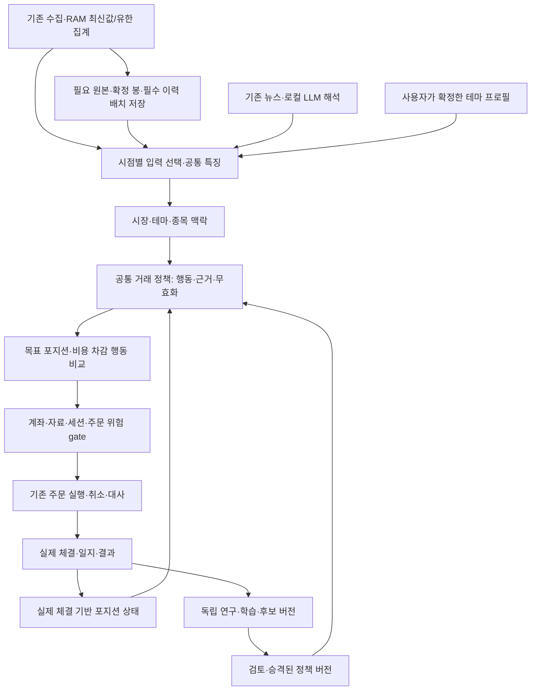

# AI Trading Intelligence 전체 설계와 재구성 판단

작성: 2026-10-13 · 제품 2.1.0 · 상태: **선택을 위한 설계안, 구현·배포 승인과 구분**

후속 승인으로 기존 돌파 경로의 첫 판단 소비 연결과 고정 입력 비교를 완료했다([22절](#22-r1-첫-돌파-판단-소비-연결)). 아래 R0의 정적 조사·미실행 기록과 이 후속의 검증 범위를 구분한다. 전체 목표 구조·새 판단 기능·저장 최적화·운영 전환의 완료를 뜻하지 않는다.

추가 후속으로 복구/주문 승인 저장 전 불변 근거의 좁은 조회 API와 첫 왕복 감소를 구현했다([23절](#23-r2-불변-승인-근거의-좁은-조회)). R2 전체 저장 최적화와 실제 PostgreSQL 부하/장중 지연 수락은 남는다.

checkpoint 후속에서 실제 COMMIT 실패/ACK 유실·동일 저장·종료 순서를 재현해 기존 runner의 재시도와 owned drain을 보완했다([24절](#24-r2-checkpoint-저장-실패noop종료-순서)). 실제 운영 수락과 전체 R2 성능 검증은 별도다.

## 현재 R4의 정책별 자료 요구조건

2026-10-15 후속 계약이다. 기존 v1 테마/타점 정책을 바꾸지 않고 `paired-net-action-selection/v2`가 필수 자료를 명시한다. 기존 공통 판단 엔진과 native Risk adapter에서 요구/가용/결측을 구분하며, 선언하지 않은 맥락의 부재를 차단 사유로 쓰지 않는다. 가격과 기존 R3 판단 생산자를 재사용하고 미연결 theme/news/turnover 생산자를 가용으로 간주하지 않는다. 계좌·미해결 주문·자금/비용·Risk·source/venue/가용시각/TTL 검사는 공통 경계이며 하드 보호가 EV와 자료 결측보다 우선한다.

R4가 테마/타점 판단을 요구하지 않으면 기존 Runtime에 테마 monitor 없이 연결할 수 있다. 같은 Collector RAM 가격과 계좌 관측·선택 기록을 재사용하며, 선택 준비/시작/복원에서 불필요한 테마 DB 조회나 시장·테마 계산을 요구하지 않는다. 독립 엔진/계좌 owner/수집/저장 경로는 추가하지 않는다. 현재 관측과 과거 고정 연구 결과의 권한은 계속 구분한다.

상위 비중 점수의 요구조건은 사용하는 가중치에 따른다. 미사용 점수의 결측은 null로 보존하고, 사용 점수의 결측은 차단한다. 테마 집중 위험은 점수 사용 여부와 독립적으로 소속 정보를 요구한다. 현재 native 상위 adapter의 leadership/context 품질 경계 분리와 현재 study 양의 지원 판정은 잔여 범위다. 이 계약으로 없는 맥락·EV 근거를 합성하거나 현재 모델을 승인하지 않는다. 정확한 외피는 [API_CONTRACT](../API_CONTRACT.md), 실행·검증 상태는 [CURRENT_STATUS](CURRENT_STATUS.md)에 둔다.

현재 v2의 선택 행동별 자료 행렬은 공통 요구에 후보별 추가 요구를 더한다. 요구한 후보의 결측/타점 제약/TTL이 다른 후보를 제한하지 않으며 기준 HOLD와 하드 보호의 우선순위는 유지한다. 상위 비중의 가중치0 소비자는 기존 owner 소속 자료와 사용 점수 구성요소의 시각/TTL을 분리한다. 불변 정책 DTO·기존 입력 adapter/선택/Runtime 경계에서 구현하고 독립 엔진·수집·저장을 만들지 않는다. 실제 상태는 [CURRENT_STATUS](CURRENT_STATUS.md)에 둔다.

## A03 설계 재검토

### ASTRA 설계 재검토 필요

**권고 모델·추론**
- GPT-6 Astra High. 현재 실행 기록은 GPT-6.1 Sol High이며 자동 전환하지 않았다.

**현재 문제**
- 00 ③9.2의 V(s,a)는 현재 상태뿐 아니라 지정한 미래 정책·기간의 순가치다. 현재 v2 원본은 등록 Family/Paper 분봉 실행 가정의 짝 결과이며 native Risk/미체결 후속 정책과 같은 미래 정책이라는 검증 계약이 없다.
- source_continuation은 code_hash/family/policy_version/parameters/execution_model/session_profile을 갖는다. 현재 runner_state에는 native_risk_limits/protection_review/session_clock 등이 있지만 과거 case proof에는 대응 기록이 없다. 현재 정상 Risk나 같은 Family를 역사 정책 지원의 증거로 복사하면 안 된다. 과거 명시 REENTER는 native 쿨다운 해제 권한도 아니다.
- current_goal_binding은 EV_UNAVAILABLE를 유지한다. 이를 양의 현재 모델 지원 경로로 바꾸려면 현재 상태·필수 자료·규모·모집단/원본 독립성과 미래 정책 지원을 어떤 의미로 승인할지 정해야 한다. 임의 가격/수량 보간·확률 변환·차단 상수 제거는 해법이 아니다.

**관련 영역**
- `application/position_target.py`: PositionActionStudyPolicy/context_support_rule, position_action_study_spec, native 상태 검증, 이번 A01 행동별 자료 요구.
- `application/research_evaluation.py`: read/decode_position_action_study_publication, historical context 재생, audit_position_study_ev_lineage. 동시 날짜 창은 보수적 REPORTED_OVERLAP이며 독립성 확정이 아니다.
- `central_server/market_theme_shadow_inputs.py`: decoder→상위 비중→하위 goal→position_study_current_goal_binding. 현재 비교의 null과 과거 COHORT_COMPARABLE을 구분한다.
- `application/research_execution.py`의 Paper 미래 경로와 `central_server/mock_automation_runner.py`의 보호/목적별 미체결/쿨다운 경로. 기존 owner/공통 판단·Risk·취소/대사를 재사용해야 한다.
- [원본 계약 대조](../data/diagnostics/20261015-capability-context-support/source-contract-audit.json)·[검증](../data/diagnostics/20261015-capability-context-support/verification.json). 실계좌/모의 브로커 전송 또는 운영 수락은 수행하지 않았다.

**기존 설계를 그대로 유지할 경우**
- 장점: 미지원 과거 연구를 native 판단으로 승인하지 않고 보호·UNKNOWN·원래 TTL을 보존한다.
- 문제: 충분한 현재 지원조건을 갖춘 별도 모델이 들어와도 모든 비교가 null인 구조를 유지한다. 이를 A03 완료로 셀 수 없다.

**가능한 대안**
- A: 동일 기존 receipt/판단 경계에서 조건부 연구 지원과 native 실행 적용 지원을 명시적으로 구분한다. 검증된 선언 범위의 Shadow 추정은 보여주되 native 미래 정책/권한이 미지원이면 실제 적용은 차단한다. 조건부 현재 상태 지원과 규모/표본/독립성 검사를 실제 근거로 계산해야 한다.
- B: 기존 연구 실행에 공통 Risk와 목적별 미체결/후속 정책을 재사용해 native 적용을 비교할 새 명시 연구 프로파일을 만든다. 원본 v2를 재표지하지 않고 해당 프로파일을 실제 생성·재생한 새 원본만 적용 후보로 삼는다. 별도 전략 엔진 복제는 금지한다.
- 두 대안을 연결하더라도 단일 지원 상태에 의미를 섞거나 신규 연구 전체를 모든 전략의 필수조건으로 강제하지 않는다.

**현재 추천안**
- A의 지원 상태/결과 계약을 먼저 정하고 B는 native 미래 정책 적용을 필요한 범위에서 구현한다. 개발 완료와 운용 승인을 분리하고 existing Risk/Execution을 우선한다. 이 안은 설계 권고이며 양의 native 모델 적용을 구현/승인하지 않았다.

**Astra가 판단해야 할 핵심 질문**
- 기존 Paper 짝 EV를 현재 Shadow에 어떤 명시 상태·자료·규모·후속 정책 범위에서 사용할 수 있고 어떤 값은 계속 null이어야 하는가?
- A01의 정책/행동별 필수 자료와 A03의 모델 지원 선언을 어떻게 연결하며, exact-observed-context/v1을 어떤 범위로 보존할 것인가?
- 미래 Risk/미체결/REENTER 정책의 연구·native 동등성을 어디에서 검증할 것인가? 단일 공통 기능을 재사용하면서 source 원본/독립성·scope/TTL과 실제 주문 권한을 어떻게 분리할 것인가?

판단 후 일반 구현·검증은 GPT-6.1 Sol High로 복귀한다. A04는 사용자 지정에 따라 뒤로 유지한다.

## 1. 결론과 조사 범위

**현 단계의 우선 권고는 기존 앱/자료 보존 + 저장·판단·UI 소비 경계의 선택적 재조립이다.** 단순 파일 분리로 끝내지 않고 종합 판단 계산과 업무 단위 저장 API를 새 계약으로 구성한다. 작은 신규 구조의 비교 prototype은 참고안이자 선택 근거를 확인할 방법이며, 사용자가 새 앱 개발을 결정한 것으로 취급하지 않는다. 기존 경로와 새 경로를 같은 작은 입력으로 비교해 재조립 또는 신규 전환을 판단한다. 현재 증거만으로 전체 기능을 처음부터 다시 만드는 편이 더 효율적이라고 결론내릴 수 없다.

추가 사용자 요구를 반영해 **기능이 늘어도 변경이 해당 기능 안에 모이는 구조**를 핵심 완료 기준으로 삼는다. DB·메인 파일 분리만 반복하지 않고 저장 API·데이터 책임·UI/서버의 소비 계약까지 재구성한다. 확장 구조는 18~19절, 저장 효율을 처음부터 설계하는 원칙은 20절에 있다. 전체 운영 기반 보존은 현재 거대 QueryStore/복합 repository의 모든 소비 방식을 그대로 유지한다는 뜻이 아니다.

사용자가 추가한 [작은 모듈형 모놀리스 원문](archive/2026-10-13/user-proposed-modular-monolith.txt)의 작은 시작·목적별 저장·공통 실시간/Replay 계산·두 실행 모드·단일 매매 비교를 반영했다. 아래 목표 계약은 최종 제품 방향이며 첫 prototype이 이 전체를 구현해야 한다는 뜻이 아니다.

추가 설명에 따라 **DB 부하 녹화/Replay는 독립 진단 도구**로 분류한다. 새 구조의 첫 비교는 고정 작은 입력의 처리 경로이며, 새로운 녹화/Replay 시스템을 먼저 만드는 단계가 아니다. 전략 백테스트·공통 계산 재현·DB 부하 Replay의 목적을 구분한다(21절).

| 판단 기준선 | 확인한 범위 |
|---|---|
| 로컬 소스 | main HEAD `232737d33b3c1ac438a3e7dc3e3123817d19a868`, 통합 소스 커밋 `3180f04`. 시작 시 앞선 검사 2파일·문서 3파일의 미커밋 변경을 보존했다. |
| 실제 구조 조사 | `src/kiwoom_monitor` Python 380파일 정적 목록·지문·AST 확인, 책임별 26모듈 import/정의 목록. 대표 실행·연구·자료·테마·수명 경로와 원래 통합 명세 대조. 파일 수는 품질 평가나 재개발 필요성의 점수가 아니다. |
| NAS 상태 | [현재 상태](CURRENT_STATUS.md)의 05:32~05:37 KST 읽기 기록을 참조했다. 이번 설계 작업은 NAS에 접속하거나 실행 상태를 다시 측정하지 않았다. 로컬 통합본과 운영 recorder v3를 구분한다. |
| 검증의 한계 | 정적 구조 검토다. 전체 함수의 동작 감사·새 구현 검증·성능 측정·실제 주문 수락은 수행하지 않았다. 새 구조의 속도·용량 개선 수치나 개발 기간을 추정 사실로 제시하지 않는다. |
| 근거 | `artifacts/architecture-review-20261013/source-inventory.json`, [현재 아키텍처](../ARCHITECTURE_CURRENT.md), [모듈 지도](../MODULE_MAP.md), 아래 실제 호출 경로. |

이 문서는 목표 구조와 선택 근거의 정본이다. 현행 실행 구조는 ARCHITECTURE_CURRENT, 진행 상태는 CURRENT_STATUS, 실제 보류는 OPEN_ITEMS, 단계 순서는 FUTURE_DEVELOPMENT_ROADMAP에 둔다. 같은 진행 로그를 여러 설계 문서에 누적하지 않는다.

## 2. 제품 목표를 다시 고정한다

[원래 통합 명세](archive/2026-09-22/references/00_전체통합_AI_Trading_Intelligence.md)의 중심을 유지한다. 시장과 재료를 관측하고 매매 가능한 후보를 좁힌 뒤, 근거·무효화 조건·비용·위험을 가진 행동을 제안하며, 승인된 정책만 기존 주문 경로로 실행한다.

| 사용자에게 제공할 기능 | 목표 결과 | 현재 기준에서 필요한 작업 |
|---|---|---|
| 시장 판단 | 지수 방향·참여·집중·거래대금·자료 품질을 함께 표시 | 기존 시장 특징을 실시간 입력과 연결. 단일 강세 점수로 모두 압축하지 않음 |
| 테마·대장 판단 | 활성 테마, 실제 가격/거래대금 반응, 대장과 차선 후보·근거 | 기존 프로필·별칭·대장 계산 재사용, 실제 구성원 coverage 확인 |
| 종목 시나리오 | 전일 연속성·현재 관측·확인/반증·유효기한 | 기존 맥락 가설과 신규 관측 연결, 사실과 해석 분리 |
| 타점·보유 판단 | WAIT/ENTER/HOLD/ADD/REDUCE/EXIT/REENTER와 무효화 근거 | 새 공통 정책 계산부. 현재 ENTER/EXIT 실행 지원을 조용히 확대하지 않음 |
| 비용 차감 행동 비교 | 행동별 기대값, 표본·불확실성·추정 한계 | 결과가 완결된 사례를 이용해 별도 모델 구현·평가. 규칙 점수를 승률로 표시하지 않음 |
| 포지션 제안 | 시장·테마·종목 특성과 EV·위험·유동성을 반영한 자동 목표 비중, 실제 보유·미체결을 고려한 변경량 | 원래 Position·Risk·Capacity/Liquidity 정책을 후속 구현. 현재 목표 금액·수량 계산은 그 하위 기능 |
| 실행·보호 | 모의 주문·부분체결·취소·중지·대사·재시작 | 기존 계좌 owner·위험 gate·주문 원장을 유지하고 연결 검증 |
| 복기·학습 | 당시 판단과 이후 결과·사용자 수정, 후보 버전 비교 | 기존 일지·피드백·연구 원장 활용. 자동 학습과 운영 승격 분리 |

최종 비중조절은 원래 통합 명세의 [Position](archive/2026-09-22/references/00_전체통합_AI_Trading_Intelligence.md#11-position-목표-노출과-분할-경로)·Risk·Capacity/Liquidity 설계를 따른다. 시장·테마·종목의 특성, 시총·거래대금·유동성·변동성·비용 차감 EV·불확실성·위험을 종합해 목표 비중을 자동 결정한다. 사용자가 종목마다 투자금액을 직접 정하는 방식을 최종 목표로 삼지 않는다. 현재 bounded 원화 목표·수량 변환은 하위 기능으로 유지하며, 상위 정책이 목표 노출을 제안하고 Risk가 불리한 미체결 조합·포트폴리오 한도를 제한하고 Capacity/Liquidity가 전체 출구 가능성을 검사하는 연결은 후속 단계에서 구현한다. 이번 R4 행동 권고 단계로 범위를 확대하지 않는다.

뉴스 엔진의 수집·본문·분석 개발은 기존 독립 범위를 유지한다. 전체 설계에는 뉴스의 소비 계약을 포함하되, 새 뉴스 엔진 완성을 모든 기능의 선행 조건으로 두지 않는다. 로컬 LLM 목표를 보존하며 외부 공급자로 자동 대체하지 않는다. 현재 외부 AI 경로가 존재한다는 사실과 목표 로컬 LLM의 구현 완료를 구분한다.

## 3. 현재 코드에서 확인한 연결과 빠진 연결

| 실제 경로 | 확인한 사실 | 구조 판단 |
|---|---|---|
| `bootstrap.py → MainWindow/AppController → owned worker/writer` | Qt 화면·자식 프로세스·로컬 저장과 종료 drain이 있음 | 화면 프레임워크와 수명을 전부 재개발할 근거 없음. 새 판단 화면은 기존 client/worker에 연결 |
| `central_server/app.py → CentralRestBroker/CentralRealtimeCollector → QueryStore` | NAS 수집·저장·서비스 시작/종료를 app이 조립 | 수집을 새 정책 실행기에 복제하지 않음. 정책은 저장 자료를 소비 |
| `research_factors.py → market_research_features.py/theme_leadership.py` | 시장·테마 계산과 missing 정책이 등록돼 있음 | 연구 구현을 보존. 현재 두 Family의 필수 입력과 실시간 운용 연결을 추가해야 함 |
| `context_candidates.py → ResearchRepository` | 맥락 가설·시점·상태·불변 저장 계약이 있음 | 기능이 전혀 없다는 앞선 표현은 과도함. 구현된 계산·저장과 운용 연결 완료를 구분 |
| `CandidateMonitor._consume → evaluate_breakout_bar` | 입력은 `top20_membership/minute_bar`, 돌파를 직접 호출 | 현재 Shadow와 자동 runner의 전략 선택 방식이 다름. 공통 정책 소비 경로로 맞추는 대상 |
| `scripts/run_research.py → family.evaluate_bar → PaperExecutionEngine` | 같은 Family 계산을 사용하며 역사 체결·비용은 Paper 엔진이 소유 | 계산을 재사용할 기반이 있음. 역사 체결과 증권사 체결을 같다고 선언하지 않음 |
| `MockAutomationRunner._consume → family.evaluate_bar → dispatch_mock_automation_decision_from_risk` | Family는 돌파·눌림 두 개, 분봉·순위 입력. 실행은 ENTER/EXIT에 한정 | 전체 Intelligence의 실시간 행동·포지션 계약은 현재 경로로 표현되지 않음 |
| `dispatch → ExecutionRuntime → OrderLifecycle → ExecutionRepository/QueryStore/transport` | 결정 gate, 제어 revision, owner, 멱등 intent, 제출 전 UNKNOWN 영속화가 있음 | 단순 전달 계층이 아님. 새로 복제하거나 검증 전 제거하지 않음 |
| `broker FILL → runner 상태/위험 대사 → 일지 projection` | 실제 체결과 전략 상태를 대조하고 중복 체결을 제외 | 이 결과의 소비 방식을 새 정책에 연결. 신호 발행으로 보유량을 변경하지 않음 |

근거 파일: [Family](../src/kiwoom_monitor/application/research_families.py), [Shadow](../src/kiwoom_monitor/central_server/candidate_monitor.py), [자동 runner](../src/kiwoom_monitor/central_server/mock_automation_runner.py), [연구 실행](../scripts/run_research.py), [전송 gate](../src/kiwoom_monitor/application/mock_automation_execution.py), [주문 수명](../src/kiwoom_monitor/application/order_lifecycle.py).

확인한 문제는 **계산·저장 조각에 비해 종합 판단의 소비 경로가 좁고, 기능 개발과 운영 진단의 완료 조건이 섞였다는 점**이다. 파일 수·계층 이름·실행 지연만으로 전체 코드가 잘못 설계됐다고 단정하지 않는다. 실제 COMMIT 지연의 원인은 이 정적 검토로 확정하지 않았다.

## 4. 세 가지 개발 방식 비교

| 기준 | 기존 구조 그대로 보완 | 선택적 재조립 + 새 판단 계산부 | 전체 신규 개발 |
|---|---|---|---|
| 원래 Intelligence 목표 | 현재 Family에 기능을 계속 붙여 복잡성이 누적될 가능성 | 입력·판단·비중·실행 경계를 명시적으로 연결 | 자유롭게 설계 가능하지만 모든 경계를 다시 구현 |
| 기존 데이터·계좌·API | 변경 적음 | 대부분 유지, 새 판단 계약과 필요한 reader만 추가 | 자료·revision·ID·프로필·일지·비밀·API 호환 이전 필요 |
| 중복 구현 | 기존 곳곳에 새 조건이 흩어질 위험 | 계산부 한 곳, 모드별 I/O만 구분 | 이전/신규 시스템 병행 동안 중복 수집·owner 위험 관리 필요 |
| 빠른 기능 확인 | 작은 기능은 빠름, 전체 연결은 계속 후순위일 수 있음 | 주문 없는 첫 연결을 기존 자료로 만들 수 있음 | 새 앱·수집·저장·인증까지 준비하면 첫 확인이 늦어질 가능성 |
| 검증 부담 | 변경된 기존 경로 위주 | 새 정책과 이전/신규 연결 경계 위주 | 기존 동작을 모두 재확인하고 데이터 이전도 검증 |
| 운영 전환 | 부분 배포 | Shadow → 단일 owner 전환 → 옛 소비 경로 정리 | 새 시스템 구축·자료 대사·운영 전환·복귀 수단 필요 |
| 추천 | 작은 결함 수정에 사용 | **작은 prototype으로 먼저 확인할 우선 가설** | 아래 재개발 조건이 실제 확인되면 재평가 |

추천안은 새 코드의 범위를 판단 계산과 그 소비 경로에 집중한다. 기존의 전달만 하는 코드를 무조건 남기는 방식도 아니다. 독립 책임이 없는 중복 orchestration은 실제 소비자를 전환한 뒤 제거한다. 코드 이동·이름 변경만으로 새 아키텍처 완성을 주장하지 않는다.

### 전체 신규 개발을 선택했을 때의 구체적 범위

목표의 책임 구분은 아래 5절과 같다. 차이는 구현을 새 저장소에서 시작해 기존 collector/broker/store/owner/UI 코드를 이식하지 않고 다시 만든다는 점이다. 단계는 새 자료 조회·수집/저장 → 시점별 입력/공통 정책 → 계좌 신원/위험/주문 원장 → UI/연구/일지 → 운영 전환 순서가 된다. 기존 시스템은 전환 완료까지 운영·원본 보존 역할을 유지한다.

새 시스템에서도 원본 ID·가용시각·accepted sequence·사용자 프로필·체결 계보를 유지해야 한다. 새 DB를 선택하면 필드별 이전표와 이전/신규 reader 결과 대조, 사용자 편집·복원·백업을 구현해야 한다. 실계좌 연결 없이 새 broker/owner를 검증하고, 실제 전환에서는 한 계좌의 주문 owner와 한 시세 담당만 활성화한다. 두 시스템이 같은 계좌로 수집/주문하는 병행을 기본값으로 두지 않는다.

같은 위험·원본·불확실성을 다시 구현해야 하므로 새 저장소가 검증 부담을 없애지는 않는다. 새 UI 기술이나 DB를 바꾸는 것은 전체 신규 개발과도 별도의 선택이다. 현재 자료만으로 새 언어/웹 프레임워크/DB가 더 빠르거나 단순하다는 근거는 없다. 계좌·체결 자료의 이전까지 필요 없는 계산부만 새로 만들고 기존 I/O를 쓰는 방안은 전체 신규 개발이 아니라 추천한 선택적 재조립에 해당한다.

## 5. 목표 시스템 구조

배포 단위는 기존 NAS 서버 + Windows 앱 + 실제 필요한 독립 작업자를 기준으로 한다. 독립 PC 모드에서는 PC worker/SQLite를 선택한다. 서버/worker는 하나의 실행 단위 안에서 책임을 나눈 모듈 구조로 출발한다. 서비스별 HTTP, 메시지 브로커, 새 DB, 범용 플러그인 프레임워크를 선행 구축하지 않는다.



| 책임 | 계산/상태 소유자 | 실행 위치 | 하지 않는 일 |
|---|---|---|---|
| 수집·원본 | 기존 broker/collector/native store | NAS, 과거 수집은 기존 PC 도구 | 전략이 직접 TR·웹 수집을 시작하지 않음 |
| 시점별 입력·특징 | 명시한 입력 cut과 특징 계산 함수, 소비자의 유한 window | NAS 실시간/PC 연구 | 원본 수정, 미래 정보 결합, UI별 중복 계산 |
| 의미 맥락 | 기존 시장/대장/맥락 함수와 사용자 승인 테마 revision | 빠른 계산 NAS, LLM 독립 worker | LLM이 주문 수량·권한을 확정하지 않음 |
| 거래 정책 | 버전 고정 계산 함수 + 실제 체결로 갱신한 정책 상태 | 연구·Shadow·모의의 공통 함수 | DB·네트워크·Qt·전역 host 시계에 직접 의존하지 않음 |
| 포지션 정책/EV | 행동별 평가와 목표량 산출 함수 | 공통 계산부 | 미확인 확률 생성, 미체결을 없는 주문으로 취급 |
| 위험·실행 | 기존 runtime owner, control CAS, 원장, gateway | 선택한 NAS/PC worker 계좌별 단일 owner | 새 정책이 native gate를 우회하지 않음 |
| 결과·학습 | 실제 체결/일지와 연구 repository | NAS/PC 기존 경계 | 사후 모델이 당시 결정·사용자 기록을 덮지 않음 |
| 표시·조작 | 기존 Qt client/worker와 인증 API | Windows | 화면 자체가 주문 신호나 별도 계좌 owner가 되지 않음 |

논리 책임 표는 새 Service/Manager 클래스를 각각 만들라는 지시가 아니다. 독립 상태·수명·저장 경계가 없으면 함수와 작은 자료형으로 둔다. 초기 구현의 새 정책 파일은 `application/trading_policy.py` 같은 한 진입점을 후보로 삼되, 이름과 위치는 첫 연결 단계에서 기존 계약과 대조해 확정한다. 아직 생성된 파일이나 구현 계약이 아니다.

이 그림의 화살표는 데이터 의존 관계다. 시장·테마·뉴스 분석은 독립적으로 최신 결과를 갱신하고 타점/포지션 계산은 해당 시점에 가용하고 유효한 결과를 읽는다. 분석이나 LLM을 매 주문마다 직렬 호출하지 않는다. 보호 시계·계좌 대사와 신규 위험 차단은 이 분석 작업의 완료를 기다리지 않는다.

## 6. 데이터 원본과 저장 책임

| 자료 | 원본/책임 | 새 구조의 소비 방식 |
|---|---|---|
| NAS 시세·순위·시장/계좌 관측 | 기존 중앙 PostgreSQL/native writer, observation revision/ACK | 해당 source revision과 시점 cut을 참조. 새 전체 복제 DB를 기본값으로 만들지 않음 |
| PC 직접/장애전환 시세 | 기존 로컬 store와 source/route provenance | 중앙 정상 자료와 구분. 자동매매는 검증한 서버 입력 경계를 유지 |
| 사용자 테마·설정 | 기존 로컬 프로필/편집 원장, NAS 수락 snapshot은 별도 게시 상태 | 사용자 편집과 NAS에서 가용한 revision을 구분. 현재 테마를 과거에 소급하지 않음 |
| 뉴스 | 기존 기사/본문/AI/사건 revision, 과거 archive는 봉인된 별도 파일 | 시각·version·hash가 고정된 reader로 소비. 현재 수집과 과거 archive를 합쳐 다시 쓰지 않음 |
| 판단·계산 결과 | 기존 불변 연구/후보 저장 경로 우선 | 원본/특징/정책 참조와 작은 결과만 저장. 새 출력이 기존 계약에 담기지 않을 때만 명시적 저장 계약·마이그레이션 |
| 주문·체결·잔고 | 기존 execution ledger와 broker 대사 | 실제 수량의 권위는 여기에 유지. 정책 checkpoint는 복구용 projection |
| 학습 자료·모델 | 완료 결과의 불변 입력 manifest와 후보 model artifact | 개발·검증·final 접근과 승격 원장 분리 |
| 비밀 | 기존 PC 암호화 저장소와 NAS vault | 새 일반 DB·판단 결과·모델 입력·일지에 복사하지 않음 |

모든 자료를 PostgreSQL 하나에 합치거나 모든 SQLite를 없애는 것을 효율화 목표로 두지 않는다. 다중 DB를 한 순간의 원자 snapshot이라고 주장하지 않는다. 입력별 cut과 가용시각, 서버에서 수락한 revision을 명시한다. 공유 NAS SQLite를 여러 PC가 직접 여는 방식은 유지하지 않는다.

### 목적별 저장과 두 모드

| 목적 | 목표 저장/소비 방식 | 보존·품질 조건 |
|---|---|---|
| 화면용 최신가/일시적 강도 | RAM 최신값과 유한 집계 우선 | stale·source generation·끊김을 표시. 재시작 후 이전 RAM 완전 복원을 주장하지 않음 |
| TOP20 변경·편입/이탈 | 의미 있는 변경/정해진 주기의 유한 batch | 당시 집합과 시각/불변 revision 보존. 중간 의미 사건을 최신값 병합으로 잃지 않음 |
| 완료 1분봉·지원 초봉 | 기존 확정/수신 집계 계약에 따라 배치 | 완료/부분·원본 해상도·venue·ACK 구분. 선언한 관측 범위의 유실 감지 |
| 5분/60분 등 파생 집계 | 지원 원본에서 계산하고 필요한 cache만 저장 | 원본 revision과 단위/창을 보존. 실제 공급자 5분 원본과 파생 집계 구분 |
| 결정·주문·체결·계좌 원장 | 실제 업무 경계의 높은 내구성 저장 | 주문 전 필수 결정/UNKNOWN·owner/control 근거와 실제 체결 보존 |
| 경량 계측 | 단계 시간·대기/queue·유실/실패 카운터 | 민감 payload 전체 녹화를 기본값으로 하지 않음 |
| 장중 부하 녹화/DB Replay | 기존 별도 진단 도구를 필요할 때 사용 | 진단 실패/누락을 표시. 새 앱 정상 운용의 필수 구성요소로 이식하지 않음 |
| 연구/백테스트 결과 | 기존 운영 경로 밖의 자료/결과 영역 | 과거 원본·정책/비용/입력 manifest 참조, 조건별 전체 DB 복제 최소화 |

실시간 계산 입력을 매번 DB에서 다시 읽지 않는다. 생산자가 확인한 RAM 자료는 값·시각·품질·source identity로 계산부에 전달한다. 내구성이 필요한 결정/주문 근거는 명시 저장/ACK를 거치고, 큰 전체 원본 녹화와 구분한다. 실패한 저장을 RAM 존재만으로 durable이라고 표시하지 않는다.

NAS 모드에서는 NAS PostgreSQL이 중앙 자료/계좌 실행의 주 저장소이고 PC는 표시·사용자 편집·필요 cache를 유지한다. NAS 미사용 모드에서는 PC SQLite와 PC의 독립 worker/runtime을 주 실행 경계로 설계한다. 상위 계산과 좁은 store 계약은 같고, 실제 backend·입력/계좌 owner는 composition에서 하나만 선택한다. UI가 멈춰도 worker가 계속 처리할 수 있도록 UI와 실행 수명을 구분한다.

PC가 PostgreSQL 파일/비밀에 직접 접근하는 방식은 아니다. NAS 조회는 기존 인증 API, 독립 PC worker는 로컬 SQLite/기존 키움 전송 adapter를 사용한다. 동일 시장 원본의 NAS/PC 이중 canonical write를 기본값으로 두지 않는다. 모드 전환은 실제 writer/주문 owner를 정지·drain·대사한 뒤 명시적으로 인계한다. NAS 장애가 자동으로 PC 주문 owner를 켜지 않는다. 현재 PC 직접/장애전환 계좌 identity의 잔여가 있어 이 독립 자동운용 목표를 구현 완료로 표시하지 않는다.

## 7. 공통 입력과 출력 계약

아래는 목표 계약이다. 기존 공개 API·DB 필드의 이름을 즉시 바꾸라는 지시가 아니다. 기존 자료형의 표현 가능 범위를 대조한 뒤 필요한 부분만 새 버전으로 추가한다.

### 7.1 판단 입력

판단 한 회차는 `decision_time`, `trading_date`, `venue`, `session_profile`, 원본별 `source_revision/watermark`, 입력 참조, 특징/테마/모델/정책 version, 품질·누락 사유를 가진다. 큰 원문·봉 배열을 매 결정마다 복사하지 않고 유한 window와 immutable 참조를 사용한다.

`effective_at`은 자료가 묘사하는 시각, `available_at`은 소비 가능 시각이다. `available_at <= decision_time`인 자료만 사용한다. 장후 정정은 다음 계산을 위한 새 revision이고 이전 결정은 보존한다. 시각만으로 source completeness를 보장하지 않는다. 영속 자료는 native ACK/cut, RAM 입력은 source generation·유한 수신 순서·품질과 volatile 상태를 명시한다.

시장 특징은 전체 시장 관측인지 TOP20 관측 집합의 특징인지 표시한다. 일부 후보의 자료로 전체 시장 폭을 확정하지 않는다. 과거 거래대금 Top40, 사후 후보, 실시간 조회 TOP20은 별도 universe다.

### 7.2 맥락 출력

시장 상태·테마/대장 위치·종목 가설은 각각 `facts`, `inferences`, `evidence_refs`, `quality`, `available_at`, `expires_at`, `policy_version`을 제공한다. 확정 별칭·사용자 병합/분리 원장을 먼저 적용한다. 동일 테마의 별칭은 중복 집계하지 않고, 다른 테마 간 종목 중복도 전체 시장 합계와 구분한다.

기존 H1 시장 Factor/H2 대장 Factor와 맥락 가설을 사용한다. H2가 요구하는 테마 구성원·연속 1초 관측이 부족하면 UNKNOWN/PARTIAL을 유지한다. 미수집 구성원을 0으로 채워 대장을 확정하지 않는다. 초기에는 표시/Shadow 결과로 연결해 기존 분봉 전략의 검증 범위를 보존한다.

### 7.3 거래 판단

출력은 `decision_id`, `policy_version`, `input_refs`, `symbol`, `action`, `reasons`, `invalidation_conditions`, `valid_until`, 정책 상태 참조를 가진다. WAIT·매매할 후보 없음도 정상 출력이다. 신규 위험 확대에 필요한 근거가 누락되면 확대하지 않고, 기존 보유의 보호 절차는 계좌/위험 owner가 별도로 수행한다.

공통 정책은 연구·Shadow·모의에서 같은 입력과 같은 정책 상태를 받으면 같은 판단을 반환해야 한다. 실행 환경마다 전략 조건을 복제하지 않는다. broker 지연·역사 체결 모델·실제 FILL 순서가 다르면 이후 포지션 상태가 달라질 수 있으며 전체 손익 일치를 요구하지 않는다.

새 정책 진입점의 목표 형태는 `evaluate_policy(inputs, policy_state, config) → evaluation`이다. 기존 두 Family의 `evaluate_bar`와 결과 형식은 그대로 보존하고 새 Family/계약 버전에서 추가 입력을 명시한다. 현재 함수에 임의 keyword를 넣거나 뉴스·테마를 전역 상태로 숨겨 전달하지 않는다. 연구 adapter는 고정 입력/가상 시계, 실시간 소비자는 저장된 현재 cut/서버 시계를 제공한다. 이 adapter는 실제 입력 변환과 source/time 경계를 맡으며 전달만 하는 추가 계층으로 만들지 않는다.

### 7.4 목표 포지션과 주문 의도

목표는 원화·수량·기준 순자산을 명시한다. `현재 실제 수량 + 확인된 미체결 매수 - 확인된 미체결 매도`와 목표량을 비교하고 예약 자금·비용·체결 불확실성을 함께 본다. UNKNOWN 주문은 확정 예정 체결로 계산하지 않으며 새 위험 확대를 차단한다. 목표량이 미정이면 `null/UNKNOWN`이고, 목표 0으로 바꿔 자동 청산하지 않는다.

첫 실행 연결은 기존 지원 ENTER/EXIT·단일 포지션·KRX 정규장 지정가로 제한한다. ADD/REDUCE/REENTER와 노출 기반 비중은 먼저 Shadow에서 표현하고, 계좌/제어/멱등 계약을 새 버전으로 확장한 뒤 실행한다. 기존 v1 gate가 지원하지 않는 행동을 ENTER/EXIT로 이름만 바꿔 통과시키지 않는다.

새 정책 출력과 기존 StrategyDecision/gate 사이에는 결정 원본 참조·입력/정책 hash가 보존되는 명시적 변환이 필요하다. 현재 구조에 표현할 수 없는 필드를 버려 이전 승인 identity를 재사용하지 않는다. 새 기능 단계에서 출력 계약과 필요한 additive 저장/reader·gate version을 함께 확정한다. 기존 게시 후보·명세·과거 결정은 변환 완료 전에 새 정책으로 실행하지 않는다.

같은 결정·목표를 반복 소비해도 intent가 증가하지 않아야 한다. 목표 revision은 계좌·정책·종목·입력 참조에 결합한다. 취소가 terminal로 확인되기 전에는 대체 주문이 중복 노출을 만들지 않게 한다.

### 7.5 실행 결과와 복기

제출·접수·부분체결·취소 요청·취소 확정·체결 완료는 별도 사건이다. 주문 발행을 청산 완료로 표시하지 않는다. 실제 FILL 식별자로 수량을 갱신하고 중복을 제외한다. 실제 비용 확인 여부와 연구 비용 모델을 구분한다. 일지에는 당시 결정·입력·실제 체결 참조를 연결하고 이후 해석을 별도 revision으로 붙인다.

### 7.6 미체결 주문 관리 정책

**R4 이후 실행 연결의 필수 설계 범위다. 57단계에서 목적별 순수 선택/고정 CLI를 검증했으며 실제 owner의 자동 가격 변경·재주문/영속 계획 연결은 아직 미구현이다. 이는 주문 활성화가 아니다.** R4의 높은 관측 EV가 실행 허가나 손절 유예 근거가 되지 않는다. 기존 공통 판단·Risk·Execution 경계를 유지하고, 주문 목적별 정책을 같은 owner 안에서 구분한다. 매매법마다 별도 주문 엔진·원장·계좌 조회기·WebSocket을 만들지 않는다.

#### 세 가지 목적과 우선순위

| 정책 목적 | 조건부 관리 흐름 | 우선 판단 기준 |
|---|---|---|
| 매수 진입·추가·재진입 | WAIT / REPRICE 검토 / CANCEL·WATCH / ABANDON | 현재 타점 유효성·기회 유효시간, 비용/슬리피지 차감 EV와 불확실성, 자금·노출 한도. 기회가 사라지면 잔여 매수를 포기할 수 있음 |
| 일반 익절 매도 | WAIT / REPRICE → 명시 목표의 REDUCE 또는 EXIT | 현재 추세/익절 조건·수익 확보, 잔여 보유 위험과 비용. 추세와 위험 여유가 확인되면 제한된 대기 허용 |
| 손절·위험 청산 | 긴급도 판단 → 미체결/실제 보유 확인 → 안전한 취소·재주문 → 실제 청산 확인 | 강제 위험 한도·손절/보호 조건·청산 기한 우선. 일반 EV 최적화보다 위험 축소 필요성을 먼저 판단 |

화살표는 항상 순서대로 실행하는 자동 체인이 아니다. 아래 조건으로 행동을 선택하며 REPRICE도 취소·대사를 거친다. 같은 SELL이라도 일반 익절과 보호 청산을 구분한다. 익절 주문 대기 중 손절·위험 한도가 발동하면 보호 정책으로 우선 전환하고 기존 주문/체결 identity를 유지한다. 새 매도를 겹쳐 제출하지 않는다. 부분 매수 체결분에 위험 조건이 발생하면 잔여 매수 중단과 실제 보유분 보호를 함께 판단한다. 매수 ABANDON이 이미 체결된 포지션을 없애지는 않는다.

#### 공통 입력과 행동 선택

한 decision cut에서 계좌/environment/venue·binding/control/owner revision, intent/run/broker 주문 ID와 목적·상태·원래/누적 체결/확인 잔량·취소 진행, 실제 보유/매도 가능 수량·전체 미체결·예약 자금·현재 목표를 연결한다. 최신 가용 타점/가설의 유효·무효화/만료, 승인된 현재 가격·가능하면 호가/스프레드·유동성, 세션/거래정지·상하한/지원 주문 유형, 비용 모델/슬리피지·관측 EV/불확실성·위험 한도와 긴급도를 같은 scope/시각의 근거로 받는다. 없는 호가·체결 확률·EV를 생성하거나 마지막 정상값을 현재 확정값으로 쓰지 않는다.

매수의 불리한 가격 이동은 `(후보 매수가 - 정책 기준가) / 정책 기준가`, 매도의 불리한 이동은 `(정책 기준가 - 후보 매도가) / 정책 기준가`로 방향을 구분한다. 기준가의 ref/시각을 고정하고 재주문마다 유리한 새 기준가로 바꿔 추격 한도를 초기화하지 않는다. spread·예상 충격·수수료/세금은 확인 가능한 범위에서 포함하며 미확인은 별도 사유다. 보호 매도는 위험 긴급도별 별도 허용 슬리피지/가격 한도를 사용할 수 있지만 승인된 정책 버전과 명시된 상한 안에서만 적용한다.

WAIT/취소/재주문/포기의 잔여 수량에 대한 비용·기회 손실·노출 지속 위험을 비교한다. 이미 발생한 체결 손익/비용을 다시 발생할 비용으로 더하지 않는다. R4의 HOLD 대비 관측 평균은 대기 시간/체결 조건이 같은 자료가 없으면 미체결 관리 행동의 EV로 재표지하지 않는다. 자료 부족은 EV_UNAVAILABLE이며 양수 EV·체결 확률 1로 대체하지 않는다. 허용 행동을 안전 조건으로 먼저 제한하고, 그 안에서만 타점·EV/불확실성·슬리피지와 위험을 비교한다. 보호 조건이 발동하면 EV가 높아도 매수/일반 익절 대기가 우선하지 않는다.

| 행동 | 매수 | 일반 익절 매도 | 손절·위험 청산 |
|---|---|---|---|
| WAIT | 타점 유효·기한/추격/위험 한도 안이고 기존 주문 유지가 허용될 때. EV 미확인은 짧은 유지의 사유를 남기며 추격 재주문은 금지 | 추세 유지와 노출 위험 여유가 확인되고 익절/세션 기한 안일 때 | 거래 가능/대사 확인을 위한 제한된 대기만 허용. 보호 기한/위험 한도 위반을 EV 개선 기다림으로 유예하지 않음 |
| CANCEL | 타점 무효·매수 기한/슬리피지/노출 한도 위반 또는 대체 주문을 준비할 때 | 목표/추세 변경 또는 더 적절한 청산 계획으로 교체할 때 | 기존 주문이 보호 목표와 충돌하거나 안전한 가격 교체가 필요할 때. 취소 자체를 위험 해소로 취급하지 않고 청산 계획/확인 기한을 함께 남김 |
| REPRICE/REENTER | 취소 확정 뒤 새 타점·EV/비용·자금/위험 조건이 통과한 잔여 목표에만 새 판단/intent 생성 | 취소 확정 뒤 현재 REDUCE/EXIT 목표의 잔여 필요량과 수익·위험/가격 조건을 다시 검증 | 취소 확정 뒤 현재 실제 잔여 보유를 보호 목표까지 줄이는 수량만 검증. 승인된 긴급도별 가격/슬리피지 정책 적용; EV 미확인만으로 보호 필요성을 해제하지 않음 |
| ABANDON | 기회 소멸·추격/재시도 예산 소진·비용 대비 이익 부족 시 추가 매수 계획 종료. 살아 있는 주문은 취소·대사까지 추적 | 익절 기회만 철회할 수 있음. 살아 있는 주문은 취소·대사하며 보유·보호 추적은 계속 | 실제 잔여 보유/미해결 주문·보호 의무가 있는 동안 자동 포기 금지. 불가능한 체결은 미해결 위험과 운영 개입 필요로 공개하고 추적 유지 |

WATCH는 CANCEL 뒤 기회를 관찰하는 부가 상태이며 broker 주문 상태나 다섯 번째 실행 명령이 아니다. ABANDON도 정책 계획 종료이고 CANCELLED/FILLED가 아니다. REPRICE/REENTER는 주문 관리 선택이며 R4 포지션 행동 REENTER와 다른 축이다. 부분 체결 뒤 추가 매수를 REENTER로 이름만 바꿔 기존 ENTER gate에 통과시키지 않는다. REDUCE/EXIT도 현재 목표 행동이고 체결 완료 상태가 아니다.

#### 취소·체결 경쟁과 재주문 불변 조건

1. QUEUED와 SUBMISSION_UNKNOWN은 살아 있는 미확인 의도로 취급한다. SUBMISSION_UNKNOWN의 응답 유실·시간 초과·재시작·새 decision/run ID·빈 미체결 조회를 미제출 증거로 쓰지 않는다. 정확한 계좌/주문 identity로 기존 대사/복구가 상태를 해소하기 전 같은 노출을 만드는 중복 제출을 금지한다. 다른 run/수동 주문도 전체 노출 계산에는 포함한다.
2. 확인된 ACCEPTED/PARTIALLY_FILLED만 기존 취소 기능에 넘긴다. CANCEL 요청 ACK/CANCEL_ACCEPTED는 CANCEL_PENDING이며 취소 확정이 아니다. CANCEL_PENDING·취소 응답 UNKNOWN에서 대체 주문·중복 취소를 보내지 않는다. 취소 거절은 기존 주문이 살아 있는 상태로 되돌아가 재평가하며 대체 주문 허가로 취급하지 않는다.
3. 취소 중 들어온 실제 FILL을 기존 execution ID로 중복 제외·대사하고 보유/누적 체결을 갱신한다. 취소 요청 수량이나 이전 로컬 잔량을 그대로 대체 주문 수량으로 쓰지 않는다. 재주문 전 해당 broker 주문의 CANCELLED 확정과 잔량 소멸·취소 이후까지의 체결/현재 잔고·계좌 전체 미체결/예약을 확인한다. 전량 FILLED면 replacement 계획을 종료하고 현재 포지션 판단으로 돌아간다. 로컬 expires_at 만료는 살아 있는 broker 주문의 취소 확정이 아니다.
4. 취소 확정 뒤에도 바로 보내지 않는다. 새 decision cut에서 현재 목표/보유·타점/위험·세션/가격·binding/control/owner와 미확인 주문 부재를 재검증한다. 매수는 새로운 목표 차이와 예약 후 자금, 매도는 실제 매도 가능 보유와 다른 미체결 매도 예약을 반영해 수량을 제한한다. 보호 매도도 보유보다 많이 팔거나 위험 감소 명분으로 주문 identity/권한 gate를 우회하지 않는다.
5. 한 parent intent/취소 확정 revision·현재 목표/정책 revision에 대해 한 replacement lineage만 허용한다. 반복 이벤트/ACK 유실/재시작은 같은 child intent를 조회·복구한다. child가 UNKNOWN이면 새 child를 만들어 재제출하지 않는다. 다른 decision ref로 멱등 키를 새로 만들어도 같은 계좌/종목의 미해결 노출을 우회할 수 없다. 네트워크 전에 기존 UNKNOWN 영속화와 owner/control fencing을 그대로 수행한다.
6. ABANDON/CANCEL/WATCH는 미확인/살아 있는 주문의 예약·복구 책임을 삭제하지 않는다. broker ID 없는 UNKNOWN을 가격/시각/수량의 추정 매칭으로 연결하지 않는다. 수동 주문·다른 run은 읽기 관측만으로 취소 권한을 얻지 않으며, 관리 owner 인계는 기존 명시 권한/복구 계약을 따른다.

#### 보호 경로의 지연·체결 한계

손절·강제 노출 한도·보호 기한 사건은 기존 계좌/체결·보유 가격·세션 시계/Risk 경계에서 실행 owner를 우선 깨운다. **PC LLM 분석, 다음 1분봉, R4/Shadow 평가 완료를 동기 대기하지 않는다.** 일반 판단 backlog보다 보호 사건을 우선하고, 보유 종목의 TOP20 이탈이나 새 틱 없음에도 기존 owner 수명의 기한 감시/복구가 유지돼야 한다. 현재 runner/owner의 실제 지연·깨우기 연결은 구현 때 확인할 수락 항목이며 이미 구현된 저지연 보호라고 주장하지 않는다.

지연 예산은 위험 감지→선택→취소 요청/확정→잔고 대사→대체 요청/체결 확인으로 분리한다. 기한 초과·데이터 stale·연결 단절은 위험을 해제하지 않는다. 대체 제출에 필요한 주문/수량 확정이 없으면 중복 제출을 차단하면서 복구/명시 운영 개입을 우선하고 미해결 위험을 표시한다. 이미 broker에서 실행 중인 네트워크 호출을 끊고 같은 주문을 다시 보내거나 세션별 REST 제한/기존 큐를 우회하지 않는다. 필요한 보호 우선순위·bounded 복구/백오프는 같은 owner/중앙 broker의 승인된 scheduling 안에서 연결한다.

시장가·공격적인 지정가도 유동성 부족·거래정지·하한가·세션/venue 제한에서는 체결을 보장하지 않는다. 현재 첫 자동 실행은 KRX 정규장 지정가이며 REPRICE는 기존 취소→대사→새 제출로 제한한다. 직접 정정·시장가/다른 venue는 native 지원·주문 체인/예약·가격 위험·회귀 수락을 별도로 완료하기 전 미지원이다. 위험 발생만으로 미지원 유형/시장으로 자동 전환하지 않는다. 청산 완료는 해당 목표까지 줄어든 실제 체결/잔고와 관련 미체결·UNKNOWN 해소로 확인하며 단순 제출/취소 ACK는 완료가 아니다. 목표 0의 EXIT는 잔여 보유 0까지 확인한다.

강제 위험 우선은 R4 EV 추천에 대한 우선순위이며 계좌/owner/제어·지원 범위를 무시할 권한이 아니다. 기존 사용자 긴급 STOP의 신규 주문 차단과 비자동 청산 의미를 바꾸지 않는다. STOP 뒤 보호 주문을 계속 허용하는 운용 모드가 필요하면 별도 명시 보호 정책/제어 버전·승인을 정의해야 하며 이번 설계로 자동 허용하지 않는다.

#### 재사용 책임·정책 출력과 수락 조건

판단은 기존 공통 계산 영역에 목적별 정책/입력을 명시한 순수 평가로 추가한다. `position_target.py`의 목표/잔량·예약/비용 계산과 R4 자료 품질 계약을 재사용한다. 실행 전달·기한/제어·복구 수명은 기존 `MockAutomationRunner`/bundle owner, 취소·전송 직렬화는 기존 `ManualMockOrderGateway` 또는 기존 runner 실행 경계, 원장/UNKNOWN/FILL은 `ExecutionRuntime → OrderLifecycle → ExecutionRepository/QueryStore`, broker 계좌·체결 대사는 `MockAccountMonitor`/기존 reader가 소유한다. 현재 세션 시계의 취소·늦은 체결/복구 경로를 먼저 재사용하고 매매법별 새 Manager/전송 엔진/DB/주기 조회를 만들지 않는다. Shadow는 같은 정책을 주문 없이 평가한다.

향후 정책 결과는 version·decision/input cut·목적/긴급도·원래 order/lineage·선택 행동/대체 계획·이유와 미확인 항목·다음 확인 기한·타점 ref·가격 기준/허용 슬리피지·EV/불확실성·위험/목표 수량·cancel/reconcile ref를 남긴다. 취소 확정 전 replacement 계획은 실행 가능 명령이 아니며 proposed/submitted/confirmed를 구분한다. 정책 임계값·대기/보호 기한·재시도/추격 횟수·전체 가격 이동 한도는 승인된 목적별 version 설정으로 정한다. 임의 숫자를 기본 정답으로 넣거나 매 재주문마다 예산을 초기화하지 않는다. 새 schema/API가 이미 존재하는 것으로 표시하지 않는다.

실행에 쓸 결정/parent-child lineage·재시도 예산은 기존 영속 결정/실행 원장 계약의 명시 version으로 복구할 수 있어야 한다. RAM 제안 또는 R4 Shadow의 complete flag를 native 실행 승인 근거로 대신 쓰지 않는다. 기존 Risk/admission·현재 계좌/체결 대사와 owner/control 검증을 통과해야 하며, 보호용 우선 처리도 그 계약 안에서만 주문을 보낸다.

실행 연결의 완료 조건은 세 목적의 고정 사례·목적 전환, 타점/슬리피지/EV 미확인·위험 한도 우선, 부분체결/취소 경쟁·거절/ACK 유실·UNKNOWN·재시작 멱등·owner/control 변경, 주문/체결/잔고 불일치·수동/다른 run, 입력 stale/세션 마감·무틱/단절·거래정지/하한가·유동성 부족을 검증하는 것이다. 취소 확정 전 replacement 0회·UNKNOWN 중복 제출 0회·과매도 0건·지연 사건에 미해결 위험 보존을 확인한다. LLM·분봉·Shadow를 의도적으로 지연시킨 상태에서 보호 평가/취소·복구가 그 작업을 기다리지 않는 것과 단계별 지연/DB·TR/COMMIT 비용을 측정한다. 실제 청산과 미체결 해소까지 제한된 모의계좌로 수락하기 전 운영 승격 완료로 표시하지 않는다.

## 8. 상태·수명·실시간 처리

정책의 시나리오 상태, 실제 포지션, 계좌 운용 제어는 서로 다른 소유자를 유지한다. 현재 `StrategyState`와 위험 대사의 수량을 다른 독립 원장으로 늘리지 않는다. 정책 상태는 실제 체결/원장 cursor로 재구성하고 불일치하면 기존 BLOCKED/STOPPED 경로를 사용한다.

NAS 시작 시 기존 app composition에서 store·broker·collector·credential/runtime owner를 조립한다. 신규 판단 소비자는 기존 supervisor/runner 또는 Shadow 수명에 연결한다. 최초 과거 bootstrap으로 주문하지 않고, 현재 경계에 도달한 뒤 가용 입력으로 새 판단을 만든다. 재시작해도 STOPPED와 미확인 주문·취소 이력은 유지한다.

시계 기반 보유·마감 보호는 새로운 봉·LLM 응답을 기다리지 않는다. 기존 session clock과 위험 owner를 보존한다. 종료는 생산 중지 → 실제 owned 작업 drain → 결과/체크포인트 ACK → 자원 종료 순서를 유지한다.

초기 판단 주기는 현재 완료 분봉과 시장/테마 revision 갱신을 사용한다. 초 단위 대장 표시가 바로 초 단위 주문 정책 완성을 뜻하지 않는다. 필요한 후보·보유·미체결만 정밀 계산하고, 보유 종목은 TOP20 이탈 뒤에도 추적한다. 구독 수명은 기존 collector가 관리하며 정책이 별도 WebSocket을 만들지 않는다.

LLM은 독립 작업자에서 의미 해석과 설명을 만든다. 장중 주문·손절 루프가 LLM 동기 호출을 기다리지 않는다. 지정한 모델/입력/결과 version과 실패 사유를 저장하고, 외부 대체·모델 교체는 별도 명시 설정으로만 한다. 배치 학습은 PC에서 수행하고 모델 artifact만 게시한다. NAS/PC/Mac의 최종 LLM 배치는 실제 가용 자원 확인 뒤 결정하며 새 장비 구매를 선행 조건으로 두지 않는다.

## 9. 세션·거래소·마감 계약

다음은 **사용자가 제시한 일반 거래일의 설계 입력**이다. 실제 거래일 달력·효력일·venue·broker 지원과 동적 거래 상태가 우선하며, 주문 가능 여부는 기존 `market_session_schedule.py`와 실행 gate에서 확인한다.

| 구간 | 목표 관측 범위 | 자동매매 적용 |
|---|---|---|
| NXT 프리 | 08:00:00 이상, 08:50:00 미만 | 관측 맥락. 초기 자동 실행 지원과 구분 |
| 정규 연속장 | 09:00:00 이상, 15:20:00 미만 | 초기 KRX 단타 정책. 15:20 시작 단일가 전에 종료하도록 계획 |
| KRX 종가 단일가 | 15:20:00부터 | 정규 연속장 전략의 새 진입 금지 |
| NXT 애프터 | 15:40:00 이상, 20:00:00 미만 | 후속 별도 venue·정책 검증 |
| KRX 애프터 | 16:00:00 이상, 20:00:00 미만 | 후속 별도 정책. 기존 수동 probe와 일반 자동 운용 구분 |
| KRX 프리 | 개발 중인 범위 | 지원 완료를 가정하지 않음 |

모든 모드는 같은 세션 함수를 사용한다. 신규 진입 cutoff는 보유 한도·신호 유효시간·청산 여유를 정책 설정으로 계산한다. 기존 15:08/15:19는 특정 설정의 계산 결과이고 새 고정 정답이 아니다. 실제 미체결이 남으면 거래소/계좌에서 허용한 기존 보호 절차와 명시 상태로 처리한다. 마감 전 체결 보장은 하지 않는다.

## 10. 기대값·학습은 기능 연결과 분리한다

첫 정책은 해석 가능한 규칙 기준선으로 시작한다. 시장·테마·가설·가격 조건의 실제 근거를 연결하고, 비용 차감 기대값이 없으면 `EV_UNAVAILABLE`로 표시한다. 규칙 점수나 LLM 확신도를 검증된 기대수익·승률로 대신하지 않는다.

기대값 모델은 action/horizon/비용/모집단/자료 해상도별 완결 결과를 사용한다. 평균과 함께 표본·불확실성·자료 공백·정책 version을 표시한다. WAIT 대비 ENTER, HOLD 대비 REDUCE/EXIT처럼 비교 범위를 명시한다. 자료가 없는 ADD·레버리지의 성과를 기존 매수/매도 결과에서 만들어내지 않는다.

뉴스 사례의 사실·사람 확정 사건·당시 가용 입력·사후 모델 해석·미래 결과를 분리한다. 사건별 분할과 블라인드 평가, 기존 TRAIN/VALIDATION/final/OOS 접근 원장을 유지한다. RAG 기억 갱신·후보 모델 학습·운영 모델 교체는 각각 다른 작업이다.

**기능 개발 완료와 전략 승격은 별도다.** 주문 없는 개발 입력/Shadow로 연결 기능을 완성할 수 있다. 실제 주문에 사용할 후보는 기존 적격·복구·권한 gate를 그대로 통과해야 한다. 현재 손실 후보를 기능 시험을 위해 ELIGIBLE로 바꾸거나 미정 기준 4개를 임의 확정하지 않는다. 엔지니어링 모의 transport 검증은 격리 자원에서 진행하고 실제 계좌 승인 근거로 사용하지 않는다.

## 11. 반복 실행·저장량을 줄이는 구조

자료를 원본 → 특징 → 판단 → 체결/포지션 → 평가로 나누고 각 결과를 의존하는 입력/설정/version에 결합한다. 같은 날의 원본을 전략마다 다시 export하거나 큰 실행 DB를 매번 복제하는 것을 기본 경로로 삼지 않는다. 기존 완료 cache와 불변 bundle을 활용한다.

| 바뀐 항목 | 재사용 가능한 범위 | 다시 계산할 범위 |
|---|---|---|
| 화면 정렬·표시 | 원본/특징/판단/체결 전부 | 화면 projection |
| 타점 임계값 | 원본, 해당 임계값에 의존하지 않는 특징 | 변경 지점 이후 판단과 상태·체결·평가 |
| lookback·특징 계산 | 원본, 영향 없는 특징 | 변경 특징의 warmup/영향 구간과 후속 판단 |
| 비용·슬리피지 | 독립 원본/시장 특징 | 주문 가능 자금·체결가·보유 상태에 영향을 주면 체결과 이후 정책도 재실행. 단순 손익 재합산으로 처리하지 않음 |
| 계좌 예산·비중 | 원본/비중과 독립인 특징 | 포지션·주문·후속 상태·손익. 상태 의존 판단까지 재검증 |
| 뉴스/테마 revision | 영향 없는 원본·특징 | 해당 가용시각 이후 맥락·의존 판단/상태 |
| 원본 정정·누락 보완 | 영향 없는 원본 partition | 바뀐 범위의 lookback/보유 영향 구간과 후속 결과 |
| 실행 adapter 변경 | 독립 특징·정책 입력 | 변경된 체결/수명·위험 경계와 이후 상태 |

원본은 날짜/venue/종목의 기존 유한 partition을 참조하고 내용 hash는 게시 시 계산해 manifest에 보존한다. mutable 파일은 수정시각만으로 동일 자료로 믿지 않는다. 특징 cache key는 원본 revision 집합·계산 의미 version·window·venue·quality 정책에 결합한다. 평가 key는 정책/모델·실행/비용·세션·초기 상태·입력/분할까지 포함한다.

현재 scientific hash와 완료 cache 계약은 검증 전 바꾸지 않는다. 새 의존성 cache는 기존 native 계산과 같은 결과인지 작은 고정 구간에서 확인한 뒤 채택한다. 정의 변경으로 과거 cache를 동일 결과라고 간주하지 않는다.

평상시 결과는 작은 결정/체결/요약과 입력 참조를 보관한다. 상세 진단은 선택한 실패 사례·기간에만 만든다. 원본·체결·사용자 일지·참조된 정책 근거는 임의 삭제하지 않으며, 재생성 가능한 완료 중복은 참조 확인 후 기존 NAS archive 절차를 사용한다. 개발 전용 비교 CSV를 다시 도입하지 않는다.

## 12. 화면과 배포 구조

Windows 기존 Qt를 유지하고 화면을 네 가지 질문에 맞춘다: 시장이 어떤가, 무엇을 왜 보고 있나, 지금 어떤 행동/무효화 조건인가, 실제 주문·잔고가 어떤 상태인가. 기존 메인·뉴스·일지·연구 창과 client/worker를 재사용하고, 표시용 read projection만 조립한다. 실행 원장을 화면 계산으로 대체하지 않는다.

NAS는 수집/조회/모의 실행을 지속하고 PC는 표시·편집·연구·배치 LLM/학습을 맡는다. 정책 계산은 같은 Python 코드와 입력 계약을 양쪽에서 사용한다. 프로세스별 중복 데이터 전체 적재를 피하고 유한 window와 페이지 조회를 사용한다. 별도 서버·웹 UI·메시지 큐가 필요한 실제 운영 요구가 나오기 전에는 추가하지 않는다.

장중 자료·계좌 상태 조회를 차단하는 무거운 연구/자료 가공을 NAS 정상 실행 루프에 넣지 않는다. 진단 예약/잠금은 운영 안전 책임이고, 진단 작업이 막혔다고 정책/화면 개발까지 직렬 대기시키지 않는다.

## 13. 보존·교체·정리 대상

| 대상 | 권고 | 전환 조건 |
|---|---|---|
| broker·collector·원본 native 저장/품질 | 보존 | 확인된 결함만 수정. 성능 문제는 실제 측정·원인 확인 뒤 별도 처리 |
| 테마 프로필·별칭·편집 원장 | 보존 | 새로운 판단이 같은 확정 revision을 소비 |
| 시장/대장/맥락 계산·Factor | 재사용 후 연결 | 실제 지원 자료의 단위·시점·품질 대조 |
| 기존 두 Family·과거 결과 | 호환 기준선으로 보존 | 새 종합 정책을 새 Family/version으로 별도 등록. 과거 hash/결과 불변 |
| 종합 거래/포지션/EV 계산 | 구조 정리와 별도 새 기능 단계에서 구현 | 아래 R3/R4의 명시 입력·출력과 격리 Shadow부터 |
| CandidateMonitor와 runner의 판단 소비 | 공통 정책 호출로 재조립 | 기존 bootstrap/cursor/control/clock/fill/drain 경계 유지, 단순 위임 owner를 새로 만들지 않음 |
| 위험 gate·OrderLifecycle·실행 owner·원장 | 보존하며 필요한 버전만 확장 | unsupported 행동은 실행 거부. 현재 계좌/멱등/UNKNOWN 의미 보존 |
| 연구 프로세스·Paper 체결·평가·final 원장 | 보존, 새 정책 adapter 연결 | 같은 입력에서 판단 비교, 체결 모델 차이와 미지원 해상도 명시 |
| Qt·인증 client·백업/복원·업데이트 | 보존 | 새 출력이 사용자 기능/왕복 보존에 연결됨을 확인 |
| 진단 recorder·전체 Replay·성능 감사 | 독립 운영 과제 | 직접 영향받은 계약은 검증하되 모든 기능의 선행 조건으로 확대하지 않음 |
| 중복 소비 경로·완료 진행 로그 | 전환 뒤 정리/아카이브 | native 호출자/소유자/참조 확인. 사용처 0과 대체 동작을 확인한 코드만 제거 |

현 단계에서 새 저장소·새 DB를 만드는 것보다, 새 정책 계산을 기존 저장소의 독립 모듈과 테스트 fixture로 구현하는 편이 입력/실행 비교를 쉽게 한다. 새 policy가 기존 UI/DB에 직접 의존하지 않게 하여 이후 별도 앱으로 옮길 선택도 남긴다.

## 14. 재조립 단계와 고정 종료 조건

| 단계 | 납품할 기능 | 종료 조건 | 다음 단계의 선행 조건이 아닌 것 |
|---|---|---|---|
| R0 설계 비교 | 이 설계·현재 대응표·세 방식 선택 근거 | 사용자에게 판단 가능한 결과 제시. 구현 방식 선택은 아직 남음 | 전체 운영 감사·성능 원인 해결 |
| R1 기존 핵심 경로 재구성 | 입력→기존 판단→위험→주문/체결→기록 한 경로의 유지/정리/교체와 필요한 변경 | 기존 기능·핵심 상태·원본/권한 경계를 보존하고 새 전달 계층 없이 소비 계약 국소화. 작업 범위는 한 기능, 실제 코드는 다음 별도 단계 | 전체 코드 동작 전수조사·새 프로젝트 생성·새 매매 기능 |
| R2 해당 저장 경로 최적화 | 그 경로의 읽기/쓰기/내구성·중복/no-op·업무 transaction 재정의 | 실제 관련 부하와 ACK/rollback/동시성/핵심 동작의 전후 비교. P1 원인이 미확정이면 해결 완료로 처리하지 않음 | 전체 recorder/DB Replay 신규 개발·다른 도메인 DB 일괄 변경 |
| R3 새 판단 기능 연결 | 시장→테마/대장→종목 행동·무효화의 공통 계산, 주문 없는 Shadow부터 | 구조 정리와 별도 기능 개발. 같은 입력/상태의 같은 판단, 누락/시점·지원 범위와 실제 gate 확인 | 양수 수익률·모든 행동 지원·부적격 후보 실제 주문 |
| R4 포지션·EV 확장 | ADD/REDUCE/REENTER 목표량과 행동 비교를 Shadow에서 표현 | 미체결/부분체결/비용/불확실성이 목표량과 결과에 반영. unsupported 주문은 차단 | 로컬 LLM fine-tuning 완료 |
| R4 후 실행 연결 | 매수·일반 익절·손절/위험 청산의 미체결 관리 선택을 기존 실행에 연결([7.6](#76-미체결-주문-관리-정책)) | 취소 확정 전 재주문/UNKNOWN 중복 제출 0회, 목적별 가격·위험/지연 정책, 실제 체결/잔고 청산 확인. 보호는 LLM/다음 분봉/Shadow를 기다리지 않음 | 새 주문 엔진·시장가/실전 자동 허용·체결 보장 |
| R5 학습·운용 확장 | 사례/RAG·후보 모델 비교·승격, 필요 venue/전략 확장 | 시간/사건 분할과 독립 검증, 지원 계좌/venue/version의 명시 승격 | 매일 자동 가중치 교체·실전/레버리지 자동 활성화 |

기능 개발과 실제 계좌 운용을 별도 진도로 표시한다. R3 기능 연결을 만들면서 실제 후보 승격을 기다릴 수 있고, R4의 주문 없는 설계를 계속 진행할 수 있다. 순서표는 실제 모의/실전 권한을 새로 부여하지 않는다.

설계 작성 당시 요청은 R0의 코드 수정 없는 설계까지였다. 후속 승인으로 진행한 R1의 첫 돌파 소비 연결·비교 범위는 22절에 둔다. 나머지 R1/R2 구조 정리와 R3 이후 새 매매 기능은 별도 작업으로 진행한다. 전체 표를 새 대규모 리팩터링 캠페인으로 자동 실행하지 않는다. 추가 사용자 참고안은 새 프로젝트를 만들기로 한 결정이 아니다.

검증은 단계 시작 때 변경 경계에 맞춰 고정한다. 새 실패가 생기거나 주문·원본 보존·인증/수명이 직접 영향을 받으면 관련 검증을 추가할 수 있다. 단순 미확인·새로운 관심사를 이유로 다른 영역을 완료 조건에 덧붙이지 않는다. 테스트 개수 대신 해당 단계의 기능 납품과 검증 범위를 보고한다. 커밋/배포 때 저장소의 기존 필수 전체 검사·운영 절차는 유지하며 이 설계를 핑계로 완화하지 않는다.

## 15. 운영 전환과 복귀

전환은 기존 원본 읽기 → 격리 Shadow → 격리 엔지니어링 모의 → 적격·지원된 실제 모의 순서다. 이전 정책과 새 정책은 다른 ID/run/checkpoint를 사용한다. 비교 중 새 Shadow가 account runtime lease나 주문 transport를 갖지 않게 한다. 같은 계좌의 주문 owner 두 개를 병행하지 않는다.

실제 전환 전 미체결·포지션·control·broker 대사 상태를 확인한다. 정책을 중지하고 owned 작업을 drain한 뒤 기존 명시 전환 경계로 owner를 인계한다. 미확인 주문이 있으면 새 run으로 초기화해 재제출하지 않는다. 실제 체결 원장은 source of truth로 유지하고 새로운 정책은 실제 잔고와 완료 cursor에서 복구한다.

복귀는 이전 정책/config 참조를 선택하는 별도 명시 동작이다. 실제 체결 이후에는 DB 파일을 과거 상태로 덮어써 복귀하지 않는다. 호환되지 않는 checkpoint는 새 상태로 재구성하고 실제 주문은 대사한다. 기존 read API·UI와 DB 구조는 사용자가 전환된 기능을 확인할 때까지 보존한다. 테이블 삭제/병합은 자료 이전·참조/조회 검증 뒤의 별도 단계다.

## 16. 언제 전체 신규 개발을 선택할 것인가

다음이 실제 코드/작은 prototype에서 확인되면 신규 개발 또는 해당 부분의 교체를 재평가한다.

- 새 공통 정책을 계산 전용으로 만들 수 없고, Qt·계좌·DB side effect를 광범위하게 함께 실행해야 하는 구조적 제약이 확인됨.
- 새로운 행동/포지션 계약을 native owner/원장과 연결할 때 주요 공개 계약을 유지하는 adapter 비용이 신규 구현·자료 이전보다 크다는 근거가 생김.
- 원본·가용시각·체결 계보를 기존 자료에서 보존할 수 없는 결함이 확인되고 명시적 보완/이전으로도 해결되지 않음.
- 실제 부하 측정에서 목표 처리 요구를 기존 배포 구조로 만족할 수 없고, 독립 처리/저장 구조가 필요한 원인이 확인됨.
- 초기 연결 prototype의 필수 수정이 핵심 관련 영역 밖으로 넓어지고 원인을 설명할 수 있는 결합이 반복 확인됨.

현재 pure 계산 함수·Family 계산 공유·native execution 경계가 존재하므로 위 조건을 이미 만족했다고 볼 근거는 없다. 반대로 정적 코드만으로 기존 구조의 모든 운영 문제를 해결할 수 있다고 보장하지도 않는다.

비교 prototype은 같은 작은 불변 입력으로 기존 adapter 경로와 새 계산 경로를 대조한다. 판단 일치/차이, 이해에 필요한 실제 파일·호출 깊이, 변경된 I/O/상태 소유자, 원본 스캔량·계산 횟수·출력 바이트·자원 사용을 기록한다. 속도 비율·개월 단위 기간·비용 절감률은 측정/작업 분해 전에는 제시하지 않는다. prototype 완료 시 재조립 또는 신규 개발의 결론을 한 번 갱신하고, 동일 질문의 전체 감사를 반복하지 않는다.

## 17. 이번 설계의 결정과 미정 사항

**추천 판단:** 현재 데이터/운영 기반과 명시 계약을 활용하면서 계산·업무 저장·UI 소비 경계를 선택적으로 재조립하는 방안을 우선한다. 작은 경로 비교로 확장성과 실제 왕복/성능을 확인하고 전체 신규 앱 전환은 그 근거로 판단한다. 첨부안은 참고안이며 새 앱 선택·구현 권한을 확정한 것으로 취급하지 않는다. 첫 납품은 단일 매매 처리와 원래 목표에 필요한 연결이며 진단 도구 보강이 아니다.

**미정:** 사용자의 개발 방식 선택, 전략/행동별 실제 정책·예산/위험값·후보 적격 기준/final 범위, 로컬 LLM의 실제 모델·배치 환경, 지원 venue의 실행 계약. 첫 기능 prototype에 필요하지 않은 값을 임의 동결하지 않는다. 새로운 기준 파일·DB·계좌·주문 설정은 이번 설계로 생성/변경하지 않았다.

**이행 상태:** 설계·정적 대조만 완료. 재조립·신규 계산부 구현·prototype·성능 측정·NAS 배포는 미실행이다. 앞선 시계 검사 66건이나 Windows 4,241건을 이 새 설계의 구현 합격으로 재사용하지 않는다.

## 18. DB·메인 리팩터링 뒤에도 복잡한 이유와 목표 코드 구조

### 확인한 사실

정적 근거는 `artifacts/architecture-review-20261013/coupling-evidence.json`에 보존했다.

| 확인 대상 | 현재 코드 근거 | 해석과 변경 목표 |
|---|---|---|
| QueryStore | 직접 선언 메서드 102개. SQLite/Postgres 구현은 각각 22개 mixin을 조립 | DB 코드가 여러 파일로 나뉘어도 전체 능력 집합은 유지된다. 새 소비자는 필요한 기능의 좁은 store 계약만 받음 |
| ForwardEvaluationRepository | 메서드 54개·컬렉션 상수 27개. 평가/피드백/후보/모의 제어·위험·복구/전송 receipt를 함께 다룸 | 저장 책임과 소비 계약을 평가/후보·피드백·자동 운용 상태로 구분. 새 facade를 앞에 하나 붙이는 것으로 끝내지 않음 |
| 실행 context 조회 | `_load_context`가 명세·profile·admission·lease·recovery·stop·control의 repository 조회 7개를 조립 | 같은 실행의 관계를 이해하려면 여러 저장 타입/키를 따라가야 함. typed 실행 context 조회 계약을 owner 안에 둠. 전송 직전 fresh fence는 유지 |
| 불변 문서 새 저장 | `_save_immutable`: 기존 값 SELECT → UPSERT → 저장 후 SELECT. native 메서드는 각각 연결 context 사용 | 인덱스 유무와 별개로 호출/transaction 왕복이 있는 실제 경로. 불변 삽입·충돌 판단·저장 ACK를 전용 저장 API 한 업무로 묶는 대상 |
| 메인/UI | MainWindow 직접 메서드 292개, AppController 55개. 테마 수정 함수는 UI 확인·저장 task·repository 재조회·표시·백업 예약을 연결 | 파일 분리 뒤에도 메인에 기능 조립이 남음. 기능의 command/read 모델을 해당 기능 안으로 모으고 메인은 표시/생명주기 조립에 집중 |

위 수치는 결함 개수나 제거할 계층 수가 아니다. 같은 key의 현재값/불변 이력/검색 index가 실제로 다르거나 owner/control/UNKNOWN을 확인해야 하는 복잡성은 유지해야 한다. 반면 UI가 저장 세부사항을 알고, 하나의 repository가 서로 다른 기능의 모든 문서를 알고, caller가 저장 왕복을 조립하는 복잡성은 줄일 대상이다.

현재 DB 사전의 43테이블·94문서 종류·물리 FK 0개는 **2026-10-01 카탈로그 기준**이며 오늘의 운영 스키마 수치로 재사용하지 않는다. 현재 소스에도 인덱스·UNIQUE/PK·조건부 UPSERT가 있다. “아무것도 최적화돼 있지 않다”는 판단은 확인하지 못했다. 실제 지연 원인과 구조의 이해 비용은 다른 문제다.

### 기능 중심의 목표 배치

아래는 작은 목표 구조의 출발 예시다. 실제 파일 수/이름은 첫 기능 prototype에서 결정하며 빈 파일을 먼저 만들거나 현재 380파일을 일괄 이동하지 않는다. 판단 엔진 전체를 한 계산 package에서 시작하고 독립 상태/수명이 커질 때만 더 나눈다.

```text
trading_app/                    namespace는 신규 구조 선택 시의 예시
  core/
    models.py                 입력·출력·시간/품질 자료형
    market.py                 시장·테마·종목 맥락 계산
    strategy.py               행동·근거·무효화 계산
    position.py               목표 수량·미체결/예약 반영
    risk.py                   전달된 근거의 위험 판단
  data/
    kiwoom.py                 기존 전송 계약에 맞춘 입력 adapter
    storage.py                좁은 저장 계약과 backend/transaction 수명
  execution/
    orders.py                 주문·체결·owner/원장
    recovery.py               계좌/미확인 주문 대사·복구
  research/                   실제 연구 단계에서 필요한 기능만 연결
  apps/
    desktop.py                표시·명시 조작·UI 수명
    server.py                 NAS 또는 PC worker의 composition
  tests/                      계산·저장/전송 adapter·연결 검사
  tools/diagnostics/          필요할 때 쓰는 DB 부하 도구, core 밖
```

각 기능 안에는 실제 필요한 계산/상태, repository/SQL, API, UI/worker와 테스트를 함께 찾을 수 있게 배치한다. server가 해당 기능의 UI 모듈을 import하지 않게 하고 기능 package의 `__init__`에서 Qt·네트워크를 자동 로딩하지 않는다. 모든 기능에 core/service/repository/controller를 기계적으로 한 벌 만들지 않는다.

초기에는 필요한 위 파일만 만든다. 해당 모듈이 커져 독립 책임이 생기면 그 기능의 package 안에 계산/store/API/UI를 모으고 다른 기능의 내부를 import하지 않게 한다. 기존 앱 재조립을 선택하면 현재 `bootstrap.py/central_server/app.py`를 composition 위치로 유지할 수 있다. 구조 예시를 맞추기 위해 파일/공개 import를 무조건 바꾸지 않는다.

의존 방향은 다음으로 제한한다.

- 계산부는 작은 공유 자료형과 전달받은 입력만 소비한다. Qt·네트워크·직접 DB 접근은 하지 않는다.
- intelligence는 market/테마의 공개 read 계약을 소비한다. execution 원장이나 계좌 비밀을 조회하지 않는다.
- trading은 맥락과 체결 기반 포지션의 명시 입력을 소비하고 판단을 반환한다. 계좌 작업자/화면을 생성하지 않는다.
- execution은 승인된 판단·계좌 근거를 받아 실제 원장을 갱신한다. 연구/피드백 전체 repository를 주문 루프에 주입하지 않는다. 승인된 정책/명세의 필요한 참조만 소비한다.
- research는 같은 계산부와 별도 Paper 체결 adapter를 사용한다. broker 자격증명·실제 주문 gateway를 갖지 않는다.
- UI는 해당 기능의 command/read 결과를 소비한다. 다른 기능의 table/key·저장 순서·transaction을 조립하지 않는다.
- 전체 QueryStore/전체 application 설정은 composition과 기존 호환 경계에 제한한다. 새 기능에 `Any` store를 넘겨 아무 데이터나 쓰도록 하지 않는다.

하나의 호출에서 서로 다른 기능의 상태를 함께 바꿔야 하면 그 업무의 소유자를 정하고 명시 command 계약을 만든다. 공용 event bus나 GlobalManager로 관계를 숨기지 않는다. 독립 transaction/실제 외부 응답을 한 원자 업무로 거짓 표현하지 않는다. 기존 분리 transaction을 바꾸는 제안은 새 native 저장 계약과 rollback/동시성/ACK 검증 뒤 적용한다.

서버 composition의 기능 등록 한 곳, desktop의 화면 등록 한 곳은 허용한 통합 지점이다. 사업 규칙을 여기 넣지 않는다. 새 기능마다 기존 owner 여러 곳에 조건문을 삽입해야 한다면 국소화 목표를 만족하지 못한 것으로 판정한다.

## 19. 기능 추가가 쉬워졌는지 확인하는 방법

새 기능의 입력·출력·상태/저장 소유자와 peer 공개 계약부터 정한다. 이미 지원한 입력·기능 내부 상태로 표현할 수 있으면 해당 기능의 계산·자료형·테스트를 수정한다. 별도 조회/표시가 필요할 때만 같은 기능의 API/UI와 등록 지점을 추가한다.

| 실제 추가 작업 | 기본 변경 범위 | 전역 변경이 필요한 경우 |
|---|---|---|
| 기존 관측으로 새 시장 특징 계산 | intelligence 계산·feature version·단위 검사 | 원본에 없던 입력을 새로 수집할 때 market 저장/품질 계약 추가 |
| 기존 특징으로 새 타점 조건 | trading 정책/config·같은 입력의 결정 회귀 | 새로운 행동·체결 의미 또는 정책 입력 계약을 바꿀 때 명시 version 확장 |
| 새 판단 설명/화면 | 해당 feature의 read 모델/API/UI | 공통 인증·페이지 수명 계약을 실제로 바꿀 때 |
| 새 연구 비용 시나리오 | research 실행 config·관련 평가/상태 검증 | 현재 체결/자금 예약 계약으로 표현할 수 없을 때 |
| 새 수집원/자료 해상도 | market adapter·그 자료의 저장/시점/품질·독립 검증 | 관련 정책이 새 입력을 필수로 요구할 때 소비 계약 추가 |
| 새 주문 유형·venue·계좌 기능 | accounts/execution와 해당 policy adapter | 원본/위험/체결/인증 경계를 실제로 변경하므로 해당 관련 검증 필요 |

**같은 입력으로 조건 하나를 추가하는 첫 확장 시연**을 재조립 prototype의 종료 조건에 넣는다. 계산/해당 테스트와 필요한 등록 지점 외에 DB schema·collector·다른 기능의 runtime·메인 business logic를 바꾸지 않고 완료할 수 있어야 한다. 이 조건을 만족하지 못하면 prototype의 결합 원인을 확인해 설계를 수정한다. 모든 종류의 새 기능을 무조건 한 파일로 끝낼 수 있다고 약속하지 않는다.

기능 테스트는 계산부·그 기능의 저장/API adapter·실제 경계를 잇는 최소 통합으로 나눈다. 새 기능의 테스트 등록은 기능별 묶음으로 모으고 전체 catalog의 누락/skip 실패 검사를 유지한다. 테스트 helper가 production store 내부 SQL/비공개 layout을 불필요하게 따라가지 않게 한다. 모든 기능이 거대한 공통 fixture를 요구하면 별도 검토 대상이다.

전체 필수 CI를 **실행**하는 것과 새 기능 때문에 기존 테스트/DB/서버의 **설계를 수정**하는 것은 다르다. 저장소의 필수 전수 검사·인증·주문/자료 보존 검사 기준은 유지한다. 새 기능의 계산 변경으로 관계없는 테스트 기대값·전체 recorder format·일괄 baseline을 고쳐야 한다면 실제 공통 계약 변경인지 숨은 결합인지 먼저 판별한다.

완료 보고에는 추가 기능, 실제 변경 파일/소유자, peer 계약 변경, 필요한 native 조회/쓰기 수, 다시 계산한 입력 범위, 관련 검증을 함께 적는다. 파일/호출 수는 측정하되 임의 최대 파일 수나 테스트 수를 성공 기준으로 만들지 않는다. 단순 전달 호출만 늘었다면 구조 개선으로 인정하지 않는다.

## 20. 저장 API와 인덱스·transaction을 처음부터 설계한다

### 현재 사실과 원인 미확정의 구분

현재 `PostgresQueryStore._connect()`는 native `psycopg.connect`를 반환하며 여러 메서드는 각각 connection context를 사용한다. `ForwardEvaluationRepository._save_immutable`의 새 저장 정상 경로는 앞선 조회·쓰기·뒤 조회의 세 native 호출이다. 현재 문서 UPSERT는 `IS DISTINCT FROM` 조건으로 동일 내용 재쓰기를 줄이며, 실행 원장에는 `ON CONFLICT`와 owner 검사, schema에는 여러 인덱스 정의가 있다.

이것은 **왕복을 줄일 설계 후보의 근거**다. 연결 생성·SELECT·COMMIT 중 무엇이 실제 10~20초 지연을 만들었는지는 이번에 측정하지 않았고 기존 P1 원인 미해결을 유지한다. SELECT를 모두 없애거나 COMMIT을 무조건 지연하는 것을 해결책으로 채택하지 않는다.

### 저장 계약의 기본 원칙

| 업무 | 목표 저장 API의 책임 | 반복 caller가 하지 않을 일 |
|---|---|---|
| 불변 결정/근거 삽입 | 키/내용 hash 검증, 원자 insert-if-absent, 중복 동일/충돌 구분, durable ACK | 매번 SELECT→일반 UPSERT→SELECT로 불변성을 조립 |
| 변경 가능한 현재 상태 | expected revision CAS, 변경 있을 때만 갱신, 결과/현재 revision 반환 | 전역 최신값을 읽고 임의 덮어쓰기, 같은 내용의 timestamp만 계속 변경 |
| 고빈도 시장 latest/bars | 기존 producer 소유의 유한 batch·동일 key 병합·rollback/재시도·ACK | 건마다 새 writer/transaction, 별도 전역 queue 추가 |
| 포지션/주문 사건 | 기존 계좌 owner/fence·멱등 사건·원장/상태의 정의된 원자 경계 | 일반 document 저장으로 bypass하거나 시장 batch에 섞음 |
| 화면/계산용 조회 | 필요한 열·기간·키·cursor만 반환, source cut/quality 포함 | 화면마다 전체 collection을 읽거나 종목별 동일 query 반복 |
| 통계/파생값 | 원본 revision을 참조하는 증분·완료 cache | 조건 하나 변경에 원본 전체 export/DB 복제를 반복 |

불변 삽입은 UNIQUE/PK와 `INSERT ... ON CONFLICT DO NOTHING RETURNING` 같은 native 원자 결과를 활용할 수 있다. 삽입 성공을 확인하려고 정상 경로에서 다시 SELECT하지 않는다. 이미 존재하면 같은 업무의 transaction 안에서 저장된 내용/hash를 확인해 동일 중복과 충돌을 구분한다. 동시 writer의 서로 다른 payload를 조용히 덮거나 중복이라고 숨기지 않는다. `RETURNING`은 실제 삽입/갱신 행만 반환하므로 조건부 no-op의 빈 결과도 정의해야 한다. [PostgreSQL INSERT](https://www.postgresql.org/docs/17/sql-insert.html)

DB 저장 API의 반환은 `changed/unchanged/conflict`, 수락 key/revision, durable 여부를 표현한다. 단일 boolean 성공이 실제 저장과 enqueue를 혼동하게 하지 않는다. commit 전에 durable 성공을 UI/후속 consumer에 알리지 않는다. ACK 유실 재시도는 동일 identity로 중복 제외하고, 실패 batch와 producer 종료는 기존 원장/유한 pending/drain을 보존한다.

### 한 업무의 transaction과 연결 수명

업무가 여러 DB 문서를 함께 확정해야 한다면 그 업무 owner의 전용 write API가 하나의 명시 transaction을 소유한다. reader/store를 작은 파일로 나눴다는 이유로 각 내부 단계마다 연결·commit을 새로 만들지 않는다. 다른 계좌·자료·업무를 임의로 한 장시간 transaction으로 묶지도 않는다. 원자 완료와 rollback은 transaction의 책임이다. [PostgreSQL transactions](https://www.postgresql.org/docs/17/tutorial-transactions.html)

DB 내부 무결성 검사와 저장은 필요한 읽기를 같은 짧은 transaction 안에서 수행한다. 읽기 없는 저장이 목표가 아니라 불필요한 사전/사후 왕복을 없애는 것이 목표다. 기존 업무별 독립 transaction은 새 계약이 검증되기 전까지 유지한다. 여러 저장을 합치는 새 계약의 이익과 rollback/후속 ACK 의미를 먼저 명시한다.

외부 주문 전송을 DB transaction 안에서 기다리지 않는다. 제출 전 UNKNOWN 영속화, 네트워크 호출, broker 응답 뒤 대사는 실제 독립 경계이며 하나의 commit으로 합치지 않는다. 이 경우 commit이 여러 번인 것은 필요 책임이다. 가격 latest와 주문 원장은 서로 다른 durability/지연 요구를 가진다.

목표 DB backend는 한 app 수명의 제한된 connection 공급/회수를 책임진다. 연결 재사용을 도입하면 업무마다 transaction/rollback/태그를 초기화하고 max connection·획득 대기·취소·shutdown drain을 명시한다. pool/연결 수는 실제 서버 예산 안에서 정하고 열어 둔 전역 connection 하나를 모든 thread가 공유하지 않는다. pool은 SELECT/COMMIT을 대신하지 않는다. 현재 코드에 pool이 이미 있거나 이번에 도입됐다고 주장하지 않는다.

### 조회 패턴에서 인덱스와 자료형을 정한다

물리 테이블을 새로 만들거나 바꿀 때 owner, immutable/current/cache 구분, PK/UNIQUE, 대표 조회의 WHERE/ORDER BY/페이지 경계, 예상 수정량과 retention/참조를 함께 정의한다. index는 대표 query와 같은 prefix/정렬을 지원하게 설계하고 중복 index를 피한다. 중요한 조회/제어 필드는 JSON 안에만 숨기지 않고 명시 열/제약으로 표현할 필요를 검토한다. 가변 설명·외부 payload는 버전된 JSON으로 유지할 수 있다.

| 대표 읽기/쓰기 | 처음 정의할 키·조회 계약 |
|---|---|
| 특정 종목·날짜·venue의 봉 | source/venue·종목·거래일·봉 시각과 해상도/수정주가 계약, 기간 제한 |
| 관측 revision의 증분 소비 | accepted sequence cut·kind/subject 조건·stable cursor·상한 |
| 현재 유효한 계좌 주문 | environment/account/run·active state·order/intent identity. terminal history와 조회 목적 구분 |
| 불변 문서 정확 키 조회 | collection/owner/key의 UNIQUE/PK. 기존 PK와 동일한 추가 index를 기계적으로 만들지 않음 |
| 날짜/정책별 판단 기록 | policy/run·symbol·decision_time·stable cursor와 evidence refs |
| ready 작업 큐 | state/available/retry time과 lease owner. 과거 완료 작업 전수 읽기와 분리 |

이 표는 기존 index를 즉시 교체할 SQL 목록이 아니다. 현재 정의와 중복 여부, 실제 데이터 분포와 대표 query plan을 해당 기능 범위에서 확인한 뒤 선택한다. index는 조회 탐색을 빠르게 할 수 있지만 쓰기·저장 비용도 늘린다. 모든 컬럼에 index를 추가하거나 index만으로 transaction이 없어질 것이라고 기대하지 않는다. [PostgreSQL indexes](https://www.postgresql.org/docs/17/indexes.html)

동일 DB/owner 안의 안정된 참조는 PK/UNIQUE·CHECK·필요한 FK로 무결성을 명시한다. 외부 archive·다른 DB·오프라인 ledger의 합법적인 참조를 임의 FK로 막지 않는다. 현재 FK/논리 참조·구형 자료를 확인하고 이전 검증 뒤 추가한다. 실제로 독립된 이력과 현재 projection을 이름만 보고 합치거나 삭제하지 않는다.

### 예방적 운영 기준

store backend에서 query/transaction 호출 수, 조회/연결 대기/lock/commit 단계 시간, 반환/변경 행, batch 크기와 실패/재시도를 공통 관측한다. 기능마다 새 진단 wrapper를 덧붙이지 않는다. hot query는 전체/무제한 collection 스캔을 피하고 작업 예산/페이지 상한을 가진다. 대표 업무의 조회/쓰기/commit 수는 해당 기능의 계약과 함께 고정한다.

새 저장 API를 실제 구현할 때 정상·같은 입력 반복·충돌·동시 삽입/CAS·rollback/ACK 경계와 대표 작은/누적 자료의 query plan을 함께 확인한다. 이는 같은 수정의 정확성·효율 검증이며, 모든 과거 DB·다른 feature 전체를 다시 설계하는 과제로 확대하지 않는다. 기존 지연 원인 조사는 이 설계와 별도 근거로 관리한다.

## 21. DB 부하 Replay와 전략 연구를 구분한다

| 기능 | 목적 | 새 구조에서의 위치 |
|---|---|---|
| 실시간 입력·RAM 집계·필수 저장 | 실제 매매/표시 입력과 원장 확보 | 핵심 처리 경로 |
| 경량 DB/queue/유실 계측 | 정상/지연/누락을 구분 | 공통 backend/producer의 작은 관측 |
| 장중 workload 녹화 | 진단 당시 입력·호출·부하 보존 | 필요할 때 실행하는 기존 독립 도구 |
| DB 부하 Replay | 같은 진단 조건의 병목 수정 전후 비교 | 개발/진단 도구. 앱이 정상 운용하는 데 필수 아님 |
| 고정 작은 입력의 판단/체결 검사 | 공통 계산과 금액/수량/반복 의미 확인 | 첫 경로의 함수/adapter 검증. 새 Replay 제품 구현이 아님 |
| 전략 백테스트·연구 | 과거 입력의 정책 성과·실패·비용 비교 | 실제 연구 단계에서 연결하는 별도 기능 |

이번 재설계 요청에서 사용자는 DB 저장 지연 진단을 위해 녹화/Replay가 만들어졌으며, 그 도구의 대용량/누락 보완이 다시 개발 부담이 된 점을 명확히 했다. 기존 recorder와 봉인 baseline/Replay를 새 앱의 mandatory core로 이식하지 않는다. 원래 연구 코드가 존재한다는 사실과 이 진단 도구의 목적은 별개다.

공통 계산부는 기록 시스템 없이도 전달한 고정 입력으로 확인할 수 있어야 한다. 전략 연구는 이후 기존 역사 입력/runner를 연결하고, DB 병목은 필요 시 기존 부하 도구의 관련 구간으로 진단한다. 진단 도구의 전체 캡처 수락·앱 전체 인과 Replay·성능 감사가 첫 매매 기능의 종료 조건이 되지 않게 한다.

첫 경로 비교는 한 작은 고정 구간·동일 정책/초기 자금/수량·동일 Paper 체결/비용을 명시한다. 비교 값은 결정·실제 격리 체결/현금·수량/비용·native 조회/쓰기/commit·입력 스캔/출력 크기·변경 소유자다. API 자격증명이나 실제 주문 transport를 사용하지 않는다. 측정 규모 밖의 실제 장중 지연 해결이나 전략 수익성으로 확대 해석하지 않는다.

## 22. R1 첫 돌파 판단 소비 연결

범위: 기존 `분봉/순위 → 돌파 판단 → 위험 → 주문/체결 → 일지` 한 경로 중 **판단 소비 연결**을 정리하고 나머지 소유 경계의 보존을 확인했다. 전체 R1 목표 구조를 구현한 단계가 아니다. 새 프로젝트를 생성하지 않았다.

### 변경과 계약

- 변경 전 Shadow는 돌파 계산 함수를 직접 호출하고 연구/모의 runner는 등록 Family를 사용했다. Shadow도 기존 `BREAKOUT_FAMILY_ID`의 `ResearchFamilyDefinition.evaluate_bar`를 소비하며 결과 타입을 기존 `StrategyEvaluation`으로 명시했다. 새 계산 함수·전달 계층·owner는 추가하지 않았다.
- 입력은 기존 완료 KRX 분봉과 당시 가용 순위, 설정, 정책 상태, run ID다. 결과는 기존 Snapshot/Decision/후보 사건/다음 상태다. Shadow의 순위 freshness 필터와 돌파 한정 지원을 유지한다.
- cursor/bootstrap/checkpoint/drain은 각 consumer, 계좌 owner/control/위험/intent/UNKNOWN/FILL은 기존 실행 경로, 일지는 기존 체결 projection이 소유한다. 신호/주문 접수는 포지션을 만들지 않고 runner만 자신의 실제 FILL을 적용한다.
- 판단 경계의 주요 파일은 consumer·Family·돌파 계산·Factor·입력 frame의 5개로 전후 동일하다. `_consume → evaluate_breakout_bar → evaluate_factor_entry_bar → _decide`의 판단 호출 단계도 4→4다. 등록표는 함수 참조이며 전달 함수를 추가하지 않는다. 전체 앱 최대 호출 깊이 측정값은 아니다.

### 검증

| 실행 | 실제 결과 |
|---|---|
| 변경 전 회귀 | 관련 5모듈 75건 통과 |
| 변경 후 회귀 | 새 소비자 비교 1건 포함 관련 8모듈 95건 통과, 실패/오류/skip 0건, 46.412초 |
| Shadow 고정 6사례 | 진입/만료·재시작, 오래된/미래/누락 순위, 보유 청산, cooldown의 판단·후보·monitor ID·checkpoint가 전후 동일 |
| store 호출 | 각 사례 bootstrap 1, 증분 읽기 3, 판단 저장 4, checkpoint 저장 3으로 동일. FakeStore 호출 수이며 native SQL/COMMIT 실측은 아님 |
| 가짜 브로커 경로 | 매수/매도 각 1회, 상세 체결 각 1건, 재시작 후 cooldown, 최종 보유/활성 주문 0. 기존 일지 상세 체결 2건 검증도 실행 |
| 새 소비자 비교 | 동일 입력·설정·상태의 진입 판단은 owner에 따른 content ID 3필드 제외 일치. Shadow는 계좌 이벤트를 추가하지 않으며 BUY FILL/재시작 후 runner만 1주로 복원됨 |
| 고정 결과 묶음 | 전후 전체 JSON 내용·SHA-256 `4f6e4320d545ed63133ba960d3d02c8da0455cd01f0699da34223821783970e3` 일치, 45,919바이트 |

근거는 `data/diagnostics/20261013-r1-breakout/`의 `scope.json`, `before.json`, `after.json`, `verification.json`, 최종 `after-regression-v2.log`다. 일회성 비교 실행기는 `tmp/r1-breakout/compare.py`에 두고 운영/CI 진입점을 추가하지 않았다. 새 검사는 이미 등록된 기존 unittest 모듈에 포함한다.

샌드박스에서는 Windows asyncio의 로컬 socketpair `accept`가 첫 시험 본문 전에 멈춰 실행을 종료했다. 실제 검사는 원본 `.venv`의 Python/FastAPI 0.141.1, 현재 저장소 `src` 우선 import, 저장소 내부 임시 경로를 쓰는 사용자 환경에서 실행했다. 초기 테스트 동료 모듈/비교 실행기의 import 경로 누락과 검사 모듈명 오기를 수정했고 실패 로그도 보존했다. `httpx2` 설치·버전 교체·요청 검사 생략은 없다.

### 판단과 남은 범위

이 경로의 판단 소비를 기존 등록표 안에서 통일하고 새 전달 계층 없이 동작을 보존할 수 있다는 근거를 얻었다. 선택적 재조립을 계속할 근거이며 전체 신규 개발의 비용/성능 우위를 판정한 결과는 아니다.

공통 종합 판단의 새 소비 계약, 업무별 좁은 저장 API와 native 조회/쓰기/COMMIT·스캔·자원 측정, R2 저장 최적화와 R3 시장/테마 연결은 남는다. 기존 연구/Paper 검사는 회귀로 실행했지만 이 고정 비교 묶음은 Shadow·가짜 broker 경로이며 새 Paper 성능/비용 비교가 아니다. Windows all-local·새 CI·NAS/Linux/실제 PostgreSQL·실제 broker·장시간·전체 재구성 수락은 미실행이다. 로컬 미커밋이며 배포하지 않았다.

## 23. R2 불변 승인 근거의 좁은 조회

복구 결정과 주문 승인 gate의 저장 전 확인에서 같은 계좌의 불변 spec/admission/lease/recovery 문서를 각각 별도 연결로 읽는 것을 실제 경로와 native SQLite 측정으로 확인했다. 해당 조회만 기존 `database_execution.py`의 `load_mock_automation_lineage`로 묶었다. 복구 확인은 3개, gate 확인은 4개 PK를 한 `UNION ALL` statement의 snapshot으로 읽는다. 누락 역할은 반환하지 않으며 기존 repository가 동일한 필수 문서·계보·현재 위험 검사를 수행한다.

새 API는 기존 `central_documents(collection,owner,document_key)` PK를 사용한다. SQL/연결 수명은 SQLite/PostgreSQL 기존 store, 근거 파싱/승인 판단은 기존 `ForwardEvaluationRepository`에 유지했다. 새 런타임 파일·전달 owner·schema·pool을 추가하지 않았다. 제어/control CAS·binding·최신 risk는 batch에 넣거나 캐시하지 않고 원래 위치에서 다시 확인한다. 불변 문서 저장·검증 후 조회·current projection·UNKNOWN·broker 호출·체결의 독립 writer transaction은 유지한다. 새 read는 기존 녹화 계약의 명시적 reader에 등록하고 인자 codec 검사를 실행했으며 전체 앱 capture/Replay 수락으로 확대하지 않는다.

### 같은 제한 입력의 native 비교

측정 범위는 기존 고정 순위/분봉 입력과 가짜 broker를 사용하는 매수→FILL→재시작→매도→FILL→일지 검사 중 **중앙 SQLite store 연결**이다. setup/결과 확인, 입력/브로커 fixture, 별도 journal DB의 SQL은 연결 계측에서 제외한다. PRAGMA는 기존 연결 factory 완료 뒤 trace를 붙여 SQL 카운트에 포함하지 않는다. 장중 운영 부하의 시간/자원 측정은 아니다.

| 중앙 SQLite 실측 | 변경 전 | 변경 후 |
|---|---:|---:|
| 연결 / close | 163 / 163 | 153 / 153 |
| SELECT statement | 171 | 161 |
| fetch한 행 | 149 | 149 |
| commit() 호출(읽기 종료 포함) | 163 | 153 |
| 실제 BEGIN / 쓰기 COMMIT | 44 / 44 | 44 / 44 |
| INSERT / UPDATE statement | 44 / 10 | 44 / 10 |
| 변경 행 | 54 | 54 |
| 현재 control / binding 조회 | 8 / 2 | 8 / 2 |

불변 근거 read는 복구 2회와 gate 2회, 총 4회다. 14개의 단건 read가 4개의 좁은 read로 바뀌어 연결/SELECT가 각각 10회 줄었다. 행 스캔량 전체나 CPU/RSS 감소를 주장하지 않는다. 실제 쓰기 transaction/결과/ACK의 개선으로 해석하지 않는다.

매수/매도 각 1회·상세 체결 각 1건·현금·비용·수량·입력/체결 cursor·최종 cooldown/보유 0·활성 주문 0을 포함한 제한 결과는 전후 동일하다. 같은 기존 일지 상세 체결 2건 검사도 실행했다. 결과 묶음 SHA-256은 `405e64a7765a6c0f21afe96ac0e57e7d06528ff9133528130fa02c6ec2a9a67d`, 646바이트다.

### 검증과 범위

- 관련 15모듈 회귀 **268건 통과(71.939초)**, 실패/오류/skip 0건. 후속 추가한 SQLite 동시 게시/snapshot 검사 **1건도 별도 통과(0.208초)**했다. 두 실행을 한 번의 전체 실행으로 표시하지 않는다.
- native SQLite에서 다른 owner/다른 key의 자료가 섞이지 않고, 4분기 모두 기존 PK index를 사용하며 `central_documents` scan이 없는 것을 확인했다. 다른 연결의 게시 COMMIT이 read 도중 발생해도 첫 조회는 기존 snapshot, 다음 조회는 새 문서를 반환한다.
- 근거 누락/서로 다른 run은 새 gate 쓰기 전에 거절되고, batch 뒤에도 현재 위험 revision을 다시 확인한다. 신호·주문·체결·영속 중지/재시작과 partial/UNKNOWN/일지 회귀를 유지했다.
- PostgreSQL은 가짜 연결에 **설치된 psycopg의 실제 `Connection.__exit__`**를 적용해 query 성공/실패·commit 실패의 propagation/commit/rollback/close와 READ 계측을 확인했다. 초기 시험의 commit 실패 기대값을 기존 driver/시험과 대조해 바로잡았으며 생산 수명 정책은 변경하지 않았다. 실제 PostgreSQL SQL 실행·planner·동시성·부하 검증은 미실행이다.
- 소스 감사에서 API 1개(프로토콜/각 backend)·repository 소비 지점 2개만 추가되고 기존 계약 변경/제거·forwarding drift·parse error·stale binding이 없음을 검토했다. 이전 활성 소비 계약 기준선은 [아카이브](archive/2026-10-13/query-store-consumers-before-r2.json)에 보존하고 검토한 새 계약을 활성 기준선에 반영했다. 감사 조건을 낮추거나 미등록 지점을 건너뛰지 않았다. catalog는 unit 438 / integration 26모듈로 통과했다.

근거는 `data/diagnostics/20261013-r2-breakout/`의 `scope.json`, `before.json`, `after.json`, `verification.json`, `regression-v2.log`, `concurrent-snapshot.log`, 소비/계약 감사 JSON이다. 일회성 계측 실행기는 `tmp/r1-breakout/measure_native.py`에 두었으며 운영 계측 기능을 새로 만들지 않았다.

이 단계에서 확인한 것은 좁은 불변 근거 조회의 왕복 감소다. mutable evidence의 단일 snapshot 승격, writer transaction 통합, checkpoint/no-op·실패 재시도, 다른 저장 경로의 최적화는 이 변경으로 완료하지 않는다. P1 장중 COMMIT 대기 원인·개선, 실제 PostgreSQL/NAS·broker·장시간·전체 R2 성능 수락과 all-local/새 CI는 미실행이다. 로컬 main `232737d` 위 미커밋이며 push/배포하지 않았다.

## 24. R2 checkpoint 저장 실패/no-op/종료 순서

### 재현한 사실과 원인

같은 현재 소스의 격리 SQLite/worker loop에 장애를 주입했다. 변경 전 4개 검사에서 5개 assertion이 실패했으며 로그를 보존했다.

- observation을 소비해 RAM cursor가 1이 된 뒤 native SQLite COMMIT과 `_run`의 오류 checkpoint COMMIT을 연속 실패시키면, DB cursor는 0에 남았다. 세 번째 idle poll에도 쓰기 시도는 2회뿐이었다. RAM cursor는 이미 진행했고 새 observation이 없으면 저장을 다시 호출하지 않는 것이 원인이다.
- STOPPED/BLOCKED 전환의 COMMIT이 실패해도 RAM status는 바뀌어 다음 같은 status poll은 저장을 건너뛰었다. native rollback 후 DB의 WARMUP가 그대로 남는 것을 확인했다.
- 이미 ACK 받은 같은 내용의 두 저장도 `checkpoint_revision`/`saved_at` 때문에 native COMMIT 2회를 만들었다. revision/saved_at은 새 input이나 정책 판단이 아니며 별도 runtime lease가 계좌 소유권을 관리한다.
- 소비한 prefix 저장의 native 호출을 지연시킨 뒤 close하면, 첫 ACK 전에 최종 저장을 시작하고 `close_done=True, first_ack=False`로 반환했다. 일반 `asyncio.to_thread` 대기가 취소되면 이미 시작한 thread를 close가 join하지 않는 경로였다.

최종 호출 경로 점검에서 bootstrap의 간접 checkpoint와 checkpoint 내용을 바꾸는 FILL 상태 읽기에도 같은 owned-work 종료 문제가 각각 재현됐다. 두 추가 실패 로그와 수정 후 검사를 따로 보존했다.

이는 제한 입력/장애 주입의 로컬 재현이다. 운영 NAS의 실제 장애 원인이나 P1 장중 COMMIT 대기 원인을 판정한 결과가 아니다.

### 최소 수정과 보존 계약

`MockAutomationRunner`가 pending checkpoint와 **이 객체가 ACK 받은 마지막 내용**만 RAM에 보유한다. native store가 정상 반환한 뒤에만 pending을 지우고 ACK 내용을 갱신한다. 실패하면 다음 poll에서 현재 fills/control을 먼저 확인하고, 그 prefix를 다시 저장한 뒤에만 후속 observation을 읽는다. STOPPED/BLOCKED의 같은 status도 pending 저장을 재시도하며 중지/주문 권한을 바꾸지 않는다.

같은 ACK 내용이고 pending이 없는 일반 저장은 native 호출을 생략해 revision·saved_at·DB updated_at을 유지한다. status/복구 receipt는 별도 snapshot으로 보관해 in-place 변경을 놓치지 않는다. 새 객체/재시작에는 이 RAM ACK cache를 승계하지 않는다. commit이 됐지만 ACK가 유실됐으면 동일 입력을 다시 판단하지 않고 새 attempt generation으로 저장을 재시도한다. 기존 `checkpoint_revision`의 증가하는 attempt generation 의미는 유지하며 durable ACK라는 의미로 바꾸지 않는다.

poll/오류/종료 checkpoint와 bootstrap의 간접 저장, checkpoint 상태를 바꾸는 FILL 읽기는 이미 사용하는 `drain_thread_call`로 native 완료를 join한다. close의 마지막 저장은 `force=True`로 유지해 no-op 때문에 기존 native 실패 전파/최종 ACK 경계를 생략하지 않는다. force는 bootstrap/부분 legacy frame recovery guard를 우회하지 않는다. checkpoint JSON v1·계좌/spec/run·cursor/체결 원장·기존 DB 연결/transaction/rollback과 broker gate는 유지했다. 새 런타임 파일/Manager/저장 경로는 추가하지 않았다. 이미 참조하던 drain helper의 한 대기 단계는 실제 취소/종료 수명 책임을 수행한다.

### 실행한 검증

| 검증 | 결과 |
|---|---|
| 같은 최초 장애 재현 | 수정 후 4건 통과(0.496초) |
| 실제 COMMIT 뒤 ACK만 유실 | 저장은 DB에 존재하지만 pending 유지, 입력 재소비 없이 retry ACK·증가 revision·재시작 복원 확인 |
| 실패한 prefix와 후속 observation | retry가 계속 실패하면 새 입력을 로드/소비하지 않음. ACK 후에만 다음 입력 소비 |
| 실제 가짜 broker 주문 제출 뒤 checkpoint COMMIT 실패 | BUY 1회만 제출. retry·runner 재생성·idle poll에도 재제출/합성 보유 없음, 활성 원래 intent 1개 유지 |
| 같은 ACK 내용의 두 일반 저장 | 연결/INSERT/COMMIT 각각 2→0회, checkpoint 행·updated_at·revision·saved_at 유지 |
| 필수 최종 저장 | native 연결/COMMIT 1→1회 유지. 일반/ bootstrap checkpoint와 FILL 상태 읽기 완료 뒤 최종 저장, 종료 실패 전파 회귀 통과 |
| 정상 제한 매매 경로 | 이전 R2 결과/현금/비용/수량/체결/cursor 해시와 native 카운트 동일: 연결 153, SELECT 161, 쓰기 COMMIT 44, 변경 행 54 |
| 관련 회귀 | 새 9건 포함 15모듈 **278건 통과(78.119초)**, 실패/오류/skip 0건. bootstrap·legacy 부분 복구·부분체결·UNKNOWN·중지·별도 프로세스 복원·일지·native PG 수명 회귀 포함 |
| 감사 | 소비 계약/기준선 변경 없이 통과. catalog unit 438/integration 26모듈, 구문·diff 검사 통과 |

기존 정상 매매 결과 SHA-256 `405e64a7765a6c0f21afe96ac0e57e7d06528ff9133528130fa02c6ec2a9a67d`와 실제 쓰기 횟수는 유지됐다. no-op 실측은 동일 checkpoint의 명시적 두 저장 사례이며 장중 전체 부하의 감소율이 아니다. `_run`의 ERROR 표시를 자동 정상 상태로 승격하거나 STOPPED를 자동 재개하지 않는다.

근거는 `data/diagnostics/20261013-r2-checkpoint/`의 `scope.json`, `before.log`, `after-focused.log`, `focused-modules.log`, bootstrap/fill-drain의 before/after 로그, 최종 `regression-v3.log`, `noop-native.json`, `normal-native-final.json`, `consumer-audit.json`, `verification.json`이다. 이전 276/277건 검사도 해당 소스 시점의 로그로 보존하고 최종 소스 수락에는 278건 결과를 사용한다. no-op 변경 전 source는 이 단계 시작 시 수정되지 않았던 HEAD의 runner를 격리 파일로 읽어 같은 fixture로 비교했다. 비교/계측 파일은 `tmp/r1-breakout/`의 일회성 도구이며 운영 진입점이 아니다.

실제 PostgreSQL/NAS의 checkpoint 실패/취소·실제 broker/supervisor 전체 재시작·장시간·전체 R2 성능/P1 원인 수락과 all-local/새 CI는 미실행이다. 이번 소스는 main `232737d` 위 로컬 미커밋이며 push/배포하지 않았다. 원본 DB/계좌/운영 서비스는 변경하지 않았다.

## 25. R3 시장/테마 Shadow 입력 연결

첫 기능 범위는 기존 H1 `compute_market_regime`와 H2 `evaluate_theme_leadership`를 동일 `decision_time`으로 계산하는 `application/market_theme_shadow.py`와 `scripts/preview_market_theme_shadow.py`다. 제공된 JSON만 읽으며 DB·네트워크·Qt·주문 owner에 의존하지 않는다. 기존 Family·StrategyDecision·주문 gate·live CandidateMonitor는 유지하며 새 Service/Manager를 만들지 않았다.

입력은 명시 market venue/window·관측 frame, 완료 돌파 통계의 참조/available_at, 테마 구성 revision·1초 관측·연속성·선택 이전 대장 상태/상한가 근거와 기존 고정 파라미터다. `available_at <= decision_time`만 소비한다. H1 COMBINED와 H2 KRX/NXT는 별도 범위이며 TOP20 특징을 전체 시장 폭으로 해석하지 않는다. 과거 날짜/유효기간이 지난 시장 분류는 UNKNOWN/STALE이며 미래 상태는 거절한다. H1/H2 각각의 관측 범위와 유효기간을 보존한다.

동일 참조의 반복 입력은 한 번만 계산하고 같은 참조의 다른 payload는 거절한다. 미래 완료 돌파 근거는 제외하며 통계 부재는 PARTIAL/UNKNOWN이다. H2 구성원/연속 관측 부족은 기존 품질과 이전 표시 상태를 유지하고 미수집 구성원을 0으로 채워 대장을 확정하지 않는다. producer의 원본 완전성/내구성은 검증하지 않았으므로 `source_durability=not_verified`를 표시한다.

출력은 facts/inferences·evidence_refs·quality·available_at/expires_at·policy_version, 다음 H2 상태와 내용 hash revision이다. COMPLETE는 계산 입력 품질이지 매매 적격/성과가 아니다. `order_authorized=false`이며 거래 action/수량/intent를 만들지 않는다. 다음 H2 상태는 caller가 다음 cut에 명시적으로 전달하며 별도 포지션 원장을 만들지 않는다.

CLI: `.venv\Scripts\python.exe scripts/preview_market_theme_shadow.py --input <입력.json>`. schema=`market-theme-shadow/v1`, `inputs`=`MarketThemeShadowInputs` 필드, 선택 `market_parameters`/`leadership_parameters`는 기존 설정이다. 고정 예제/출력은 `data/diagnostics/20261013-r3-market-theme/input.json`, `output.json`에 있다. typed 함수와 JSON consumer가 같은 입력에서 같은 결과/revision을 반환한다.

새 12건 포함 시장·대장·맥락·Factor·돌파 5모듈 **52건 통과(9.459초)**, 실패/오류/skip 0건이다. 기존 직접 계산/상태 보존, 두 입력 경로 동등성, 미래/타 venue/window 제외, 누락/신선도/상태 시각, 중복/참조 충돌, 상한가 참조·파라미터 identity를 확인했다. 최초 sandbox TEMP 권한 오류는 workspace TEMP로 같은 전체 관련 검사를 재실행해 검증했다. CLI·AST·기존 CI catalog·diff도 통과했다. 같은 디렉터리의 `regression-local-temp.log`, `verification.json`에 근거를 둔다.

앞서 R1/R2 전체 회귀는 소스 수정 전에 의도적으로 중단했다. 완료 33 worker/1,830건과 미실행 257 worker를 `data/diagnostics/20261013-r1-r2-all-local/stopped.json`에 기록했고 coordinator/전용 Job 자식 종료를 확인했다. **전체 회귀/현재 소스 지문 통과가 아니다.** 커밋·push 전 all-local/지문 gate는 남는다.

R3 전체 시장→테마/대장→종목 행동/무효화는 미완료다. 실제 source cut/내구성·NAS 실시간 reader/Shadow 수명·시간순 연구 입력·저장/표시·새 행동 계약/gate가 후속이다. 실제 데이터 성능·NAS/PG·새 CI·운영 수락·커밋/push/배포는 미실행이다.

## 26. R3 진입 근거의 종목 행동/무효화 Shadow 연결

`market_theme_shadow.py::evaluate_stock_thesis_shadow`가 기존 불변 `EntryThesis`와 명시한 venue/기존 thesis policy를 같은 입력 cut의 H1/H2 결과에 연결한다. 새 입력 schema는 `stock-thesis-shadow/v1`이며 기존 CLI에서 `stock_thesis={entry_thesis, thesis_venue, thesis_policy_version}`를 추가해 소비한다. 기존 `market-theme-shadow/v1` 입력과 고정 출력/revision은 그대로 보존했다. 정책의 자동 선택/default, 새 매매 임계값·Family·주문 gate는 추가하지 않았다.

행동 규칙은 기존 `evaluate_entry_thesis`의 PRICE_ONLY/IMMEDIATE_EXIT/REDUCE_ON_RISK/CONFIRM_THEN_EXIT를 그대로 사용한다. 진입 대장 유지=VALID, 대장 가격 약화=AT_RISK, 표시 대장 교체=INVALIDATED이며 HOLD/WAIT/REDUCE/EXIT는 연구 제안이다. H2 누락은 UNKNOWN·NO_TRADE/HOLD이고 자동 청산하지 않는다. H1은 맥락으로 함께 표시하되 기존 H2 보호 판단을 막는 새로운 veto로 사용하지 않는다. 실제 보유 보호·수량·UNKNOWN 주문·계좌 제어는 기존 owner에 남는다.

출력은 별도 `stock-thesis-shadow` decision ID·종목/run·정책·진입/맥락/원본 H2 판단 참조·원본 thesis 결정, 무효화 조건과 price_exit_bps·품질·H2 유효기간을 포함한다. `entry_leader_price_exit`는 AT_RISK이고 `entry_leader_replaced`가 INVALIDATED이며 선택 policy에 따라 제안이 달라진다. 원본 정책의 결정 내용을 변경하지 않고 새 출력 identity에 보존한다. H1 유효기간과 H2 행동 유효기간은 각 출력에서 구분한다. 두 출력 모두 `order_authorized=false`이며 새 action을 기존 ENTER/EXIT gate에 넘기거나 수량·intent를 생성하지 않는다.

입력의 진입 근거 available_at·같은 theme·명시 venue를 확인하고 이전 미래 상태는 기존 cut 검사로 차단한다. JSON reader는 `EntryThesis`의 원래 내용 ID 검증을 사용하며 policy 생략/미지원·내용 위조를 거절한다. 계산 함수가 H1/H2를 한 번 계산해 typed H2 결과도 공유하도록 private helper를 두었다. 새 runtime 계층은 없고 파일 수는 공통 평가/CLI/기존 H1·H2로 유지했다. 기존 맥락 public 호출은 내부 계산 한 단계가 추가되지만 입력 cut·중복·신선도와 typed 결과를 공유하는 실제 책임을 가진다.

새 8건 포함 관련 6모듈 **64건 통과(10.558초)**, 실패/오류/skip 0건이다. 기존 정책 네 가지 결과/원본 decision 보존, 대장 교체/가격 약화, H1 누락 중 H2 보호 제안, H2 누락, 시각/venue/theme·명시 policy·내용 ID, 같은 입력의 결정 재현을 확인했다. 실제 CLI 다섯 사례는 HOLD/VALID·WAIT/AT_RISK·REDUCE/AT_RISK·EXIT/INVALIDATED·HOLD/UNKNOWN이고 typed 결과와 모두 일치했다. 이전 맥락 고정 출력도 일치한다. catalog·AST·diff는 통과했고 전체 회귀는 반복하지 않았다. 근거는 `data/diagnostics/20261013-r3-stock-thesis/`의 `regression.log`, `scenarios.json`, 각 사례 입력/출력과 `verification.json`이다.

이번 기능은 이미 존재하는 진입 가설의 후속 관찰이다. 신규 ENTER·ADD·REENTER·목표 수량/EV, 시장 유형별 새 진입 규칙·동적 정책 선택, 실제 source cut/내구성·실시간 reader/Shadow 수명·저장/표시·시간순 연구/운영 수락은 남는다. 기존 명세/후보·공개 API·DB·운영/NAS는 수정하지 않았다. 로컬 미커밋/미배포이며 커밋·push 전 전체 all-local/지문 gate와 새 CI는 별도다.

## 27. R3 native 입력 조회 연결

저장된 ranking/5 관측·수락된 테마 이력·중앙 1초봉에서 공통 평가 입력을 만드는 `central_server/market_theme_shadow_inputs.py::read_market_theme_shadow_inputs`를 추가했다. 기존 ranking/theme reader와 같은 native backend를 사용하며 새 네트워크 조회·broker/주문 owner에 의존하지 않는다. app poll task 등록이나 운영 Shadow 기동은 아직 하지 않았다.

1초봉의 읽기 API가 없어 QueryStore/SQLite/PostgreSQL에 additive `load_second_trade_bars`를 추가했다. 기존 `database_market_bars.py`에서 연결/조회 책임을 유지하며 writer·스키마·HTTP API는 바꾸지 않았다. 종목 최대 200개, 날짜·KRX/NXT·정렬된 최대 600초 창·available_at cut·최대 10,000행을 매개변수로 제한한다. 한 SELECT로 상한+1행을 읽어 예산 초과를 거절하고 부분 창을 조용히 반환하지 않는다. 빈 종목은 연결을 열지 않는다. PG는 기존 read 계측과 native context의 COMMIT·rollback·close 의미를 유지한다.

bridge는 서버의 테마 이력 순서에서 cut 이전의 최신 수락 snapshot을 선택한다. 최신 프로필에서 테마가 제거되면 과거 테마로 fallback하지 않는다. 당시 순위/가용 프로필과 1초봉의 기존 adapter를 재사용하며 제공된 완료 돌파 근거/이전 H2 상태는 공통 함수에서 재검사한다. read별 native snapshot을 단일 원자 snapshot이라고 주장하지 않는다.

현재 1초봉은 mutable 최신 행이고 연속 수집/구독 epoch의 완전성 증명이 없다. cut 이후 값으로 덮인 행의 과거 버전을 재구성하지 않고 제외한다. 따라서 행 존재만으로 COMPLETE를 추정하지 않으며 `continuity_status=UNAVAILABLE`/H2 PARTIAL·주문 권한 false·`source_durability=not_verified`를 유지한다. 역사 Replay의 완전한 입력 공급자가 아니다.

새 6건 포함 관련 DB·시장·가설·소비 감사 10모듈 **200건 통과(38.079초)**, 실패/오류/skip 0건이다. SQLite의 조건/예산·덮인 행 제외·실제 index SEARCH·native 연결 1회/SELECT만 수행을 확인했다. 초기 fixture의 initialize 누락은 기존 생성/초기화 수명을 확인해 고쳤고 실패 로그를 보존했다. PG는 가짜 연결+설치된 psycopg native exit의 정상/execute 실패/commit ACK 실패 수명 검증이며 실제 SQL/planner/동시성/부하는 미실행이다.

native SQLite fixture→bridge→typed 평가→실제 JSON CLI 결과가 일치한다. 기존 계약/forwarding은 보존했고 새 API 1개/소비 3지점의 정확한 delta만 검토했다. 이전 baseline을 `docs/archive/2026-10-13/query-store-consumers-before-r3-native-inputs.json`에 보존하고 현행 기준선을 갱신했다. 감사 pass(106/110/112 methods, reviewed 353, unresolved 28, forwarding 59, parse/stale 0)·catalog·AST·diff도 통과했다. 근거는 `data/diagnostics/20261013-r3-native-inputs/`의 회귀·계약 검토·감사·native 입력/출력·검증 원장이다. 전체 회귀는 반복하지 않았다.

실제 live continuity/source cut 수락·owned task/종료 drain·후속 상태/결과 저장·표시·신규 진입/수량, 새 reader의 녹화/Replay 지원·실제 PG/NAS 검증은 후속이다. 이번 R3 소스는 로컬 미커밋/미배포이며 운영 source/계좌/서비스를 변경하지 않았다. 다른 작업의 커밋 배포와 구분한다. 커밋·push 전 all-local/지문 gate·새 CI는 별도다.

## 28. R3 RAM 입력 Shadow 수명과 부하 경계

사용자가 Shadow의 역할과 1초봉 반복 읽기/쓰기 부하를 지적했다. Shadow는 같은 시점 입력에서 새 정책의 판단·근거·누락·무효화를 관찰하는 선택 검증 경로이며 주문/가상 체결·손익 원장을 소유하지 않는다. 별도 시세 수집기나 원본 복제 writer를 추가하는 기능이 아니다. 상시 운영 필수 엔진으로 취급하지 않는다.

이 단계의 초기 2초 native 재조회안은 운영에 활성화하지 않고 제거했다. 추가하던 app/settings/compose/env 연결도 제거해 기존 실행 설정을 유지했다. 27절 native reader는 초기 복원/명시 점검용으로 남기고 정상 실시간 계산의 반복 polling 경로로 사용하지 않는다. 기존 돌파 `CandidateMonitor`의 DB 조회/결정/체크포인트 저장은 별도 기존 기능으로 유지하며 이번 변경으로 전체 Shadow I/O가 0이 됐다고 주장하지 않는다.

`central_server/market_theme_shadow_monitor.py`는 store/네트워크/주문 transport를 받지 않고 `offer_inputs(MarketThemeShadowInputs)`의 RAM snapshot 도착 때만 공통 계산을 실행한다. 입력이 없으면 Event를 기다리고 같은 snapshot은 추가 계산하지 않는다. 계산 중 대기 snapshot은 최대 1개이며 전체 snapshot을 최신 것으로 바꾼 횟수를 `coalesced_snapshots`로 표시한다. 현재값 관찰 범위(`coverage=latest_snapshot`)이지 모든 입력 cut·중간 판단의 무손실 녹화가 아니다. 원본 사건/저장은 기존 producer 책임에 남는다.

순위 frame 1,000개·frame당 TOP20 20종목·1초 관측 10,000개·테마 구성원/상한가 근거 200개를 넘으면 거절한다. cut의 역행·다른 theme/venue도 거절하며 외부 변경 방지를 위해 입력과 공개 결과를 snapshot으로 보관한다. 마지막 성공 결과·H2 상태는 RAM에만 있으며 `durable=false`, `order_authorized=false`이고 결과의 유효기간을 별도로 제공한다. CPU/복사/메모리 비용이 0이라는 뜻이 아니다.

기존 `drain_thread_call`로 이미 시작한 계산을 종료 전에 join한다. 종료는 신규 입력 거절→진행 작업 join→마지막 수락 대기 snapshot 계산→STOPPED 순서다. 취소된 close caller도 owned close 완료 후에만 취소를 반환한다. 실패는 마지막 결과/상태를 덮지 않고 pending을 재시도하며 실패 때만 최소 0.5초의 delay를 둔다. 반복 DB 조회·매 tick 원본/결과 쓰기·새 checkpoint 저장은 없다.

새 6건 포함 관련 8모듈 **91건 통과(29.643초)**, 실패/오류/skip 0건이다. 같은 입력 100회 전달/빈 run에서 평가 1회·SQLite/PG connect 0회를 실제 driver spy로 확인했다. 예산/중복/한 대기 snapshot/실패 재시도·마지막 상태 보존·진행 계산과 대기 snapshot의 종료 drain·close caller 취소를 확인했다. 기존 소비 감사는 signatures/sites/forwarding delta 없이 통과했고 catalog·AST·diff도 통과했다. 근거는 `data/diagnostics/20261013-r3-ram-shadow/`의 `focused.log`, `regression.log`, `ram-io-probe.json`, `consumer-audit.json`, `verification.json`이다. 전체 회귀는 반복하지 않았다.

실제 producer의 RAM 발행·구독/세대/연속성 품질·app 수명 연결, 장중 CPU/메모리/latency 부하·선별된 결과 보존/표시는 아직 미실행이다. 운영/NAS 활성화·배포도 하지 않았다. 현재는 검증된 RAM 수명 실행부이며 실제 수집기와 연결된 운영 Shadow는 아니다. 기존 저장 실패/입력 완전성을 RAM 존재만으로 해결 완료 처리하지 않는다.

## 29. Shadow를 공통 판단의 검증 실행으로 통일

2026-10-13 사용자 지시를 현행 개발 계약으로 반영한다. **Shadow는 공통 판단 엔진을 주문 없이 실행하고 검증하는 방식이다.** 매매법마다 별도 엔진을 만드는 방향으로 확장하지 않는다. 전략의 판단 규칙·버전·설정·상태·결과는 독립적으로 유지한다. 공통 계산을 사용한다는 이유로 전략 점수·판단·성과를 합치거나 다른 전략의 상태를 복원하지 않는다.

| 경계 | 재사용/격리 계약 |
|---|---|
| 데이터 수집·입력 | 기존 broker/collector/프로필과 동일한 입력 cut·가용시각·품질을 사용한다. 정상 실시간은 기존 RAM 발행/유한 window를 소비하고 초기 복원·명시 점검만 native reader를 사용한다. 전략별 TR·구독·1초봉 재조회/복제 저장을 추가하지 않는다. |
| 시장·테마 분석 | 기존 시장 특징/H1/H2 계산을 공통 맥락으로 제공한다. 같은 입력·설정·이전 상태의 맥락은 공유할 수 있지만 다른 venue·window·revision·상태의 맥락을 같은 것으로 취급하지 않는다. |
| 전략 판단 | 기존 등록 evaluator를 주문 없는 소비자가 호출한다. 연구/Shadow/실행은 같은 전략·버전·설정·입력·상태일 때 같은 판단을 반환한다. 전략별 규칙과 상태 변화는 해당 evaluator의 책임이다. |
| 결과·기록 | 전략/run·구현 버전·설정·입력 근거의 식별자를 보존해 결과를 분리한다. 기존 평가/후보/일지 저장 계약을 먼저 재사용하고 필요한 변경·의미 사건·checkpoint만 목적에 맞게 저장한다. 매 tick 원본과 결과를 무조건 재저장하지 않는다. RAM 수락을 durable ACK로 표시하지 않는다. |
| 복구·수명 | 기존 observation recovery·checkpoint·owned 작업 drain을 재사용한다. 전략별 cursor/상태·멱등성·실패 재시도를 보존하고, 공통 사용을 이유로 기존 transaction·계좌 owner를 합치지 않는다. 누락된 입력이나 체결을 생성하지 않는다. |
| 주문 경계 | Shadow는 판단과 근거를 반환하는 데서 끝난다. 주문 gateway/transport를 호출하지 않고 가상 체결·실제 포지션을 만들지 않는다. 모의/실제 체결과 손익은 기존 실행/연구 경계가 소유한다. |

현재 돌파 `CandidateMonitor`는 연구/모의 runner와 같은 `ResearchFamilyDefinition.evaluate_bar`를 사용하며 `StrategyEvaluation`을 소비한다. H1/H2·진입 가설 Shadow 계산도 기존 `compute_market_regime`, `evaluate_theme_leadership`, `evaluate_entry_thesis`를 호출한다. 28절 RAM monitor는 입력 도착·coalescing·실패/종료의 수명 검증부이며 전략 판단 규칙을 구현하는 엔진이 아니다. 현재 이 실행부와 기존 CandidateMonitor의 기록/복구/조립까지 하나의 공통 실행 계약으로 연결됐다고 보고하지 않는다.

직전에 준비하던 시장/테마 전용 ranking/1초봉 listener·peek API와 publisher용 scope를 제거해 원래 producer 동작을 복원했다. 새 전용 publisher/운영 task를 추가하지 않았다. 후속 R3는 **기존 입력 발행·공통 맥락·등록 evaluator를 주문 없는 공통 소비 경계에 연결**하는 한 단계로 진행한다. 기존 수집/분석/기록/복구의 실제 호출 경로와 변경 전후 파일 수·호출 깊이를 확인하고 독립 책임이 없는 전달 계층은 추가하지 않는다.

후속 완료 조건은 같은 입력의 판단 동등성, 전략별 상태/결과 격리, Shadow에서 주문 호출 0회, 기존 producer 저장/재시도/구독 보존, 복구와 종료 drain, 추가 I/O·계산 빈도의 제한이다. 공통 연결의 실제 구현·장중 부하·운영 수락은 남아 있으며 이번 계약 반영을 그 완료로 처리하지 않는다.

이번 계약 정리와 전용 hooks 제거 후 기존 공유 판단·시장/테마·진입 가설·RAM 수명·복구 관련 6모듈 77건을 재검증했다(28.622초, 실패/오류/skip 0건). producer 세 파일은 HEAD와 일치하고 diff 검사도 통과했다. 실행 근거는 `data/diagnostics/20261013-shadow-common-contract/`다. 전체 회귀·CI·NAS·장중 부하를 실행하지 않았다.

## 30. 전략 입력 해상도와 기존 Shadow 실행부 재사용

1초봉은 Shadow나 공통 판단의 필수 조건이 아니다. 현행 돌파·눌림 두 Family는 `minute_bar/KRX/closed/complete`와 `top20_membership/as_available` 계약을 유지한다. H2의 기본 최근 10초/이전 10초 비교는 기존 초 단위 관측 계약에 남기며 모든 전략의 필수 입력으로 승격하지 않는다. 이 해상도나 임계값의 매매 효용은 아직 검증되지 않았다.

`CandidateMonitor`의 돌파 고정 선택을 기존 `family_for_config`로 바꿨다. 돌파/눌림은 같은 실행부의 기존 minute/ranking reader·freshness·candidate/decision 저장·checkpoint·복구·종료 경로를 사용하며 각 Family의 evaluator와 기존 monitor ID로 상태/결과를 분리한다. 별도 전략 엔진·DB API·collector·writer·task를 만들지 않았다. 현재 reader의 입력 계약과 다른 등록 Family는 초기 저장/복원 전에 거절한다. `required_inputs`는 등록 계약을 반환하며 새로운 데이터 조회를 실행하지 않는다.

기존 `from_json`의 flat JSON과 기본 돌파 선택·ID를 보존했다. 코드에서 명시적인 `family_id` 인자를 줄 때만 등록된 다른 Family를 파싱한다. app/운영 설정/HTTP/UI에 새 전략 선택 필드를 추가하거나 현재 선택을 바꾸지 않았다. 따라서 로컬 공통 실행부의 두 Family 지원을 운영 눌림 Shadow 활성화로 보고하지 않는다.

새 6건을 포함한 관련 7모듈 **98건 통과(38.233초), 실패/오류/skip 0건**이다. 같은 1분봉의 두 Family 판단/상태가 기존 evaluator 직접 호출과 일치하며 신호 차이도 보존했다. 실제 SQLite의 공통 평가/checkpoint 저장에서 전략별 ID·원본 config·cursor·재시작 후 상태와 후보 중복 방지를 확인했다(관측 reader는 고정 fixture). 기존 주문 dispatch 경로 호출은 0회이고 Shadow 상태의 실제 보유 수량은 생성하지 않는다. partial/열린 봉은 새 판단을 만들지 않으며 미등록/설정 불일치/초 단위 계약을 저장 접근 전에 거절한다. 두 Family의 bootstrap/증분 read 종류는 모두 minute/ranking이고 1초봉 조회는 0회다.

초기 새 fixture는 돌파 전용 `buffer_bps`를 눌림 설정으로 전달해 5건의 로딩 오류가 났다. 해당 필드와 rolling factor 필드를 제외하고 원래 눌림 config 계약에 맞춘 뒤 6건/관련 98건을 재검증했다. 최초 실패는 `focused.log`, 수정 후는 `focused-corrected.log`, 합동 결과는 `regression.log`로 보존했다. 기존 소비 감사는 API/signature/site/forwarding delta 없이 통과했고 catalog는 unit 438/integration 26개 등록을 확인했다. 근거는 `data/diagnostics/20261013-shadow-family-inputs/`다.

변경 전후 실행부/Family/evaluator/reader/저장·복구의 파일 수와 판단 호출 깊이는 같다. 선택 함수는 이미 존재하는 registry에 두고 새 전달 계층을 만들지 않았다. 입력을 한 번 발행해 여러 소비자에 분배하는 RAM 연결, H1/H2 공통 맥락 공유·선별 기록, app 수명/운영 선택, 실제 PG/NAS·장중 부하 수락은 남는다. 이번 로컬 검사에서 두 monitor는 각각 기존 reader를 호출했으므로 전체 다중 전략 read를 한 번으로 합쳤다고 주장하지 않는다. 전체 회귀·CI·NAS 배포/활성화는 실행하지 않았다.

## 31. 공통 관측 페이지의 RAM 다중 전달

`CandidateMonitor.consume_observation_page`와 같은 모듈의 `run_shadow_monitors_once`를 연결했다. 기존 native safe-prefix reader를 한 번 호출해 같은 1분봉/순위 페이지를 RAM에서 여러 등록 Shadow 소비자에게 전달한다. 별도 엔진·수집기·writer·task·DB API를 추가하지 않는다. 정상 read는 동일 store의 준비된 소비자 중 최소 cursor에서 시작한다. 각 소비자는 자기 cursor 이후의 행만 처리하고 기존 evaluator·평가 저장/checkpoint를 유지한다. source page와 소비자 입력을 복사해 외부/다른 전략 변경을 격리한다.

페이지는 최대 5,000행, 소비자는 최대 32개다. 동일 store 신원·서로 다른 monitor ID·행 순서/종류·safe frontier·cursor 시작점·예산을 검사하며 unsafe page의 행, 무진행 page, 입력 공백을 건너뛰는 시작점은 거절한다. 서로 다른 store나 실행 중인 개별 worker와 공통 전달을 혼용하지 않는다. 안정된 순서의 per-monitor lock으로 동시 회차를 직렬화한다. 뒤처진 소비자 때문에 이미 처리한 행을 다시 계산하지 않으며 최신 snapshot만 남기는 coalescing으로 결정 입력을 버리지 않는다.

초기 bootstrap/legacy frames 복구는 해당 소비자의 기존 경로로 진행하고 그 회차의 새 batch에서는 제외한다. 준비된 다른 전략은 계속 처리한다. native read 실패는 호출자에게 전달하고, 소비자별 실패/처리 prefix·cursor/checkpoint pending은 결과에 명시한다. checkpoint 실패는 기존 pending retry로 복구하며 처리 수를 durable ACK로 해석하지 않는다. 공통 호출의 취소/종료는 기존 `drain_thread_call`로 실제 native read와 모든 소비자의 처리/저장을 기다린다. 새로운 운영 수명 owner는 만들지 않았다.

실패 검증 중 기존 `_consume`가 RAM 전략 상태를 먼저 갱신한 뒤 평가 저장에서 실패하면 다음 회차가 후보를 잃거나 ENTER 대신 HOLD를 저장하는 문제를 재현했다. 실패 전과 native COMMIT 후 ACK 유실의 두 경우를 기록했다. 공통 소비 루프는 해당 행의 평가/저장 실패 시 이전 불변 전략 상태로 돌아가고 cursor는 이전 prefix를 유지한다. 재시도는 동일 decision/candidate를 기존 native 멱등 저장으로 보낸다. 실제 SQLite에서 저장 전 실패와 COMMIT 후 ACK 유실의 문서 동일성·후보 1개·최종 cursor를 검증했다. 관측 reader는 이 실패 검사에서 고정 fixture이며 기존 주문/FILL 상태는 변경하지 않는다.

같은 불변 SQLite fixture를 native backup으로 복사한 전후 비교에서 두 Family의 전체 판단/후보/최종 상태가 같았다. 관측 page read **2→1회**, 해당 SELECT **4→2회**, 전체 연결 **12→11회**, 쓰기 COMMIT **10→10회**다. 준비/bootstrap은 측정 전에 끝냈으며 빈 회차/다중 계좌/PG/장중 부하의 개선률로 확대하지 않는다. 같은 페이지 재전달은 추가 read/평가/checkpoint가 없지만 공통 함수를 새로 호출하면 native read를 수행한다. source polling을 없앴거나 운영의 모든 조회를 1회로 합친 것은 아니다.

새 13건 포함 관련 7모듈 **111건 통과(42.556초), 실패/오류/skip 0건**이다. bounded catch-up/중복·전략 격리·unsafe 입력 거절·legacy 복구·native read 실패·checkpoint/evaluation 실패/ACK 유실·동시 회차·반복 취소 drain을 확인했다. 초기 109건 통과 뒤 평가 저장 실패의 2가지 subcase가 실패했으며 최소 수정 후 같은 재현과 111건을 다시 실행했다. 최초 실패는 `evaluation-write-reproduction.log`, 수정 후는 `evaluation-write-fixed.log`, 최종은 `regression-final.log`에 보존했다.

기존 소비 감사는 새 read site 1개만 검토·등록했다. 변경 전 기준선을 archive에 보존했으며 protocol/SQLite/PG API signature와 기존 site/forwarding은 유지했다. 새 기준선은 reviewed 354/unresolved 28/forwarding 59다. 근거는 `data/diagnostics/20261013-shadow-shared-page/`다. 실행부의 소비 루프가 native/RAM 두 입력과 실패 rollback을 공유하면서 판단 경로에 실제 처리 함수 한 단계가 늘었다. 새 전달 전용 계층이나 소스 파일은 추가하지 않았다.

실제 collector의 RAM 발행·상류 source generation/continuity·H1/H2 공통 맥락·선별 기록·app의 공통 worker 조립/수명은 남는다. 이번 전달은 기존 저장 관측을 읽은 뒤 RAM에서 공유하는 로컬 연결이며 producer RAM에 직접 연결된 운영 모드가 아니다. 실제 PG/NAS·장중 부하·전체 회귀/CI·배포는 실행하지 않았다.

## 32. Collector RAM 공유·입력 권한·중복·지연의 네 항목 점검

2026-10-13 사용자 지시의 네 항목을 현재 코드와 격리된 실제 SQLite/Collector/Hub 실행으로 확인했다. 운영 서비스·계좌·WebSocket·NAS에 접속하지 않았다. 재현 harness와 전체 표본은 `data/diagnostics/20261013-shadow-collector-audit/measure.py`, `measurements.json`에 보존했다. **수집·원본 저장·DB 관측 조회는 공유할 수 있지만, 공통 입력 변환/H1/H2 계산의 중복 제거는 아직 완료되지 않았다.**

### 기존 RAM을 공통으로 전달할 수 있는가

`CentralRealtimeCollector._publish_parsed`는 파싱한 체결을 기존 `RealtimeHub.publish`로 전달하고 원래 1분/1초 집계기에 각각 한 번 추가한다. Hub의 기존 구독 합집합을 사용하므로 같은 종목의 소비자를 더 만드는 데 새 시세 Collector를 만들 필요가 없다. `MinuteBarAccumulator.pending_bars`는 RAM delta를 복사하며 dirty/operation ID를 소비하지 않는다. 반면 `load_live_minute_bars`는 DB 이력과 RAM pending/inflight/retry를 합치는 조회이고, `latest_membership_snapshot`은 검증된 TOP20을 DB 저장 전 `persistence_state=pending`으로 공개한다. 이 둘을 DB 확정 근거와 혼동하지 않는다.

40개 고정 체결, 구독자 0/2/8개를 비교했다. Collector는 모두 1개, 1분/1초 집계 add는 각각 40회, 원본 네 writer의 호출은 각각 1회, COMMIT은 4회로 동일했다. native 봉 payload hash도 같았다. RAM peek의 DB read는 0회이며 dirty는 유지됐다. 2/8개 구독자의 전달은 80/320개·drop 0개다. 별도 네트워크/REG는 실행하지 않았다. 이 검사는 기존 Hub의 입력 다중 전달이며 실제 Shadow의 Hub 연결은 아직 없다. 공유 Hub event의 payload는 mutable하므로 새 소비 경계에서 읽기 전용 snapshot/격리를 유지해야 하고 queue drop/gap을 COMPLETE로 바꾸면 안 된다.

### 실시간 판단과 확정 관측의 경계

| 기능 | 사용할 수 있는 입력 | 확정 근거/제약 |
|---|---|---|
| 현재가·진행 봉 표시·시장/테마 실시간 미리보기 | 기존 Collector/Hub/RAM snapshot과 명시 cut·venue·quality | RAM 존재는 durable ACK나 연속 수집 증거가 아니다. 미수집/끊김/대기·실패 저장을 구분한다. |
| 돌파·눌림의 순수 계산 | 논리적으로 종료·완전한 KRX 1분봉과 당시 순위 frame | 계산 함수 자체는 DB를 요구하지 않는다. 현재 CandidateMonitor/모의 runner의 cursor·기록·복구는 DB safe-prefix revision을 소비한다. 미저장 틱/진행 봉에 가짜 accepted_sequence나 확정 quality를 붙여 대체하지 않는다. |
| 판단 기록·checkpoint·재시작·연구/Replay·후보 승인 계보 | 영속 불변 revision/수락 순서 또는 검증된 동결 export | native ACK/원본 ID·가용시각·복구 prefix를 보존한다. 동결 입력을 쓰는 연구가 매 회차 live DB를 읽어야 한다는 뜻은 아니다. |
| 주문/취소·계좌 위험·실제 보유/FILL | 기존 runtime/control/gate/계좌·체결 owner의 권한 | Shadow RAM 결과로 계좌/FILL을 생성하거나 원장/위험 gate를 우회하지 않는다. |

봉 종료(시간/수집 품질)와 DB 저장 확정(COMMIT ACK)은 별개의 조건이다. 두 전략의 1분봉 계약과 H2의 초 단위 계약을 유지하며 1초봉을 공통 필수 입력으로 올리지 않는다.

### 여러 Shadow의 중복 여부

같은 native snapshot을 backup으로 복사해 두 Family의 개별 `run_once`와 공통 `run_shadow_monitors_once`를 31쌍·교차 순서로 비교했다. 모든 최종 판단/후보/상태 hash는 같았다.

| 한 회차의 측정 | 개별 조회 | 공통 페이지 전달 | 해석 |
|---|---:|---:|---|
| 관측 read API | 2 | 1 | native safe-prefix 페이지를 한 번 공유 |
| 관측 SELECT | 4 | 2 | 기존 frontier/행 조회 SQL 재사용 |
| 전체 DB 연결 | 12 | 11 | 읽기 연결 1회 감소 |
| 분봉 frame 변환 | 8 | 8 | 같은 입력의 공통 변환은 아직 반복됨 |
| 전략 evaluator | 8 | 8 | 두 전략×4봉의 독립 규칙 판단이며 필요한 계산 |
| 전략 평가 저장 | 8 | 8 | 서로 다른 run/전략 결과를 합치거나 버리지 않음 |
| 쓰기 COMMIT | 10 | 10 | 평가 8개와 독립 checkpoint 2개 보존 |

ACK 받은 동일 RAM 페이지의 재전달은 read/evaluation/save/checkpoint COMMIT 모두 0회다. 동일 monitor ID를 공통 회차에 중복 등록하는 것도 거절한다. 그러나 동일 cut·설정·이전 상태의 H1/H2 RAM monitor 두 개는 **H1 2회/H2 2회**를 계산했고 DB 연결만 0회였다. 각 instance에 같은 snapshot을 100번 더 전달해도 추가 계산은 없었지만 instance 간 공통 계산은 공유되지 않는다. 따라서 “여러 Shadow에서 모든 계산/저장이 이미 한 번”이라는 판정은 반증됐다.

### 판단 지연과 검증 범위

최종 동일 소스의 31쌍 표본은 DB 확정 입력이 준비된 뒤 두 전략의 총 8개 판단이 준비/저장되는 시간을 측정했다. Collector의 봉 종료·source COMMIT 대기·운영 queue/네트워크/PG 지연은 포함하지 않았다.

| 지연(ms) | 개별 조회 | 공통 페이지 전달 |
|---|---:|---:|
| 모든 판단 준비 중앙값 / p95 | 350.3 / 643.0 | 358.8 / 573.0 |
| 모든 판단 저장 ACK 중앙값 / p95 | 409.8 / 705.0 | 411.8 / 623.3 |
| 회차 완료 중앙값 / p95 | 438.8 / 755.2 | 474.4 / 678.4 |

조회 감소는 표본마다 동일하지만 지연의 일관된 개선은 확인하지 못했다. 초기 측정은 판단 중앙값이 줄고 p95가 늘었으며 최종 표본은 그 반대였다. 로컬 warm-cache/계측·실행 변동을 운영 성능으로 확대하지 않는다. 개별 wait/COMMIT 지연의 원인은 이 비교만으로 확정하지 않았다. 초기 표본도 `measurements-initial.json`으로 남겼다.

현재 소스 재검증에서 이전 111건 보고의 평가 저장 실패 보완이 현재 코드에 없음을 확인했다. 동일 두 검사 네 subcase가 실패했으며 import 경로와 파일 ID/해시를 대조했다. 이전 보완 기록과 현재 소스가 달라진 경위는 확정하지 못했다. 사용자 환경의 실제 CRLF 소스에서 **평가 저장 ACK 이후에만 전략 상태를 공개**하도록 3줄을 최소 수정했다. 저장 전 실패/실제 SQLite COMMIT 후 ACK 유실은 이전 상태·cursor에서 같은 문서로 재시도한다. 이후 같은 두 검사와 기존 7모듈+RAM/DB 경계 2사례, 총 **113건 통과(44.568초), 실패/오류/skip 0건**을 확인했고 전후 소스 해시도 기록했다. 이전 통과를 현재 소스 보증으로 사용하지 않으며 이번 `regression-final.log`/`user-context-source-proof.json`/`verification.json`이 현재 근거다.

후속은 기존 입력의 공통 frame 변환과 H1/H2 결과를 동일 source revision/cut/venue/설정/이전 상태 범위에서 한 번 계산해 전략 소비자에 전달하는 연결이다. Collector RAM 읽기 전용 발행·generation/gap 품질과 app 수명은 같이 검증해야 한다. 전략별 판단·결과/checkpoint·주문 owner의 독립성은 유지한다. 이번 단계에서는 새 엔진/task/writer·운영 설정·NAS 배포를 추가하지 않았다.

## 33. 같은 관측의 frame 변환과 H1/H2 계산 공유

2026-10-13 R3의 공통 계산 연결을 기존 세 모듈 안에서 구현했다. `run_shadow_monitors_once`는 동일 store의 native safe-prefix 페이지를 전달하는 한 회차에서만 불변 순위/분봉 frame을 재사용한다. 순위는 해당 페이지의 수락 sequence, 분봉은 sequence와 research session profile이 모두 같을 때 공유한다. 페이지 전체 검증과 각 cursor 이후 행 선택을 먼저 수행하며 다른 session profile·다음 페이지/새 revision·bootstrap/legacy 복구에는 재사용하지 않는다. 변환 결과가 빈 tuple인 제외 관측도 그 회차에서 공유하지만 오류나 전략 판단·상태·저장 결과를 캐시하지 않는다. 기존 평가 저장 ACK 이후 상태 공개와 독립 checkpoint/retry는 유지한다.

`evaluate_market_theme_shadow_batch`는 명시 입력 cut의 H1/H2 공통 맥락을 한 번 계산하고 기존 `evaluate_entry_thesis`를 각 진입 가설/정책에 적용한다. 요청별 실패는 해당 결과 slot에 남기고 다른 요청의 결과를 유지한다. 맥락 결과는 소비자별로 복사하므로 한 정책의 출력 변경이 다른 정책에 전파되지 않는다. 기존 단일 평가/CLI의 결과 필드와 decision/revision ID는 같다.

기존 RAM 수명 모듈의 `run_market_theme_shadow_monitors_once`는 최대 32개 monitor의 대기 snapshot을 같은 회차에서 소비한다. 입력 전체 내용/근거·cut·시장/테마/venue/window/연속성·계산 parameters·각 monitor가 실제 사용할 이전 H2 상태가 모두 같을 때만 묶는다. 정책과 진입 가설은 공통 맥락 이후 독립 평가한다. 각 monitor의 기존 iteration lock을 안정된 순서로 잡으며 개별 worker와의 혼용/중복 등록/닫힌 monitor는 거절한다. 공통 계산 중 개별 worker 시작도 거절한다. 입력 도착은 기존 한 pending slot/coalescing을 사용한다. 실패한 slot의 마지막 정상 결과·상태는 보존하고 더 최신 pending 입력을 덮어쓰지 않는다. 취소는 기존 `drain_thread_call`로 모든 공통 계산을 기다린 뒤 성공 결과 공개/실패 입력 복원을 끝낸다. close는 같은 iteration 소유권을 기다리고 마지막 accepted pending을 기존 경로로 drain한다. 회차를 넘는 전역 캐시나 새 worker/task/writer/수집기·주문 owner는 없다.

### 동일 입력 전후 측정

수정 전 세 소스를 `data/diagnostics/20261013-shadow-common-calculation/*.before.py`로 보존했다. 실제 native SQLite backup 31쌍에서 **수정 전 공통 페이지 전달**과 **수정 후 공통 frame 변환**을 교차 순서로 비교했다. 모든 최종 판단/후보/상태 hash는 같다. 이 단계의 관측 read 1회/SELECT 2회/전체 연결 11회, 전략 evaluator/평가 저장 각각 8회, 쓰기 COMMIT 10회는 전후 동일하고 분봉 frame 변환만 **8→4회**다. 개별 조회와 현재 공통 전달의 관련 테스트에서는 read 2→1/SELECT 4→2/연결 12→11/분봉 변환 8→4회, COMMIT 10→10회를 확인했다. 순위 frame 변환은 동일 fixture에서 2→1회다. 서로 다른 전략×4봉의 규칙 판단과 독립 결과 저장을 불필요한 중복으로 합치지 않는다.

RAM 두 동일 context의 H1/H2는 각각 **2→1회**, 공통 context와 네 정책의 다섯 소비자는 각각 **5→1회**로 줄었다. DB 연결은 0회다. 수정 전 순수 함수 소스와 결과 문서/ID가 같으며 같은 snapshot을 소비자별 100회 재전달해도 추가 계산은 0회다. 실제 app에서 공통 호출을 조립한 결과는 아니며 개별 monitor만 호출하면 여전히 개별 계산을 수행한다.

| 지연(ms, 중앙값 / p95, 각 31쌍) | 변경 전 | 변경 후 |
|---|---:|---:|
| 공통 DB 페이지→8개 판단 준비 | 321.3 / 626.8 | 349.8 / 676.8 |
| 공통 DB 페이지→8개 평가 저장 ACK | 394.8 / 660.4 | 397.4 / 736.9 |
| 공통 DB 페이지→회차 완료 | 423.3 / 688.3 | 447.2 / 777.0 |
| RAM→동일 context 두 결과 준비 | 1.81 / 4.52 | 1.22 / 1.73 |
| RAM→context와 네 정책 결과 준비 | 4.83 / 5.97 | 2.29 / 3.23 |

공통 계산 횟수와 RAM 결과 준비 지연은 줄었지만 SQLite 저장을 포함한 지연은 이 표본에서 개선되지 않았다. 저장 대기의 원인이나 장중 개선률을 이 측정으로 확정하지 않는다. 입력은 이미 준비된 고정 관측이며 봉 종료/source COMMIT 대기·네트워크·운영 queue·PG는 제외했다. 재현 코드, 전체 표본/소스 해시, 최초 실패한 테스트 입력과 수정 후 검증은 같은 diagnostics 폴더에 보존했다.

### 검증과 남은 연결

새 9건 포함 관련 10모듈과 Collector RAM/DB 경계 2사례 **160건 통과(42.878초), 실패/오류/skip 0건**이다. 공통 변환의 모든 결정/상태/checkpoint 동등성, session/revision 범위, 네 정책의 독립 결과/ID, cut/ref/venue/window/parameters/previous-state/quality 범위, 요청별·공통 계산 실패/재시도, 반대 순서의 동시 회차·반복 취소·최신 pending·close drain을 확인했다. 소비 감사 delta 0(354 reviewed/28 unresolved/59 forwarding), catalog 438 unit/26 integration도 통과했다. 실제 사용자 환경의 세 소스 해시는 측정/검증 전후 일치하며 평가 저장 ACK 순서 보완도 유지된다.

이 기능을 이해하는 소스 파일 수는 늘지 않았다. 분봉 경로는 기존 consumer/replay frame을 그대로 사용하며 변환 캐시를 실행 회차에 한정했다. H1/H2는 기존 순수 평가/수명 모듈 안에 batch 호출을 두고 정책 결과 작성 함수만 단일/batch 양쪽에서 공유한다. 단일 진입 가설 경로에 결과 작성 함수 한 단계가 늘지만 입력·정책·결과를 재전달하는 별도 계층은 추가하지 않았다.

후속 R3는 기존 Collector RAM의 읽기 전용 공통 입력 발행과 generation/gap 품질, app 공통 호출의 수명/선별 기록 연결이다. 현재 운영 app·설정·Collector/Hub producer는 변경하지 않았다. 기록/checkpoint는 기존 native 확정 관측을 요구하며 RAM 계산 결과를 durable 근거로 올리지 않는다. 실제 PG/NAS·장중 수락, 전체 회귀·CI·커밋/push·배포는 이번 단계에서 수행하지 않았다.

## 34. 기존 Collector RAM 관측과 앱의 공통 수명 연결

2026-10-13 R3 후속으로 기존 `RealtimeHub`의 수동 관측자와 Collector의 canonical RAM 집계를 공통 실행부에 연결했다. `MarketThemeShadowRuntime`는 명시적인 `(MarketThemeShadowMonitor, MarketThemeShadowInputs)` binding을 받고 Hub 소비자 한 개·공통 worker 한 개·Collector RAM 보존 수명·종료를 소유한다. 기존 순수 H1/H2/진입 가설 함수를 사용하며 새 매매법 엔진이나 원본 수집기/집계기/writer를 만들지 않는다. Hub 관측자의 codes는 비어 있어 기존 요청 종목 합집합/REG/TR를 늘리지 않는다. 실제 상류에 등록되지 않은 테마 종목을 자동으로 추가 수집하지 않는다.

### RAM 입력과 기록의 경계

`SecondTradeAccumulator`는 원래 저장된 clean 초 관측을 늦은 체결 허용 구간(기본 5초) 이후 제거했다. 공통 실행부가 연결된 동안만 두 H2 window에 필요한 RAM 구간을 보존한다(기본 20초, 상한 60초). dirty/실패 재시도 자료의 보존·drain/COMMIT·late/dedup/cumulative 규칙은 유지하며 clean RAM 보존 종료 후 기존 5초 정책으로 돌아간다. 동일 Collector에 두 공통 수명 owner를 연결하거나 다른 caller가 활성 owner의 보존 설정을 바꾸는 것은 거절한다.

`CentralRealtimeCollector.ram_observation_snapshot`는 이벤트 루프에서 현재 cut의 원본 절대 관측을 한 번 복사한다. store read나 drain·새 집계를 하지 않는다. 최대 200종목/60초/10,000행이며 초 관측 외에 source ID/generation·승인 종목/venue·연속 수신 시작·RAM 보존 시작·마지막 gap 시각을 전달한다. source 변경/재승인/gap에서 generation이 바뀌며 기존 retained 종목의 누적 baseline은 초기화하지 않는다. 원본 Hub event의 mutable payload는 판단 입력으로 다시 집계하지 않는다.

기존 입력 bridge의 `market_theme_shadow_inputs_from_ram`은 실제 membership/venue의 현재·이전 window만 골라 기존 초 DTO로 변환한다. `ram:<source-id>:<generation>:<content-hash>`로 명시한 일시적 근거를 사용하며 native accepted sequence/revision이나 durable ACK를 만들지 않는다. 모든 테마 종목의 승인/연속 수신과 RAM 보존이 전체 구간을 덮고 gap 이후 충분한 구간이 확보된 경우에만 continuity COMPLETE를 허용한다. 각 종목의 실제 point 부족/신선도는 기존 H2 검사가 추가 판정한다. 시작/재연결/미등록/짧은 RAM 이력/수신 또는 소비 큐 유실은 PARTIAL/UNAVAILABLE로 유지한다. RAM quality COMPLETE도 영속 기록이나 승인 계보를 뜻하지 않는다. Runtime/monitor의 durable/order_authorized는 false다.

H1 시장 frame·테마 membership·상한가/진입 가설 등은 기존 owner가 공급한 명시 context를 재사용하고 `offer_context`로 갱신한다. context의 원본 가용시각과 실시간 계산 cut은 분리한다. 자동 TOP20/theme owner 갱신은 이번 연결에 포함하지 않았다. Collector/Hub가 직접 제공하는 초 관측만 RAM으로 바꾸며 기존 돌파/눌림 CandidateMonitor의 native safe-prefix 기록/cursor/checkpoint/복구 경로는 유지한다. 초 해상도를 모든 매매법에 강제하지 않는다.

### 실행·실패·종료

도착한 Hub event를 기존 bounded queue에서 모아 한 canonical snapshot으로 처리한다. 동일 context/window의 입력 변환과 동일 실제 이전 상태/설정의 H1/H2는 한 번 공유하고 결과·정책·상태는 독립적으로 유지한다. 입력이 없을 때 주기적 DB/RAM 조회나 판단을 하지 않는다. context 갱신은 큐가 가득 찼더라도 다음 회차에서 보존한다. 실패한 pending 계산만 0.5초 이후 재시도하고 더 최신 도착 입력은 기존 한 pending slot/coalescing을 사용한다. 실패한 회차의 마지막 정상 상태/결과는 기존 monitor 계약대로 유지한다.

close는 새 context를 거절하고 아직 전달하지 않은 마지막 관측 cut을 먼저 복사한 뒤 Hub를 분리한다. 실행 중인 계산을 기존 `drain_thread_call`로 끝까지 기다리고 공통 pending/frozen cut을 처리한 다음 모든 monitor를 닫는다. 반복 취소도 owned close를 기다린다. 마지막 snapshot 실패나 한 monitor의 close 실패는 다른 소비자의 정리를 마친 뒤 호출자에게 남기며 성공으로 처리하지 않는다. 도착 입력/대기가 없는 정상 close는 새 snapshot/평가를 만들지 않는다.

`create_app(..., market_theme_shadow_bindings=())`는 기본 빈 binding을 유지한다. 명시 binding이 있으면 원래 Collector 시작 전에 공통 Runtime을 시작하고 shutdown에서 top20/Collector/store보다 먼저 닫는다. 상류 시작 실패에도 실제 앱 lifespan이 Runtime/Hub/monitor를 정리한다. 별도 운영 setting/API/UI나 임의 기본 테마/정책을 추가하지 않았으며 NAS에서 새 기능을 활성화하지 않았다.

### 검증과 부하

같은 native SQLite fixture의 40초/두 종목·80체결을 0/2/8개 Shadow와 비교했다. Collector 한 개, minute/second add 각각 80회, 기존 네 writer 각각 1회, 연결/COMMIT 각각 4회와 저장 봉 내용이 모두 같다. Shadow 2/8개에는 canonical RAM snapshot을 각각 1회 읽었다. 이 입력은 한 번에 도착한 합성 burst이며 실제 장중 40초 연속 수신 성능으로 확대하지 않는다.

8개 동일 scope의 입력 burst에서 snapshot/입력 변환/H1/H2는 각각 1회, DB 연결은 0회였다. idle에 추가 read/계산이 없고 계산 실패 재시도도 snapshot 재조회 없이 기존 pending으로 처리했다. native write drain 뒤 clean RAM window가 남아도 원본 writer payload/late tick 거절/누적 baseline/dedup/dirty는 보존한다. 새 pipeline의 종단 지연·장중 CPU/메모리 개선율은 측정하지 않았고, 앞선 33절의 synthetic RAM 계산 지연을 이 pipeline 성능으로 재사용하지 않는다.

새 12건 포함 관련 10모듈과 기존 앱 수명 5사례 **183건 통과(42.017초), 실패/오류/skip 0건**이다. 구독 합집합·입력/계산/원본 저장 중복, RAM 읽기 전용·가용시각/예산·clean 보존, source/gap/drop 품질, context 원본 cut 분리/포화 큐, 실패 retry·반복 취소·최종 cut freeze·시작 실패·종료 실패 정리, 단일 Collector 수명 소유권을 확인했다. 기존 앱 시작/종료 순서·실패/취소·native 저장 drain 계약도 통과했다. 소스 해시는 사용자 환경의 실행 전후 대조에 보존했다. 근거는 `data/diagnostics/20261013-shadow-ram-runtime/`다.

소비 감사는 새 구성 오류 분기의 `app.create_app → store.close` 한 호출만 검토했다. 기존 승인된 store 신원과 cleanup이며 정상 RAM 전달의 DB call/COMMIT 증가가 아니다. 이전 기준선을 archive에 보존하고 해당 identity 한 개만 더했다. method signatures/미분류 후보/forwarding은 유지하며 최종 감사는 355 reviewed/28 unresolved/59 forwarding·delta 0, catalog 438 unit/26 integration 통과다.

새 소스 파일은 없다. 기존 직접 typed 입력의 수명 이해는 RAM monitor 한 파일이었다. 실제 입력/앱 수명 연결은 app/공통 Runtime/Collector/accumulator/bridge의 다섯 파일을 필요로 한다. 공통 Runtime 한 단계는 단순 전달 대신 bounded Hub 소비·중복 owner 거절·보존/재시도·취소/종료라는 독립 수명 책임을 맡는다. 판단 규칙·원본 저장·native 복구를 그 안으로 옮기지 않았다.

다음 R3는 기존 TOP20/테마 owner의 context 갱신 연결과 명시 운영 선택, 선별 기록/표시·재시작 근거의 공통 경계다. RAM 입력에 native 확정 권한을 붙이거나 writer를 매 tick마다 새로 만들지 않는다. 실제 PG/NAS·장중/장시간 수락, 전체 회귀·CI·커밋/push·배포는 미실행이다.

## 35. TOP20·테마 owner의 공통 context 자동 갱신

2026-10-13 R3 후속으로 기존 producer의 변경 신호를 34절 공통 Runtime에 연결했다. TOP20는 검증된 20-slot RAM projection을 공개한 직후 동기 알림만 보낸다. source callback의 실패는 로그로 격리하고 원래 구독/원본 저장·보완 경로는 계속 진행한다. 공통 Runtime은 TOP20의 기존 `latest_membership_snapshot`을 한 번 읽으며 TR/새 수집/DB 조회를 추가하지 않는다. 원본 `persistence_state=pending|persisted`는 durable 승인 근거로 승격하지 않는다.

테마의 실제 확정 원본은 `theme_metadata` 쓰기에서 생성되는 불변 native snapshot이다. Content POST/PUT의 테마 쓰기 호출이 끝나면 Runtime에 변경 신호를 보낸다. Runtime은 startup과 변경 신호/실패 재시도 때만 app의 같은 store에서 `load_theme_snapshots(limit=1)`을 한 번 호출한다. tick마다 읽거나 각 전략이 다시 읽지 않는다. 정상 source 변경의 읽기 비용은 소비자 수와 무관하게 1회이며 새 COMMIT/writer/schema/API는 없다. HTTP 인증·요청 검증·응답과 원래 native write transaction은 유지한다. 기본 binding은 여전히 비어 있고 다른 content 쓰기의 동작은 그대로다.

### 동일 입력과 시간 경계

공통 입력 bridge는 기존 `market_frames_from_observations`를 사용해 COMBINED/cumulative_session 순위를 한 번 변환한다. 입력 identity는 slot과 실제 payload의 content hash이며 저장 ACK 상태/중복 수신 시각으로 새 frame을 만들지 않는다. RAM ranking 근거는 `ram:top20:<hash>`로 명시하며 accepted sequence/native revision을 만들지 않는다. KRX/NXT·다른 window의 context를 COMBINED 순위로 덮지 않는다. 가용시각이 현재 cut보다 늦으면 최신 projection 하나만 보류하고 이후 입력 도착에서 재조회 없이 처리한다.

테마 변경은 configured theme의 현재 native membership을 갱신한다. 활성 profile에서 테마가 삭제되거나 유효한 두 종목 이상을 갖지 못하면 membership을 None으로 바꿔 H2를 UNKNOWN/PARTIAL로 유지하고 빈 scope도 안전하게 처리한다. 기존 시장 frame을 새 테마로 다시 라벨링하지 않는다. 새 frame에는 그 frame의 가용시각 이전에 알려진 테마만 적용한다. Runtime은 최근 native 테마 snapshot 두 개와 기존 bounded market frame 이력을 사용하며, 더 오래된 테마 원본이 없으면 근거를 만들지 않는다. 전체 역사/Replay 복원 기능이 아니다.

source 갱신은 기존 공통 worker/큐·pending을 사용하며 새 task/listener 계층이나 전용 엔진을 추가하지 않는다. context source가 실패하면 마지막 정상 결과/상태와 pending을 유지하고 공통으로 재시도한다. 종료 중 native 읽기는 기존 owned drain으로 기다린다. theme 갱신 중 close는 승인된 전체 RAM source를 한 번 freeze해 새 membership의 이미 수집된 종목을 놓치지 않는다. 최종 theme 읽기는 frozen cut의 native 가용시각을 사용하고 TOP20 RAM projection도 yield 전에 고정한다. 운영 구독 종목/REG 합집합은 늘리지 않는다.

### COMMIT 후 ACK 유실

처음에는 성공 ACK 이후에만 테마 알림을 보냈다. 실제 SQLite COMMIT 뒤 OSError를 주입하자 HTTP는 실패하고 native snapshot은 바뀌었지만 공통 context가 갱신되지 않는 재현이 실패했다. 쓰기 호출이 성공/실패/취소 여부와 별개로 끝났을 때 native snapshot을 한 번 확인하도록 최소 수정했다. 요청 payload를 직접 공개하지 않으며 HTTP 실패를 성공으로 바꾸지 않는다. rollback/쓰기 전 실패면 기존 snapshot ID가 같아 추가 판단은 없고, COMMIT 후 ACK 유실이면 실제 확정된 새 ID를 반영한다. 취소는 실제 native 호출을 기다린 뒤 갱신 신호를 전달한다. 원본 COMMIT/rollback/retry 정책은 그대로다.

### 검증과 비용

8개 소비자에서 최초 TOP20 RAM 읽기/변환과 native theme 읽기는 각각 1회였다. 동일 slot/payload의 pending→persisted 중복 알림은 frame 변환/평가/RAM 초 조회를 늘리지 않았다. theme 변경 신호의 native 읽기도 1회다. 기존 0/2/8 소비자·80체결 native fixture의 원본 네 writer/연결/COMMIT 각 4회와 봉 내용은 유지됐다. theme startup/변경/불확실한 쓰기 완료에는 명시적 native read가 추가되므로 모든 DB 호출이 0회라는 뜻은 아니다. 입력 없는 주기적 조회, Shadow result 저장, 추가 원본 COMMIT은 없다.

새 6건과 기존 TOP20 저장 대기/notification 실패 검사를 포함해 관련 10모듈+HTTP/저장·앱 수명 5사례 **255건 통과(71.291초), 실패/오류/skip 0건**이다. native HTTP의 인증·성공/쓰기 실패·취소·실제 COMMIT 후 ACK 유실, 과거 frame의 테마 lineage 보존·미래 cut 보류·테마 삭제·읽기 실패 retry·갱신 중 최종 cut/새 종목 drain을 확인했다. 처음 잘못된 KRX fixture/PUT writer mock을 사용한 검사 실패와 ACK 유실 재현 실패, 수정 후 근거는 `data/diagnostics/20261013-shadow-context-updates/`에 남겼다. 현재 실행/검사 소스 10개 해시의 전후 일치를 확인했다.

소비 감사에서 app theme reader 1개와 Content write의 전달 identity 두 변경을 검토했다. 기존 기준선을 archive에 보존하고 그 차이만 반영했으며 protocol/SQLite/PG method signature·미분류 후보/forwarding은 유지된다. 최종 356 reviewed/28 unresolved/59 forwarding·delta 0, catalog 438 unit/26 integration 통과다. HTTP 검증은 기존 httpx ASGI와 계약 TestClient 경로를 사용했으며 httpx2/버전 변경/인증 생략은 없다.

새 소스 파일은 없다. 입력/수명 이해 범위는 이전 다섯 파일에 기존 TOP20 producer와 content router를 더한 일곱 파일이다. content helper 한 단계는 단순 전달 대신 native 완료/취소 drain과 불확실한 ACK 이후의 알림을 맡는다. 판단 규칙/원본 writer/계좌 owner는 이동하지 않았다.

다음 R3는 선별 기록/표시·재시작 근거와 명시 운영 선택이다. 외부 SQL/파일을 직접 바꾸는 관리 작업은 서버 Content 알림 경로가 아니며 일반 DB polling/watch를 추가하지 않았다. RAM의 순간 refs/quality를 native 확정 승인으로 만들지 않는다. 실제 PG/NAS·장중/장시간·새 pipeline의 종단 지연/CPU/메모리·전체 회귀/CI·커밋/push·배포는 미실행이다.

## 36. RAM Shadow 결과의 선별 저장과 인증 조회

2026-10-13 R3 후속. 공통 판단/Collector 입력은 그대로 두고, 기존 Runtime에 선택적 기록 수명과 기존 research read router에 조회를 연결했다. 새 엔진·Collector·DB 스키마·주문/계좌 경로는 추가하지 않았다. `create_app`의 기본 binding은 비어 있고 `market_theme_shadow_recording=False`다. 명시 binding과 recording=True가 함께 있을 때만 app의 같은 QueryStore를 기록에 전달한다. binding 없는 recording=True는 store 생성 전에 거절한다. 운영 설정/UI 활성화는 아직 연결하지 않았다.

### 기록 정책과 비용

첫 결과 또는 H1 시장 유형/후보 유형, H2 leader/trend/expansion/limit, 테마 revision, quality/status/reasons, 종목 thesis 정책/action/reasons의 범주 상태가 바뀔 때 기록 후보를 만든다. 숫자·RAM cut/ref·만료시각만 바뀐 관측은 추가 쓰기를 만들지 않는다. 동일 상태의 저장 대기분은 첫 선택 cut을 유지한다. 최신 상태 변화 한 개만 pending에 보관하며 중간 변화는 coalescing될 수 있다. 전체 전이 이력·replay ledger를 보장하는 기록이 아니다.

기존 `upsert_documents`로 `central_documents`의 collection=`ram_shadow_diagnostics`, owner=`market_theme`, key=`latest` 한 행을 갱신한다. 최대 32개 결과·1 MiB이며 동일 revision의 공통 context는 한 번만 담고 정책별 결정은 독립 slot으로 유지한다. 원본 초봉/틱을 다시 저장하지 않는다. `session_id`로 이전 Runtime의 보관 결과를 구분하며 재시작 때 이를 monitor 상태나 승인 입력으로 복원하지 않는다.

기록 worker 하나가 기존 owned thread drain을 사용한다. 정상 쓰기/실패 재시도 간격은 기본 30초이며 느린 DB 대기 중에도 RAM 판단은 계속된다. 시도/ACK 성공/대기/coalescing/오류는 Runtime status에서 따로 보인다. COMMIT 후 ACK 유실에는 같은 key·정확히 같은 문서를 다시 upsert해 중복 행을 만들지 않는다. 마지막 close는 실제 진행 중 native 쓰기를 기다린 뒤 최신 pending을 한 번 더 저장하며 간격을 우회한다. 취소도 해당 owner를 끝까지 기다리고, 영속 저장 실패는 성공 종료로 숨기지 않으며 Hub·monitor·보존 소유권은 정리한다.

기본 OFF의 기존 native producer 0/2/8 소비자·80체결 검사는 집계 각 80회, 원본 네 writer·연결·COMMIT 각 4회를 유지했다. 명시 recording ON의 별도 native SQLite 검사에서는 8개 소비자의 첫 결과가 context 1개/result 8개·write/COMMIT 1회였다. 다음 cut/ref가 바뀌어도 같은 판단 상태면 write 0회 추가, gap에 의한 상태 변화는 간격 내 pending 한 개·종료 시 추가 COMMIT 1회였다. 기록을 켜면 총 DB 호출/COMMIT이 증가하며, 원본 writer의 transaction을 합치거나 줄였다는 뜻이 아니다.

### 인증 조회와 표시 경계

`GET /api/v1/research/ram-shadow`는 기존 인증을 적용하고 기본적으로 현재 Runtime status와 복사한 RAM 결과만 반환한다(DB read 0회). `include_recorded=true`를 명시할 때 기존 `load_document`로 고정 key 한 번을 읽는다. `live`와 `recorded`는 분리하며 `recorded_is_live=false`, `source_durability=not_verified`, `replay_eligible=false`, `order_authorized=false`를 보존한다. API 표시에는 유효기간 경과를 `EXPIRED`로 붙인다. 이전 session의 보관 결과가 현재 판단으로 복원되거나 후보 승인 stream에 들어가지 않는다. 일반 Content POST/PUT 허용 collection에 이 진단 collection을 추가하지 않았으며 404 계약을 유지한다. 데스크톱 화면·저장 이력 탐색은 후속이다.

### 실제 검증과 남은 범위

신규 7건과 기존 관련 156건의 고유 163건을 두 묶음에서 검증했다. 첫 관련 163건 실행(64.705초)에서 신규 앱 검사의 두 subcase만 기존 404를 400으로 잘못 기대해 실패했다. 제품 소스 세 개의 hash는 그대로 유지하고 해당 assert 한 줄만 404로 수정한 뒤 신규 7건을 다시 실행해 3.554초·실패/오류/skip 0건을 확인했다. 전체 163건의 단일 clean run으로 보고하지 않는다. 실제 SQLite 첫 쓰기/같은 상태 no-op/최종 drain, 막힌 writer 동안 판단 진행, 실제 COMMIT 뒤 ACK 유실과 idempotent 재시도, 반복 취소/영속 오류 cleanup, 공통 context와 네 독립 policy, 인증·기본 무조회·저장분 분리/만료·앱 opt-in/기본 OFF를 검증했다. 근거는 `data/diagnostics/20261013-shadow-selected-records/verification-final.json` 및 각 실행 로그다. 사용한 HTTP 경로는 기존 httpx ASGI이며 httpx2/버전 변경/인증 생략은 없다.

소비자 추적에 optional writer와 명시 reader 한 곳씩만 추가했다. 이전 소비 기준선을 archive에 보존하고 두 identity만 검토 반영했다. native protocol/SQLite/PG signature와 미분류 28곳/forwarding 59곳은 유지, 최종 358 reviewed·delta 0/catalog 438 unit·26 integration 통과다. RAM 입력/판단 파일 범위는 그대로며 기록 이해에는 기존 `database_documents.py`, HTTP 표시에는 기존 `research_read_routes.py`를 더 본다. 기록 task는 독립 pending/interval/retry/저장·종료 책임을 맡으며 전달용 새 계층은 없다.

다음은 실제 화면과 명시 운영 선택/정책·재시작 승인 근거다. native 확정 입력으로 판단 재현/승인을 완성하는 작업, 외부 운영 활성화, 실제 PG/NAS·장중/장시간·종단 지연/CPU/메모리·전체 회귀/CI·커밋/push·배포는 이번에 실행하지 않았다.

## 37. 시장·테마 관찰 화면과 명시 실행 선택

2026-10-13 R3 후속. 기존 `CandidateMonitorDialog`에 ‘시장·테마 관찰’ 탭을 연결했다. 매매 후보의 기존 cursor/알림/설정은 그대로 유지하며 RAM 판단을 후보 승인·알림 stream에 합치지 않는다. 새 engine/Collector/Manager/DB schema는 만들지 않았다. 공통 RAM Runtime과 기존 native 문서 저장·HTTP client·Qt 요청 worker를 재사용한다.

### 선택·저장·적용·종료 계약

별도 인증 `GET/PUT /api/v1/research/ram-shadow/selection`을 기존 운영 설정 router에서 제공한다. 기존 `/settings/operations` 요청/응답/저장 revision은 바꾸지 않는다. 기본 enabled/recording=False, theme_ids=[], venue=KRX다. 명시 선택은 최대 32개 theme ID·합집합 200종목·KRX/NXT·기록 여부다. 활성화 전 기존 native theme snapshot 한 번으로 해당 테마/두 명 이상 구성원과 union을 확인하며 DB 초봉·새 TR/REG·thesis/주문을 만들지 않는다. market scope는 TOP20 COMBINED/cumulative_session이며 새 보존창은 WARMUP/부분 자료부터 시작한다.

선택은 `central_documents`의 별도 collection=`ram_shadow_selection`, owner=`global`, key=`current` 한 행에 저장한다. 필드/version·strict bool·revision·중복/빈/과도한 theme ID를 검증하고 PUT의 expected_revision을 필수로 요구한다. 일반 Content 허용 collection에 추가하지 않았다. Client는 기존 운영 설정과 이 선택의 revision을 따로 보관해 stale save를 막는다. enabled selection에는 기존 Collector가 필요하지만, Collector가 없을 때도 disabled 선택/잘못된 저장 설정의 명시 복구는 허용한다. 생성자가 직접 제공한 binding은 별도 mode로 표시하며 화면 선택으로 덮어쓰지 않는다.

app이 기존 운영 설정 lock 안에서 검증→native 저장→이전 Runtime close/drain→새 Runtime 공개/start→applied_revision을 소유한다. 같은 값/적용 revision은 no-op다. 새 선택 저장/적용 owner task는 요청이 반복 취소돼도 join한 뒤 lock을 놓는다. shutdown은 같은 lock을 기다리고 신규 변경을 fence한 뒤 현재 Runtime을 닫으며 store 해제를 앞당기지 않는다. 실제 COMMIT 뒤 ACK 유실은 고정 key를 한 번 읽어 저장 revision만 공개하고 기존 Runtime/적용 revision은 유지해 RECOVERY_REQUIRED로 표시한다. 다음 명시 요청은 같은 저장 revision에서 적용만 재시도한다. 쓰기 전 실패는 선택/기존 Runtime을 바꾸지 않고, start 실패도 성공 적용으로 표시하지 않는다. 이전 Runtime close가 실패하면 교체를 강행하지 않는다.

시작 때 고정 선택 한 행을 읽는다. 저장된 enabled 선택은 native 테마 구성과 새로운 session/빈 monitor 상태에서 다시 시작하며 이전 진단 결과/진입 thesis/주문 권한을 복원하지 않는다. 누락/잘못된 테마나 기동 실패는 복구 필요로 남긴다. saved selection의 시작 실패를 처리한 뒤 두 번째 start로 들어가 서버 시작까지 실패하는 분기를 실제 고장 주입으로 재현했다. if→elif 한 줄 수정으로 자동 두 번째 시작을 없애고 선택 API를 제공하는 서버는 유지하도록 했다. 영속 config가 잘못됐을 때는 기본 OFF/복구 필요 상태에서 명시 저장으로만 정상 형식과 새 revision을 기록한다.

TOP20 공개 callback은 현재 app Runtime을 조회하며 미활성일 때 no-op다. Content theme notification도 현재 Runtime이 있을 때만 기존 owned native write 완료 알림을 사용한다. 따라서 기본 OFF에서 원래 쓰기/취소 계약을 유지하고, 화면으로 나중에 활성화한 Runtime도 새 owner context를 받는다. 모든 바인딩은 같은 Collector/Hub·단일 판단 worker/보존 owner를 사용한다. 전략의 확인된 entry thesis를 임의로 생성하거나 보호 정책을 화면 checkbox만으로 활성화하지 않는다.

### 화면과 부하

현재 탭/창이 보일 때만 기본 5초의 RAM 결과 조회를 Qt worker에서 수행한다. RAM API는 기존대로 기본 DB read 0이며 판단/틱 수집/저장을 실행하지 않는다. 매매 후보 탭이 보이지 않고 알림도 꺼져 있으면 기존 후보 polling도 쉰다. ‘최근 저장 결과’ 선택/명시 새로고침만 include_recorded=true로 고정 진단 key를 읽으며 저장 화면의 주기적 DB 조회는 없다. 보관된 화면의 만료는 로컬 시각으로 다시 표시한다. 숨김·stop 후 암묵 조회를 하지 않고 진행 중 요청 worker는 기존 10초 HTTP 경계와 종료 wait를 사용한다.

테마/종목/정책·거래소·시장 유형·대장·추세/확산/상한·행동 제안·H1/H2 자료 상태·판단 시각/만료를 표시한다. 네 보호 정책의 독립 행동은 유지/청산/축소/대기 ‘제안’으로 구분한다. 저장 결과는 선택 시각과 과거 관찰 결과로 표시하며 현재 live가 없어도 명시 읽은 저장분을 현재 판단으로 승격하지 않는다. 선택 설정의 복구 필요/실패 표시를 결과 status와 분리하고 live 갱신이 편집 중 선택을 덮어쓰지 않는다. 테마는 기존 native ID를 직접 입력하며 테마 picker/검색은 이번에 추가하지 않았다.

### 검증·남은 범위

신규 15건 포함 관련 **166건 통과(69.706초), 실패/오류/skip 0**. native SQLite/HTTP 인증·validation/no-op/revision 충돌·늦은 context notification·없어진 테마·쓰기 전 실패/실제 COMMIT 뒤 ACK 유실·동일 revision 적용 재시도·start 실패·반복 요청 취소/경합·서버 종료 중 save·실제 재시작·잘못된 저장 config 명시 복구와 Qt 탭/숨김/편집 보존/만료/정책 분리/worker 종료·HTTP client의 독립 revision을 확인했다. 기존 운영 설정의 saved/applied recovery·Content/market dataset HTTP·후보 알림·Collector/초 집계·앱 close 실패 계약도 포함했다. 이전 165건 결과는 기동 분기 수정 전 근거로 따로 보존했고 현재 완료 근거는 최종 166건이다.

테스트 fixture의 잘못된 theme owner/key와 ‘빈 문서 목록 교체가 native snapshot 삭제를 뜻한다’는 잘못된 가정은 정본 계약에 맞게 수정했다. native snapshot이 없으면 422로 거절하는 경계를 보완했다. 숨겨진 창에서 programmatic view 변경이 조회를 시도하는 것도 재현·보완했다. synthetic four-policy 자료의 live/recorded 미리보기를 offscreen에서 픽셀 확인했다. offscreen 환경은 system font 목록이 0개여서 설치된 Malgun Gothic을 미리보기 프로세스에만 로드했다. 제품 글꼴/사용자 Qt 설정·실행 앱·NAS는 변경하지 않았다.

현재 source 7개/test 4개의 실제 import 경로와 테스트 전후 SHA를 대조했다. private selection 소비 네 곳(시작 설정 읽기/테마 검증/저장/불확실 ACK 후 읽기)만 추적 검토하고 이전 baseline을 archive에 보존했다. native signature 변화·미분류/forwarding drift는 없고 362 reviewed/28 unresolved/59 forwarding·delta 0/catalog 438 unit·26 integration 통과다. 원본 0/2/8 소비자 native fixture는 집계 각 80회·원본 네 writer/연결/COMMIT 각 4회를 유지했다. 선택 시작에는 config read 1회, 활성화 검증 theme read 1회와 Runtime 초기 context read, 실제 변경 때 config write 1회가 추가되며 틱마다 수행하지 않는다. 전체 DB 호출/COMMIT이 불변이라는 뜻은 아니다.

UI 변경을 이해하는 파일은 기존 dialog→content/operational client에 기존 server operations router/app과 RAM Runtime을 더 본다. 입력/수집/판단 책임은 이동하지 않는다. server callback은 전달 전용 계층이 아니라 저장 revision·교체·취소/종료/재시작을 소유한다. 근거는 `data/diagnostics/20261013-shadow-selection-ui/verification-final.json` 및 로그/미리보기다.

다음은 여러 실제 테마/정책 조합의 공통 분석·판단 지연/DB 호출/CPU/메모리와 실제 PG/NAS·장중/장시간 수락이다. 현재 배치 계산은 동일 전체 scope/이전 상태의 공유를 보장하며 서로 다른 테마 사이의 동일 H1 부분까지 공유하는 최적화는 후속이다. 확정 입력/entry thesis의 승인·보호 정책 선택/재시작 근거, 상한가 원본 공급과 실제 UI/NAS 통합 수락도 남는다. 운영 활성화·주문·커밋/push·배포·전체 회귀/CI는 이번에 실행하지 않았다.

## 38. 서로 다른 테마의 H1 공유와 불변 시장 입력 재사용

같은 회차의 cut·거래소·시장 window·전체 market frame/lineage·돌파 evidence·시장 parameters가 같으면 테마가 달라도 H1 시장 판단을 한 번 계산한다. H2의 테마 구성·관측·이전 상태·품질·parameters·상한가 입력과 정책 결과는 독립으로 유지한다. 기존 전체 context 공유 위에 H1 부분 공유만 추가했으며 단일/CLI 결과·ID·출력 schema는 유지한다. 캐시는 기존 Runtime의 owned 계산 회차 안에만 존재하고 성공/실패/취소 뒤 finally에서 비운다. H1 오류는 동일 scope에서 공유하되 다른 scope는 진행하며 재시도는 새 회차에서 다시 계산한다. 공유된 시장 결과는 소비자마다 복사해 가변 결과를 격리한다.

H1 계산 횟수만 줄인 첫 측정에서는 큰 입력의 준비→결과 중앙값이 663.63→663.94ms로 개선되지 않았다. 단계별 계측에서 준비 시 전체 시장 frame을 소비자마다 deepcopy하는 비용을 확인했다. 기존 snapshot 경계에서 정확한 MarketResearchFrame/MarketMember 타입·tuple 구성·허용 scalar 필드의 불변성을 확인한 frame만 참조를 공유한다. 입력 root와 H2 가변 입력/상태는 계속 복사한다. frozen DTO 안의 list·변형 타입·지원하지 않는 필드 형식은 전체 deepcopy로 복귀하며 작성자가 원본을 변경해도 이미 받은 snapshot을 바꾸지 않는다. 새 수집기/worker/writer·도메인 DTO 변경·전역 cache는 없다.

Python 값 비교로는 같지만 JSON 인코딩은 다른 int 100/float 100.0을 같은 scope로 합쳐 결과 hash가 달라지는 경계를 재현했다. H1 cache와 기존 전체 context 그룹 모두 필드 타입까지 비교하도록 최소 수정했다. cut/거래소/window/revision뿐 아니라 같은 revision의 다른 frame 내용·evidence·parameters도 공유하지 않는다. 기존 모듈 두 개에서 evaluator→H1 helper 한 호출이 추가되며 입력 복사 helper는 실제 불변 snapshot 경계를, scope 비교 helper는 인코딩 보존 경계를 맡는다. 단순 전달 계층/새 파일은 추가하지 않았다.

### 전후 측정

수정 전 두 소스를 보존해 같은 사용자 Python·같은 입력으로 3회 준비 후 21쌍을 전후 순서 교대로 실행했다. 아래는 로컬 합성 자료의 중앙값이며 전체 장중 지연/실제 PG/NAS 수락이 아니다. 입력 준비부터 결과 공개까지와 계산 구간을 구분하고 결과 전체 SHA256 일치를 확인했다.

| 합성 입력(테마 8개) | 변경 전 | 변경 후 |
| --- | ---: | ---: |
| H1/H2 계산 횟수 | 8/8 | 1/8 |
| 3 frame×2 시장 구성원 준비→결과 | 6.029ms | 5.344ms |
| 600 frame×20 시장 구성원 준비→결과 | 677.394ms | 88.058ms |
| 큰 입력 준비→결과 P95 | 734.890ms | 102.926ms |
| 큰 입력 계산 구간 | 72.763ms | 6.398ms |
| 큰 입력 process CPU | 671.875ms | 93.750ms |
| 큰 입력 준비→결과 추가 Python allocation peak | 23,052,780 bytes | 217,788 bytes |
| 순수 RAM 평가 DB 호출/COMMIT | 0/0 | 0/0 |

메모리는 tracemalloc 별도 3회 중앙값이며 공통 입력 생성/인터프리터 RSS를 제외한 추가 Python allocation이다. 작은 입력 CPU 중앙값 0은 Windows 15.625ms 시계 해상도 때문이므로 CPU 소비가 없다는 뜻이 아니다. 순수 평가 측정은 선택 기록/HTTP/UI/실제 source 갱신 시간을 포함하지 않는다.

실제 Collector canonical RAM→공통 Runtime→native SQLite의 0개 OFF/8개 OFF/8개 recording ON을 80체결로 대조했다. 원본 분/초 집계 각 80회·네 원본 writer 각 1회·연결/COMMIT 각 4회와 봉 내용을 유지한다. 8개 테마의 RAM 읽기 1회/H1 1회/H2 8회이며 기록 OFF는 추가 DB 호출 0이다. recording ON 첫 선택 기록은 기존 진단 writer 1회/연결·COMMIT 각 1회를 추가해 총 5회가 된다. 서로 다른 H2 context 8개/result 8개를 담으며 이후 범주 변화/간격/no-op 계약은 기존대로다. 총 COMMIT이 recording 여부와 무관하게 같다는 뜻은 아니다.

### 검증·후속

신규 **12건 포함 관련 184건 통과(63.626초), 실패/오류/skip 0**. 서로 다른 테마/네 정책의 단독 결과 일치·결과 mutation 격리·scope partition·H1/H2 독립 실패/retry·회차 cache 해제·반복 취소/close·불변 참조/가변 fallback·int/float 인코딩과 원본 collector/store/API/lifespan 계약을 확인했다. 실제 import 경로와 세 source/test SHA를 테스트 전후 대조했다. 소비 감사 362 reviewed/28 unresolved/59 forwarding·delta 0, native Protocol/SQLite/PG signature 106/110/112 유지·catalog 438 unit/26 integration 통과다. 기준선 변경이나 전체 회귀 재실행은 없다.

근거는 `data/diagnostics/20261013-shadow-h1-sharing/`의 수정 전 소스·세 재현 로그·최종 `verification.json`, `benchmark.json`, `memory-prepare.json`, `regression-final.log`, `consumer-final.json`이다. H1만 공유했던 중간 측정은 별도 보존하며 최종 개선과 구분한다. 새 설계 계층이나 전략 엔진 없이 기존 pure evaluator와 RAM snapshot/owned 수명을 보완했다.

다음은 실제 source 모양·테마/정책 조합의 장시간/PG/NAS/장중 부하 수락과 확정 입력/entry thesis 승인·보호 정책 선택/재시작 근거, 상한가 원본 공급이다. 합성 부하 개선을 실제 운용 성능 수락으로 확대하지 않는다. 기본 OFF·명시 binding/선택·주문 경계는 유지하며 운영 활성화·주문·커밋/push·배포·전체 회귀/CI는 이번 단계에서 실행하지 않았다.

## 39. 기존 0g 상한가 참조정보의 RAM Shadow 전달

Collector가 기존 종목정보 `0g`에서 상한가/하한가/기준가·거래소를 받고 native `stock_price_references`에 기록해도 RAM Shadow 입력에는 전달하지 않아 H2 상한가 상태가 UNKNOWN인 것을 재현했다. 기존 parser→Collector→RAM snapshot→공통 입력→기존 H2 계산에 참조정보를 연결했다. 새 TR/REG·DB reader·상한가 추정식·별도 전략 엔진/worker/writer는 없다. 기존 MarketEventService의 상한가 사실 저장 ACK/재시도와 수명도 수정하지 않았다.

Collector가 승인된 `(종목, 거래소)`마다 최신 참조정보 하나만 RAM에 보존한다. 메모리 항목 수는 현재 승인 source 수를 넘지 않으며 승인 밖의 참조는 기존 원본 저장/Hub 전달만 수행한다. 기존 source 삭제/재승인 reset·capture gap 때 해당 RAM 근거를 제거하고 snapshot에서 KST 거래일·요청 종목·가용시각을 확인한다. 참조정보는 초 단위 봉 보존창과 별개인 당일 가격 기준이며, 보존 당시 timezone-aware 수신시각을 사용한다. Shadow 활성화 전에도 같은 Collector에 남아 있는 당일 근거를 사용할 수 있지만 DB의 과거/latest 문서를 자동 복원하거나 새 조회를 요청하지 않는다. 새 Collector/연결 공백/새 거래일에 유효한 참조가 없으면 UNKNOWN으로 남는다.

RAM snapshot은 참조 dict를 복사하며 source ID/generation·원문 hash로 `ram:...:0g:...` 임시 input_ref를 만든다. 입력 adapter는 동일 거래소/당일/가용시각/승인 source의 명시 양수 정수 상한가만 기존 UpperLimitReference로 전달한다. 관측한 빈/0 가격은 해당 코드의 이전 명시 기준을 제거하며 미확인을 NONE으로 바꾸지 않는다. 기존 명시 context 참조는 해당 코드의 새로운 유효/무효 RAM 관측이 없으면 유지한다. 이 명시 context는 호출자가 책임지는 기존 계약이고 durable 승인/재시작 근거를 새로 만들지 않는다.

`stock_reference` 도착도 기존 owned Runtime의 coalesced 입력 wake에 포함한다. 새 체결 없이 참조만 도착해도 현재 H2의 NEAR/TOUCHED/NONE/UNKNOWN을 갱신한다. 동일 내용/동일 수신시각 반복은 기존 no-op이고 테마/정책별 H2 상태와 결과는 독립이다. 같은 회차의 H1은 계속 공유한다. close는 복사한 최종 cut을 drain하며 늦은 참조와 반복 취소가 그 cut을 바꾸지 않는다. RAM 근거는 native 저장 ACK를 기다린 확정 사실이나 주문 승인이 아니며 기존 source_durability=not_verified를 유지한다.

### 전후 검증·부하

신규 **9건 포함 관련 152건 통과(33.699초), 실패/오류/skip 0**. 실제 Collector parser→runtime 결과의 UNKNOWN 재현/NEAR 수락, 참조 단독 갱신·중복 no-op, KRX/NXT 분리, 전일/미래/승인 밖 제외·snapshot mutation 격리·source 제거/reset/gap·8개 테마 공유·취소/최종 close를 확인했다. 기존 Collector·초 집계·owner context·선별 기록/선택·공통 H1·시장 이벤트의 실패/ACK/drain도 관련 회귀에 포함했다. 실제 import 경로와 세 제품 소스/한 테스트의 전후 SHA가 같았다. 전체 회귀를 반복한 것이 아니다.

수정 전 세 소스를 보존하여 같은 offline 80체결+0g 1건을 native SQLite에서 비교했다. 분/초봉과 참조정보 document 원문 hash는 0개·8개·기록 ON 전후 모두 일치한다. 최초 비교는 독립 실행의 DB `updated_at` envelope까지 비교하여 실패했으므로 로그를 보존하고 봉과 참조 document 원문 비교로 수정했다. 제품 저장 코드·시간 계약을 변경하지 않았다.

| 소비자/기록 | 변경 전·후 공통 RAM 읽기 | 변경 전·후 H1/H2 | 변경 전·후 연결/COMMIT |
| --- | ---: | ---: | ---: |
| 0개 OFF | 0 | 0/0 | 5/5 |
| 8개 OFF | 1 | 1/8 | 5/5 |
| 8개 recording ON | 1 | 1/8 | 6/6 |

각 COMMIT은 기존 네 원본 writer와 기존 0g 문서 writer 각 1회이며 recording ON 첫 진단 writer가 1회를 추가한다. 이전 38절의 0g 없는 fixture 4/5회와 입력 구성이 다르다. 이 연결 자체로 새 DB 호출/COMMIT은 추가하지 않았다. 별도 단독 RAM 3회 준비/21쌍 순서 교대 측정의 도착→결과 중앙값은 20.742→21.395ms, P95는 26.541→24.863ms다. 판단 내용이 UNKNOWN→NEAR로 달라지는 기능 연결이며 지연 개선은 확인하지 못했다. 합성/로컬 수치를 장중 수락으로 확대하지 않는다.

소비 감사 362 reviewed/28 unresolved/59 forwarding·delta 0, native Protocol/SQLite/PG signature 106/110/112 유지·catalog 438 unit/26 integration을 확인했다. 저장소 build 규칙에 따라 로컬 SERVER_BUILD/기본 Compose image/Dockerfile 검증 표식을 `2026.10.13-ram-shadow-upper-limit-v1`로 맞췄다. 기존 health HTTP/소스 release 계약 **별도 12건 통과(2.105초)**이며 현재 source-runtime 의존성 이미지/운영 release는 이번 작업에서 변경하지 않았다. 152건과 12건은 별도 실행 근거다.

수정 대상은 기존 Collector→입력 adapter→Runtime 세 모듈이며 함수 호출 깊이는 같다. 새 전달 계층·공개 API 필드·DB schema·매매 정책 변경은 없다. 근거는 `data/diagnostics/20261013-shadow-upper-limit/`의 수정 전 소스, `reproduction.log`, `targeted.log`, `regression.log`, `verification.json`, `comparison.json`, `build-contract.log`, `consumer-final.json`이다.

다음은 확정 입력/entry thesis 승인·보호 정책 선택/재시작 근거와 실제 PG/NAS·장시간/장중·UI 통합 수락이다. 현재 기본 OFF·명시 선택·주문 없는 실행을 유지하고 활성화·주문·커밋/push·배포·전체 회귀/CI는 이번 단계에서 수행하지 않았다.

## 40. 기존 연구 DB의 불변 진입 가설을 명시 복구해 Shadow에 전달

기존 ResearchRepository가 이미 저장하는 EntryThesis·ThemeLeadershipEvaluation을 공통 Shadow의 명시 입력으로 연결했다. 연구 가설 저장과 운영 승인을 구분하고, 새 승인 DB/정책 엔진을 만들지 않았다. 새 조회는 기존 테이블/schema에서 지정한 run_id/thesis_id의 가설·연결된 대장 문서·run status를 단일 SELECT/동일 snapshot으로 읽는다. thesis PK와 leadership revision UNIQUE를 사용하며 run 전체 가설 목록·자동 최신 선택을 읽지 않는다. 공개 HTTP API·운영 선택 설정 schema는 바꾸지 않았다.

기존 native 입력 adapter의 `read_persisted_stock_thesis_shadow_request`가 저장 ID/본문의 불변 content ID, run/symbol/대장 revision·theme·거래소·state scope, COMPLETE 품질, 대장 시각≤가설 생성≤가용시각≤판단 cut을 검증한다. 정책/venue는 기존 지원 값으로 명시해야 하며 running/completed 연구 run만 허용한다. failed/cancelled run은 재개하지 않는다. RAM 임시 input/factor/hypothesis/theme 참조는 이 복구 경로에서 거절한다. 다만 non-RAM 문자열이라고 실제 시장 원본/완전성·운영 승인까지 검증된 것은 아니다. 이 경로가 확인하는 것은 기존 DB에 저장된 연구 가설과 연결된 불변 연구 문서다.

기존 미리보기 CLI는 선택적으로 `--research-db`, `--research-run-id`, `--entry-thesis-id`, `--thesis-policy` 네 인자를 함께 받는다. 기존 context JSON의 cut/venue와 명시 가설을 연결해 stock-thesis-shadow/v1을 기존 evaluator로 평가한다. 이미 JSON에 가설이 들어 있으면 DB 선택과 혼합하지 않는다. DB는 기존 ResearchRepository(read_only=True)의 mode=ro로 열며 누락 파일 생성·schema migration·연구 시작/재개·문서/설정 저장을 수행하지 않는다. 기존 내장 JSON 가설과 H1/H2-only CLI 동작은 유지한다.

예시(파일과 ID는 실제 저장 근거로 지정):

```powershell
python scripts/preview_market_theme_shadow.py --input followup.json --research-db research.sqlite3 --research-run-id RUN_ID --entry-thesis-id THESIS_ID --thesis-policy PRICE_ONLY
```

이 read 함수는 기존 MarketThemeShadowMonitor의 stock_thesis 인자를 준비할 때도 사용한다. 가설을 한 번 읽어 불변 typed 요청으로 만들고, 이후 공통 Collector RAM·H1/H2·기존 네 policy를 소비한다. 두 번의 새 reader/Runtime 생성에서도 같은 저장 thesis ID를 사용하되 이전 H2 상태나 진단 결과는 복원하지 않고 새 관측부터 시작한다. 요청은 order_authorized=false이며 현재 관측의 source_durability=not_verified도 유지한다. 새 작업/worker·DB polling·주문/가상 체결·계좌 상태를 만들지 않는다.

### 검증·조회 비용

신규 **10건 포함 관련 103건 통과(30.274초), 실패/오류/skip 0**. 새 read-only reader를 통한 네 명시 정책/단독 기존 evaluator 결과·ID 일치, completed run 복구, 다른 run/venue·미지원 정책·미래/naive cut·RAM refs·가변 DB identity/불변 본문 손상·자체 hash가 유효한 PARTIAL 근거 거절을 확인했다. 실제 subprocess CLI의 typed 결과와 기존 CLI 보존, 일부 인자/누락 DB/내장 가설과 혼합 거절·DB 미생성/바이트 무변경, 두 새 RAM binding의 준비 read 1회·틱 이후 추가 read 없음/주문 차단을 확인했다.

준비된 repository의 정확한 가설 조회는 연결 1회·SELECT 1회·쓰기/COMMIT 0회다. CLI 최초 read-only constructor의 schema version 확인은 별도 1회이며 이후 판단마다 DB를 다시 읽지 않는다. 모든 테스트 DB는 격리 fixture다. 조회 속도/실제 운영 성능 개선을 측정한 단계는 아니다. 기존 Collector/원본 저장과 네 정책·H1 공유·0g 참조·연구 immutable batch/run·build/health 계약을 관련 회귀에 포함했다.

첫 신규 검사 중 CLI 자식의 Windows CP949 출력을 UTF-8로 읽는 테스트 가정이 실패했다. 제품 입출력은 변경하지 않고 해당 테스트 subprocess의 PYTHONUTF8=1 환경을 명시해 재검증했다. 실패 로그를 `targeted-before-utf8.log`에 보존했고 최종 103건은 그 수정과 PARTIAL 근거 검사를 포함한 clean run이다. 실제 import와 source/test/build 일곱 파일의 전후 SHA가 같았다. 소비 감사 362 reviewed/28 unresolved/59 forwarding·delta 0, native Protocol/SQLite/PG signature 106/110/112 유지·catalog 438 unit/26 integration 통과다.

수정한 제품 기능은 기존 CLI→입력 bridge→ResearchRepository 정확한 조회와 불변 DTO→기존 공통 평가다. 기존 JSON-only 이해 경로에 DB 조회 owner/입력 bridge 두 파일을 추가로 보지만 준비 read 책임만 추가하고 per-cut 계산 호출 깊이는 그대로다. 새 Manager/Service/Controller·전달 전용 계층·DB 테이블/마이그레이션은 없다. 로컬 build 표식은 SERVER_BUILD/기본 Compose image/Dockerfile 검증 문자열을 `2026.10.13-shadow-persisted-thesis-v1`로 맞췄으며 source-runtime 의존성 이미지·운영 release를 변경하지 않았다.

근거는 `data/diagnostics/20261013-shadow-persisted-thesis/`의 수정 전 소스, CLI/복구/readonly 테스트와 `targeted-before-utf8.log`, `targeted-fixed.log`, `regression.log`, `verification.json`, `consumer-final.json`이다. 이번 단계는 저장된 연구 근거의 명시 재사용이며 운영 entry 승인·원본 입력의 확정 수락·정책을 실행 설정으로 채택하는 기능의 완료가 아니다.

다음은 이 명시 가설/정책 선택의 실제 화면·운영 설정 연결, 원본 입력의 확정 승인/적격성 근거와 실제 PG/NAS/장시간/장중 수락이다. 기본 context 관찰 선택은 그대로이며 가설을 자동 선택/복원하지 않는다. 실제 계좌/주문·운영 활성화·커밋/push·배포·전체 회귀/CI는 이번 단계에서 수행하지 않았다.

## 41. 저장된 연구 가설/정책의 관찰 화면과 명시 설정 연결

기존 시장·테마 관찰 탭에 저장된 연구 가설 사용·PC 연구 DB 선택·run/thesis ID·기존 네 행동 정책의 명시 선택을 연결했다. 가설 사용은 기본 OFF, 정책은 사용자가 직접 선택하며 관찰 자체를 자동 활성화하지 않는다. PC의 기존 CandidateSettingsWorker에서 read_only ResearchRepository의 schema 확인/정확한 근거 조회를 하고, 40절의 불변 근거 검증을 통과한 문서만 기존 인증 selection API로 전달한다. 새 UI worker·서버 파일 경로 조회·전략/정책 엔진·수집/주문 경로는 없다. 연구 근거의 원문 snapshot을 전달하는 기능이며 native 시장 원본/운영 승인을 부여하지 않는다.

기존 입력 bridge의 순수 `persisted_stock_thesis_shadow_request_from_evidence`를 저장 DB reader와 서버 선택 validation이 함께 사용한다. 기존 가설의 content ID/저장 column identity·run/대장/theme/venue/state·COMPLETE·시간·RAM 참조 거절 계약을 유지한다. 서버는 intrinsic 검증과 실제 Collector cut의 가용시각 검증을 수행하며 선택된 native theme에 해당 가설을 연결한다. 가설은 한 개/정책 한 개이고 다른 선택 테마는 context 관찰로 유지한다. 현재 최대 32테마/합집합 200종목 예산은 같다. 동일 theme의 여러 가설/정책 UI 편집은 이번에 추가하지 않았다.

### 설정·저장·수명

private ram-shadow-selection/v1 문서에 선택적인 `stock_thesis={evidence,thesis_policy_version}`만 추가했다. 기존 여섯 필드의 값/형식과 가설 없는 응답을 유지하며 새 버전이나 공개 API 우회 경로를 만들지 않았다. 전달 evidence는 thesis/leadership/run_status/stored_identity 네 키이며 선택 전체 가설 payload는 UTF-8 JSON 1MiB 이하, PC 경로 인자는 없다. PUT 생략은 기존 가설 유지, 명시 null은 해제하며 GET은 가설이 없으면 해당 필드를 생략한다. 가설 theme ID는 관찰 theme 목록에 있어야 하며 다른 거래소/미래/손상/실패 근거·추가 path 필드는 422로 거절한다. mode는 가설 선택이 있으면 research_thesis, 없으면 기존 theme_context, 직접 binding은 기존 explicit_bindings다.

기존 중앙 문서 `ram_shadow_selection/global/current` 한 행·별도 expected_revision·operational lock과 save→old Runtime close/drain→new Runtime start/applied revision을 재사용한다. 설정 ACK 유실은 실제 저장 snapshot/revision만 공개하고 이전 Runtime을 유지하며 적용 재시도는 새 설정 쓰기 없이 진행한다. null 해제 뒤 이전 nested field가 RAM 설정에 남지 않도록 canonical 문서 전체로 교체한다. 같은 선택/applied revision은 native no-op다. 서버 GET은 nested 선택 근거도 복사한다.

서버 재시작은 저장된 명시 연구 snapshot만 같은 순수 검증으로 확인하며 PC 파일을 열거나 새 가설/최신 정책을 선택하지 않는다. 새 session·빈 H2 상태/현재 관측부터 시작하고 과거 진단/포지션/주문 권한을 복원하지 않는다. 원문과 형식 검사가 유효하다는 것은 현재 PC 연구 run이나 모든 market input을 서버가 직접 확정했다는 뜻이 아니다. 현재/후속 판단의 source_durability=not_verified와 order_authorized=false를 유지한다. 일반 context 선택/직접 binding·기본 OFF 계약은 그대로다.

UI는 서버에 저장된 snapshot을 불러온 뒤 PC 경로가 비어 있으면 그 snapshot으로 정책만 변경/재저장할 수 있다. 새 파일/ID를 고르면 worker에서 다시 읽고, 사용 해제는 null을 명시 저장한다. live 결과 polling은 새 가설/정책 편집을 덮지 않고 DB를 다시 읽지 않는다. 로컬 DB 오류는 화면에 표시하며 HTTP 저장을 하지 않는다. 창 stop은 로컬 read를 기다리고 아직 HTTP 저장 전이면 interruption을 확인해 요청을 막는다. 이미 전달된 HTTP 저장은 기존 서버 owner의 취소/close 계약과 클라이언트 timeout을 유지한다.

### 검증·부하·남은 범위

신규 **10건 포함 관련 116건 통과(74.115초), 실패/오류/skip 0**. native SQLite/인증 HTTP로 명시 attach·중복 no-op·현재 RAM action/주문 차단·null 해제·별도 theme 상태/결과·손상/미래/cross venue·path/1MiB 초과 거절·attach/clear 실제 COMMIT 뒤 ACK 유실/동일 revision 적용 재시도와 새 앱 재시작을 확인했다. 재시작에서 PC repository 생성이 없는 것과 새 H2 상태를 검증했다. 기존 원본 writer/0g·공통 H1/H2·선별 기록·일반 설정/클라이언트 revision·기동/종료 실패도 관련 범위다.

실제 Qt worker로 PC 읽기/HTTP 저장이 GUI thread 밖인지 확인하고, DB 바이트 무변경·파일 경로 미전달·저장 snapshot 재사용/정책 변경·명시 해제·invalid SQLite 오류·편집 보존/정책 미선택 거절과 stop 중 read join/HTTP 미시작을 확인했다. 최초 신규 검사에서 Qt classmethod 초기화·FastAPI router 직접 순회·sync patch를 async with에 넣은 테스트 가정이 실패했으므로 harness만 바로잡고 로그를 보존했다. 최종 116건은 현재 소스의 단일 clean run이다. 테스트 자료의 offscreen 화면을 렌더링하고 한글/선택 필드·행동 제안 배치를 픽셀 확인했다. 미리보기의 글꼴만 Malgun Gothic으로 로드했으며 제품/실행 앱 설정은 바꾸지 않았다.

새 PC 파일 선택은 schema 확인 1회+exact evidence SELECT 1회이며 mode=ro/쓰기·COMMIT 0회다. 저장 snapshot 재사용은 PC read 0회이고 tick/live polling에서 가설 read 0회다. 서버 theme 읽기/설정 변경 COMMIT은 기존 명시 선택 경계에 유지하며 새 설정 snapshot field 때문에 별도 writer/행을 만들지 않는다. 같은 입력의 기존 8개 테마 원본 fixture는 80체결·네 writer/연결/COMMIT 각 4회·recording ON 첫 진단 포함 5회, H1 1회/H2 8회를 유지했다. 이번 UI 연결의 실제 장중 성능 개선은 측정하지 않았다.

현재 product/test/build 아홉 파일의 실제 import/SHA 전후 일치·소비 감사 362 reviewed/28 unresolved/59 forwarding·delta 0와 native Protocol/SQLite/PG signature 106/110/112 유지·catalog 438 unit/26 integration 통과다. 기존 dialog/client→operations router/app→RAM Runtime에 기존 입력 bridge/ResearchRepository의 준비 read만 추가하며 per-tick 호출 깊이/수집·native transaction 소유권은 유지한다. 새 relay 계층·DB 테이블/마이그레이션은 없다. 로컬 build 표식은 `2026.10.13-shadow-thesis-selection-v1`이며 운영/source-runtime 의존성 이미지를 변경하지 않았다.

근거는 `data/diagnostics/20261013-shadow-thesis-selection/`의 수정 전 소스, `compatibility.log`, `targeted-before-harness-fix.log`, `targeted.log`, `regression.log`, `verification.json`, `consumer-final.json`, `selection-preview.png`다. 실제 사용자 앱/NAS 통합·원본 입력의 확정 provenance/적격성·운영 승인·PG/장시간/장중 수락은 남는다. 실제 계좌/주문·운영 활성화·커밋/push·배포·전체 회귀/CI는 수행하지 않았다.


## 42. 연구 가설의 native 원본을 명시 대조

현재 원본 저장 경계를 먼저 확인했다. ranking/top20_membership/minute_bar는 기존 불변 관측 revision이 있고 테마는 native snapshot 이력이 있으나, central_second_trade_bars는 동일 key의 더 새 가용시각/같은 시각의 큰 trade_count로 최신 값만 보존한다. 과거 초봉 revision과 수집 연속성 근거는 이 reader에 없다. 저장된 연구 대장의 COMPLETE와 문서 content ID가 유효해도 원본 확정·Replay 적격성·운영 승인을 증명하지 않는다. 초마다 새 이력 저장을 추가하지 않고 기존 원본을 수동 대조하는 기능으로 범위를 한정했다.

### 대조 경로와 판정 범위

인증 GET /api/v1/research/ram-shadow/source-check는 필수 expected_revision과 명시 조회 창 lookback_seconds(기본 20, 1–60)를 받는다. 선택된 저장 연구 가설 하나를 사용하며 관찰 enabled는 요구하지 않는다. 기존 app의 operational lock에서 revision/선택/종료를 확인하고 제공 evidence를 복사한 뒤 기존 입력 bridge의 불변 검증·두 native reader를 사용한다. 취소는 이미 시작한 native read를 drain한 뒤 잠금을 해제한다. 대조 요청 중 설정 변경과 shutdown은 기존 잠금을 기다리고 실시간 판단 worker는 기존 RAM 경로를 사용한다. 새 Runtime/Manager/Writer·승인 원장/테이블/마이그레이션은 없다.

기존 load_theme_snapshots의 as_of 이전 수락 이력 최대 100개에서 정확 snapshot ID를 찾고, native document hash와 해당 테마 구성원을 저장 대장의 구성원과 비교한다. MATCHED/NOT_FOUND_IN_BOUNDED_READ/CONTENT_HASH_MISMATCH/MEMBERSHIP_MISMATCH를 구분하고 이력 예산 도달 여부를 보고한다. 제한된 목록에서 찾지 못한 것을 전체 원본 부재라고 단정하지 않는다. 내부 순수 reader는 테마 예산 1–1000을 허용하지만 HTTP 계약은 100개로 고정한다.

기존 load_second_trade_bars는 대장 판단 as_of의 서울 거래일/거래소·2–200 구성원과 요청 창(자정에서 절단)·가용시각으로 최대 10,000행을 읽는다. 원본의 open/high/low/close·수량/대금/체결 수·가용시각 전체를 기존 converter로 다시 해시하고 저장 input_refs의 canonical second-trade 해시와 대조한다. 임의 revision_id를 신뢰하지 않고 row budget 초과를 부분 결과로 반환하지 않는다. 이전 값의 덮어쓰기·창 밖 자료·보존 만료를 현재값 불일치 하나로 구분할 수 없으므로 원인을 확정하지 않는다. 기타 대장 refs·factor/hypothesis refs는 미확인으로 그대로 보고한다.

stock-thesis-source-check/v1은 조회 시간/행 수와 대조 결과만 반환하고 저장하지 않는다. 두 native 읽기는 각자 기존 transaction/connection을 유지하며 원자적인 공통 snapshot이 아니다. source_durability=not_verified, replay_eligible=false, order_authorized=false와 초봉 이전 revision·수집 연속성·factor/hypothesis lineage·cross-read snapshot·운영 승인 미확인을 항상 유지한다. 기존 private 선택과 진단 결과를 승인 상태로 바꾸지 않는다. PC client의 명시 호출을 추가했고 기본 live polling/틱/화면 자동 호출이나 버튼은 추가하지 않았다.

### 검증과 비용

신규 10건 전부 통과. 관련 회귀는 최초 110건 중 109건 통과, 1건은 기존 source-runtime staging의 Windows directory rename에서 WinError 5 접근 거부였다. 그 검사만 새 workspace 임시 경로에서 0.104초에 재실행해 통과했다. 제품/테스트 수정 없이 동일 소스를 확인했으며 단일 clean 110건 실행으로 보고하지 않는다. 최초 오류·verification.json과 retry 로그를 모두 보존한다. 관련 범위는 native SQLite 원본 비교/수정·미래 overwrite/창/예산/hash 손상, 인증/revision·기본 RAM 조회 비용, 반복 취소/read drain/shutdown, 저장 가설/설정·기록·다중 Shadow·build/health/수명과 가짜 PG reader transaction 계약이다.

SQLite 대조 fixture는 SELECT 2회·연결 2회·쓰기/COMMIT 0회·DB 바이트 무변경·초봉 hash 8/8 일치를 확인했다. 기본 RAM GET 세 번은 대조 source read/쓰기 0회다. 원본 Collector fixture는 소비자 0/2/8 모두 80체결·네 writer/연결/COMMIT 각 4회, Shadow RAM snapshot 0/1/1을 유지한다. 8개 다른 테마 H1 1회/H2 8개 독립이고 recording ON 첫 진단만 기존 1회 COMMIT 추가다. PG 기존 read의 native context COMMIT/rollback/close는 가짜 연결로 보존 확인했으며 SQLite의 COMMIT 0회를 실제 PG에 일반화하지 않는다. 응답의 시간은 명시 대조 비용이고 실시간 판단 지연의 전후 개선·장중 수락은 측정하지 않았다.

실제 import/product-test-build 아홉 SHA의 검사 전후/최종 일치, 소비 계약 감사 364 reviewed/28 unresolved/60 forwarding·delta 0와 Protocol/SQLite/PG 106/110/112 signature 유지, catalog 438 unit/26 integration 통과. 기존 소비 identity/계약은 보존하고 이번 두 native read 지점과 app 전달 edge 하나만 검토·추가했다. 이전 active 기준선은 docs/archive/2026-10-13/query-store-consumers-before-source-check.json에 보존했다. 명시 진단 이해 경로는 client→router→기존 app owner→입력 bridge→native reader이며 기존 per-tick 파일 수/호출 깊이는 늘지 않는다. 서버 source/build 세 표식만 2026.10.13-shadow-source-check-v1로 맞췄고 source-runtime 의존성/운영 release는 변경하지 않았다.

근거는 data/diagnostics/20261013-shadow-source-check/의 before 소스, targeted.log, regression.log, verification.json, staging-retry.log, final-verification.json, source-check-fixture.json, consumer-initial/ reviewed/ final.json이다. 다음은 명시 대조 결과의 관찰 화면 표시와 실제 입력의 연속성/lineage·확정 적격성/운영 승인 근거, 실제 앱/PG/NAS·장시간/장중 수락이다. 이번 단계에서 활성화·계좌/주문·커밋/push·배포·전체 회귀/CI를 실행하지 않았다.


## 43. 관찰 화면의 수동 원본 대조와 결과 표시

시장·테마 관찰 탭에 ‘저장된 가설 원본 대조’와 1–60초 범위(기본 20초)를 연결했다. 현재 서버 선택을 불러왔고 지원되는 저장 연구 가설이 있을 때만 버튼이 활성화된다. 관찰 enabled는 요구하지 않는다. 아직 저장하지 않은 PC DB/가설 ID·정책/테마 편집은 대조에 포함하지 않으며 화면에서도 이를 명시한다. 가설이 없는 기존 context 선택·구형 client/직접 binding은 버튼을 활성화하지 않는다.

### 기존 수명과 표시 경계

기존 CandidateSettingsWorker와 check_ram_shadow_sources를 사용한다. 클릭 시 GUI thread에서 저장 revision/가설 참조/조회 창만 캡처하고, 기존 인증 source-check를 worker에서 한 번 호출한다. PC 연구 DB를 다시 읽거나 편집 내용을 저장하지 않는다. 현재 worker가 실행 중이면 중복 요청을 거절하고 종료 시 버튼을 차단한다. 이미 시작한 요청은 기존 timeout/wait 규칙으로 join하고, stop 뒤 도착한 대조 응답은 표시하지 않는다. 새 QThread/Timer/Manager·서버 callback/API/저장 경로를 추가하지 않았다.

별도 대조 영역은 저장된 선택 번호·과거 대장 판단 시각/범위, 테마 대조/조회 예산, 초봉 일치 수·미대조 참조 수, 조회 행 수/시간과 초봉 이전 이력·수집 연속성·요인/가설 출처 미확인·운영/재생 승인 없음을 표시한다. canonical 초봉 참조 0건은 ‘대조 가능한 참조 없음’으로 표시한다. 0/0을 전체 일치처럼 표현하지 않는다. 테마 bounded read의 미발견·hash/구성원 불일치는 서로 구분한다. 일치 표시를 자료 완전성/운영 승인 상태로 변환하지 않는다.

report version/scope·저장 revision/가설/창과 비승인 플래그, 시각/건수/참조 배열/조회 시간의 기본 계약을 검사하며 오래된 대상·승인 범위가 다른 응답/형식 손상은 정상 일치로 표시하지 않는다. 서버 conflict/인증/조회 실패는 대조 영역에서 보여주고 기존 live/저장 판단·편집을 유지한다. 선택 reload/save는 이전 대조를 초기화한다. 기본 5초 RAM polling·저장 결과 조회는 대조를 호출하거나 대조 영역을 덮어쓰지 않는다. 숨김/보임과 후속 live refresh도 자동 대조를 시작하지 않는다.

### 검증과 비용

신규 5건 포함 관련 **50건 통과(31.236초), 실패/오류/skip 0**. 실제 Qt worker의 GUI 밖 단발 호출/저장 revision·창 전달·편집/live 보존·PC DB/저장 미호출·알림 없음, 기본 polling 대조 0회/수동 클릭 이후 1회 유지·선택 해제 초기화, malformed/authority/stale 응답 거절, 중복 차단·종료 join/늦은 결과 미표시를 확인했다. 관련 기존 관찰/가설 선택·운영/client와 원본 대조 SQLite/인증/서버 취소/종료·연구 선택 재시작을 포함했다. 전체 회귀는 실행하지 않았다.

실제 격리 SQLite의 native theme/초봉 8/8 대조 응답을 화면에 넣어 offscreen PNG를 렌더링하고 한글·버튼/창·일치 수/비승인 안내·기존 결과 표 배치를 픽셀 확인했다. 미리보기 프로세스만 Malgun Gothic을 로드했고 실제 앱/운영 설정은 변경하지 않았다. 실제 import/product-test 여덟 SHA의 검사 전후/최종 일치, 소비 감사 364 reviewed/28 unresolved/60 forwarding·delta 0와 native Protocol/SQLite/PG 106/110/112 signature 유지·catalog 438 unit/26 integration 통과다. 소비 기준선/승인 파일은 이번에 변경하지 않았다.

명시 대조만 기존 native 두 읽기를 사용하며 UI/tick 자동 조회·수집·계산/저장·COMMIT을 추가하지 않는다. 기존 dialog→worker/client→router/app→입력 bridge/native 경로를 사용하므로 새 파일/전달 계층·실시간 호출 깊이는 늘지 않는다. 이번 변경은 presentation과 그 검증만 수정했고 서버 build 세 표식은 기존 2026.10.13-shadow-source-check-v1를 유지했다. 원본 확정 수집 연속성/이전 revision·lineage/적격성·운영 승인과 실제 앱/PG/NAS/장시간/장중 수락·판단 지연 전후 측정은 남는다.

근거는 data/diagnostics/20261013-shadow-source-check-ui/의 before 소스, targeted.log, regression.log, verification.json, consumer-final.json, preview-report.json, source-check-preview.png다. 실제 실행 앱 조작·계좌/주문·운영 활성화·커밋/push·배포·전체 회귀/CI는 수행하지 않았다.


## 44. RAM 판단의 공통 출처와 연속성 근거 연결

원본 확정에 필요한 기존 경로를 먼저 확인했다. Collector의 canonical RAM에는 승인된 source·continuous_from·보존 시작/수집 gap·source generation이 있고, Runtime은 전달 queue 누락을 반영해 같은 입력의 연속성을 판정한다. 기존 recorder는 raw Collector initial/message/approval/gap와 저장 호출 payload를 별도 capture 계약으로 기록하지만, 재생 reader는 complete manifest·sequence/checksum·입력/lineage gate를 요구하며 Collector replay도 cold prefix/source_state_equivalent=false 경계를 가진다. 따라서 현재 연구 가설의 원본 확정 근거를 새 초봉 writer로 보완하거나 RAM 상태만으로 Replay 승인하지 않는다. 이번 범위는 이미 계산에 사용한 RAM 연속성 판단의 근거를 기존 live/선별 진단 한 행에 연결하는 것이다.

### 공유 출처와 정확한 cut

기존 MarketThemeShadowRuntime의 Collector snapshot 1회에서 요청된 종목/거래소 합집합에 대한 ram-source-coverage/v1을 한 벌 만든다. source_id/generation·decision_time·승인 여부/continuous_from·retention_since·Collector/effective gap와 delivery gap·누락 수를 남긴다. delivery gap/누락 수는 snapshot 시점에 고정하여 close가 나중에 찍은 snapshot이나 이후 owner 상태로 이전 입력을 다시 표기하지 않는다. 같은 cut의 여러 테마/정책은 이 근거를 공유한다. raw 초봉/체결/가격을 새로 보관하지 않고 source receipt ID는 진단 상관 ID로만 쓴다.

기존 ram-shadow-diagnostics/v1에 optional source_coverage(coverage_ref별 공유 근거)와 input_provenance(context_ref별 scope)를 추가했다. scope는 continuity_status·H2 window·테마 revision/구성원·거래소·입력 point 수·제공된 시장 frame/상한가 refs다. 제공 refs를 실제 사용된 H1 근거나 확정 원본으로 과장하지 않는다. 승인 종목의 범위는 구성원 합집합 200코드×KRX/NXT 최대 400 source pair이고 현재 결과 32 slot만 유지한다. 같은 context/coverage는 API 복사/직렬화에서도 한 번만 나타나며 반환 문서 변경은 Runtime 내부 근거를 바꾸지 않는다.

공유 executor가 publish한 실제 결과 객체·입력 cut/준비 입력과 맞는 경우만 연결한다. 실패 slot은 이전 결과/이전 근거를 유지하고 성공 slot은 새 cut에 연결한다. 취소된 native 계산이 drain 중 성공 결과를 publish해도 같은 cut의 근거를 연결한다. 외부 직접 갱신/확인되지 않는 결과에는 이전 근거를 재사용하지 않으며, 복구 뒤 쓰이지 않는 cut 근거는 현재 slot 참조에서 제거된다. 새 state machine/Manager/worker/전달 계층은 없고 각 monitor의 상태/결과와 공통 Runtime 수명을 그대로 사용한다.

### 기록과 승인 경계

기존 first/categorical transition signature·30초 제한/coalescing·기록 worker·ram_shadow_diagnostics/market_theme/latest 한 행·native transaction/COMMIT을 사용한다. coverage ID·시각/ref 변화는 선별 signature에 넣지 않으며 같은 범주 판단은 계속 저장하지 않는다. 선택 결과 1MiB 예산에서 새 optional map만 때문에 넘으면 두 map을 생략하고 기존 판단이 예산 내면 저장한다. 기존 판단 자체가 예산을 넘는 오류 계약은 유지한다. 구형/생략된 map은 출처 근거 미확인이며 성공으로 조용히 승격하지 않는다.

근거는 RAM owner의 연속성 주장과 판단 입력의 연결 기록이다. source native revision/원본 값·체크섬 검증된 capture와의 lineage·Replay/운영 approval이 아니며 raw_values_recorded=false·capture_lineage=unverified·source_durability=not_verified·replay_eligible=false·order_authorized=false를 유지한다. 재시작은 빈 Runtime 근거와 새 source/H2 상태를 사용한다. 기존 연구 가설/원본 대조/관찰 화면과 주문 권한은 변경하지 않는다. 실제 durable 원본 수락은 별도 gate다.

### 검증·부하

신규 **6건 포함 관련 142건 통과(검사 91.717초), 실패/오류/skip 0**. 8개 소비자의 snapshot 1회·출처 1벌/동일 context 1개·DB 접근 없음·복사본 변경 격리, Collector gap/전달 누락/제거된 source·나중 delivery 상태가 이전 cut에 섞이지 않는 재현, 실패 slot의 이전 근거/복구 후 pruning·반복 취소 drain·기록 예산 optional 생략을 확인했다. 기존 SQLite 선별 한 행의 근거/저장 cut 보존·cut/ref 변화만으로 추가 write 없음·gap transition 기록과 close/native COMMIT도 확인했다. 관련 공유 H1/H2·owner 갱신·0g·명시 가설/선택·API/UI·재시작/종료·health를 포함했다. 전체 회귀·실제 PG/NAS·장중 수락은 실행하지 않았다.

원본 fixture는 소비자 0/2/8 모두 80체결·네 writer/연결/COMMIT 각 4회·RAM 읽기 0/1/1을 유지한다. 서로 다른 8테마는 H1 1회/H2 8개 독립이며 recording ON 첫 선별 기록 1회만 기존 COMMIT을 추가해 5회다. 출처 근거만으로 DB 조회/쓰기·COMMIT·추가 초봉 수집은 없다. 별도 기록 테스트의 cut 변화는 추가 write 0회, gap 범주 전환/종료만 기존 두 번째 COMMIT을 유지했다.

수정 전/후 소스를 번갈아 실행한 각 12회 paired 합성 RAM dispatch 비교에서 작은 8테마 입력 중앙값 7.070→7.174ms, 600 frame×20 종목의 8테마 입력 84.154→88.269ms였다. 모든 과학적 context ID가 같고 DB/PG 연결은 금지했다. 차이는 이 표본의 전달→판단 비용이며 OS/thread scheduling 변동을 포함한다. 저장 포함 end-to-end·실제 장중 지연이나 성능 개선으로 보고하지 않는다. 최초 sandbox benchmark는 완료되지 않아 중단·제외했으며 동일 사용자 환경에서 완료한 표본만 사용했다.

최초 신규 테스트가 gap 후 0행을 PARTIAL로 기대했으나 기존 converter는 UNAVAILABLE을 반환하므로 harness 기대값만 수정했다. 최초 로그와 delivery cut 고정 전 141건 통과를 보존했으며 최종 142건은 현재 소스의 단일 clean run이다. 실제 import/product-test-build 일곱 SHA 검사 전후/최종 일치·소비 감사 364 reviewed/28 unresolved/60 forwarding delta 0·Protocol/SQLite/PG 106/110/112 signature 유지·catalog 438 unit/26 integration 통과다. 기존 per-tick 파일 수/호출 깊이는 그대로며 Runtime 안의 metadata 준비/결과 연결만 추가했다. 로컬 server/기본 image/Dockerfile 표식은 2026.10.13-shadow-source-coverage-v1, source-runtime 의존성 이미지와 운영 release는 유지했다.

근거는 data/diagnostics/20261013-shadow-source-coverage/의 before 소스, targeted.log, regression-before-cut-fence.log, regression.log, verification.json, benchmark.json/log, consumer-final.json이다. 다음은 실제 입력의 capture lineage·원본 확정/적격성·운영 승인과 앱/PG/NAS/장시간/장중 수락이다. 이번 작업은 계좌/주문·운영 활성화·커밋/push·배포·전체 회귀/CI를 수행하지 않았다.


## 45. RAM 출처의 기존 녹화 입력 조회 힌트

기존 Recorder의 Collector별 _recorded_input_high_water=(trace_id,input_id)와 _recorded_capture_epoch를 재사용했다. 실제 수집 입력을 recorder가 수락한 경우에만 기존 high-water가 갱신되며, 이는 이미 captured_workload의 native 저장 호출 cause_input_id에도 쓰이고 있다. 새 recorder 영수증/초봉 writer/상태 원장을 만들지 않고 RAM snapshot에 조회 힌트만 연결했다.

### 같은 입력 snapshot과 세션 경계

Collector는 기존 input_token('collector_inputs')의 running 세션과 자체 epoch·수락 high-water trace ID가 모두 일치할 때만 capture_anchor를 만든다. trace_id/기존 producer_component/input_id·collector_input_version과 role=last_accepted_collector_input·verified=false를 전달한다. 녹화 OFF·타 세션/epoch·없거나 잘못된 high-water·input replay에서는 새 snapshot의 힌트가 null이다. Recorder 시작/상태 파일/manifest 읽기·payload emit·DB/TR를 추가하지 않는다.

hint는 같은 snapshot에서 고정하고 공통 Runtime의 기존 회차 출처 한 벌·선별 한 행에 복사한다. snapshot 후 Recorder 세션이 교체되거나 호출자가 문서를 바꿔도 이전 판단의 힌트를 다시 표기하지 않는다. 새 snapshot은 새 활성 상태를 사용하고 이전 결과/저장 행은 당시 힌트를 유지한다. 기존 captured_workload/Recorder의 high-water tuple·수락/거절/초기 상태·redaction 계약은 변경하지 않는다. 같은 tick의 여러 Shadow마다 Recorder를 다시 조회/기록하지 않는다.

### 힌트와 원본 확정의 구분

수락 high-water는 마지막으로 수락한 한 입력의 조회 위치다. 일부 message group/거절·제외된 입력, prefix·현재 RAM 전체 값/테마·H1/상한가 참조의 완전성, 실제 파일 COMMIT/봉인을 증명하지 않는다. 현재 collector-input/v2 whitelist는 0B/0w/0J/0U이고 0g는 기존 other 제외로 남는다. 따라서 힌트가 있거나 격리 capture manifest가 complete라는 이유로 0g/전체 원본 출처가 확인됐다고 표시하지 않는다.

raw_values_recorded=false·capture_lineage=unverified·source_durability=not_verified·Replay/주문 승인 false를 유지한다. hint는 기존 reader의 trace manifest/checksum·입력/출처 대조를 위한 후속 조회 단서다. 완전성/적격성 검증이나 운영 승격은 아직 구현/수락하지 않았다. optional map 기록 예산 생략과 구형 필드 부재는 계속 근거 미확인으로 처리한다.

### 검증과 비용

신규 **5건 포함 관련 108건 통과(39.902초), 실패/오류/skip 0**. active matching epoch/ID·녹화 OFF/타 세션/재생/잘못된 ID 거절, Recorder가 새 입력을 거절했을 때 기존 마지막 수락 ID만 유지/verified=false, snapshot 후 세션 교체·입력/API 문서 mutation 격리, 8 소비자의 snapshot token 읽기 1회/DB·새 payload emit 없음, 실제 격리 Recorder→공통 Runtime→기존 SQLite 선택 행의 입력 ID 전달을 확인했다.

격리 native capture를 stop/봉인한 후 기존 recorded_events의 checksum/sequence/payload 검사를 통과한 실제 row에서 힌트 input_id·producer_component·message kind/source_time을 대조했다. RAM snapshot 세 번의 추가 조회는 payload_accepted를 늘리지 않았고 기존 선별 write는 1회였다. 임시 자료는 운영 녹화가 아니며 실제 source 전체/장중 수락을 주장하지 않는다. 관련 원본 capture 분할/민감 필드 제외·busy/실패/거절·reader/replay 계약과 RAM 연속성·기록/예산·0g·선택/restart·API/UI를 포함했다.

원본 fixture의 소비자 0/2/8은 모두 80체결·네 writer/연결/COMMIT 각 4회, RAM 읽기 0/1/1을 유지한다. 다른 8테마 H1 1회/H2 8개 독립, recording ON 첫 선별 1회만 기존 COMMIT을 추가해 5회를 유지한다. 기본 API 조회/틱의 추가 DB read·COMMIT과 Recorder payload 재기록은 없다. Recorder 활성 token의 RAM 확인 1회만 기존 단일 source snapshot에 추가했다. 이번 단계는 실제 판단 지연 전후를 측정하지 않았다.

실제 import/product-test-build 아홉 SHA의 검사 전후/최종 일치·소비 감사 364 reviewed/28 unresolved/60 forwarding delta 0·Protocol/SQLite/PG 106/110/112 signature 유지·catalog 438 unit/26 integration 통과다. 기존 이해 경로는 Collector→공통 snapshot/Runtime→기존 선별/API이며 수집/저장 호출 깊이는 늘지 않았다. 새로운 보조 함수는 Collector의 snapshot provenance 책임 안에만 둔다. Recorder source/typed payload 정책·native schema/transaction·원본 누적/쓰기/복구/주문 owner는 유지한다. 로컬 build는 2026.10.13-shadow-capture-anchor-v1이고 운영/source-runtime 의존성 이미지는 변경하지 않았다.

근거는 data/diagnostics/20261013-shadow-capture-anchor/의 before 소스·targeted.log·regression.log·verification.json·consumer-final.json이다. 다음은 0g capture 계약/기존 reader의 bounded 원본 대조·전체 lineage/적격성/운영 승인과 실제 앱/PG/NAS/장시간/장중 수락이다. 실제 계좌/주문·운영 녹화/활성화·커밋/push·배포·전체 회귀/CI는 수행하지 않았다.

## 46. R4 명시 목표 수량과 기존 계좌/주문 입력 연결

R3의 수집/공통 계산·앱 수명/선택·선별 기록/표시 연결은 로컬 범위에서 확인했다. R3 전체 기능과 실제 운용 승격이 완료됐다는 뜻은 아니다. 원본 확정·완전한 Replay·실제 앱/PG/NAS/장중 진단 전체를 R4의 주문 없는 기능 개발의 직렬 선행 조건으로 추가하지 않는다. 첫 R4 범위는 명시한 수량 목표와 기존 계좌/대사 입력의 계산 연결로 고정했다. 신규 진입/자동 목표량 정책·EV 모델·live 계좌 owner/화면 연결·주문 gate 확장은 이번 완료 조건이 아니다.

`application/position_target.py`의 `evaluate_position_target_shadow(request, account, open_orders)`는 기존 `AccountSnapshot`과 기존 원장이 이미 대사한 계좌 전체 `ExecutionRecord` 목록을 읽는다. 새 계좌 원장·Fill 적용/대사 엔진·서비스/worker·store API를 만들지 않는다. caller는 mock/KRX 입력 scope·계좌/주문 input ref와 대사/주문 목록 완전성, 가용 snapshot·가격 시각/허용 나이, 정책/원본 결정 ref를 명시한다. 이 선언과 형식 검사는 실제 시장/계좌 입력의 native 승인 증명이 아니며 source_durability=not_verified와 order_authorized=false를 유지한다. 현재 DTO 기반 지원은 mock/KRX이고 실제 계좌/다른 venue의 실행 지원을 추가하지 않았다.

목표 수량은 정책이 명시해서 전달하는 최종 보유 주식 수다. 비중·목표 원화·기준 순자산에서 목표를 자동 생성하지 않는다. 목표가 null이면 미정이며 0으로 바꿔 청산하지 않는다. ADD는 기존 보유보다 큰 목표, REDUCE는 0 초과/기존 보유 미만, REENTER는 현재 해당 종목 0주와 양수 목표, EXIT는 명시 목표 0, HOLD는 실제 수량 유지로 제한한다. WAIT/미정 또는 행동과 목표가 모순되면 새 주문 수량을 계산하지 않는다. REDUCE의 비율·ADD/REENTER 조건을 임의로 정하지 않는다.

확인된 ACCEPTED/PARTIALLY_FILLED의 `intent.quantity - filled_quantity`만 예정 수량으로 사용한다. 체결 수량은 이미 account.positions에 포함되므로 다시 더하지 않는다. terminal 취소의 남은 주문량은 예정 수량에 넣지 않는다. UNKNOWN/QUEUED/CANCEL_PENDING·미대사 aggregate fill·계좌/주문 cut 역전·미확인 전체 주문 목록/대사는 projection과 추가량을 차단한다. unchanged 주문은 최근 broker 대사 시각으로 freshness를 확인하며 과거 상태 변경 시각만으로 stale을 만들지 않는다. 반대 방향 주문이나 목표 초과 잔량을 자동 취소/매매로 뒤집지 않는다. 미체결 매도량이 실제 보유보다 크면 거절 근거를 남긴다.

사용 가능한 현금은 기존 계약처럼 available_cash_won - reserved_open_buy_won이며 타 종목 예약도 포함한다. 확인된 지정가 매수 잔량의 최소 원금 예약 누락을 감지하고, market 매수 예약은 별도 근거 없이 추정하지 않는다. 비용은 기존 `SimulationCostModel`의 v1 정수/v2 소수 bp와 기존 연구 예약/반올림을 사용한다. `estimate_buy_cash_won`을 기존 PaperExecutionEngine과 공유하며 이전 계산식은 동일하다. 목표까지의 잔여 매수량 중 이 예약 함수가 현금 안에 드는 최대 정수 수량을 계산한다. 자금 부족은 목표를 덮지 않고 funding_shortfall_quantity로 반환한다. 비용이 미정/유효기간 밖이면 새 매수량을 만들지 않지만 기존 보호 owner의 청산 절차는 변경하지 않는다. EV는 아직 계산하지 않아 EV_UNAVAILABLE다.

출력 `position-target-shadow/v1`은 actual/pending/projected/target 수량·목표 원화 환산·잔여 차이·추가 side/quantity·예약 후 현금/필요 현금/조달 부족량·입력/정책/결정 ref·차단 근거를 포함한다. 계산 요청·전체 계좌/주문 내용과 출력으로 결정 ID를 고정하고 주문 목록 순서만 바뀌어도 같은 ID를 유지한다. 같은 목표를 반복해도 intent나 실제/가상 체결·포지션을 생성하지 않는다. 모든 행동의 execution_support=shadow_only이며 기존 v1 ENTER/EXIT 승인을 재사용하지 않는다.

기존 `scripts/preview_market_theme_shadow.py --input ...`의 dispatcher에 새 schema를 연결했다. JSON 최상위는 정확히 schema/request/account/open_orders이며 request의 시각과 cost_model·account as_of·nested 기존 intent/record를 typed 입력으로 변환한다. 기존 market-theme/stock-thesis v1 문서와 결과 ID는 그대로다. 제공한 원본 결정 ref만으로 실제 정책 승인을 주장하지 않으며, R3 REDUCE 결과의 행동/정책/결정 ref를 같은 목표 계산에 전달하는 로컬 사례를 검증한다. PC/NAS의 실시간 계좌를 새로 조회하거나 현재 live Shadow 설정/API/선별 저장에 목표량을 자동 주입하지 않는다.

기능 이해 경로는 고정 CLI→목표 계산→기존 비용 예약 함수이며 실행/저장 경로에 전달 계층을 추가하지 않았다. 목표 정책 책임의 application 파일 한 개와 기존 CLI 분기·기존 비용 식의 공통 함수만 추가했다. 단위 검증은 기존 entry-thesis 모듈에 두어 별도 회귀 profile을 늘리지 않는다. 실제 SQLite 원장/OrderLifecycle의 부분 FILL 대사 결과를 사용해 기존 원장 사건이 바뀌지 않고 실제 수량+잔량만 계산됨을 확인했다. 계산 중 DB 연결/주문 submit은 0회다.

신규 15건 포함 관련 6모듈 **114건 통과(29.324초), 실패/오류/skip 0건**이다. mock/KRX 명시/미지원 scope·400건 예산, 부분체결 매수/매도·예약 중복 방지, 목표/비용 누락, 정수/소수 비용의 원 단위 경계, aggregate/취소 대기·시점/대사·단조 ID·typed/JSON·SQLite 원장 보존을 확인했다. 실제 import 경로와 네 수정 소스 SHA의 검사 전후/최종 일치·catalog 438 unit/26 integration·diff 검사도 통과했다. 기본 샌드박스 회귀는 미완료로 중단하고 성공에서 제외했다. 사용자 환경 첫 실행은 실제 검사 96건 통과와 잘못 지정한 모듈명 한 건의 로딩 오류였으며, 기존 admission 검사로 정정한 뒤 완전한 묶음을 재검증했다. 입력 scope 보완 뒤 위 114건을 최종 소스로 다시 확인했다. 최초/중간 로그는 별도 보존한다.

기존 연구 비용 계산의 이해 파일 수는 1→1, 호출은 메서드→fee/slippage에서 메서드→공통 예약 함수→fee/slippage로 한 단계 늘었다. 같은 예약식을 두 소비자가 사용하기 위한 실제 계산 함수이며 새 전달 Service/Manager나 저장/주문 owner를 추가하지 않았다.

근거는 data/diagnostics/20261013-position-target-shadow/의 before 소스·targeted-final.log·regression.log·verification.json·example-input.json/example-output.json이다. 다음 R4 기능은 비용 차감 행동 비교와 자료가 없는 행동의 EV_UNAVAILABLE·불확실성 표현이다. 자동 목표 정책·실시간 계좌 owner/관찰 화면 연결과 실제 운용 gate 승격은 별도로 남는다. 이번 단계에서 커밋/push·배포·운영 활성화·전체 회귀/CI를 실행하지 않았다.

## 47. R4 행동별 비용 차감 관측 기대값과 불확실성 비교

첫 목표량 계산에 완결된 행동별 자료의 관측 비교를 연결했다. 이번 완료 조건은 고정 입력에서 현재 목표/자금/대사 차단을 보존하고, 같은 초기 상태·기간의 행동별 비용 차감 평균/차이와 표본·변동성을 반환하는 것이다. 기존 연구 전체 매매 평균을 ADD/REDUCE/REENTER로 재표지하거나 규칙 점수·LLM 확신도를 승률로 바꾸지 않는다. 실제 행동 자료 생성/reader·실시간 계좌/관찰 화면 소비·예측 모델 검증/운영 승격은 별도다. 전체 Replay/운용 진단을 이 계산 기능의 선행 조건으로 다시 추가하지 않는다.

기존 `application/research_evaluation.py`에 `PositionActionOutcome`과 `compare_position_action_outcomes`를 두었다. 입력은 완결된 고정 기간의 포트폴리오 가치 변화이며 단일 매수/매도 label과 구분한다. `gross_change_won`은 체결 가격/가치에 슬리피지가 이미 반영된 수수료·세금 차감 전 변화, `fee_tax_won`은 이 결과의 확인된 수수료·세금이다. net=gross-fee_tax 한 번만 계산한다. 이미 비용 차감한 net P&L을 gross 필드로 재사용하지 않는다. value_basis는 이 의미의 v1 하나만 지원한다. HOLD도 당시 보유 가치의 완결 결과가 필요하며 자료가 없다고 0으로 만들지 않는다.

결과는 input/case/초기 상태 ref·행동/정책·목표 가정 environment/venue·자료 생성 종류/체결 모델·실제/미체결/목표 수량·기간/모집단/해상도·비용 모델 ref·시작/완결/가용시각·완전성/gap·gross/fee_tax를 명시한다. source_kind=simulation/broker/shadow_valuation은 결과의 생성 경로이며 목표의 mock/KRX scope와 별도다. 선언과 형식 검사는 원본 계좌/시장 자료의 native 확정 승인이 아니다. 비용 모델 ref는 기존 SimulationCostModel의 버전/수치/출처/유효기간 전체 내용에서 고정한다. 같은 비용 버전 이름만으로 다른 요율을 묶지 않는다.

`evaluate_position_action_comparison_shadow`는 같은 계좌/종목·입력/cut/가격·대사 설정·비용 모델의 서로 다른 행동 목표 2~5개를 기존 목표 계산으로 검증한다. baseline은 HOLD이며 최소 표본 수는 2 이상으로 명시한다. 같은 모집단/기간/입력 해상도·자료 생성 종류/체결 모델과 행동별 정책/실제·미체결/목표 수량·비용 모델을 확인한다. minute 입력에 1초 등 분 미만 기간을 선언하면 거절한다. 현재 차단되거나 목표 전체를 조달하지 못한 행동은 과거의 완전한 목표량 성과로 기대값을 만들지 않는다. 비용 모델이 미정이거나 현재/자료 기간에 유효하지 않으면 미확인으로 유지한다.

COMPLETE·gap 0·gross/fee_tax 확인·원본 가용시각≤현재 cut·시작부터 명시 기간 전체가 완결된 자료만 수락한다. 미래·partial/censored·비용/값 누락과 다른 정책/목표·비용/체결 모델/모집단/해상도는 행동별 제외 사유와 수로 남긴다. 같은 input ref나 같은 행동/case를 중복 제공하면 거절한다. 제공하지 않은 행동을 결과에 끼워 넣지 않는다. 자료 예산은 총 10,000건이고 JSON을 DTO로 변환하기 전에 검사한다.

각 행동을 baseline과 같은 case ref·초기 상태 ref·시작/완결 시각의 짝에서 비교한다. 어떤 행동의 자료가 없는 case는 0이나 다른 행동의 손익으로 대체하지 않는다. 다른 case를 독립 두 집단의 평균 차이로 섞지 않는다. 평균/비용·net과 baseline 평균, paired delta는 그 행동과 HOLD의 공통 사례에 대해서만 계산한다. 같은 cohort 안의 미대응 case와 짝이 맞지 않는 초기 상태/시각의 수를 따로 표시한다. ADD 자료가 없어도 수락한 HOLD/REDUCE 짝의 비교는 유지한다.

수락한 짝이 명시 최소 표본 이상일 때만 EMPIRICAL_ESTIMATE와 gross/fee_tax/net 평균·짝 차이, 표본 표준편차/표준오차·최소/최대·양수 관측 수를 반환한다. 부족하면 EV_UNAVAILABLE·null이며 sample_count/paired_sample_count/unpaired_sample_count와 제외 사유는 유지한다. Fraction으로 평균/분산을 계산하고 표시용 수치를 반환해 음수 소수 평균을 원 단위 내림하지 않는다. 표준오차는 관측 사례의 독립성이 검증되지 않은 기술 통계다. 보정된 미래 확률·신뢰구간·승격 기준으로 바꾸지 않으며 자동 best action/주문을 선택하지 않는다.

목표 계산의 기존 v1 결과/ID를 targets에 그대로 둔다. 통계는 새 `position-action-comparison-shadow/v1` actions에 붙인다. 같은 요청/자료에서 결과와 ID는 같고 요청/자료 순서만 바뀌어도 같다. 수락한 자료는 내용 hash와 원본 ref를 묶으며 제외한 미래 값의 숫자를 변경해도 판단 ID가 바뀌지 않는다. 시장·테마/기존 가설 및 목표 v1 필드·gate/주문 identity를 덮지 않는다. source_durability=not_verified, probability_calibration=not_verified, execution_support=shadow_only, order_authorized=false를 유지한다.

기존 고정 CLI dispatcher의 새 문서 최상위는 schema/parameters/requests/account/open_orders/outcomes다. 같은 계좌/주문 문서는 한 번 변환하고 행동 목표·결과는 독립 계산한다. 새 DB/HTTP 조회·원장·Collector·체결 시뮬레이터/주문 owner는 없다. `PositionActionOutcome` 생성기는 실제 연구/관측 경계가 소유하며 이 함수는 결과를 검증·요약한다. 기존 연구 fold의 총 매매 평균에는 행동/동일 기간 포트폴리오 결과가 없어 이를 자동 입력으로 소비하지 않는다. 기존 TRAIN/VALIDATION/final/OOS reader·접근 원장은 수정하지 않았다. 실제 자료 reader를 연결할 때 그 경계의 split/원본 수락 계약을 그대로 적용한다.

이해 파일은 목표/CLI/기존 비용 계산의 3개에서 기존 연구 통계 파일을 포함해 4개로 늘었다. 호출은 CLI→목표/행동 비교→기존 목표 계산/연구 통계이며 새로운 전달 Service/Manager·worker가 없다. 새 사례/조건은 typed 자료/통계와 해당 검증만 수정하며 DB schema·Collector·주문 gateway를 변경하지 않는다. 현재는 고정 입력 계산 연결까지이며 실제 데이터 부하/판단 지연 개선을 주장하지 않는다.

신규 15건 포함 관련 4모듈 **100건 통과(969.926초), 실패/오류/skip 0건**이다. 손계산 평균/비용/짝 차이·표준오차, ADD 자료 없음/다른 행동 유지, HOLD 자료 누락, REENTER/EXIT 자체 자료, 미래/불완전/gap·다른 정책/목표·비용/체결 모델/모집단/해상도, 현재 차단/자금 부족·최소 표본, 초기 상태/시각 mismatch·미대응 이상치·중복/예산 거절, typed/JSON/순서/원본 보존·미래 제외 값의 ID 비영향·R3 결정/기존 목표 ID 보존을 확인했다. 계산 중 DB 연결/주문 submit 0회다. 기존 연구 보고/실행·시장/가설/저장 가설 CLI 및 RAM 복구 사례도 통과했다. 실제 다섯 import 경로/소스 SHA의 검사 전후/최종 일치·AST, catalog 438 unit/26 integration과 diff를 확인했다. 기존 비동기 RAM 사례의 90.5초 대기를 포함해 검사가 오래 걸렸으나 통과했으며, 이를 새 계산의 지연/성능 측정으로 쓰지 않는다.

검증 근거는 data/diagnostics/20261013-position-action-ev/의 before 소스·targeted.log·regression.log·verification.json·catalog.log·example-input.json/example-output.json이다. 다음 기능 범위는 목표량/비교 결과의 기존 공통 Shadow/관찰 소비 연결이다. 실제 행동별 자료 준비/reader·예측 검증·자동 목표 정책과 실제 운용 승격은 남는다. 이번 단계에서 커밋/push·배포·운영 활성화·계좌/주문·전체 회귀/CI는 실행하지 않았다.


## 48. R4 목표·행동 비교의 기존 공통 Shadow/관찰 소비 연결

기존 공통 Runtime·관찰 탭·인증 선택/조회·선별 기록 수명을 재사용한다. 새로운 엔진/계좌 owner/정기 계좌 조회는 추가하지 않는다. PC 화면에서 기존 행동 비교 입력 JSON을 명시 가져오고 기존 Qt worker가 서버 선택 API에 불변 입력을 전달한다. 서버 파일 경로 또는 임의 계산 결과를 수입하는 API는 없다. 입력/결과는 각각 256 KiB 이하이며 한 계좌·종목/cut의 2–5 행동을 기존 순수 계산으로 검증한다. 활성 선택의 거래소는 KRX이고 종목은 관찰 테마 구성원이어야 한다. 실제 계좌·대사·미체결 완전성은 입력에 선언된 범위이며 미확인/부족한 조건은 기존 수량 차단/EV_UNAVAILABLE를 유지한다.

선택 준비에서 R4 계산 한 번 → 기존 선택 저장/적용 → Runtime의 공통 고정 결과 한 벌 → 기존 인증 조회/관찰 표시로 연결한다. 실시간 시장·테마의 contexts/results·독립 정책은 유지한다. R4는 별도 입력 시각·판단 ID를 보존하며 R3의 새 cut/행동 결과로 재표지하지 않는다. 여러 테마 또는 반복 조회는 계산·계좌/TR/DB 읽기를 다시 실행하지 않는다. 입력 해제는 기존 nullable 필드·선택 revision을 사용한다. 부적합 입력은 저장/Runtime 교체 전에 거부한다. ACK 유실 복구와 재시작은 같은 불변 입력을 다시 계산하되 과거 계좌를 현재 것으로 복구하지 않는다.

화면은 실제/미체결 매수·매도, 예상/명시 목표, 추가 가능 수량, 비용 차감 관측 평균, HOLD 대비 짝 차이, 표본 수·차이 표준오차와 미확인/차단 사유를 표시한다. None은 0으로 표시하지 않고 제공되지 않은 행동 자료는 기대값 미확인이다. live envelope에도 고정 입력 판단 시각·실시간 계좌 자료 아님을 표시하며 기록분은 최근 저장으로 구분한다. 기존 후보 알림/소리·실시간 계좌·주문 승격은 발생하지 않는다. 기본 창 크기는 유지하고 관찰 탭을 스크롤해 추가 표를 볼 수 있다.

기록 ON에서는 기존 범주 변화의 선별 한 행/공통 transaction에 결과를 포함한다. 틱마다 R4 signature나 추가 writer를 만들지 않는다. 8개 관찰 첫 cut에서 Collector RAM 읽기 1회·R4 평가 1회·기존 기록 COMMIT 1회이며 같은 상태의 다음 cut은 R4 추가 계산/COMMIT 0회다. 반복 인증 RAM 조회의 DB 연결도 0회다. source_durability/probability_calibration은 미검증, 실행 지원은 shadow_only/주문 권한 false다. 입력/출력 예산 때문에 선별 전체 envelope가 기존 1 MiB를 넘으면 기존 기록 오류로 보고하며 결과를 승인된 자료로 축약하지 않는다.

한 기능의 계산 진입 파일은 기존 position_target/research_evaluation을 유지한다. 화면 전달에는 기존 선택 route/app·공통 Runtime·dialog의 책임만 사용한다. 새 전달 전용 Service/Manager나 독립 account/order poller를 추가하지 않는다. 실제 계좌 owner를 확인한 결과 복구 reader는 계좌 전체 브로커 자료를 읽지만 기존 execution active 원장은 실행별 범위다. 그 원장을 계좌 전체 미체결로 선언해 재사용하지 않는다. 후속 연결은 기존 owner가 이미 얻은 관측을 공통 전달하고 전체 미체결/대사 범위를 증명하거나 계산을 차단해야 한다.

신규 6건 포함 관련 105건(32.300초), 실패/오류/skip 0·현재 source SHA/AST·소비 감사 delta 0·catalog를 확인했다. 검증 근거는 `data/diagnostics/20261013-position-comparison-view/`의 신규/관련 검사 로그·현재 source SHA·consumer-final.json·preview.png/preview.json이다. 첫 신규 검사에서는 검증 코드의 deepcopy import/tuple-JSON 비교가 실패했고 이를 수정했다. 확대 검사에서는 동일 시각의 KST/UTC 문자열 비교 실패 한 건을 시각 값 비교로 수정했다. 성공 결과와 최초 실패 기록을 분리 보존한다. 실제 NAS/PG/실시간 계좌·장중 수락·판단 지연 개선은 검증하지 않았다. 자동 목표 정책·행동별 실제 자료 준비/reader·예측 검증·운영 승격은 남는다. 다음 구현은 고정 입력을 기존 계좌·주문 owner의 관측으로 대체하는 연결이다.


## 49. 기존 모의계좌 owner의 RAM 관측을 공통 R4 입력으로 전달

계좌를 새로 조회하는 Shadow 전용 엔진을 만들지 않는다. `MockAccountMonitor`가 원래 수행한 recovery의 account 저장·주문 reconcile·자동모드 위험 기록을 마친 뒤 `PositionAccountObservation`을 RAM에 게시한다. 이미 얻은 AccountSnapshot/ExecutionRecord를 복사하고 자동모드의 기존 active/risk 결과를 재사용한다. 새 TR·DB 조회·저장·계좌 활성화 task가 없다. 관측 한 벌의 세션/회차 ref·실제 자료 시각·미연결 브로커 주문 ID를 보존하고 주문 자료/미연결 ID는 각각 400개로 제한한다. 예산 초과는 불완전 근거이며 성공으로 승격하지 않는다.

기존 recovery의 브로커 조회는 계좌 전체지만 로컬 intent 조회·reconcile은 실행별 범위다. 다른 실행·QUEUED/전송 미확인·수동 주문을 포함한 전체 로컬 원장 범위를 증명하지 못하므로 이 owner의 open_orders_complete는 false다. 자동모드의 reconciliation_complete는 기존 risk 근거에서 받으며, 수동/standby는 확인되지 않은 대사를 true로 만들지 않는다. 브로커 미체결이 비어도 전체 로컬 주문 완전성을 선언하지 않는다. 실제 보유/확인된 주문은 표시하되 기존 계산이 예상·추가 수량/EV를 차단한다. 이번 단계는 실제 입력 전달이며 수량 배분의 운용 개방이 아니다.

회복 시작·연결/잔고/주문/체결/단절 알림·종료·임대 갱신 실패 때 캐시를 무효화한다. 조회 도중 새 알림이 오면 generation이 달라져 늦게 끝난 조회가 이전 자료를 다시 게시하지 못한다. 실패한 read/save/reconcile/risk 경로는 이미 무효화한 자료를 복구하지 않는다. 소비 알림 실패는 로그로 격리해 기존 계좌 owner의 동작을 깨지 않는다. getter는 TR/DB를 읽지 않고 복사본만 반환한다. MockCredentialOwner는 같은 account_ref의 검증된 mock binding·단일 현재 bundle만 선택하며 owner/bundle 종료, 모호한 중복 또는 다른 계좌는 자료를 반환하지 않는다.

기존 선택 API에 optional strict boolean `position_account_live`를 연결했다. 기본 OFF/false는 저장 필드를 생략한다. true는 기존 고정 비교 입력을 목표·비용·행동 자료의 정책으로 사용하고 계좌·현재 cut/가격만 기존 관측으로 대체한다. 이 선택 때문에 계좌 owner를 시작/활성화하거나 자격증명을 조회하지 않는다. 등록 owner가 없거나 source가 준비되지 않으면 UNAVAILABLE이며 원래 고정 계좌/가격으로 돌아가지 않는다. explicit false는 고정 입력 모드로 돌아간다. 비교 입력의 null 해제는 live flag도 해제하며, null과 explicit true의 모순 요청은 거절한다. 기존 config revision·private 문서/저장·재시작 수명과 source 권한을 유지한다. 별도 설정 파일·DB 스키마·백업/Google/NAS 콘텐츠 동기화 대상은 추가하지 않았다.

기존 app이 owner 알림을 공통 Runtime의 account 이벤트로 연결한다. 여러 테마가 같은 RAM cut/owner 관측을 회차당 한 번 공유한다. 시장 이벤트에서는 이미 변환한 H2 points를 재사용하고, 계좌 알림의 pending 상태는 큐가 가득 차도 보존한다. 계좌 알림만 있으면 기존 RAM 변환만 한 번 수행해 R4를 갱신하며 H1/H2/각 monitor 판단을 다시 실행하지 않는다. KRX 승인 source·같은 종목의 실제 마지막 가격/가용 시각을 사용한다. 승인 해제·없는 가격·미래 source·다른 계좌는 결과를 만들지 않는다. 수집 gap/불완전 연속성·오래된 계좌/가격은 대사/수량 차단을 보존한다. 새 1초봉 수집·DB 왕복·저장은 없다. 고정 정책/행동 자료는 한 번 typed 변환하고 새 cut에도 원래 목표를 자동 수정하지 않는다.

RAM 결과는 `position_comparison.input_mode=owner_ram_snapshot`, is_live_account=true와 기존 비교 v1 결과, 계좌/가격 ref·account_as_of·valid_until·quality·미연결 주문을 한 벌 담는다. is_live_account는 현재 owner RAM 경로라는 뜻이며 freshness/원장 완전성/승인 근거가 아니다. 결과 없음은 null이고 실패/부족 사유를 표시한다. 기존 source_durability/probability_calibration=not_verified·shadow_only·order_authorized=false를 유지한다. API/화면 조회는 원장을 다시 읽거나 R4를 다시 계산하지 않는다. 화면은 고정 정책과 기존 RAM 계좌/가격의 역할·자료 시각/만료·확인된 미체결/수량 차단을 구분한다. 저장 결과/재시작은 현재 계좌 자료로 재승격하지 않는다.

선별 기록은 기존 한 행/간격·coalescing·writer·close drain을 재사용한다. R4 수량/quality·비교 통계 상태의 변화는 같은 signature에 포함하고 관측 ref/시각만 바뀌면 추가 기록하지 않는다. 계좌 cut이 시장 cut보다 새로우면 selected_at은 실제 시각 값을 비교해 최신을 선택한다. 8개 관찰은 계좌 RAM read 1회/R4 평가 1회/Collector RAM read 1회, API/복사 조회는 추가 read/계산 0회다. 기존 첫 선별 COMMIT 1회를 유지하고 동일 상태의 새 계좌 ref에는 추가 COMMIT 0회다. owner getter 8회가 기존 recovery 호출/계좌 저장 1회를 늘리지 않는 것도 확인했다. 실제 장중 판단 지연 개선은 측정하지 않았다.

신규 총 11건을 추가했다. 관련 계좌 수명·drain·자격증명/임대·위험·선택/기록/Qt·목표/비교 검사 **160건(93.093초)**을 통과한 뒤 nullable 해제·종료 차단/임대 실패·최종 상태 기록/표시 보완은 직접 관련 **18건**으로 재검증했다. 두 묶음을 합쳐 178개의 독립 검사나 현재 소스의 160건 단일 재실행으로 보고하지 않는다. 실패/오류/skip 0이며 최종 소스/import/SHA·소비 감사 delta 0/catalog·격리 Qt 한글/스크롤을 확인했다. 초기 신규 검사에서 화면 문자열 연결·승인 해제 가격의 사용을 수정했고 비동기 진행 중 read 수 비교는 배경 생산자를 멈춰 HTTP 자체의 read와 분리했다. 최초 실패 로그를 별도로 보존한다.

근거는 `data/diagnostics/20261013-position-account-ram/`의 targeted/최초 실패 로그·regression.log/verification.json·final.log/final-verification.json·consumer-final.json·preview-left/right.png/preview.json이다. 로컬 build는 2026.10.13-position-account-ram-v1이며 미커밋/미배포다. 실제 NAS/PG·실제 모의계좌·장중/장시간/지연 수락·원본 확정/Replay·운영 승격은 검증하지 않았다. 다음은 모든 실행·수동/QUEUED/전송 미확인 주문을 포함한 계좌 전체 원장 대사 근거를 연결해 수량 계산을 안전하게 사용할 수 있게 하는 범위다. 실제 행동 자료 reader·자동 목표 정책·예측 검증은 별도로 남는다.

## 50. R4 계좌 전체 대사와 브로커 확인 잔량 계산

기존 verified mock owner/recovery 수명과 명시 live 선택을 재사용한다. 선택한 계좌에만 `ExecutionRepository.account_active_intents`로 recovery 전후 계좌 전체 미종결 원장을 읽는다. 새 QueryStore read는 environment/account_ref로 모든 run과 이벤트 없는 QUEUED를 포함하고 401행을 조회해 400행 예산 초과를 구분한다. 기존 run-scoped active/find/reconcile·writer/임대·위험/주문 허용 계약은 유지한다. schema·producer·poller·새 전달 계층은 없다. 저장 선택을 owner boot/새 bundle 시작 전에 전달하고 같은 계좌 교체에도 유지한다. 해제/다른 계좌 선택은 즉시 캐시를 무효화하며 선택 때문에 새로운 계좌/TR을 시작하지 않는다.

기존 네 종류 계좌 TR/페이지의 응답 파싱에서 원래 수량/매수·매도/주문 가격/거래소를 optional BrokerOrderDetails로 받는다. 기존 AccountRecovery 동등 비교와 parser 반환 계약은 유지한다. 수동 주문의 불명확한 메타데이터는 미확인이다. 한 로컬 intent와 일치한 주문만 그 기존 근거로 보완할 수 있다. metadata conflict/중복 broker identity/종목·계좌 mismatch/미확인 venue·매수 가격/계좌 전체 예약 부족·다른 종목의 초과 매도는 완전성으로 승격하지 않는다.

순수 `reconcile_position_account_observation`이 account와 전후 로컬 원장/브로커 주문을 연결한다. 다른 실행의 원장·fill을 갱신하지 않는다. 수동 주문의 intent/event/fill도 합성하지 않는다. 부분체결은 실제 account.positions에 이미 반영된 수량을 다시 더하지 않고 native remaining_quantity만 pending으로 사용한다. broker 확인 terminal 행은 exposure를 닫지만 다른 run의 로컬 state는 보존한다. native 경로는 `pending_quantity_basis=broker_remaining_quantity/v1`이고 고정 CLI/입력은 이전 필드·ID를 유지한다.

QUEUED/SUBMISSION_UNKNOWN·취소 대기·누락 broker·새 intent·broker 근거 없는 전후 변경·조회 실패/예산 초과는 대사/미체결 완전성을 false로 남겨 계산을 차단한다. ExecutionRuntime의 submit/automation/reconcile/cancel/stop 시도는 별도 작은 RAM revision으로 관측을 무효화한다. revision은 lease DB lock을 기다리지 않는다. 전후 조회 중 직접 실행 변경은 불완전이며 기존 자기 reconcile의 알려진 revision만 반영한다. getter는 복사 전후 revision을 확인하고 무효 자료를 반환하지 않는다. monitor generation과 기존 계좌 알림/실패/종료 fencing도 유지한다. 관측 만들기 실패는 로그로 격리하며 기존 recovery를 깨지 않는다.

완전한 근거만 기존 목표/행동 비교로 한 번 전달한다. 계좌/브로커 주문/Collector 승인 KRX 가격의 freshness와 비용 모델의 유효기간 중 가장 먼저 끝나는 시각을 receipt.valid_until로 표시한다. 계좌 알림만 바뀌면 H1/H2 추가 실행 없이 공통 R4만 갱신한다. optional account_orders_complete/account_reconciliation_complete와 근거/확인된 미체결 표시는 기존 화면/선별 기록을 사용한다. 고정 정책 목표와 과거 행동 결과를 자동 수정하거나 원래 과거 cut으로 새 계좌를 재표지하지 않는다. 새 수량이 계산돼도 order_authorized=false, shadow_only·원본 내구성/확률 보정 미검증을 유지한다.

공통 owner recovery에는 계좌 전체 SELECT 2회가 추가된다. 자동모드에서는 post 전체 원장이 완전할 때 기존 current-run active read 하나를 재사용하므로 구조상 순증 1회다. 불완전하면 원래 risk read를 유지한다. 조회 자체는 SQLite COMMIT 0이고 PG는 기존 native read context의 성공 COMMIT/실패 rollback/close를 유지한다. Shadow/GET의 추가 DB·broker TR은 0이다. 8개 Shadow에 source read/목표 비교 각 1회이며 여러 getter는 다시 계산하지 않는다. 새로운 시간 주기/1초봉 읽기·쓰기·계좌 writer는 없다.

같은 native SQLite 빈 주문 계좌·fake 기존 broker recovery의 24쌍 순서 교차 ON/OFF 비교에서 전체 연결/SELECT는 각각 1→3, COMMIT 1→1·broker recovery 1→1이었다. owner 회복 중앙값은 2.288→6.700ms로 추가 대사 비용이 있다. 8회 RAM getter DB 0회다. 이는 opt-in 경로 비교이며 이전 소스 바이너리 비교나 실제 broker/NAS/장중 판단 지연 측정이 아니다. 시간 개선을 주장하지 않는다.

신규 22건 포함 최종 관련 **188건(74.372초)**, 별도 정적 계약 **5건(11.869초)** 통과·실패/오류/skip 0이다. 모든 run/이벤트 없는 QUEUED·401 예산·partial/manual buy/sell/terminal·결손/모호한 근거·조회/변경 실패·RAM lock·첫 admission/교체/해제·공통 8 소비/expiry·기존 계좌 drain/임대/위험/선택/기록/Qt·고정 목표/행동 ID를 확인했다. PG는 native psycopg context semantics를 사용하는 fake 연결 검사이며 live PG 성공으로 보고하지 않는다. 신규 Runtime 테스트의 첫 실패는 계좌 fixture 시각이 39초 오래되어 정상 차단된 결과다. 수정/재검사 로그와 최초 실패를 모두 보존한다. 최종 import/SHA·AST, 기존 signature/forwarding 보존과 새 read/소비 각 1개·catalog 438 unit/26 integration·diff를 확인했다.

근거는 `data/diagnostics/20261013-position-account-reconciliation/`의 before 소스·targeted/실패/회귀 로그·read-comparison.json·consumer-delta/기준선 전후·verification.json·catalog.log다. build는 `2026.10.13-position-account-reconciliation-v1`, 로컬 미커밋이다. 실제 PG/NAS/모의계좌/장중·장시간 수락·전체 회귀/CI·주문/운영 활성화·커밋/push/배포는 미실행이다. 네 계좌 TR은 원자적 broker cut이 아니며 RAM revision은 다른 프로세스/offline import의 연속 변경을 증명하지 않는다. 조회 시점의 Shadow 계산 근거이며 실행 승인으로 사용하지 않는다.

기능 파일 수/호출 깊이는 기존 app→owner/bundle→monitor→repository/store→순수 목표 경계를 유지한다. broker 기존 parser에 metadata를 추가하고 기존 runtime에 RAM invalidation을 추가했으며 새 Service/Manager/엔진은 없다. R4 계좌 전체 계산 연결은 이번 범위에서 종료한다. 다음은 행동별 실제 완결 자료의 기존 reader 연결과 split/원본 수락 계약 검증이다. 자동 목표 정책·미래 예측 검증·운영 승격은 별도 범위다.

## 51. R4 기존 연구 원장의 완결 행동 자료 reader 연결

새 시뮬레이터/DB/실시간 조회기를 만들지 않고 기존 `ResearchRepository`의 run/report·execution 원장을 읽는다. 첫 범위는 기존 단일 포지션 시뮬레이션이 실제로 기록한 **HOLD와 EXIT의 고정 기간 포트폴리오 변화**다. ADD/REDUCE/REENTER를 전체 매매 평균이나 EXIT 체결의 다른 이름으로 생성하지 않는다. 해당 선택은 미지원 사유와 함께 제외하며 기존 EV_UNAVAILABLE를 유지한다. 실제 broker 결과·다른 실행 모델/세션의 자료는 이번 reader의 수락 범위가 아니다.

`load_position_action_evidence`는 read_only ResearchRepository의 v19+ 원장에서 한 연결/BEGIN 읽기 snapshot을 사용한다. schema 확인→run/report와 final execution membership→등록된 final window overlap→bounded execution prefix의 SELECT 4회다. 종료/실패는 ROLLBACK/close이고 COMMIT·새 쓰기 0회다. 구형 read-only v17/v18을 자동 마이그레이션하지 않고 이 reader만 거절한다. 기존 연구 원장의 다른 read/write·마이그레이션 계약은 유지한다.

기존 `_development_partition_result`의 완결 run·manifest/단일 TRAIN 또는 VALIDATION fold·report/표본 정책 검증을 재사용한다. 호출에서 한 role을 정하고 다른 role은 값 읽기 전에 제외한다. final/OOS·노출된 final policy·미완결/실패/보고서 부적격·현재 cut 이후 완료 run은 실행 값을 읽지 않는다. native scientific run ID와 실제 manifest hash, 원래 코드/전략·실행 모델/비용·세션을 검증하고 등록된 final window와 warmup 포함 입력 기간의 overlap도 거절한다. 최종 입력/접근 원장을 쓰거나 이름을 바꿔 TRAIN으로 읽지 않는다.

가용 endpoint만 native prefix의 상한으로 사용한다. 미래 endpoint의 실제 값은 읽지 않고, 같은 run의 더 이른 정상 창은 유지한다. prefix 내부에 현재 cut 이후의 발생/가용 사건이 있으면 그 prefix를 수락하지 않는다. 기존 event_id content hash와 저장된 run/주문/시각/종목 identity·수량/금액·simulation scope를 대조한다. 선택은 최대 200창, 실행 자료는 모든 run 합계 10,000행이며 초과는 실패다. 같은 물리 창을 case/행동 이름만 바꿔 반복 선택하거나 같은 case/행동을 중복 제공하면 읽기 전에 거절한다. 이름만 바꾼 동일 input/policy/초기 상태/기간의 유효 근거도 중복 표본에서 제외한다. 여러 창은 run별 한 읽기를 공유한다.

초기 endpoint는 실제 보유분 MARK이고 미체결/예약이 없어야 한다. 중간 valuation은 분 경계마다 존재하며 현재 요청 종목/같은 포지션·cash projection을 유지해야 한다. HOLD는 중간 주문/체결 없이 같은 수량을 유지한 실제 마지막 MARK를 사용한다. EXIT는 원래 SELL 의도와 같은 identity의 전량 SELL FILL·실제 잔여 수량 0·cash 변화를 확인한다. 보호 RISK_FILL·censored/unsupported/혼합 행동·평가 공백·불명확한 초기 주문·purge/fold 경계 통과·기간 불일치는 이 첫 reader에서 제외한다. 없는 flat valuation이나 체결을 새로 만들지 않는다. 지원 기간은 60초 단위이며 유한 실행 자료 예산이 표현할 수 있는 60–599,940초로 제한한다.

기말 cash+보유 평가액과 기초 cash+보유 평가액의 차이는 이미 비용 차감 net이다. 실제 기간 내 FILL의 fee/tax를 한 번 더해 gross를 복원하고 기존 비교에서 한 번 차감한다. 기초 이전 매수 비용을 다시 차감하거나 slippage가 반영된 체결가에 slippage를 또 적용하지 않는다. 실행 값/비용이 없으면 0으로 채우지 않는다. native 계좌/보유 평가의 초기 상태 hash는 run 이름을 제외한 종목·시각·가격/cash·실제 수량·원래 시장 revision을 결합한다. HOLD/EXIT의 같은 case는 기존 비교가 초기 상태/기간 일치로 다시 확인한다.

정책 ref는 source의 실제 코드/전략/파라미터·실행/비용·세션 전체를 hash해 만들고 실행 모델 ref/비용 ref도 원래 내용에 결합한다. caller의 R4 정책 이름으로 다시 라벨링하지 않는다. native 실행 종류는 simulation이고 요청의 mock/KRX는 비교 대상 시나리오 scope다. 이를 실제 모의 broker 체결로 표시하지 않는다. outcome.available_at은 원래 사건 가용시각과 실제 run 완료시각 중 최신이다. 과거 창이 완결됐다고 run 생성/완료 전에 그 값을 알았던 것으로 복원하지 않는다. source_durability/probability_calibration은 미검증, 주문 권한 false다.

기존 CLI의 명시 선택 경로를 추가했다. 비교 입력은 기존 `position-action-comparison-shadow/v1`이며 outcomes는 빈 배열이어야 한다. 이미 주어진 자료와 native 자료를 조용히 혼합하거나 정책/목표/계좌를 자동 수정하지 않는다. 선택 JSON은 256 KiB 이하이며 각 창의 정확한 필드는 run_id/start_event_id/end_event_id/action/case_ref다. 기존 목표 입력을 먼저 검증하고 그 cut·기간/모집단·종목을 native reader에 전달한다. 실제 source 정책/실행/비용 ref와 요청이 다르면 기존 비교가 제외하며 EV를 만들지 않는다.

```powershell
.\.venv\Scripts\python.exe scripts/preview_market_theme_shadow.py `
  --input <기존-비교-입력.json> --research-db <기존-연구-원장.sqlite3> `
  --position-outcome-selection <명시-창-선택.json> --position-outcome-role TRAIN
```

결과는 기존 비교 v1/ID에 optional position_outcome_source receipt만 추가한다. requested/accepted·source run/dataset/revision·원래 정책/모델·원장 행 수·제외된 창과 사유·선택 role/종목/시나리오 scope를 표시한다. typed reader 자료를 직접 준 비교와 CLI의 결과/ID는 동일하다. 기존 thesis 선택 플래그와 섞거나 selection 없이 role만 지정하면 거절한다. 고정 입력/시장·가설/목표 CLI는 기존 경로를 유지한다. 서버/PC 관찰 화면의 자료 선택은 아직 연결하지 않았고 GET/tick·주문/보호 수명에 새 SQL/TR을 추가하지 않았다.

신규 **10건**을 추가했다. 관련 연구 원장·실행·분할/독립 비교·목표/행동 회귀 **79건(18.898초)** 통과 후, 미래 sibling/입력 거절의 추가 사례와 최종 build/health는 **33건(10.456초)**으로 확인했다. 두 묶음은 중복이 있으며 112개의 독립 검사나 최종 112건 전체 재실행으로 합산하지 않는다. 첫 신규 실행의 테스트 연결 미종료로 발생한 Windows cleanup 오류와 CLI 검사 sys import 누락은 검사 코드에서 수정했고 최초 로그를 보존했다. 현재 source/import/SHA·AST, DB 소비 감사 delta 0·catalog 438 unit/26 integration·diff를 확인했다.

근거는 `data/diagnostics/20261013-position-outcome-reader/`의 before 소스·신규/최초 실패/관련/최종 로그·verification.json·consumer-final.json·catalog.log다. 값/기간/수수료·실패/role/final/gap/미래/중복/예산·CLI 검증은 기존 PaperExecutionEngine이 만든 격리 SQLite 시뮬레이션 fixture에 대한 로컬 수락이며 실제 운용 연구 run이나 broker/NAS/PG·장중 지연의 수락은 아니다. 성능 개선을 주장하지 않는다. build는 `2026.10.13-position-outcome-reader-v1`, 미커밋·미배포이며 전체 회귀/CI·실제 계좌/주문 활성화는 미실행이다.

기능 진입은 기존 CLI→ResearchRepository의 좁은 native read/guard→research_evaluation의 순수 변환→기존 R4 비교다. 수정 책임은 기존 세 파일이며 새 엔진/Manager/전달 서비스나 저장 schema가 없다. 이 첫 HOLD/EXIT reader 범위는 종료한다. 다음은 실제 자료의 기존 PC 관찰 선택 연결이다. ADD/REDUCE/REENTER의 자체 자료 생성/reader·자동 목표 정책·예측 검증과 [R4 이후 미체결 관리의 실행 연결](#76-미체결-주문-관리-정책)은 별도로 남는다.

## 52. R4 완결 행동 자료의 기존 PC 관찰 선택 연결

기존 시장·테마 관찰 탭의 포지션 비교 영역에서 연구 DB·자료 창 JSON·TRAIN/VALIDATION을 명시 선택하고 완결 HOLD/EXIT 자료를 가져온다. 먼저 기존 비교 입력 JSON을 선택하며, 기존 outcomes가 있으면 행동 자료를 해제한 뒤 가져온다. 목표·정책·계좌·판단 시각은 기존 입력을 유지하고 outcomes만 교체한다. 자료가 원래 정책/목표와 다르면 기존 EV_UNAVAILABLE이며 자료에 맞춰 정책을 자동 변경하지 않는다. 자료는 연구 시뮬레이션 결과이고 실제 계좌 관측/주문 승인과 구분한다.

기존 CandidateSettingsWorker에서 readonly ResearchRepository와 51절의 공통 reader를 실행한다. 역할 선택은 기본 미선택이고 JSON 256 KiB·1–200창/전체 native prefix 10,000행·기존 development/final/원본 identity guard를 유지한다. native SQL은 선택 창의 endpoint와 prefix가 잠긴 개발 구간의 warmup_start 이상/end 미만인지 값을 읽기 전에 검사하도록 보완했다. UTC 정규화로 기존 저장 시각과 비교하며 미래 sibling·다른 role·등록 final overlap·미확인/불완전 자료를 수락하지 않는다.

가져오기는 PC 편집 중 입력만 갱신한다. 기존 저장/적용 버튼과 revision 계약으로 값만 서버에 전달하며 DB/선택 파일 경로는 보내지 않는다. 저장 선택 복구·GET·tick은 원장을 다시 읽지 않는다. 가져온 자료 해제도 outcomes만 비우며 저장/적용은 별도다. source receipt는 가져오기 상태의 요청/수락/제외·관측 기대값 확인 수와 tooltip에 표시하며, 저장 후 복구는 저장된 값/원본 ref를 사용하고 receipt를 새로 조회하지 않는다.

동시에 다른 settings worker가 있으면 가져오기를 시작하지 않는다. 시작 때 입력·revision·경로/역할·세대를 고정하고, 선택 변경/창 닫기/종료 후 늦은 결과는 적용하지 않는다. 닫기는 기존 숨김 수명과 worker 소유를 유지하며 중단을 요청한다. 기존 reader에 선택적 checkpoint를 추가해 source/window·이벤트 변환과 SQLite progress handler에서 실제 읽기를 중단하고 ROLLBACK/close한다. 앱 종료는 실행 중인 자료 worker의 실제 완료까지 소유하며 중단 요청만으로 종료 완료를 보고하지 않는다. 새 task/Manager/owner·시뮬레이터·DB schema·서버 폴링은 추가하지 않았다.

같은 run의 여러 창은 native 연결 1회/SELECT 4회/COMMIT 0회다. readonly Repository 생성 때 별도 schema 확인 연결/SELECT 1회가 있으므로 4개의 서로 다른 run fixture를 가져오면 전체 연결 5회/SELECT 17회다. 신규 Qt 검사에서는 native loader 4회의 SELECT 16회/COMMIT 0회와 DB byte 불변을 확인했다. 이 계수는 자료를 명시적으로 가져오는 한 번의 읽기이며 Shadow 수/GET/tick마다 반복하는 조회가 아니다. 지연 개선이나 실제 운영 DB 성능을 주장하지 않는다.

신규 **6건**(PC worker/저장 복구/실패/선택 변경·닫기/종료 4건, 개발 구간 SQL 차단/실제 SQLite 중단 2건)을 추가했다. 최종 관련 **122건(35.175초)** 통과, 실패/오류/skip 0이다. 기존 Qt 후보/관찰·계좌 RAM·포지션 목표/비교·연구 원장/독립 분할·설정/build/health 경계를 검증했다. DB 소비 감사 delta 0·catalog 438 unit/26 integration·현재 import 경로/SHA/AST·build 3곳 일치·diff를 확인했다. 이는 전체 회귀나 CI 실행이 아니다.

820×850 기존 스크롤 창에서 자료 선택/결과 2행의 한글 미리보기를 확인했다. QA fixture의 무관한 후보 설정 client 누락은 미리보기에서 분리했고, offscreen 글꼴은 기존 Windows malgun.ttf를 QA 스크립트에 명시 등록했다. 실행 앱 글꼴을 수정하거나 실제 PC 앱/운영 서버 수락으로 간주하지 않는다. 근거는 `data/diagnostics/20261013-position-outcome-selection/`의 before 소스·검사/최초 QA 로그·consumer-final.json/catalog.log·verification.json·preview.py/두 PNG/preview.json이다.

현재 로컬 build는 `2026.10.13-position-outcome-selection-v1`이며 미커밋·미배포다. 기존 세 구현 파일의 GUI→공유 reader→native 저장 경계를 재사용했고 CLI 호출 경로를 유지했다. 이 PC 자료 선택 범위는 종료한다. 다음은 명시 목표 수량 입력을 자동 목표 정책의 주문 없는 계산으로 연결하는 범위다. ADD/REDUCE/REENTER 자체 자료·예측 검증/운영 승격·[R4 이후 미체결 관리 실행](#76-미체결-주문-관리-정책)과 실제 운용 연구 run/broker·PG/NAS·장중 수락은 별도로 남는다.

## 53. R4 자동 목표 수량 정책의 공통 Shadow 계산 연결

기존 PositionTargetShadowRequest에 optional target_policy를 추가하고 기존 목표 계산 안에서 수량을 생성한다. 첫 정책은 명시한 원화 목표와 한도의 `bounded-notional-sizing/v1`이다. target_notional_won·max_position_notional_won·max_position_quantity·cash_buffer_won·available_at·valid_until을 모두 제공한다. 임의 비율/예산 기본값을 넣지 않으며 available_at/valid_until은 timezone-aware이고 available_at≤cut<valid_until이어야 한다. 시각 선언은 native 원본/운영 승인을 뜻하지 않는다.

target_policy가 있으면 target_quantity는 null이고 행동은 ADD/REDUCE/REENTER 중 명시한다. null을 미정 목표나 0으로 해석하지 않고 정책으로 계산한다. 정책이 없는 기존 null은 미정으로 유지한다. 자동 정책은 행동을 선택하거나 기존 HOLD/EXIT를 바꾸지 않는다. HOLD는 기존 명시 실제 수량 baseline이고 EXIT는 기존 명시 0이다. 자동 REDUCE가 0주를 만들거나 ADD/REENTER 방향과 실제 보유가 맞지 않으면 기존 action_target_mismatch로 차단하며 EXIT나 신규 진입으로 자동 바꾸지 않는다.

희망 수량은 floor(target_notional_won/현재 기준가격)이다. 최종 보유 목표의 상한은 floor(max_position_notional_won/현재 기준가격)과 max_position_quantity다. 원화 한도는 기준가격으로 평가한 종목 보유액이며 실제 체결 가격/장중 위험 한도의 확정 승인이 아니다. ADD/REENTER는 기존 projected=실제 보유+확인된 매수 잔량−매도 잔량을 재사용하고, 가용 현금−전체 계좌 매수 예약−cash_buffer_won에서 추가 매수량을 제한한다. 기존 paper execution의 슬리피지/수수료·원 단위 반올림 함수를 이진 탐색으로 재사용한다. 미체결 매도를 통한 예상 현금 유입을 선사용하지 않고 다른 종목 예약도 공제한다. 원하는 수량과 제한 사유는 target_sizing에 남긴다.

이것은 독립된 행동 후보의 목표 계산이며 여러 행동을 동시에 주문하는 자금 배분이나 재주문 예산이 아니다. cash/position 한도가 목표를 줄여도 기존 행동 방향·상충 주문·미확인/취소 대기·대사/시각/비용 guard를 우회하지 않는다. 불완전한 projection·미래/만료 정책이면 목표/추가 수량을 만들지 않는다. native broker 입력에서는 원래 주문 총량 대신 확인된 remaining_quantity를 사용하고 체결분을 실제 보유에 다시 더하지 않는다.

정책의 내용 전체와 원래 request.policy_version을 UTC 정규화한 hash로 묶어 position-sizing-policy ref를 생성한다. body의 target_policy_version과 비교의 expected policy/target은 이 ref와 실제 계산된 목표량을 사용한다. 정책 이름만 같은 다른 한도/현금 buffer/가용 구간이나 기존 명시 수량 정책의 성과를 새 정책 성과로 바꾸지 않는다. 자체 자료가 없으면 EV_UNAVAILABLE다. 순수 비교의 선언된 자체 binding fixture는 계산 계약 검사이며 기존 native reader가 자동 정책 자체 자료를 이미 검증했다는 뜻이 아니다.

기존 typed/JSON/CLI→선택 준비 한 번→기존 저장/revision·재시작→공통 Runtime의 owner RAM/Collector 가격 경로로 연결한다. live cut에서 자동 목표만 현재 가격/계좌 근거에 따라 다시 계산하고 기존 명시 목표는 유지한다. 여러 Shadow는 source read/비교 한 벌을 공유하고 반복 GET은 복사만 한다. receipt valid_until은 기존 계좌/가격/주문/비용 만료와 모든 자동 목표 정책의 만료 중 가장 이른 시각이다. PC 기존 표에 자동 목표 정책 적용을 표시하고 tooltip에 원화/주식 한도·남길 현금을 표시한다. 전용 정책 편집 폼은 추가하지 않았으며 기존 비교 JSON 선택을 사용한다.

정책이 없는 입력의 body/결정 ID를 보존하기 위해 legacy identity에는 새 null 필드를 넣지 않는다. 변경 전의 목표/행동 비교 결과 전체와 SHA 결정 ID가 변경 후와 동일함을 확인했다. 새 top-level API·DB schema·수집/TR·writer/owner/Manager는 없다. 구현 책임은 기존 position_target.py·공통 Runtime의 만료 경계·관찰 표 세 파일이다. 내부 공유 예약 비용 탐색만 추출했으며 CLI→기존 계산과 Runtime→기존 계산의 호출 경계를 유지한다. 실제 주문·보호/STOP·계좌 활성화 수명은 변경하지 않았다.

신규 **13건**(자동 sizing 10건, 8개 공통 RAM/가격 변경·만료 1건, 저장/ACK 유실·재시작 1건, Qt 표시 1건) 포함 최종 관련 **115건(27.457초)** 통과·실패/오류/skip 0이다. 부분체결/예약·다른 종목 자금·native 잔량·가격/비용 반올림·한도/방향/0주·미래/만료/미확인 주문·정책 binding·legacy 결과/ID·기존 원장/선택/계좌/Qt·인증 ASGI/build/health를 검증했다. 8개 소비에서 회차당 source read 1회/비교 1회, 반복 GET의 추가 계산/SQL 0회·SQLite/PG 접근 금지 검사를 통과했다. 성능 개선이나 장중 지연 측정으로 해석하지 않는다.

현재 import 경로/SHA/AST·build 3곳·DB 소비 감사 delta 0·catalog 438 unit/26 integration·CLI 결과/ID 동일·820×850 offscreen 한글 화면을 확인했다. 첫 검사의 주문 상태 fixture 이름 UNKNOWN을 기존 SUBMISSION_UNKNOWN으로 수정했고, 재시작 검사의 KST/UTC 문자열 비교를 시각 값 비교로 바로잡았다. QA 예제 생성 때 null 자동 목표로 과거 자료를 새로 만들려던 fixture는 기존 완결 자료를 보존하도록 수정했다. 최초 실패 로그와 최종 성공 근거를 `data/diagnostics/20261013-position-sizing-policy/`에 구분 보존한다. 실제 앱/운용 연구 run·broker/PG/NAS·장중 수락·전체 회귀/CI는 수행하지 않았다.

현재 로컬 build는 `2026.10.13-position-sizing-policy-v1`, 미커밋·미배포다. 자동 bounded 원화 목표 계산의 첫 범위는 종료한다. 다음은 ADD/REDUCE/REENTER의 자체 행동 자료와 자동 목표 정책 binding을 기존 연구 실행·원장으로 생성/검증하는 연결이다. 자동 행동/정책 선택·비중/순자산/손절 거리 기반 sizing·미래 예측 검증/운영 승격과 R4 이후 미체결 실행 정책은 남는다. 보호 목적 청산은 R4 EV/PC 분석을 기다리지 않는 별도 Risk·Execution 우선 경로라는 [7.6 계약](#76-미체결-주문-관리-정책)을 유지한다.

## 54. R4 자동 목표의 native ADD·REDUCE·REENTER 실행 자료 연결

기존 PaperExecutionEngine의 process_position_target/observe_position_value와 execute_research의 optional position_target_plan을 연결했다. 프로그램 호출의 typed tuple 1–200건·256 KiB이며 같은 원래 정책/목표 파라미터·비용/native 계좌의 고유 cut만 허용한다. 준비된 independent_development_validation/v1 KRX 입력과 기존 소유 claim을 사용하며 final/OOS/legacy scope는 허용하지 않는다. 실제 처리한 complete bar와 같은 가격/가용 cut·같은 비용의 자동 목표만 계산한다. 계획은 과학적 run identity에 포함하고 누락/EXIT 선점된 계획을 성공 run으로 마감하지 않는다. 기존 writer/보고/manifest/완료를 재사용하며 계획이 없는 기본 호출은 유지한다. 생성 GUI/CLI 폼과 campaign 자동 예약은 추가하지 않았다.

같은 엔진의 단일 pending·next open/세션/갭·슬리피지/수수료·위험/취소 경로를 사용한다. 기존 reason 필드에 paper-position-target/v1의 원래 request를 기록하고 계산 decision/intent hash를 묶는다. ADD 원가/수량/진입 비용을 누적하고 REDUCE 이후 잔여 원가/수수료를 보존한다. 다음 open에서 현금 buffer를 지키지 못하면 취소하고 기존 보유를 유지한다. pending DTO의 현금 buffer/target version은 이 모의 경로만 사용하며 기본값은 기존 동작이다. RISK_FILL/기존 전략 EXIT가 target pending을 선점하면 취소를 기록하고 청산을 우선한다. 기본 연구 event/portfolio/state의 변경 전후 동일성을 확인했다. 실제 broker 미체결/UNKNOWN/보호 지연 수락이나 [7.6 실행](#76-미체결-주문-관리-정책) 완료를 뜻하지 않는다.

기존 readonly reader는 명시 position_action_execution run의 HOLD·ADD·REDUCE·REENTER를 검증한다. 미표지 run의 기존 HOLD/EXIT와 미지원 행동 차단은 유지한다. 새 행동은 주문 1건/같은 intent·수량의 실제 FILL 1건, 전체 분 단위 MARK, 현금/수량/예약·비용·next open·최종 목표를 확인한다. REENTER는 0주 초기 평가와 선행 ordinary SELL의 청산 기록이 필요하며 flat HOLD도 실제 0주 평가 기록이다. 위험/취소/미지원/불완전 창을 성공 행동으로 재표지하지 않는다. 고정 native 정책/비용/cut과 저장 proof를 재계산하고 고정 계획이 있으면 그 요청에 속해야 한다. 같은 정책 ref/계산 목표의 자체 자료만 기존 짝 비교에 전달한다.

새 실행 모델 ref는 기본 execution 설정·target 실행 version·원래 code_hash를 포함한다. 연구 구현 hash에도 실제 새 의존성 position_target.py를 포함했다. source receipt에는 원래 target 실행 version/정책 이름/파라미터를 optional로 표시하고 caller의 임의 이름을 붙이지 않는다. final/OOS/등록 final overlap·TRAIN/VALIDATION·기간/purge·미래/중복/예산 guard는 유지한다. 새 엔진/owner/Manager·DB 표/column·서버 GET/tick의 추가 SQL/TR/수집은 없다. PC 선택/저장/복구는 기존 worker와 값 소비를 재사용한다.

실제 runner 왕복에서 원장이 KST/UTC 원래 시각을 보존하는데 reader가 UTC 문자열과 비교해 KST 자료를 거절하는 원인을 확정했다. probe_runner.json의 실제 저장 열/선택 경계로 확인했고 저장/원본 hash를 바꾸지 않고 SQL을 julianday 시각 비교로 보완했다. SQL의 미확인 시각은 차단하며 소수 밀리초 정밀도는 행의 aware datetime으로 cut/개발 구간을 다시 검사한다. 본문/시간 column은 원래 문자열 일치를 확인한다. 1µs 미래 endpoint도 완결 자료로 공개하지 않는다.

같은 run의 여러 창은 native 연결 1회/SELECT 4회/COMMIT 0회이며 별도 readonly 생성 schema 확인 1회다. 6 run/6창 예제는 native SELECT 24회·연결 6회·COMMIT 0회/DB byte 불변이다. producer의 기존 연구 writer 쓰기는 readonly 소비의 COMMIT 0회와 구분한다. 틱/GET마다 원장을 읽거나 새 연구 시뮬레이션을 실행하지 않는다. 성능 개선/장중 지연을 주장하지 않는다.

신규 native 경계 **13건**을 추가했다. 관련 **214건(115.495초)** 통과 뒤 receipt/화면·추가 원가/재진입 **50건(44.682초)**, 정밀 시각/최종 native 경계 **29건(31.262초)**을 통과했다. 중복 묶음이며 합산 전수검사나 전체 회귀로 보고하지 않는다. 준비된 격리 개발 입력→기존 runner/원래 전략·모의 목표→실제 ELIGIBLE 보고/manifest/완료→readonly reader 왕복을 검사했다. 다른 짝/성과 예제는 기존 engine의 SQLite와 선언된 eligible 보고 fixture이며 실제 운용 연구 run/원본 내구성 수락이 아니다.

처음에는 fixture의 purge 경계·slippage 원가·현금 실패 후 정상 위험 청산을 구분하도록 보완했다. 실제 KST reader 실패는 별도 진단/최소 수정이며 테스트 실패를 성공으로 처리하지 않았다. CLI tuple/JSON list 비교·Qt fixture self 호출·밀리초 경계 fixture도 검증 도구에서 수정하고 최초 로그를 보존했다. 현재 import/SHA/AST·legacy event/state 동일·소비 감사 delta 0·catalog 438 unit/26 integration·build 3곳·CLI 결과/ID와 실제 Qt 자료 worker 6/6창/3행·820×850 한글 표시를 확인했다. 근거는 `data/diagnostics/20261013-position-action-native/`의 before/검사/최초 실패/probe·verification.json·consumer-final.json/catalog.log·native 예제/JSON/CLI·preview.py/PNG/JSON이다. 폴더는 10/13 시작 날짜이며 최종 완료/로컬 build는 10/14다.

현재 로컬 build `2026.10.14-position-action-native-v1`은 미커밋·미배포다. 기존 producer/모의 실행·readonly reader·공통 계산·PC 소비 경계를 확장하고 새 전달 계층은 만들지 않았다. 다음은 비용 차감 관측값·불확실성·위험을 반영한 R4 행동 선택의 주문 없는 연결이다. 계획 생성/자동 예약·비중/손절 기반 sizing·예측 보정/운영 승격과 실제 앱/운용 연구 데이터·broker/PG/NAS/장중 성능·미체결 실행 수락은 남는다. 전체 회귀/CI·커밋/push·계좌/주문 활성화·배포는 미실행이다.

## 55. R4 비용·불확실성·위험 제약의 주문 없는 행동 권고

기존 PositionActionComparisonParameters의 optional selection_policy와 같은 position_target.py 순수 계산으로 행동 권고를 연결했다. 생략/null이면 기존 비교 결과 전체/ID를 보존한다. version=paired-net-action-selection/v1·최소 순손익 개선액·표준오차 차감 multiplier·명시 연구 위험 제약·계좌/종목/계좌 및 주문 input ref·가용/만료 시각은 필수이며 기본 위험값을 만들지 않는다. 정책 값은 UTC 정규화해 비교 identity에 넣는다. 최종 자동 비중은 2절의 원래 Position·Risk·Capacity/Liquidity 설계를 유지한다. 현재 원화 목표/수량 변환은 하위 기능이고 상위 동적 비중 정책 구현은 후속이다.

점수는 HOLD와 짝이 되는 비용 차감 관측 평균 차이에서 multiplier×표준오차를 뺀 값이다. 예제 순차이 45원·표준오차 25원·multiplier 1의 점수는 20원이며 최소 개선액 19원에서는 REDUCE, 20원에서는 HOLD다. 이는 독립성 미검증 표본의 보수 순위 기준이고 신뢰구간·검증된 미래 EV·확률 보정이 아니다. 허용 후보의 짝 HOLD 근거 집합이 다르면 순위를 만들지 않는다. 허용 행동의 결손/미래/부족 표본·수량 차단·자금 부족은 WAIT/BLOCKED, 동일 최상 점수도 WAIT다. 최소 개선액을 엄격히 넘는 양의 추가량이 없으면 HOLD다. 후보 자료와 목표 sizing은 서로 다른 행동의 근거로 재표지하지 않는다.

NO_NEW_RISK/REDUCE_ONLY는 ADD·REENTER를 제외하고 HALT_NEW_ORDERS는 WAIT다. 현재 계좌/종목/input ref와 다른 위험 제약·미래/만료 제약은 WAIT다. 유효 EXIT_REQUIRED는 EV 결손·미확인 주문이어도 EXIT/RISK_REQUIRED와 기존 보호 Risk·Execution 경로 필요를 표시한다. EXIT 목표가 없거나 차단 상태면 target_decision_ref는 null이며 새 수량·취소·주문을 생성하지 않는다. 공급된 연구 제약은 기존 MockAutomationRiskSnapshot/운영 Risk 승인이 아니다. 실제 보호 owner는 LLM·새 봉·Shadow 완료를 기다리지 않는 별도 우선 경로라는 7.6 계약을 유지한다. CANCEL_PENDING/UNKNOWN의 중복 제출이나 취소 확정 전 재주문 경로는 추가하지 않았다.

기존 parser tuple·CLI·PC JSON 선택/기존 저장/revision·ACK 유실/재시작·공통 Runtime과 기존 관찰 표를 그대로 소비한다. live receipt는 위험 제약 만료도 포함하고 계좌/가격 갱신으로 이전 위험 ref를 새 계좌 cut으로 다시 붙이지 않는다. 여러 Shadow와 GET은 결과 한 벌을 공유한다. 기존 state-change 기록 signature에는 권고/사유/점수/위험 ref만 추가하며 매 cut마다 달라지는 target decision ref는 넣지 않아 같은 권고의 중복 저장을 억제한다. 새 endpoint·DB/schema·writer·TR·계좌/실시간 owner·Manager는 없다. 계산 이해 파일 수는 기존 position_target/research_evaluation/research_execution 3개로 유지하고 기존 CLI/Runtime→비교 함수에 순수 정책 계산만 추가했다.

신규 13건(순수 정책 10·공통 RAM/만료/기록 coalescing 1·Qt 1·ACK 유실/재시작 1), 기존 native 자료 소비 검사 보완을 포함한 관련 164건을 58.152초에 통과했다. 실패/오류/skip 0이며 전체 회귀로 보고하지 않는다. native 자료의 기존 6 run/24 SELECT/0 COMMIT를 유지하고 선택 계산 중 SQLite를 금지해 추가 조회가 없음을 검사했다. 8개 소비는 회차당 계좌 source read/공통 비교 각 1회, 반복 GET의 추가 계산 0회다. 같은 권고의 다음 cut은 추가 기록 0회이며 계좌 이벤트는 H1/H2를 다시 계산하지 않는다. 성능 개선이나 장중 지연 측정은 주장하지 않는다.

현재 source import/SHA/AST·CLI 결과/ID·ASGI health/인증 선택·build 3곳과 820×850 한글 Qt 표시를 확인했다. DB 소비 감사는 pass·추가/제거 site 및 forwarding edge 0·parse error 0이다. catalog 검사는 별도 준비 과거자료 작업의 미등록 tests.unit.test_prepared_historical_archive_inputs로 실패했다. 해당 모듈 등록을 이번 R4 변경으로 대신 처리하거나 catalog 통과로 보고하지 않는다. 기본 샌드박스 Qt 검사 로딩은 출력 없이 계속되어 중단했고 사용자 환경에서 같은 연결 3건과 최종 관련 검사를 통과했다. 근거는 data/diagnostics/20261014-position-action-selection/의 검사 log·consumers.json·example-input/cli-output·preview/verification.json이다.

현재 로컬 build는 2026.10.14-position-action-selection-v1이며 미커밋·미배포다. 이번 명시 정책의 주문 없는 행동 권고 첫 범위는 종료한다. 다음은 기존 타점 판단과 native Risk 관측을 이 권고의 입력/제약에 연결하는 좁은 검증이다. 상위 동적 비중조절·CAP/포트폴리오 위험/전체 청산 유동성·계획 자동 예약·예측 보정/운영 승격·미체결 실행과 실제 앱/운용 연구 데이터·broker/PG/NAS/장중 수락은 남는다. 전체 회귀/CI·커밋/push·계좌/주문 활성화·배포는 수행하지 않았다.

## 56. R4 기존 타점과 native Risk의 공통 RAM 입력 연결

기존 계좌 모니터의 _publish_risk가 저장한 MockAutomationRiskSnapshot을 같은 recovery의 PositionAccountObservation에 복사한다. Risk를 새로 조회/계산/저장하지 않으며 기존 계좌 owner의 generation/runtime revision·연결 해제·주문 변경·닫기 무효화를 그대로 적용한다. Risk가 없는 owner는 None이며 별도 조회로 보완하지 않는다. 저장 실패를 RAM 성공으로 공개하는 경로는 추가하지 않았다. 기존 DTO 끝의 optional risk_snapshot과 명시 selection_policy.input_mode=owner_ram_risk_and_thesis/thesis_ref가 연결 책임이다. 기본 supplied_fixed는 기존 결과 전체/ID를 유지하며 새 기본 필드는 identity에서 생략한다.

같은 공통 Runtime이 계좌 관측을 한 번 복사하고 같은 종목/선택 가설의 기존 R3 결과와 함께 기존 비교 함수에 전달한다. 여러 소비자의 동일 decision ID는 한 결과로 소비하고 서로 다른 현재 결과면 모호함으로 차단한다. 계좌 이벤트는 현재 타점 결과를 재사용하고 H1/H2를 다시 계산하지 않는다. 본문의 selection_inputs에는 원래 native Risk snapshot/account revision/reconciliation revision·시각과 타점 decision ref/action·만료/사유만 넣는다. 과거 자체 행동 자료의 정책/목표/실행 모델·source_decision_ref는 새 타점 성과로 재표지하지 않는다.

native Risk는 기존 내용 hash 검증을 재사용하고 같은 계좌/as_of·관측 가용/최대 age를 확인한다. Risk 관측 이전에 아직 존재하지 않은 계좌 cut은 차단한다. 타점은 선택 thesis ref/종목/KRX·주문 없음·COMPLETE quality·가용/판단 시각/만료를 확인한다. HOLD는 ADD/REENTER 허가가 아니므로 NO_NEW_RISK, REDUCE는 REDUCE_ONLY, WAIT는 차단한다. native 미확인 주문/잔고·대사 불완전은 일반 행동 WAIT, 비용/일별 순손익 미확인은 증액 금지다. 임의 일손실/Capacity/포트폴리오 한도를 만들지 않는다. 현재 운영 spec·Risk gate·STOP/control/실제 owner 승인과 주문 전 재검사는 기존 실행 책임이다.

유효 타점 EXIT는 EV와 native Risk 결손에도 기존 보호 경로 필요를 표시하고 수량/주문을 만들지 않는다. 유효 native Risk에 붙은 명시 EXIT_REQUIRED 제약도 타점 WAIT보다 우선한다. 정책 자체의 범위/가용 구간이 잘못되면 이 우선순위를 적용하지 않는다. 권고 risk_authority는 native_observation_not_execution_approval이며 order_authorized=false다. 실제 손절 관리가 Shadow·LLM·다음 봉을 기다리도록 연결하지 않았다. CANCEL_PENDING/UNKNOWN 중복 제출과 취소 확정 전 재주문 금지를 유지한다.

기존 parser/CLI·PC JSON 선택·저장/revision/ACK 유실·복구를 사용한다. native Risk JSON 본문을 서버 입력으로 받지 않으며 owner RAM이 없다면 고정 CLI/재시작의 native 선택은 WAIT다. 정책 복구를 현재 계좌/Risk/타점 승인으로 간주하지 않는다. live receipt는 계좌/가격/기존 정책 만료에 native Risk 최대 age와 타점 만료를 함께 제한한다. 기존 PC 표에 native 참조와 실행 승인 아님을 표시한다. 새 API endpoint·DB 표/column·writer·TR·owner·Manager는 없다. 계산의 기존 3파일에 기존 mock_automation_risk DTO/hash 계약 1파일을 더 소비하며 전달 계층이나 Risk 계산 경로는 만들지 않는다.

신규 15건(순수 native 입력 11·기존 실제 Risk 저장/계좌 RAM 1·8개 공유/모호함/계좌 이벤트 1·Qt 1·저장/ACK 유실/재시작 1)을 포함한 최종 관련 173건을 61.455초에 통과했다. 실패/오류/skip 0이다. 기존 Risk producer/store 왕복 후 동일 저장본을 RAM으로 확인했고 8개 getter의 추가 DB/계좌 read 0회다. 8개 R3/Shadow 소비에서 회차당 계좌 source/비교 각 1회, 반복 GET 추가 계산/SQL 0회이며 계좌 이벤트의 H1/H2 추가 계산 0회다. native UNKNOWN·계좌/내용/미래/만료·비용 결손과 보호 우선·기존 목표/부분체결/예약·native 행동 자료/타점/복구를 검사했다. 처리시간 개선이나 장중 지연 수락을 주장하지 않는다.

첫 테스트는 fixture의 함수 attribute가 native adapter를 가리던 문제·UUID 주문 계좌 불일치·immutable repository owner 재사용·가격 retention 이후 계좌 이벤트에서 새 평가를 기대하던 가정 때문에 실패했다. 실제 owner와 가용 구간을 보존하도록 검사를 바로잡았다. 관련 172건의 첫 실행은 기존 고정 정책 기본 필드가 identity에서 생략되는 계약을 복구 검사가 잘못 비교해 1건 실패했다. 기본 필드 생략/기존 결과 보존을 명시 확인하고 native Risk보다 미래인 계좌 cut guard와 UNKNOWN 검사를 추가한 최종 173건을 통과했다. 최초 실패를 성공 기록으로 덮지 않았다.

현재 import 경로/SHA/AST·build 3곳·CLI native 입력 부족 WAIT/결정 ID·이전 55단계 고정 결과 전체와 ID 동일·ASGI health/인증 선택·820×850 한글 Qt 표시를 확인했다. DB 소비 감사 pass/추가·제거 site/forwarding edge 0·parse error 0이다. catalog는 별도 미등록 tests.unit.test_prepared_historical_archive_inputs로 실패했고 보류를 유지한다. 근거는 data/diagnostics/20261014-position-native-inputs/의 최초/최종 검사 log·consumers/catalog·example/CLI/native Risk·타점·result·preview/verification.json이다. native builder/저장과 실제 기존 R3 계산을 쓰는 격리 fixture이며 운영 계좌·실제 장중/PG/NAS Risk 수락이 아니다.

현재 로컬 build 2026.10.14-position-native-inputs-v1은 미커밋·미배포다. 기존 R4 종료 조건의 주문 없는 첫 기능 범위(목표 수량/미체결·예약·비용/짝 행동 비교·불확실성·입력 제약/미지원 주문 차단)는 여기까지 종료한다. 다음은 R4 후 실행 연결의 첫 범위로 7.6의 매수·익절·위험 청산 미체결 정책을 기존 취소/체결 대사 계약에 붙이는 주문 없는 모의 검증이다. 운영 주문 허가·실제 재주문/보호 지연/체결 수락은 별도다. 원래 Position·Risk·Capacity/Liquidity의 상위 동적 비중조절, 계획 자동 예약·예측 보정/운영 승격·실제 앱/운용 연구 데이터/계좌/PG/NAS/장중 수락은 후속으로 유지한다. 현재 금액/수량은 하위 기능이다. 전체 회귀/CI·커밋/push·계좌/주문 활성화·배포는 수행하지 않았다.

## 57. R4 후 미체결 목적별 정책의 주문 없는 첫 검증

기존 order_lifecycle.py에 독립 상태/owner 없는 순수 목적별 정책 계산과 명시 DTO를 추가하고 기존 preview CLI에 unfilled-order-management-shadow/v1 고정 입력을 연결했다. 현재 범위는 기존 KRX mock LIMIT intent 한 건의 BUY_OPPORTUNITY/TAKE_PROFIT/PROTECTIVE_EXIT다. 원래 intent/가격 anchor·가격 ref/가용 시각·대기/보호 기한·일반/보호 슬리피지·재가격 예산·입력 age·고정 비교 horizon·최소 개선액/표본·불확실성 multiplier를 명시한다. 기본 수치나 승인된 운영 위험 프로파일을 새로 만들지 않는다. 현재 목표 금액/수량은 기존 하위 계산이며 원래 Position·Risk·Capacity/Liquidity 상위 동적 비중조절은 후속으로 유지한다.

매수는 유효 기회/위험/기한 안의 제한된 WAIT, 지원된 개선의 CANCEL→REPRICE 계획과 기회/기한/추격/재시도 한도 위반의 CANCEL→ABANDON 또는 확정 취소 뒤 ABANDON을 구분한다. 이미 체결된 보유량은 그대로 남는다. 일반 익절은 추세 유지·위험 여유의 제한된 WAIT와 비용/불확실성 개선의 REPRICE를 사용한다. 보호 매도는 일반 EV 대기를 적용하지 않고 현재 EXIT 목표와 보호 슬리피지/기한을 우선한다. 익절에서 보호로 전환할 때 기존 order identity를 유지하고 일부 REDUCE를 임의 전량 목표로 재표지하지 않는다. 거래 중단/유동성/가격·대사 미확인/재시도 한도와 보호 기한 초과는 미해결 위험/운영 개입 필요이며 ABANDON/체결 보장이 아니다.

새 summary DTO는 unfilled-WAIT-vs-REPRICE/v1이며 기존 R4 HOLD 대비 관측 평균과 다른 축이다. 원래 intent·현재 비교 잔량·후보 가격·고정 horizon·가용 cut·현재 비용 model ref/유효 구간·짝 표본을 확인한다. 순차이에서 multiplier×표준오차를 뺀 점수가 최소 개선액을 엄격히 넘는 경우에만 일반 REPRICE를 제안한다. 현재 자료는 공급된 paired 요약의 SUPPLIED_PAIRED_UNFILLED_ESTIMATE이며 native 자체 성과/모집단·비용 완전성/독립성/미래 확률 검증이 아니다. 자료 없거나 binding/시점/비용이 맞지 않으면 EV_UNAVAILABLE다. 보호는 이 자료나 R4 Shadow/PC 분석·LLM·새 봉을 호출/대기하지 않는다. 실제 clock/owner의 보호 지연 수락은 후속이다.

원래 OrderLifecycle/MockOrderTransport class의 AST는 HEAD와 동일하다. QUEUED/SUBMISSION_UNKNOWN/CANCEL_PENDING은 WAIT와 기존 대사를 요구하고 대체 수량을 만들지 않는다. CANCEL/after_cancel=REPRICE도 실행 명령이 아니다. 기존 _snapshot_state를 재사용해 broker raw state와 누적 체결의 정규화를 맞춘다. 같은 broker 주문 identity·filled/last_broker_as_of·최신 계좌 cut의 CANCELLED/remaining 0에서만 체결 상세 대사와 계좌 전체 pending/예약을 확인한다. 그 뒤 같은 PositionTarget 계산으로 후보 가격의 비용·현재 목표/실제 보유를 반영해 추가 수량을 구한다. BUY는 원래 미체결 예산을 늘리지 않고 SELL은 현재 잔여 보유를 넘지 않는다. 취소 거절/ACK 유실·빈 미체결 조회/로컬 expires_at은 취소 확정이 아니다.

취소 경쟁으로 전량 체결되면 새 주문 계획을 종료하고 현재 포지션으로 돌아간다. FILLED만으로 전량 보호 해소를 주장하지 않는다. 0주 계좌·완전 대사/전체 pending 소멸 입력에서만 liquidation_confirmed를 표시한다. 다른 run/수동 pending BUY가 있으면 위험 추적을 유지한다. 실제 기존 세션 판정을 재사용하며 수동 장후 LIMIT broker probe를 자동 재가격 허가로 사용하지 않는다. 기존 취소/대사의 장 외 계약이나 STOP/control/owner·실제 주문 유형 지원을 바꾸지 않는다.

typed/JSON/CLI는 같은 순수 함수와 기존 계좌/주문/목표 parser를 사용한다. 계좌와 주문은 동일 combined observation ref로 묶으며 최대 400 order/fill budget을 적용한다. 결과에는 원래 policy/lineage/cut/입력·목적/사유·다음 확인 시각·대체 계획·Risk 필요/운영 개입/실제 잔고 확인 상태를 둔다. order_authorized=false·execution_support=shadow_only·risk_authority=supplied_research_constraint_only다. 현재 반복 횟수/기한/타점·Risk 입력은 명시 고정 자료이며 아직 기존 owner의 영속 parent-child plan/재시도 원장으로 복구하는 실행 계약이 아니다. 새 endpoint·DB/schema·writer·실제 취소/재주문/자동 timer·매매법별 엔진/Manager를 추가하지 않았다. 이해 경로는 기존 lifecycle·공통 target·cost/evidence helper 파일이며 CLI→순수 계산→기존 목표/비용 계산을 사용한다.

신규 24건 포함 최종 관련 191건을 80.121초에 통과했다. 실패/오류/skip 0이다. 첫 목적별 18건 통과 뒤 전량 체결 fixture가 0주 EV를 만들려던 두 건은 비교를 만들지 않는 완료 경계로 바로잡았다. 해당 실패와 최종 성공을 구분한다. 기존 파일 검사의 출력 간격이 길어 중단/별도 8초 제한 gateway traceback probe를 실행했고 gateway 자체는 0.823초/1건 통과했다. 기본/사용자 실행 환경 모두에서 관측했던 긴 출력 간격을 sandbox 원인으로 확정하지 않는다. 관련 189건 통과 뒤 만료 비용/장후 probe guard의 새 2건을 포함한 최종 191건을 통과했다. 중복 묶음을 합산한 전수검사로 보고하지 않는다. 기존 HTTP 경로의 httpx2 설치 안내 경고는 의존성 변경 없이 현재 지원 환경에서 검사했고 별도 health는 httpx ASGI로 확인했다.

실제 기존 lifecycle/SQLite 원장과 fake transport의 부분체결/취소 거절·응답 UNKNOWN/재시작/중복 fill·전량 체결을 사용했다. 예제 BUY active는 CANCEL/after_cancel REPRICE·수량 없음, 취소 중 3주 체결/확정 이후 현재 목표는 7주 REPRICE다. 보호 SELL 취소 중 4주 체결 이후 실제 잔여 6주를 제안하고 10주 전량 체결/0주·pending 없음은 보호 해소로 표시한다. 정책 평가의 추가 SQL/submit/cancel 0회·기존 writer/원장 unchanged·typed/CLI 결과와 ID 동일·현재 import/SHA/AST·build 3곳·ASGI health를 확인했다. producer fixture가 직접 호출한 fake submit/cancel/기존 원장 쓰기는 정책 추가 I/O 0과 구분한다. 장중 지연/운영 DB·체결 성능은 측정하지 않았다.

DB 소비 감사 pass/추가·제거 site/forwarding edge 0·parse error 0이다. catalog는 별도 미등록 tests.unit.test_prepared_historical_archive_inputs로 실패해 기존 보류를 유지한다. 근거는 data/diagnostics/20261014-unfilled-management/의 최초/최종 검사 log·gateway probe·consumer/catalog·고정 입력/CLI·네 사례/verification.json이다. 이 결과는 격리 native SQLite/기존 상태 전이와 공급된 연구 요약의 검증이며 실제 broker/owner Risk 승인이 아니다.

현재 로컬 build 2026.10.14-unfilled-management-shadow-v1은 미커밋·미배포다. 목적별 미체결 순수 선택/고정 입력 첫 범위는 종료한다. 다음은 이 정책을 기존 owner의 영속 결정/parent-child lineage·재시도 예산·취소/대사·보호 시계에 연결하는 실행 전 검증이며 주문 전송은 OFF로 유지한다. 실제 제한 모의계좌의 재주문/부분체결/보호 wake-up·지연/체결/잔고 수락과 운영 승격은 남는다. 미체결 관리 축 REPRICE/REENTER를 포지션 REENTER/ENTER로 바꿔 기존 gate에 통과시키지 않는다. 상위 동적 비중·미래 EV 보정·계좌/PG/NAS/장중 수락은 후속이다. 전체 회귀/CI·커밋/push·실제 계좌/주문 활성화·배포는 수행하지 않았다.

## 58. 미체결 검토 계획의 기존 checkpoint 복구와 실행 전 검증

기존 MockAutomationRunner의 명시 `preview_unfilled_management`와 기존 실행 원장 reader·checkpoint writer를 연결했다. 시작하지 않은 ready runner에서만 호출하며 RUNNING control의 계좌/spec/run/revision·현재 native parent·입력 cut을 확인한다. 기존 순수 정책을 한 번 평가하고 저장 ACK 후 parent/control/child가 그대로인지 다시 확인한다. 저장 실패나 중간 체결/STOP/교체는 반환을 차단한다. 이 확인은 여러 DB read 사이의 실행 전 점검이며 atomic 실행 승인이나 owner lease fence가 아니다. `order_authorized=false`, `native_owner_authority=not_granted`를 유지한다. 운영 polling/HTTP/UI/자동 예약에서 이 seam을 호출하지 않는다.

기존 `execution_mock_automation_runner_current`, owner=계좌 UUID, key=current, checkpoint/v1에 optional `unfilled_management_preflight`를 둔다. 원래 scope/intent/정책 전체와 평가 입력·결과·content hash·예약 child ID를 보존하며 한 필드는 1MiB 이하, 유한 JSON으로 제한한다. 현재 단일 root의 첫 대체 검토 슬롯만 지원한다. 취소 ACK/UNKNOWN에는 child payload가 없고 취소 확정·상세 fill/현재 계좌 대사 후에만 수량을 담는다. 실제 OrderIntent·QUEUED 원장 행은 생성하지 않는다. 10주 BUY가 취소 중 3주 체결되면 현재 목표의 7주를 제안한다. 0주 보유 ADD는 기존 목표 계약에 따라 차단하며 ENTER로 바꾸지 않는다.

예약 ID는 원래 anchor/scope/첫 슬롯으로 고정하고 새 cut의 수량·가격·입력·결과는 다시 계산한다. 정책/원래 가격/기한/예산/control을 바꿔 예약을 초기화하지 못한다. preview 슬롯은 실제 전송 횟수가 아니다. `native_reprices_used=0`, `reserved_preview_slots=0|1`을 분리하며 공급 횟수가 0보다 크거나 동일 child ID가 native 원장에 있으면 native child 대사가 필요하다고 차단한다. 실제 다회 재시도 예산/parent-child 실행 원장 투영은 아직 연결하지 않았다. 새 스펙/owner의 실행 승격이나 이 marker를 실제 주문 ID로 제출하는 권한도 주지 않는다.

COMMIT/ACK 실패에도 같은 예약·내용을 유지하고 기존 checkpoint pending/retry를 재사용한다. 재시작은 receipt의 version/필드/유한 값/크기/hash/lineage를 검사하고 항상 `requires_revalidation=true`로 표시한다. 손상이나 malformed checkpoint의 조용한 bootstrap으로 예약을 지우지 않는다. 정상 복구 후 같은 cut을 재검증하면 receipt/child ID가 같다. 새 객체의 첫 ACK 저장과 같은 객체의 반복 no-op은 구분한다. 명시 preview는 동시 호출·start/run_once와 겹치지 못하며 실행 중/종료 중 호출을 거부한다.

기존 session_clock_assessment와 runner status에 미체결 next_check_at·due·risk_path_required·재검증 필요를 전달한다. 가격봉/LLM/Shadow 결과를 기다리지 않는 순수 시계 평가이며 입력/가격을 합성하지 않는다. 기존 session clock의 EXIT/STOP reasons·주문/취소 로직은 승격하지 않는다. 보호 기한이 되었어도 실제 exposure·native Risk·owner gate 확인이 필요하고, 이 scheduling hint 자체는 보호 주문 wake-up/실제 청산 수락이 아니다.

새 DB/schema/table/collection/writer·독립 task·수집/초봉 계산은 없다. 기존 document.collection과 등록된 document:execution_mock_automation_runner_current 측정을 재사용한다. 명시 preview가 변경 checkpoint를 저장할 때만 기존 COMMIT이 생기며 일반 Shadow/runner poll에 추가 DB 호출을 넣지 않았다. 격리 fixture의 changed preview COMMIT 1회, 같은 객체/입력 반복 0회, 추가 submit/cancel·실행 원장 쓰기 0회다. 실제 native control/lease/Risk 검증·PostgreSQL/WAL/장중 지연 표본은 아니다. recorder는 현재 runner checkpoint collection을 지원하지 않으므로 저장 성공을 recorder capture/Replay 수락으로 주장하지 않는다. 새 캡처 허용 목록을 임의 확장하지 않았다.

신규 13건 포함 관련 4모듈 100건을 42.650초에 통과했다. 초기 테스트의 빈 보유 ADD와 CANCEL_PENDING 재취소 fixture 오류를 바로잡았으며 실패 로그와 최종 성공을 분리했다. sandbox의 초기 묶음은 중단했고 추적에서 Windows socketpair accept→asyncio event loop 초기화가 멈춘 것을 확인했다. 사용자 환경으로 같은 묶음을 재실행해 첫 96건/39.750초, 별도 프로세스/control STOP/크기 보강 뒤 99건/46.389초, 수동 run_once의 native 대기와 preview 배타성을 보강한 최종 100건을 통과했다. overlapping 묶음을 합산하지 않는다. 기존 lifecycle/transport class AST 동일·native SQLite 파일의 별도 OS 프로세스 복구·추가 주문/취소 0·소스 SHA/AST·ASGI health/build 3곳을 확인했다. 소비 감사의 신규 동일 이름 control 조회 두 곳은 ForwardEvaluationRepository receiver임을 확인해 기존 candidate baseline만 갱신했다. QueryStore 107개 계약/365개 reviewed site·forwarding edge delta 0이며 감사 pass다. catalog는 별도 미등록 tests.unit.test_prepared_historical_archive_inputs로 실패 상태를 유지한다.

근거는 data/diagnostics/20261014-unfilled-preflight/의 related-tests-traced.log·verification.json·격리 사례/프로세스 복구·consumer 전후/catalog·초기 실패/환경 추적 기록이다. build 2026.10.14-unfilled-preflight-v1은 미커밋·미배포다. 다음은 기존 owner/control fence 안의 native parent-child 전송 시도 투영·다회 예산과 guarded 실행 adapter를 주문 OFF로 연결 검증하는 단계다. 실제 자동 재주문·보호 우선 wake-up·모의계좌/지연/체결/잔고 수락은 남는다. 상위 동적 비중은 원래 Position·Risk·Capacity/Liquidity 후속 정책이며 현재 금액/수량 하위 기능 범위를 유지한다. 전체 회귀/CI·커밋/push·계좌/주문 활성화·PG/NAS 배포는 하지 않았다.

58단계 이해 경로는 기존 runner → 순수 정책/공통 목표 계산 → 기존 checkpoint writer이며 보호 시계는 기존 pure helper에 힌트를 더한다. 57단계의 순수 계산 경로에 기존 상태 소유 runner/checkpoint 복구와 시계 파일을 연결했으며 새 전달 계층/Manager/Service는 없다. native read/저장 확인은 기존 repository/store 경계를 유지한다.

## 59. Native parent-child 시도 투영과 닫힌 owner gate 검토

기존 idle runner에 명시 `preview_unfilled_execution`을 연결했다. 58단계의 원래 anchor를 유지하고 기존 automation_decision_guard 안에서 실제 owner lease·control·binding/spec/admission/복구·현재 저장된 Risk를 사용한다. 기존 상세 FILL reader로 보유와 cursor를 동기화하고 native Risk의 owned 수량/이벤트 cut과 대조한다. 기록 후에도 parent/child/이벤트·control/Risk·owner와 현재 시간의 freshness를 다시 검사한다. 저장 ACK 유실·중간 STOP/체결·느린 ACK·owner 손실이면 결과를 반환하지 않는다. 이 경로도 여러 native transaction의 실행 전 검토이며 atomic 주문 승인이 아니다.

같은 runner checkpoint/v1 행의 optional `unfilled_execution_preflight`에 `unfilled-native-attempt-plan/v1`을 저장한다. 원래 scope/정책/가격/기한과 native child의 기대 OrderIntent·root/parent/ordinal 계보를 보존한다. 같은 root+ordinal은 control/cut/후보 가격이 달라져도 같은 결정적 native child ID를 사용한다. v1 preview marker를 실제 native 주문으로 취급하지 않는다. manifest가 없는데 다음 결정적 ID가 원장에 있거나 기대 내용/계보가 다르면 차단한다. 최대 64개 슬롯·child당 이벤트 400개·계획 1MiB로 제한하며 한도를 넘는 이력을 승인 자료로 축약하지 않는다. 기존 OrderIntent/ExecutionRecord/SQL table·schema·writer는 변경하지 않았다.

native QUEUED 행부터 보수적으로 재시도 예산을 차지한다. `native_reprices_used`는 실제 claim 수이고 `native_submission_attempts`는 native SUBMISSION_STARTED proof 수다. 검토 예약만으로 두 값을 증가시키지 않으며 caller의 reprices_used를 실행 횟수로 신뢰하지 않는다. 단일 SUBMISSION_STARTED·정확한 intent 내용·부모 취소 확정/상세 fill·부모 잔여 예산·broker 시각/child 생성 순서와 연속 prefix를 확인한다. 과거에 관측한 claim/전송 proof가 없어지거나 중복 proof가 생기면 예산을 초기화하지 않는다. QUEUED/SUBMISSION_UNKNOWN/CANCEL_PENDING에는 새 슬롯을 만들지 않는다. REJECTED·FILLED·불완전 대사도 기존 판단 의미대로 유지한다.

현재 managed parent의 native snapshot/현재 계좌/전체 pending·목표로 공통 정책을 평가하되 원래 root의 가격/기한/정책을 유지한다. 원래 BUY 10주가 취소 중 3주 체결되면 7주, 첫 child 취소 중 2주가 체결되면 5주, 다음 1주 체결 이후 4주를 검토한다. 실제 보유 6주는 기존 FILL reader/Risk에서 복구한다. 3개 native claim 예산을 모두 쓰면 BUY는 ABANDON하고 네 번째 ID를 만들지 않는다. 보호/익절의 예산 소진은 미해결 위험을 남긴다. 아직 claim되지 않은 예약의 quantity/price/created_at/expires_at은 새 cut으로 덮지 않으며 `pending_child_matches_current_cut=false`로 구분한다.

기존 dispatch_from_risk의 Risk/복구 검증을 `_validated_risk_metrics`로 공유하고 전송 없는 `assess_mock_automation_decision_from_risk`를 추가했다. 기존 gate 조건이나 실제 dispatch 의미는 유지한다. target의 ADD/REENTER/REDUCE를 ENTER/EXIT로 바꿔 통과시키지 않는다. 기존 gate는 ENTER/EXIT만 지원하므로 ADD·REDUCE는 NON_ACTION_DECISION으로 BLOCKED이며 그 외 native 복구/PnL/source 차단도 그대로 보여 준다. 보호 EXIT는 기존 manage-only/보유·pending/위험/세션 검사를 재사용하며 일반 EV/일일 PnL의 신규 매수 조건을 기다리지 않는다. 격리 보호 fixture의 기존 EXIT gate 평가는 APPROVED_FOR_SINGLE_SUBMISSION이었지만 이는 현재 assessment에 대한 기존 평가일 뿐 고정 child의 주문 승인/ID 결합이 아니다. `native_gate_scope=current_assessment_only_not_child_submission_approval`, `transport_state=OFF`, outer order_authorized=false이고 approved-gate/dispatch receipt·실제 intent/event는 저장하지 않는다. 실제 submit/cancel/queue 호출도 없다.

기존 checkpoint/독립 시계/문서 writer를 재사용한다. native plan의 현재 위험/기한 힌트를 시계에 전달하지만 actual 보호 wake-up/timer·주문 관리는 아직 연결하지 않았다. 일반 polling/Shadow/Collector에 이 검토 호출을 추가하지 않았고 새로운 수집/초봉 처리·Manager/Service/task·DB path/collection/진단 child는 없다. 이해 경로는 기존 runner→같은 목적 정책/target·native projector→기존 Risk gate/helper→기존 checkpoint다. 기존 원장 reader·runtime lock/owner·native transaction 소유자를 옮기지 않았다.

신규 14건 포함 관련 5모듈 135건을 65.245초에 통과했다. 전송/시계/복구·checkpoint·원장과 native owner/control/Risk 경계를 검증했다. 초기 복구 결정 연결 누락, retired runtime 기대 오류와 익절 비교 수량 fixture를 바로잡았고 각 실패를 성공 로그와 분리했다. manifest 손실 검사는 snapshot identity 검사가 먼저 차단했으며 다음 결정적 native ID의 충돌을 입력 평가 전 검사하도록 보강했다. 첫 관련 134건/60.151초 이후 상세 보유/Risk cut·ACK 후 freshness 보강을 포함한 최종 135건을 확인했다. overlapping 묶음을 합산하지 않는다. Windows asyncio socketpair 제한은 앞 단계에서 확인한 사용자 실행 환경으로 검증했고 httpx2/의존성 변경·skip은 없다.

검토 adapter의 추가 submit/cancel·execution intent/event 쓰기는 0회다. fake fixture가 native 3개 child를 실제 기존 queue/submit/reconcile 경로로 만든 것과 구분한다. 파일 SQLite의 별도 OS 프로세스에서도 2개 native 시도/실제 보유 6주·3개 보존 슬롯을 복구하며 마지막 4주 child는 원장에 없고 재검증/전송 OFF다. 기존 lifecycle/transport class AST 동일·소스 SHA/AST·ASGI health/build 3곳·소비 감사 pass를 확인했다. 소비 감사의 새 control 조회 두 곳은 ForwardEvaluationRepository receiver임을 확인해 candidate baseline만 추가했고 107개 QueryStore 계약·365개 reviewed site/forwarding delta는 없다. catalog는 기존 tests.unit.test_prepared_historical_archive_inputs 미등록으로 실패 상태를 유지한다.

격리 SQLite의 native 첫 검토는 SELECT 24/COMMIT 3, 같은 cut 반복은 SELECT 26/COMMIT 2다. checkpoint는 changed=1/repeat=0을 유지하지만 실제 owner의 진입/ACK 후 lease 갱신 2회가 필요하다. 두 native 시도 이후 SELECT 32/COMMIT 3이고 예산 소진 검토는 SELECT 34/COMMIT 3이다. 최초/반복 5.336/5.145ms, 두 시도 이후 6.052ms의 단일 합성 표본이며 장중 latency/PG/WAL/운영 성능 수락은 아니다. 공급 입력만 쓴 58단계 검토의 COMMIT 1/0과 다른 경계다. 이 명시 호출을 여러 Shadow의 polling에 복제하지 않는다. 기존 recorder의 runner checkpoint collection 미지원은 그대로이며 native 파일 복구를 capture/Replay 수락으로 보고하지 않는다.

근거는 data/diagnostics/20261014-unfilled-native-attempts/의 related-tests.log·verification.json·native 사례/별도 프로세스·consumer 전후/catalog·초기 실패 기록이다. build 2026.10.14-unfilled-native-attempts-v1은 main/HEAD 232737d 작업본·미커밋·미배포다. 다음은 기존 gate의 미체결 대체 주문 목적별 승인 계약과 보호 우선 wake-up을 주문 OFF로 연결 검증한다. 현재 ADD/REDUCE/REENTER의 실행 승인·고정 child ID와 gate 결합·실제 자동 취소/재주문·모의계좌/PG/NAS/장중/지연/체결/잔고 수락은 남는다. 현재 EV는 공급된 연구 요약이고 운영 승격하지 않는다. 상위 동적 비중은 원래 Position·Risk·Capacity/Liquidity 후속 정책으로 유지하며 금액/수량 하위 기능 범위를 확대하지 않았다. 전체 회귀/CI·커밋/push·계좌/주문 활성화·NAS 배포는 수행하지 않았다.

## 60. 목적별 고정 대체 주문 검토와 보호 요청의 우선 처리

기존 `mock_automation_execution.py`의 owner/control·복구·Risk·신선도·시장/세션 검사를 공유해 legacy ENTER/EXIT 평가와 `mock-unfilled-replacement-gate/v1`을 같은 native cut에서 계산한다. 일반 ADD/REDUCE는 legacy NON_ACTION_DECISION을 유지한다. 목적별 검토는 원래 승인된 BUY ENTER의 계좌/run/spec/admission/control·decision·수량/가격 계보와 실제 취소/상세 체결을 확인하고, 예약된 child ID·전체 payload·가격/수량·부모·기한·native 예산을 결합한다. BUY는 이미 보유한 수량까지 포함한 자본 상한·추가 자금·다른 보유/미체결을 검사한다. 익절 REDUCE는 일반 수익/새 위험 조건을 유지하고 보호 EXIT는 일반 EV·당일 손익 확인을 기다리지 않되 잔고·대사·owner/control·UNKNOWN·매도 가능량 검사를 유지한다.

결과의 `VALIDATED_FOR_OFFLINE_REPLACEMENT`는 실행 승인 상태가 아니다. `order_authorized=false`·`transport_state=OFF`이며 approved-gate/dispatch receipt/intent/event 행을 쓰지 않는다. 가격/수량이 달라진 새 cut은 기존 child를 수정하거나 새 ID로 회피하지 못한다. 보호 검토가 대기 중이면 BUY/익절 기회 검토를 차단하고 보호 EXIT의 별도 검토만 허용한다. 저장된 gate는 언제나 현재 입력과 실제 제출 gate의 재검증이 필요하다.

기존 runner 안에 한 개의 bounded RAM 보호 요청과 기존 loop의 Event 깨우기를 연결했다. `request_protection_review`는 reason/input_ref/aware time을 검증하고 최신 요청 한 건·첫 요청 시각·단조 revision을 보존한다. 새 Collector/TR/초봉/LLM/Shadow 호출, 새 collection/writer 또는 독립 background task는 없다. RAM 접수는 DB 작업 없이 가능하며 기존 idle polling을 깨운다. runner는 현재 FILL/control을 확인한 뒤 봉 읽기/일반 평가에 앞서 PROTECTION_REVIEW_REQUIRED를 기록하고 일반 dispatch 직전에도 재검사한다. 이미 시작된 native 작업은 기존 drain을 마쳐야 하며 강제 중단이나 실시간 보호 주문 지연 상한을 보장하지 않는다. 현재 seam은 명시 OFF 검토용이고 운영 Risk producer의 자동 알림·실제 보호 주문에는 아직 연결하지 않았다.

요청은 기존 checkpoint/v1의 optional `protection_review`에 저장한다. 같은 요청/내용의 반복은 no-op이며 새 요청 경쟁·ACK 유실·손상/다른 scope·STOP은 요청을 지우지 않는다. 불완전 bootstrap/legacy frame recovery도 요청을 보존하고 재개 전 원래 입력 복구를 요구한다. 명시 idle `resolve_protection_review`는 ACK와 그 뒤 owner/시간 재검증까지 RAM 요청을 PENDING으로 유지하고 최신 native Risk와 연결된 복구·계좌 전체 bounded 활성 원장·실제 flat 보유·대사/신선도·현재 control을 재확인한다. 불완전 목록/다른 run QUEUED/UNKNOWN/잔고 불일치는 해제하지 않는다. RESOLVED_FLAT도 재시작하면 PENDING으로 되살려 새 native 검증을 요구한다. 부분 체결/취소 ACK/TTL/과거 flat 기록만으로 위험을 해소하지 않는다.

신규 20건 포함 관련 5모듈 **155건(60.004초)** 통과. 기존 gate는 6개 action×5개 위험 조건을 12개 격리 fixture에서 전후 360회 비교해 ID/결과/사유가 같았다. 기존 OrderLifecycle/MockOrderTransport class AST, 별도 OS 프로세스의 고정 child/보호 요청 복구, ASGI health/build 3곳과 소비 감사를 확인했다. 새 control 조회 2개는 ForwardEvaluationRepository의 같은 이름 후보로만 기록했고 QueryStore 승인 소비 365곳·프로토콜 107개는 유지했다. catalog의 기존 `tests.unit.test_prepared_historical_archive_inputs` 미등록 보류는 유지한다. 초기 guard 인자·fixture import/동결 객체 patch·가격 anchor/수수료 자금 조건 오류 로그는 최종 통과에 합산하지 않는다.

같은 SQLite/가짜 broker의 변경·반복 cut을 전후 각 6회 비교했다. BUY의 원래 승인 확인 때문에 SELECT는 변경 24→25·반복 26→27, 연결 27→28·28→29다. COMMIT는 변경 3/반복 2로 유지했고 checkpoint 자체는 1/0이며 추가 intent/event 쓰기·submit/cancel은 0이다. 중앙값은 변경 약 6.67→6.53ms·반복 5.42→5.26ms로, 운영 성능 개선을 주장하지 않는다. 60초 idle poll의 보호 요청 6회는 RAM 표시 약 0.35–0.52ms·checkpoint 처리 약 1.27–1.74ms였고 요청 자체의 DB 호출/COMMIT는 0이다. 실행 중 DB 대기/실제 broker/장중/PG/NAS의 보호 지연 측정은 아니다.

근거는 `data/diagnostics/20261014-unfilled-purpose-gate/`의 related-tests.log·verification.json·전후 native 호출·wake 표본·별도 프로세스·consumer/catalog 기록이다. build `2026.10.14-unfilled-purpose-gate-v1`, main/HEAD `232737d`의 미커밋·미배포 작업본이다. 첫 연결 범위를 닫기까지 남은 것은 **이 경로의 통합 수락 한 묶음**이다. 이를 통과하면 주문 OFF 첫 범위를 종료하고 실제 모의계좌 취소/재주문·보호 producer/실제 청산 수락을 다음 범위로 넘긴다. Recorder checkpoint capture 미지원, 공급된 EV의 운영 검증/승격과 원래 Position·Risk·Capacity/Liquidity 상위 동적 비중은 후속으로 유지한다. 전체 회귀/CI·커밋/push·계좌/주문 활성화·배포는 하지 않았다.

## 61. 주문 OFF 첫 연결의 통합 수락과 DB 호출 범위

사용자 지시에 따라 첫 OFF 연결의 마지막 통합 검증을 완료하고 개발 우선순위를 동적 비중조절로 넘긴다. 실행 승인/운용 수락은 이 개발 종료와 별도다. 이번에는 실행 소스·주문/DB 계약을 변경하지 않고 기존 테스트 파일에 통합 4건만 추가했다. 60단계의 실행 소스 4개 SHA와 기존 테스트 class AST가 같음을 확인해 앞선 관련 155건 근거를 재사용했고, 신규 4건 포함 목적 gate·보호 요청·native 시도 **선택 38건(10.994초)**을 실행했다. 중복 34건을 앞선 155건에 더해 새 전수검사로 보고하지 않는다.

실제 SQLite observation reader로 idle polling을 연결 전후 각각 5회 측정했다. 각 회차는 연결 3·SELECT 4·COMMIT 0으로 같았다. 상태 조회 100회, 보호 기한 due 표시와 동일 보호 요청 100회는 DB 호출/COMMIT 0이었다. 첫 보호 요청 처리의 FILL/control 조회는 SELECT 2·checkpoint COMMIT 1, 동일 요청을 유지한 10회 polling은 기존 FILL/control SELECT 20·COMMIT 0이며 전체 미체결 gate·최신 Risk reader 호출은 0이었다. 이는 격리 idle/고정 사건 표본이고 실제 체결 이벤트 페이지 증가·PG/NAS/장중 부하 측정은 아니다.

현재 `preview_unfilled_execution`/`preview_unfilled_management`/`request_protection_review`는 실행 소스에 자동 호출자가 없다. native 전체 검토는 명시 OFF 함수 한 곳에서만 계산하고 일반 polling/틱/봉/Shadow/조회/기한 힌트에는 붙지 않는다. 실행 중 runner에서는 명시 전체 검토도 native I/O 전에 거부한다. **수동으로 동일 cut을 반복 호출하면 여전히 SELECT 25/27·COMMIT 3/2가 발생한다.** 값싼 실행 승인 cache나 자동 사건 dispatcher를 구현했다고 해석하지 않는다. `unfilled_management_due`는 순수 표시 힌트이고 운영 Risk producer/보호 기한의 자동 요청/실제 제출은 아직 연결하지 않았다.

후속 실행 연결의 부하 계약은 원장 상태/상세 체결·취소 확정·UNKNOWN/복구 revision·Risk/control 변화 또는 보호 기한을 사건으로 삼는 것이다. 동일 사건/동일 native revision을 합치고 같은 기한은 한 번 깨우며, 재검토가 필요한 변화나 ACK 실패에만 기존 예산/고정 ID로 재검토한다. 실제 제출 직전 owner/control/Risk·계좌 전체 미체결/수량/신선도 확인은 생략하지 않는다. 매 틱/봉/Shadow별 native 전체 검토 루프를 만들지 않고 hard 보호는 일반 재조정 대기·EV/LLM/새 봉을 기다리지 않는다. 이 문단은 후속 자동 실행의 수락 계약이며 현재 구현된 자동 호출 경로가 아니다.

승인된 BUY 부분 체결 3주 → 첫 child 7주 → child 부분 체결 2주 → 다음 child 5주를 기존 원장/실제 보유/목적 gate로 연결했다. 다음 예약의 ACK 유실·재시작 후 같은 payload/ID를 유지하고, fixture의 두 번째 child 전송 UNKNOWN 뒤 WAIT/BLOCKED·추가 child 0·기존 claim/전송 proof 2회를 유지했다. 보호 요청/STOP/재시작은 새 제출을 만들지 않고 요청을 보존했다. 실제 running loop의 전체 검토 거부·due/중복 cue와 polling 무추가 호출을 함께 확인했다. broker 명령은 격리 fixture가 명시한 것뿐이고 adapter 추가 전송·실행 원장 쓰기는 없다.

근거는 `data/diagnostics/20261014-unfilled-off-acceptance/`의 selected-tests.log·verification.json·source 호출 위치·실제 native polling/cue 계측이다. **명시 native preview·고정 child·caller가 접수한 OFF 보호 요청·기존 checkpoint의 첫 연결 범위는 여기서 종료한다.** 실제 모의계좌 전송/취소/재주문·사건/기한 dispatcher와 운영 보호 producer·실제 청산/잔고/지연, PG/NAS/장중·recorder checkpoint 미지원·catalog 미등록 수락은 별도 후속이다. 실행 소스와 build `2026.10.14-unfilled-purpose-gate-v1`은 유지하며 미커밋·미배포·주문 OFF다. 전체 회귀/CI·커밋/push·계좌 활성화·배포를 하지 않았다.

### 다음 큰 개발: 상위 동적 비중조절

기준은 사용자가 유지한 원래 [00 통합 명세](archive/2026-09-22/references/00_전체통합_AI_Trading_Intelligence.md)의 ③ §11 Position·§12 Risk·§13 Capacity/Liquidity다. **미체결 실제 전송의 운용 승인을 기다리지 않고 주문 없는 상위 정책 개발을 시작한다.** 개발 완료·연구 검증과 계좌별 운용 승격을 각각 기록한다.

첫 구현은 `현재 순자산/분모·가용 시점 → 시장/테마/종목 근거 → 비용 차감 EV·불확실성 → 위험예산·유동성/전체 출구 제약 → 목표 총노출 → 기존 목표 수량/실제·미체결 차이 계산`의 입력 계약과 결측 차단부터다. 현재 `AccountSnapshot`의 주문가능 현금·수량을 순자산으로 대체하지 않는다. 현재 시장/테마 Collector 공통 RAM와 R4 EV/native Risk 입력을 재사용하고 없는 시총·유동성/호가·변동성·순자산 근거는 0/기본값으로 채우지 않는다. 각 값에 source/ref·available_at·단위/시간창·품질·정책 버전을 요구하며 신규 위험 확대는 NO_NEW_RISK로 차단한다.

기존 `PositionTargetSizingPolicy`의 bounded-notional/목표 수량 계산은 하위 기능으로 유지한다. 종목별 사용자 금액 지정이나 고정 % 누적 주문이 상위 목표가 아니다. 시장·테마·종목 특성/시총·거래대금·유동성·변동성·EV·위험을 통합해 목표 비중을 자동 선택하고, 현재 보유와 잠재 매수만 체결/매도 미체결의 불리한 조합·테마/계좌 총노출·전체 청산 시간/스트레스를 다시 검사하는 구조다. 일반 작은 목표 변화의 최소 변화량/재조정 주기는 정책 검증 대상으로 두되 hard 보호를 지연하지 않는다. 이 전환 기록은 동적 비중 정책의 구현/운용 승인 완료를 뜻하지 않는다.

## 62. 운영 Risk의 자동 보호 요청 연결과 개발 순서 개정

사용자가 개발 순서를 **① 운영 Risk→보호 요청 자동 연결 → ② 목적별 모의계좌 자동 취소·재주문/실제 00·04와 REST 대사 → ③ 상위 동적 비중조절 → ④ 종목 선정부터 청산까지 모의 통합 검증 및 별도 운용 승인**으로 정했다. 61단계의 동적 비중 우선 권고는 이 순서로 대체한다. 이미 닫은 OFF 첫 연결을 다시 개발 단계로 열지 않고 ①의 자동 전달/우선 검토를 로컬 구현·검증했다. 다음은 ②의 실제 전송 연결이다.

기존 `MockAccountMonitor`의 같은 REST 복구·Risk builder/writer ACK 뒤 계좌와 Risk만 RAM으로 전달한다. broker 주문/체결 페이지 전체를 복제하지 않고 Runtime의 기존 observation revision/in-progress와 monitor의 generation/accepting 경계를 재사용한다. 주문 변화/새 복구/실패·닫힘에 이전 cut을 무효화한다. 새 TR/REST limiter·별도 Risk DB/writer/task는 없고 기존 Position/Runtime listener를 덮어쓰지 않는 단일 Risk listener의 소유권을 추가했다. 활성화/재개에서 Runner 생성 전 ACK된 첫 cut은 즉시 전달하며 추가 REST/DB를 읽지 않는다. 닫힘/생성 실패/재시작에서 다른 listener의 소유권을 제거하지 않는다.

`mock_automation_risk.py`의 순수 trigger가 현재 spec의 binding/account/run/data_path·시간과 기존 한도를 검사한다. 검증된 비용/FIFO 당일 손익의 일일 손실 한도 위반은 EXIT_REQUIRED, UNKNOWN·잔고/대사 불일치·신선도/자료 공백·재연결 한도는 RECONCILE_REQUIRED다. UNKNOWN을 새 주문으로 해결하지 않는다. 비용/손익 미확인만으로 보호 EXIT를 막거나 거짓 손실 한도 위반을 만들지 않고 기존 신규 위험 gate를 유지한다. 현재 Risk snapshot이 제공하지 않는 현재 순자산 반납·가격 hard stop·포트폴리오 스트레스 위험을 감지했다고 보고하지 않는다.

Runner가 같은 event loop에서 보호 요청을 자동 접수하고 기존 60단계 wake-up으로 봉/일반 판단에 앞서 보호 검토를 시작한다. `protection_review.risk_trigger`는 원래 ACK된 snapshot/reconciliation revision·scope·판정/사유·cause signature를 같은 checkpoint/v1에 보존한다. 같은 위험/실제 보유/미체결/확인된 잔고가 그대로인 새 recovery revision은 요청을 합친다. 잔고 불일치 누적 카운터만 증가한 중복도 합치며 실제 잔고/보유/UNKNOWN 노출 변화에는 새 요청을 만든다. 새 건강한 cut만으로 기존 보호 요청이나 STOP을 지우지 않고, 기존 flat/native ACK 재검증 해제 계약을 유지한다.

**이번 ①의 실행 범위는 자동 요청·보호 우선 검토/신규 판단 차단까지다.** EXIT_REQUIRED라는 검토 판정이 실제 청산/체결을 뜻하지 않는다. 보호 취소/재주문/실제 제출과 가격/잔량·기한의 자동 실행은 ②에서 기존 gateway/lifecycle·owner/control·현재 native Risk/계좌 대사와 연결한다. 현재 Risk 생산의 REST/저장 완료 및 이미 실행 중 native 작업은 기다려야 하며 계좌 위험 발생→청산의 장중 지연 상한을 수락한 상태가 아니다. 실제 모의계좌 자동매매 활성화·계좌 변경·배포는 하지 않았다.

신규 13건 포함 계좌/위험/runner/세션 시계/승인/원장/owner·supervisor 관련 9모듈 **234건(108.710초)** 통과. 실제 기존 Risk builder/FIFO 비용 parser/writer·계좌 monitor·Runner를 격리 SQLite/가짜 broker에 연결했다. 10주 매수/9주 매도 뒤 실제 보유 1주·당일 손익 -360,000원과 승인된 -300,000원 한도로 자동 EXIT_REQUIRED 요청을 만들고 60초 polling을 봉 없이 깨웠다. ACK 유실/다른 binding·run·계좌/캐시 무효화·초기 cut/동결 listener/닫힘·STOP/UNKNOWN·비용 outage·재시작/손상·동일 mismatch 누적/실제 노출 변화를 확인했다. 이전 겹치는 검사 묶음을 합산하지 않는다.

native recovery revision 6개에서 보호 요청은 1개로 유지됐다. 전달 callback 추가 연결/SELECT/COMMIT·추가 TR·추가 broker 제출은 0이며 5회 반복 처리의 checkpoint 쓰기도 0이다. callback 측정 0.157–0.273ms는 격리 전달 6표본일 뿐 운영 Risk 생산/REST/저장/청산 전체 지연이 아니다. 기존 Risk/체결/계좌 수집의 자체 비용은 유지한다. source SHA/ASGI health/build 3곳·소비 감사 delta 0/pass를 확인했으며 catalog는 별도 과거자료 개발의 `test_index_historical_archive_lookups`/`test_prepared_historical_archive_inputs` 미등록으로 실패 상태다.

근거는 `data/diagnostics/20261014-native-risk-protection/`의 related-tests.log·verification.json·callback 계측·consumer/catalog 기록이다. build `2026.10.14-native-risk-protection-v1`, main/HEAD `232737d`의 로컬 작업본·미커밋·미배포다. 실제 모의계좌/PG/NAS/장중·보호 청산 수락은 남으며 전체 회귀/CI·commit/push·계좌 활성화·배포를 하지 않았다. 순서 개정은 모델 변경이나 계좌별 운용 승인을 뜻하지 않는다.

## 63. 모의계좌 자동 취소의 native 실행 경계

REST 복구는 체결 변화가 없어도 BROKER_RECONCILED/확인 시각을 갱신한다. 신규 취소 경계는 intent·broker ID·상태/체결 수량·상세 ID/누적 수량을 그대로 비교하되 `last_broker_as_of`/`updated_at`만 앞으로 갱신된 경우 허용한다. 확인 시각 회귀·부분/전량체결·상태/주문 변화는 다시 판단해야 한다. 기존 producer를 대조해 이 정상 복구 경계를 추가로 보완했다.

사용자 순서 ②의 첫 구현은 기존 취소 transport/계좌 복구·native event/owner/control을 재사용하는 **내부 취소 실행 기반**이다. 60단계의 OFF gate/연구 결과를 주문 승인으로 승격하지 않는다. `cancel_automation_intent`에 caller가 검토한 실제 ExecutionRecord와 spec/control revision을 전달하고 기존 gateway의 owned command/직렬화/credential-change drain 안에서 계좌를 갱신한다. 갱신 뒤 부분/전량체결·주문 내용이 변하면 다시 판단하도록 차단한다. 현재 이 메서드를 자동으로 호출하는 production dispatcher는 없으며 ② 전체 완료나 계좌 활성화가 아니다.

runtime의 같은 operation lock과 native owner를 사용한다. CANCEL_STARTED의 event/intent 저장 transaction에서 기존 DB의 RUNNING/spec/run/control revision을 검사하고, durable claim ACK 뒤 control 바인딩을 해제한다. 이미 claim한 취소의 응답/늦은 체결 대사는 이후 STOP에도 기존 owner 아래 계속된다. STOP/owner 변경이 claim 이전에 들어오면 transport는 호출하지 않는다. 신규 주문시간 gate를 취소에 적용하거나 새 이벤트·스키마·writer를 만들지 않는다.

같은 주문에 기존 CANCEL_STARTED가 있으면 추가 계좌 갱신/취소를 수행하지 않는다. ACK 유실/취소 응답 UNKNOWN·거절/재시작도 자동 반복 전송의 근거가 아니다. 반복 반환은 Risk RAM revision을 무효화하지 않는다. 취소 ACK는 CANCEL_PENDING이며 실제 CANCELLED/상세 체결·잔고 대사 전 고정 child를 제출하지 않는다. 이 신규 primitive는 거절 후에도 자동 재전송하지 않으므로 **보호 목적의 취소 거절 후 bounded 재시도·우회/위험 잔류 대응은 목적 dispatcher와 함께 후속 구현한다.** 기존 수동 취소의 명시 재시도는 변경하지 않았다.

핵심 취소 호출 경로는 기존 gateway→runtime→lifecycle→repository→DB의 같은 5단계/4파일이며 새 전달 계층/Manager/독립 task는 없다. gateway/runtime은 같은 파일이고 계좌 갱신의 monitor 경로도 기존 것을 재사용한다. lifecycle에 claim ACK 후 control을 해제하는 optional hook만 추가했다. 기존 경로는 hook을 넘기지 않아 원래 동작을 유지한다. `_command`의 기존 shield/close drain·`execution.event`/`execution.runtime_lease`의 진단 master/TTL·측정/보호 writer를 재사용한다. 공개 HTTP API/계좌 신원/주문유형 지원·운용 승인 계약은 유지한다.

신규 **18건 포함 관련 6모듈 212건(124.253초)** 통과. SQLite native transaction/가짜 broker에서 BUY·SELL 취소 ACK/CANCEL_PENDING, 부분/전량체결 경합, 갱신 중 STOP·RUNNING revision/spec/run 교체, transaction 직전 STOP/owner 상실, claim 뒤 STOP/늦은 상세 체결, UNKNOWN/거절/commit ACK 유실·repository/runtime 재시작, foreign 주문/닫힌 manual gate, caller 취소/credential close drain을 검증했다. 처음 신규 실행의 두 실패는 테스트가 없는 `new_orders_enabled` 속성을 사용한 오류였고 기존 `_new_orders_enabled` 검사로 수정 후 통과했다. 다른 주문 경로를 통과시키거나 검사 실패를 성공으로 처리하지 않았다.

같은 격리 fixture의 기존 수동 native 취소는 연결 6/SELECT 11/COMMIT 3, 신규 자동 경계는 연결 8/SELECT 14/COMMIT 3이다. 추가 SELECT 3은 native 시작 이력 두 검사와 claim transaction의 control 검사다. 명시 중복 5회는 각 연결 5/SELECT 4/COMMIT 1(owner lease)이며 추가 계좌 갱신·취소 전송/Risk 무효화는 0이다. **실제 REST/Risk 생산·시장 지연이 포함되지 않은 primitive 경계 측정**이며 시간/부하 개선을 주장하지 않는다. 이를 매 틱/봉/polling에서 호출하지 않고 다음 dispatcher는 실제 미체결 사건/기한만 처리해야 한다.

근거는 `data/diagnostics/20261014-automation-cancel/`의 new-tests-final.log/related-tests-final.log·verification.json·consumer/catalog 기록이다. source 지문·ASGI health/build 3곳·소비 감사 delta 0을 확인했다. catalog는 별도 과거자료 개발의 `test_historical_archive_batch_reads`, `test_historical_archive_completion_gate`, `test_index_historical_archive_lookups`, `test_prepared_historical_archive_inputs` 4모듈 미등록으로 실패 상태이며 이번 취소 검사 모듈은 기존 catalog에 있다. build `2026.10.14-automation-cancel-fence-v1`, main/HEAD `232737d` 작업본·미커밋·미배포다. 실제 PG/NAS/모의계좌·장중 수락, 전체 회귀/CI·commit/push·활성화/배포는 하지 않았다.

다음은 **목적별 사건/기한 dispatcher 및 고정 child의 native 실행 승인/제출 연결**이다. BUY·익절·보호의 정책을 보존하며 ADD/REDUCE를 ENTER/EXIT로 재표지하지 않는다. 취소 확정/상세 체결/현재 Risk·계좌 전체 잔고·owner/control을 다시 확인하고 고정 child/남은 예산을 유지한다. 실제 00/04/REST 수락까지 ②의 개발/계좌 검증을 구분하고, 다음 큰 개발 ③은 원래 Position·Risk·Capacity/Liquidity의 동적 비중, ④는 선정부터 청산까지 모의 통합과 별도 운용 승인으로 유지한다.

## 64. 목적별 고정 대체 주문의 native 승인과 제출

②의 고정 child 승인/제출 연결을 기존 native 실행으로 구현했다. **현재는 idle Runner의 명시 dispatcher이며 running 자동 사건/기한 호출이나 계좌 활성화가 아니다.** 기존 단순 ENTER/EXIT 계약을 확대/재표지하지 않고 optional 동결 정책과 병행 v3 승인으로 구분했다. 실제 00/04/REST·부분체결/잔고·운용 수락과 자동 입력/사건 dispatcher는 후속이다.

### 동결 정책과 실행 권한

기존 operating spec/v1의 optional `unfilled_execution_policy`는 `MockUnfilledExecutionPolicy`의 버전/최대 reprices·일반/보호 slippage·관리 lifetime·snapshot 신선도·짝 EV 표본/표준오차 penalty/최소 순우위·horizon 및 공급 짝 입력의 모의 허용 여부를 동결한다. 필드가 없으면 기존 JSON/hash와 실행 OFF를 유지한다. 선택하면 새 spec hash/run/admission에 포함하며 이미 승인된 명세에 권한을 덧붙이지 않는다. 각 root의 하위 정책은 이 동결 한도를 초과하거나 근거 기준을 약화할 수 없다. max snapshot age는 기존 spec의 자료 한도를 넘을 수 없다.

BUY/일반 익절의 공급된 짝 WAIT-vs-REPRICE summary는 `allow_supplied_paired_mock_evidence`를 명시 허용한 **모의 정책 입력**으로만 승인한다. 과거 연구 평균/R4 action 평균을 바꿔 쓰지 않으며 미래 예측 검증/운용 승격 완료를 뜻하지 않는다. default false·기존 명세 OFF다. 보호 EXIT는 native 실제 보유/현재 Risk·취소/대사/가격/지원 시장·보호 slippage 조건 아래 일반 EV와 알려진 비용을 기다리지 않는다. 현재 가격/타점 입력은 명시 caller 공급이며 자동 native producer를 구현했다고 보고하지 않는다.

`mock_automation_replacement_gate/v3`는 원래 root/parent/attempt·purpose/운영 정책 ID·고정 child payload/hash·실제 평가 ref/짝 입력을 포함한다. ADD/REENTER·REDUCE/EXIT를 그대로 보존하며 v1/v2 ENTER/EXIT 승인과 병행한다. first fixed 승인/index는 불변이다. 재검토의 최신 Risk/근거 gate는 같은 immutable gate 원장에 추가하고 실제 제출 receipt는 실제 검사한 gate를 참조한다. 순수 OFF plan/result의 `order_authorized=False`는 실행 후에도 그대로다.

### 실제 claim과 복구

같은 runtime owner guard/control·native spec/admission/recovery/Risk로 재검증하고 실제 account-wide 활성 원장의 완결/일치를 검사한다. 원래 native root/기존 child들/상세 이벤트를 투영해 native QUEUED claim과 SUBMISSION_STARTED를 따로 센다. 원래 승인된 BUY의 root 내용/총 보유 자본·자금, 익절의 일반 안전 조건, 보호 EXIT의 실제 보유/예약 매도 한도를 재사용한다. 원래 anchor/기한/예산과 child payload/expiry를 유지하며 미래 Risk보다 먼저 만들어진 child의 신선도 lifetime을 묶어 느린 저장 후 만료되면 기존 lifecycle가 broker 제출을 막는다.

QUEUED create와 QUEUED event의 **같은 native transaction**은 lease/control뿐 아니라 최신 Risk ID/revision/내용 hash, 실제 승인 gate/index·운영 정책·고정 payload, 원래 root/직전 parent의 CANCELLED/상세 체결·잔량, account-wide 미체결 부재를 검사한다. 입력과 직접 전달 검사가 통과해도 저장 직전에 Risk/STOP/parent/고정 내용/다른 run의 주문이 바뀌면 claim을 거부한다. PG에는 FOR UPDATE를 사용하며 새 writer/table/collection을 만들지 않는다. native claim이 먼저 존재하면 QUEUED/UNKNOWN/재시작을 추가 제출/새 ID의 근거로 쓰지 않는다. 관리 child를 새 root로 삼아 원래 예산/anchor를 초기화하지 않는다.

실제 검사한 `{gate_id,risk_snapshot_id,risk_reconciliation_revision}`를 같은 intent JSON의 `mock_replacement_claim`에 create와 원자 저장한다. 기존 양 backend event writer가 후속 제출/체결/취소/대사 update에도 이 참조를 보존한다. typed ExecutionRecord/원래 연구 입력 ID는 유지한다. QUEUED commit ACK 유실로 event가 전혀 없어도 원래 실제 gate를 찾아 역사 receipt를 복구하며 network를 다시 호출하지 않는다. 승인·receipt ACK 유실도 고정 child/first 승인/최신 검사 gate를 보존한다. 이미 시작한 제출은 같은 preflight lock 아래 완료/원장/checkpoint까지 close가 join하고, 승인 중 close는 새 claim을 차단한다. 일반 running runner가 이 명시 seam을 직접 호출할 수는 없다.

기존 REST 대사는 체결이 없어도 취소된 부모의 확인 시각을 앞으로 갱신한다. 이것이 이미 제출된 child보다 늦어졌다고 원래 취소를 부정하지 않도록 bounded native 취소 이벤트의 broker/received 시각으로 그 전에 취소가 확인됐는지 검증한다. 실제 상세 수량/잔량/원래 내용이 달라지거나 이전 취소 proof가 없으면 fail closed다. 복구 시각을 되돌리거나 현재 header만으로 이전 확인을 가정하지 않는다.

### 검증과 DB 범위

신규 **29건 포함 관련 12모듈 372건(167.737초)** 통과. 실제 SQLite publication/admission/control/Risk/원장/기존 lifecycle와 가짜 broker로 BUY ADD 7주·익절 REDUCE 1주·보호 EXIT 2주, 부분체결 7→5주 재시도를 연결했다. default OFF/공급 짝 입력 미허용·동결 한도 약화, QUEUED/승인/receipt ACK 유실·UNKNOWN/재시작, 새 Risk별 gate/first 승인/실제 claim 참조, 고정 내용/parent/Risk/foreign-run 주문/STOP 경합, 취소의 새 REST 확인 시각·proof 부재·child 재-root, cutoff/보호 cue·metadata 후속 보존·close/drain·v1/v2 및 spec hash 호환을 검증했다. actual PostgreSQL은 실행하지 않았다. PG placeholder/FOR UPDATE 구조는 실제 SQLite 승인 자료를 읽는 격리 cursor와 기존 PG fake-context 회귀로만 확인했다.

초기 실패는 계좌 snapshot 저장에도 child claim 검사를 적용한 오류를 intent에만 검사하도록 좁힌 것, SELL 상세 보유 seed/async unittest cleanup fixture를 고친 것이다. 이어 기존 child 투영이 새 REST 취소 확인 시각 때문에 차단되는 재현을 native 이전 취소 proof로 최소 보완했다. 두 번째 BUY 입력의 비용을 0으로 채우거나 gate를 완화하지 않고, 실제 계좌 비용의 symbol/side 집계 fixture를 고쳤다. 로그와 실패/보완 범위는 diagnostics 폴더에 보존했다.

동일 선택 정책/입력에서 OFF preview는 SELECT 26–27/COMMIT 3, 실제 명시 실행은 SELECT 106–108/COMMIT 14였다. 실행은 예약 재검증·최신 승인/first index·계좌 snapshot·실제 QUEUE/전송 시작/응답·receipt/index·checkpoint 및 lease 갱신까지 포함한다. 이후 동일 명시 요청 5회는 각 SELECT 10/lease COMMIT 1, 추가 broker 제출 0이다. **실제 REST/Risk 생산 비용을 제외한 SQLite fixture 측정**이며 시간 개선이나 장중/PG 지연 수락을 주장하지 않는다. 전체 경로를 매 tick/bar/polling에 연결하지 않았으며 다음 자동 dispatcher는 실제 사건/기한·동일 입력 coalescing과 필수 claim 검사를 분리해 검증해야 한다.

소비 감사의 새 native `load_execution_intent` 지점 1개와 기존 repository wrapper 후보 1개만 대조해 active baseline을 갱신했다. 107개 계약/signature·기존 identity/forwarding은 유지하고 이전 baseline 바이트를 보존했다. 최종 감사 pass·ASGI health/build 3곳·source hash를 확인했다. catalog는 별도 과거자료의 `test_historical_archive_batch_reads`, `test_historical_archive_completion_gate`, `test_historical_archive_execution_transition`, `test_index_historical_archive_lookups`, `test_prepared_historical_archive_inputs` 미등록 5모듈로 실패 상태이며 이번 모듈은 기존 catalog에 있다.

근거는 `data/diagnostics/20261014-unfilled-native-dispatch/`의 related-tests-final.log·verification.json·실패/경계 로그·consumer/catalog·이전/검토 baseline이다. build `2026.10.14-unfilled-native-dispatch-v1`, main/HEAD `232737d` 미커밋·미배포/미활성화다. 실제 계좌/00/04/REST·PG/NAS/장중·Recorder capture/Replay/모의 운용 수락, 전체 회귀/CI·commit/push·계좌/주문 활성화·배포는 하지 않았다.

다음은 **기존 running Runner의 실제 미체결 사건/보호·관리 기한 → current 입력 선정 → 목적별 취소/대체 실행**을 연결한다. native 정책이 없는 기존 명세는 OFF를 유지하고, missing/stale 가격·타점/짝 EV는 기본값으로 채우지 않는다. 보호에는 PC LLM·다음 1분봉·Shadow 대기를 넣지 않으며 UNKNOWN/취소 미확인 중 추가 제출을 금지한다. 취소 거절 후 bounded 보호 재시도/우회와 실제 청산 확인도 그 자동 dispatcher 범위다. 이후 사용자 순서 ③ 원래 Position·Risk·Capacity/Liquidity의 동적 비중, ④ 전체 모의 통합/별도 운용 승인으로 진행한다.


## 65. Running Runner의 사건/기한 소비와 고정 주문의 동일 native 실행

### 구현과 경계

`offer_unfilled_execution_inputs` → 같은 wake/Runner loop → 공통 잠금 core → 기존 v3 고정 승인/native runtime/lifecycle/원장 경로를 연결했다. 명시 idle API는 running 경쟁 호출을 계속 차단한다. 새 Manager/Engine/Collector/writer/table/collection/독립 background task는 없다. Runner 내부 core 한 함수 경유는 단순 전달 계층이 아니라 한 실행 잠금/종료 합류를 공유하는 경계다. native 실행의 기존 6모듈 경로와 처음 고정된 root/예산/ordinal/payload/expiry는 유지한다.

입력은 실제 typed policy·broker confirmation·target·계좌/orders 관측·assessment·linked recovery/Risk의 한 cut이다. 계좌/run/가용시각/동결 신선도·역행·같은 cut의 다른 내용·1MiB 상한을 검증하고 방어 복사해 최신 한 건만 유지한다. 동일 cut은 재처리하지 않는다. 입력 본문은 저장/checkpoint/재시작 자동 replay하지 않으며 실제 authority는 기존 current native Risk/gate/QUEUED transaction에서 다시 확인한다. 기존 명세는 미선택 OFF다.

가격 시각/건강한 REST revision은 freshness만 갱신한다. 주문 상태/상세 체결·보유/예약 수량·위험/손익·타점 조건·짝 EV 허용 여부가 변하거나 관리 기한에 도달해야 전체 검토한다. 기한은 처리한 동일 기한을 매 revision마다 다시 검토하지 않는다. current cut이 없거나 만료되면 가격/EV를 만들어 제출하지 않는다. 보호 기한의 미확인 청산은 기존 요청을 한 번 arming하며 독립 session/risk clock을 막지 않는다. 보호 pending에서는 BUY/일반 익절보다 protective EXIT를 먼저 처리하며 이 경로는 일반 EV·다음 봉/LLM/Shadow를 기다리지 않는다.

입력 소비는 checkpoint ACK 이후에 시작하고 실제 native 제출/receipt/checkpoint 작업 중 close/cancel은 owned 작업을 끝까지 합류한다. close 전에 ACK 중이면 새 claim을 막고 claim 이후 제출 중이면 원장/응답을 끝까지 처리한다. UNKNOWN·QUEUED·기존 승인/receipt는 새 ID/전송으로 복구하지 않는다. PROCESSED는 입력 처리 진단이며 체결/청산 성공을 뜻하지 않는다.

### 검증과 부하

신규 21건 포함 관련 8모듈 **266건/122.762초** 통과. SQLite native spec/admission/Risk/고정 승인/원장과 가짜 broker로 running BUY ADD 7주·익절 REDUCE 1주·보호 EXIT 2주, 봉 없는 wake, 중복/역행/방어 복사·기한/신선도/보호 우선·checkpoint ACK/STOP·UNKNOWN/재시작·close 전/후 claim drain을 확인했다. source/격리 httpx ASGI health/build 3표식 pass, 소비 감사는 기존 Runner wrapper 후보 2개의 잠금 core 이동만 검토했으며 366 reviewed/35 후보/107 계약/60 forwarding과 실제 store 호출 변화 0을 유지했다. catalog의 별도 과거자료 5모듈 미등록은 별도 보류다.

| 같은 격리 입력의 범위 | SELECT | COMMIT | 추가 제출 |
|---|---:|---:|---:|
| 소비 전/후 idle 각 10회 | 각 20 | 각 0 | 0 |
| 동일 알림 101회 | 0 | 0 | 0 |
| 건강한 REST revision 6회 RAM 갱신 | 0 | 0 | 0 |
| 실제 running 승인/제출 한 번 | 108–110 | 14 | 1 |
| 제출 이후 새 pending-sell 사건 검토 | 10 | lease 1 | 0 |
| 입력 없는 보호 기한 RAM 100회 | 0 | 0 | 0 |
| 보호 요청 첫 poll / 이후 10회 | 2 / 20 | 1 / 0 | 0 |

실제 running 처리 17.926–21.764ms는 이 격리 SQLite fixture의 loop/승인/제출/기록 시간이다. 이전 64단계 명시 실행 SELECT 106–108/COMMIT 14보다 기존 FILL/control 읽기 2개가 추가되며 실행 transaction 자체를 줄인 것은 아니다. 실제 REST/Risk 생산 비용·장중 지연/부하 개선·실제 계좌 전송 수락을 증명하지 않는다. 동일 입력의 idle 전후 SQL 비용은 유지됐다. 최초 계측에서 제출 후 SELL 예약 변화가 건강한 revision으로 잘못 분류된 비교 조건을 바로잡아 별도 사건으로 표시했고 실행 구현을 우회하지 않았다.

### 남은 실제 연결

**running 소비자만 연결됐으며 `offer_unfilled_execution_inputs`의 production caller는 아직 0개다.** Collector RAM 가격·기존 계좌/타점/EV 관측 원천은 있지만 현재 broker confirmation과 실행용 타점/짝 EV/target을 묶어 전달하는 producer는 후속이다. supplied mock evidence 허용은 예측/운용 승인과 구분한다. 기존 자동 cancel primitive를 이 목적별 사건/기한 선택에 연결하고 취소 거절 후 bounded 보호 대응을 정한 뒤 실제 00/04/REST 부분체결/잔고를 대조한다. ② 전체 완료가 아니며 ③ 원래 Position·Risk·Capacity/Liquidity 동적 비중 → ④ 전체 모의 통합/별도 운용 승인 순서를 유지한다.

근거: `data/diagnostics/20261014-unfilled-running-dispatch/`의 related-tests-final.log·verification.json/verify.py·경계/초기 실패 로그·consumer/catalog·기존/검토 baseline. build `2026.10.14-unfilled-running-dispatch-v1`, main/HEAD `232737d` 미커밋·미배포/미활성화다. 실제 계좌/00/04/REST·PG/NAS/장중·Recorder capture/Replay 수락, 전체 회귀/CI·commit/push·활성화·배포는 수행하지 않았다.


## 66. 목적별 자동 취소와 취소 직전 native 계좌/Risk 재검증

### 실제 연결

기존 running 입력 소비가 WAIT/CANCEL/ABANDON/REPRICE를 먼저 분기한다. WAIT/ABANDON을 fixed-child dispatcher로 넘겨 child 없는 오류가 나던 빈틈을 보완했다. CANCEL은 기존 gateway의 owned command/계좌 refresh → runtime 잠금 및 optional before-claim callback → 원래 CANCEL_STARTED owner/control/상태·체결 transaction fence → 기존 취소/대사를 호출한다. REPRICE만 기존 fixed child 승인/native 제출을 호출하며 동일 current preview를 다시 만들지 않는다.

취소/대체 주문은 기존 `unfilled_execution_policy_rejections` 순수 helper에서 같은 동결 limits를 검증한다. 일반 reprice 목적의 취소도 명시 모의 EV 허용 및 현재 비용 근거가 필요하다. 기존 BUY 위험을 줄이는 취소/ABANDON과 보호 EXIT는 일반 EV 비교보다 위험 한도를 먼저 처리한다. 보호 pending에서도 기존 BUY를 취소할 수 있지만 새 BUY/기회 주문은 여전히 차단한다. 실제 청산은 detailed FILL/잔고 확인이며 제출/취소 ACK로 완성하지 않는다.

before-claim callback은 기존 Monitor의 `latest_automation_risk_cut`/`latest_position_observation` RAM getter와 현재 native Risk/보유·broker confirmation을 읽는다. full account 주문 범위/대사·현재 native Risk/owned state·시점이 없거나 바뀌면 취소를 막는다. Risk는 기존 저장 ACK 뒤 관측하며 새 TR/Collector/분석/저장자를 추가하지 않는다. gateway의 기존 REST 갱신을 재사용하고, 원래 타점/가격/짝 EV 시각은 바꾸지 않는다. 재검증 decision time만 현재 시각으로 평가한다. 최신 native record의 실제 last_broker_as_of는 runtime이 모든 intent/state/fill business field를 먼저 비교한 뒤 사용하며 새로운 체결이나 확인 시각을 만들어내지 않는다. 선택이 WAIT 등으로 바뀌거나 TTL이 만료되면 CANCEL_STARTED 전에 차단한다.

취소 ACK의 CANCEL_PENDING·UNKNOWN·거절에는 child/같은 취소를 재전송하지 않는다. 새 current cut의 실제 CANCELLED 및 완전한 상세 체결 대사 후 기존 fixed child만 승인/제출한다. 취소 거절은 CANCEL_UNCONFIRMED/attention으로 표시하고 보호 요청을 유지/arming한다. bounded 자동 재시도/우회는 아직 없다. 보호 latch 상태 표시가 실제 cancel assessment/Risk/broker 참조를 지우지 않으며 같은 checkpoint가 이 참조를 저장한다. close 전 refresh/claim에서는 취소를 차단하고 claim 후 transport/응답/원장에서는 기존 owned drain을 끝까지 합류한다.

변경 핵심은 Runner·기존 gateway/runtime·공통 frozen policy helper 3개 파일이며 native 취소의 Runner→gateway→runtime→lifecycle→repository→DB 6모듈 경로를 유지한다. callback은 계좌 refresh 뒤 의미/TTL 재검증 책임을 가지며 전달용 Manager나 새 엔진/collector/writer/table/collection/독립 task를 추가하지 않았다. 수동 API/명시 재시도·기존 v1/v2 승인/원래 주문 지원과 미선택 명세 OFF는 유지한다.

### 검증과 비용

신규 **20건 포함 관련 8모듈 286건/137.129초** 통과. SQLite 실제 spec/admission/Risk/원장과 가짜 broker에서 BUY/익절/보호 취소 각 1회, 취소 ACK 미확정 시 제출 0, 이후 상세 부분체결/취소 확정 뒤 ADD 8주·REDUCE 1주·보호 EXIT 2주를 확인했다. WAIT·ABANDON·타점/가격 TTL·부분체결 변경/STOP·동결 EV 미허용·거절 중복 금지·close 전후 drain을 검증했다. 실제 Monitor 코드에 가짜 REST reader를 붙여 계좌 전체/ACK된 Risk RAM 재검증도 통과했으며 비용 조회 실패는 보호 취소를 막지 않았다. 실제 external REST/00/04를 호출한 것은 아니다.

| 같은 격리 입력의 범위 | SELECT | COMMIT | 전송 |
|---|---:|---:|---|
| 최초 소비 전/취소 후 idle 각 10회 | 각 20 | 각 0 | 0 |
| 같은 알림 101회 / 중복 100회 | 0 / 0 | 0 / 0 | 0 |
| 최초 자동 취소 전체 경로 | 71 | 15 | 취소 1회 |
| 취소 ACK 사건의 미확정 검토 | 25 | 3 | 재주문 0 |
| 상세 체결/취소 확정 후 대체 제출 | 104–106 | 15 | 제출 1회 |

최초 취소 14.461–16.151ms·확정 후 대체 제출 16.864–18.123ms는 이 SQLite/fake broker fixture의 처리 시간이다. 최초 취소에는 첫 anchor/계획·계좌 refresh fixture의 native Risk/recovery 저장·lease/실제 claim/기록이 포함된다. 63단계 primitive의 SELECT 14/COMMIT 3은 이런 상위 계획/검토·Risk 생산을 제외했으므로 같은 범위의 비용 개선으로 비교하지 않는다. 최초 시장/타점/EV와 확인 입력 생산·실제 REST 지연/장중 성능/운용 승인은 측정하지 않았다. 실제 거래 비용 및 COMMIT 횟수를 줄인 것이 아니라 사건에만 한 번 처리하고 같은 알림/idle에서 반복하지 않는 경계다.

source/격리 httpx ASGI health/build 3표식·소비 감사 pass(기존 366 reviewed/35 후보/107 계약/60 forwarding, baseline 수정/새 store 호출/계약 변화 0). catalog의 별도 과거자료 5모듈 미등록은 보류다. 첫 검사에서 활성 주문/취소 확정 fixture의 호출 형태·pending 잔량 EV 및 문자열 ref 계약 불일치를 바로잡았고 실행 guard/증거 조건을 완화하지 않았다. 보호로 이미 취소 확정된 BUY는 BLOCKED 대신 ABANDONED로 처리하는 기존 검사를 새 정책에 맞춰 갱신했다.

### 다음 실제 공급/등록

**취소 직전 native 계좌/Risk 공급과 목적별 자동 cancel caller는 연결됐지만 최초 `offer_unfilled_execution_inputs` production caller는 여전히 0개다.** 최초 가격·타점·짝 EV·target/broker confirmation의 공급 및 원래 주문 자동 관리 등록이 남는다. Collector RAM 현재가와 기존 계좌/타점 관측을 재사용하되 R4 HOLD-vs-action 자료를 unfilled WAIT-vs-REPRICE EV로 바꾸어 쓰지 않는다. 현재 유효한 typed 첫 입력은 fixture가 공급했으며 전체 무인 운용/실제 계좌 수락은 아니다.

이후 취소 거절 후 bounded 보호 대응·실제 모의계좌 00/04/REST 부분체결/잔고·가격/판단/REST 지연을 확인한다. 사용자 순서 ② 전체 완료로 보지 않으며 ③ 원래 Position·Risk·Capacity/Liquidity 동적 비중 → ④ 전체 모의 통합/별도 운용 승인을 유지한다. 현재 금액/수량은 하위 기능이고 상위 자동 비중 정책을 이 범위에 추가하지 않는다.

근거: `data/diagnostics/20261014-unfilled-running-cancel/`의 related-tests-final.log·cancel-boundaries.log·초기 실패/재현 로그·verification.json/verify.py·consumer/catalog. build `2026.10.14-unfilled-running-cancel-v1`, main/HEAD `232737d` 미커밋·미배포/미활성화다. 실제 계좌/00/04/REST·PG/NAS/장중·Recorder capture/Replay 수락, 전체 회귀/CI·commit/push·계좌/주문 활성화·배포는 하지 않았다.


## 67. 기존 Collector·계좌 입력의 자동 공급과 원래 주문 관리 등록

### 연결 범위와 보존 경계

기존 승인 ENTER/EXIT 제출 뒤 같은 native owned 작업에서 원래 intent 수량·가격·시각·만료 및 BUY_OPPORTUNITY/TAKE_PROFIT/PROTECTIVE_EXIT 목적을 기존 Runner checkpoint에 등록한다. 익절은 원래 EXIT 이유가 target_reached 하나인 경우이며 다른 확인된 EXIT는 보호 목적이다. 등록 content ID·scope/동결 policy·원래 target/deadline을 복구 때 검증한다. 내용을 다시 hash해도 목표 수량·기한/동결 bounds를 바꾸면 거절한다. 원래 승인 BUY는 한 번 발견할 수 있지만 목적 등록이 유실된 과거 EXIT는 추측하지 않는다. 여러 활성 root/미해결 child/UNKNOWN/체결 누락을 새 root로 초기화하지 않는다. 기존 checkpoint schema/collection과 주문 원장 writer를 사용하며 원래 금액/수량 계산은 후속 상위 동적 비중 정책의 하위 기능이다.

기존 app→Supervisor activate/resume 조립에서 같은 Collector price callback을 Runner에 전달한다. Collector는 이미 승인된 연속 KRX trade의 최신 RAM 값만 읽으며 NXT/미승인·재연결 gap/결측·stale 가격은 차단한다. Monitor는 기존 full account 대사 결과·ACK된 Risk·실제 recovery 주문 confirmation을 하나의 defensive copy cut으로 전달한다. 소유자의 native revision이 바뀌면 cut을 무효화하며 계좌 계층의 선택 옵션과 자동 관리 선택 옵션은 독립적으로 유지한다. 기존 REST read limiter/복구 queue·owned 작업을 재사용하며 실제 00 대사와 관리 기한에 복구를 coalesce한다. 제출/등록 native thread에서 요청하더라도 queue mutation/waiter wake는 Monitor의 기존 loop에 넘긴다. close는 자동 입력 선택만 해제하고 기존 Position 선택/owned drain을 보존한다.

Runner의 production offer caller는 0→1개다. BUY 타점은 원래 승인 ENTER의 유효기간 안에서만 사용하며 새 틱/REST로 원래 결정·가격·EV 시각을 갱신하지 않는다. TRADABLE 표시는 승인된 신선한 trade 관측 기준이며 VI/거래정지·유동성·체결 보장이 아니다. 시장 가격은 현재 Collector 값, 목표는 승인 원래 수량/SELL 목표 0, Risk는 최신 ACK 관측을 사용한다. 현재 WAIT-vs-REPRICE 짝 EV/현재 비용 모델·익절 추세 공급자는 없으므로 일반 재주문은 계속 차단한다. 기존 R4 HOLD-vs-action 결과를 다른 의미의 짝 EV로 재사용하거나 관측 EV를 예측으로 승격하지 않는다. 보호 EXIT는 EV/비용·bootstrap/분봉 복구 없이 기존 처리로 진행한다. missing→유효/허용 슬리피지의 보호 가격 준비 변경만 RAM에서 재검토 필요로 표시하고 건강한 REST revision/틱 자체는 전면 gate 사건으로 보지 않는다.

첫 승인 무체결 BUY는 상세 체결 원장이 없기 때문에 native Risk의 reconciliation_complete와 PnL이 미확인으로 유지된다. 기존 신규 위험/재주문 승인 조건을 완화하지 않는다. full account가 flat이고 현재 모든 미체결이 브로커 확인된 ACCEPTED/상세·집계 체결 0의 BUY이며 UNKNOWN·잔고 불일치·미매핑 주문이 없을 때만 기존 위험을 줄이는 취소/ABANDON을 허용한다. 취소 callback에서도 실제 새 ACK Risk/full 관측과 동일 조건 및 after_cancel ABANDON을 다시 확인한다. 이는 Risk를 완료/0손익으로 바꾸거나 replacement를 승인하는 예외가 아니다. 기존 보호 latch는 건강한 다음 조회가 지우지 않는다.

native 취소의 Runner→gateway→runtime→lifecycle→repository→DB 6모듈 경로와 호출 깊이는 유지한다. 입력 이해에 필요한 기존 Collector/Monitor 두 소유자를 연결했고 assembly는 기존 app/Supervisor 두 지점이다. 새 Manager/엔진/수집/초봉/분석·writer/table/collection/독립 background task는 없다. 미선택 정책은 OFF이며 optional Monitor가 없는 기존 준비/종료/복구 경계도 유지한다.

### 검증과 비용

선택 9모듈 334건의 최초 실행에서 기존 OFF 준비 경계의 Monitor 접근 10건과 새 thread 테스트의 asyncio import 1건이 실패했다. 원인을 확인해 OFF를 먼저 검사하고 optional Monitor 접근으로 수정했으며 테스트 import를 바로잡았다. 입력 준비 중 ACK 경합 검사 1건을 추가한 뒤 신규 15건 포함 Runner/Supervisor 관련 50건(23.126초)을 재실행해 통과했고 변경과 직접 무관한 나머지 285건의 첫 통과 근거는 재사용했다. 새 ACK가 native 작업 대기 중 도착하면 generation 변경으로 이전 cut 전달을 멈추고 최신 알림을 보존하는 것도 확인했다. 전체 고유 검사 범위는 335건(재실행 50건과 무관 285건 근거)이다. 첫 실패 로그를 성공 로그로 바꾸거나 검사를 생략하지 않았다. 정책/Risk/대사/체결 안전 조건은 낮추지 않았다. 전수 회귀·CI는 실행하지 않았다.

실제 로컬 Collector/Monitor/Runner/gateway 및 SQLite에 가짜 REST/broker를 붙여 원래 BUY 자동 발견·원래 기한 취소·첫 무체결 flat BUY의 제한된 취소, 익절 EV 결측 차단, 보호 EXIT의 분봉/복구 비의존과 취소 확정 전 재주문 0→취소 중 1주 상세 체결→잔여 2주만 제출 1회, 목적/원래 목표·기한 복구/변조, 컷 복사/무효화, 100개 thread 복구 요청의 같은 owner loop/한 queue coalescing을 확인했다. 보호 가격 결측 후 실제 새 시각의 Collector 값이 오면 처리하며 가격 틱만으로 전체 검토를 반복하지 않는다. 실제 00/04/REST 전송 수락은 아니다.

| 동일 SQLite/fake broker fixture 범위 | SELECT | COMMIT | 시간 ms |
|---|---:|---:|---:|
| 자동 공급 OFF 전/ON 후 idle 각 10회 | 각 20 | 각 0 | 6.744 / 5.875 |
| Collector 가격 100회 / 정상 Risk 알림 100회 | 각 0 | 각 0 | 0.235 / 0.543 |
| 정상 owner recovery 5회(원래 DB 쓰기 포함) | 80 | 25 | 18.575 |
| 원래 BUY 등록/첫 WAIT | 41 | 8 | 12.758 |
| BUY 기한 취소 전체 경로 | 68 | 15 | 15.923 |
| 보호 취소 전체 경로 | 72 | 16 | 18.928 |
| 보호 취소 ACK 후 idle 10회 | 20 | 0 | 7.369 |
| 상세 부분체결/취소 확정 후 보호 대체 제출 | 114 | 18 | 19.198 |

사건 측정은 생산자의 기존 recovery 연결/anchor/계획·검토·실제 claim/checkpoint·gateway의 가짜 REST owner refresh를 포함한다. 최초 fixture 준비/사전 취소 확정 owner recovery와 실제 REST 지연은 제외한다. 단계66의 typed 첫 입력 fixture와 단계67의 production 최초 공급은 포함 범위가 다르므로 전체 성능 개선으로 직접 비교하지 않는다. 전체 Risk/owner recovery의 원래 DB 쓰기는 그대로 비용이며 healthy callback에서 추가 gate를 반복하지 않는 경계를 확인한 것이다. 실제 시장 지연/DB 부하·장중 수락의 대체 지표가 아니다.

source/격리 httpx ASGI health/build 3표식·store 소비 감사 pass(366 reviewed/35 후보/107 계약/60 forwarding, baseline/계약/identity delta 0). 별도 과거자료 5모듈 catalog 미등록은 보류다. 근거는 data/diagnostics/20261014-unfilled-native-source/의 첫 실패/재현·related-tests-final.log(첫 실패 보존)/boundaries-final.log(재검증 통과)/verification.json·verify.py/consumer/catalog이다. 실제 새로운 외부 계좌 활성화·주문 전송·PG/NAS/장중 검사·Recorder 수락·commit/push/배포는 없다. build 2026.10.14-unfilled-native-source-v1, main/HEAD 232737d 미커밋 작업본이다.

### 남은 연결과 다음 순서

WAIT-vs-REPRICE 짝 EV/현재 비용·익절 추세 입력, 취소 거절 후 bounded 보호 재시도/우회와 Risk 보호 요청에서 새로운 보호 EXIT를 처음 생성하는 연결이 남는다. 현재 자동 보호 관리 대상은 기존 승인 EXIT가 등록된 주문이다. UNKNOWN/취소 확정 전 중복 제출 금지를 유지하며 실제 모의계좌 00/04/REST·부분체결/잔고/지연 및 운용 승인은 별도다. ② 전체 무인 운용 완료로 보고하지 않는다. 이후 ③ 원래 00 통합 명세 Position·Risk·Capacity/Liquidity의 상위 동적 비중 → ④ 전체 모의 통합/별도 운용 승인을 유지하고, 실제 운용 승인까지 기다려야 동적 비중 개발을 시작할 수 있는 것으로 해석하지 않는다.


## 68. 운영 Risk 보호 요청의 첫 EXIT 생성과 native claim 확인

### 적용 범위와 고정 결정

명시 unfilled_execution_policy가 선택된 RUNNING 계좌의 ACK된 native Risk가 일손실 한도 초과 EXIT_REQUIRED를 요청했을 때 기존 Collector 가격/full account/실제 detailed FILL로 재구성된 단일 run 보유 수량을 사용해 첫 보호 EXIT를 만든다. 일반 caller cue 및 UNKNOWN/미매핑·잔고 불일치/불완전 대사의 RECONCILE_REQUIRED는 검토/대사를 유지한다. 현재 자동 첫 EXIT trigger는 계좌 일손실 한도다. 모든 종목별 손절/위험 이벤트의 즉시 Risk producer를 구현했다고 보지 않는다. 명세 미선택 OFF/기존 hash·HTTP/활성화/주문 유형은 유지한다.

원래 요청 revision/input/trigger·Risk ref 및 승인 KRX RAM 가격의 실제 available_at/ref/가격과 실제 목표 수량/결정 시각을 mock-protection-exit/v1 고정 workflow로 기존 Runner checkpoint에 ACK한다. 주문은 기존 EXIT gate→runtime/lifecycle→native QUEUED/단발 broker/원장 경로다. 원래 결정/수량/가격/만료를 다시 생성·갱신하지 않는다. 가격이 Risk 관측보다 새로우면 그 가격을 RAM에 보존하고 요청 revision당 기존 recovery queue를 한 번 요청한다. 해당 가격보다 이후인 실제 ACK 계좌 cut에서 평가하며 타임스탬프를 만들어내지 않는다. 모니터·초봉 수집/분석·독립 작업을 만들지 않는다.

보호 EXIT는 EV/다음 분봉·bootstrap/PC LLM을 기다리지 않는다. 이미 확인된 native 일손실 보호 요청은 뒤의 비용 조회 실패만으로 지워지지 않으며 최신 계좌/원장·보유가 확인된 경우 원래 manage-only EXIT gate로 청산한다. 위험/계좌 대사 자체가 불확실하거나 UNKNOWN/미체결/취소 대기·미매핑이 있으면 다른 SELL/새 root를 만들지 않는다. 이전 관리 episode의 미해결 child/상세 체결 결손도 새 root로 예산을 초기화하지 않는다.

### 실제 claim과 복구

기존 QUEUED transaction cursor에서 current native Risk/정상 EXIT 승인·checkpoint 요청/고정 workflow·원래 payload/expiry·현재 owner/control/계좌 전체 미종결을 확인한다. SQLite BEGIN IMMEDIATE와 PostgreSQL FOR UPDATE 분기를 재사용하며 새 writer/SQL table/column/migration/collection은 없다. claim proof의 workflow/gate/Risk ID·revision은 같은 intent JSON의 optional mock_protection_claim에 원자 저장한다. 같은 QUEUED event의 본인 root는 제외하되 다른 계좌 미종결 및 새로운 중복 claim은 차단한다. 이후 SUBMIT/ACK/FILL/취소 대사 event에서도 같은 proof를 보존한다. 기존 replacement proof의 보존도 유지한다.

QUEUED 또는 receipt/checkpoint ACK가 유실되면 같은 frozen decision/native root/proof/원래 승인과 실제 수량·가격·시각을 대조해 목적 등록만 복구한다. 새 network 제출을 하지 않고 QUEUED/UNKNOWN은 원래 대사 owner와 operator attention을 유지한다. 기존 dispatcher가 intent/receipt를 찾는 idempotency도 유지하며 현재 Risk의 조용한 승격이나 미체결 확정 전 재주문은 없다. 만료된 결정은 가격/시간/수량을 다시 만들지 않고 차단한다. close 전 ACK 작업은 합류하고 종료가 진행되면 claim 전에 멈춘다.

ORDER_SUBMITTED/NATIVE_RESTORED는 청산 성공이 아니다. 실제 detailed FILL 및 최신 ACK된 full account의 잔고 0·owned/pending/UNKNOWN/미종결 0과 native 상태 일치를 확인한 뒤 LIQUIDATION_CONFIRMED로 표시한다. 재시작 후에는 REVALIDATION_REQUIRED이며 새 native 확인을 요구한다. 보호 latch는 그대로 유지하고 BUY를 자동 재개하지 않는다. 기존 명시 flat resolution/운용 승인은 별도다.

### 검증 및 비용

관련 10모듈 328건/202.974초 통과. 이후 마지막 고정 expiry/청산 신선도/close 경계를 포함한 신규 16건/3.695초를 재실행해 통과했으며 고유 범위는 330건이다. 실행 소스가 동일한 기존 Collector 34건 근거는 재사용했다. 전수 회귀·CI는 하지 않았다. SQLite 실제 spec/승인/원장 및 기존 Collector/Monitor/Runtime/gateway에 가짜 REST/broker를 붙여 첫 EXIT 1주/30,000원 한 번, 비용 실패/분봉 복구 비의존, price/account 시각 정렬, UNKNOWN·QUEUED/receipt ACK 유실/재시작, STOP/expiry/새 Risk 경합·close 합류, FILL/flat 확인과 재시작 재검증을 확인했다.

처음 검사에서 테스트 class 삽입 위치/가짜 DB wall clock 및 tuple/JSON 복구 비교를 바로잡았다. 실제 QUEUED 이후 그 주문의 event도 같은 proof를 검사한다는 경계를 확인해 계좌 미종결 검사에서 같은 root만 제외하고 중복 새 claim/다른 주문은 계속 차단했다. 성공 전에 원장을 만들어낸 첫 실패 로그와 모든 재검증을 보존한다. 실제 새 주문의 ACK event cursor는 다음 loop에서 한 번 반영/저장하며 이를 유휴 반복 비용으로 합산하지 않는다.

| SQLite/fake broker 측정 범위 | SELECT | COMMIT | 시간 ms |
|---|---:|---:|---:|
| 첫 보호 EXIT 전체(고정 ACK·recovery 연결·승인·실제 claim/제출/등록) | 79 | 19 | 13.776 |
| 실제 QUEUED/ACK 사건 cursor 1회 | 2 | 1 | 1.501 |
| 이후 idle 10회 | 20 | 0 | 9.100 |
| 같은 이미 ACK된 Risk cue 100회 | 0 | 0 | 3.214 |

fixture 준비/원래 계좌 Risk/cost 생산은 첫 경로 밖이며 실제 broker/REST latency·NAS/장중 성능의 대체 수치가 아니다. 같은 Risk cue는 listener RAM/합치기 측정이고 이미 제출로 무효화된 owner cut을 신규 주문 근거로 쓰지 않는다. 사건 처리의 SELECT/COMMIT 비용은 남는다. 계좌 owner의 기존 recovery 쓰기를 제거했다고 주장하지 않는다.

Source/hash/격리 httpx ASGI health/build 3표식·소비 감사 pass. 보호 proof accessor의 기존 load_execution_intent read 1개와 내부 verify의 같은 이름 ForwardEvaluationRepository control 후보 1개만 검토해 baseline에 추가했고 기존 identity/107 계약/60 forwarding은 보존했다(367 reviewed/36 후보). 별도 과거자료 5개 catalog 보류는 유지한다. PostgreSQL은 실제 서버 미실행이며 같은 `%s`/FOR UPDATE proof 경로를 격리 cursor로 검사했다. 근거 data/diagnostics/20261014-first-protection-exit/의 관련/신규·첫 실패 로그, verification.json/verify.py, consumer-delta-review/consumer/catalog. build 2026.10.14-first-protection-exit-v1·main/HEAD 232737d 미커밋 작업본이며 실제 계좌 00/04/REST·PG/NAS/장중·Recorder 수락·계좌 활성화/주문/배포·전체 회귀/CI·commit/push는 하지 않았다.

### 다음 단계

다음 ② 개발은 취소 거절 후 bounded 보호 대응과 WAIT-vs-REPRICE 짝 EV/현재 비용·익절 추세 공급이다. 종목별 손절의 즉시 native Risk trigger와 실제 모의계좌 00/04/REST·부분체결/잔고/지연 및 운용 수락도 남는다. 계좌 일손실 첫 EXIT만으로 모든 위험 청산/무인 운용을 완료했다고 보고하지 않는다. 이후 ③ 원래 Position·Risk·Capacity/Liquidity 동적 비중 → ④ 전체 모의 통합/별도 운용 승인을 유지하며 실제 운영 승인까지 동적 비중 개발을 기다려야 한다고 해석하지 않는다.

## 69. 취소 거절/불확실 이후 bounded 보호 대응

### 범위와 기본 계약

사용자 순서 ②의 보호 매도 취소 실패 대응을 같은 Runner/gateway/runtime/lifecycle/native writer로 연결했다. 새로운 모의 운용 명세의 MockUnfilledExecutionPolicy에 maximum_protective_cancel_retries(0–3)와 protective_cancel_retry_delay_seconds를 선택한 경우에만 자동 재시도한다. 기본 0/OFF이며 OFF to_dict는 새 키를 생략하므로 기존 policy/spec identity를 유지한다. 명시 활성은 다른 동결 명세/승인이다. 실제 계좌에 활성화하거나 주문을 보내지 않았다.

매수와 일반 익절은 기존 정책이다. 보호 취소의 마지막 native 응답이 CANCEL_REJECTED이고 다음 조건이 충족될 때만 동일 취소를 재시도한다.

- 명시 한도/대기 시간이 충족되고 원래 valid_until/protection_deadline 이전이다. 원주문 생성 시각과 동결 max_snapshot_age_seconds의 상한도 SQL에서 고정한다.
- 거절 이후 동일 원주문의 실제 broker confirmation이 ACCEPTED/PARTIALLY_FILLED이며 상세 체결이 총 체결과 일치한다.
- 전체 계좌/ACK Risk/run 보유·현재 가격/허용 슬리피지와 원래 목표·결정/anchor가 현재 취소를 승인한다.
- 새 CANCEL_STARTED를 저장하는 같은 transaction에서 최신 응답 ID/시도·동결 명세/계보/현재 Risk·owner/control을 다시 확인한다.

WAIT-vs-REPRICE EV·LLM/다음 분봉은 보호 취소의 선행 조건이 아니다. CANCEL_ACCEPTED/CANCEL_RESPONSE_UNKNOWN/응답 유실의 마지막 CANCEL_STARTED는 재시도 권한이 아니다. 기존 복구/대사로 실제 취소를 확인하고, 취소 확정 전 새 SELL이나 UNKNOWN 중복 제출은 금지한다. REST 도중 부분체결/상태가 바뀌면 이전 검토 수량으로 진행하지 않고 새 입력을 요구한다. REST가 CANCELLED/FILLED를 확정하면 취소를 또 보내지 않는다. 후속 재주문은 기존 상세 체결/취소 확정·fixed child 승인 경로다. 시장가나 유동성 없는 상황의 체결 보장으로 확장하지 않았다.

### 사건·기한·예산과 복구

원주문 계보 전체에서 주문별 native CANCEL_STARTED 횟수의 첫 1회를 제외한 합계를 재시도 사용량으로 계산한다. 자식 주문으로 넘어가도 같은 원주문 예산을 공유한다. Runtime의 빠른 마지막 응답 확인 뒤 SQLite BEGIN IMMEDIATE/PG 같은 FOR UPDATE cursor에서 다시 계보/순수 정책/Risk를 검사한다. 명시 proof는 같은 CANCEL_STARTED event JSON에 저장하고 새 intent 생성 권한으로 쓸 수 없다. native claim ACK가 유실돼도 이미 소비한 횟수를 되돌리지 않는다. 새 원장 테이블/collection/별도 엔진/Manager/writer는 없다. 기존 6모듈 호출 경로/깊이를 유지했다.

protective_cancel_recovery는 기존 checkpoint/status의 비권한 cue다. WATCH/RETRY_READY/WAIT_RECONCILIATION/RESOLVED/ESCALATE와 native 수/계보 예산·원래 ID·다음 시각/이유를 기록하고, 복구 시 계보/범위·상태/시간을 검증한다. 횟수와 승인 근거는 매번 native 원장/현재 Risk에서 재계산한다. 원래 보호 기한 또는 예산 도달은 requires_operator_attention이며 목표/시각/기한/child ID를 갱신하지 않는다. 기한 도래 시 기존 Monitor recovery queue에 한 번 합치고 실제 ACK로 같은 Runner를 깨운다. 동일 입력/유휴 loop는 full gate/COMMIT을 반복하지 않는다. close는 기존 owned 작업·gateway/Runner drain에 합류하고 claim 전에 종료가 시작되면 새 취소를 막는다.

### 검증과 부하

관련 10모듈 348건/202.691초를 한 번 실행해 347건 통과했고 신규 경합 fixture의 order_event 인자 오류 1건을 기록했다. 실제 기존 intent_id 계약으로 수정한 뒤 신규 19건/17.685초 통과, 마지막 기존 Monitor 큐/기한/ACK 연결 1건/1.014초와 최종 SQL 보호 기한 변조/정상 커서 2건/1.597초도 통과했다(신규 고유 21건). 최종 고유 범위 351건이며 관련 회귀 전체를 다시 실행하지 않았다. 첫 테스트 class 위치/기존 anchor key·fixture의 동결 정책 재구성/유효 Risk identity도 확인·수정했으며 실패 로그를 보존했다. 로딩 실패를 성공으로 처리하지 않았다. 기존 httpx ASGITransport health 200/build 세 표식과 실제 로컬 import/hash를 확인하고 httpx2를 추가하지 않았다.

확인 범위는 실제 SQLite spec/승인/checkpoint/native 원장 + 기존 Collector/Monitor/Runtime/gateway + 가짜 REST/broker다. 확정 거절의 한 번 재시도, UNKNOWN/승인/확인 대기 무전송, 한도/기한/재시작·계보 예산, claim ACK 유실, 현재 Risk/응답 경합·부분체결·REST 중 취소 확정, close와 기존 coalesced queue의 실제 ACK를 검증했다. PG는 같은 cursor의 placeholder/row-lock 분기를 SQLite 연결에 번역한 격리 검사이며 실제 PostgreSQL은 실행하지 않았다.

| 정책/사건의 SQLite 측정 | SELECT | COMMIT | 시간 ms |
|---|---:|---:|---:|
| 기본 OFF 첫 취소 거절 | 74 | 17 | 21.533 |
| 명시 1회 재시도 정책 첫 취소 거절 | 74 | 17 | 22.621 |
| 기본 OFF 이후 신선한 cut 처리/재전송 없음 | 12 | 4 | 4.811 |
| 명시 1회 이후 실제 취소 재시도 사건 | 78 | 16 | 19.778 |
| 각 정책 native ACK cursor 한 번 | 2 | 1 | 1.666–1.780 |
| 유휴 10회(기본/명시·취소 대기 전후) | 20 | 0 | 10.274–12.090 |

첫 사건은 recovery 연결·검토/승인·원장 취소/응답과 cue checkpoint까지다. fixture 준비와 독립 full account/Risk/cost 생산은 제외했다. 기본 OFF 대 명시 1회 정책의 같은 최종 코드 비교이며 이전 버전보다 부하가 개선됐다는 전후 주장이 아니다. 실제 사건 처리 비용은 남고 실제 REST/장중/NAS/PG 지연 수락을 뜻하지 않는다.

소비 감사는 367 reviewed/36 후보/107 계약/60 forwarding을 그대로 통과했다. source identity/계약/baseline 변경 0이며 별도 과거자료의 catalog 미등록 5개는 보류 유지한다. 근거는 data/diagnostics/20261014-protective-cancel-recovery/의 initial/new-final-fixture-failure/related-tests/new-final/due-final 로그·verify.py/verification.json·consumer/catalog/diff-check다. build 2026.10.14-protective-cancel-recovery-v1, main/HEAD 232737d 미커밋·미배포/계좌 미활성. 전체 회귀/CI·commit/push/배포, 실제 계좌 00/04/REST·PG/NAS/장중/Recorder 수락은 하지 않았다.

### 다음 범위

② 다음 개발은 WAIT-vs-REPRICE 짝 EV/현재 비용·익절 추세 입력 공급이다. 종목별 즉시 native 손절 trigger와 실제 모의계좌 부분체결/잔고/지연·운용 수락도 별도 남는다. 이후 ③ 계좌 운용 한도/시장·테마·시총·거래대금·유동성·변동성·EV·위험에 따른 원래 Position·Risk·Capacity/Liquidity 상위 동적 비중 → ④ 전체 모의 통합·별도 운용 승인을 유지한다. 현재 목표 금액/수량은 하위 계산이며 사용자 종목별 수동 금액이 최종 목표가 아니다. 실제 운용 승인을 동적 비중 개발의 선행 조건으로 두지 않는다.

## 70. WAIT/REPRICE 짝 입력·동결 비용·익절 판단의 공통 연결

### 구현과 범위

WAIT/REPRICE를 직접 표현하는 별도 UnfilledActionOutcome을 기존 research_evaluation.py에 추가했다. 공통 PositionActionOutcome의 시간/범위/완결/비용 검증과 짝 통계를 재사용하지만 R4 HOLD/EXIT를 변환하지 않는다. 일반 PositionActionOutcome은 WAIT/REPRICE를 계속 거부하고 기존 R4 직렬화/행동 계산은 그대로다. 새 DTO는 pending LIMIT 분기의 계약 표시(unfilled-paired-limit/v1), simulation/KRX·BUY/익절 목적·ACCEPTED/PARTIALLY_FILLED/CANCELLED 상태·기존/후보 가격·잔량을 명시한다. 이 표시는 실제 미체결 시뮬레이터를 구현했다는 증거가 아니다.

현재 요청의 held/pending/target quantity·원래/후보 가격·side/symbol/purpose/state·정책/비용/집행 모델·모집단/해상도/기간을 정확하게 묶는다. 완결·무공백·원래 발표 시각까지 관측 가능한 WAIT/REPRICE의 같은 case/initial_state/time만 짝을 만든다. missing/partial/gap/future/unpaired는 0 표본으로 바꾸지 않는다. 공통 gross 차이에서 fee/tax 차이를 한 번만 차감해 평균과 짝 표준오차를 기존 UnfilledRepriceEvidence에 넣는다. 분 해상도는 온전한 분 기간, 초 해상도도 선택 가능하며 1초봉 수집/저장을 요구하지 않는다.

동결 후보 package.execution_model의 비용 모델을 기존 parser로 한 번 읽고 원래 기간/출처와 rate basis가 있을 때만 현재 계산에 쓴다. 새로운 수수료/세율을 추정하거나 현재 실제 비용 완결을 모델로 대체하지 않는다. 마지막 취소 전 callback의 actual Risk cost_complete/PnL·잔고/체결 검사는 유지한다. 모델 만료·짝 데이터 불일치/결손은 일반 재주문을 차단한다. 보호 경로는 EV/비용 계산을 우회한다.

익절은 원래 승인 EXIT와 기존 등록 family의 실제 새 bar HOLD/EXIT를 사용한다. 이미 알려진 active 익절 주문이 있을 때만 그 bar에서 같은 순수 evaluator를 한 번 호출하고 주문이나 FILL-owned state를 바꾸지 않는다. HOLD는 원래 wait_until 안의 제한 대기를 허용할 뿐 새 추세 예측/주문 권한은 아니다. EXIT의 알려진 손절/보유·세션 기한 사유는 기존 보호 요청을 우선시한다. 계좌 native Risk의 빠른 경로는 여전히 분봉/Shadow/LLM을 기다리지 않으며 이 보완을 모든 종목별 즉시 손절 producer 완성으로 보지 않는다. 원래 후보/목표·시각/기한·계보/예산·current owner/control을 보존한다.

### 접수·캐시·시각·실행 경계

offer_unfilled_reprice_outcomes는 같은 원주문/관리 주문에 단일 모집단을 명시 공급하는 내부 RAM 경계다. 기존 frozen allow_supplied_paired_mock_evidence가 true인 경우만 허용하고 1MiB/10,000행·typed 모델/범위·중복/시각·순서/계보를 검증한다. 보호 episode에는 공급하지 않는다. 동일 입력은 no-op, 자료 접수에서 DB나 주문을 호출하지 않고 새로운 task/엔진/Manager/collector/writer/table/collection을 만들지 않았다. 원래 ready/event/deadline와 pending 한 슬롯을 재사용한다. 모집단 ID/상태/잔량/현재 보유/목표/가격·비용/TTL가 같은 짝 계산은 native owned thread의 RAM cache에서 재사용한다. 건강한 계좌/가격 timestamp만으로 발표 시각을 갱신하거나 전면 gate를 반복하지 않는다.

새 주문의 판단 시각은 실제 ACK Risk의 observed_at이다. 새 EV/가격/전략 관측이 뒤거나 동일 decision/Risk cut을 다시 쓰게 되면 원래 입력/가격을 보존하고 기존 Monitor recovery queue에 한 번 요청한다. 후속 건강한 ACK도 이 대기만 깨우며 임의 시각/Risk를 만들지 않는다. 입력이 만료되면 그대로 차단한다. 기존 입력의 동일 시각/revision 충돌 계약은 완화하지 않았다. 보호 취소는 원래 현재 가격과 기존 gateway REST 직전 재검증으로 바로 처리하며 새 EV 정렬을 기다리지 않는다. 취소 확정 후 새 주문은 causal native cut을 요구한다.

취소 전 ACCEPTED/PARTIALLY_FILLED 모집단으로 CANCELLED 이후 WAIT/재진입을 승인하지 않는다. 새 CANCELLED 상태·실제 잔여 목표의 짝 자료와 후속 계좌 ACK가 필요하다. 가격/부분체결·목표/비용·managed ID가 바뀌면 기존 자료는 맞지 않으므로 승격하지 않는다. 고정 child가 있을 때는 원래 승인을 바꾸거나 새 ID로 재생성하지 않는다. UNKNOWN/미체결 대사·취소 확정 전 중복 제출 금지와 native transaction fence는 그대로다. raw 모집단/현재 판단/계산 cache는 checkpoint에 넣지 않고 재시작 후 새 공급/현재 관측을 요구한다.

### 남는 데이터 소유 경계

**현재는 명시 공급 실험 자료이며 source_durability=not_verified다. 기존 native 연구 reader는 HOLD/EXIT만 검증하고 미체결 자료를 읽지 못한다. 실제 WAIT/REPRICE 모집단 생성기와 영속 native 출처/개발 구간 reader는 아직 없다.** 합성 자료의 계산/동작 검증을 실제 예측력·실행 모델·개발/검증/final 구간의 증거나 운용 승인으로 보고하지 않는다. 실제 자료는 기존 공통 연구 Runtime/원장을 확장해 관측 분기를 기록하고 현재 native final/development·window/cut/완결 guards를 유지하는 별도 후속 단계다. final 자료를 임의로 개발 자료로 재사용하지 않는다. 기존 정책 미선택 OFF와 supplied evidence 미승인은 유지하며 계좌 활성화도 하지 않았다.

### 검증과 측정

관련 7모듈 458건/270.028초에서 456건 통과, 기존 UNAVAILABLE 표시와 보호 missing→ready 가격의 빠른 취소 두 회귀를 확인해 보존했다. 이후 영향 경계 62건/50.298초 통과, 신규 26건 포함 최종 고유 459건 범위다. 전수/관련 회귀 전체를 다시 실행하지 않았다. 초기 fixture의 누락 enum·FILL 반영 순서/측정 구간·비용 기간과 동일 cut 충돌/1ms 미래 판단 및 Risk freshness expiry를 실제 호출/차단 사유로 확인했다. 승인 조건을 낮추지 않고 실제 후속 ACK 정렬과 원래 보호 REST 전 검증을 유지했다. 모든 첫 실패 로그와 수정 후 경계를 보존한다.

SQLite 실제 spec/계좌/승인/checkpoint/native 원장 + 기존 Collector/Monitor/Runtime에 합성 짝 자료와 가짜 REST/broker를 사용했다. 비용 한 번 차감/짝 표준오차·R4 의미 보존, missing/future/중복/state/수량/가격/기간·cost expiry, 동일 알림/cache/건강한 ACK·재시작, 익절 실제 bar HOLD/손절 우선, 취소 한 번/확정 전 child 없음/확정 후 새 모집단의 3주·990원 child 한 번을 검증했다. 실제 계좌 00/04/REST·PG/NAS/장중·운용 수락은 아니다.

| 같은 최종 코드의 서로 다른 사건 측정(SQLite/합성 자료/fake broker) | SELECT | COMMIT | 시간 ms |
|---|---:|---:|---:|
| 자료 미선택의 첫 익절 검토/미확인 | 39 | 7 | 12.473 |
| 모집단 선택/최초 짝 계산 1회·실제 취소 | 72 | 16 | 22.977 |
| 모집단 접수 1회 + 동일 알림 100회 | 0 | 0 | 21.141 |
| 유휴 10회(미선택/선택) | 20 | 0 | 7.836–8.403 |
| 취소 확정 후 이전 상태 자료의 재주문 차단 | 31 | 4 | 7.944 |
| 새 CANCELLED 자료와 현재 ACK의 고정 child | 114 | 18 | 22.649 |

fixture 준비/모집단 생성과 독립 full account/Risk/cost 생산은 제외했다. 접수 경계에서 native read를 수행하는 fixture helper를 측정에 섞지 않았다. 당시 서로 다른 사건/공급 여부를 비교한 값이며 이전 버전 대비 성능 개선이나 실제 장중/NAS 지연 수락 주장이 아니다. 사건 비용은 남고 유휴 추가 COMMIT 0·동일 짝 계산 재사용을 확인했다.

실제 import/hash·격리 httpx ASGITransport health 200/build 세 표식, store 소비 감사 367 reviewed/36 후보/107 계약/60 forwarding(delta 0), diff 확인이다. native DB/Risk/runtime source는 기존 보호 transaction 구현을 유지했고 새 DB schema/collection은 없다. 별도 과거자료 catalog 5개 미등록은 유지한다. 근거 data/diagnostics/20261014-unfilled-paired-inputs/의 paired/native 첫 실패·related-tests/boundaries-first-failed/boundaries-final/causal-fixes 로그·verify.py/verification.json·consumer/catalog/diff-check다. build 2026.10.14-unfilled-paired-inputs-v1, main/HEAD 232737d 미커밋·미배포/계좌 미활성. 전체 회귀/CI·commit/push·실제 계좌/PG/NAS/Recorder/장중 수락은 없다.

### 다음 범위

② 다음 보완은 실제 WAIT/REPRICE 모집단의 기존 연구 Runtime/원장 기반 생성과 native 출처/개발 구간 검증이다. 종목별 즉시 native 손절 producer와 실제 모의계좌 부분체결/잔고·지연 및 운용 수락도 남는다. 이후 ③ 원래 00 통합 명세의 계좌 운용 한도/시장·테마·시총·거래대금·유동성·변동성·EV·위험을 묶는 Position·Risk·Capacity/Liquidity 상위 동적 비중 → ④ 전체 모의 통합·별도 운용 승인을 유지한다. 현재 목표 금액/수량은 하위 계산이며 사용자 종목별 수동 금액이 최종 목표가 아니다. 실제 운용 승인을 동적 비중 개발의 선행 조건으로 두지 않는다.

## 71. 기존 연구 실행기의 지정가 분기와 native 미체결 결과 읽기

### 구현과 공통 책임

기존 PaperExecutionEngine에 명시 unfilled_action_plan의 SUBMIT→WAIT/REPRICE 지정가 연구 분기를 연결하고 같은 연구 원장 writer를 재사용했다. native readonly 개발 구간/최종평가·내용 hash/cut/예산 guard 뒤에 같은 실행기로 가격·현금·예약·비용·취소/재주문 순서를 재생해 UnfilledActionOutcome을 생성한다. 기본 next-open 실행과 기존 HOLD/EXIT/자동 목표 자료는 유지한다. 흐름은 기존 execute_research의 명시 typed/동결 계획 → 같은 PaperExecutionEngine의 pending/예약·FILL/위험 → 기존 연구 event writer → 기존 readonly snapshot/개발 acceptance → 공통 selected-window reader/독립 LIMIT adapter → 같은 실행기 재생 → 기존 WAIT/REPRICE DTO·짝 평균/비용·표준오차 계산이다. 원래 기본 next-open, 자동 목표와 R4 HOLD/EXIT 계약은 유지한다. 새 Manager/engine/수집기/task/writer/schema/collection은 없다. source 이해에 필요한 소유자는 generator 3모듈, reader 3모듈(합계 4파일)이며 실제 주문의 6모듈 경로/깊이는 그대로다.

명시 unfilled_action_plan은 2–200개·256KiB·같은 종목/유일한 순차 cut이며 독립 TRAIN/VALIDATION의 KRX 개발 run에서만 실행한다. 기본은 None/OFF, final/자동 목표 계획 혼합은 금지하고 기존 prepared input·claim·resource/cancel/report·과학 코드 hash를 재사용한다. SUBMIT은 현재 실제 paper 현금/보유/비용에서 원래 지정가 주문과 예약을 만든다. WAIT/REPRICE는 그 원장의 실제 pending owner/side/수량/원래 가격·목표를 요구한다. raw 수익값을 직접 입력하지 않는다.

### v1 연구 모델과 한계

unfilled-paired-limit/v1은 이후 가용 입력 뒤의 완결 KRX 분봉 시가에만 체결 후보를 확인하고, 슬리피지 반영 가격이 지정가 안이며 분봉 거래량이 전체 주문 수량 이상일 때 기존 공통 FILL/비용 계산을 사용한다. 분봉의 고저가 접촉은 체결 근거가 아니다. 자료 공백/불완전·전체 수량 근거 부족·비용 만료/세션 경계는 censored/미확인이고 유리한 0원 sample로 바꾸지 않는다. 실제 호가 순서/그 시가에서의 가용 물량·부분체결 확률을 입증한 모델은 아니다.

REPRICE는 같은 paper owner에서 취소 확정 사건 뒤에 새 주문을 기록하는 **취소 지연 0의 명시 가정**이다. 실제 broker CANCELLED/상세 FILL/계좌 대사를 대체하지 않는다. 기본 모델은 전체 체결이므로 native 결과는 ACCEPTED 모집단만 생성하고 PARTIALLY_FILLED/CANCELLED 시나리오를 재표지하지 않는다. 분봉 종료의 입력 가치 baseline과 실제 가용시각의 취소/제출을 구분해 주문 판단 시각을 소급하지 않는다. 연구 결과의 시작/종료는 baseline/terminal MARK의 같은 분별 가치 측정 기간이다. 보호 Risk/전략 EXIT는 기존 공통 경로가 우선하며 그 사건이 섞인 창은 ordinary EV 모집단에서 제외한다.

### native 결과 읽기와 표본 결합

기존 load_position_action_evidence의 같은 readonly BEGIN snapshot에서 schema v19+/실제 completed run/report·원래 개발 정책/과학 run ID/manifest hash/코드·동결 모델/role·최종 구간 미사용·미래/미완료·시간/내용 hash·10,000 event/200 window 상한을 먼저 검사한다. 기존 폐쇄 거래/개발 acceptance를 낮추지 않으며 적격 run이 아니면 값이 나오지 않는다. 새 DTO adapter는 원래 동결 계획과 실제 앞선 ORDER_SUBMITTED·미종결 owner/예약·현재 cash/held를 대조하고 같은 PaperExecutionEngine으로 취소/제출/FILL/분별 valuation 전체 창을 재생해 event 내용이 정확히 일치해야 받아들인다. 1초봉 조회/수집을 추가하지 않고 분별 horizon만 생성한다.

짝 초기 상태에는 실제 cash/reserved/보유·원가/entry fee/열린 시각, 원래 pending side/qty/price/submitted/eligible 시각, 원래 source revision·dataset hash·전략/비용·코드 hash를 결합한다. run별 intent/decision ID는 실제 owner 확인에 쓰되 같은 초기 상태의 두 branch 결합을 막는 임의 ID로 넣지 않는다. 같은 물리 창·내용상 같은 창을 새 case label/run으로 복제해 표본을 늘릴 수 없다. 빠진 짝/완료/기간·비용/상태/수량/가격/target mismatch는 기존 공통 비교가 제외하며 최소 짝 표본을 충족하지 않으면 EV 미확인이다. 비용은 원래 FILL에서 한 번 차감한다. controlled 두 짝은 순 advantage -10원/표준오차 0을 실제 실행/읽기/기존 bridge로 얻었으며 수익을 유리하게 합성하지 않았다.

같은 source run은 한 readonly snapshot으로 공유하지만 서로 다른 branch run의 상태·결과는 독립이다. 오프라인 재생 proof/모델 입력 projection은 branch별 기존 event JSON에 기록하므로 저장 건수·COMMIT가 증가한다. 이것을 원본 수집/실시간 Shadow 중복 제거 성능 개선으로 보고하지 않는다. 실제 raw market capture/계보·모집단 대표성·취소/호가/체결 보정은 아직 검증하지 않았으므로 source_durability=not_verified·order_authorized=false다. 겹치는 controlled 기간의 표준오차도 미래 확률/독립 표본 수락/신뢰구간/운용 승인이 아니다.

### 검증과 운영 상태

관련 6모듈 고유 266건의 근거를 대조했다. 초기 제한 실행의 성공 99건 뒤 중단하여 잔여 묶음 120건/135.554초와 미실행 64건/24.719초만 완료하고, 최종 변경 영향 신규 19건/43.142초를 확인했다. 중복은 고유 건수에서 제외하며 전체 회귀는 반복하지 않았다. 초기 신규 fixture는 폐쇄 거래/평일 요건을 충족하도록 수정했고 운영 guard를 완화하지 않았다. 최종 신규 class는 native 11건/모델 8건이다. 기본 next-open/자동 목표·partial cancel/UNKNOWN·보호 우선·권한/owner 경합은 관련 기존 검사로 확인했다. 초기 신규 fixture의 no closed trade/주말 source 오류는 적격 폐쇄 거래·평일 자료로 재현 조건을 맞췄고 guard 완화 없이 해결했다. 최초 제한 실행 중단을 성공 suite로 처리하지 않고 실제 미완료 64건을 별도 확인했다.

격리 SQLite의 4개 source run/2개 짝 읽기는 SELECT 16·COMMIT 0·BEGIN/ROLLBACK 각 4회·12.657ms다. 이는 완료된 오프라인 연구 원장 읽기이며 실시간 사건/독립 계좌 producer/실제 시장 지연 측정이 아니다. Runner와 order_lifecycle 소스 SHA는 70단계와 동일하며 새 실시간 DB/TR/task는 없다. ASGI health 200·세 build 표식/실제 source import/hash와 store consumer 감사(367 reviewed/36 후보/107 계약/60 forwarding delta 0)·diff 검증이다. catalog의 별도 과거자료 5개는 기존 보류다. 오프라인 branch별 생성 사건/lineage·SQL/COMMIT/시간, native source/상태/비용값과 로그/유일 검사명 대조는 data/diagnostics/20261014-unfilled-native-population의 verification.json/verify.py·related-tests/related-remaining/related-missing/boundaries-final·consumer/catalog/diff-check에 남겼다.

build 2026.10.14-unfilled-native-population-v1, main/HEAD 232737d 미커밋·미배포/계좌 미활성이다. 실제 00/04/REST·시장 입력 수락·호가/부분체결/취소 지연·PG/NAS/Recorder·전체 회귀/CI·commit/push/활성화는 없다. 프로그램 API의 계획/명시 source reader이며 UI/연구 예약/실시간 source publisher를 만들었다는 뜻은 아니다.

### 다음 범위

다음은 검증한 원장 결과를 기존 bounded RAM 접수에 한 번 게시하고 미지원 상태를 명시 처리하는 연결이다. PARTIALLY_FILLED/CANCELLED 모집단과 실제 계좌 00/04/REST·부분체결/잔고 수락·종목별 즉시 native 손절도 남는다. 이 연구 모델을 운영 예측/승인으로 승격하지 않는다. 이후 ③은 원래 00 통합 명세의 계좌 한도/시장·테마·종목 특성/시총·거래대금·유동성·변동성·EV·위험을 묶는 Position·Risk·Capacity/Liquidity 상위 동적 비중, ④는 모의 전체 통합/별도 운용 승인이다. 현재 목표 금액/수량은 하위 기능이며 사용자 수동 금액이 최종 목표가 아니다. 실제 운용 승인을 동적 비중 개발의 선행 조건으로 두지 않는다.

## 72. PC native 원장 결과의 인증 게시와 기존 Runner RAM 접수

### 구현과 책임

PC CentralContentClient의 명시 prepare_native_unfilled_population으로 기존 readonly 연구 원장/공통 재생을 한 번 검증하고, 같은 클라이언트의 publish_native_unfilled_population이 준비된 패킷을 기존 인증 POST 경계로 보낸다. 기존 mock 라우트·Supervisor·Runner의 계좌 lock/owned drain/단일 RAM 접수를 재사용한다. 서버에 DB 경로를 보내거나 계좌를 활성화하지 않는다. PC readonly 자료 준비와 HTTP 전송을 두 명시 메서드로 구분해 같은 준비 패킷을 ACK 유실/재전송에 사용한다. 클라이언트는 현재 활성 account/profile/spec/run/control/root/managed ID를 명시 전달해야 한다. 자동 연구 예약/스케줄러·UI 버튼을 추가하거나 이 패킷으로 계좌를 start/resume하지 않는다.

새 source를 이해하는 변경 소유자는 PC client/공통 codec/기존 router/Supervisor/Runner 5파일이며 PC 원장 reader/Paper는 기존 71단계를 빌린다. 기존 6모듈 주문/취소 실행 깊이는 유지한다. 새 Manager/엔진/수집기/writer/table/독립 background task는 없다. 기존 request-owned drain으로 bounded CPU 작업을 소유하고 계좌 lock으로 start/stop/resume과 실제 RAM 전달을 직렬화한다. 보호 Runner/요청은 그 lock이나 source decode 완료를 기다리지 않는다.

### 패킷과 실행 경계

원래 native 결과의 최대 available_at과 내용 hash를 고정하며 HTTP 재전송/계좌 ACK/재시작으로 갱신하지 않는다. 계좌·profile/spec/run/control·원주문/known child·동결 비용/horizon/표본·같은 native 정책/모델·완결 짝/가치·1MiB/200창/10,000 event budget을 검사한다. 새 패킷에는 현재 native RUNNING control 한 번을 확인하고 같은 패킷의 inert 중복은 새 조회/깨우기/슬롯 교체가 없다. 등록 전환과 RAM 교체는 기존 input lock 안에서 검사한다. 패킷은 version/mock UUID account scope·profile/spec/run/control·root/managed ID·원래 최대 native available_at·내용 hash·결과/출처 보고만 갖는다. 서버에는 PC DB 경로/SQL을 보내지 않는다. 모든 선택 창이 완결되고 같은 원래 native 정책/체결 모델과 비용·심볼·목적/상태·수량·목표·가격·horizon/population이어야 한다. WAIT와 REPRICE는 같은 case/초기 상태/기간의 두 실제 결과가 있어야 하며 최소 표본을 유지한다. 제외/누락 창을 조용히 제거해 접수하지 않는다.

POST의 기존 bearer 인증 후 실제 stream 상한을 확인하고 기존 status/start/stop/resume의 계약을 유지한다. 데이터 검증 중 malformed row/추가 필드/잘못된 bool revision/미래·갱신한 available_at/불일치 hash·scope·혼합 모델/부족한 짝은 차단한다. native 실제 STOP 직후 아직 Runner poll에 반영되지 않아도 새 패킷의 native control 조회가 막는다. 동일 이전 패킷의 inert 중복은 새 상태/권한을 만들지 않고 receipt만 반환할 수 있으며 actual execution은 계속 현재 native control을 검증한다.

저장 slot/hash 계산 중 원주문 등록이 바뀌면 기존 input lock에서 거부하고 등록/slot 초기화도 같은 lock으로 묶는다. raw 패킷/outcome와 출처는 checkpoint로 복구하지 않는다. 기존 source slot에 출처 요약을 붙이고 현재 status에 optional 요약만 노출한다. 원래 가용시각이 만료되면 재전송/계좌 fresh ACK로 갱신하지 않으며 명시 새 근거가 필요하다.

PC의 readonly/replay 검증 보고이며 서버의 시장 원본/호가/체결 확률/취소 지연 승인이 아니다. PC_READONLY_REPLAY_REPORTED·source_durability=not_verified·order_authorized=false를 유지한다. native v1은 ACCEPTED 분봉 자료만 지원하고 현재 PARTIALLY_FILLED/CANCELLED/UNKNOWN에서는 EV 미확인(native_unfilled_model_state_unsupported)이며 이전 cohort를 재표지하지 않는다. 실제 00/04/REST·PG/NAS/장중 수락·부분체결/CANCELLED 모집단/취소 지연 보정은 남는다. packet hash는 내용 일관성과 중복 식별이며 native broker ACK/서명·현재 Risk 승인이 아니다. 서버는 PC의 readonly/replay 보고를 표지한 채 전달하고 실제 시장/체결 확률·일반 EV 운용 승격을 주장하지 않는다. 실제 체결/잔고와 원래 목표·가격/기한·owner/control·취소 확정·예산은 기존 native 실행 경로가 계속 검사한다. PARTIALLY_FILLED/CANCELLED/UNKNOWN을 연구 ACCEPTED로 바꾸거나 source가 없다는 이유로 보호 주문 관리를 늦추지 않는다.

### 검증과 측정

관련 153건/145.093초 통과 후 최종 변경 영향 신규 15건/28.666초를 확인했다(고유 154건). 기존 start/stop/resume/status HTTP 72시나리오를 지원되는 httpx ASGITransport와 실제 lifespan에서 원래 baseline과 대조했고 health/build도 확인했다. 전수 회귀/기존 통과 묶음을 반복하지 않았고 httpx2를 설치하거나 import를 위장하지 않았다. 신규는 PC 준비/전송 4건과 실제 Native Paper→readonly ledger→패킷→ASGI→기존 Supervisor/Runner 11건이다. native control STOP의 즉시 차단, 인증·stream/구조, 가용시각/동일 100회·위험 decode 선행/닫기, 등록 전환/실제 짝 계산을 확인했다. 초기 fixture의 클래스 초기화 및 테스트 진행 시간에 source TTL이 만료되는 조건은 명시 고정 mock clock으로 수정했으며 원래 available_at/운영 guard를 변경하지 않았다.

격리 SQLite/ASGI에서 첫 새 게시 SELECT 1·COMMIT 0·7.143ms, 중복 HTTP 100회 SELECT 0·COMMIT 0·257.041ms이다. 추가 취소/제출 0·한 RAM 슬롯/가용시각·source generation 유지이고 실제 공통 실행 결과 두 짝을 기존 계산에 연결해 순 차이 -12원을 확인했다. PC 자료 생성/읽기·계좌 Risk 생산·실제 네트워크/시장 지연은 이 측정 밖이다. 첫 게시 1 SELECT는 같은 native control reader이고 예전 실행 전체 gate의 24–34 SELECT/COMMIT 묶음을 반복한 것이 아니다. 100회 중복도 패킷 구조/내용은 검증하지만 자료 재수집·연구 원장 읽기·실행기 재생/시장 계산은 하지 않는다. 이 값은 controlled SQLite·메모리 HTTP 전송 값이며 실제 NAS/시장 latency 및 전체 프로세스 성능 개선 수락이 아니다.

기존 HTTP 72시나리오와 lifespan은 httpx ASGITransport/지원되는 anyio portal로 기존 snapshot을 정확히 대조했다. TestClient의 선택적 httpx2 안내를 설치·운영 의존성·호환 import로 대체하지 않았다. store 소비 감사는 367 reviewed/37 후보/107 계약/60 forwarding pass이다. 기존 ForwardEvaluationRepository control bound reference 1개를 리뷰해 baseline에 추가했으며 새로운 공개 DB 계약/writer/forwarding은 없다. PaperExecutionEngine/order_lifecycle/research_repository SHA는 71단계와 동일이다.

근거는 data/diagnostics/20261014-unfilled-source-publication의 client/API 초기/수정 로그·native-control/related-tests/boundaries-final·verification.json/verify.py·consumer-first/final·catalog/diff-check다. 기존 과거자료 catalog 5개는 별도 보류다. build 2026.10.14-unfilled-source-publication-v1·main/HEAD 232737d 미커밋·미배포/계좌 미활성이다. 실제 모의계좌 전송/취소·00/04/REST·PG/NAS·시장 수락·전체 회귀/CI·commit/push/배포/운용 승인은 없다.

### 다음 범위

다음 우선 보완은 종목별 즉시 native 손절 producer이며 기존 Risk→Runner 보호 경로를 재사용한다. 이후 실제 모의 00/04/REST 수락을 별도 다루고 ③ 원래 Position·Risk·Capacity/Liquidity 상위 동적 비중 → ④ 모의 통합/별도 운용 승인 순서를 유지한다. 운용 승인을 동적 비중 개발의 선행 조건으로 두지 않는다. 부분체결/CANCELLED native 모집단·호가/취소 지연 보정과 actual 계좌 수락은 후속이며 공급되지 않은 근거는 EV 미확인으로 유지한다. 현재 금액/수량 계산은 하위 기능이고 최종 목표는 원래 00 통합 명세의 시장·테마·종목 특성/시총·거래대금·유동성·변동성·EV·위험을 계좌 운용 한도에 결합하는 자동 목표 비중이다.


## 73. 승인된 Collector RAM 가격의 즉시 종목 손절과 native 보호 EXIT

기존 동결 unfilled execution 정책을 선택한 자동 모의 Runner의 운영 Risk→보호 경로에 종목별 손절을 연결했다. 선택하지 않은 프로필의 기존 review/실행 OFF 계약과 계좌 활성 조건을 자동 변경하지 않는다. 현재 후보 package의 정규 family 설정 stop_loss_bps를 사용하고, 상세 broker execution ID가 있는 실제 FILL만으로 run별 진입 가격을 계산한다. 정수 이동평균/부분 매도 후 잔여 원가 규칙은 기존 Runner와 같은 mock_owned_buy_basis를 공유하며 비용 조회 실패를 원가/손절의 차단 조건으로 쓰지 않는다. 실제 비용이 필요한 일일 순손익의 FIFO·known/unknown 계산은 그대로다.

Risk v1 JSON에는 선택적 owned_entry_prices를 추가했다. 현재 owned 수량과 실제 broker 잔고가 일치하는 종목만 사용한다. 구형 Risk에는 이 필드가 없으며 빈 값은 직렬화에서 생략해 원래 hash/reader를 보존한다. 구형/누락 원가를 주문 가격이나 신호에서 추정하지 않는다. 같은 기존 Risk writer/ACK·Monitor cut/원장 복구를 사용하고 새 table/collection/writer/수집기를 만들지 않는다.

Collector는 기존 승인된 KRX trade를 RAM에 반영한 뒤 같은 automation_price_observation을 Supervisor에 한 번 전달한다. Supervisor는 보유 runtime의 기존 Runner에 전달하고 Runner는 ACK된 Risk/잔고의 bounded RAM cut을 사용해 정수 가격 비교만 수행한다. 정상 가격/중복 손절에는 DB·REST·COMMIT·주문·추가 구독·봉 재생이 없다. 새 worker/task/큐/Manager/전략별 손절 엔진 없이 기존 wake event를 깨운다. 미승인/NXT/중단/연속 관측 누락/비정상 가격, 실제 체결 전의 오래된 가격은 신규 손절의 근거가 아니다. 보유 종목의 승인된 KRX 가격이 공급되지 않는 경우의 운용 수락은 남는다.

처음 한도를 넘은 가격/ref/available_at과 손절 근거를 기존 보호 요청에 고정한다. 반등/반복 틱/새 Risk ACK로 가격을 갱신하거나 TTL을 늘리지 않는다. 오래된 계좌 관측/불확실한 native Risk는 RECONCILE_REQUIRED로 보호 요청을 남기고 기존 Monitor coalesced recovery queue를 최초 사건에서 한 번 깨운다. 복구 이후에도 최초 가격을 유지한다. unmapped broker order는 full observation에서 차단하고 그 요청을 가격 반등으로 지우지 않는다. 처음 손절 가격이 승인 시점보다 최신이면 기존 첫 EXIT 경로가 현재 계좌 ACK를 기다린다. 분봉·Shadow·PC LLM·EV 완료를 기다리지 않는다.

현재 full 계좌/주문 대사, 상세 체결 수량·원가, owner/control, 보호 요청/고정 결정/승인·Risk revision·원래 기한을 재검사한 뒤 기존 보호 SELL LIMIT 경로로 제출한다. 같은 QUEUED transaction의 cursor/PG FOR UPDATE 안에서 admitted candidate package/hash/정규 stop_loss_bps·현재 native owned 원가/수량·고정 가격 시각을 추가 확인한다. 일반 caller cue는 기존 review 전용이다. 취소 확정 전 child 재주문, UNKNOWN 원주문의 중복 전송은 허용하지 않는다. 이미 전송한 보호 루트는 기존 목적별 미체결 관리와 취소 복구를 재사용한다. 최초 가격/기한 만료는 새 가격을 만들어 재승인하지 않고 BLOCKED/운영자 주의로 남는다. LIMIT의 실제 체결이나 청산 완료를 보장하지 않는다.

### 검증과 부하

신규 MockImmediateStopLossTests 18건을 포함해 관련 280건/101.808초 pass. Risk/Monitor/Collector/Runner·Supervisor·기존 일손실/첫 EXIT·보호 취소·현재 미체결 입력·원장·SQL source 경계를 한 번 검증했다. 초기 새 fixture는 Risk 저장 revision을 증가시키지 않아 모노토닉 guard에 먼저 차단됐으므로 정상적인 revision 변경 뒤 basis 차단을 확인하도록 수정했다. unmapped order가 native Risk의 UNKNOWN 집계와 같다는 테스트 가정도 실제 full observation 차단 계약에 맞게 고쳤다. 이미 실행한 280건을 다시 전수 실행하지 않았다.

기존 start/stop/resume/status HTTP 72시나리오를 httpx ASGITransport와 실제 lifespan에서 원래 baseline에 정확히 대조했다. health와 app/compose/Dockerfile build를 확인했다. 선택적 httpx2를 설치하거나 import/의존성 버전을 바꾸지 않았다. PG는 같은 SQL placeholder/FOR UPDATE를 격리 cursor에서 확인했으며 실제 PostgreSQL 수락은 아니다.

격리 SQLite/가짜 브로커 동일 가격 처리에서 listener 연결 전 정상 1,000틱은 30.626ms, 연결 후는 40.271ms이고 두 경우 SELECT/COMMIT/연결 0이다. 증가분은 새 RAM 손절 비교의 controlled 비용이며 실제 시장 지연/전체 성능 개선으로 확대하지 않는다. 최초 손절 cue 0.395ms·SELECT/COMMIT/전송 0, 중복 손절 1,000틱 51.288ms·SELECT/COMMIT/전송 0·원래 요청 동일이다.

실제 사건의 계좌 정렬 전 Runner poll은 SELECT 3/COMMIT 1/2.039ms, 현재 native ACK 뒤 첫 보호 승인·원장·가짜 전송 전체 경로는 SELECT 80/COMMIT 18/13.587ms이다. 뒤의 보호 대기 10회는 기존 event/control SELECT 20/COMMIT 0/9.356ms이며 추가 주문은 없다. Monitor Risk 생산/REST 왕복/실제 시장·NAS 지연은 이 수치 밖이다. 기존 일손실 첫 EXIT의 현재 코드 비교 기준은 SELECT 79/COMMIT 19/13.367ms이며 입력 원장이 다른 참조값이다. 저장된 변경 전 실행값이나 native 전체 경로의 직접 성능 향상으로 주장하지 않는다. 신규 후보 검증 SELECT는 실제 stop 보호 claim의 transaction에만 수행한다.

소비 감사는 367 reviewed/37 후보/107 계약/60 forwarding pass, 추가·삭제·signature drift 0이다. 기존 과거자료 catalog 5개는 별도 보류다. 근거는 data/diagnostics/20261014-immediate-native-stop의 초기/관련 로그, verify.py/verification.json, legacy-reference.log, consumer/catalog/diff-check와 실제 source SHA다. 기존 6모듈 주문 경로는 유지하고 입력 쪽만 Collector→기존 Supervisor→Runner의 현재 수명 소유자를 연결했다.

build 2026.10.14-immediate-native-stop-v1, main/HEAD 232737d의 누적 미커밋 상태다. 계좌 활성/실제 주문·00/04/REST, 실제 PG/NAS/장중·전체 앱 수락, 전체 회귀/CI·commit/push/배포/운용 승인은 하지 않았다.

### 다음 범위

① 운영 Risk의 즉시 종목 손절 producer 보완은 로컬 구현/관련 검증까지 완료했다. 다음은 ② 실제 모의계좌 00/04와 REST 부분체결·미체결·잔고/청산 수락을 구분해 진행하고, ③ 원래 00 통합 명세 Position·Risk·Capacity/Liquidity의 계좌 한도/시장·테마·시총·거래대금·유동성·변동성·EV·위험에 따른 상위 동적 비중 → ④ 전체 모의 통합/별도 운용 승인 순서를 유지한다. 실제 운용 승인 대기는 동적 비중 개발의 선행 조건이 아니다. 현재 목표 금액/수량 계산은 하위 기능이며 사용자가 종목별 투자금을 직접 지정하는 것이 최종 목표가 아니다. 부분체결/CANCELLED native 연구 모집단·호가/취소 지연 보정은 계속 EV 미확인으로 남는다.


## 74. 실제 모의계좌 수락 준비 확인과 상위 동적 비중 계산 시작

### 실제 확인한 운영 상태

2026-10-14 11:22 KST에 현재 PC personal_server 설정의 기존 인증 GET으로 health·계좌 context·mock automation status를 확인했고, 추가 계좌별 settings·native execution-events GET으로 상태를 대조했다. X: NAS 공유의 선택된 active release/manifest와 Risk·Runner·Supervisor·database_execution·Collector 5파일의 LF SHA도 읽기 전용으로 대조했다. 토큰/키/실제 계좌번호는 출력·저장하지 않았다. PC 테스트 앱은 현재 워크스페이스 run_test_app_with_data.py 진입점으로 실행 중임을 프로세스 판별값으로 확인했다.

NAS health는 ok이고 선택된 release/manifest build는 2026.10.14-recorder-shared-10m-v1-af0f8072f960415b / 2026.10.14-recorder-shared-10m-v1이다. 개발 소스와 5개 관련 파일 지문이 모두 다르다. 등록 mock 계좌는 MANUAL, automatic control/Runner 없음, 계좌 settings revision/applied revision은 1/1, monitor_enabled=true·mock_order_enabled=false, native event count=0·has_more=false이다. legacy env의 transport ON은 계좌별 OFF를 해제하는 근거가 아니다. 계좌 연결이나 빈 원장은 00/04·REST 부분체결/취소/청산 수락의 증거가 아니다.

따라서 현재 릴리즈/설정으로 73단계의 실제 주문 수락을 실행하거나 성공으로 기록하지 않았다. 실제 주문·취소·자동 활성·설정/릴리즈 변경 0이다. 증거는 data/diagnostics/20261014-mock-live-preflight/live-preflight.json과 명시 read-only 스크립트다. ② 실제 목적별 자동 취소·재주문·00/04/REST·잔고/청산 수락은 남는다. 개발 완료와 운영 승인을 분리한다는 사용자 지시에 따라 이 운영 준비 대기를 ③ 개발의 선행 조건으로 두지 않는다.

### ③ 첫 주문 없는 정책 계산

기존 application/position_target.py에 DynamicPositionAllocationPolicy/Candidate와 evaluate_dynamic_position_allocation을 추가했다. 입력은 계좌 전체 운용 한도·현재 현금/평가 보유·미체결의 기존 PositionAccountObservation, 종목/시장/테마의 정규 연구 강도·순 EV/불확실성·시총·맞춘 창의 거래대금·보수 출구 수용량·변동성·스트레스 손실 입력이다. 종목별 목표 투자금액을 수동 입력하는 계약이 아니며, 정책 계수/한도는 명시 실험값만 받고 기본 비율/임의 승인 위험값을 만들지 않는다.

노출 분모는 cash_plus_marked_long_positions/v1의 현재 현금+표시된 롱 보유 평가액이다. 계좌 운용 예산을 이 순자산 이하로 제한하고 미수·신용/레버리지를 켜지 않는다. 순 EV에서 동결 불확실성 배수를 제외한 하한과 명시 market/theme/stock 가중 맥락을 변동성으로 조정한 값으로 원화 배분 후보를 만들고, 종목/시총/관측 거래대금/전체 출구 상한을 적용한다. 이는 검증할 정규 연구 정책이며 실제 체결 확률·최대 손실 보장·승인된 운영 모델이 아니다. 거래대금 창과 Capacity 집행 창이 다르면 차단한다. 과거 대금 비율을 실현 참여율로 부르지 않는다.

기존 evaluate_position_target_shadow의 전체 계좌 미체결/예약/known state 검증을 재사용한다. 실제+매수 미체결 잔량을 현재 불리한 노출로 계산하며 매도 미체결을 자금·보유·위험 해제에 쓰지 않는다. 종목/겹치는 모든 테마·계좌 총노출과 현재 스트레스/선형 변동성 위험을 검사하고, 제안 목표 포트폴리오도 별도로 다시 검사한다. 이미 한도를 넘은 보유는 REDUCE_ONLY·새 위험 0으로 표시하지만 미체결 매도가 체결된 것처럼 현재 위험을 낮추지 않는다. 보수 점수 순서/종목 tie-break로 신규 현금·예약·buffer·테마·위험 여유를 배분하며 남는 예산은 현금으로 남긴다. 상한에 걸린 잔여금을 자동 재분배하는 최적화 모델은 이번 첫 범위에 없다.

EV 미확인은 증액 0이며 기존 보유를 임의 0으로 바꾸지 않는다(별도의 실제 위험 상한 위반은 축소 제안). UNKNOWN/취소 미확정·예약 불일치·누락된 보유/주문 종목·오래된/미래 자료·비용/대사 미확인은 BLOCKED다. 보호 필요는 별도 protection_required로 전달하고 기존 즉시 Risk 보호 경로를 우회하지 않는다. 명시 Risk disposition/ref는 이번 고정 연구 입력이며 native Risk 승인으로 검증한 것이 아니다.

결과는 자동 target weight/원화와 기존 bounded-notional-sizing/v1 PositionTargetSizingPolicy다. 기존 수량·비용/주문 계획 함수로 내려 보낼 수 있고 실제 하위 수량 결과와 대조했다. 기존 preview_market_theme_shadow.py CLI의 dynamic-position-allocation-shadow/v1 문서 분기로 같은 계산을 실행한다. 정책/자료/비용/계좌 content는 ID에 포함하며 원래 source available_at/최초 만료를 보존한다. 반복 계산으로 TTL을 갱신하지 않는다. source_durability=not_verified·shadow_only·order_authorized=false다. 새 엔진/Manager/수집기/DB writer/collection/background task/계좌 활성 경로는 없다.

### 검증 범위

관련 R4 목표/전체 계좌·행동 비교/선택·native 기존 입력·자동 수량·기존 Paper/원장 결과 101건/82.791초 pass, 최종 원본 TTL/JSON shape/기존·목표 원가의 보수 주당 위험 반올림 경계 포함 새 정책 21건/0.072초 pass, 고유 103건이다. 전수 회귀나 직전 280건 보호 묶음은 반복하지 않았다. 실제 기존 CLI subprocess 결과는 pure 결과와 같고 controlled 10만원 계좌 예에서 종목 목표 69,000/29,000원·나머지 현금/비용을 확인했다. 이 수치와 정책 계수는 fixture 예이며 운영 권장액이 아니다.

200종목 고정 supplied 배분은 controlled 33.337ms, 자료 수집/DB 연결/COMMIT/주문 0이다(SQLite 연결 차단으로 확인). 실제 입력 생산·시장/계좌 왕복·다중 전략 소비/운영 지연·통계적 정책 성능은 이 수치 밖이다. 기존 HTTP status/start/stop/resume 72시나리오·실제 ASGI lifespan/health와 app/compose/Dockerfile build를 확인했다. 소비 감사는 367 reviewed/37 후보/107 계약/60 forwarding pass·delta 0이다. 관련 새 unit class는 기존 test_entry_thesis 모듈에 포함하며 별도 과거자료 catalog 5개 보류는 그대로다.

근거는 data/diagnostics/20261014-dynamic-allocation의 related-tests/boundaries-final/adapter-final/rounding-final.log, verify.py/verification.json, 실제 CLI example-input/output/cli-output.json, consumer/diff-check다. 변경 소유자는 기존 position_target.py의 상위 정책/하위 수량, 기존 preview CLI, 기존 R4 테스트다. 필요한 계산 경로는 상위 정책→기존 목표 계산→공통 비용의 2모듈(명시 CLI까지 3모듈)이며 native 주문/취소의 기존 경로와 저장 계약은 바꾸지 않았다.

build 2026.10.14-dynamic-allocation-shadow-v1·main/HEAD 232737d 미커밋·미배포다. native 보호 source는 바꾸지 않았고 실제 운용 릴리즈는 위 recorder release다. 실제 모의계좌 수락·운용 승인·전수 회귀/CI·commit/push/배포는 하지 않았다.

### 다음 범위

③ 동적 비중 개발을 시작했다. 다음은 기존 공통 RAM의 실제 시장/테마·종목 특성·EV·Capacity·native Risk 관측을 이 입력 계약에 한 번 연결하고 R4 계좌 전체 목표/행동 비교를 주문 없이 통합 검증하는 것이다. 이번 supplied 점수/출구 상한/선형 위험 proxy의 정규화·통계 성능·보정/승인 정책과 계좌 순자산 범위(결제/기타 자산 등)는 후속이며 현재 CASH/롱 연구 계약을 운영 NAV로 확대하지 않는다. 그 뒤 ④ 종목 선정→비중→주문→미체결→청산 모의 통합과 별도 운용 승인을 진행한다. ② actual 00/04/REST·부분체결/취소/잔고 수락은 목표 소스 배포·승인된 spec/control·계좌별 허용/정상 입력이 준비될 때 별도 수행하고, 준비되지 않은 상태를 합격이나 신규 권한으로 바꾸지 않는다.


## 75. 동적 비중의 공통 RAM 사실과 native 계좌 Risk 연결

### 연결한 범위

기존 Shadow selection/runtime에서 optional position_allocation을 명시 선택하면 같은 계좌 owner의 PositionAccountObservation/Risk와 기존 Collector RAM·공통 시장/테마 결과를 연결한다. frozen dynamic-position-allocation-ram/v1 문서는 64KiB/200종목, 계좌 정책/expected run·binding revision/data_path/명시 연구 일손실 한도/비용만 받는다. 임의 EV·Capacity·시장 점수를 선택 설정에 공급하는 필드는 금지한다. 기존 R4 비교와 동시 선택할 때 한 계좌만 허용하고 같은 RAM 관측을 재사용한다.

Collector의 기존 ram_observation_snapshot에 선택적 trade_references를 넣었다. 기존 승인된 KRX automation_price_observation에서 현재가/ref/원래 available_at과 같은 0B FID 311 시총(억원 단위)을 빌린다. 기본 호출의 반환 shape/기록·수집은 그대로다. 새 1초 수집/DB 조회/구독을 만들지 않으며 원래 누적값·dirty/retry 상태를 drain하거나 다시 수집하지 않는다. 시총은 유통 시총으로 바꾸지 않고 억원→원만 정확한 정수 변환을 한다. 미승인/NXT/credential pause·관측 gap·미확인 시총은 알려진 값으로 만들지 않는다.

같은 기존 runtime이 공통 시장/테마 context를 한 번 검증·index하고 이미 받은 절대 거래 관측을 종목별로 한 번 나눈다. 동결 v1 연구 정규화는 TOP20 breadth ppm→bps, 관측 테마의 양의 수익률 종목 비율, 기존 leadership_score_ppm→bps다. TOP20 비율을 전체 시장 지표로 부르지 않는다. 겹치는 관측 테마는 각각 기록하고 정규화 맥락은 보수적인 최솟값을 남긴다. 기존 H1/H2 엔진을 다시 실행하거나 전략별 시장 분석을 새로 만들지 않는다. 현재/과거 시점·hash/quality·유효기간을 검증하고 잘못된 context는 맥락 입력으로 받지 않는다.

관측 대금은 명시한 1..60초 native retained window의 기존 trade_value_won 합계다. retention/REG 연속성/gap이 완전한 창만 사용하고 누락 초를 채우지 않는다. 절대 행과 source id/generation/창의 내용 hash를 ram-allocation-window ref로 남긴다. 같은 실제 관측 종가 간 반환의 RMS를 Fraction으로 계산해 최종 bps에서만 올림한다. 이는 불균일한 관측 간 종가 통계이며 연율 변동성·틱 전체 변동성·스트레스 손실·출구 체결 확률이 아니다. 이 통계만으로 승인된 변동성/스트레스 모델을 만들어낸 것으로 보지 않는다.

계좌/Risk는 기존 owner가 ACK 후 공개한 RAM만 읽는다. Risk content hash, 계좌·execution run·binding/data_path·같은 account_as_of·KST 거래일·신선도/대사/UNKNOWN과 실제 비용·일별 순손익 출처를 확인한다. 완결 근거가 없으면 HALT_NEW_ORDERS/NO_NEW_RISK로 분류하고 미확인 계좌값을 fixed snapshot으로 대체하지 않는다. 확인된 일손실 위반은 명시 연구 한도 기준 EXIT_REQUIRED/protection_required로 표시한다. 이 표시와 연구 한도는 native 실행 승인이 아니며 실제 보호 주문은 기존 승인 spec의 Risk→Runner 경로가 계속 맡는다.

### 확인된 미공급 모델

현재 공통 RAM에는 이 배분 정책의 종목/가격·수량·horizon에 맞는 독립 allocation EV, 전체 포지션의 보수 exit Capacity, 스트레스 손실 모델 producer가 없다. 기존 WAIT/REPRICE 미체결 EV나 leadership 점수를 배분 EV로 재표지하지 않고 관측 거래대금을 실제 출구 유동성으로 대체하지 않는다. 세 모델을 missing_producers/reasons로 명시하고 **result=None·BLOCKED**로 남긴다. 목표 원화/수량을 0으로 합성하거나 미검증 값을 stage74의 전체 계산에 전달하지 않는다. 현재 실제 사실 입력 연결은 완료했지만 자동 목표가 native 자료로 완결된 것은 아니다.

최초 source 가용시각/만료와 실제 Risk ref를 보존한다. 읽기 API·재시작·계좌 ACK로 가격이나 context의 원래 TTL을 갱신하지 않는다. 조회는 기존 결과/receipt만 복사하고 만료는 BLOCKED로 표시한다. source_durability=not_verified·order_authorized=false·replay_eligible=false를 유지한다.

### 기존 수명·API·기록

기존 selection PUT/GET과 research/ram-shadow GET을 재사용하고 새 HTTP route/독립 worker/Manager/table/collection/DB writer를 추가하지 않았다. position_allocation:null은 기존 save-before-apply/owned close 경로로 해제한다. 준비 단계에서 전체 source union 200종목과 account/venue를 검증하며, 선택은 계좌 활성/주문 허용을 켜지 않는다. 명시 선택의 시작 시 기존 테마 읽기/selection 저장 및 계좌 owner 관측 범위 설정은 기존 경계이고, 매 frame/status에서 이를 반복하지 않는다.

native 변환은 기존 drain_thread_call로 같은 runtime 소유의 thread-pool 작업에 보낸다. 변환이 막혀도 Collector의 native 손절 callback/기존 Runner를 기다리게 하지 않는다. 닫기/설정 변경은 그 작업을 끝까지 join하며 실패 receipt는 해당 슬롯에만 남긴다. 계좌-only wake는 기존 H1/H2 결과를 빌리고 데이터 도착·출처 변경의 실제 cause에서만 입력을 갱신한다. R4 비교/배분은 같은 frame에서 account source 한 번을 공유하며, source 실패도 cache해 중복 조회하지 않는다. 8개 Shadow도 별도 account/market 입력을 만들지 않는다. 선택 기록 ON일 때만 같은 기존 categorical/coalesced writer가 작은 allocation quality/Risk/missing-model 요약과 그때의 envelope를 저장한다. 새 수집·상시 저장 경로는 없다.

### 검증

관련 131건에서 기존 119건은 통과했고 새 API fixture의 계산 시작 counter/게시 완료 race 1건을 확인했다. 게시 완료를 기다리도록 fixture를 고친 후 최종 신규 14건/3.959초 pass, 고유 133건이다. 같은 방식의 전체 회귀를 반복하지 않았고 fixture SQLite cleanup도 별도 1건/0.720초로 확인했다. 정상 native Risk/시총/대금·모델 unknown, scope/date/time/hash·gap/pause, R4 공유/실패, 조회/TTL, 실제 ASGI opt-in/조회/해제, account-only wake·닫기, native 손절 우선과 절대 대금/RMS/창 ref를 확인했다. 기존 Shadow 공유·선택·source coverage·기록·계좌 전달·Collector/Monitor·stage74 계산의 통과 범위는 별도로 유지한다.

기존 HTTP status/start/stop/resume 72시나리오와 실제 ASGI lifespan/health/build를 exact baseline으로 대조했다. 검증 스크립트의 baseline assertion/health는 통과했으며 이후 독립 부하 fixture에서 닫힌 monitor를 재사용한 오류만 수정해 부하 부분만 다시 실행했다. 선택적 httpx2를 설치하거나 버전을 변경하지 않았다.

Shadow 2개/8개 모두 Collector RAM read=1·계좌 RAM read=1·시장 계산=1·배분 입력 변환=1, DB 연결/COMMIT/추가 주문·구독=0이다. status 100회 추가 조회/계산=0이며 기존 dirty/누적 상태는 동일하다. 최종 controlled 두 경우 시간은 별도 verification.json에 기록했다. 8개 비중 비선택 대조는 첫 executor 준비 비용을 포함하므로 latency 개선이나 동등 조건의 전후 성능 비율을 주장하지 않는다. 실제 계좌/시장/NAS/자료 생산·통계 모델 성능 및 새 모델이 공급된 전체 계산 지연은 측정 밖이다.

소비 감사는 367 reviewed/37 후보/107 계약/60 forwarding pass·추가/삭제/signature drift 0이다. 기존 과거자료 catalog 5개는 별도 보류다. 근거는 data/diagnostics/20261014-dynamic-allocation-ram의 관련/신규/최종 source/cleanup 로그, verification-run/metrics-source-final/verification.json, consumer/catalog/diff-check와 실제 source SHA다. 입력 연결의 소유자는 기존 Collector→runtime/inputs adapter→native 계좌/Risk owner의 4모듈이며 API 설정 수명은 기존 app/operational router 2파일이 맡는다. native 실행 6모듈과 stage74 순수 상위→하위 계산은 변경하지 않았다.

build 2026.10.14-dynamic-allocation-ram-v1·main/HEAD 232737d 미커밋이다. 이번 작업에서 실제 선택 설정·계좌 활성/주문·NAS/PG·배포·commit/push/CI·전수 회귀를 수행하지 않았다. 이전 실제 모의 수락 준비 확인은 74단계의 관측이며 이번 턴의 새 운영 상태 확인이 아니다.

### 다음 범위

③ 다음은 기존 연구/공통 EV 근거를 종목·가격·검증 수량/노출 크기·horizon·비용·원래 publication TTL에 맞게 공급하고, 전체 출구 Capacity/스트레스 모델을 검증 가능한 연구 정책으로 연결하는 것이다. 수량/크기에 대해 검증되지 않은 EV를 선형 외삽하거나 거래대금을 청산 보장으로 쓰지 않는다. 세 producer가 공급되면 stage74의 순수 상위 계산→기존 하위 수량/R4 행동 비교를 계좌 전체로 주문 없이 검증한다. ② actual 00/04/REST·취소/부분체결/잔고 수락은 별도이며 ③ 개발을 그 운영 승인에 종속시키지 않는다. 이후 ④ 전체 모의 통합과 별도 운용 승인을 진행한다.

## 76. 배분 EV의 native 연구 공급과 검증 크기 제한

### 구현과 책임

기존 research_evaluation.py의 read_dynamic_allocation_ev_evidence가 기존 native position reader/ResearchRepository readonly loader/PaperExecutionEngine을 한 번 사용하고, position_target.py의 동일 R4 paired 비교를 거쳐 ADD 또는 REENTER 대 독립 HOLD의 순 차이를 준비한다. 실시간 입력 reader/새 collector/별도 전략 엔진/Manager/독립 task/writer/table/공개 DB 계약을 만들지 않았다. 이해할 경로는 기존 연구 reader·Paper·Repository·목표/R4 4모듈과 명시 preview CLI이며 native 주문 실행 6모듈은 그대로다. 추가 함수는 완결 연구 표본·크기·시점의 책임 경계다.

기존 preview_market_theme_shadow CLI의 --research-db/--position-outcome-selection/--position-outcome-role을 재사용한다. 입력은 dynamic-allocation-native-ev/v1의 request/account/open_orders/horizon_seconds/population_ref/minimum_samples/max_evidence_age_seconds이며 추가 caller EV 필드는 거절한다. 4..200개 native 선택·최소 2개 완결 BUY/HOLD 짝·전체 10,000 event 및 기존 256KiB 선택 파일 한도를 유지한다. 명시 TRAIN 또는 VALIDATION의 독립 개발 원장·완료/lineage/hash/순서/가격/비용/수량·공통 재생 검증을 재사용한다. WAIT/REPRICE·EXIT/REDUCE를 배분 BUY 근거로 재표지하지 않는다. 누락/부분/갭/역할 불일치/불완전 짝/미래 값은 EV_UNAVAILABLE이고 0 표본을 합성하지 않는다.

현재 request의 실제 가격/보유·목표/비용·동결 sizing 정책과 native 표본이 일치해야 한다. 단순 체결 성과나 다른 가격의 성과를 현재 규모에 옮기지 않는다. 순 차이에는 실행 가격의 슬리피지가 이미 반영되며 비용/세금 차이를 한 번 차감한다. 이를 추가 매수 수량×기준 가격의 원화 대금으로 나눈다. 기존 paired 통계 helper를 선택적으로 확장해 Fraction으로 평균 bps를 내림하고 유리수 분산/정수 제곱근으로 표준오차 bps를 올린다. 기본 helper 반환/기존 비교 계약은 동일하다. 표준오차는 제공 모집단의 관측 변동이며 독립성·조건부 미래 확률/확률 보정·신뢰구간·실제 시장 내구성은 검증되지 않았다.

DynamicAllocationEvEvidence는 종목·ADD/REENTER·현재/검증 목표 수량·가격·cost ref·horizon/population·comparison/outcome refs·원래 availability/expiry를 묶는다. available_at은 원래 native outcome 최대, valid_until은 각 원래 availability+명시 age/비용/sizing 정책 만료의 최솟값이다. CLI 재실행/계좌 시계/현재 request 재평가로 source expiry를 늘리지 않는다. 정확한 만료 경계는 불가다.

### 상위 비중 소비

dynamic-position-allocation-shadow/v1 candidate의 optional ev_evidence와 명시 allocation_ev_horizon_seconds가 가격·현재 보유/미체결 없음·EV/불확실성·cost/horizon·시점을 검사한다. 미선택 supplied v1의 기존 shape/과학적 decision ID는 유지한다. native EV를 사용할 때는 검증된 정확한 BUY 목표 수량까지만 허용한다. 더 큰 비중에 선형 외삽하지 않고 현금/테마/포트폴리오/위험 한도 때문에 더 작은 BUY 수량만 가능한 경우에도 그 성과를 그대로 적용하지 않는다. EV를 평가한 수량과 실제로 제안하는 수량이 다르면 새 BUY는 0이며 기존 보유를 유지한다. 독립 Risk·Capacity/포트폴리오 한도에 따른 축소는 계속 가능하다.

ADD 대 HOLD의 EV가 불리하다는 것은 추가 매수의 불리함이다. 이를 기존 전체 보유의 EXIT EV로 바꾸지 않는다. native ADD 근거만으로 HOLD보다 낮은 목표를 만들지 않고 별도 확인된 위험/출구 한도로만 축소한다. 기존 보호 경로·UNKNOWN/취소 확정 전 중복 금지·계좌 승인 책임은 바꾸지 않았다.

### 검증과 범위

관련 80건/46.012초 후 정수 통계 변환의 실제 변경 영향 범위 49건/60.957초와 기존 RAM/API 14건/4.460초를 실행했다. 마지막 추가 경계는 최종 49건에 포함된다. 고유 118건(신규 12건) pass다. 최초 fixture의 계좌 identity/timezone assertion을 맞췄고, gap fixture가 이미 완료한 동일 run을 재사용해 기존 event를 남겼던 경우는 별도 native run으로 분리했다. 생산 검증을 약하게 하지 않았다. 기존 공급 v1의 봉인된 예제 출력/decision ID가 동일함을 대조했다. 실제 CLI 정상/추가 필드 거절·원본 SQLite bytes 동일·readonly BEGIN/ROLLBACK·미재표지·불완전 짝·가격/수량/cost/시간/horizon·과다/부분 자금·음의 ADD EV·Fraction 올림/내림을 확인했다.

controlled 명시 준비 1회는 native run 4회(각 한 번)·SELECT 16·BEGIN/ROLLBACK 각 4·COMMIT 0/14.619ms이며 원본 SQLite가 동일하다. 준비된 실제 음의 ADD EV -30bps를 공급한 순수 preview 101회는 DB 연결/주문 0·35.738ms로 보유 10,000원/추가 BUY 0을 유지했다. 그 preview의 Capacity/스트레스는 supplied fixture이며 native 생산 근거가 아니다. 준비 비용은 실시간 반복 검토나 status DB 비용으로 숨기지 않는다. 실제 브로커/시장/NAS 지연·일반화된 조건부 EV는 이 측정 밖이다.

소비 감사는 367 reviewed/37 후보/107 계약/60 forwarding pass, source/계약 signature/forwarding delta 0이다. 전체 회귀와 기존 HTTP 72시나리오는 반복하지 않았으며 이전 HTTP 증거는 현재 새 실행으로 보고하지 않는다. 현재 ASGI optional RAM 경계는 14건에 포함된다. test catalog의 기존 관련 없는 과거자료 5개 unrouted는 계속 별도 보류이며 전체 catalog pass로 보고하지 않는다. 근거는 data/diagnostics/20261014-allocation-native-ev의 related-tests/ram-boundary/final-statistics/final-boundary-pass/measure/consumer-final/catalog/final-verify 로그, native receipt/metrics/preview/verification.json의 실제 LF source SHA다.

build 2026.10.14-allocation-native-ev-v1·main/HEAD 232737d 로컬 미커밋이다. build 3파일 일치를 확인했다. 실제 선택/계좌 활성·주문/취소·NAS/PG·배포·commit/push/CI·장중 수락을 수행하지 않았다.

### 남은 순서

이번 producer는 PC의 명시 readonly 연구 준비이며 아직 공통 RAM에 게시하지 않았다. 현재 RAM adapter의 세 missing_producers와 result=None/BLOCKED는 유지된다. 일반 paper-position-target 모델의 다음 분봉 시가 전체 체결은 volume/호가/청산 기간을 검증하는 모델이 아니고, 별도 unfilled 모델의 volume 조건도 전체 포지션 출구/스트레스 근거로 재표지하지 않는다. 따라서 전체 출구 Capacity·스트레스 손실을 알고 있다고 합성하지 않는다.

다음은 기존 공통 실행 모델 안에 전체 청산/스트레스 연구 시나리오를 명시해 전체 잠재 보유 크기·창/청산 기간·보수적 유동성·비용/슬리피지·부분/불가 상황을 검증 가능한 근거로 만드는 단계다. 그다음 세 producer의 고정 근거를 공통 RAM에 게시하고 계좌 상위 비중→기존 하위 수량/R4 비교를 주문 없이 통합한다. ② actual 00/04/REST·취소/부분체결/잔고/실제 청산 수락과 운용 승인은 별도다. ③ 완료 후 ④ 전체 모의 통합을 진행한다.

## 77. 전체 보유 출구 Capacity와 명시 스트레스 연구 근거

### 기존 경로 재사용

기존 research_execution.py에 등록한 paper-full-exit-stress/v1 정책/시나리오와 simulate_full_exit_stress가 기존 PaperExecutionEngine._sell_fill의 부분 SELL 원가·수수료/세금·잔고·잔여 포지션 계산을 재사용한다. 새 엔진 class·Manager/Controller·collector·독립 task·writer/table/공개 DB 계약을 추가하지 않았다. 시나리오별 가상 포지션/결과는 독립이고 입력 시장 창은 공유한다. 기존 4모듈(연구 평가/실행·Repository·목표/R4)과 기존 CLI가 이 기능을 설명하며 native 실행 6모듈/계좌 Risk·보호 수명은 그대로다.

정책은 연구 검증 수량/가격·청산 가능 창·원래 available_at/valid_until과 2..20개의 서로 다른 명시 시나리오다. 이는 종목 투자금액을 사용자가 정하는 최종 운용 정책이 아니라, 자동 목표가 사용할 연구 근거의 검증 크기다. 각 시나리오의 participation bps·volume haircut·가격 충격·추가 SELL 슬리피지·체결 불가 minute offset을 모두 명시하며 승인된 기본 계수/위험 한도를 만들어 넣지 않는다. 기간은 1..200분으로 제한한다. 과거 거래량의 이 모델상 참여 상한은 실제 참여율/체결 확률/미래 유동성 예측이 아니다.

기존 research_evaluation.py의 read_full_exit_stress_evidence가 ResearchRepository.load_position_action_evidence로 한 개 완결 독립 TRAIN/VALIDATION run을 readonly BEGIN→ROLLBACK에서 읽는다. 기존 native source의 완료/lineage/hash·known endpoint·cost/session·final 격리/인과 시점/10,000 event 한도를 재사용한다. 해당 원장에 이미 기록한 시장 bar proof를 입력으로 빌리며, 기존 WAIT/REPRICE의 체결 결과나 EV를 Capacity/스트레스 근거로 바꾸지 않는다. 시작 baseline의 source bar/request는 원래 동결 plan/시점/가격에 일치해야 하고 끝 MARK는 같은 종목/청산 창에 일치해야 한다. 원래 시장 자료의 실제 내구성/완전성은 여전히 not_verified다.

기존 preview CLI의 --research-db/--position-outcome-selection/--position-outcome-role을 재사용한다. dynamic-allocation-native-exit/v1 문서에는 policy/decision_time/max_evidence_age_seconds만 있고 단일 run_id/start_event_id/end_event_id를 명시한다. 임의 caller Capacity/stress/추가 필드나 잘못된 배열을 거절한다. 새 HTTP route·실시간 구독/봉 수집·서버 DB 경로 전달·실제 계좌 활성/명령 경로는 없다.

### 전체 청산과 대기 위험

처음 주문 판단이 가능한 source available_at을 기준으로 다음 실행 가능 정규 분봉 시가부터 명시한 창을 사용한다. 그 전의 대기 구간도 같은 시장 proof에서 빌리고 누락/phase/session/gap/미래/중복 revision/비용 만료면 근거를 만들지 않는다. 늦게 도착한 관측으로 원래 대기 위험을 생략하지 않는다. 대기 중 관측의 최저가에는 인과 순서를 추정하지 않고 보수적인 손실 평가만 적용한다. 이미 열린 대기 분봉의 시가/최저가로 과거 체결을 합성하지 않는다.

각 실행 minute의 수량 budget은 과거 volume×명시 참여율×잔여 유동성 비율을 한 번 계산해 내림한다. blocked minute는 0이며 그 수량만 원래 Paper의 부분 매도로 처리한다. 체결 가격은 해당 실행 가능 시가에 선언한 가격 충격/추가 슬리피지/원래 비용 모델 슬리피지를 적용한다. low/high로 체결 순서를 만들지 않는다. 각 component FILL은 가상 chunk의 완료이며 실제 브로커 원주문의 부분/전체 체결 ACK가 아니다.

각 시나리오에서 목표 증가분만이 아닌 전체 잠재 보유 수량의 완료/부분/미체결·잔여 수량·순 처분금액/실현 손실을 확인한다. 모든 시나리오에서 전량이 완료된 경우만 Capacity=검증 전체 수량×기준 가격을 공급한다. 한 주라도 남거나 가격/자료가 불가하면 Capacity·스트레스는 None이며 0 청산/손실을 합성하지 않는다. 더 큰 포지션에 외삽하지 않는다. 실제 시장의 거래정지/하한가·유동성 부족은 이 결과로 청산을 보장하지 않는다.

스트레스 위험은 대기/실행 창 전체의 선언된 가장 불리한 가격과 주당 수수료/세금 올림으로 만든다. 기존 실제 component 비용은 원래 Paper의 내림 규칙으로 한 번만 반영하고, 주당 위험 한계에는 보수적인 올림을 사용한다. 따라서 작은 수량에서 수수료 반올림이나 먼저 나쁜 가격에 체결되는 경우도 평균 청산 가격의 손실률로 과소평가하지 않는다. 이는 현재 기준 가격 대비 이 시나리오의 조건부 추가 손실이며 campaign 초기 원금/peak giveback·계좌 전체 실제 최악 손실/확률 보정의 보장이 아니다. 승인 Risk의 다른 축/강제 제한·즉시 손절·보호 주문이 연구 완료를 기다리게 하지 않는다.

### 상위 비중과 원래 TTL

FullExitStressEvidence는 종목·검증 전체 수량/가격·출구 horizon·Capacity/스트레스·같은 cost ref·scenario 수·고정 source ref·원래 available_at/valid_until을 묶는다. native availability는 원래 run 완료와 실제 소비한 대기/실행 시장 관측의 최댓값이고 expiry는 원래 availability+명시 age/정책/비용 만료의 최솟값이다. 조회/재실행·현재 계좌/quote 시계로 TTL을 연장하지 않는다. 동등한 UTC/KST 표현으로 같은 정책을 읽어도 ID가 같도록 해시 입력 시간을 UTC로 정규화했다.

기존 dynamic-position-allocation-shadow/v1 candidate의 optional full_exit_evidence와 명시 allocation_exit_horizon_seconds를 추가했다. 거래대금 관측 창과 출구 horizon은 다른 의미로 유지한다. 상위 계산은 가격·cost·horizon·원래 TTL과 실제 보유+pending BUY 전체가 검증 범위 안인지 검사한다. pending SELL의 미체결 수량을 위험 여유로 쓰지 않으며 범위 초과는 BLOCKED다. 목표 전체 금액은 검증된 출구 수량까지 제한하고 같은 보수적인 주당 스트레스로 현재/제안 포트폴리오를 모두 검사한다. 기존 EV의 정확한 테스트 BUY 수량 제한·음의 ADD EV를 EXIT로 재표지하지 않는 규칙과 native 보호 우선 경로는 유지한다. optional 미선택의 supplied v1 예제 결과/과학적 ID는 동일하다.

기존 native EV와 새 native 시장 입력의 Capacity/스트레스를 같은 비용·현재 가격으로 독립 준비해 상위 순수 계산에 함께 공급했다. 다른 source의 비용 기간/가격을 재표지해 일치시키지 않고 해당 조건으로 연구 결과를 다시 생성했다. 종목/시장·계좌/Risk 관측은 controlled supplied fixture이며 전체 native 계좌/RAM 통합으로 보고하지 않는다.

### 검증과 부하

관련 96건/69.963초와 기존 RAM/API 14건/4.015초 pass 후 변경된 연구 fixture/최종 정책 경계 34건/52.565초를 확인했다. 후속 대기 구간 포함/최종 source 영향 범위 16건/17.429초 pass다. 고유 125건(신규 16건)이며 전체 회귀/기존 HTTP 72시나리오는 반복하지 않았다. 초기 session namespace 불일치를 실제 정규 세션 검사에 맞게 수정했고, CLI timezone ID 차이와 통합 fixture의 서로 다른 비용/기준 가격을 바로잡았다. 실제 검증을 약화하거나 미래/불완전 표본을 성공으로 취급하지 않았다.

실제 native guarded reader/CLI·원본 DB bytes·단일 BEGIN/ROLLBACK·전체/부분/불가/0 volume·대기 갭·low의 비체결 사용·cost/session/horizon/TTL·전체 보유+pending BUY/pending SELL·원래 보호 표시·native EV/출구 근거의 순수 통합을 확인했다. controlled native 준비는 run read 1·SELECT 4·BEGIN/ROLLBACK 각 1·COMMIT 0/4.483ms다. 두 시나리오가 같은 시장 창을 공유하며 원본 SQLite가 동일하다. native EV/출구·스트레스를 소비하는 pure preview 101회는 DB/주문 0·35.458ms로 현재 보유 10,200원/추가 BUY 0을 유지했다. 이 숫자는 격리 fixture 결과이며 자료 생성·실제 REST/시장/NAS·조건부 모델 일반화의 지연/성능은 별도다.

소비 감사 367 reviewed/37 후보/107 계약/60 forwarding pass·추가/삭제/계약 signature/forwarding delta 0이다. 기존 과거자료 catalog 5개 unrouted는 그대로 별도 보류이며 전체 catalog pass로 보고하지 않는다. data/diagnostics/20261014-full-exit-stress의 related-tests/ram-boundary/final-boundary/source-final/wait-window-final/measure-final/consumer-final/catalog/final-verify 로그와 native receipt/EV evidence/joined preview/metrics/verification.json에 실제 근거와 LF source SHA를 남겼다.

build 2026.10.14-full-exit-stress-v1·main/HEAD 232737d 로컬 미커밋이다. app/compose/Dockerfile build 일치를 확인했다. 실제 주문/취소·계좌 선택/활성·NAS/PG·배포·commit/push/CI·장중 수락은 수행하지 않았다.

### 다음 단계

세 producer는 PC의 명시 readonly 연구 준비에서 공급 가능해졌지만 아직 공통 RAM에 게시하지 않았다. 현재 native RAM의 세 missing_producers/result=None/BLOCKED는 유지하며 준비 가능한 모델을 이미 실시간으로 소비한다고 보고하지 않는다. 다음은 같은 고정 근거의 종목·가격·현재/목표 크기·cost/horizon·계좌 binding·원래 TTL을 검증해 공통 RAM에 한 번 게시하고 계좌 전체 상위 비중→기존 하위 수량/R4 비교를 주문 없이 연결하는 것이다. 동일 입력의 전략별 재수집/재계산/저장을 만들지 않는다. ② actual 00/04/REST·부분체결/잔고/실제 청산 수락과 운용 승인은 별도이며, ③ 이후 ④ 전체 모의 통합을 진행한다.


## 78. 준비된 native 모델의 공통 RAM 게시와 상위→하위 목표 연결

기존 PC readonly 연구 준비의 배분 EV·전체 출구 Capacity/스트레스 결과를 인증된 POST /api/v1/research/ram-shadow/allocation-models로 기존 공통 MarketThemeShadowRuntime의 RAM 슬롯 하나에 게시한다. 기존 선택 revision/계좌·run/binding/path·정책 내용/종목·가격/현재·검증 수량·동결 cost/horizon·원래 availability/expiry를 결합한다. native 짝 EV 통계와 같은 Paper 출구 시나리오를 최초 게시에서 재생 검증하고, 동일 패킷 재전송/status는 재생·계좌 조회·깨우기·TTL 갱신이 없다. 선택 교체/해제·재시작은 슬롯을 복구하지 않으며 이전 worker가 새 세대 결과를 덮어쓰지 못한다.

기존 Collector/공통 시장·테마/ACK된 계좌 Risk 사실이 유효하면 상위 자동 비중→기존 하위 목표 수량을 공통 frame에서 한 번 계산한다. 가격·계좌/Risk binding·source TTL이 바뀌거나 근거가 부족하면 BLOCKED/미확인으로 남기며 만료한 목표 결과는 조회에 노출하지 않는다. 새 동적 목표 정책의 R4 행동 비교는 자체 완결 모집단이 필요하므로 EV_UNAVAILABLE다. 기존 정책의 EV를 새 정책으로 재표지하지 않는다. PC_READONLY_REPLAY_REPORTED·source_durability=not_verified·order_authorized=false이며 DB 원본/시장 확률·운영 Risk/주문 승인을 뜻하지 않는다.

관련 고유 96건(신규 8건) 통과 후 최종 영향 15건 및 입력/종료 경계 2건을 확인했다. 격리 2/8 Shadow에서 게시 후 Collector/계좌 RAM 각 1회·상위 계산 1회, DB 연결/COMMIT/주문/구독 0이며 중복/status 100회 추가 계산/조회 0이다. 최초 시장 계산은 기존 cache에 공유하고 게시만으로 재계산하지 않는다. 원본 자료 준비의 SELECT 16(EV)/4(출구)·COMMIT 0은 앞 단계의 별도 비용이다. 전체 회귀/기존 HTTP 72시나리오는 반복하지 않았다. 소비 감사 delta 0·기존 supplied v1 예제/ID 동일, 관련 없는 과거자료 catalog 5개 보류 유지다. build 2026.10.14-allocation-model-publication-v1·main/HEAD 232737d 로컬 미커밋·미배포·실제 계좌 활성/주문 없음.

다음 개발은 생성된 동적 목표 정책에 일치하는 독립 native 모집단과 R4 행동 비교의 주문 없는 통합이다. actual 모의 00/04/REST·부분체결/취소·잔고/청산 수락과 ④ 전체 모의 통합·별도 운용 승인은 남는다. ② 운용 수락 대기는 ③ 개발의 선행 조건이 아니다. 아래 단계별 설명은 각 시점의 기록이며 현재 미완료 범위는 이 절을 따른다.

### 게시·소비·수명 경계

기존 native EV reader 결과에 완결 outcome/원래 age를, 출구 reader 결과에 원래 정책/전략/실행 설정·source/대기/청산 bar/finished_at/decision_time/age를 추가했다. 저장 schema나 native 연구 ID는 바꾸지 않는다. 같은 PC 클라이언트의 명시 prepare/publish 호출만 추가하며 원본 연구 준비는 별도다. 전체 selection hash가 계좌 운용 한도·Risk 연구 한도·context 가중치·run/binding/data_path까지 고정하고 패킷 hash가 native receipt 전체를 묶는다. native source DB를 서버에서 다시 읽는 계약은 아니다.

서버는 기존 인증 라우트/state lock과 owned drain_thread_call로 최초 재생을 수행한다. 종료 flag는 기존 close 시작에 닫고 재생 완료 뒤 owner를 다시 확인한다. 취소된 요청도 worker 종료까지 lock을 유지하며 해제/교체를 선행시키지 않는다. 기존 native 보호 owner는 이 lock을 기다리지 않는다. common runtime 슬롯은 선택 revision별 RAM뿐이며 기존 checkpoint에 모델을 추가하지 않는다. 새 패킷은 generation을 올리고 기존 pending/wake를 합치며 늦게 끝난 이전 generation의 성공/오류 모두 결과를 덮어쓰지 못한다. 동일 원래 유효 패킷은 canonical JSON으로 판별해 bool/int의 잘못된 동등성을 허용하지 않는다.

4MiB·선택 최대 200종목/완결 outcomes 2,000/실행·대기 bars 2,000/native event 10,000 예산을 적용한다. 각 native EV는 HOLD와 동일 사례/모집단/정책/가격/보유·목표/비용/horizon의 완결 짝 통계/원래 TTL을 재생한다. 각 출구 근거는 모든 명시 시나리오의 실제 같은 Paper SELL 원가·비용·잔여량/대기 위험을 재생하고 부분/불가/누락을 전체 청산으로 바꾸지 않는다. 재생 일치는 PC 보고의 내부 정합성이지 원본 시장/DB 내구성이나 미래 체결 확률의 증명이 아니다.

기존 RAM 사실은 별도로 freshness/continuity·시장/테마/시총/대금/RMS·ACK Risk/계좌 scope를 검사한다. 판정 가능하면 기존 상위 평가와 하위 목표 수량을 함께 반환하고 같은 optional selected-transition writer가 작은 publication_ref/goal 변경만 기존 기록 정책으로 선택한다. raw 모델 패킷을 새 writer로 반복 저장하지 않는다. 상위 모델의 ADD/HOLD EV는 원래 테스트 수량/정책 범위이며 새 동적 목표 R4 비교의 EV로 재표지하지 않는다. Risk 강제 청산은 이 연구 결과와 무관하게 우선한다.

### 실행한 검증과 범위

related-tests.log의 95건/94.264초, cancellation-final.log의 실제 ASGI 취소/native 손절 경계 1건/5.962초, final-boundaries.log의 최신 게시/기록 15건/44.623초, source-final.log의 최종 입력/close 2건을 실행했다. 종료 flag 영향에 기존 실제 lifespan의 저장/재시작 2건과 반복 취소 drain 1건을 추가 확인했다. 마지막 테스트의 첫 호출은 class 이름을 잘못 지정한 loader 오류였고 실제 소속 class에서 한 건만 다시 실행해 통과했다. 성공 테스트를 합산한 고유 96건 중 신규 8건이다. 관련 기존 공통 RAM/선택/계좌/Risk/기록·native EV/출구·동적 비중 계산만 검사했으며 전체 회귀나 기존 72 HTTP 시나리오를 반복하지 않았다. malformed row·SHA/통계/출구 결과/대기 bar·revision/권한 tamper·현재가/계좌 binding 변경·TTL·늦은 worker·100중복·인증/해제/closed runtime·취소 drain·느린 replay 중 기존 native 즉시 손절을 포함한다.

measure-final.log/metrics.json은 같은 격리 fixture의 게시 전 BLOCKED frame과 게시 후 CALCULATED frame을 구분한다. 2/8 모두 공통 Collector/계좌 1회이며 게시 전 H1 1회·상위 0회, 게시 후 cache H1 재계산 0·상위 1회다. 원래 계좌 현금/보유와 명시 연구 정책·native 표본에서 목표 19,380원/보유 10주/추가 BUY 9주를 얻고 하위 수량이 일치한다. 이는 연구 fixture 결과이며 실시간 부하의 일반 수치가 아니다. 별도 optional 기록 ON이면 기존 coalesced writer 비용이 발생하고 기존 Collector flush 비용도 보존된다.

packet.json/receipt.json·measure.py·consumer-final.json/로그·verification.json에 고정 게시/결과/측정과 현재 source SHA를 남긴다. 기존 supplied v1 예제/ID·소비 계약 signature/forwarding delta는 동일하며 기존 catalog 5개는 unrelated 보류다. app/compose/Dockerfile build를 함께 변경했으나 NAS 설치/실제 health·PG·장중 수락/CI·원격 main은 확인하지 않았다.

## 79. 동적 목표의 연구 정책과 순간별 판단 유효기간 분리

2026-10-14 Astra High 설계 결정이다. **설계 완료·구현 대기**이며 78단계의 런타임/주문 OFF 상태를 변경하지 않았다. 기존 원장 outcome이나 정책 ID를 수정하는 마이그레이션은 하지 않는다. 다음 구현은 Sol High에서 이 절의 명시 v2 계약으로 진행한다.

### 확인한 원인과 결정

`position_target.py`의 상위 계산은 매 판단의 `cut`과 source expiry로 `PositionTargetSizingPolicy`를 만든다. 하위 계산의 `position-sizing-policy:*`는 그 절대 시각까지 포함해 hash한다. `research_evaluation.py`의 v1 비교는 표본의 `policy_version`이 현재 하위 정책 ID와 같아야 한다. `run_research.py`의 기존 고정 plan도 동일한 full target policy를 요구한다. 이 네 계약은 각각 정상적으로 작동하지만, 순간마다 바뀌는 동적 목표를 과거 완결 표본에 연결하는 용도로는 맞지 않는다.

`data/diagnostics/20261014-dynamic-r4-contract/reproduce.py`를 현재 소스에서 다시 실행했다. 78단계 고정 예제에서 목표 정책 TTL 30초/연구 horizon 180초이며, 기존 표본은 `outcome_target_or_model_mismatch`로 제외되고 180초 후 같은 목표는 `sizing_policy_expired`다. 동일 사실의 판단 시각만 1초 바꾸어도 목표 29,000원은 같고 full policy 내용은 달라진다. 원래 RAM receipt 자체의 만료는 추가 source TTL 때문에 목표 정책보다 더 빠를 수도 있다.

**목표의 사용 기한과 연구 결과의 관측 기간은 독립이다.** 30초 안에 유효하게 채택한 과거 판단의 결과를 180초 뒤 평가하는 것은 허용한다. 그 과거 판단을 현재 다시 실행하는 것은 허용하지 않는다. 현재는 새로 계산하고 검증한 목표에, 호환성이 증명된 과거 연구 근거만 연결한다. TTL을 늘리거나 목표를 기다리게 하지 않는다.

선택한 설계는 **안정적인 연구 규칙 ID + 원래 순간별 판단 증명 + 완결 근거 ID**다. 첫 버전은 동일한 하위 목표/실행 조건의 제한된 행동 비교이며 상위 동적 비중 알고리즘 전체의 성과 검증으로 부르지 않는다. 원래 00 통합 명세 ③ 9.2의 같은 출발 상태에서 행동 후 정책을 비교하는 계약을 따른다. 시장·테마·유동성·EV·위험으로 목표 금액을 만드는 상위 책임은 그대로이고 사용자의 종목별 수동 투자금 입력으로 대체하지 않는다.

### 세 식별자의 의미

| 식별자 | 반드시 포함하는 내용 | 시각 취급 |
| --- | --- | --- |
| `study_policy_ref` | 명시 `position-action-study/v2`, scientific implementation hash, 원래 source policy version, bounded sizing의 version/목표 원화/최대 원화·수량/cash buffer, 허용 행동과 HOLD 규칙, 등록 family/설정·후속 정책, execution/cost/session 계약, horizon/valuation basis, 사전 동결 모집단 선택·지원 범위 규칙 | 개별 판단의 절대 `available_at/valid_until`·run/account/입력 ref는 넣지 않는다. 신선도·기한을 결정하는 규칙/상한은 포함한다. |
| `decision_ref` / 기존 full target policy ref | 원래 전체 요청·목표·계좌/주문/Risk cut·source refs·시각·실제 유효기한과 상위 배분 decision ref | 기존 v1 hash와 원래 TTL을 보존한다. 재조회/재게시로 바꾸지 않는다. |
| `evidence_ref` | study ref, 실제 동결 cohort와 개발 분할, 각 case/branch의 원래 결정·run/endpoint/lineage refs, outcomes·제외/미완료 목록, 원래 완료/가용 시각, 근거 age 정책 및 결과 | 원래 표본 완료/가용 시각에 묶인다. 게시 시각으로 근거를 젊게 만들지 않는다. |

`study_policy_ref`는 caller가 붙인 이름만으로 인정하지 않고 검증된 명시 내용에서 계산한다. 별도 연구 규칙 ID를 만든다고 기존 `PositionActionOutcome.policy_version`, full target policy ref 또는 native input ref를 덮어쓰지 않는다. 단순히 v1 JSON에서 날짜를 지운 뒤 다른 정책의 표본을 합치는 방식은 금지한다. 목표 금액·cap·cash buffer·후속 정책 등 시각 이외의 의미가 달라지면 첫 v2에서는 다른 연구 규칙이다.

실제 계좌 신원·run/binding/data_path는 연구 규칙의 일반성 때문에 생략하는 것이 아니라 **현재 사용 시 기존 selection/ACK Risk 경계에서 별도로 정확히 검사**한다. 이 분리가 계좌 간 주문 권한 공유를 뜻하지 않는다.

### 첫 v2의 근거 재사용 판정

1. 먼저 현재 공통 RAM으로 상위 목표와 하위 수량을 정상 계산한다. fresh quote/시장·테마/계좌·주문/Risk, 현금·예약·Cap·Capacity·손실 한도 검사 중 하나라도 실패하면 연구 근거가 있어도 현재 목표는 사용할 수 없다.
2. 근거는 명시 v2 연구 계약에 참여한 native TRAIN 또는 VALIDATION run이어야 한다. 기존 full source hash/manifest/개발 분할·최종평가 격리/readonly 예산/원래 source 시점 검증을 통과해야 한다. 연구 계약을 기록하지 않은 v1 run은 v2로 자동 승격하지 않는다.
3. 현재 목표에서 계산한 study ref와 표본의 study ref가 같아야 한다. 현재 종목/시장, 행동, 보유·pending BUY/SELL·목표 수량, 기준 가격, cost 및 execution/family/session/horizon/value basis도 정확히 일치해야 한다. 첫 구현은 pending=0의 기존 지원 범위를 유지한다. 거래 규모 보간·외삽이나 다른 가격으로 환산하지 않는다.
4. 시장 상태에 대한 암묵적 일반화를 추가하지 않는다. 첫 지원 규칙은 `exact-observed-context/v1`: 사전 선언한 공통 입력의 시장/테마/종목 강도, 정렬된 테마 집합, 시총, 거래대금 및 관측 창, 관측 변동성, 출구/스트레스 모델 의미와 검증 범위의 값이 현재와 일치해야 한다. 모델의 source ID·절대 시각은 provenance로 보존하고 수치/의미 비교와 분리한다. 모델·표본·현재 cut 중 필요한 관측이 없으면 미확인이다. 허용 오차/구간화/타 종목·타 상태 전이는 별도 검증한 지원 규칙 버전이 생기기 전에는 허용하지 않는다.
5. 같은 case의 행동/HOLD는 같은 실제 초기 포트폴리오·보호 상태·시장 창에서 출발해야 한다. 원가/보유기간·등록 전략 상태처럼 후속 보호 행동에 영향을 주는 상태도 확인한다. 현재 native owner 관측에 필요한 상태가 없다면 같은 기존 read에서 제공 가능한 항목만 추가하고, 없으면 `EV_UNAVAILABLE`이다. 시총/대금/강도 숫자만으로 보호 상태를 합성하지 않는다.
6. 후속 정책은 명시한 기존 등록 family와 Paper 실행 모델이다. 목표 행동은 case cut에서 한 번 적용하고 이후 같은 보호/후속 규칙으로 평가한다. HOLD는 독립 baseline이며 ADD 결과에서 비용만 빼 만들어내지 않는다. 동적 비중을 horizon 동안 반복 재최적화한 성과라고 보고하지 않는다.
7. 원래 표본의 결정이 당시 유효했음, native 체결·가치/비용 계산과 완결 시간, 동일 사례/기간의 짝, 원래 근거 가용 시각을 검증한 후 같은 짝 통계 계산을 재사용한다. source outcome과 study binding 증명을 함께 보관한다. v1 비교 함수의 정책 일치 검사를 조용히 제거하지 않는다.

엄격한 exact 지원으로 최초 표본 범위가 좁아지는 것은 허용한다. 미지원 목표를 0 EV로 채우거나 주변 크기/상태의 근거로 대신하지 않는다. 지원 범위를 넓히기 위한 가격/크기/시장 상태 일반화는 이번 연결의 숨은 구현 사항이 아니다.

### 표본 생성·미완료·순환 의존성

기존 `execute_research`와 `PaperExecutionEngine`, 같은 `ResearchRepository` writer를 사용한다. 새 Shadow 엔진/collector/writer/table/task/Manager를 만들지 않는다. 명시 v2 study 계약과 case 목록은 기존 run spec JSON에 동결하고 해당 내용은 native run identity에 포함한다. 기존 v1 `position_target_plan` 검증은 그대로 두고 opt-in v2 branch만 추가한다. 한 native run에 한 case/고정 full policy를 두는 첫 구현도 허용하며 범용 여러 정책 실행기를 만들 필요는 없다.

각 역사 case의 목표 유효기한은 그 case의 실제 관측 cut과 동결 신선도 규칙에서 생성하고, 전체 요청/초기 상태/공통 시장 사실을 기존 연구 기록 경계에 남긴다. 현재 목표의 절대 시각을 과거로 옮겨 과거 결정이었다고 주장하지 않는다. 이는 미리 동결한 규칙을 역사 입력에 적용하는 simulation이며 사후 생성/가용 시각과 원본 관측 시각을 모두 남긴다. HOLD branch도 선언된 study/case/초기 상태·판단 cut을 증명하되 실제 매수/매도 요청을 합성하지 않는다.

기존 연구 bar/state proof가 필요하면 그 공통 직렬화/재생 코드를 재사용한다. `UNFILLED_BAR`에서 빌릴 수 있는 것은 시장/포트폴리오 proof이며 WAIT/REPRICE의 행동 결과나 EV가 아니다. source에 필수 상태/proof가 없으면 v2 표본을 만들지 않는다. 입력 창은 한 번 읽어 branch별 상태/결과만 독립적으로 재생한다.

cohort/case/action 목록과 비교 horizon은 결과를 보기 전에 동결한다. 첫 v2는 기존 reader가 완전히 증명할 수 있는 목표 행동과 HOLD 창만 지원한다. 부분체결·미해결 주문·Risk/후속 행동의 개입 등으로 기존 adapter가 완결을 증명하지 못하면 사전 목록에서 해당 case를 빼지 않고 **그 cohort의 EV를 미확인으로 반환**한다. 손실 사례를 탈락시키고 성공 표본만으로 평균을 만들지 않는다. native RISK_FILL을 포함한 더 넓은 경로가 필요할 때는 같은 Paper/terminal valuation 재생을 명시 확장하고 별도 검증한 뒤 지원한다.

배분에 투입한 EV 근거와 이번 결과로 평가할 R4 표본의 lineage를 기록한다. 시각 기준으로 각 역사 판단에는 당시 가용한 상위 입력/EV만 사용할 수 있다. cohort 선택/목표를 같은 미래 outcome으로 조정하고 그 outcome을 독립 검증으로 재사용하지 않는다. 배분용 과거 모델과 R4 검증 기간의 독립성·warmup/purge/embargo는 기존 연구 분할 계약으로 확인한다. 지원되지 않는 중첩/순환은 미확인으로 남긴다.

### 유효기간 계산과 현재 사용

과거 case에서는 `case.available_at <= case.decision_time < case.valid_until`을 당시 요청·source proof에 대해 검사한다. 이후 결과는 `completed_at <= outcome.available_at <= current_cut`이어야 한다. **outcome의 가용 시각이 과거 case TTL 뒤라는 이유만으로 그 역사 표본을 버리지 않는다.** TTL은 과거 판단의 사용 기한이며 이미 채택한 모의 행동의 관측 종료 기한이 아니다. 실제 미체결 주문의 관리/보호 기한은 기존 native Execution 정책이 소유한다.

연구 근거 `available_at`은 원래 완결 outcome/source run의 가용 시각에서 계산한다. `valid_until`은 각 원래 outcome의 가용 시각 + 명시 evidence age, cost의 유효기간, 별도로 명시한 model/study 사용 기간의 최솟값이다. 과거 순간별 목표 TTL은 이 model expiry에 넣지 않는다. 현재 R4 결과의 유효기한은 **현재 목표·quote/account/Risk/context의 원래 기한과 model expiry의 최솟값**이다. 과거 표본이 남아 있어도 현재 목표가 만료되면 결과를 실행용으로 노출하지 않는다.

09:00:02에 유효한 30초 목표의 09:03:02 평가가 완결될 수 있다. 09:04의 새 목표가 현재 사실/승인 Risk·study scope와 일치하고 연구 근거가 아직 유효하면 사용할 수 있다. 09:00:02 목표를 09:04에 다시 사용하거나 원래 expiry를 바꾸는 것은 금지한다. 다음 180초 연구가 끝날 때까지 native 손절을 기다리는 경로도 만들지 않는다.

### v1 호환과 공통 RAM 연결

- 기존 v1 DTO/hash/연구 spec/preview/정책 비교의 의미는 보존한다. 새 `position-action-study/v2`와 그 원래 outcome을 감싼 v2 binding/evidence는 명시 선택한다. v1의 `policy_version`을 study ref로 바꾸는 in-place 변환은 금지한다.
- v2 comparator는 원래 outcome/proof를 먼저 검증하고 별도 study binding으로 비교 가능성을 판단한다. 평균·표준오차/비용 산술은 기존 공통 구현을 재사용한다. 공통 내부 통계 함수를 분리하더라도 v1의 필터/ID는 바꾸지 않는다.
- `dynamic-allocation-native-models/v1`의 exact 10-key 계약에 임의 필드를 붙이지 않는다. 연결 단계에서 같은 인증 endpoint에 명시 v2 packet decoder를 추가하고, 기존 선택 revision/state lock/owned drain/한 RAM 슬롯/generation fence/inert duplicate를 재사용한다. 혼합 버전·부분 종목 교체는 원자적으로 거절한다. stage78 예산은 늘리지 않는다.
- 동일 native 자료의 scope가 입증되면 배분 EV와 R4 비교가 같은 typed 근거를 공유할 수 있다. 같은 결과를 두 개의 독립 검증으로 계산하지 않으며 중복 read/replay/저장을 만들지 않는다. v1 배분 EV를 새 v2 모집단으로 재표지하지 않는다.
- 실시간 hot path는 검증·게시된 근거와 공통 RAM 사실의 범위 비교/상위·하위 계산만 한다. native DB 준비/연구 replay는 명시 준비·최초 게시에서 수행하고 상태 조회/여러 Shadow의 동시 소비로 반복하지 않는다.
- `source_durability=not_verified`, `probability_calibration=not_verified`, `order_authorized=false`를 유지한다. 표본의 조건부 비교와 상위 자동 배분 정책 전체의 성과·실제 계좌/체결 수락은 별도다. BUY·익절·보호 매도 목적 및 UNKNOWN/취소 확정 전 중복 제출 금지는 기존 native 경로가 우선한다.

### Sol 구현 순서와 완료 기준

1. **식별/시간 계약과 native proof:** `application/position_target.py`에 v2 study 의미/현재 goal binding의 순수 계약, `research_evaluation.py`에 기존 source 검증을 재사용하는 native v2 envelope/시간 판정을 추가한다. `scripts/run_research.py`의 기존 run spec/plan 경계에 명시 study/case 선언을 동결하고 기존 Paper 경로에서 증명을 생성한다. 기존 저장 JSON/같은 writer와 readonly per-run borrow를 사용한다. 첫 검증은 새 engine/DB 없이 안정적 의미 ID·원래 순간별 ID·완결 후 outcome의 적법성을 증명하는 것이다.
2. **자체 native cohort와 비교:** 같은 초기 상태의 HOLD+ADD, HOLD+REDUCE, HOLD+EXIT, flat-after-close HOLD+REENTER를 지원 가능한 범위에서 독립 생성·읽기하고 같은 산술을 사용한다. 미지원 branch는 명시 미확인이다. 기존 78단계 fixture의 다른 sizing 정책 표본이 여전히 거절되는지 확인한다. 작은 DTO identity 테스트만 통과한 것을 native 생성/비교 완료로 보고하지 않는다.
3. **기존 게시/공통 RAM 통합:** 1·2의 근거를 같은 slot에 명시 v2로 게시하고 현재 상위→하위 goal/선택 조건에 연결한다. 현재 TTL·scope가 바뀌면 이전 goal을 제거하고 stable model 근거만 남긴다. 2/8 Shadow의 같은 입력 수집/변환/계산/기록 횟수와 최초 게시·100회 중복/조회 DB 호출을 대조한다. 그 후 ③의 주문 없는 연결 완료 여부를 판정한다.

필수 검증 사례는 다음과 같다.

| 사례 | 기대 결과 |
| --- | --- |
| 의미/지원 상태는 같고 새로운 유효 판단 cut만 생김 | study ref 동일, full decision ref는 다름; 현재 freshness를 다시 확인한 뒤 근거 사용 가능 |
| 목표/cap/cash buffer/비용/체결·후속 정책/코드/horizon/지원 상태 변경 | 새 study ref 또는 scope mismatch; 기존 근거 자동 전용 금지 |
| 과거 목표는 만료, 완결 outcome은 현재 가용, 현재 목표는 새로 유효 | 원래 proof와 v2 model TTL을 통과하면 비교 가능 |
| 현재 목표/계좌/Risk/source 만료 | model이 살아 있어도 현재 비교 BLOCKED/미확인 |
| 미래 outcome, 잘못된 당시 TTL, 위조 case/source proof | 거절 |
| 사전 case 중 누락/partial/unknown/risk 미지원 | 해당 cohort EV 미확인; 유리한 표본만 선택하지 않음 |
| 같은 표본 반복/다른 case 이름으로 복제·상위 EV와 검증 outcome의 누출 | 중복/독립성 검사 거절 |
| v1 source/비교/preview | 기존 shape/정책 검사/고정 예제 ID 보존 |
| 여러 Shadow·중복 게시·selection 교체/close 중 오래된 worker | 기존 공통 owner/세대/드레인 보존, source DB 중복 없음 |
| 모델 준비 지연 중 native 손절 | 기존 보호 pending/주문 관리가 연구 완료를 기다리지 않음 |

30초와 180초는 재현 fixture 수치이며 운영 기본값으로 하드코딩하지 않는다. 통계 모델/시장 일반화·부분체결 모집단·실제 모의 00/04/REST/잔고/청산·PG/NAS/장중 수락·④ 모의 전체 통합/운용 승인은 별도 미완료다. 이번 설계는 이 항목들을 통과시킨 것이 아니다.

설계 판단 근거는 위 실제 코드 경로와 현재 소스에서 재실행한 contract reproduction이다. 이번 턴에서는 새 기능 테스트/전체 회귀·source build 변경·계좌 활성/주문·배포/commit/push를 하지 않았다. 로컬 main/HEAD 232737d, build allocation-model-publication-v1 및 기존 누적 미커밋 변경을 유지한다. 핵심 계약 판단은 종료됐고 다음 구현·검증은 GPT-6.1 Sol High로 인계한다.


## 80. v2 연구 규칙/순간별 case 계약과 native 증명 첫 구현

79단계 인계의 첫 구현을 완료했다. 기존 position_target.py의 typed v2 study/case 계약은 sizing 의미·등록 family/설정·실행/cost/session·실제 scientific hash를 안정적인 study ref에 묶고, 원래 순간별 요청/TTL은 별도로 유지한다. 기존 research_run_identity/execute_research의 명시 opt-in에서 같은 run spec에 study/case를 동결하고, 같은 Paper/원장 writer가 실제 source bar·포트폴리오/전략 상태·목표 계산의 POSITION_STUDY_CASE 증명 한 건을 기록한다. native readonly reader는 기존 source guard와 가치/비용 adapter를 재사용해 원래 outcome/정책 ID를 보존한다.

실제 native 연구 run에서 30초 목표의 180초 완결 결과를 원래 TTL 연장 없이 읽고, 독립 HOLD에는 목표 주문이 없는 것을 검증했다. 이것은 NATIVE_CASE_PROOF이며 짝 모집단/현재 exact context 지원 증명이 아직 없으므로 R4는 EV_UNAVAILABLE/주문 OFF다. 현재 공통 RAM에 v2를 게시하지 않았다. 다음은 자체 독립 native cohort/같은 짝 통계, 이어 기존 인증 게시/공통 RAM 연결이다.

관련 고유 149건(신규 10건)·기존 supplied v1 예제/ID 동일·소비 감사 delta 0을 확인했다. 기존 연구 101건/118.869초와 수량/R4/비중 호환 46건/0.110초, 최종 신규 경계 검증을 실행했고 전체 회귀/기존 HTTP 묶음은 반복하지 않았다. 단일 명시 native 준비는 run borrow 1·SELECT 4·BEGIN/ROLLBACK 각 1·COMMIT 0·원본 SQLite 동일이다. 이 비용은 실시간 반복 판단 비용이 아니다. source_durability=not_verified/order_authorized=false·실제 계좌/PG/NAS/장중 수락·④ 전체 모의 통합/운용 승인은 별도다. build 2026.10.14-position-study-native-v2·main/HEAD 232737d 로컬 미커밋·미배포다.

### 구현 범위와 실제 호출 경로

79단계의 1번 식별/시간/native proof를 첫 명시 경로로 구현했다. PositionActionStudyPolicy는 시각 없는 sizing 의미·두 선언 행동/HOLD·horizon·신선도/원래 lease 상한·개발 role/동결 모집단·exact context/후속/가치 규칙을 검증한다. position_action_study_spec은 실제 run spec의 code_hash/등록 family/config/기존 전략 policy_version·execution/cost/KRX session을 함께 hash한다. 원래 절대 시각/요청은 PositionActionStudyCase와 기존 full goal/decision hash에 보존한다. 한 초 새 cut은 같은 study ref를 유지하고 native run/full goal ID는 다르며, sizing/후속 설정 변경은 다른 study다.

기존 research_run_identity/execute_research는 명시 position_action_study/position_study_case를 같은 independent_development_validation spec에 동결한다. 첫 구현은 run당 한 case/고정 policy이고 별도 기존 target/unfilled plan과 혼합하지 않는다. 현재한 branch가 ADD/REDUCE 등 목표라면 기존 target plan 실행을 사용하고 HOLD는 같은 목표/현재 상태를 관측하되 target 요청을 내지 않는다. 등록 family의 기존 후속 처리는 유지한다. case cut을 관측하지 못하거나 두 번 만나면 실패하며 빈/missing 실행을 성공으로 봉인하지 않는다.

PaperExecutionEngine.observe_position_study_case는 실제 현재 portfolio/strategy_state와 원래 source bar·goal 계산을 POSITION_STUDY_CASE 이벤트 한 건에 기록한다. pending/예약·잘못된 quote/cut/cost·차단/미완전 funding이면 기록을 거절한다. 기존 append_execution_events writer와 같은 event JSON을 사용하고 새 테이블/collector/task/엔진/Manager를 만들지 않는다. 사전 목표 계산을 증명하기 위한 추가 순수 계산은 명시 offline case에서만 수행한다.

기존 position_action_source_context는 v2 선언이 있으면 raw run identity/manifest·개발 분할/role·cost/session guard 뒤에 study 내용을 다시 계산하고 원래 target plan과 branch를 대조한다. read_position_action_study_case는 loader를 한 번 호출하고 proof의 원래 case·가격/분봉/시각/complete session·실제 포트폴리오/전략 상태와 initial MARK를 대조한다. goal을 같은 하위 계산으로 재검사한다. proof는 초기 MARK 뒤/행동 실행 전이어야 하며 중복·256KiB 초과/10,000 event 초과를 거절한다.

검증한 단 하나의 metadata 이벤트만 기존 가치/비용 adapter의 뷰에서 제외한다. 원래 run/endpoints·policy_version/input_ref/실제 event 값을 바꾸지 않는다. 과거 request TTL을 당시 cut에서 검사하고, 완결 outcome은 원래 finished_at/received_at의 가용 시각으로 검사한다. reader 출력 evidence_ref는 원래 proof/outcome/source 내용에 묶이며 current read 시각으로 TTL을 새로 만들지 않는다. 이 증명에는 model TTL/paired EV를 합성하지 않는다.

현재 reader의 첫 지원은 held ADD/REDUCE/HOLD다. EXIT/flat REENTER나 Risk/다른 후속 경로가 기존 adapter의 완결 창으로 입증되지 않으면 미지원이다. schema가 허용한 action 이름만으로 그 경로의 EV를 제공하지 않는다. 출력은 NATIVE_CASE_PROOF이고 missing=[independent_paired_cohort, exact_context_support_binding], r4_status=EV_UNAVAILABLE다. 현재 실제 quote/account/Risk/시장/테마의 지원 범위와 연구 독립성은 아직 연결하지 않았으며 RAM v1 게시 문서를 자동 v2로 승격하지 않는다.

### 검증과 부하

신규 8건/17.934초 pass 뒤 관련 native source/목표/EV/출구·Paper 실행/독립 개발 분할 101건/118.869초를 확인했다. 최종 source/proof 순서·예산 경계 10건 중 9건이 통과했고 tuple/list fixture 연결 오류 1건만 수정하여 1건/2.990초를 실행해 통과했다. 기존 sizing/R4/상위 비중 46건/0.110초도 pass다. 중복을 제외한 고유 149건 중 신규 10건이며 전수 회귀/기존 HTTP 묶음은 반복하지 않았다.

초기 fixture에서 존재하지 않는 repository.close를 제거해 기존 per-call connection 소유권을 따랐다. 3분 warmup을 선언한 첫 연구는 실제 개장 자료가 부족해 INELIGIBLE였고, active fold를 옮기면 초기 보유가 없어 ADD가 차단되는 것을 확인했다. 최종 fixture는 실제 지원된 2분 warmup/원래 active fold와 독립 3분 outcome horizon을 명시했다. 운영 source guard/eligibility를 완화하거나 INELIGIBLE를 성공으로 처리하지 않았다. 관련 로그는 보존한다.

실제 runner/Paper/원장에서 30초 TTL 이후 180초 완결 outcome·원래 source/policy ID, 독립 HOLD의 target 주문 없음·실제 초기 보유/원가/전략 상태, 다른 sizing/후속 설정, original TTL/role/혼합 plan/미관측/위조 goal·state/source/case·중복/늦은 proof/event budget·미래 완료/v1 미승격을 검증했다. 명시 readonly 준비는 native borrow 1/SELECT 4/BEGIN·ROLLBACK 각 1/COMMIT 0/5.748ms이고 원본 SQLite가 동일하다. 이 숫자는 격리 fixture의 read이며 실제시장/NAS·source 생성 전체의 성능 수치가 아니다.

기존 supplied v1 봉인 예제 output/decision ID가 동일하고 소비 감사 367 reviewed/37 후보/107 계약/60 forwarding·계약/signature/추가/삭제 delta 0이다. 기존 unrelated catalog 5개는 별도 보류로 유지한다. data/diagnostics/20261014-position-study-native-v2의 related-tests/source-final/source-budget-final/compatibility-final/measure/consumer/frozen-example 로그와 study-spec.json/case-receipt.json/metrics.json/verification.json에 검증·고정 증명/source SHA를 남긴다. app/compose/Dockerfile build를 함께 갱신했으나 실제 NAS health/PG/장중·CI/원격 main은 이번 턴에 확인하지 않았다.

### 다음 단계

다음은 79단계 2번 자체 native paired cohort와 공통 통계다. 여러 사전 동결 case의 같은 경제적 초기 포트폴리오/보호 상태와 시장 창에서 HOLD+목표 branch를 생성·읽고, 원래 native outcome을 변경하지 않는 v2 binding으로 같은 통계를 재사용한다. exact context 증명과 상위 배분 EV의 가용 시점·검증 기간 독립성이 없으면 미확인이다. 그 뒤 3번 기존 인증 게시/공통 RAM·현재 목표 TTL/Risk 연결을 구현하고 ③의 주문 없는 통합 완료를 판정한다. 실계좌 actual 모의 00/04/REST/부분체결·잔고/청산·④ 전체 모의 통합/별도 운용 승인은 계속 별도다.


## 81. v2 native 짝 모집단 동결과 공통 통계

79단계의 두 번째 구현으로 사전 case/HOLD·행동 목록을 각 native run의 시작 명세에 고정하고, 실제 Paper의 HOLD+ADD/REDUCE 결과를 기존 readonly source guard·가치/수수료 adapter와 공통 짝 산술로 비교한다. 원래 outcome·정책/실행 ID와 당시 목표 TTL은 보존한다. 짝의 실제 포트폴리오/전략 상태·source bar/목표가 같아야 하며, case 창은 MARK 끝점을 공유하지 않는다. 선언한 case가 누락·미완료·미지원이면 성공 표본만으로 평균을 만들지 않고 전체 cohort EV를 미확인으로 반환한다.

지원된 완결 모집단의 연구 상태는 COHORT_COMPARABLE다. 이는 역사적 목표 규칙의 조건부 경험 통계이며 상위 자동 비중 정책 전체의 성과나 현재 타점 지원 증명은 아니다. exact context·상위 EV/검증 lineage 독립성·현재 계좌/Risk binding이 아직 없으므로 current_goal_status=EV_UNAVAILABLE/usable_for_current_goal=false/order_authorized=false다. v2 EXIT/flat REENTER와 partial/보호 개입 창의 확대, 명시 v2 인증 게시/공통 RAM 연결은 후속이다. 최종 비중 정책은 기존 00의 Position·Risk·Capacity/Liquidity를 따르는 상위 자동 결정이며 연구 목표금액은 하위 sizing 기능이다.

신규 12건 포함 관련 고유 81건·소비 감사 delta 0·기존 supplied v1 output/ID 동일을 확인했다. 명시 두 case/네 run 준비 SELECT 16·BEGIN/ROLLBACK 각 4·COMMIT 0·원본 SQLite bytes 동일이고 실시간 반복 호출을 추가하지 않았다. 신규 모듈은 기존 연구 profile/required Windows CI에 등록했으나 전체 catalog의 기존 과거자료 미등록 5개는 별도 보류로 남는다. 전수 회귀·HTTP 묶음·실제 주문/활성·PG/NAS/장중 수락·④ 통합/운용 승인·CI/원격 main 확인은 실행하지 않았다. build 2026.10.14-position-study-cohort-v2·main/HEAD 232737d 로컬 미커밋·미배포다.

### 구현과 증명 범위

freeze_position_action_study_cohort는 동일 study 의미/종목·가격/비용/행동과 TRAIN 또는 VALIDATION source에 묶인 순서 있는 case 목록을 결과 없이 동결한다. 모든 case의 원래 30초 lease는 바꾸지 않고, 명시 evidence age와 model 기한은 별도다. 기존 development fold에 들어가는 분 단위 case 창은 끝 MARK의 재사용까지 금지한다. 이것이 시장 표본의 통계적 독립성/확률 보정이나 상위 EV lineage의 독립성을 증명하지는 않는다.

모든 branch 시작 명세에 같은 cohort를 포함해 run ID와 source guard가 내용·dataset/revision/role/study/case를 재검증한다. 기존 POSITION_STUDY_CASE/원장 writer를 쓰고 별도 outcome/모델 저장 테이블을 만들지 않는다. 각 case의 원래 outcome input_ref/policy_version/execution_model_ref는 바꾸지 않는다. 별도 v2 pairs binding이 실제 full portfolio/strategy_state/source bar/goal의 일치와 현재/목표 수량·가격/cost/horizon을 증명한다. run마다 생성되는 원래 entry_intent_id는 원본 proof에 그대로 남기고 파생 경제 상태의 동일성 비교에서만 제외한다.

read_position_action_study_cohort는 동일 branch/endpoint를 두 번 선택하거나 이름 바꾸기·다른 cohort/source를 붙이는 것을 거절한다. loader를 run마다 한 번 빌리고 기존 native case reader/value adapter를 재사용한다. 선언 branch가 하나라도 누락·미지원·미완결이거나 정확한 짝/수량·가격/비용이 다르면 result=None/EV_UNAVAILABLE다. 최소 표본 수를 넘겼더라도 사전 전체 모집단을 축소하지 않는다. source 전체 10,000 events/receipt 4MiB·case 256KiB budget과 checkpoint를 유지한다. 미지원/짝 불일치 테스트 일부는 실제 source read 위에 통제된 예외/receipt 변형을 넣은 경계 검증이며 실제 장중 보호/partial 수락 증명은 아니다.

완결한 held HOLD+ADD/REDUCE의 gross/fee/net·paired delta/표준오차는 기존 _position_action_estimate를 그대로 사용한다. 바뀐 exposure notional을 분모로 signed bps 내림/표준오차 올림을 계산하며 기존 Paper 수수료 반올림도 유지한다. 실제 fixture의 10→19주 ADD/9,180원 분모는 수수료 차이 -13원/평균 -15bps이고, 10→4주 REDUCE/6,120원 분모는 -9원이다. 불리한 결과를 탈락시키지 않는다. 이 값과 30초/180초는 검증 fixture 값이며 운영 기본값/최종 비중을 뜻하지 않는다.

model available_at은 원래 outcome의 최댓값, expiry는 각 원래 availability+명시 evidence age/cost validity/model_until의 최솟값이다. 목표 TTL 뒤 완결 outcome을 읽을 수 있지만 현재 goal TTL을 연장하지 않는다. source_durability/probability_calibration/independent_cases_assumption=not_verified다. 현재 exact market/protection context·자동 배분 EV lineage·actual account/Risk는 missing_current_support에 남기고 usable_for_current_goal=false/order_authorized=false를 고정한다. native 손절/UNKNOWN/취소 확정 전 중복 금지 경로에는 연결하지 않았다.

### 검증과 다음 단계

신규 실제 native source 12건/76.609초와 직접 관련 기존 study·R4/자동 sizing·상위 배분·native target/Risk/REENTER 회귀 71건/56.301초가 통과했다. 중복 제외 81건이며 끝 MARK 공유 금지 보완 후 해당 선언/실제 ADD 경계를 다시 확인했다. 초기 두 테스트 오류는 fixture의 수수료 기대치와 receipt 위치를 고쳤고, EXIT 자동-sizing DTO의 기존 계약을 우회하지 않고 실행 전 거절로 검증했다. 기존 v1 supplied 예제 output/decision ID 동일·소비 367 reviewed/37 후보/107 계약/60 forwarding delta 0이다. 신규 테스트는 기존 연구 profile와 Windows 필수 그룹에 등록했고 core fingerprint는 유지했다. 전체 catalog에는 기존 과거자료 모듈 미등록 5개만 남아 있으며 성공 처리하지 않았다.

data/diagnostics/20261014-position-study-cohort-v2에 실제 cohort/selection/원본 case와 짝 receipt/metrics·최종 테스트/source hash/검증을 남긴다. 네 run readonly 준비의 SELECT 16/COMMIT 0은 80단계 단일 run SELECT 4/COMMIT 0과 같은 계약이며 전체 실시간 성능 또는 live 캡처/계좌 수락을 뜻하지 않는다. 전체 회귀/HTTP 재검사·NAS/PG/CI/remote main/live acceptance·실제 계좌 활성/주문·commit/push/deploy는 하지 않았다.

다음은 현재 study/목표·수량/가격·시장/보호 context 지원과 상위 EV 입력/검증 lineage를 명시 결합하고, 같은 기존 인증 endpoint/selection revision/generation fence/owned drain/한 RAM 슬롯에 v2를 연결하는 것이다. 준비·최초 게시와 공통 RAM hot path의 횟수를 나눠 2/8 Shadow/100회 중복·조회에서 중복 DB/재생·TTL 갱신이 없는지 확인한다. v2 EXIT/flat REENTER 및 partial/보호 개입 source adapter 확대는 명시 지원 범위와 별도 검증을 따른다. ② actual 00/04/REST·잔고/청산 수락과 ④ 전체 통합/운용 승인은 별도다.


## 82. v2 연구 근거의 공통 RAM 게시와 현재 목표/Risk 결합

81단계 native cohort의 원래 run 명세/report·이벤트를 동일 readonly transaction에서 함께 준비하고, 기존 PC client·인증 allocation-models endpoint·selection lock/세대 fence/owned drain/한 RAM 슬롯에 명시 v2로 게시한다. 최초 게시에서 같은 native source/case/cohort 검증기로 재생하고 원본 ID/availability/TTL을 보존한다. 기존 v1 EV/출구 receipt는 그대로 두며 혼합/부분 종목·변형 source/통계·다른 revision은 원자적으로 거절한다. 4MiB/전체 10,000 event·2,000 outcome/bar 예산은 늘리지 않았다.

공통 RAM에서 기존 상위 자동 비중→하위 목표와 같은 계좌 관측/ACK Risk를 공유해 현재 goal/Risk binding을 추가했다. 계좌·run/revision/path·원래 신선도/기한과 정확한 수량·가격/비용·sizing 의미를 확인하고 native Risk가 우선한다. 만료한 하위 목표/현재 결합은 조회에서 제거하며 모델 원래 기한은 갱신하지 않는다. 현재 관측에는 원가·보유기간/등록 전략 보호 상태가 없고 81단계 source에는 과거 공통 context·상위 EV 독립 lineage 증명이 없으므로 EV_UNAVAILABLE/result=None/order OFF다. v2 게시 완료를 현재 R4 사용/③ 전체 완료로 보고하지 않는다.

신규 8건 포함 관련 고유 63건·소비 감사 delta 0·기존 supplied v1 예제/ID 동일을 확인했다. 명시 PC 준비 네 run SELECT 16/COMMIT 0·원본 DB 동일로 81단계와 SQL 횟수가 같다. 격리 2/8 Shadow의 Collector/계좌 RAM 각 1회·상위 계산 1회·DB/COMMIT/주문 0, 100회 중복/status의 추가 조회/계산 0이다. 인증 HTTP/ASGI v2 최초/중복/revision/해제와 기존 v1 게시·취소 drain/보호 우선 회귀를 실행했다. 전체 HTTP 72묶음/전수 회귀·실제 계좌 활성/전송·PG/NAS/장중·CI/원격 main 검증은 하지 않았다. 신규 CI 등록과 core fingerprint를 유지했고 catalog의 기존 과거자료 미등록 5개는 별도 보류다. build 2026.10.14-position-study-publication-v2·main/HEAD 232737d 로컬 미커밋·미배포다.

다음은 기존 native owner/연구 source에 필요한 보호·후속 상태 및 과거 공통 시장 맥락·상위 EV 입력/검증 lineage 증명을 연결하는 것이다. 없는 상태를 합성하거나 현재 숫자만 과거에 붙이지 않는다. 원래 00의 상위 Position·Risk·Capacity/Liquidity 자동 비중 정책과 ② actual 00/04/REST/잔고·청산 수락, ④ 전체 통합/운용 승인 분리는 유지한다.

### 실제 경계와 미완료 지원

ResearchRepository.load_position_action_evidence(include_source_record=True)는 이미 같은 transaction에서 읽은 record를 복사해 제공한다. 기본 False 경로/context와 SELECT·BEGIN·rollback·final isolation 검사는 유지한다. 별도 SELECT/연결/COMMIT이나 새 source writer는 없다. prepare_position_action_study_publication은 기존 cohort reader를 한 번 사용해 같은 원래 case/outcome과 각 record/event prefix를 동결한다. NAS decoder는 original manifest/run hash·개발 분할/role/case/cohort·보고된 final 제외·event content/시간/정수 값·완결 짝 통계/원래 receipt·TTL을 다시 확인한다. 이는 PC가 보고한 snapshot의 재생 정합성이며 원본 SQLite/원시 캡처의 지속성 또는 NAS의 실제 final-window registry를 조회한 증명이 아니다.

기존 v1 EV/출구 모델 rows를 그대로 유지해 별도 position_study를 묶은 명시 v2 외피를 사용한다. 비교/정책/outcome/실행 ID를 수정하지 않는다. v1 외피 투영은 기존 allocation 모델 decoder의 재사용을 위한 내부 packet 표현이며 native 표본의 v2 재표지가 아니다. 모든 선택 종목/row 버전은 원자적으로 검증하고 전체 source event10000/outcome2000/bar2000/packet4MiB를 유지한다. 모델의 original availability/expiry·selection ref를 v2 packet에 결합한다. 기존 client·HTTP router lock·runtime generation/owned drain·duplicate 경로에 추가 owner를 만들지 않았다.

current binding은 기존 RAM 상위 allocation 결과로 만든 원래 request/lower target와 동일 계좌 observation/Risk를 소비한다. 실제 계좌·run/binding revision/path/계좌 cut·broker 대사·UNKNOWN/잔고 오차·원가/P&L·한도·원래 input refs와 신선도를 확인한다. current_account_risk_bound는 이 제한된 확인이다. study sizing 의미/행동·정확한 초기/목표 수량·pending0/가격/cost/horizon 및 원래 목표의 짧은 lease를 검사하며 값이 바뀌면 mismatch다. 최신 quote가 오래된 계좌/Risk/목표·모델 기한을 갱신하지 않는다. native Risk가 보호를 요구하면 기존 Risk 경로가 우선한다.

현재 PositionAccountObservation/Risk snapshot에는 실제 원가·보유기간·등록 family StrategyState/후속 정책 binding이 없다. 기존 native v2 case에는 Paper portfolio/StrategyState가 있지만 과거 공통 시장/테마/시총·대금/변동성/출구·stress 의미의 exact 지원 proof와 상위 EV 입력/검증 lineage 독립성은 없다. 이 차이를 현재 시총/수량만으로 합성하지 않고 네 missing reason을 명시한다. v2 current binding은 언제나 EV_UNAVAILABLE/resultNone/orderfalse이며 Cohort 연구 통계를 현재 타점 EV로 노출하지 않는다. 따라서 ③ 주문 없는 전체 행동 판단 완료는 아직 아니다. 이 제한을 해제하려면 기존 source/native owner에서 그 증명을 실제 생산·연결하고 별도 검사해야 한다.

현재 목표/quote/account/Risk/receipt·모델 expiry의 최솟값이 current binding 기한이다. latest 조회는 만료한 상위 result/lower target와 v2 현재 goals를 제거한다. stable 연구 모델은 자체 기한까지 같은 슬롯에 남고 재조회/중복 게시로 원래 source availability/expiry를 바꾸지 않는다. 보호 주문 관리/Collector 수집·1초 DB 쓰기·DB polling·실제 매매 제출 경로를 추가하지 않았다.

### 실행 검증과 비용 범위

신규8건 중 actual readonly/source/current binding5건과 RAM2/8·원자적 거절·인증 ASGI/client3건을 실행했다. 기존 study/R4/automatic sizing/native source 관련48건/51.874초, 기존 v1 게시8건과 신규 공유1건69.593초 및 최종 신규 경계를 확인해 중복 제외63건이다. ASGITransport/httpx를 사용했으며 httpx2 설치/TestClient 호환 위장은 없다. 첫 fixture 오류(Collector method 이름)는 실제 ram_observation_snapshot으로 수정했고 시작 결과가 없던 기본 비동기 실행을 중단 후 사용자 환경에서 실행했다. 실패/미실행을 성공으로 합산하지 않았다.

원본 SQLite bytes/단일 per-run borrow/SELECT4·COMMIT0을 유지한다. 명시 네 source 준비23.196ms/SELECT16은 모델 준비의 비용이다. 2/8 가짜 소비에서 v1 cold baseline frame10.223/12.403ms, v2 같은 시장 입력 cache 재사용 frame3.170/3.676ms·최초 v2 decoder17.987/18.882ms였다. 동일 cache가 유지된 v2 전환의 추가 시장 계산0·상위1·Collector/계좌 각1·DB/COMMIT/주문0이고, cold 첫 v2 frame의 common 시장 계산1은 신규 테스트에서 별도 확인했다. 두 상태의 cache 조건이 다르므로 frame 차이를 실운영 지연 개선 수치로 주장하지 않는다. 100회 중복/status의 추가 read/replay/evaluation0이다.

기존 supplied v1 전체 예제/decision ID 동일·소비 감사367 reviewed/37 후보/107 계약/60 forwarding delta0이며 새 테스트는 기존 연구 profile/required Windows에 등록했다. core fingerprint 보존 및 신규 모듈 등록은 확인했으나 전체 catalog는 기존 archive 미등록5개 때문에 실패로 남는다. data/diagnostics/20261014-position-study-publication-v2에 reported source publication·v1/v2 RAM packet/receipt·metrics·최종 test/source SHA/verification을 남긴다. 실제 broker00/04/REST·부분체결·잔고/청산·운용 승인·PG/NAS/장중/CI/원격 main은 별도다.

최종 예산 감사에서 v2 native valuation MARK도 기존 출구 replay와 같은 전체 2,000-bar 예산에 포함하도록 보완했다. source run별 MARK count는 실제 supplied events에서 계산하고 중복 run은 max count로 합친다. 통제된 decoder count 확대의 예산 거절 및 정상 2/8 RAM 두 경계를 40.758초에 재검증했다. 신규 고유 건수는 변하지 않는다. 최초 게시 시간은 이 count 보완 전 측정이므로 최종 저장 packet을 현재 decoder로 다시 읽은 replay-budget-measure.json의 별도 값을 함께 기록한다. 기존 SQL/실시간 변환 로직에는 변경이 없다.


## 83. native Runner 체결/보호 상태의 동일 계좌 RAM 관측

기존 Runner가 실제 반영 체결로 유지하는 가중 진입가·잔여 수량·최초 보유 시각, 등록 family/parameters/session/implementation identity, 원래 보호 요청·session clock·native Risk 한도를 기존 계좌 RAM 관측 한 번에 연결했다. 별도 원장 조회·TR·DB/COMMIT·저장/계산 엔진이나 task를 추가하지 않았다. 기존 기본 PositionAccountObservation 모양은 보존하며 현재 등록 owner의 정합성이 확인된 경우에만 선택 subtype의 native-position-runner-state/v1을 제공한다. 주문 권한은 false다.

82단계의 '원가·기간/전략 상태가 없다'는 표현을 바로잡는다. Risk의 owned_entry_prices와 Runner의 StrategyState/opened_at는 이미 존재했으며 당시 현재 비교 경로에 전달되지 않았던 것이다. 이번 연결은 그 사실의 관측을 해결한다. 보호·실행 후속 정책이 연구 모델과 동등하다는 증명, 과거 공통 시장 맥락과 상위 EV 독립 lineage는 아직 생산되지 않았다. 등록 family/parameters/session/implementation hash가 맞는지 확인하더라도 그 추가 정책 지원을 인정하지 않는다. 현재 R4는 계속 EV_UNAVAILABLE/result=None/order OFF이고 사용자 순서 ③ 전체 판단은 미완료다.

원장 high-watermark·Risk 원가/수량·계좌 cut·run/revision/path와 owner registry/계좌 epoch를 확인한다. 체결 반영 중·오류/동시 writer·복사 중 상태/보호/session 변경·복구/종료 시에는 추가 사실을 버린다. writer metadata lock은 I/O 밖의 짧은 경계에만 두고 getter는 기다리지 않는 lock 검사로 종료한다. 기존 native Risk 보호 callback은 이 lock이나 Shadow/LLM/다음 봉을 기다리지 않는다. 최초 보호 시각·최초 quote·예산·자식 주문 ID를 다시 만들지 않는다. 관측 조회와 미변경 fill read로 state availability를 갱신하지 않는다.

신규 11건 포함 관련 고유 98건·소비 감사 delta0·기존 supplied v1 전체 예제/decision ID 동일을 확인했다. 격리 native getter100회는 원장/DB/COMMIT/주문0, 평균0.1127ms이며 원래 상태/availability가 같다. 2/8 Shadow 모두 Collector/계좌 RAM 각1·native getter1·상위 계산1·원장/DB/COMMIT/주문0, status100회 추가 계좌 조회/계산0이다. 동일 시장 입력 cache 재사용 frame3.737/3.814ms이고 cold baseline11.244/9.499ms와 cache 조건이 다르므로 실운영 지연 개선으로 일반화하지 않는다. 실제 app 계좌 활성 HTTP→broker 전송, 실제 00/04/REST·부분체결/잔고/청산, PG/NAS/장중·CI/원격 main은 검증하지 않았다. 전체 회귀 없음, catalog의 기존 과거자료 미등록5개는 별도 보류다. build2026.10.14-native-position-state-v1·main/HEAD232737d 로컬 미커밋·미배포다.

다음은 기존 연구 source에서 과거 공통 context/상위 EV 입력·검증 lineage와 native 보호/실행 후속 지원을 실제 증명할 수 있는 경로를 확인·연결하는 것이다. 없는 과거 사실을 현재 숫자로 채우지 않는다. 원래 00의 상위 Position·Risk·Capacity/Liquidity 동적 자동 비중과 ② 모의계좌 수락/④ 전체 통합·운용 승인 분리는 유지한다.

### 실제 소유자와 정합 경계

현재 앱은 기존 계좌 owner에서 PositionAccountObservation을 한 번 빌리고 이미 등록된 supervisor의 Runner에만 추가 상태를 요청한다. fallback mock_bundle도 같은 경로를 사용한다. 관측이 없거나 Runner/monitor가 없으면 기존 base DTO로 반환한다. 실제 신규 계좌 활성·전송이나 source refresh를 유발하지 않는다. AccountMonitor.position_observation_matches는 이미 보관된 관측 값과 runtime observation revision/in-progress를 전후 검사하고 추가 deepcopy/REST/DB/ledger를 하지 않는다. Supervisor는 복사 후 registry owner 동일성/종료와 계좌 epoch를 재검사한다. owner 손실 시 이전 선택 subtype의 상태를 제거한다.

기존 _apply_new_fills 본체는 _apply_new_fills_core로 이름만 옮기고 모든 account_events 조회/페이지/BUY 가중 원가/부분 SELL/flat 상태 및 cursor 처리는 동일하게 유지한다. wrapper는 I/O 전후의 짧은 metadata lock 안에서 writer 수·revision·available_at/failed flag만 관리한다. 중첩 writer 또는 기존 처리 오류는 현재 진단 facts를 재시작까지 미지원으로 두고 기존 오류는 원래대로 전파한다. 임의 catch로 trading 오류를 성공 처리하지 않는다. clock getter 실패는 진단 availability만 미지원으로 만들고 성공한 기존 fill 처리를 실패로 바꾸지 않는다. 기존 family 평가의 state 치환도 같은 revision 경계를 사용한다. 이후 값이 같은 원장 read는 availability를 갱신하지 않는다.

getter는 metadata/protection lock을 blocking=False로 검사하고 보호 callback이 사용하는 lock을 오래 잡지 않는다. 기존 notice를 그대로 복사하고 current runtime epoch/state revision/원장 cursor/Risk hwm/account cut·실제 run/binding/data_path/원가·수량과 맞아야 한다. 초기 bootstrap/frame recovery/close/in-progress/진입가 mismatch/owned 수량 mismatch/기록 hwm 차이 또는 복사 중 state/protection/session_clock 변경은 None이다. 전체 document는 JSON으로 분리하고 content ref를 만들며 기존 notice 검증기도 재사용한다. 이 checksum은 RAM 사본의 integrity이고 독립 원본 DB/capture 지속성 인증은 아니다.

StrategyState.opened_at의 최초 값은 부분 매도 후에도 보존된다. 보호 review의 first_requested_at/requested_at/input_ref/risk_trigger를 그대로 복사한다. state_available_at은 기존 실제 처리 완료 시각이며 새 quote/조회 시각으로 대신하지 않는다. 현재 binding의 available_at에는 그 원래 시각을 합치되 expiry는 기존 account/Risk/goal/model 기한 최솟값을 유지한다. native 보호 notice PENDING 또는 session_clock 미완료는 연구 비교보다 우선한다. family/parameters/session와 원래 scientific implementation hash 비교는 필요한 scope 확인일 뿐 Risk 한도·unfilled/cancel/session protective 실행 정책이 연구 Paper와 같다는 증명이 아니다. 따라서 native_protection_model_support_unverified/native_execution_continuation_support_unverified를 유지한다.

### 검증과 남은 범위

신규 native9건은 실제 기존 fill handler를 controlled 원장 fixture로 실행해 BUY2@1000+BUY2@1200→부분 SELL1 후 원가1100/잔량3/최초 보유 시각을 확인한다. getter DB/ledger 호출 금지·동시 fill read·처리 오류·cut mismatch·busy lock·bootstrap/종료·계좌 epoch/registry/state/protection/session 변경·재서명된 content 변형·원래 보호 시각/noop availability를 검사했다. 신규 RAM2건은 2/8 공통 소비 및 pending protection/owner 손실을 확인한다. 기존 Runner/계좌 monitor/즉시 stop-loss57건과 기존 v1 연구 게시/automatic sizing/R4 비교30건을 포함해 고유98건이다. 마지막 session clock fence는 native9건에서 재검증했고 같은 경로의 final metrics도 변경 후 실행했다.

계좌 활성 app HTTP→실제 native broker 경로를 이번에 실행하지 않았으며 두 RAM 검증은 실제 supervisor/Runner 및 기존 fake account/Collector를 조합했다. 실제 00/04/REST·부분체결·잔고/최종 청산과 운용 승인은 이번 dev scope가 아니다. 기존 supplied v1 전체 결과/decision ID 및 기본 DTO shape는 유지한다. 소비 감사367 reviewed/37 후보/107 계약/60 forwarding delta0, 새 테스트의 required Windows/profile 등록과 core fingerprint 보존을 확인한다. 전체 catalog 실패는 기존 무관 archive 미등록5개로 유지하고 이 단계에서 확대 수정하지 않는다.

data/diagnostics/20261014-native-position-state-v1에는 native-state.json·RAM receipt2/8·metrics·실행 log·source SHA/verification을 보관한다. 전체 회귀·actual PG/NAS/장중/CI·원격 main 동기화/배포 검증은 하지 않았다. 기존 자격증명·DB 스키마·저장 owner·취소 확정/UNKNOWN 중복 금지·native Risk 우선·자동 목표 비중 정책을 바꾸지 않았다. 과거 정확 context와 상위 EV 독립 lineage 및 현재 보호/후속 정책의 실제 모델 지원 증명 연결이 다음 범위다.


## 84. 상위 EV 원본 출처 재생과 R4 연구 중복 확인

기존 readonly EV 준비에서 원래 연구 명세/report·이벤트를 같은 transaction/borrow로 함께 전달하는 선택 include_source_records=True 경로를 추가했다. 기본 False 결과/원래 outcome·비교·정책 ID와 availability/TTL은 동일하다. 기존 CLI 입력의 명시 옵션으로 native_source_publication을 준비하고 기존 v2 allocation 게시/공통 RAM 경로에서만 원래 결과와 재생 대조한다. 새 DB 읽기·writer/table/collector/계좌/TR/task/Manager 없음.

같은 기존 native source 검증기를 EV와 R4 study가 재사용한다. run/input manifest hash·개발 role/범위·보고된 final 제외·이벤트 content/time/정수·원래 endpoints·outcome/source receipt 전체를 확인한다. 4MiB·전체 event10000/outcome2000/bar2000 예산은 유지한다. v2에서 원본 proof가 명시됐으면 null/변형/다른 receipt는 거절하고 기존 활성 슬롯/세대는 유지한다. proof가 없는 기존 v1/v2는 지원되지 않은 계보를 합성하지 않는다.

재검증한 보고 출처끼리 run·입력 revision hash·warmup을 포함한 선언 기간·outcome 공유를 확인해 현재 goal에 선택 allocation_lineage를 연결한다. 격리 시험의 서로 다른 run/input hash도 선언 기간16쌍이 겹쳐 REPORTED_OVERLAP으로 표시했다. 기간 끝 경계는 보수적으로 포함한다. REPORTED_DISJOINT도 원시 revision 목록·상위 모델 학습/선택/검증 계보·독립 source custody가 없으므로 independence_verified=False다. 보고된 중복 진단을 실제 통계적 독립성 승인으로 바꾸지 않는다. 과거 exact 시장/테마 context와 native 보호·실행 후속 정책의 모델 지원은 아직 미증명이므로 R4 EV_UNAVAILABLE/result=None/order OFF, 사용자 순서③ 전체 판단은 미완료다.

신규7 포함 관련 고유38건·소비 감사delta0·기존 supplied v1 전체 예제/decision ID 동일을 확인했다. 명시 네 run 준비는 변경 전후 SELECT16/COMMIT0·borrow4·원본DB bytes 동일이다. 격리2/8 Shadow는 Collector/계좌 각1·상위1·DB/COMMIT/주문0, status/중복100회 추가 read/replay/evaluation0이다. 재생은 최초 게시 때만 수행하고 실시간에서는 동결한 작은 계보 진단만 복사한다. 실제 CLI opt-in/default와 기존 v1 게시/해제/drain을 실행했다. 새로운 proof의 인증 HTTP→실제 broker 활성/전송·00/04/REST·잔고/청산·PG/NAS/장중/CI/원격main은 검증하지 않았다. 전수 회귀 없음, catalog의 기존 과거자료 미등록5개는 보류다. build2026.10.14-position-ev-lineage-v1·main/HEAD232737d 로컬 미커밋·미배포다.

다음은 기존 source가 관측 당시 공통 시장/테마/종목 context와 상위 EV 모델의 학습·선택·검증 계보를 실제로 생산할 수 있는 경로를 확인·연결하고 native 보호/실행 정책 지원을 증명하는 것이다. 현재 숫자나 서로 다른 run 이름만으로 과거 상태/독립성을 인정하지 않는다. 원래00의 상위 Position·Risk·Capacity/Liquidity 자동 비중 정책과② 모의계좌 수락/④ 전체 통합·운용 승인 분리는 유지한다.

### 원래 경로와 신뢰의 범위

read_dynamic_allocation_ev_evidence의 기본 include_source_records=False는 기존 loader keyword/result를 그대로 유지한다. True는 이미 지원하던 include_source_record=True를 loader에 전달하고 원래 명세·report·manifest/final 표식과 event prefix를 같은 context에서 분리해 보관한다. 모든 원본 run은 기존 _read_action_outcomes의 endpoint grouping·한 borrow/transaction/event 예산을 따른다. proof를 붙이기 위해 별도 read/COMMIT을 하지 않는다. PC helper에서 기존 표본이 완결될 때만 bounded proof를 만들고 원래 evidence/result를 수정하지 않는다. 기존 CLI document reader가 선택 bool 옵션을 전달하므로 새 GUI 자동 polling/client endpoint는 필요하지 않다.

decode_dynamic_allocation_ev_source_publication은 같은 파일의 기존 native study source validation을 공유한다. 공유 전 중복돼 있던 동일 final/정수 검사 두 쌍은 한 번만 수행하며 그 조건을 완화하지 않는다. 원래 source record의 scientific run/manifest·locked development acceptance·session/execution/cost·finished time, event ID/time/정수/계좌·환경을 확인하고 원래 selection endpoints에 기존 value adapter를 적용한다. replay source receipt 및 outcome list는 원래 receipt와 정확히 같아야 한다. source prefix가 남는 run/중복/없는 endpoint·변형값·보고된 final 또는 잘못된 role은 거절한다. source validation은 PC_READONLY_REPLAY_REPORTED이며 원본 SQLite/capture 또는 NAS final registry의 독립적 인증은 아니다.

최초 v2 decoder가 optional proof를 재생해 기존 ev_receipt의 outcome/source receipt/원래 comparison decision cut과 대조한다. 외피는 기존 네-key row와 기존 4MiB/전체event10000/outcome2000/bar2000 예산을 유지한다. 같은 run의 원래 prefix event budget은 기존 max-per-run 방식으로 계산하고 중복 직렬화된 packet bytes는 전체 4MiB 한도 안에 둔다. proof가 명시 null이면 실패하며 미포함 구형 packet과 구분한다. 검증이 끝나기 전 runtime.offer를 호출하지 않아 오류가 기존 슬롯/세대를 바꾸지 않는다. 기존 인증/selection lock/revision/owned drain/duplicate는 그대로다. 별도 lineage 저장소/task는 없다.

source_windows는 원래 보고된 개발 manifest의 warmup_start/end를 사용한다. 결과 숫자만 다른 cohort를 새 표본으로 이름 바꿔도 shared run/revision hash/outcome 및 같은 기간을 표시한다. 모든 source 구간은 한 번 날짜를 파싱하고 제한된 교차 구간을 검사한다. inclusive 끝 경계와 선언된 전체 warmup 범위를 보수적으로 사용하므로 raw revision intersection이나 실제 통계적 종속성의 확정 판정이 아니다. REPORTED_OVERLAP에는 native 원본 재검증 뒤에도 출처 범위가 겹친다는 이유를 표시하고 REPORTED_DISJOINT에는 비교한 보고 범위에서 발견하지 못했다는 의미만 부여한다. 두 경우 모두 independence_verifiedFalse이고 missing allocation_input_lineage_independence_unverified를 해제하지 않는다. 실제 학습/선택/검증 lineage와 원시 revision/custody proof가 아직 없기 때문이다.

현재 goal에는 작은 진단 사본만 붙이고 보고된 겹침이면 allocation_study_reported_source_overlap을 추가한다. 상위 자동 목표/하위 수량을 새로 계산하거나 관측/모델 TTL을 갱신하지 않는다. 과거 시장/테마/시총·대금·변동성/Capacity/stress의 exact-context와 native 보호/미체결·session 후속 지원은 그대로 미검증이다. 실제 실행·손절은 이 준비/모델 게시/Shadow 판단을 기다리지 않는 기존 Risk/Runner 경로다.

### 검증 기록

최종 고유38건은 새 source5/RAM2와 기존 native study 게시5·cohort12·EV6의23, 기존 v1 allocation RAM8이다. 실제 기존 Paper execution과 readonly SQLite fixture에서 원본 준비 및 CLI opt-in/default를 실행했고 변형 source/outcome/endpoints/final/role·명시null·예산·취소 checkpoint·다른 이름의 공유 revision/기간과 보고상 disjoint도 양의 독립성으로 바꾸지 않는 것을 검사했다. 2/8 RAM hot/status/중복은 sqlite.connect와 source decoder를 호출하면 실패하도록 확인했다. 최초 CLI 예상값의 Python tuple과 JSON array 차이는 JSON 경계로 정규화했고 production 값을 바꾸지 않았다. 검사 중 scientific hash 대상 파일 편집과 한 frozen cohort가 겹친 회귀1건은 실패로 남기고 파일 수정 완료 후 기존23건 전부를 안정된 지문으로 다시 통과했다. 이전 실패를 통과 합계에 넣지 않았다.

metrics.json의 기본/선택 준비와 원래 byte 보존을 같은 fixture로 비교했다. 게시의 추가 source replay는 최초에만 수행되며 반복 status/duplicate/hot판단의 추가 DB/재생/상위 계산은0이다. 원본 포함 hot frame은 같은 시장 input cache를 재사용하므로 cold frame과 성능 개선 전후로 일반화하지 않는다. 소비 감사delta0·supplied v1 전체 결과/decision ID 동일·자체 CI/profile 등록/core fingerprint를 확인한다. profile의 이미 중복된 study publication 모듈 항목 한 개는 제거하고 새 모듈을 같은 research/settings 그룹에 등록했다. catalog의 기존 무관 archive 미등록5개는 보류 그대로다.

data/diagnostics/20261014-position-ev-lineage-v1에 원래 EV source/전체 allocation publication·RAM receipt2/8·metrics·성공/실패 log 및 final source SHA/verification을 남긴다. 이 단계에서 새로운 optional proof의 HTTP 인증 roundtrip/실제 계좌 활성·전송·00/04/REST·잔고/청산/PG/NAS·장중·CI/원격main/전체회귀를 실행하지 않았다. 원래00의 자동 Position/Risk/Capacity 목표와② 모의계좌 실행 수락·④ 전체 통합/운용 승인 경계는 유지한다.


## 85. 기존 연구 입력의 과거 순위/테마 맥락 연결

기존 FrozenResearchDataset의 D2 순위 관측과 D5 테마 스냅샷을 과거 case의 원래 decision cut에서 동결해 native Paper 연구 명세와 기존 POSITION_STUDY_CASE proof에 선택 연결했다. 현재 테마를 과거에 붙이지 않으며 future availability/effective time·다른 dataset/symbol/case·실제 입력과 다른 내용·변형된 theme hash를 거절한다. 기존 연구 실행·목표·체결·값 adapter·writer를 재사용하고 새 collector/TR/DB query/table/writer/task/Manager는 없다. 기본 None 연구 명세/7-key proof는 유지한다.

같은 case의 HOLD/행동 branch는 같은 historical context를 가져야 완결 짝으로 인정한다. 최초 v2 게시에서 기존 H1 market 판단과 D5 membership 변환을 사용하고 동일 context_ref는 한 번만 재생한다. 이후 공통 RAM goal에는 작은 historical_context_summary(원래 refs/관측 테마/시장 quality/맥락·case coverage)를 공유한다. 기존 기본 v1 및 context 없는 v2 packet/goal 모양은 유지한다. 시장/테마 공통 모듈 두 개를 explicit KRX scientific implementation hash의 dependency에 추가했으며 legacy None hash는 유지한다. 기존 패키지를 새 지문으로 자동 재표지하지 않는다.

이 연결은 기록 당시 관측된 순위·테마의 제한된 provenance다. 초 단위 테마 leadership·성숙 breakout·시총·상위 EV/출구/stress 조건, 학습·선택·검증 계보와 native 보호/실행 후속 정책의 모델 지원은 아직 없다. 현재 조건의 exact statistical support를 승인하지 않는다. current_context_support_verifiedFalse·R4 EV_UNAVAILABLE/result=None/order OFF이며 사용자 순서③ 전체 판단은 미완료다. 원본 DB/capture의 독립 인증과 historical theme/revision 완전성도 not_verified다.

context는 최신100 ranking/100 theme snapshot 및128KiB, 기존 case proof256KiB/전체packet4MiB/event10000/outcome2000/bar2000 예산 안에 둔다. row count로 잘린 이력은 명시 flag를 남기고 bytes 초과는 실행 전 실패한다. 잘린 테마의 이전 seed나 빈 자료를 복원·추정하지 않는다. 새 현재 quote/status 조회가 과거 시각·quality/TTL을 갱신하지 않는다. 보호 Risk/Runner 경로는 이 준비/게시/Shadow 평가를 기다리지 않는다.

신규8 포함 관련 고유53건·소비 감사delta0·기존 supplied v1 전체 예제/decision ID 동일을 확인했다. 과거 case2개의 동결은 DB/판단 계산0·1.439ms, 네 run 준비 전후 borrow4/SELECT16/COMMIT0·원본 bytes 동일이다. 명시 연구 packet163433→262097bytes로 커지고 source read21.380→26.437ms다. 기존 별도 case event 행/COMMIT을 추가하지 않고 기존 명세/metadata payload만 커진다. 격리2/8 최초 게시의 과거시장 계산은 각각2회(case별1회), hot Collector/계좌 각1·현재 시장1·상위1·DB/COMMIT/주문0, status/중복100회 추가read/replay/evaluation0이다. 전체회귀·새 context proof의 HTTP/실제계좌 활성·00/04/REST/잔고/청산·PG/NAS/장중/CI/원격main은 검증하지 않았다. 기존 catalog의 무관 archive 미등록5개는 보류다. build2026.10.14-position-historical-context-v1·main/HEAD232737d 로컬 미커밋·미배포다.

다음은 이번에 없는 종목/타점·EV/Capacity/stress 조건과 모델 학습·선택·검증 계보를 기존 생산자에서 연결하고, 실제 현재 맥락에 대한 모델 지원 및 native 보호/실행 후속 정책의 적합성을 증명하는 것이다. 공통 시장/테마 관측이 붙었다는 이유만으로③ 전체 판단이나 모의계좌 운용 승인을 완료로 표시하지 않는다. 원래00 Position·Risk·Capacity/Liquidity의 상위 자동 비중과②/④ 수락·운용 승인 분리는 유지한다.

### 실제 입력과 기록 경계

prepare_position_study_historical_context는 이미 고정한 development FrozenResearchDataset의 observation.kind=ranking/query_type5/COMBINED와 theme_snapshots를 사용한다. available_at<=case.request.decision_time만 선택하고 최신100개씩 원래 timestamp/ID/payload/document를 분리된 JSON으로 동결한다. 현재 DB/프로필을 읽지 않는다. 원래 데이터의 content_hash가 있으면 기존 stable_document_hash로 검사하며 없는 hash를 인증된 hash로 채우지 않는다. query count 한도를 넘어선 이력은 truncated bool로 표시하고128KiB 초과는 명시 실패한다. theme seed가 보존되지 않았으면 이를 현재 테마로 보완하지 않는다. 독립 partition의 source validity와 source history completeness는 구분한다.

연구 실행/identity는 선택 document의 dataset/revision hash·symbol/case cut·version/key/byte/count/type·원래 available/effective time 및 ranking의 원래 warmup/end 범위를 확인한다. 실제 FrozenResearchDataset으로 재동결한 값이 동일해야 하므로 caller가 같은 ref를 붙여 다른 거래대금/테마를 주입하지 못한다. 이 검사는 raw source 변환이며 market inference를 반복하지 않는다. identity에 분리된 원본 context를 명시하고 Paper는 그 선언을 기존 POSITION_STUDY_CASE의 historical_context에 동결한다. 새로운 event 종류/별도 raw writer/table/COMMIT은 없고 명세 및 기존 metadata bytes만 커진다. 저장된 source header/event는 readonly transaction에서 기존 SELECT와 함께 읽는다.

position_action_source_context는 새로운 선택 선언을 원래 historical case와 대조한다. 기존 case reader는 source에 선언이 있을 때만 선택 key를 허용하고 event의 전체 document가 원래 spec와 정확히 같아야 한다. legacy case metadata를 지우고 기존 값 adapter를 호출하는 기존 경계는 그대로다. 서로 다른 맥락을 넣은 HOLD/행동은 경제 상태/goal이 같더라도 paired cohort 통계가 미지원이 된다. 기본 None case의7-key/원래 arithmetic·예전 저장 run/policy/outcome ID를 재표지하지 않는다. 새 optional input과 scientific implementation 변경을 사용하는 새 run의 scientific ID는 정상적으로 새로 생성한다.

첫 게시의 decoder는 같은 context_ref마다 market_frames_from_observations/evaluate_market_theme_shadow 및 theme_memberships_from_snapshot을 한 번씩 사용한다. 데이터가 없으면 기존 H1의 UNKNOWN/UNAVAILABLE을 그대로 반환하고 membership을 추정하지 않는다. 초봉/leader 강도를 만들지 않으며 H1이 기존 missing-breakout 처리에서 쓰는0-denominator를 실제 성숙 표본으로 보고하지 않는다. 공통 모듈의 원래 missing reason·기한/quality를 보존한다. COMBINED TOP20 관측은 KRX 매매 체결 source와 다른 분석 범위다. 분모/행 범위/시장 단위를 바꾸지 않는다. 과거 결과를 현재 quote로 갱신해 현재 factor로 사용하는 경로는 없다.

native source decode의 local context cache는 명시 게시 한 번에만 존재하며 global state/task/DB cache는 추가하지 않는다. 두 case의 네 branch에서 과거 H1 계산은2회이고 여러 Shadow의 현재 공통 RAM consumer는 그 작은 summary를 함께 사용한다. summary는 covered/declared case count를 모두 표시하므로 일부 case에만 선언이 있으면 전체 contextual coverage로 오해하지 않는다. current_context_support_verifiedFalse와 historical_exact_context_proof_unavailable은 그대로다. 관측된 순위·테마를 제공했다는 사실이 현재 시총/EV·Capacity/stress/변동성이나 통계적 조건 지원을 증명하지 않는다. native 보호/취소·UNKNOWN 중복 방지/Runner 경로는 unchanged다.

공통 market_theme_shadow/theme_leadership 계산을 실제 scientific path에서 재사용하므로 explicit-profile research_implementation_hash 목록에 두 모듈을 추가했다. 이미 hash에 있던 factor/market_features/research_eval/run_research의 byte 지문과 함께 묶는다. legacy session None의 고정 hash는 바꾸지 않으며 오래된 native package를 새 scientific hash로 자동 승인/재표지하는 경로를 만들지 않는다. 실제 후보 admission/배포 시 기존 지문 대조와 별도 승인이 그대로 필요하다.

### 검증과 제한

신규8건은 source/native7과2/8 RAM1이다. 실제 기존 frozen input에 통제한 D2 ranking/D5 역사·미래 theme를 넣어 원래 independent preparation 및 Paper4run을 실행했다. case5/9에서는 역사 theme만 선택되고 future-theme(10분)는 제외된다. native reader4borrow/SELECT16/COMMIT0·원래 fee mean-13·원본 byte 보존, 동일 context별 H1 계산2회, 변형 context/future cut/source/실제 dataset·theme hash·선언 뒤 event 변형·mixed pair·empty/truncated/128KiB guard·shared code hash/legacy identity를 확인한다. row-limit 시험의 원래20-member100row가 byte 한도를 넘은 최초 실패는 올바른 budget 거절로 확인했고 byte 거절과 count 잘림을 분리한 fixture로7건 모두 재실행해 통과했다. 기본 sandbox probe의 Temp DB 생성 실패는 workspace-local TEMP로 실행 경계를 바로잡았다. 이 미실행/실패를 통과로 합산하지 않았다.

기존 case10·study 게시5·cohort12·EV 원본source5의32, 후보 package/repository/hash4·기존 normalization dependency hash1, 기존 v1 allocation RAM8을 포함해 고유53건이다. 전체전수/새proof HTTP roundtrip/실계좌·브로커·PG/NAS·장중·CI/원격main을 실행하지 않았다. TestClient/httpx2를 새로 설치·우회하지 않았다. default supplied v1 전체결과/decision ID·소비 delta0·자체 required Windows/기존research profile 등록/core fingerprint를 확인하며 무관 archive catalog5개는 보류 그대로다.

data/diagnostics/20261014-position-historical-context-v1에는 실제 fixture의 historical-contexts·native study/전체 allocation publication·RAM receipt2/8·metrics·실행log/source SHA/scientific hash·final verification을 남긴다. 명시 preparation/first decode 비용은 이번 증명 경계의 비용이며 hot의 새DB/재생0을 전체앱 성능/실장중 지연 개선으로 보고하지 않는다. 다음으로 source에 없는 exact 종목/타점/EV/Capacity/stress 조건과 training/selection/validation lineage, 현재 조건별 모델 지원 및 보호/실행 후속 정책 적합성 증명을 연결해야 한다. 원래00 자동 비중 및② 실제모의 수락/④ 통합·운용 승인 경계를 유지한다.


## 86. 개발 마무리 범위 고정과 공통 입력/원본 근거 묶음

사용자가 종료 시점을 요청한 뒤 현재 사용자 순서③의 개발 마무리를 다음 세 묶음으로 고정했다. 입력 연결·원본 근거 참조의 구현과 모델 적합성/독립성 검증, 실제 운용 승인을 구분한다. 범위 밖의 새로운 기능·광범위 source 수집/ML/통계 보정 요구를 이 묶음에 자동 추가하지 않는다. 현재 쓰는 paired empirical EV는 학습 예측기가 아니며, 실제 학습/선택/검증 모델을 사용하는 경우의 계보와 기존 후보 모델 지원 검증을 생략한다는 뜻은 아니다.

| 묶음 | 개발 상태 | 종료 기준 |
|---|---|---|
| 1. 현재 입력·원본 근거 연결 | **구현/관련 검증 완료** | 기존 현재가/시총·대금/변동성·시장/테마/종목·계좌Risk와 EV/출구/study 원래 참조를 동일 cut에 연결. 누락/불일치/만료는 현재 입력으로 인정하지 않고 공통 소비·기록 횟수를 보존. |
| 2. 현재 적용·보호 정책 검증 | **다음 필수 묶음** | 명시된 지원 범위의 판단 결과, 범위 밖/충돌/만료의 EV_UNAVAILABLE, 원래 sampling·학습/선택/검증 계보 및 native Risk/보호/미체결 후속 우선 정책을 함께 검증. 입력 연결 완료를 모델 승인으로 사용하지 않음. |
| 3. 주문 OFF 전체 흐름 통합 | **2 이후** | 종목 선정→상위 자동 비중→하위 수량→주문 계획→미체결/청산까지 공통 경로를 한 통합 시나리오로 대사하고 입력 부족/실패/종료를 검증. |

실제 모의계좌 활성/전송·00/04/REST/잔고/청산, NAS/장중 수락과 별도 운용 승인은 위 로컬 개발 완료와 구분한다. unsupported 입력/모델이 실제 운용 가능한 자료로 준비됐다고 주장하지 않는다. 전체 종료 시간이나 다음 사용자 메시지 수를 보장하지 않는다.

기존 current RAM allocation의 이미 계산된 facts/account·Risk refs와 typed EV/출구 모델 및 재검증한 native source/study refs를 dynamic-allocation-input-bundle/v1으로 한 번 동결했다. v2만 선택 field를 추가하고 v1 출력/수치/ID는 보존한다. R4 각 goal은 같은 bundle_ref를 공유한다. source refs는 원래 것 그대로이며 원래 account/quote/model availability와 expiry 최솟값을 갱신하지 않는다. 지원되지 않는 source/누락/차단된 cut은 INPUTS_UNAVAILABLE, 갖춰진 현재 cut/원래 보고 근거는 INPUTS_BOUND다. 두 경우 모두 model_application_verifiedFalse·orderfalse이며 R4 현재 적용은 계속 EV_UNAVAILABLE다.

새 engine/collector/DB read/table/writer/task나 모델 재생·시장 계산은 없다. 현재 EV 추정 방법을 paired_empirical_incremental_portfolio_delta/v1/trained_predictor_usedFalse로 기록하고 학습 모델 계보를 만들어내지 않는다. Native raw/custody와 독립성·조건별 모델 지원은 다음 묶음의 미검증으로 유지한다. raw facts/EV outcome arrays를 재복사하지 않고 현재 facts의 hash와 원래 모델/입력 refs hash/count를 사용한다.256KiB budget 초과 시 작은 unavailable 사유만 제공하고 이미 계산한 비중/목표/quality/lease를 바꾸지 않는다. 조회 만료 때 현재 bundle과 goal을 함께 제거한다.

신규6 포함 관련17건·기존 v1 전체 예제/decision ID 동일·소비 감사delta0·compile 및 자체 CI 등록/core fingerprint를 확인했다. 격리2/8 Shadow의 Collector/계좌/입력bundle/상위 계산 각1·현재시장1·DB/COMMIT/주문0, status/중복100회 추가 read/build/replay/evaluation0이다. bundle2236bytes·평균 생성0.1377/0.1795ms, cold frame10.647/9.301ms이며 운영 지연 수치가 아니다. 명시 선택 기록은 기존 upsert 한 번/COMMIT1·다른 입력변화 없는 반복0이며 새 저장 경로가 없다. 기록은 selected_latest_transition의 한 latest 진단이고 전체 역사 capture가 아니다. 전체회귀/새bundle HTTP/실계좌·PG/NAS·장중/CI/원격main은 미검증이다. catalog 기존 archive5 보류 유지. build2026.10.14-allocation-input-bundle-v1·main/HEAD232737d 로컬 미커밋·미배포다.

### 입력 완료와 적용 검증의 구분

현재가/시총은 기존 승인 KRX quote, 거래대금/변동성은 Collector RAM의 완결 window, 시장/테마/종목 점수는 기존 공통 context, 계좌와 Risk는 기존 ACK 관측, EV/출구/stress는 기존 typed published models에서 이미 온다. 이 작업은 없는 값을 새로 계산·추정하는 대신 그 current cut을 하나의 witness로 고정했다. source hash는 receipt의 원래 account/risk disposition·cut/available/valid·input_refs/facts/quality를 포함한다. EV의 original input_refs는 count/hash로 연결하고 원래 model publication·comparison/population·native source/study·exit refs 및 각 model 원래 시간/lease를 표시한다. raw facts/outcome arrays를 중복 저장하지 않는다.

현재 input assembly가 CALCULATED이고 원래 scope/cut과 필수7그룹 및 reported original model source refs가 갖춰졌을 때만 INPUTS_BOUND다. source가 미포함인 구형v2, 누락/UNKNOWN·reconciliation 차단, 잘못된 model selection/expiry/cut은 INPUTS_UNAVAILABLE다. 기존 v1에는 새field가 없다. 앞선 source decoder/권한/예산/계좌 대사·숫자/단위 검사를 우회하지 않으며 witness 자체 checksum을 독립 broker/raw 인증으로 사용하지 않는다. caller가 재검증된 기존 receipt/model 값을 동결하는 내부 경계다. 원래 input assembly/upper math/R4 평가를 다시 호출하지 않는다.

모든 R4 goals는 한 bundle_ref를 사용하며 그 평가 result/status·model evidence/policy/outcome IDs를 변경하지 않는다. 원래 trained predictor를 쓰지 않는 EV paired empirical estimator를 명시해 훈련 모델의 lineage를 만들어내지 않는다. 원래 선택 편향·개발 분할·독립 검증/조건지원·native 보호/실행 정책 등 모델의 실제 적합성 문제는 묶음2에서 검증해야 한다. missing reason을 지우거나 unknown 값을0으로 채우지 않고 model_application_verified는 항상False다. riskEXIT/UNKNOWN의 기존 보호 우선/대사/중복 방지 경로는 그대로이며 LLM/Shadow/1분봉 완료를 기다리지 않는다.

현재 receipt의 original expiry와 model expiry를 확인하고 max input availability는 원래 것을 유지한다. latest_results는 expired current bundle과 lower target/current goals를 함께 제거하며 모델 원래 publication TTL은 그대로 남긴다.256KiB optional bundle 예산을 넘으면 작은 unavailable sentinel만 반환하고 이미 계산한 상위 amount/quantity·quality나 lease를 변경하지 않는다. 기존 selected_latest_transition/first-result-or-categorical-state-change의 signature에는 이 source hash를 추가하지 않아 매quote/프레임마다 write를 만들지 않는다. 명시 기록의 같은 snapshot 한 upsert/COMMIT에 optional bundle이 함께 저장된다. saved latest는 causal 역사 input/capture가 아니며 restore/조회가 current model admission이나 lease 갱신을 뜻하지 않는다.

### 실행 검증과 고정 후속

신규6건은 pure bundle4와 실제 기존 Paper/가짜 계좌·Collector RAM2다. 원래 참조/분리된 사본·값 변경 시 cut ref 변화·모델 미승인, 누락/불일치/unknown/기한·예산 fallback,2/8의 한 입력/한 bundle/한 상위 계산·R4 같은ref/100중복·만료 제거, 기존 transaction1/COMMIT1·반복0 및 v1무필드를 실행했다. 기존 v1 allocation 게시/취소·해제8, native EV source RAM2, historical context RAM1을 포함해 고유17건이다. consumer delta0·기존 supplied v1 전체결과/decision ID 동일·자체 required Windows/profile/core fingerprint를 확인한다. catalog의 기존 무관 archive 미등록5개를 이 범위에서 확대 수정하지 않는다.

data/diagnostics/20261014-allocation-input-bundle-v1에 actual controlled RAM receipts2/8·metrics·성공log/source SHA/final verification을 보관한다. bundle materialization 100회 평균0.1377/0.1795ms와 hot cold frame10.647/9.301ms는 isolated fixture의 관측이며 NAS/운영 지연 개선을 의미하지 않는다. recorded packet은 현재 latest transition이며 더 큰 whole-app 수집/성능 acceptance로 일반화하지 않는다. 실제HTTP/활성/전송/00/04/REST/PG/NAS/장중/CI/원격main/전수검사·운용 승인은 별도다.

이로써 묶음1의 구현·관련 로컬 검증 종료 기준을 충족했다. 다음 묶음2는 명시 범위에 대한 실제 판단 지원/미지원의 닫힌 경계, 원래 모델 선택·검증 계보와 native 보호/미체결/후속 policy 우선 검증이다. 그 뒤 묶음3에서 선정→상위자동비중→하위계획→미체결/청산의 주문OFF 공통 경로를 한 번에 통합한다. 기존00의 목표 자동 비중은 유지하고 종목별 고정 투자금액을 최종 제품으로 삼지 않는다. 새 범위 발견은 필수 회귀/결함 여부를 구분하고 일반 확장은 OPEN_ITEMS 보류 원장으로 분리한다. 이 상태를 모델/운용 승인이나 전체③ 완료로 보고하지 않는다.

## 개발 마무리 묶음 2 — 모델 지원·차단과 native 보호 우선 검증

고정한 둘째 묶음의 **로컬 지원·차단/보호 경계 검증**을 마쳤다. 현재 R4 모델 적용을 승인한 것은 아니다. 새 생산 코드·엔진·수집·조회·기록·주문 경로 없이 기존 시험 모듈에 동시 실행 회귀 한 건을 추가했다. 8개 Shadow의 실제 공통 allocation 계산을 멈춘 동안 별도 native 계좌 owner의 실제 Collector→Supervisor→Runner 손절 cue와 첫 보호 처리가 진행됐다. 두 시험 owner의 계좌 cut·모델 승인을 혼용하지 않는다.

| 검증 대상 | 현재 판정 |
|---|---|
| 사전 동결한 native Paper HOLD·ADD/REDUCE 짝 | 과거 비교 COHORT_COMPARABLE. 음의 수수료 포함 결과도 유지. 관측된 범위의 경험 통계이며 현재 예측/자동 비중 전체 성능 승인이 아님. |
| 현재 계좌의 R4 | 원래 exact context·상위 입력 독립성/source custody·native 보호/후속 모델 지원 미증명. EV_UNAVAILABLE/result=None/orderfalse 유지. 누락·변형·범위 충돌·만료와 후행 표본 선택 차단 검증. |
| native Risk·손절·미체결 | Shadow/EV/다음 분봉 완료 전에 보호 cue·wake·첫 가짜 전송 확인. 취소 확정/체결 대사 전 재주문과 UNKNOWN 중복 제출 금지. 매수·익절·보호 정책 구분. |

신규1 포함 관련 고유 **90건** 통과. 새 동시 시험은 R4를 풀기 전에 첫 보호 전송이 1회 진행되는지, 최초 stop quote/요청·수량을 보존하는지, 제출 상태를 청산 완료로 오인하지 않는지 확인했다. 즉시 cue의 connection/SELECT/COMMIT/전송0, 기존 status100회·기한/중복cue100회의 DB0 및 반복10회 COMMIT0 회귀도 통과했다. 이는 불필요한 전체 preflight 반복을 차단하는 경계 검증이며 Runner의 기존 체결/운영 control 주기 조회가 사라졌다는 뜻은 아니다. 소비 감사delta0·compile·기존 required Windows CI route/core fingerprint 유지. [검증 산출물](../data/diagnostics/20261014-model-protection-closeout/verification.json).

다음은 셋째 **주문 OFF 전체 흐름 통합**이다. 현재 R4 미지원은 명시 차단 시나리오로 포함하며, 이를 지원된 현재 R4의 종목 선정/비중/성과 통합 성공으로 표시하지 않는다. 현재 모델 적용 근거 확보와 실제 모의계좌00/04/REST·잔고·청산/운용 승인은 보류 항목으로 유지한다. 원래00의 Position·Risk·Capacity/Liquidity 상위 자동 비중 정책과 수량 하위 기능 구분은 그대로다. bundle 2의 경계 검증 완료를 사용자 순서③ 전체 구현 완료로 표시하지 않는다.

이번 묶음은 시험/문서만 변경했다. main/HEAD232737d·누적 로컬 미커밋, build2026.10.14-allocation-input-bundle-v1 유지, 미배포. 전체 회귀·CI·원격main·실제계좌·실제PG·NAS·장중 수락 미실행. catalog의 기존 무관 archive5개 보류 유지. 기본 샌드박스 비동기 시작은 중단했고 사용자 세션의 완료된 격리 SQLite/가짜 계좌 시험만 통과로 집계했다.

## 개발 마무리 묶음 3 — 주문 OFF 로컬 통합 검증

고정한 세 묶음의 로컬 검증을 마무리했다. 현재 입력→수량/주문 OFF 계획과 고정 연구 입력→합성 브로커 원장 전체 흐름을 구분한다. 현재 R4는 EV_UNAVAILABLE/result=None/orderfalse이며 양의 현재 R4를 native 주문으로 연결한 성공을 주장하지 않는다. 사용자 순서③ 전체 개발 완료 또는④ 실제 모의계좌 통합/운용 승인 완료는 아니다.

| 로컬 묶음 | 종료 범위 |
|---|---|
| 1. 공통 입력 연결 | 기존 현재 관측과 원래 EV/출구/study 참조·cut·TTL 연결 검증 완료. |
| 2. 모델·보호 경계 | 과거 지원 범위와 현재 미지원 차단, native 보호/목적별 미체결 우선 검증 완료. 현재 모델 적용 근거는 보류. |
| 3. 주문 OFF 통합 | 고정 입력의 선택→상위 자동 비중→수량→단일 원장 미체결/청산, 현재 RAM 계획/차단·입력 소실·만료·종료 검증 완료. |

기존 시험 모듈 두 개에 통합 시험3건만 추가했다. 관련 고유59건 통과, compile·소비 감사delta0·기존 required Windows CI route/core fingerprint 유지. 생산 코드·호출 깊이·owner/collector/task/table/writer·배포 build는 변경하지 않았다. 현재 RAM8개 Shadow는 같은 선정 범위/상위 goal ref/비중 금액/하위 수량으로 주문 OFF 계획을 대사하고 DB 접근0·계좌borrow1을 확인했다. 현재 R4 미지원, account source 예외 후 이전 계획 제거, 원래 sizing TTL 만료/조회 제거 및 종료 후 게시 거절을 확인했다. 기존 게시 취소 drain과 selected 기록 회귀도 실행했다.

고정 입력 시나리오는 계좌 운용 한도10,000원과 EV/시장·테마·종목/유동성·위험 입력으로 목표를 자동 결정한다. 양의 EV 종목은10주, 음의 EV 종목은 신규0주로 선택되고 하위 수량 결과가 같은 시험 원장의 root quantity/decision ref로 전달된다. 종목별 투자금을 사용자가 직접 지정하는 최종 구조로 바꾸지 않았다. 이 경로는 supplied fixed-input 연구이며 현재 native 모델 적용 승인·성과 검증이 아니다.

같은 원장의 BUY3주 부분체결/취소 후1,010원 재평가에서는10,000원 목표가9주가 되어 잔여6주다. 이전7주 WAIT/REPRICE 근거를 거절하고 별도 명시한 고정6주 근거만 계산한다. UNKNOWN 응답과 재시작은 중복 제출을 만들지 않는다. 이후 익절 WAIT와 보호 CANCEL/REPRICE를 구분하고, 보호 SELL4주 부분체결/취소 확정 후 잔여5주를 다시 계산한다. 완전 체결+신선한 flat/reconciled 계좌일 때만 liquidation_confirmed이며 불완전 대사/미체결은 청산 완료로 인정하지 않는다. 수량/현금은 원장 상세 FILL을 읽는 시험 계좌 producer에서 계산하고 기존 Paper fee ROUND_DOWN을 재사용한다. gross-110원/모의 수수료·세금34원/net-144원·최종현금99,856원·보유0을 손계산과 대사했다. 원장4intent·가짜 submit4/cancel2·실제 브로커 전송0이다. 합성 응답/모의 비용으로 실제 체결·수수료·잔고 수락을 대체하지 않는다.

[검증 기록](../data/diagnostics/20261014-order-off-closeout/verification.json) · [원장 흐름/목표/최종 계좌](../data/diagnostics/20261014-order-off-closeout/offline-ledger-flow.json).

다음 남은 항목은 현재 R4에 필요한 exact 과거 맥락·상위 입력 독립성/source custody·native 보호/후속 모델 지원 근거 확보와 실제 모의계좌00/04/REST·부분체결/잔고/청산 검증 및 별도 운용 승인이다. 없는 과거 사실이나 미지원 모델을 승인 자료로 합성하지 않는다. 원래00 Position·Risk·Capacity/Liquidity 상위 자동 비중 정책을 유지한다. 무관 기능/새 ML 프레임워크/새 proof 단계는 자동 추가하지 않는다. main/HEAD232737d·누적 로컬 미커밋·미배포·build2026.10.14-allocation-input-bundle-v1 유지. 전체 회귀·CI·원격main·실제PG·NAS·장중 수락 미실행, catalog 무관 archive5개 보류 유지.

## 2026-10-14 자동 목표 HOLD/EXIT 변환 오류 수정과 현재 R4 근거 확인

현재 근거 확인 중, 근거 부족과 별개인 자동 목표 변환 오류를 재현해 수정했다. 계좌 운용 한도가 기존 보유 평가액과 같아 HOLD가 되거나 0으로 줄어 EXIT가 되는 경우, 상위 비중 계산은 정상이나 RAM 변환이 ADD/REDUCE/REENTER 전용 automatic sizing DTO에 HOLD/EXIT를 넣어 ValueError를 발생시켰다. 같은2/8 Shadow 입력에서 HOLD/EXIT4개 실패를 재현했고 REDUCE를 대조군으로 유지했다.

기존 market_theme_shadow_inputs의 하위 요청 생성 한 곳에서 ADD/REDUCE/REENTER는 기존 sizing 요청을 그대로 사용하고, HOLD/EXIT는 기존 명시 수량 계약(actual/0)으로 전달한다. 상위 자동 목표/정책/ref·원래 receipt TTL은 유지하며 조회 만료 때 결과/하위 목표를 함께 제거한다. 사용자 종목별 수동 금액 정책을 추가한 것이 아니다. DTO 허용 범위·과거 study 계약·native Risk/보호/주문 경로를 넓히지 않는다. 새 함수/owner/collector/table/writer/task나 호출 단계를 추가하지 않았고 기능 이해 파일/호출 깊이는 기존과 같다.

신규2 포함 관련 고유52건 통과: 2/8 HOLD·EXIT·REDUCE의 목표/수량/공통상위ref·매수0·계좌borrow1·hot SQLite접근0·만료 제거, v2 HOLD/EXIT에 ADD 연구 scope를 잘못 승인하지 않는 경계, 기존 ADD/비중/수량/게시·기록/취소 drain을 검증했다. 신선한 native 위험 우선, 만료 위험으로 새 보호를 만들지 않는 경계, 8개 Shadow 계산 정지 중 실제 기존 보호 처리(가짜 전송)3건도 통과했다. 현재 R4는 EV_UNAVAILABLE/result=None/orderfalse를 유지한다. 소비 감사delta0·compile·기존 supplied v1 전체 예제/decision ID 동일·자체 required Windows CI/core fingerprint 유지. [검증 기록](../data/diagnostics/20261014-allocation-hold-exit/verification.json).

기존 controlled native 연구 publication을 같은 decoder로 재검증했다: 원래4run·2context의 COHORT_COMPARABLE과 원래 availability/expiry를 보존한다. D2/D5 맥락에는 초 단위 leadership·breakout·시총·상위 EV/출구/stress 현재 지원 근거가 없고, source spec에는 native 위험 한도/미체결 후속 정책이 없다. 현재 맥락/독립 source와 native 보호·후속 모델의 적합성을 승인할 수 없다. [원본 감사](../data/diagnostics/20261014-allocation-hold-exit/source-audit.json).

실제 연구 입력 후보 두 디렉터리(`data/research/historical-development-inputs/monthly-2024-09-to-2026-01-clockfix-v2`, `multi-period-2024-2026-stocks-pairs-v4`)는 기본 샌드박스와 사용자 세션 읽기 전용 재확인 모두 Windows 접근 거부였다. 전체 역사 입력이 없다고 결론내리지 않으며 이 두 폴더 내용/적용 근거 존재 여부는 미검증이다. 읽기 ACL을 바꾸거나 자료를 현재 숫자로 합성하지 않았다. 확인된 DTO 오류와 이 자료 접근/모델 근거 문제를 별도로 유지한다.

다음은 접근 가능한 실제 원본 또는 읽기 권한이 회복된 입력에서 사전 cohort·공통 맥락·상위 입력 계보·native 보호/후속 지원을 확인/생산하는 작업이다. 상위00 Position·Risk·Capacity/Liquidity 자동 비중을 유지하고, 현재 R4 적용 및 사용자③ 전체/④ 실제 모의계좌00/04/REST·잔고·청산/운용 승인은 미완료다. 무관 proof/ML 단계를 자동 추가하지 않는다. main/HEAD232737d·누적 로컬 미커밋·미배포·build2026.10.14-allocation-hold-exit-v1. 전체 회귀·HTTP 전체 묶음·CI·원격main·실제PG/NAS/장중 수락 미실행, catalog의 무관 archive5개 보류 유지.

## 2026-10-14 실제 연구 입력 접근 복구 확인과 v2 재진입 비교 지원

사용자가 접근 복구를 알려준 뒤 두 실제 연구 패키지의 manifest와 TRAIN/VALIDATION4분할을 기존 load_research_input/partition/readiness 함수로 읽기 전용 검증했다. 접근 문제는 해결 확인했으며 로컬 디렉터리·manifest는 정상이다. package hash, 원본 observations/ordinal/revision hash·partition ID/경계를 확인했고 OOS 입력을 열지 않았다.

| 패키지 | TRAIN 관측 | VALIDATION 관측 | 분봉 준비 상태 |
|---|---:|---:|---|
| monthly-2024-09-to-2026-01-clockfix-v2 | 181,708 | 63,218 | READY |
| multi-period-2024-2026-stocks-pairs-v4 | 14,976 | 16,541 | READY |

총276,443관측(분봉276,423·역사 후보 모집단20)이다. 실제 데이터는1분봉/후보 복원이며 당시 TOP20 관측이 아니고 theme snapshot은 모두0이다. 기존 historical-context 변환으로 첫 원래 bar cut을 확인했으며 D2/D5 context가 없는 상태를 그대로 보존했다. 파일 무결성/분봉 READY를 당시 공통 맥락·통계적 독립성·현재 R4 적용 승인으로 바꾸지 않는다. [실제 입력 감사](../data/diagnostics/20261014-real-r4-input-audit/real-input-audit.json).

별도의 통제 연구 시험으로 기존 native v2 reader의 REENTER 지원을 연결했다. 기존 registered family/Paper/ResearchRepository가 실제 계산한 선행 매수·전량 SELL 체결과 pending0·빈 포지션·cooldown 상태를 요구한다. 기존 v1 target 가치 adapter의 prefix 읽기 코드를 같은 파일의 공통 helper로 추출해 재사용하고, 원래 빈 계좌 {}와 원래 goal/TTL을 정확히 재생한다. flat HOLD는 검증된 v2 안에서 같은 현금/수량 가치 adapter를 쓰되 HOLD에 target declaration/주문을 만들지 않는다. 짝 경제 상태의 position=None을 보존하며 기존 평균/표준오차·비용 계산·native writer/게시 경로를 사용한다.

이것은 명시 재진입 가설의 과거 Paper 비교다. 통제 시험의 쿨다운 중 명시 목표 적용을 실제 native 재진입/쿨다운 해제 승인으로 해석하지 않는다. 원래 v1 DTO/공개 비교·held HOLD/ADD/REDUCE 의미와 현재 R4 차단을 유지한다. Native RISK_FILL 선행 청산, partial/pending 초기 상태 및 EXIT의 v2 확장은 승인하지 않았다. 새 engine/collector/table/writer/task/실시간 조회가 없다. 기존 과거 목표 TTL 뒤 완결한2case/4run의 REENTER19주 대 flat HOLD 비교는 COHORT_COMPARABLE·평균 순가치-29원이며 현재는 EV_UNAVAILABLE/usablefalse/orderfalse다. [통제 원본 게시](../data/diagnostics/20261014-real-r4-input-audit/controlled-reentry-publication.json).

선행 완전 SELL 증명이 빠지면 HOLD/REENTER4branch 모두 제외하고 전체 cohort를 미확인으로 만든다. 공개 원본 준비는 기존4borrow/SELECT16/COMMIT0·원본 SQLite bytes 동일이며 최초 게시 재생은 DB0이다. 원래 outcome/정책/가용 시각/기한을 덮어쓰지 않는다. 실제276,443행을 이 통제 fixture의 모델 학습 자료였다고 주장하지 않는다. explicit KRX scientific source hash는 코드 변경으로 바뀌며 기존 패키지를 자동 재표지하지 않는다. legacy None hash와 supplied v1 전체 예제/decision ID는 보존한다.

신규3 포함 관련 고유44건 통과, compile·소비 감사delta0·기존 required Windows route/core fingerprint 유지. [검증 기록](../data/diagnostics/20261014-real-r4-input-audit/verification.json). 다음은 현재 R4용 공통 맥락·상위 입력 독립 계보와 native 보호/미체결 후속 정책 근거를 실제 생산자에서 연결하는 작업이다. 없는 과거 테마/초 단위 입력이나 운영 승인을 합성하지 않는다. 사용자③ 전체·④ 실제 모의계좌00/04/REST·잔고·청산/운용 승인 및 현재 R4 적용은 미완료다. 원래00 상위 Position·Risk·Capacity/Liquidity 자동 비중을 유지한다. main/HEAD232737d·누적 로컬 미커밋·미배포·build2026.10.14-position-reentry-study-v2. 전체 회귀/HTTP 전체 묶음·CI·원격main·실제PG/NAS/장중 수락 미실행, catalog 무관 archive5개 보류 유지.
