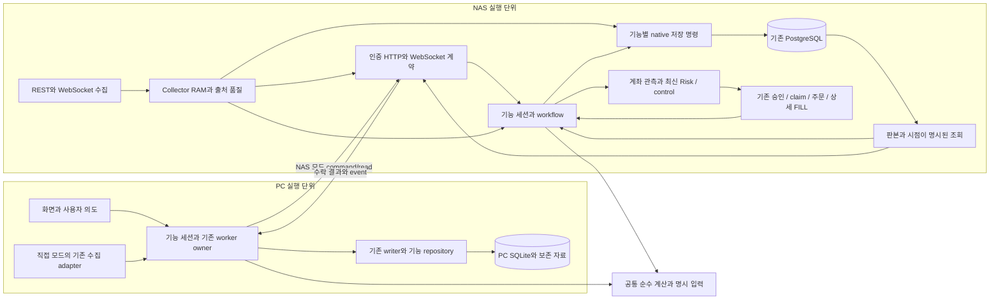
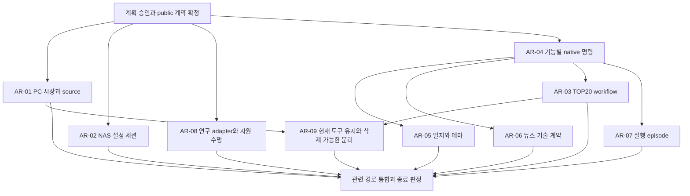
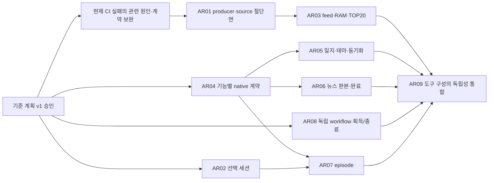
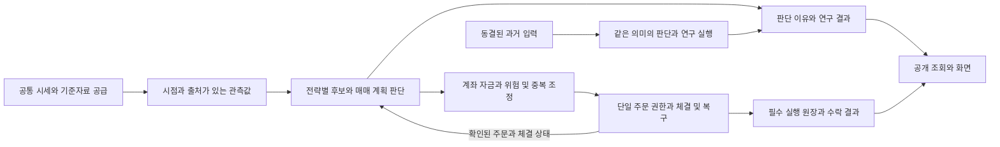

# 앱 전체 구조·품질 평가와 목표 구조·전환 계획

작성: 2026-10-23 · 제품 2.1.0 · **기준 계획 v1 + 네 운용군 목표 설계 유지 / AR02 로컬 종결 / v1 기술 경계 연속 진행**

이번 작업은 PC 앱·NAS 서버·공통 로직·저장·통신·동기화 전체의 구조와 개발·검증·운영 품질 재평가다. 이전의 NAS 국소 개선만 진행·완료 영역 재평가 금지·전체 재설계 제외라는 범위는 이번 지시로 대체됐다. 과거 R3 수정·실패·검증 이력은 그대로 보존한다. 현재 파일·클래스·상태·내부 API·설정 배치·임시 우회와 DB 테이블/인덱스 모양은 보존 조건이 아니다. 기능·데이터 의미·안전·복구·필요한 호환 계약을 보존하면서 재사용·책임 이전·통합·부분 재작성을 선택한다.

첨부 지시문 7절과 후속 사용자 정정에 따라 **목표 구조와 전환 계획을 먼저 제시하고 승인 뒤 구현한다.** 이 문서는 구현 완료나 배포 증거가 아니다. 구현 착수 시 합의한 작업 묶음과 계약을 확정하며, 이후 발견을 이유로 범위를 자동 확대하지 않는다.

## 0. 현재 기준과 진행 현황

갱신. **2026-11-05 · S12-04 계획형 0B 모의 실행과 S12-05 후보 근거 복구**. AR 판정과 선행 개발은 11절에 둔다.

**현재 단계.** 기본 저장소 `main`에서 S12-01~03을 수락했다. S12-04는 명시 승인된 0B 돌파의 계획형 모의 실행과 뉴스 미확인 표본을 포함하는 낙주 Paper 비교를 연결했다. S12-05는 같은 계좌·계획의 명시 재개와 종가베팅·신규주·낙주 후보의 최초 근거 조회를 연결했다. 나머지 전략별 승인 모의 실행, 필수 입력·미정 정책과 12.12 통합 수락이 남아 완료율은 3/5다. AR은 검사용 `6495993`의 C24 검증 수락과 C16 재발 시 이관 상태다. [승인 로드맵](section12-development-roadmap-20261105.md) · [낙주 후보](#section12-panic-shadow-readback) · [낙주 Paper](#section12-paper-panic) · [계획형 실행](#section12-native-plan-runner) · [540](#c24-hosted-539-run-540) · [541](#c16-recurrence-handoff-541).

**연속 실행 제어.** 자동 CI 41872124336가 7분 33초에 최종 성공했다. Windows 6,672건·필수/확장 PG·Linux·operator·봉인 v1/v2, 동일 소스·증분 실행 대조와 최종 필수 판정을 수락했다. 이전 실패는 각각 보존한다. [540](#c24-hosted-539-run-540).

**목표·필수 원칙:** [승인 v1](#11-이번-재설계-기준-계획-v1)을 따른다. 선택한 Windows/macOS/Linux 실행 컴퓨터가 장중 공통 엔진·로컬 SSD·주문 상태를 소유하고 NAS는 장후 보관을 맡는 [목표 배치](#portable-execution-target)를 유지한다. 순위 이력과 확정된 설정/편집·미확정 주문/미완료 저장/복구의 최소 예외는 보존하고, 나머지 과거 자료는 기존 DB에 보관한다([11.12](#1112-데이터-보존과-db-구조-재설계--2026-10-24)). 동일 순간·당시 가용성·KST 표시와 시계 필요성을 구분하며 새 계층·중복 상태·매 틱 DB 조회를 추가하지 않는다. 녹화/진단·일회성 도구는 현재 유지하면서 제거 경계를 확보하고 자체 로컬 LLM은 제외한다.

**실행 제한:** 별도 승인 없는 commit/push·새 GitHub CI·배포·운영 DB/설정·실계좌·로컬 전체 회귀·새 라이브러리/이미지/환경 구축·권한 변경은 실행하지 않는다. NAS 임시 관리자 권한은 2026-11-02 09:30 KST에 만료됐고 추가 사용·연장0이다. 원 권한과 영수증·회수 조건은 [241](../../tmp/ar-test-session-until0930-241/execution/current-access241.json)에 보존한다. 526은 사용자가 승인한 단일 NAS 격리 검사를 기존 제한 operator로 실행했다.

**검사 자료 정리.** 367에서 복원 가능한 빌드 중간물 19개를 정리해 약 **0.82 GiB**를 확보했다. 직후 C 드라이브 여유는 **66.28 GiB**였다. 과거 검사 환경의 Qt 사본 약 **3.75 GiB**는 재실행에 복원이 필요해 보존했다. [367 결과](../../tmp/ar08-c24-observer367-20261104/STORAGE_RESULT367.json) · [365·366 이력](#c24-owned-job-fixture-and-tmp-cleanup-366).

**완료 범위:** 독립 완료 조건90개 중 **검증 완료83·재발 시 이관1·현재 잔여6, 세부 행동17개**다. C16은 현재 진행과 완료 수에서 분리한다. AR05는8완료/3잔여/9행동이며 전체 AR 로컬 종결은 AR02만1/9·Q0/14·운영 미수락이다. 기존 부분12/외부연결부분31·OS/장후 전송의 필수 범위도 유지한다. [541](#c16-recurrence-handoff-541).

| AR | 완료 | 부분 완료 | 미완료 | 외부 환경 대기 | 재발 시 이관 | 현재 잔여 | 남은 세부행동 |
|---|---:|---:|---:|---:|---:|---:|---:|
| [AR01 PC 시장 상태·호출 연결](#checklist-ar01) | 4 | 0 | 0 | 0 | 0 | **0** | 0 |
| [AR02 선택 세션·allocation](#checklist-ar02) | 4 | 0 | 0 | 0 | 0 | **0** | 0 |
| [AR03 공통 수집·RAM·TOP20(기존 NAS)](#checklist-ar03) | 6 | 0 | 0 | 0 | 0 | **0** | 0 |
| [AR04 DB/native 저장·자료 모델](#checklist-ar04) | 7 | 1 | 0 | 0 | 0 | **1** | 3 |
| [AR05 동기화·선별 이전·복원](#checklist-ar05) | 8 | 2 | 0 | 1 | 0 | **3** | 9 |
| [AR06 뉴스 입력·판본·처리](#checklist-ar06) | 7 | 0 | 0 | 0 | 0 | **0** | 0 |
| [AR07 연구·Runner·주문/복구](#checklist-ar07) | 19 | 0 | 0 | 0 | 0 | **0** | 0 |
| [AR08 기동·종료·설치·검증](#checklist-ar08) | 18 | 1 | 0 | 1 | 1 | **2** | 5 |
| [AR09 선택 도구·기본 관측](#checklist-ar09) | 10 | 0 | 0 | 0 | 0 | **0** | 0 |
| **합계** | **83** | **4** | **0** | **2** | **1** | **6** | **17** |

**현재 성과와 검증 한계**

- **설치 검증 source290:** 로컬 소유 서버의 종료 ACK/오류 전파와 호출자·저장·취소·복구·선택 의존성 부재를 관련31건으로 확인했다. 실제2 native probe는 이전 정상/실패 모두 final 저장0행→수정 후 literal1행 COMMIT/연결 close 및 exit0/실패exit1을 검증했다. 새 Manager/queue/poll·업무 DB/스키마/시계/주문 변경0이며 Windows 자원 owner만 추가했다. 기존5초+강제정리2초를 유지한다. 포장290의 현재 코드34와 실제303 두 기동·닫힌 source clone cut/사본 소비는 수락했다. 같은 원ID의 POSIX 실제2를 추가 수락했다(새 고유검사 증가0). 운영 producer quiet/final ACK·T0·권한 전환은 별도 미검증이다. [POSIX 실제 근거](#posix-owned-stop308).

- source277의14건은 실제 headless 연결을 포함한 입력 권한6 + 기존 native 소비자 실패·취소·재시작/ACK8이다. 원2revision·고정 watermark/cursor·선택 INPUT bearer·원파일/원시각/hash·native PUBLISHED/job/acceptance·재열기를 확인했다. 직접 headless 함수를 실행한 검사이며 독립 프로세스의 실제 NAS 작업 전체나 전략 유효성은 아니다. theme는 빈 sidecar 표본이다.
- source276의86건에는 연구 UI/7 launch 계약·실제 자식 smoke3과 알려진22개 환경 이름을 검증한 실제 자식 witness1이 있다. 알 수 없는 비밀이나 같은 사용자 파일/OS ACL 격리는 증명하지 않는다. 기존 full/operator 연결은 명시 선택 호환으로 남아 있으므로 최종 독립 역할 수락 전 운영 input grant와 연결을 전환해야 한다. FinalHoldout의 두 실제 subprocess는 아직 별도 미검증이다.
- source27581PASS/4fixture 실패·등록/순서 지문 거절과 기존269/270/272·139/C24 실패는 보존한다. source271 실제 자료 HTTP·앞선 순위/Drive/NAS7·포장258은 각 소스·범위의 근거다. 현재16이나 이전86을 전체 AR·Q·운영·GitHub CI·설치 전체 통과로 승격하지 않는다.

**남은 조건·차단 사유·재개 조건**

| 대상 | 현재 미완료·차단 사유 | 다음 확인/재개 조건 |
|---|---|---|
| AR04-C08·AR05-C08~10·AR08-C18 | source290 기술 사본의 닫힌 cut·원receipt/pending·실제 설치물 두 기동/HTTP·설정11·전체rank·보존/guest 종료는 국소 수락했다. 최종 운영 source/target/T0·quiet/ACK·운영 grant/기존 broad 연결 전환은 미수락이다. | 사용자가 운영 source/target/T0를 확정한 뒤 선택 owner의 실제 입장차단·quiet/final ACK·권한/연결 전환을 검증한다. 없는 execution stream을 추가하거나 사본 수락을 운영 완료로 합산하지 않는다. |
| AR08-C16 | **재발 시 후속 이관.** 원139에서 Abort 1건을 관측했고 후속 같은 분기는 정상 종료했다. 최초 원인은 미확인이다. | 재발한 자식 PID와 첫 C++ 호출 스택, 같은 PID의 작업·종료 순서를 확보해 충돌 작업을 확인한다. [541](#c16-recurrence-handoff-541). |
| AR08-C24 | **완료(검증 수락).** `6495993` GitHub 필수 회귀 성공과 526 실제 NAS 선택 경로 수락을 결합했다. | 운영 전환은 별도 조건이다. [540](#c24-hosted-539-run-540). |
| AR08-C18·C25 | 402 시험용 빌드에서 동일 EXE 관리형 서버 기동·인증 조회와 서버→앱 정상 종료, 포트·잠금·Job·게스트 정리를 확인했다. 기존 source290의 실제303 사본 소비와 POSIX 종료 검증을 각각 유지한다. | 최종 selected/T0·source quiet/final ACK·운영 공급/권한·TLS/ACL/다른 PC/장중 조건이 남는다. [402](#c18-managed-frozen-and-c24-attribution-402). |

**다음 작업·재개 조건.** 계획 보호를 일반 실행의 명시 승인과 연결하려면 미체결 원주문·재시작·보호 주문의 잔량 관리까지 검증한다. 기존 계획 외 전략의 승인과 확인 가능한 장중 자료를 연결한다. 구체적인 매매 조건은 [12.11](#1211-미정-매매운용-정책)의 미정 항목을 따른다. 운영 전환 재개 시 [기존 준비310](#c25-readiness310)을 재사용해 PC·source/target/T0, quiet/final ACK·권한·승인 조건을 확인한다. C16은 재발한 PID와 첫 C++ 스택을 확보한 뒤 재개한다. [승인 로드맵](section12-development-roadmap-20261105.md) · [541](#c16-recurrence-handoff-541).

**읽기·기록 규칙:** 이 절의 목표·제약·현황부터 확인한 뒤 담당 AR/F·호출자/소비자·관련 미해결 실패와 근거만 선택해 읽는다. 최신 내용은 교체하고 원 실행·이전 판단은 11절에 보존한다.11.71 현재표와 공유 원장은 함께 맞추며 완료 조건·집계 기준 변경은 현황 갱신과 구분한다. 문서 저장은 명시적 LF로 처리하고 표 행 사이에 빈 줄을 넣지 않는다. 다른 현황 문서는 이 절을 참조한다.


## 1. 기준 소스와 증거

| 구분 | 이번 기준과 한계 |
|---|---|
| 작업 소스 | 평가 시작은 `2884eba`+당시 dirty 코드이며 제품/검사 본문은 같은 채 `0d7da46`으로 커밋했다. PC·NAS·GitHub main SHA 일치 확인. NAS active release는 Oct17 유지·health ok. 그 뒤 조사/계획 문서와 승인된 첫 구현은 미커밋이다. 최신 구현 소스·검증은 0절/11.8절 |
| 실행 코드 지문 | 1,157파일, LF SHA-256 `28b645733feaa6b9aacffd83f3e615c76a0f25529b965e69b55d0a76573bf3a3`. v1 조사 기준 제품 `src/kiwoom_monitor`는 394개, 첫 구현에서 실제 상태 owner 1개가 추가되어 현재395개다. 원래394/748의 조사 근거는 보존하며 개수는 정밀 검토 증거가 아님 |
| 직전 관련 실행 | 같은 코드 지문의 Runner 공개 계약 관련 149건, 7입력 DTO/순서 동일·DB 0→0, 당시 정적 검사 통과. [원문](../../data/diagnostics/r3-runner-public-20261023/verification.json) |
| 이전 비용 실측 | 뉴스 claim의 다른 소스 `92ce20cd…`: empty SQL 2→2, job 1개 3→2, 4개 6→2, 연결/COMMIT 각 1·반환/저장 동일. PC 격리 PG 2건 포함 89건. 현재 NAS 지연 개선율을 뜻하지 않음. [원문](../../data/diagnostics/r3-news-claim-20261023/verification.json) |
| 더 이전 실행 | 22차 통합·PG 필수 5개·operator 소유/lease·PC 회귀는 각각 당시 소스 이력. 이번 설계의 실행 검증이나 현재 전체 수락으로 합산하지 않음 |
| 이번 조사 | 8개 구조 영역과 추가 보안·관측·개발/운영 품질 경계의 본문·호출자·상태 변경·저장·소비·수명을 확인하고 root가 통합. 진단 전용/공통 안전의 교차 경계도 추가 확인. 앱·DB·유료 호출·새 녹화/리플레이 실행 없음. 사용자 첨부의 공개 설계 지침은 공식 웹 문서만 확인 |

이전 [AI Trading 설계](../AI_TRADING_SYSTEM_REDESIGN.md)의 공통 계산·입력·Risk·실행 경계는 재사용한다. 2026-10-24부터 자동매매·연구의 목표 흐름과 전환 설계는 [12절](#12-연구노트-기반-네-운용군의-목표-설계)을 우선하며, 이전 문서의 개발 순서·실험 기본값으로 새 네 운용군을 제한하지 않는다. [R3 백로그](../../REFACTOR_BACKLOG.md)는 과거 문제·비용·F 상태의 정본이며, 남은 항목 수를 이번 구조 정리의 완료 기준으로 삼지 않는다.

### 1.1 앱에 적용할 품질 목표

품질을 클래스 배치만으로 판단하지 않는다. 현재 기능과 가까운 계획인 0B Shadow 개발에 다음 기준을 적용한다. 미확정 운영 SLA·허용 손실·RPO/RTO 수치는 개발자가 임의로 채우지 않는다.

| 품질 목표 | 이번 수락 기준 | 개선 근거와 남은 결정 |
|---|---|---|
| 정확성·안전 | 같은 수락 입력의 저장/계산 결과·출처/시점/단위 보존. UNKNOWN이나 gap을 성공으로 만들지 않음. FILL/최신 Risk/control/native 승인/중복 방지 유지 | 현재 fixture와 native 통합으로 확인. 실제 매매 규칙·불명 주문 재전송·손실 허용은 사용자 정책 |
| 변경 용이성 | 선택한 책임을 상태·호출·실패·복원과 함께 소유하고 무관한 owner 변경·private mutation을 줄임 | 대표 기능 추가 시나리오로 영향 설명. 파일 수나 속도만으로 판정하지 않음 |
| 비활성화·교체·제거 용이성 | 선택 기능의 코드·상태·작업·자료와 공통 기반의 의존을 구분. 해당 기능과 소수의 명시 등록/계약 변경으로 전환하고 무관한 내부 구현을 광범위하게 고치지 않음 | 대표 선택 기능의 진행 작업 종료·자료 보존·재시작·관련 회귀와 실제 변경 파급을 함께 확인. 모든 기능의 plugin/별도 process 전환은 요구하지 않음 |
| 가용성·복구 | 부분 성공·저장후 적용 대기·결과 불명을 구분하고 소유 작업의 실제 종료와 durable receipt로 close/재개 판단 | crash/ACK 손실/취소/재시작/restore 검증. 운영 중단·데이터 손실 허용은 별도 합의 |
| 진단 가능성 | 대표 PC 요청→NAS→worker→DB의 단계·시도·버전·원인/결과를 기존 기록으로 추적. 예외 없는 지연·stale·적체도 구분 | 기본은 적은 용량의 경계 기록, 상세 DB 진단은 기존 opt-in. 전 틱 기록·새 플랫폼은 불필요 |
| 성능·자원/비용 | 대표 동일 입력의 DB/I/O·지연/queue/CPU 등 필요한 지표와 결과 비교. 안전에 필요한 비용 유지 | 현재 운영값과 과거/격리값 분리. 필요한 증가는 이유와 함께 계약 갱신, 임의 임계값으로 금지하지 않음 |
| 보안·운영 | 기존 인증/비밀/권한/복원/release 격리 유지, URL/예외/로그/backup의 비밀 노출 방지 | 실제 설정·외부 공개/TLS·설치 helper는 미확인 시 그대로 표시. 새 SSO·권한 기반을 기본 도입하지 않음 |

### 1.2 14개 품질 영역의 현재 판정

`충분함`은 정한 범위와 검증까지 충족한 경우, `부분적으로 갖춤`은 기반은 있으나 전체 연결/수락이 남은 경우, `보완 필요`는 현재 코드나 절차의 구체적인 불일치가 확인된 경우다. `미확인`은 결함이라는 뜻이 아니며, `적용 불필요`는 앱 규모/기능상 제외 근거가 있는 기술에만 쓴다. 아래 판정은 현재 코드·기존 검증에 대한 것이며 현재 운영 전체 품질 인증이 아니다.

| 영역 | 현재 판정 | 확인한 기반 / 부족·미확인 / 목표 연결 |
|---|---|---|
| Q01 요구사항·기능 완성도 | 부분적으로 갖춤 | roadmap/OPEN_ITEMS/F 원장, 실제 research/Shadow/실행 연결 존재. 사용자 주도주 규칙·모델 지원/운영 수락은 미완성/정책 미정. 가까운 0B Shadow는 입력·출력·주문 없음부터 확정하며 계획 기능을 구현 완료로 계산하지 않음 |
| Q02 품질 목표 | 보완 필요 | 기능별 비용·안전/회귀·수명 기준은 있으나 과거 국소 범위가 앱 전체 종료 판단과 혼재. 이 문서의 품질 목표·대표 시나리오·승인 범위로 일관된 판정 마련. 운영 SLA/RPO/RTO 숫자는 미확인·별도 정책 |
| Q03 구조·상태 소유 | 보완 필요 | 기존 실질 owner와 public 계약 재사용. MainWindow/root/Runner/sync에 확인된 결합은 3~5절의 실제 상태/전이 단위로 재구성 |
| Q04 데이터 설계·보존 | 부분적으로 갖춤 | native transaction·불변 revision·원본/보존/동결 자료·no-op 기반. 일지 수동scope/ID·generic immutable import·테마 generation/복원 경계 보완. 과거 자료 임의 귀속/삭제 없음 |
| Q05 API·이벤트 계약 | 부분적으로 갖춤 | 인증/typed 요청·API fixture/expected revision·WS ACK 존재. 문구→업무 source 판정과 뉴스 판본 유실·일반 결과 상태 전달의 일관성 보완 |
| Q06 동시성·작업 수명 | 보완 필요 | shield/drain·account/Runtime fence·queued signal/writer 종료 기반. 중첩 producer·취소된 native wrapper·일부 child handle/setup cleanup 경계가 실제 종료를 충분히 표현하지 못함 |
| Q07 오류·재시도·복구 | 부분적으로 갖춤 | no-op/CAS/ACK-loss·claim retry·UNKNOWN/RECOVERY_REQUIRED·strict restore 존재. feature별 원인/단계/저장 receipt를 공통 경계 기록과 연결하고 빈 결과 fallback으로 숨는 범위를 변경 경로에서 확인 |
| Q08 로그·상태·장애 추적 | 부분적으로 갖춤 | KST 서버 일별 회전, DBWriterContext/call/parent/request IDs·단계계측·Collector 상시 pending/stale/실패 상태 존재. 일반 PC HTTP→NAS request context 연결, PC 보존/용량·공통 비밀 마스킹·sink 실패 확인은 보완 대상. 상세계측 off인 것을 상시 추적 성공으로 판단하지 않음 |
| Q09 성능·자원·비용 | 부분적으로 갖춤 | R3 source별 native 호출/반환행/ACK 비용과 기존 PG 지연·queue 계측 재사용. 최신 운영 병목 순위·장기 CPU/메모리/lock/WAL은 미확인. 새 진단 체계 없이 대표 전환별 재현 가능한 비용 비교 |
| Q10 보안·권한·비밀 | 부분적으로 갖춤 | 기존 bearer/credential 보안경계·암호화 vault·계좌 HMAC/lease·원본/비밀 배포 제외 존재. WS query token과 URL 기록·message shape 검증 보완. PC provider 키는 DPAPI, 별도 NAS bearer는 JSON 평문이므로 위협/백업 경계를 구분. 실제 유출/TLS·권한 배치/운영 로그는 미확인 |
| Q11 UX·실수 방지 | 부분적으로 갖춤 | saved/applied·지원/차단·재시작 필요 표시와 실패 pending 보존 존재. 화면 문구와 업무 전이 분리, 입력 판본/부분/불명 상태 표시·중복 클릭/늦은 응답·복원 권한을 실제 caller 연결에서 검증 |
| Q12 검사·리뷰·개발 환경 | 부분적으로 갖춤 | 가상환경/소스 지문/격리 worker·증분 선택·구조/비용/CI required gate 존재. 기존 dirty 누적 execution gate는 같은 소스 고유관련1,134와 실제PG90/전체 API발견89+22를 대조해 통과했다. 별도 실제 GitHub CI는 실패이며 native Abort/진단-Collector 계약/PG helper 오류를 현재 미결로 보존. 새 구조 관련 검사·설계 영향 검토를 개발 중 수행, 전체 회귀 자동 확대 없음 |
| Q13 배포·호환·이전·백업 복원 | 부분적으로 갖춤 | immutable release/operator 격리·restore lease/before-image·Drive component hash/manifest-last·업데이트 rollback 존재. production Docker의 범위 지정 설치와 CI lock constraint가 달라 재빌드 재현성 보완. 실제 현행 배포/설치 helper/복원 수락은 미확인. 일지 독립복원·호환/전환 순서 명시 |
| Q14 운영·설계 문서·변경 관리 | 부분적으로 갖춤 | CURRENT_STATUS/OPEN_ITEMS/R3/F·guardrails·운영 명령/모델/검증 문서 존재. 현재/과거/목표를 구분하고 중요한 선택의 원인·대안/기각·계약·검증·재개 조건을 기존 정본에 함께 기록 |

**임시 도구의 위치(2026-10-23 최종 사용자 정정):** NAS 병목은 아직 해결되지 않았으므로 기존 녹화·리플레이·정밀 진단은 **현재 계속 유지·사용한다. 이번 재설계의 목표는 즉시 퇴역이 아니라, 필요할 때 도구를 삭제해도 제품 기능이 유지되도록 의존성을 분리하는 것**이다. 과거 뉴스 수집→NAS 적재와 대신증권(CREON) 자료 수집→NAS 적재도 일회성 생산 도구로 같은 경계를 적용한다. 도구 코드·설정·화면·쓰기 경로를 없애는 것과 이미 적재한 자료·출처·판본·검증 근거를 없애는 것은 별개다. 현존 도구·작업·자료는 지금 삭제하거나 중단하지 않는다. 앞선 AR-09의 '퇴역/제거' 표현을 즉시 삭제 지시로 해석하지 않는다.

**취소된 계획:** 자체 로컬 LLM 구축·학습·서빙과 이를 위한 전용 모델 작업자 구축은 진행하지 않는다(2026-10-23 사용자 정정). 목표 구조·선행조건·미완료 개발 목록에서 제외한다. 현재 사용 중인 뉴스 분석·외부 AI 호출·과거 결과/방법 비교 계약까지 폐기하거나 새로운 공급자로 자동 전환한다는 뜻은 아니다.

`적용 불필요`로 권장하는 것은 새 microservice/메시지 브로커/중앙 로그 플랫폼·대규모 APM·일반 다중 tenant/SSO 체계·전면 재작성이다. 이번 개인 PC/NAS 앱에서 현재 근거상 요구되지 않는다. 보안·로그·복원 같은 **영역 자체**를 불필요하다고 제외하지 않는다. scoped native claim/불변 저장·public DTO 등 기존에 충분히 검증한 경계는 해당 소스/범위에서 `충분함`으로 재사용하되 그 영역 전체를 일괄 충분으로 올리지 않는다.

기준 참고는 보안을 개발 과정에 통합하는 [NIST SSDF](https://csrc.nist.gov/pubs/sp/800/218/final), 필요한 경계의 문맥·민감정보 제외·기록 실패 검증을 다루는 [OWASP Logging](https://cheatsheetseries.owasp.org/cheatsheets/Logging_Cheat_Sheet.html), 지연·처리량·오류·포화를 함께 보는 [Google SRE](https://sre.google/sre-book/monitoring-distributed-systems/)다. 현재 앱의 판정 근거는 외부 체크리스트가 아니라 위 실제 코드/검증이며, 해당 문서의 모든 기술을 도입하거나 준수 인증을 선언하지 않는다.

## 2. 현재 전체 구조와 유지할 경계

현재 PC는 `bootstrap`이 실행 모드·client·repository를 조립하고, `MainWindow`가 시장 RAM과 화면을 함께 관리한다. `AppController`는 worker·timer·저장 pending·교체·종료를 소유한다. 뉴스·일지·연구는 별도 프로세스로 실행되며 각 로컬 자료와 NAS API를 소비한다.

NAS는 `create_app/lifespan`이 store·REST broker·Collector/Hub·TOP20·뉴스·Shadow·계좌 owner를 조립한다. PostgreSQL/SQLite의 native 구현과 transaction은 저장 계층에 있다. 다만 조립 함수 안에도 Shadow 설정의 상태 전이와 복구 판단이 있고, 일부 기능은 동일 자료의 현재값/판본/화면 projection을 서로 다르게 조립한다.

| 이미 역할이 확인된 경계 | 유지 이유와 개선 시 보존할 것 |
|---|---|
| REST broker / 공유 키·보정 시계 | 호출 제한·캐시·인증·시계 소유. 직접 WS와 fallback이 별도 토큰/시계를 만들지 않도록 유지 |
| Collector / Hub | REG ACK·출처 품질, 실제 0B→RAM/집계→pending/native 저장·실패 복원·live overlay의 연결. 틱마다 DB 재조회하는 구조로 바꾸지 않음 |
| 순수 집계·계산 | `MinuteTradeValueAggregator`, `Top20TradeValueCollector`, 시장/테마·연구 evaluator를 재사용. PC/NAS의 의미가 다른 상태까지 강제로 통합하지 않음 |
| AppController / 전용 writer / 작은 worker controller | 중복 실행·queued signal·pending 재시도·producer→signal→writer drain이라는 실제 수명 책임. 모두 제거하거나 하나의 전역 Manager로 합치지 않음 |
| native store / 기능별 SQL | 원자성·no-op·불변 충돌·CAS·claim·ACK 복구를 소유. QueryStore의 조립/기존 호환 역할과 좁은 소비 계약은 구분 |
| Runtime/Monitor/Supervisor/Execution | 상세 FILL·대사·계좌 cut·lease·최신 Risk/control·승인/claim/실제 전송의 서로 다른 권한. 판단 DTO를 주문 권한으로 승격하지 않음 |
| 뉴스 수집 / job / revision 저장 | source cursor, BODY/RULE/AI 실행, attempt CAS와 native revision 수명은 실제 책임. 개선한 claim CTE·정렬·두 phase·rollback 유지 |
| 원본·캐시·일지 보존·연구 입력 | NAS 운영 원본, PC 직접 수집 원본/캐시, 일지의 당시 보존본, 동결 연구 자료는 목적이 다름. 중복이라는 이유로 삭제하지 않음 |
| restore / credential / update / deploy | 자원 lease, 비밀·DB commit, 파일 원자 교체, 실행 release의 복구 의미가 다름. 하나의 범용 rollback으로 대체하지 않음 |

## 3. 실제 코드에서 남은 구조 문제

아래의 `코드 확인`은 본문과 연결을 확인했다는 뜻이다. 운영 장애 발생이나 현재 성능 비용까지 측정했다는 뜻은 아니다. 기존 R3와 겹치면 같은 근거에 연결하며 R3 신규 번호를 중복 생성하지 않는다.

| 원인 / 분류 | 현재 경로와 근거 | 목표와 판단 |
|---|---|---|
| PC 시장 상태와 화면의 공동 소유 / 유지보수성 | `presentation/main_window.py:_on_trade_tick`(2993), `_apply_ranking_view`(2579), history/gap/entry snapshot(3658,3933,4844); Controller의 ranking 응답이 화면 callback을 호출하고 그 뒤 구독/보완을 시작 | 가격·누적 기준·집계·coverage/recovery·당시 관측 입력은 시장 세션으로 함께 이전. UI는 값을 다시 소유하지 않고 투영만 표시. callback만 옮기는 분할은 불충분 |
| 표시 문구가 자료 권한을 결정 / 구조적 결함 위험 | `main_window.py:_on_realtime_status_changed`(1940)가 한국어 문장을 파싱해 active route·복구 조회·TOP20 허용을 결정. 실제 `test_nas_recovery_forces_current_top20_minute_history_reload`도 문장을 입력 | transport의 typed 출처/연결 전이를 정책 입력으로 사용. 문장은 결과 표시로만 유지. 실제 복구·full-code ACK·gap 기준은 유지 |
| 상위 worker 완료와 내부 producer 완료의 차이 / 수명 결함 | v1 조사 당시 Controller `requestInterruption` 경로에 child drain이 없음을 재현. 현재 `central_realtime_worker.py:run`의 finally가 nested fallback/validation 실제 종료까지 소유하도록 국소 보완 | 현재 child 관련 회귀와 종료·교체/FILL drain 검증은11.8절. typed source/PC 시장 상태 이전은 후속이며 운영 유출/전체 기동·종료 수락으로 확대하지 않음 |
| NAS 조립부의 feature 전이 / 유지보수성·잠금 결합 | v1 조사 당시 app의 saved/applied/error/runtime/account와 route의 CAS/task를 현재 RamShadowSelectionSession으로 이전. root는 조립/callback, router는 HTTP 표현. 기존 OperationalSettingsState.lock은 주입한 fence로 유지 | 상태·native 완료 합류·Runtime 교체/close 소유는 첫 국소 검증 완료. allocation 공개 계약·오류 shape 및 근거 있는 fence 분리는 후속. 공유 잠금 운영 지연 규모는 미측정 |
| TOP20의 서로 다른 변경 이유와 수명 결합 / 유지보수성·성능 가설 | `autonomous_top20.py`가 ranking/cohort, 0B contribution, catalog/NXT/history, 장후 정산을 함께 소유. `_index_loop`(907)는 pending index·program 저장을 await한 뒤 sampling advance | live 순위/cohort는 함께 유지, reference 준비와 장후 workflow 분리. index pending/inflight/retry는 전용 저장 owner로 함께 이동. 지연→gap 영향은 통제 재현·비용 대조 후 확정 |
| generic 문서 쓰기에 숨은 업무 원자성 / 결합 | `database_documents.py:upsert_documents`의 theme snapshot, 기사 revision+BODY enqueue와 postcommit wake-up. caller가 같은 generic API를 원시 CRUD로 오해 가능 | 기능별 native 쓰기 명령으로 의미를 드러내고 동일 cursor/transaction helper 재사용. 서비스에서 따로 enqueue하는 방식은 원자성을 깨므로 채택하지 않음 |
| 테마 게시의 다중 원자 단위 / 데이터 계약 위험 | `infrastructure/central_content_sync.py:replace_themes`(109)가 profile/stock/metadata를 3개 HTTP/native 교체로 게시. Shadow는 metadata snapshot 소비 | 한 테마 판본을 한 native command로 게시하고 수락한 generation을 반환. 편집 원본과 서버 수락본을 분리. 현재 혼합 관측의 운영 발생률은 미측정 |
| 동기화가 자료별 소유 의미를 덮음 / 정합성 위험 | 일반 content pull은 theme dispatcher의 expected revision 없이 로컬 테마를 교체. journal generic merge는 불변 분석 revision·사용자 편집·실행 task를 timestamp UPSERT로 취급 | 테마 교체는 하나의 owner/CAS, 일지 import는 자료별 불변·사용자 편집·로컬 실행 소유 계약 적용. 원격 task 행 복제가 실행 권한이 되어서는 안 됨. 실제 운영 손실은 미관측 |
| 일지 수동 입력의 scope·revision 불일치 / 코드상 결함 | `journal_process.py:_setup_cycle_override_changed`(2084)가 scope/clock을 전달하지 않아 legacy 기본값 저장. preparation(196)은 선택 scope로 조회. revision inputs(255–272)은 override를 제외하지만 결과 selected_types는 영향을 받음 | UI→명시 scope/수동 입력→동결 분석→revision 저장을 한 계약으로 연결. 재현과 native 동일 ID 충돌 검증을 구현 첫 조건으로 둠. 기존 사용자 수정/과거 revision 삭제 금지 |
| 일지 복원의 writer·중앙 동기화 경계 / 복구 위험·정책 | 일지 child 중단과 DB 복원만으로 parent `EntrySnapshotWriter`의 접근·후속 원격 tombstone/재동기화를 조정하지 못함 | 기존 restore/lease 경계에서 대상 writer 입장 차단·drain·before-image·실제 교체를 한 작업으로 소유. 로컬 복원과 NAS 과거 자료 되감기는 다른 정책이며 자동 연동 금지 |
| 뉴스 원문과 분석 입력·현재 판본의 혼합 / 정합성·정책 | `ai_service.py:_prepare_events`와 `news_jobs.py:_run_ai`의 묶음/단일 BODY 입력 차이, 대표 기사 BODY로 저장 가능한 경로, mutable assessment와 최신 BODY 별도 조회, PC AI DTO의 판본 유실 | 원본 BODY와 분석 input bundle 구분, article/BODY/analysis IDs를 끝까지 운반. 현재 표시·재분석 정책은 별도 결정. 기존 R3-084와 통합 |
| 업무 시계 전달 누락 / 코드상 불일치·영향 미측정 | 기사 enqueue는 주입 `_now_provider`; `database_news_jobs.py:claim_news_jobs` 기본값과 일부 revision 시각은 `time()`. 같은 큐의 retry/stale 시계 출처가 다름 | 기존 키움 보정 시계를 같은 큐의 생산·claim·완료에 전달. epoch에 9시간 가감 금지. 실제 skew가 없는 환경의 비용/결과를 버그 재현으로 주장하지 않음 |
| Runner의 입력 해석·실행 세션 결합 / 유지보수성·안전 민감 | `mock_automation_runner.py:run_once`(2077)는 FILL→control→unfilled/protection→전략/clock→cursor/checkpoint를 직렬 소유. 생성자도 native 복원·listener 등록·입력 활성화를 수행 | 입력별 순수 adapter와 per-account/run execution episode를 구분. episode에는 FILL 투영/cursor·입력 복구·source·fixed decision·child·기한·보호·시계·checkpoint ACK를 함께 둔다. 연관 상태를 여러 Manager에 나누지 않음 |
| 연구·CLI·프로세스 진입점의 역방향 의존 / 유지보수성 | `research_process.py`가 `scripts.export_research_dataset`/`scripts.run_research` 본문을 import, ResearchDialog가 process 모듈에서 재사용 계약을 import | 재사용 실행/요청 계약은 src의 해당 기능으로 이동. CLI와 process는 인자·실행·exit만 담당. 계산/Paper/repository/subprocess/동결 입력 재사용 |
| 시작·교체·종료 자원의 불완전한 합류 / 수명 위험 | bootstrap의 일부 자원 시작이 최종 cleanup 구간보다 앞섬. child kill 후 실제 exit 확인과 source reuse 신원이 경로별로 다름 | 기존 bootstrap/feature process owner가 최초 획득부터 정리·실제 종료까지 책임. 저장 설정/현재 API 적용/전체 재시작 적용을 구분. 기존 ‘재시작 필요’ 정책을 몰래 hot reload로 변경하지 않음 |
| 기록 기반과 실제 경계 추적의 단절 / 진단·운영 부채 | `DBWriterContext`의 request/call/parent ID는 있으나 일반 HTTP client/app middleware에는 작업 ID 전달 연결 없음. `news_jobs.py:_run_body`는 URL 실패를 `except: continue`로 fallback하며 원인 정보가 남지 않는 경계 존재 | 기존 ID/context/logger·health를 연결하고 source fallback 원인과 결과를 함께 보존. 기본 기록과 opt-in 상세 진단은 분리. 새 플랫폼·매 틱 로그로 대체하지 않음 |
| 민감정보의 전송 호환과 기록 정책 불일치 / 보안 위험 | `realtime_routes.py:36`의 query token 호환, `server_logging.py:100`의 Uvicorn INFO, 로컬 설치 Uvicorn의 accepted/rejected URL 로그 경로를 확인. 일반 formatter에는 마스킹 없음 | 실제 token 없이 합성 fixture로 노출을 재현하고 경계/formatter에서 제거. 현재 header caller 유지, query 호환 제거는 전체 caller 확인 뒤 결정. 운영 유출이 발생했다고 단정하지 않음 |
| 검증 이미지와 production 재빌드 입력 차이 / 배포 재현성 | `deploy/synology/server.Dockerfile:48`은 서버 dependency 범위 설치, `tests/ci_runtime.Dockerfile`은 lock constraint 사용 | 기존 lock의 서버 subset/constraint 또는 실제 해석 dependency·image ID를 release 증거로 고정. NAS에 Windows/UI 패키지 추가·임의 버전 변경·httpx2 도입 없음. 현재 운영 이미지 mismatch라는 증거는 아님 |

`ForwardEvaluationRepository`의 일부 recovery/stop은 불변 append→현재 read→upsert가 여러 native 호출이다. recovery의 현재 caller는 Runtime guard로 직렬화되므로 즉시 결함으로 분류하지 않는다. STOP의 모든 caller 사이 순서 역전 가능성은 미재현 가설이다. 선택한 execution 전이의 동시성 검증에서만 확인하고, 이번 조사만으로 CAS나 저장 횟수 정책을 새로 만들지 않는다.

backend의 같은 문서 판정도 구분한다. SQLite 문서는 직렬화 TEXT, PG는 JSONB 비교이므로 key 순서만 바뀐 입력의 no-op 결과가 다를 수 있다. 이는 현재 구현 차이며 운영 병목이라는 증거가 아니다. AR-04에서 실제 변경하는 기능의 논리 결과·updated_at/receipt 의미를 검증하고 모든 codec을 일괄 교체하는 작업으로 확대하지 않는다.

## 4. 추천 목표 구조

**목표 기능의 수명과 책임을 먼저 설계하고, 그 계약에 맞는 기존 구현을 선택적으로 재사용한다.** 자동매매·연구는 12절의 네 운용군 전체 흐름을 기준으로 판단·상태·입력/결과 계약을 재설계하며 현재 Family·Runner 구조를 보존 조건으로 삼지 않는다. 검증된 수집·native 저장·주문/복구 기능은 재사용하되 아래 PC/NAS 그림은 기존 배치의 전환 설명이다. 목표 역할은 11.17에 따라 위치와 화면 기동에 독립적이다. 모든 칸마다 Controller/Service/Repository를 만들거나 앱 전체를 일괄 재작성하는 계획은 아니다.



### 4.1 책임·상태·접근 계약

| 기능 owner | 실제 소유 상태·수명 | 공개 경계 / 소유하지 않는 일 |
|---|---|---|
| PC 시장 세션 | 가격·누적 기준·분봉 집계·history coverage/gap 복구·TOP20 cohort·시장/테마 관측·source generation. 기존 순수 집계 재사용 | `accept_tick/ranking/history/source_transition`와 view/entry snapshot. QWidget·표 셀·서버 계좌·직접 SQL은 소유하지 않음 |
| 기존 AppController | worker/timer 생성·완료·queued signal, pending/dispatch/ACK/retry, runtime install·종료 순서 | 세션 입력·writer 명령·UI projection 연결. 시장 계산을 전부 옮겨 두 번째 MainWindow로 만들지 않음 |
| 기존 transport worker / controller | socket·구독 ACK·fallback/validation 자식·실제 종료. Qt 신호 adapter는 현행 controller | typed source transition과 기존 tick. 표시 문자열을 정책 입력으로 제공하지 않음 |
| NAS feed session / 시장 RAM / persistence | feed는 socket·구독 ACK·연결 generation·자식 수명, 시장 상태는 승인 receipt·품질/baseline·latest/봉 집계, persistence는 detached operation·pending/inflight·ACK/retry/close를 소유 | 현재 Collector의 구현을 책임 단위로 재구성하되 Collector 공개 경계는 원자 source transition·RAM+pending+inflight cut·retention·close를 조정. 상태 이동 없는 relay 3개를 만들지 않음. `accept`에는 DB I/O 없음 |
| TOP20 live owner | 순위 수락·membership/cohort·0B contribution·sampling 순서 | 불변 membership/index 결과와 subscription 요구. catalog/history/장후 장기 작업을 직접 관리하지 않음 |
| reference 준비 / 장후 workflow | 전자는 catalog/NXT/기준자료 readiness와 기존 per-stock/venue 이력 잠금, 후자는 거래일별 대상·진행·재시도·정산 | broker/native store의 기존 명령 소비. 필요 상태·수명이 있어 분리하며 별도 서비스 프로세스·범용 Queue는 만들지 않음 |
| RAM Shadow 설정 세션 | saved selection/revision, applied revision, error/closing, 선택 관측 계좌, current/failed runtime, mutation lock/owned task | load/status/update(expected revision)/publish/context/start/close. Runtime은 실제 Hub/계산/model slot/drain을 계속 소유. 주문·Risk owner 아님 |
| 뉴스 수집 / job runner | 공급자 cursor·budget·일정, claim한 attempt·입력 판본·실행·취소·완료 | 공통 입력 구성/분석 계산 재사용. native 원본과 AI bundle을 구분, latest 판본 선택은 일관된 조회 계약 사용. UI나 임의 별도 poller가 작업 owner가 되지 않음 |
| Runner execution episode / 입력 adapter | episode가 account/run/spec, FILL portfolio/cursor/seen IDs, 입력 cursor·복구, 원주문 anchor/child·source generation·기한·fixed decision·보호·session clock·checkpoint ACK를 일관되게 소유. adapter는 분봉 window 또는 0B 관측을 순수 kernel 입력으로 해석 | 기존 Runner를 episode로 재정의/부분 재작성 가능. 같은 직렬 loop·native gateway 재사용. scheduling shell은 wake/task/close만 소유하며 episode private 상태를 재조립하지 않음. 새 독립 clock loop·checkpoint writer 없음 |
| 일지 분석·보존 / 동기화 | 명시 account/canonical scope, 사용자 수동 입력, 동결 분석 입력·revision, 당시 보존본. sync owner는 수락/미전송 generation | UI는 의도와 표시, 기존 preparation/repository는 분석·보존. sync가 사용자 원본을 재계산하거나 오래된 자료로 조용히 덮지 않음 |
| 연구 workflow / 기존 process owner | 동결 spec/input/run/trial·claim과 결과 게시, child 실행/실제 종료 | 공통 계산/Paper·기존 repository 재사용. UI/CLI는 실행 진입점, 실계좌 자격증명이나 실제 주문 권한 없음 |
| native feature store | 키·revision·no-op/충돌·동일 transaction·ACK·원자 완료 | 좁은 실제 기능 명령을 직접 구현. full QueryStore는 root/기존 호환에 남기고 새 runtime에 무제한 저장 권한을 넘기지 않음 |

`PC 시장 세션`, `RAM 설정 세션`, `실행 episode`처럼 새 객체가 필요하다면 **상태와 전이·수명이 함께 이동할 때만** 만든다. 기존 큰 객체가 상태를 그대로 보유하고 새 객체가 그 private 필드를 수정하는 방식은 목표 구조에 미달한다. 독립 상태가 없는 계산·codec은 함수로 유지한다.

Collector 내부도 단순히 이름 세 개로 나누지 않는다. feed의 ACK된 source transition을 시장 상태에 먼저 반영하고, open RAM과 detached pending/inflight를 하나의 불변 cut으로 포착하는 호출은 같은 동기 전이로 남긴다. 그 뒤 native 저장만 별도 소유 작업으로 실행한다. 현재 TOP20 `MinuteTradeValueAggregator`와 native `MinuteBarAccumulator`는 venue·억/백만원 단위·누적 fallback/정산 의미가 달라 하나로 통합하지 않는다. 수락 receipt/정규화가 같음을 입증한 부분만 공유한다.

일지는 기존 `selected_types`를 결과에 보존한다는 계약을 유지하는 안을 추천한다. 수동 편집은 별도 사용자 상태로 저장하고, 분석은 해당 수동 상태의 명시 revision/hash까지 입력으로 고정한 새 분석 버전을 사용한다. 과거 v2 ID/시각/내용은 그대로 읽는다. setup/current 결과와 새 immutable revision의 최종 게시는 하나의 native 명령으로 처리한다. 이 명령이 `expected_manual_revision`을 확인하여 계산 중 편집이 바뀌면 과거 입력의 immutable 결과는 보존하되 current를 덮지 않도록 한다. 같은 내용 재저장은 receipt 시각만으로 새 분석 ID를 만들지 않는다. 사전 일봉/뉴스 보완 자료의 독립 보존을 거짓 원자 transaction에 포함하지 않으며, 출처가 입증되지 않은 기존 legacy 수동 행을 새 계좌에 자동 귀속시키지 않는다.

뉴스도 기사 원문 BODY와 여러 기사로 구성한 AI 입력은 별도 정체성을 갖는다. 기존 group 의미를 그대로 표현하는 입력 bundle을 고정하고, 결과가 참조한 article/BODY/analysis IDs를 PC까지 전달한다. job terminal CAS만으로 계산 중 부수 저장까지 보호됐다고 판단하지 않는다. 해당 native 완료 명령은 attempt가 여전히 유효한지와 어떤 결과가 공개되는지를 같은 저장 계약에서 확인해야 한다. 오래된 attempt가 만든 원본 이력 보존과 현재 판단 게시 권한은 구분한다.

### 4.2 저장·조회·동기화·오류 계약

1. NAS 모드의 시장/계좌 운영 원본은 기존 서버 store, PC 직접 모드는 기존 로컬 owner다. PC 화면 cache, 일지 당시 보존, 연구 동결 manifest는 역할을 명시한 복사본이다. NAS 공유 SQLite를 새로 직접 열지 않는다.
2. 고빈도 RAM 입력은 기존 source snapshot을 빌린다. DB의 최신 Risk/control·lease/승인·대사는 안전 목적의 fresh 조회이므로 RAM cache로 대체하지 않는다. 연구 봉·실시간 0B·초봉은 서로의 의무 중간 자료로 만들지 않는다.
3. 쓰기 API는 업무 결과와 실제 저장 receipt/revision을 반환한다. 문서+revision+job 등 현재 원자 업무는 같은 native cursor 안에서 유지한다. 외부 HTTP/비밀 파일/별도 DB까지 원자 transaction이라고 표현하지 않는다.
4. 테마 전체 게시처럼 하나의 업무 generation은 native 명령 하나로 수락한다. 기존 API가 분할 게시만 지원하면 새 명령을 추가하고 기존 caller를 전환한 뒤 옛 조립을 제거한다. 임시 호환은 실제 caller와 제거 조건을 기록한다.
5. 입력/응답은 기존 DTO를 우선 확장하여 source/venue/거래일, observed/available 시점, 단위, revision/hash, complete/partial/stale와 실제 ACK를 보존한다. `EMPTY`, `FAILED`, `UNSUPPORTED`, `APPLY_PENDING`을 빈 tuple 하나로 합치지 않는다. 모든 자료에 과대한 공통 envelope를 강제하지 않는다.
6. 업무 현재 시각은 기존 키움 보정 시계와 KST, timeout은 monotonic이다. 원래 발행/체결/봉 순간과 canonical UTC hash 경계는 보존한다. 시간을 얻기 위한 새 TR·poller는 없다.
7. source/API 교체는 기존 generation의 producer 정지→실제 내부 완료→queued 입력/저장 ACK→새 세션 install 순서를 따른다. 저장됐으나 적용 실패한 설정은 saved/applied로 구분한다. whole-app 재시작 적용을 무조건 hot reload로 바꾸지 않는다.
8. `close`는 새 입력 차단 후 이미 소유한 작업·native thread·저장 receipt까지 합류한다. 취소 요청·async wrapper 취소·kill 요청은 실제 종료 완료와 다르다. 저장 실패 pending을 보존하며 store/lease를 살아 있는 작업보다 먼저 닫지 않는다.

### 4.3 현재 구성의 처리 결정

| 처리 | 대상 | 구체적 근거 |
|---|---|---|
| 재사용 | 기존 broker/Collector/Hub·공통 집계·native store·Monitor/Runtime/gateway·restore/update/operator | 실제 성능·트랜잭션·인증·수명 경계가 있고 대체는 같은 안전 문제를 다시 구현하게 됨 |
| 개선 | 공개 source/runtime 계약, 기능별 native write, clock 전달, pinned revision·실행 결과, 자식 완료 | 현재 기능을 그대로 유지하면서 모호한 owner·유실된 판본·불완전한 완료 신호를 정리 |
| 상태와 책임 이전 | MainWindow 시장/복구/입력 조립, app Shadow selection, Runner execution episode | 서로 다른 이유로 바뀌는 상태와 제어가 UI/root/전략 처리에 섞임. 관련 caller·consumer·restore를 함께 이전 |
| 부분 교체 | 문자열 route 추론, dict/private runtime install/rollback, 테마 3단 게시, 일지 scope/revision 연결, research의 CLI 역의존 | 기존 구성 그대로는 공개 책임·원자성·입력 정체성을 표현하기 어려움. 대체 후 옛 분기/저장 조립/불필요 relay 제거 |
| 유지하며 판단 보류 | 뉴스 current 선택·유료 재분석, 동일 계좌 키 교체 뒤 AUTO 주문 관리·재개 | 구조 문제와 업무/안전 정책이 겹침. 기술 계약을 먼저 명확히 하되 정책을 임의 확정하지 않음 |
| 현재 유지·삭제 가능하게 분리 | 병목 조사용 recorder/replay/정밀 진단, 과거 뉴스·CREON 일회성 수집/적재의 전용 hook·UI/config/API/task/저장 | 현재 필요한 도구는 계속 작동시킨다. 공통 안전/자료 읽기·계약을 업무 owner에 두고 도구는 그 공개 경계만 소비. 향후 도구 구성 단위를 물리적으로 제외해도 정상 제품·기존 데이터 소비가 유지되게 검증 |
| 계획 취소 | 자체 로컬 LLM 구축·학습·서빙, 해당 목표만을 위한 모델 작업자 | 사용자 철회. 새 구조나 개발의 선행조건으로 남기지 않으며 현재 외부 AI·기존 자료는 별도 보존 |
| 채택하지 않음 | 앱 전체 일괄 재작성, 새 microservice/event bus/공용 Manager/진단 체계, 모든 store 하나로 병합 | 자동매매·연구의 판단/수명 재설계와 필요한 부분 재작성은 12절에 포함. 무관한 기능까지 교체할 근거는 없으며 기존 안전 경계·이전 비용을 평가 |

### 4.4 코드 배치와 의존 방향

기능 owner는 해당 기능의 상태·전이·공개 자료형과 가까이 둔다. PC 시장 세션은 Qt를 요구하지 않는 application 모듈, RAM 설정 세션은 `central_server`의 해당 runtime 옆, native 업무 명령은 현재 기능별 `database_*` 구현, 연구 재사용 실행은 `application`/입력 adapter는 `infrastructure`에 둔다. 기존 `Runner`를 episode로 재정의할 수 있으므로 타입 하나를 더 만들기 위해 현재 Runner를 빈 relay로 남기지 않는다. Collector 분해도 기존 등록 planner·quality·minute accumulator를 재사용하며 필요한 새 모듈만 만든다.

| 호출·의존 경계 | 목표 규칙 |
|---|---|
| UI → PC 기능 owner | 사용자 command와 read projection만 사용. 표 셀에서 업무 입력을 역산하거나 owner private dict를 수정하지 않음 |
| application/domain 계산 | 명시 DTO·정책·시계/입력 cut 소비. Qt·HTTP·DB·process entry/CLI를 import하지 않음 |
| NAS route → 해당 세션/업무 owner | 인증·요청 검증/오류 표현 담당. 업무 CAS·mutation task/lock·복구 판단을 route와 root에 중복 배치하지 않음 |
| 기능 owner → 다른 기능 | 기존 snapshot/read/command·명시 callback 사용. source owner가 Shadow/뉴스/UI 구현을 import하지 않고 root에서 연결 |
| 기능 owner → native store | 실제 필요한 기능 command/reader만 소비. interface만 나눈 뒤 전체 store를 들여다보는 우회나 단순 runtime forwarding adapter를 추가하지 않음 |
| bootstrap/create_app | provider/clock/resource 생성·공개 연결·최상위 시작/종료. feature selection·뉴스 판본 선택·시장 복구·매매 전이를 해석하지 않음 |

예를 들어 source 전이는 `(generation, route, ACK/품질, 관측시점)`의 불변 값, 설정 갱신은 `update(expected_revision, changes) → saved/applied receipt`, 일지 준비는 명시 `scope/input cut/manual revision → 저장된 분석 결과`, native 쓰기는 현재 기능의 receipt를 반환하는 경계로 고정한다. 명칭은 새 프레임워크를 뜻하지 않으며 기존 DTO/반환 형식을 확장하는 방법을 우선한다. 이 계약을 확정한 뒤 각 owner의 caller와 소비자를 한 전환 안에서 바꾼다.

### 4.5 오류·추적·보안·운영의 공통 경계

기능 owner만 옮기고 장애를 추적할 연결이 없으면 목표 구조가 완성된 것이 아니다. 기본 기반은 기존 `logging_config`, `server_logging`, Collector의 가벼운 상태, job/run/attempt·저장 receipt다. `postgres_access.DBWriterContext`·`diagnostic_metrics` 등 상세 계측은 필요할 때 재사용할 수 있는 **선택적 조사 수단**이며 영구 핵심 의존성으로 만들지 않는다. 별도 로그 서비스·진단 DB·새 recorder/replay를 만들지 않는다.

| 경계 | 기본 기록/처리 계약 | 비용·보안·검증 |
|---|---|---|
| 사용자 의도·HTTP/child 진입 | 기존 request/job/run/selection revision과 논리 작업 ID를 연결. 없는 경우 진입점에서만 유한한 operation ID 부여. source/build·mode·적용 설정 revision·단계·attempt 전달 | 기존 PC→NAS client/header와 middleware의 누락을 보강하고 ContextVar/native thread에 연결. 외부 ID는 길이·형식을 검증하고 권한으로 사용하지 않음. 매 tick UUID/기록 생성 없음 |
| 인계·저장·완료 | owner의 accepted/start/native-ACK/applied/finished/cancel/retry/recovery를 필요한 업무 경계에서 기록. 저장 receipt·result state와 elapsed monotonic·관련 원본/판본 ID를 연결 | DB 결과 전체·기사 본문·고빈도 tick payload를 기록하지 않음. 기존 job attempt/업무 ID를 우선 사용하고 DB call/parent ID는 상세 조사 사용 시 연결. 같은 오류의 origin cause는 책임 경계 한 곳에서 보존 |
| 오류 공개 | 정상 EMPTY, 실패 FAILED, PARTIAL/STALE, UNSUPPORTED, 저장후 APPLY_PENDING, 결과 UNKNOWN을 기존 DTO/상태 코드에 명시. 원인 예외/chain은 내부 안전 문맥에 보존 | 사용자 메시지에 raw 예외·URL/DSN·키/토큰·계좌 비밀을 복사하지 않음. 기존 API 호환은 선택한 feature adapter에서 유지, 불필요한 공통 예외 프레임워크 없음 |
| 예외 없는 지연/멈춤 | 최근 수신/ACK·단계 시작/완료·현재 owned task·pending/inflight·실패/마지막 성공을 기존 status/health에서 확인 | Collector의 accepted0B age·waiting flushes·pending/failure 상태를 재사용. `oldest_record_at`은 queue 대기 시작 시각과 다르므로 혼용하지 않음. broker/news/native wait는 필요한 누락 경계만 연결 |
| 상세 성능 진단 | 기존 opt-in PG connect/worker/execute/fetch/commit·stage hook/lease와 bounded RAM을 그대로 사용 | 항상 상세 trace를 켜거나 주기적 전체 스캔하지 않음. 상세 진단이 꺼져 있거나 끝나지 않은 call은 원인 미확정으로 보고. 단순 에러 0건을 지연 없음으로 해석하지 않음 |
| 로그 보호·실패 | 공통 formatter/filter와 전송 경계에서 credential/header/query/DSN 민감정보와 CR/LF 주입을 제거. 일반 로그의 날짜·용량 한계/중복 요약·sink 실패 상태를 관리 | 서버 기존 KST 14일 회전은 재사용. PC 보존/byte cap은 실제 기록량·기존 정책을 확인해 일반 진단 로그에만 적용. 파일 오류를 같은 sink에 무한 재기록하지 않으며 비밀·필수 주문 원장과 별도 처리 |
| 인증/권한·호환 | 기존 bearer·credential 전용 trusted-peer/HTTPS·필드/용량 검증·vault·HMAC/lease 유지. 현재 WS query-token 호환은 실제 caller 확인 후 header 경로 우선 | `realtime_routes.py`의 query token과 Uvicorn URL 기록 연결을 먼저 안전하게 마스킹. 기존 인증을 없애거나 보안 실패를 빈 정상 응답으로 바꾸지 않음. 토큰이 없는 합성 fixture로 accepted/rejected 로그 경로 검증 |
| 배포/설정·복구 | 빌드/소스·실제 실행 release·설정 saved/applied·DB schema/호환을 구분. 외부 전송·DB commit·파일 commit 이후 복귀 의미를 각 owner가 보고 | 이전 키/DB/RAM으로 무조건 rollback하지 않음. 기존 배포·restore 절차/격리 operator 재사용. 생성된 backup과 실제 복원 수락을 구분 |

기본 로그/오류·상태·실제 완료 정보와 임시 진단은 다음처럼 구분한다.

| 구분 | 제품 수명과 의존성 | 제거/종료 조건 |
|---|---|---|
| 기본 업무 관측 | 필요한 시작/실패/저장/적용·마지막 성공·작업 완료를 기존 logger/status/receipt로 확인. 실제 주문/체결 원장과도 구분 | 앱의 정상 개발·운영에 필요한 최소 범위 유지. 모든 함수/SQL/tick 기록을 강제하지 않음 |
| 녹화기·NAS 진단기·상세 PG trace | 병목 미해결이므로 현재 유지·사용. 제품 기능은 도구 설치/활성 여부에 의존하지 않도록 재설계 | 이번 완료 조건은 도구의 정상 사용과 물리적 제외 시 제품 독립성이 모두 검증되는 것. 실제 퇴역 시점은 나중에 정하며 이력/원본 자료 폐기는 별도 정책 |
| 과거 뉴스·CREON 수집/적재 | 일회성 생산·전송·검증 작업의 수명/재시도/ledger는 도구에 둠. NAS 수락 자료·기존 연구/조회는 제품의 자료 계약을 소비 | producer/COM·수집 원본 코드·업로드 스크립트가 없어도 이미 수락한 기사/봉/출처·판본/연구 입력을 읽을 수 있어야 함. 현재 수집/적재 작업의 중단·자료 삭제는 하지 않음 |
| 고빈도 경로 비용 검사 | 기존 관련 native fixture의 호출/반환/저장 결과와 간단한 카운터 우선 | 진단 제품의 유지나 녹화/리플레이 실행을 회귀검사의 필수 선행조건으로 삼지 않음 |

현재 `diagnostic_replay_runtime`의 작업 helper가 production에서도 호출되는 것처럼 이름과 실제 수명 책임이 섞인 부분은 전환 시 구분한다. production native 작업의 실제 완료 합류는 해당 업무 owner가 진단 없이 보장해야 한다. 필요한 일반 수명 코드는 기존 업무 경계로 옮기고 진단 전용 capture/scheduling hook만 선택적으로 남긴다. recorder/진단 API를 빈 relay로 영구 보존하거나 새 진단기를 만들어 대체하지 않는다.

현재 DBWriterContext에는 request/call/parent ID가 있지만 일반 PC HTTP는 clock header만 보내고 app middleware도 clock만 응답하므로, 이 기반의 존재를 PC→NAS→worker→DB 전체 추적 완료로 볼 수 없다. 상세 PG metrics는 opt-in lease의 bounded RAM이며 상시 사건 원장이 아니다. 현재 source에서 producer를 확인하지 못한 과거 `connection-events` 파일을 신규 추적 기반으로 간주하지 않는다.

일반 로그 저장 실패 때문에 정상 RAM 수신·불필요한 재전송·동일 오류 폭주가 생기지 않아야 한다. 반면 필수 주문/승인/FILL/native 업무 원장의 영속화 실패는 기존 안전·UNKNOWN/복구 계약을 따라야 한다. 두 종류를 같은 “로그 실패 무시”로 처리하지 않는다. 새로운 로그 보존값이나 운용 경보 임계값을 정할 때는 해당 기록량과 사용자 허용 비용/손실을 먼저 구분한다.

PC NAS bearer의 평문 저장은 현재 사실이며 실유출 증거는 아니다. 기존 provider 키와 같은 보호 저장 경계 재사용을 추천하되 PC/계정 간 이동·기존 파일/backup 읽기·secret 참조 전환을 함께 설계한다. 서버 vault의 암호문과 master key를 모두 읽을 수 있는 계정까지 암호화로 보호된다고 주장하지 않는다. 일반 LAN HTTP·실제 TLS termination·역할 분리의 필요성은 설치 환경/위협 모델을 확인한 뒤 정하고 대규모 인증 체계를 선행 도입하지 않는다.

### 4.6 선택 기능의 수명과 제거 계약

**2026-10-23 사용자 추가 기준:** 확장뿐 아니라 비활성화·교체·제거가 쉬워야 한다. 이는 임시 진단/일회성 생산 도구만의 규칙이 아니라 실제 선택 기능 전반의 목표다. 다만 주문·상세 FILL·최신 Risk/control·원본/transaction·작업 종료 같은 공통 안전 처리를 편의를 위해 선택 기능으로 내려놓지는 않는다. 비활성화/삭제의 구조를 설계하는 것과 지금 실제 기능을 중단·제거할 권한은 구분한다.

| 선택 기능 | 해당 기능이 소유할 코드·상태·작업 | 전용 저장 자료와 남겨야 할 공통 계약 |
|---|---|---|
| 시장·테마 RAM Shadow | 선택/해석·model slot·saved/applied revision·current runtime·평가/기록 task·본인 Hub 구독/retention lease | 선택 문서·선택적 관측 결과/model receipt는 해당 기능 자료. 기존 Collector/Hub·시장 원본·계좌/Risk·공통 native 작업 합류는 기능 부재에서도 유지 |
| 외부 시장 자료 수집 | 공급 adapter·symbol/roll 설정·현재 수집/설정 적용 task·폴링·자기 pending/마지막 결과 | 기존 외부시장 관측/봉은 자료 계약에 따라 보존. 비활성화는 새 수집을 멈추며 지난 자료를 지우거나 신선한 값으로 표시하지 않음. 공통 broker/store/보정 시계와 국내 시장 수집 수명은 독립 |
| 뉴스 AI 공급 adapter | 해당 provider의 요청 구성·model 설정·진행 중 요청/attempt·일시 cache·provider 적용 세대 | 기사/BODY 원본·과거 분석 판본·usage/승인 receipt는 기존 reader로 유지. 공통 credential/vault·job claim/native 완료·다른 provider는 제거 대상이 아님. 자체 로컬 LLM 신규 구축은 취소 상태 |
| 병목 녹화·리플레이·정밀 진단 | capture 설정·observer/route/화면·session/task·전용 직렬화/보고/쓰기 | 현재 필요하므로 동작 보존. 전용 trace/report와 공통 gap 시각·task/native 합류·기본 상태를 분리. 코드 분리는 과거 trace/원본 삭제를 뜻하지 않음 |
| 과거 뉴스·CREON 일회성 수집/적재 | collector/COM·retry/진행 ledger·CLI/전용 설정·전송·적재 작업 | NAS에 수락한 데이터/출처·판본·단위/시각·manifest/hash는 독립 소비 계약. producer의 코드/설치가 없어도 조회/연구 가능해야 하며 진행 중 작업·적재 데이터는 지금 중단/삭제하지 않음 |

이 표의 owner/구성 단위는 기존 모듈·객체·명시 조립 지점으로 구현한다. 독립 process·plugin manifest·공용 feature registry·범용 Manager를 기능마다 만들지 않는다. 실제 caller·state writer·구독/작업 생성·저장·reader·복원·build/설정 등록을 해당 전환 묶음에서 확인하고, 필요 없어진 구형 연결은 함께 정리한다.

**공통 전환 계약**은 다음과 같다. 모든 기능에 같은 상태 enum이나 wrapper를 강제하지 않고 기존 상태/receipt로 의미를 표현한다.

1. 비활성화 요청은 해당 기능의 새 작업 입장만 막는다. 이미 수락한 입력·native 작업·저장 ACK는 기존 처리/복구 계약대로 합류한다. 단순 cancel 요청이나 async wrapper 완료를 실제 종료로 간주하지 않는다.
2. feature owner는 본인 구독/lease·timer·callback·task만 해제한다. 공유 Hub/broker/store나 다른 기능 작업을 닫지 않는다. 종료/저장 실패는 pending·적용 대기/복구 필요로 남기고 기능이 꺼졌다고 거짓 성공하지 않는다.
3. 비활성화는 재활성화 가능한 상태, 최종 `close`는 자원 종료로 구분한다. 예를 들어 현재 외부 collector의 settings disable은 `_stop` 후 재시작 가능하지만 최종 close는 `_shutdown`을 고정한다. 재활성화를 닫힌 객체에 강제로 적용하지 않고 기존 owner의 재개/교체 계약을 따른다.
4. 교체는 기존 공개 입력/반환·시점/판본/오류·저장/ACK 계약을 확인한 뒤 prepare→구 작업 drain→install/publish와 세대 fence를 적용한다. 늦은 구 결과는 원래 receipt를 보존하되 새 활성 상태를 덮지 않는다. DB/외부 전송 후에는 옛 RAM으로 무조건 rollback하지 않는다.
5. 실제 제거 시에는 해당 기능의 등록·화면/설정·route/client·전용 background work·전용 dependency/build 항목까지 정리한다. 구 설정이 남아 있어도 공통 기동을 깨거나 사라진 작업을 영구 재시도하지 않게 호환 경계를 명시한다. 기능 미지원/비활성 상태를 정상 0값이나 현재 결과로 위장하지 않는다.
6. 코드 제거는 데이터 삭제가 아니다. 잔여 자료는 기본 보존하고 계속 소비하는 reader/schema·과거 판본/출처 계약을 유지한다. archive/이전/삭제·tombstone·외부 동기화 전파는 별도 정책/승인으로 정한다. 필수 주문/체결·사용자 원본·불변 이력은 기능 중단에 딸려 삭제하지 않는다.
7. 재시작에서는 saved/active 상태와 종료/복구 receipt를 대조한다. 비활성/제거 기능의 작업이 자동 부활하지 않고, 필요한 계좌 대사/공통 복구·자료 조회는 계속 연결돼야 한다. 잔여 미완료 업무가 있으면 원인/수락 상태를 드러내며 완료를 꾸미지 않는다.

선택 기능 변경의 **허용 파급**은 해당 기능의 구현/자료·소수의 명시 조립/등록 지점·실제로 바뀐 public/API/UI/자료 호환 계약이다. 공통 계약이 그대로인데 Collector의 수집/분봉 산술·계좌 native gate·다른 기능 내부 cache를 광범위하게 수정해야 한다면 분리 목표에 미달한다. 처음 책임을 이전할 때 필요한 공통 경계 정리는 해당 AR에서 근거를 남기되, 이후 매 제거 때 같은 광범위한 수정을 반복하지 않게 한다. 파일 수/호출 깊이는 근거로 기록하고 임의 최대 개수로 판정하지 않는다.

## 5. 단계별 전환 계획

아래 `AR-01~09`는 이 설계의 전환 묶음이며 새 R3 결함 ID나 별도 상시 백로그가 아니다. 현재 실행 상태는 **0절 한 곳**에서 관리하고, 파일별 상세·과거 R3 비용/실패 근거는 기존 원장에 연결한다. 승인/구현/검증/운영 적용 상태를 분리한다. 묶음 내부도 한 번에 전체 파일을 바꾸지 않고 기능이 연결된 절단면 단위로 통합한다.

| 묶음 / 권장 순서 | 현재 → 목표 / 변경 경계 | 선행·충돌 경계 | 완료 기준·검증·위험 |
|---|---|---|---|
| AR-01 PC 시장 세션·출처·실제 producer 수명 / 우선 | CentralRealtimeWorker 자식 종료·typed source 전이부터 재현/보강. 다음으로 MainWindow의 tick→집계/복구→writer 명령→관측 snapshot을 실제 세션으로 이전. UI 표시/타이머 투영은 남김 | 공통 source transition/DTO 계약 먼저 확정. AR-08 bootstrap install/close와 함수·수명 소유권 합의. AR-03의 NAS 입력 뜻과 충돌 없이 각 상태 독립 | 중첩 worker가 끝나기 전 교체/close 완료 없음. 같은 틱·rank·gap/recovery·entry snapshot 결과, late signal·writer 실패/재시도·no-writer 호환·숨김 화면·재시작 검증. GUI 문구 변경이 source 정책을 바꾸지 않음. 고위험: source 바꿈과 native late write |
| AR-02 NAS 설정 세션·root 조립 / 우선, AR-01과 독립 | app closure의 상태/준비/저장 settle/apply/retry/Runtime 교체를 RAM 설정 세션으로 이전. Runtime allocation 공개 연산. 일반 settings lock과 분리 | 기존 selection transaction·CAS·account callback/Runtime 게시 의미 동결. AR-07과 관측 callback 계약만 공유, 계좌 전이는 수정하지 않음 | no-op/CAS/명시 null/ACK 손실·저장후 적용실패·동일revision 재시도·반복취소·startup/close 최종 native 합류. app/route에 selection 업무 전이·private Runtime 접근이 남지 않음. 고위험: saved/applied·계좌 변경 fence |
| AR-03 NAS 수집·TOP20 workflow / 이후 | live TOP20와 기준자료/장후 상태·task, index pending/inflight/retry owner를 분리. Collector는 feed 승인·시장 materialization·native 저장 수명으로 부분 재구성하되 공개 원자 cut·Hub 계약은 재사용 | AR-02와 Collector 공용 API 변경 시 root 통합. AR-04 native 저장 계약 사용. 초기 index-loop 지연은 통제 재현 후 해결 범위 확정 | 동일 membership/cohort/지수·gap·retention·open+pending+inflight overlay·subscription ACK·중복저장 방지. 느린/실패 native 저장 중 RAM sampling·입력유실·outbox 크기/순서/close 확인. 비용·지연은 같은 입력/저장 결과로 대조. 고위험: cohort cut·재시도·최종 flush |
| AR-04 기능별 native 저장 명령 / 각 기능 전환에 선행 | aggregate를 다시 쪼개기보다 뉴스/테마/실행 등 실제 업무 transaction 명령을 현재 구현에 노출. generic API의 숨은 side effect·호출자 read/write/read 조립을 해당 범위에서 교체 | 기능별 native 함수/transaction owner는 한 agent만 수정. 뉴스는 AR-06, 테마/일지는 AR-05와 같은 branch에서 계약 합의 후 통합. 한 거대한 전역 선행 리팩토링으로 만들지 않음 | native SQLite/PG의 반환·row/order·no-op·immutable conflict·동시 claim/CAS·rollback·commit후 ACK 손실·wake failure. 필요한 안전 조회/COMMIT은 보존. 전체 snapshot/허용 I/O baseline 초기화 금지 |
| AR-05 일지·테마·동기화 authority / AR-04 해당 명령 뒤 | 일지 수동 scope/clock/revision 재현을 먼저 확정. 분석 입력/보존 책임을 기존 preparation/repository에 정리하고 UI는 command/표시. 테마 accepted snapshot 원자 게시, 일반 pull/import의 owner 우회를 제거. 복원은 모든 대상 writer 조정 | AR-01 entry snapshot의 외부 계약 보존. AR-04 테마 native command. 연구의 과거 입력/사용자 복기와 저장을 공동 변경하지 않음 | UI 선택→선택 scope 저장→분석→새revision→native조회/재열기→sync 소비. 수동 수정·구형scope/revision·불변 충돌·미전송delta·삭제/이름변경·동시편집·백업/Drive/NAS·복원 중 parent writer 확인. 고위험: 사용자 원본·identity |
| AR-06 뉴스 입력·판본·완료 / 기술 단계 우선, 정책 단계 조건부 | source BODY와 AI bundle 분리, pinned IDs/clock을 job→저장→API→PC projection에 전달. 일반 current 선택과 job 완료 공개를 명시. 기존 collect/job/process/native 저장 재사용 | AR-04 뉴스 command/claim 원자성. R3-084 표시/재분석 정책 전에는 현재 표시 의미를 바꾸지 않음. AR-05 content schema 소비와 합의 | 같은 입력의 manual/auto/direct 의미, article/BODY/input hash 보존, stale attempt·실패/rollback·중복/재시도·완료후 ACK 손실·exact BODY evidence·PC 캐시/백업/종료 검증. claim SQL/연결/COMMIT 계약 유지. 고위험: 원본 오표지·판단 판본·외부 유료 호출 |
| AR-07 Runner execution episode / 안전 계약 동결 뒤 | FILL 투영/cursor·입력 복구·원주문/보호/시계·고정결정·checkpoint ACK를 하나의 run episode로 재구성하고 입력별 전략 adapter와 구분. 생성/prepare-restore/listener attach/start/current 게시를 명시. 같은 loop/native gate 유지 | AR-02 관측 callback와 인터페이스만 합의. AR-04 실행 command는 같은 transaction 소유자와 단독 통합. R3-085 계좌/키교체 정책은 별도 차단 | FILL→control→unfilled source/management→protection→leader 또는 clock/bootstrap/frame/관측→checkpoint의 실제 분기 순서 유지. 고정 보호 EXIT/clock Decision 등 기존 경로별 durable-before-QUEUED, cancel 직전 재검증, ACK 손실·재시작·STOP/취소·close·UNKNOWN/중복전송 검증. 고위험: 실제 주문 수명·권한 |
| AR-08 연구·프로세스·시작/복구 / 독립 절단면 병렬 | reused research 실행/요청 계약을 src 기능으로 이전, CLI/process는 adapter. bootstrap 최초 자원 획득부터 정리 범위에 포함. process는 실제 종료 확인 후 handle/lease 반환; saved/active/restart 적용 구분 | AR-01 runtime swap/close와 충돌 함수 순차 통합. 연구 계산/저장과 NAS 주문은 독립. operator 보고기/권한 변경은 별도 승인 범위 | 같은 spec/input 결과·run identity/구형hash 호환·final/OOS 접근·lease·중복재시작·원자 trial·publish failure. setup 각 단계 예외·child start실패/취소/native 진행·kill후 실제 종료·부모 재시작. 고위험: 연구 이력/프로세스/restore |
| AR-09 임시 도구의 삭제 가능성·제품 독립성 / 현재 도구는 유지 | 병목 녹화/진단과 과거 뉴스·CREON 일회성 수집/적재를 별도 구성 단위로 분리. 공통 native 수명/Hub gap/구독·기본 상태/자료 reader는 제품 owner로 이전. 현재 도구 기능은 보존하고 향후 삭제 때 전용 호출/설정/UI/API/task/쓰기까지 함께 빠지도록 연결 정리 | AR-01 fallback, AR-03 Hub/Collector 수명, AR-04/06 수락 데이터/판본, AR-08 연구/작업 경계와 교차. app/store·operator/probe는 root 순차 통합. 현재 설치/운영 변경·도구 중단 없음 | 도구를 설치한 경우 현재 조사/수집/적재 계약 유지, 격리 환경에서 도구 구성 단위를 물리적으로 제외한 경우 정상 수집/저장/주문/FILL/Shadow·종료/복구와 이미 적재한 데이터 조회/연구 유지. 플래그 OFF만으로 수락하지 않음. 실제 도구·자료 삭제는 별도 시점/승인 |

### 5.1 병렬화와 통합

설계 승인 직후 AR-01 PC transport/시장, AR-02 NAS 설정 세션, AR-08 연구 adapter 이동은 서로 다른 상태·transaction을 소유하므로 병렬 착수가 가능하다. AR-05 일지 scope 재현도 해당 UI/repository와 AR-01의 frozen entry DTO를 수정하지 않으면 병렬 가능하다. 나머지는 기능별 native 명령과 public 계약을 먼저 확정하여 후속 투입한다. 동시 개수를 관례적으로 제한하지 않되 승인된 독립 경계 수만큼 실행하며 불필요한 agent를 만들지 않는다.



화살표는 계약 선행이며 모든 저장 영역을 먼저 통째로 리팩토링하라는 뜻이 아니다. AR-04의 뉴스·테마·실행 구현은 각 기능의 실제 transaction별로 진행한다. 같은 파일이어도 함수/상태/계약이 독립하면 병렬화할 수 있고, 다른 파일이어도 같은 owner·transaction·fixture 자원을 바꾸면 순차 통합한다. root만 공유 원장/F·계약/guardrail을 갱신하고, 합류 뒤 현재 소스의 관련 검증을 실행한다.

AR-07은 현재 별도 clock collection과 Runner checkpoint envelope를 곧바로 새 schema에 합치는 작업이 아니다. 통합 episode의 저장·복원 단위와 구형 두 문서의 호환 읽기를 명시하고, ACK 손실/재시작에서 고정 Decision·취소 시도·보호 상태·cursor가 같은 수락 상태로 복구되는지 검증한 뒤 전환한다. AR-05 독립 일지 복원은 `news.sqlite3`의 링크·기사/AI 근거와 sync baseline까지 확인해야 하며 journal 파일만 돌아온 것을 기능 전체 복원으로 수락하지 않는다.

**공통 품질의 첫 적용은 AR-02의 PC 선택→NAS 접수→native 저장→적용/응답 한 경로**를 추천한다. 여기서 작업/시도 연결, saved/applied 오류 상태, 비밀 제외, 로그 실패/취소/ACK 손실, 기본 기록과 opt-in 상세진단의 구분을 실제 fixture로 검증한다. 기존 logger/client/middleware/DB context를 보강할 뿐 별도 플랫폼을 만들지 않는다. WS URL 비밀 마스킹은 같은 기본 품질 배치에 넣되 구독/인증 의미는 보존한다. 공통 logging/client/middleware 파일은 root가 변경 소유권을 하나로 배정하고 AR-01/08과 순차 통합한다. 검증된 규칙만 각 AR에 적용하며 모든 기능에 강제로 DB/log/task를 추가하지 않는다.

AR-08의 delivery 검증에는 기존 production/CI 의존성 입력·소스 image/release 지문 정합성, 격리 backup→restore→조회/소비의 실제 결과를 포함한다. 실행이 승인되지 않은 이미지 build/운영 복원은 수행하지 않고 필요한 환경/승인과 미검증을 남긴다. 보안/기록 공통 변경은 해당 feature의 실제 authentication/WS/오류 응답·기존 `test_central_server_logging`·`test_postgres_access` context/sink 격리 검사와 연결한다.

### 5.2 AR-09의 실제 도구·의존·분리와 향후 삭제 범위

현재 필요한 NAS 병목 조사 도구를 없애는 단계가 아니다. **지금은 유지하면서 제품→도구 역의존을 끊고, 향후 구성 단위째 삭제할 수 있도록 만드는 단계**다. 현재 사용 여부/활성 capture session·수집 완료·운영 자료는 이번에 조회하지 않았다. 아래 표의 '제거'는 도구를 나중에 퇴역시킬 때 함께 제거할 전용 범위이며 이번 구현에서 당장 사용 기능을 지우라는 뜻이 아니다. 도구가 연결된 개발용 실행에서는 기존 동작을 유지하고, 도구 코드 자체가 없는 정상 제품 실행도 검증한다. 플래그만 끄거나 import 오류를 숨겨서 독립성을 대신하지 않는다.

| 도구/연결 | 현재 실제 용도·경로 | 이번 분리·향후 삭제 범위와 보존할 계약 |
|---|---|---|
| PC 병행 검증/녹화 | API 설정의 `parallel_validation_enabled`→client factory의 병행 REST, bootstrap의 `RealtimeValidationRecorder`/JSONL→CentralRealtimeWorker의 별도 local validation WS | 전용 UI/설정 저장·factory 인자·녹화 callback·validation child·직렬화/쓰기 제거. `_validation_worker`는 recorder에만 전달하며 실제 fallback과 별개다. fallback producer와 full-code upstream ACK·재연결·stop은 보존. AR-01과 같은 파일은 순차 통합 |
| NAS workload pause/측정 lease | compose가 `KIWOOM_DIAGNOSTIC_WORKLOAD_PATH`를 주입, `diagnostic_workloads.control_snapshot`이 JSON을 읽어 진단 pause/capture 판정, 업무 loop의 hook에서 소비 | 제품 loop의 진단 pause/decorator·반복 control 파일 읽기·전용 env/config/client/화면 제거. 기능 자체의 운영 설정/STOP/control은 진단 pause와 다른 계약이므로 보존 |
| store/REST/Hub 입력 capture | SQLite/PG store 생성자가 항상 `install_store_capture`를 호출해 native 공개 메서드 wrapper 설치. Hub publish도 항상 capture 함수/metadata wrapper를 거침 | normal store/REST/Hub에서 replay input/context/capture wrapper·전용 metadata·payload 쓰기 호출 제거. 비용 비교는 같은 native 결과/SQL/COMMIT와 wrapper/파일 접근 수로 검증. OFF 상태 오버헤드를 실제 운영 지연 수치로 확대하지 않음 |
| 정밀 PG trace·run 보고 | app가 read/control/run router를 등록하고 시작 interrupted trace 복구·종료 run/trace drain에 관여. 상세 metrics/trace/manifest/payload·report JSON/JSONL에 저장 | 현재 조사에 필요한 수단은 개발 전용 실행으로 격리하고 끝난 run scheduler/control/report API/UI·capture 저장 경로·build COPY 등 제거. 일반 오류/상태/최소 단계 시간은 작은 기본 경계에 유지하며 상세 시스템 복제 금지 |
| replay task/thread helper | Collector/TOP20/broker 등 production이 `diagnostic_replay_runtime.owned_create_task/owned_to_thread`를 import. 일반 실행은 plain asyncio로 내려가며 replay scope의 thread registry는 활성 replay에서만 동작 | 실제 생산자/worker/native 종료 합류는 업무 owner에서 명시 보장. replay scheduler/ContextVar/input routing·capture receipt는 제품에서 제거. helper 이름만 바꾸고 같은 진단 종속을 남기지 않음 |
| Hub wrapper의 공통 gap 안전 | `CapturedHubEvent.published_at`을 `RealtimeSubscriber.remember_drop`이 실제 유실 범위/거래일 판정에 사용 | 먼저 기존 보정 시계의 발행시각을 정상 event envelope로 옮겨 gap 범위/자정/불명 처리를 검증한 뒤 capture receipt/type 제거. dict wrapper를 통째로 삭제해 source 품질을 약화하지 않음 |
| 기본 연결 확인·resource UI | `ApiSettingsDialog._load_resource_document`가 진단 resources API를 일반 NAS 연결 확인에도 사용 | 연결/인증·최소 health/resource read는 정상 운영 계약으로 옮기고 필요한 UI만 유지. 녹화/세션/trace/보고 탭·전용 client는 제거. 일반 연결 버튼을 404로 남기지 않음 |
| operator 상태·시험/배포 입장 | `scripts/nas_operator.py:SNAPSHOT_CODE`가 health 외 workloads/trace/reports 세 진단 API를 요구하고 `idle`이 진단 drain을 검사 | 버전 있는 product-only 상태/실제 owner idle 계약을 먼저 지원. 구 helper 호환은 실제 caller·제거 조건/수락 release를 명시한 한시 경계로 둠. 설치 helper 변경은 별도 승인, 이를 거치기 전 진단 API만 먼저 없애지 않음 |
| 과거 자료·연구/안전 receipt | trace/run/validation JSONL, 기존 diagnostic 원본·manifest·결과와 연구 `research_replay`/EV `source_receipt` 등이 이름상 유사 | 과거 원본/증거는 자동 삭제하지 않음. 진짜 연구/Paper 재생·복구/상세 FILL·승인/lease·보존 receipt는 제품/연구 기능이므로 유지. “replay/receipt”라는 이름으로 일괄 삭제 금지 |
| 과거 뉴스의 일회성 수집·처리·NAS 적재 | `run_historical_news_*`, `import_historical_news_to_nas.py`는 명시 CLI에서 수집/로컬 ledger와 기존 `news_article` API 적재를 실행. `import_prepared_historical_news_to_nas.py`는 prepared DB를 읽고 기존 native 기사/BODY/RULE 완료 계약으로 적재 | 생산/전송·재시도/진행 UI·전용 import endpoint/task/ledger는 일회성 도구 단위에 격리. 도구가 native 계약을 소비하는 방향은 허용하고 제품 reader가 collector/CLI를 import하는 방향은 제거. 실시간 뉴스 수집/BODY/RULE/AI와 이미 적재한 기사/BODY/판단 revision·원본/출처/발행·가용시각·연구 소비 유지 |
| 대신증권(CREON)의 일회성 수집·NAS 게시 | `run_daishin_collector.ps1`→candidate collection/COM 수집·backfill, `publish_historical_daishin_raw_to_nas.py`는 원응답을 복사/검증하고 manifest/hash·기존 DB run 참조를 게시 | COM/수집기·probe/retry·전송 스크립트와 해당 설정/작업 상태는 도구 단위로 격리. NAS 조회/연구/재시작은 이 실행 코드나 CREON 설치를 요구하지 않음. 수락된 DB/원응답·provider/venue·단위/수정주가 기준·시각·manifest/hash는 자료 계약으로 보존 |

#### 일회성 producer와 남는 데이터의 계약

일회용인 것은 **자료를 만들고 옮기는 실행 도구**다. 수집한 과거 뉴스/대신 자료를 앱에서 쓰지 않겠다는 지시가 아니다. 이미 수락한 자료를 읽는 codec/schema·native read API·출처/품질 검증은 제품/자료 경계에 남긴다. 도구가 없어도 데이터 출처를 이름/ID로 표현할 수 있어야 하며, 현재 producer의 코드 파일이나 COM을 다시 실행해야만 읽거나 검증할 수 있는 결합은 제거한다. 수집 버전/hash는 당시 값을 자료/manifest에 보존하며 producer 삭제를 이유로 다시 계산하거나 정상 검증을 완화하지 않는다.

`HistoricalNewsArchiveReader`는 현재도 별도 봉인 자료를 읽는 소비 경계이며 collector/적재 CLI와 구분한다. 이 reader와 필요한 archive 검증/조회·연구용 입력은 보존한다. `historical_backfill.py`처럼 수집·정규화/자료 처리가 한 곳에 있는 경우에는 실제 reader caller가 필요한 작은 자료 계약만 기존 domain/infrastructure 경계로 옮기고, producer 전체를 공통 필수 모듈로 남기지 않는다. 공용 native 저장·중복 방지·불변 revision·완료/복구 helper를 단순히 도구에서 쓴다는 이유로 삭제하지 않는다.

구현 시 수집기→적재→저장→조회/연구의 실제 caller와 완료/미완료 작업을 확인하고 도구의 실행 ledger와 NAS 수락 receipt를 구분한다. collector/process/API/메뉴/설정/빌드 COPY·외부 절대경로·스케줄이 생산 도구 구성 단위에 들어가도록 정리한다. 현재 기록이나 경로의 존재만으로 수집/적재가 완료됐다고 판정하지 않는다. 운영 job·기존 schema/자료·원본/검증 manifest를 삭제하거나 중단하지 않는다.

이번 전환은 **정상 event/작업 완료/기본 상태·수락 데이터 계약 확보 → 제품→도구 역의존 제거 → 내부/외부 caller·operator의 공개 경계 전환 → 현재 도구 동작 보존 → 격리 복사본에서 도구 모듈·설정·UI/API·쓰기 구성 단위 제외 → 정상 기능·기존 자료 소비·오류/지연 검증** 순서다. 실제 도구 퇴역·원본/자료 삭제는 이 단계에 포함하지 않는다. 범용 plugin/event bus나 교체 진단 플랫폼을 만들지 않으며, 필요한 기존 주입/호출 경계를 재사용한다. 공통 native rollback·동시성·gap·ACK·lease·실제 worker 종료 assertion은 정상 경계에서 계속 보호한다.

R3-079의 과거 operator-owned/유효 lease 수락은 당시 replay 기능의 소스 이력이다. 퇴역으로 기능 자체가 없어지면 적용성 변경을 같은 ID와 실행/CI 원장에 기록한다. **도구 제거를 이유로 아직 쓰는 operator/worker/임시 PG 격리·lease 검사를 skip/완화하거나 일반 PG로 대체하지 않는다.** 필요한 공통 검사를 해당 정상 계약에 연결하고 전용 기능 검사 정리는 따로 설명한다. 기존 GitHub 전체 required 정책과 현재 변경의 관련 로컬 검사 원칙은 유지한다.

AR-09 완료는 **현재 필요한 도구 유지 + 도구가 없어도 제품/기존 자료 소비 독립**의 두 조건이다. 정상 제품 graph에 도구 내부 모듈/import/decorator/설정·worker·파일쓰기에 대한 필수 의존이 남지 않아야 한다. 도구의 명시적 연결은 해당 도구 구성 단위가 소유하고 삭제 시 그 연결도 함께 빠진다. 일반 수신·저장·주문/FILL·복구와 적재 데이터 조회/연구를 도구 부재에서 확인하고, 대표 오류/지연 단계는 기본 기록으로 확인한다. 운영 배치·기존 자료 정리나 병목 해결 완료를 뜻하지 않는다.

관련 검사에는 ① 현재 녹화/진단과 수집/적재가 설치된 구성의 계약 ② 격리 복사본에서 해당 코드/의존 패키지/전용 설정·등록을 물리적으로 제외한 구성의 기동·조회·저장·Shadow/연구·실패/취소/종료/재시작 ③ 기존 적재 fixture의 행/판본/출처·단위/수락 receipt 동일 ④ 일반 수신→DB/기본 상태와 대표 지연 단계의 최소 기록을 포함한다. 도구 OFF 플래그·가짜 import/DB 결과로 부재 검증을 대신하지 않으며 현재 운영 도구나 데이터에 삭제 실험을 하지 않는다. 이번에는 이 검증을 계획에만 반영하고 실행하지 않았다.

### 5.3 호환·전환·복귀

- 기존 caller를 새 owner의 동등한 공개 연산으로 한 경로씩 바꾼다. 같은 이벤트를 구·신 owner 양쪽에 넣어 상태를 이중 갱신하지 않는다. 순수 결과의 일회성 비교는 가능하나 운영 이중 실행을 기본 전환으로 만들지 않는다.
- schema/API를 유지하는 상태 이전을 우선한다. 새 필드/command가 필요하면 구형 row/read 호환, server/client 전환 순서, 마지막 caller 제거 조건을 함께 둔다. 데이터 삭제/재작성·실행 모드 제거는 이 계획의 자동 단계가 아니다.
- 책임 이전이 끝나면 옛 상태 dict·private mutation·relay·분기·전용 테스트 helper를 실제 소비자 확인 후 제거한다. 복구/과거 비교를 보호하는 검사를 단순 내부 구조 검사와 혼동하지 않는다.
- 저장 전 실패는 기존 owner 유지가 가능하다. 저장/외부 전송 뒤 실패는 이미 수락한 revision·원주문 receipt를 먼저 확인하고 `RECOVERY_REQUIRED`로 남긴다. 키·주문·미호환 schema를 옛 RAM 복사본으로 되돌리지 않는다.
- NAS 배포가 필요하면 승인된 source release·호환 DB·정리/복귀 조건을 별도 제시한다. 이번 설계나 구현 승인을 운영 배포 승인으로 해석하지 않는다.

## 6. 변경하기 쉬워지는지 판단할 대표 시나리오

| 시나리오 | 현재 확인한 변경 파급 | 목표 구조에서 바뀔 곳 / 바뀌지 않아야 할 곳 |
|---|---|---|
| 뉴스 공유 설정 하나 추가 | PC dialog/local 저장, shared mapping, NAS operational route/app 적용, job/AI, backup/sync를 각각 추적해야 함 | 뉴스의 설정 schema/effective revision·기존 설정 apply와 실제 소비자·화면/백업 mapping은 필요에 따라 변경. app의 unrelated selection 분기·시장/계좌 runtime·Collector는 변경하지 않음. 실제 새 설정 구현으로 시연할 필요 없음 |
| 분봉 저장 내부 구현 변경 | Collector pending/inflight·native bar SQL·PC writer/history fallback·live overlay·조회 품질을 함께 이해해야 함 | native bar command 내부와 동일 저장/overlay 계약 검사. 저장 receipt 형식이 같으면 시장 세션·UI·전략 계산을 수정하지 않음. 품질/시점 의미가 달라지면 해당 소비 계약도 명시 변경 |
| 일지 표시 변경 | 화면에 조회·보완·수동 override·revision 조립이 섞여 분석/보존 영향 확인 필요 | 동일 분석 read DTO의 표시만 바꾸면 UI/표시 검사. 분석 입력/수동 판정 자체를 바꾸면 preparation/revision·해당 저장/재열기 검사도 필요. 화면 편집을 NAS 수집 변경으로 전파하지 않음 |
| TOP20 장후 재시도 변경 | live ranking/cohort/index loop와 같은 서비스/task 집합 영향 | 장후 workflow의 해당 거래일 진행·재시도와 저장 검사. live sampling·프로그램 저장·계좌 owner는 변경하지 않음 |
| 미체결 관리 규칙 변경 | Runner의 cursor/FILL/protection/clock/checkpoint 전체 이해 필요 | execution episode의 명시 전이·동결 입력·해당 native gate/복구 검사. 전략 cursor나 UI DTO를 재작성하지 않음. 주문/안전 의미가 달라지면 해당 승인 정책은 별도 변경 |

### 6.1 가까운 예정 기능과 장애 조사 시나리오

| 수락 시나리오 | 기대하는 증거 / 통과 조건 | 이번 설계에서의 상태 |
|---|---|---|
| 0B 기반 Shadow에 승인된 판단 입력/조건을 연결 | 같은 기존 Collector source→명시 입력 adapter→공통 판단→주문 없는 결과→API/UI를 잇고 source/품질/정책 버전을 보존. 수정할 것은 해당 계산/입력 계약·등록/표시·관련 검사. 계좌 권한/필수 해상도·새 수집원·미정 매매 규칙을 만들지 않음 | 기능 추가의 변경 파급을 평가할 대표 시나리오. 사용자 전략의 미정 의미는 기존 로드맵대로 별도 확정, 지금 새 기능 구현 없음 |
| PC 설정 요청의 DB COMMIT 뒤 응답 손실 | 기존 관련 fixture/receipt에서 같은 작업·다음 시도·source/build·native ACK·saved/applied를 따라 “미저장”과 “저장됐으나 응답/적용 대기”를 구분. 재시도 중 duplicate 저장/작업 없음 | 현재 ACK-loss 검사를 재사용하고 기록 연결만 필요한 만큼 보강. 과거 로그에 ID가 없으면 사후 원인을 꾸며 채우지 않음 |
| 에러 없이 저장/작업이 지연됨 | 현재 source의 health/owned stage/pending/inflight·마지막 ACK, 켜져 있던 기존 DB stage 기록을 대조. queue/worker/DB execute/commit/미수신 중 구분할 수 있는 범위를 설명 | 기존 기록으로 판단 못 하면 정확한 미확인 단계만 보고. 새로운 녹화/리플레이/진단 플랫폼 없이 선택 경계의 fixture를 보강 |
| stale 뉴스 attempt/중복 클릭/늦은 UI 응답 | job/run/attempt와 pinned BODY·현재 선택 epoch를 따라 저장된 사실과 현재 표시를 구분. 오래된 attempt가 current를 덮지 않으며 유효한 보존 결과를 UI 취소로 버리지 않음 | AR-05/06의 native·소비 검증과 연결 |
| 로그 파일 쓰기 거절/용량 한계·악성 query/예외 | 실제 formatter/handler·API/WS 경계 fixture로 secret/CRLF가 출력되지 않고 sink 실패가 유한하게 관측됨을 확인. 정상 수신·필수 원장 실패 처리는 구분 | 기본 품질 첫 배치에 포함. 실제 운영 디스크를 채우거나 운영 토큰을 사용하지 않음 |
| 설정 교체/종료 중 native 작업·child가 살아 있음 | 기존 owned task/receipt·source generation/프로세스 identity와 실제 종료를 대조. 구 작업이 남았는데 새 owner/restore lease가 수락되지 않음 | AR-01/02/07/08의 실제 관련 수명 검사 |
| backup을 별도 경로에 복원하고 다시 소비 | before-image·schema/자료 범위·기사/뉴스 link·수동 복기·source/revision·sync 재개 조건을 확인. 파일 생성 성공과 복원 기능 연결 성공을 구분 | 기존 격리 restore/lease 검사 재사용. 운영 복원·중앙 자료 되감기는 별도 승인/정책 |

이는 모든 장애의 원인을 즉시 알아내겠다는 약속이 아니다. 합의한 대표 경로에서 무엇을 수락했고 어느 단계가 남았는지 안전한 기록으로 구분하며, 근거가 없는 원인은 미확정으로 남길 수 있어야 한다.

### 6.2 선택 기능 비활성화·교체·제거의 대표 검증

현재 코드를 읽어 영향 경계와 기존 검사를 선정하는 계획이며, 아래 동작을 이번 설계 정정에서 실행한 것은 아니다. 구현 후 정상·실패·취소·재시작의 같은 source/fixture에서 실제 결과와 변경 파급을 기록한다. 물리적 부재는 격리 복사본/패키지에서 전용 코드·등록/의존을 제외해 검증하며 단순 OFF 플래그나 가짜 module/DB로 대체하지 않는다.

| 시나리오 / 관련 AR·F | 현재 연결에서 확인한 경계 | 구현 후 수락 조건·무관한 변경 방지 |
|---|---|---|
| RAM Shadow 평가/기록 중 비활성화 후 재시작 / AR-02·F13/14/23/24 | 현재 selection save/apply는 app/route에 분산. Runtime.close는 마지막 수락 cut 포착→자기 Hub 구독 해제→owned close/native read·기록 합류를 수행 | 새 평가 입장 차단·마지막 저장/실패 pending·saved/applied·자기 retention/listener 정리 확인. 재시작 후 disabled이며 Collector/Hub·TOP20·계좌 대사/보호는 계속 작동. 변경은 설정 세션/runtime·표시 계약에 한정, 무관한 수집/주문 내부 수정 없음 |
| RAM Shadow 또는 외부 시장 선택 기능의 코드 제거 / AR-02/03/09·F07/09/13/24 | root는 선택 runtime/route/start/close와 general settings를 함께 연결. 외부 collector는 update의 가역 stop과 최종 close가 구분됨 | 전용 모듈·등록을 제외해도 app/기본 API 기동·0B→RAM→저장/조회·Shadow와 무관한 기능 유지. 남은 자료는 독립 reader로 읽고 과거 결과/노후 상태 구분. 기능의 조립/설정·UI/호환 범위 밖 native 산술/계좌 gate를 광범위하게 바꾸면 실패 |
| 지원 중인 뉴스 AI adapter 교체 / AR-06·F19/23/24 | 현재 provider/model 적용, credential 세대, 진행 request/job attempt·native 완료·PC 판본 소비가 연결됨 | 구 요청의 실제 종료/원래 receipt와 새 세대 게시·실패 복구를 확인. 과거 분석/기사/BODY/usage 유지, stale attempt가 새 current를 덮지 않음. provider adapter·명시 연결/계약 외 Collector·일지 원본/계좌 로직 변경 없음. 실제 유료 호출/운영 provider 전환은 실행하지 않음 |
| 현재 진단 도구 유지와 코드 부재 비교 / AR-09·F25 및 공통 F04/07/17/24 | store capture wrapper·Hub gap 시각·native helper·probe/operator와 도구 전용 기능의 결합 확인 | 설치 구성에서는 현재 조사 동작 유지, 제외 구성에서는 수신/저장/주문/FILL/종료·복구 유지. 기본 기록으로 오류/지연 단계 확인. 실제 운영 도구는 삭제/중단하지 않음 |
| 과거 뉴스/CREON producer 제거 뒤 데이터 소비·재시작 / AR-09·F19/20/21 | 일회성 CLI→API/native completion/원본 manifest와 별도 NAS archive reader | producer/COM·업로드 코드가 없는 구성에서 수락 fixture의 행/판본/출처·단위/시각·연구 결과 동일, backlog가 제거된 수집기를 자동 재실행하지 않음. 미완료 적재는 기존 ledger/receipt로 미완료 표시. 기존 데이터·실시간 뉴스/0B 기능 보존 |

각 시나리오는 기존 정상·실패/재시도·반복 취소·종료·저장후 ACK 손실·재시작·자료 보존 검사에서 변경된 owner/소비자만 선택한다. 예를 들어 RAM 선택의 기존 `test_candidate_monitor`/server 설정 검사, 외부 collector의 stop/update/close 검사, 뉴스 job/credential/판본 검사, 공통 AppController/Collector/native 저장 회귀를 재사용한다. 전체 로컬 회귀·운영 기능 비활성화·실제 코드/데이터 삭제는 자동 검증 절차에 넣지 않는다.

결과에는 **실제 바뀐 파일/함수·공개 계약·상태 owner·공유 transaction/수명, 비활성화/제거 전후 남은 작업/자료·재시작 상태, 관련 실행 결과와 미검증 환경**을 남긴다. 정상 결과만 맞고 무관한 기능 내부를 광범위하게 다시 고쳤다면 변경 용이성 수락은 별도 실패로 기록한다. 구현된 공개 경계가 목표를 충족하면 새 plugin/프로세스 구조를 요구하지 않는다.

파일 수·호출 깊이는 전후 보조 지표로 기록한다. 필수 API/UI/native 검사가 여러 파일에 있다는 이유만으로 실패로 판단하지 않으며, **무관한 owner 수정·private 접근·중복 상태·중복 정책**이 줄었는지를 판정한다. 속도가 변하지 않아도 이 조건과 외부 계약을 충족하면 구조 개선이다.

## 7. 검증·가드레일과 완료 기준

각 전환은 현재 소스를 동결하여 ① 보존할 입출력/상태 전이 ② 저장 결과·ACK ③ caller→처리→native 저장→재조회/소비 ④ 관련 실패·취소·교체·close/재시작 ⑤ 구조/비용을 별도로 판정한다. 기존 [증분 테스트 선택](../INCREMENTAL_TEST_REVIEW.md)의 관련 검사와 R3 비용 fixture를 우선 재사용한다. 구현 배치마다 관련 F01~F25, 실제 책임 계약, 수정한 정확한 guardrail 항목을 root가 갱신한다.

- PC 시장/수명: 기존 `test_main_window`, `test_app_controller`, `test_central_realtime_worker`, `test_planned_reconnect`, writer/history/entry·TOP20 관련 검사에서 변경한 caller와 native 결과를 선택한다. 중첩 child 종료는 기존 검사로 보장되지 않아 실제 fixture 보강이 필요하다.
- NAS 설정/시장: 기존 `test_candidate_monitor`의 no-op/CAS/ACK loss/apply retry/repeated cancellation/startup/close, `test_autonomous_top20`, `test_central_realtime_collector`, ProgramSnapshotWriter·market read 관련 native 검사. 느린 저장 중 sampling은 구조적 인과를 구분해 검증한다.
- 일지/뉴스/연구/실행: 각 실제 변경 범위의 기존 unit·API/contract·native 저장/복구 검사를 선택한다. 기존 assertion을 약화하거나 skip/가짜 DB로 대체하지 않는다. 직접 구현 layout만 보호하던 검사는 바꿀 수 있으나 기능/실패 계약은 같은 수준 이상으로 유지한다.
- PostgreSQL/lease: SQL·동시 claim·rollback을 PC 격리 PG로 검증할 수 있는 범위와 실제 `nas_operator_owned`/유효 lease가 필요한 검사를 구분한다. 후자는 승인된 기존 NAS 격리 operator 경로만 사용하며 일반 PG 결과로 대체하지 않는다. 운영 성능은 별도 수락이다.
- 구조: `python -m scripts.check_architecture --base-ref HEAD`와 기존 QueryStore 소비·증분 검토를 재사용한다. 새 private 접근/금지 의존/순환/I/O site 증가·비용/기능 연결 회귀를 확인한다. 필요한 책임 이전은 근거와 기존 항목 폐기까지 정확히 갱신하고 snapshot을 초기화하지 않는다.

**이번 구조 정리의 종료 조건**은 승인한 묶음에서 목표 owner가 상태·수명·전이를 실제 소유하고, 구형 연결/중복 상태가 제거되고, 저장/오류·재시작 계약과 관련 기능 연결이 검증되는 것이다. 구조 효과와 성능 효과를 따로 보고한다. 미검증 환경·임시 호환 코드의 제거 조건·사용 제한·보류 정책은 명시한다. 모든 잠재 최적화·R3 전 항목·실계좌 수락 완료를 종료 조건으로 만들지 않는다.

현재 필요한 NAS 병목 녹화/진단이나 일회성 수집/적재 도구를 실제로 삭제하는 것은 완료 조건이 아니다. **도구를 계속 쓸 수 있으면서, 격리 환경에서 그 코드를 물리적으로 제외해도 정상 제품과 수락 데이터 소비가 유지되는 구조**가 완료 조건이다. 취소된 자체 로컬 LLM 구축은 검증/종료의 선행조건에 포함하지 않는다.

선택 기능 전반에는 4.6절의 상태/작업/자료 소유와 6.2절의 대표 비활성화·교체·제거 검증을 적용한다. 진행 작업·native ACK/실패 pending이 남았는데 종료됐다고 판정하지 않고, 잔여 자료·재시작·기존 소비 기능과 실제 변경 파급까지 확인해야 한다. 이는 이번 구현 완료 기준이며 설계 문서 반영만으로 검증 완료로 올리지 않는다.

여기에 1.1절 품질 목표와 6.1절 대표 기능 추가·장애 조사·비밀/로그 실패·복원 시나리오의 승인 범위 통과를 포함한다. 기본 기록을 통해 결과/원인·미확인 단계를 설명할 수 있어야 하며, 문서·로그 항목·테스트 개수만 늘린 것은 충분하지 않다. **녹화기·NAS 진단기 유지/확장은 종료 조건이 아니며, 꺼진 상태에서도 핵심 기능/수명이 유지돼야 한다.** `미확인`인 운영 배치·부하·복구 목표를 로컬 정적/격리 검사 성공으로 바꾸지 않는다.

지금은 설계 단계이므로 새 구조의 기능/PG/성능 검증은 **미실행**이다. 같은 실행 코드 지문의 기존 변경 관련 고유1,134건과 증분 실행 gate 통과는 0절 원문으로 구분한다. 실제 GitHub CI 실패와 과거 실패 원문을 보존하며 문서 작업으로 해결 또는 전체 PASS라고 바꾸지 않는다. 전체 로컬 회귀·새 GitHub 실행·commit/push·운영 DB·배포·실계좌·유료 호출은 각각 별도 명시 승인이 필요하다. 기존 GitHub 전체 CI 구성은 유지한다.

## 8. 기술적 추천과 사용자 정책 결정

| 구분 | 권장 기술적 처리 / 사용자에게 남는 결정 |
|---|---|
| 기술적으로 결정 가능 | 실제 세션/episode 상태 이전, typed source 전이, nested worker 완료, native 업무 명령, 시계 전달, scope/revision 입력 연결, CLI 의존 방향, 전체 자원 획득/정리. 클래스 분리 방법을 사용자에게 대신 결정하게 하지 않음 |
| 뉴스 current 표시 | 항상 article/BODY/analysis의 실제 판본과 pending을 운반하는 기술 계약을 먼저 확정. 최신 BODY+판단 대기 표시와 마지막 완결 pair 유지 중 어느 표시를 원할지는 사용자 정책. 새 BODY마다 유료 AI 재실행/실패시 이전 판단 사용 여부도 별도 결정 |
| 같은 계좌의 키 교체 뒤 AUTO | 계좌 identity·credential epoch·원주문 run/child·FILL/UNKNOWN을 잃지 않는 것이 기술 계약. 기존 실행 run을 이어 대사·취소 관리할지, flat/불확실 주문 해소 뒤 새 run을 허용할지와 AUTO 자동재개는 R3-085 정책. 현재 차단/원장 보존 유지 |
| PC/NAS 설정 적용 | 현행 로컬서버/NAS 전체 변경은 재시작 필요 안내를 유지하며 saved/active/pending을 분리하는 안 추천. 전체 hot reload가 꼭 필요하면 기능 정책 변경으로 별도 합의 |
| 다중 PC 편집 | CAS·accepted revision·미전송 변경 보존은 기술 계약. 사용자 수정 충돌의 자동 병합/우선권이 현재 계약에 없으면 임의 도입하지 않고 충돌을 명시 |
| 일지 복원과 중앙 동기화 | writer drain·before-image·자료 의존·불변 충돌 검증은 기술 계약. 즉시/다음 시작 복원, 로컬만 복원/NAS에도 승격, 원격 최신값·tombstone 처리/재동기화 재개 기준은 실제 사용자 복원 정책. cursor 초기화·원격 삭제로 임의 해결하지 않음 |
| 운용 품질·비용 목표 | 로그 위치/형식·작업 ID 전달·원인 보존·기본 비밀 마스킹·기존 검사 선정은 개발 담당자가 결정. 허용 손실/중단·복구 시점(RPO)/복구 시간(RTO)·유료 비용/실운영 경보 우선순위는 사용자 정책이며 미확정 수치를 꾸미지 않음 |
| 매매·자료 보존·운영 | 새 전략/승인/손실 허용/데이터 폐기/다운타임은 이번 구조 변경으로 결정하지 않음. 15% 조건검색은 계속 제거 상태이며 과거 schema/data는 유지 |

정책 미정 부분만 보류하고 독립적인 기술 전환까지 모두 멈출 필요는 없다. 다만 특정 정책을 전제로 한 current projection·AUTO activation을 기술 리팩토링에 숨겨 적용하지 않는다.

### 8.1 이후 개발에 적용할 완료 방식

기능 추가·비활성화·교체·제거와 버그 수정·성능 변경은 Git diff와 관련 기능 계약부터 시작해 **입력/상태 owner/저장·소비/오류·복구/진단·보안/관련 검사/문서**의 적용 여부와 근거를 확인한다. 선택 기능의 전용 작업/자료·공통 의존, 종료·잔여 자료·재시작/실제 변경 파급도 포함한다. 저장·로그가 필요 없는 순수 계산이면 그 이유만 남기고 불필요한 I/O를 만들지 않는다. 14개 영역의 전체 원장이나 모든 소스를 매 작업마다 다시 읽지 않는다.

구현 중 관련 검사를 먼저 선택하고 변경 절단면마다 피드백을 받는다. feature를 끝낸 뒤 한 번에 검사하는 절차로 미루지 않는다. 기존 증분 선택·환경 격리·source/ID/종료 evidence·CI required gate를 재사용하며, 전체 로컬 회귀나 새 검사 프레임워크를 기본 조건으로 추가하지 않는다. fixture TEMP 위치는 현재 실행기의 checkout 밖 격리 정책을 따르고 과거 작업별 TEMP 지침을 일괄 적용하지 않는다.

중요한 설계 변경은 이 정본/관련 기능 계약과 같은 R3 ID 또는 기존 기능 원장에 **문제·현행 근거→고른 대안/기각 이유→owner/데이터·실패·호환 영향→관련 검증→운영 미확인/복귀·재개 조건**을 짧게 남긴다. 매 함수마다 새 ADR 파일이나 관리 계층을 만들지 않는다. 여러 agent의 공통 계약·문서·통합은 root 한 곳에서 관리하고, 승인 후 기능 구현 중 발견한 별개 후보는 종료 기준을 막는 경우 외에는 후속으로 분리한다.

## 9. 검토 범위와 남은 확인

**이하 표는 이전 대표 경로 제안 단계의 조사 이력이다. 현재 전체 대조의 완료 판정으로 사용하지 않는다.** 당시 평가는 파일 크기·AST 목록 대신 아래 실제 경로를 기준으로 했다. 기존 394모듈/77세부경로 감사 원장은 보존하지만, **이번에 394개 모든 함수 본문을 다시 전수 검토하거나 모든 분기를 실행했다고 주장하지 않는다.** 당시에는 각 영역의 진입점·상태/저장·소비·수명 경계를 재평가했다. 이후 사용자 정정으로 광범위한 구현에 앞서 전체 적용 범위와 중요 미검토 소비자를 보완하며, 현재 판정은 0절과 기존 모듈 원장의 이번 재설계 상태를 따른다.

| 검토 영역 | 실제 본문·연결을 확인한 대표 경로 | 깊이/미확인 |
|---|---|---|
| PC 시장·화면 | bootstrap→MainWindow/AppController→ranking/0B→RAM/집계→MarketCacheWriter/EntrySnapshotWriter→history/entry/UI; central/direct worker→fallback/ACK→recovery/close | 핵심 body·기존 assertion 확인. 모든 widget와 direct transport/SQL 분기는 전수 검토 아님 |
| PC 일지·동기화 | journal UI→선택 scope/수동 override→TradeAnalysisPreparationService→revision/native 저장→재열기; content/theme/journal/settings/backup 소비 | 핵심 scope·보존·generation 경계. 모든 엑셀/OCR·과거 revision/Drive 외부 동작은 미실행 |
| NAS 시장 | app→broker/ingestor→Collector/Hub→TOP20 event/rank/index→pending/native store→live read/Shadow→close; reference/장후 task | 본문·큐/잠금/기존 저장 계약 확인. 현재 지연/CPU/PG WAL/lock·운영 수락 미측정 |
| NAS 조립·설정 | PC selection→client→route CAS/lock→app prepare/save/settle/apply→Runtime→account/theme/rank notification→live read/start/close | body/기존 no-op·ACK loss/취소 assertion 확인. 실제 PC/NAS 실행 미확인 |
| 저장·데이터 계약 | QueryStore/protocol→native document/news/theme/market/execution helpers→revision/job/snapshot→소비 | 핵심 transaction/side effect/권한/clock 경계. 모든 native SQL·backend·동시 caller 전수 검증 아님 |
| 판단·주문 | research/정책→Shadow/Runner→FILL/Risk/control→episode/native claim/gateway→checkpoint/restore/STOP/close | 실제 주요 전이와 기존 공개 계약 확인. 전략 의미·실계좌·모든 동시 branch 운영 수락 아님 |
| 뉴스·연구 | collect/source→BODY/RULE/AI→revision/current/evidence→PC; 연구 UI→process/scripts→고정 입력/Paper/repository→publication/cancel | 실제 입력 판본/실행·저장/소비 확인. 전체 archive finalization·모든 특수 study·유료 provider 미검증 |
| 공통 수명·운영/검사 | mode/restore lease→자원 시작→API/credential 교체→child 종료→cleanup; updater/NAS release/operator·CI 선택/required gates | 관련 본문·정적 구성 확인. 설치 operator/현재 release·원격 CI·복원/배포·실제 child hang 미실행 |
| 기본 품질·임시 도구 분리 | logger/handler→PC HTTP clock/작업 context→DBWriterContext/상세 opt-in, Collector health; WS query/auth→Uvicorn 기록, production/CI 설치, recorder factory→validation child, app 진단 router/수명→store capture/Hub gap→operator snapshot | 관련 본문·선택 assertion/실제 로컬 dependency 기록 경로 확인. 모든 diagnostics serializer/격리 replay/과거 trace 파일의 전수 검토는 아님. 설치 helper/현재 capture·민감정보 실유출·운영 부하 미확인 |
| 일회성 수집/적재·기존 자료 소비 | 과거 뉴스 import CLI→기존 news API/native completion·로컬 ledger, CREON launcher→수집 CLI·원응답 게시의 hash/manifest/DB run, NAS HistoricalNewsArchiveReader | 대표 진입/적재·게시 본문과 read 모듈 경계만 추가 확인. 전체 수집기/COM·적재 변환·모든 reader의 전이/도구 부재 실행 검증은 구현 후 범위이며 현재 완료로 올리지 않음 |


### 9.1 F01~F25와 이 계획의 대응

F 번호는 [기존 실제 연결 원장](../../REFACTOR_BACKLOG.md#기능별-실제-연결-원장)을 그대로 사용한다. 이번 구조 평가는 실행 결과가 아니므로 `정상 연결`로 일괄 승격하지 않는다.

| 기능 | 목표 구조/전환 묶음 | 이번 판정과 남은 증거 |
|---|---|---|
| F01 PC 시작, F23 교체, F24 종료 | AR-01/08 + NAS AR-02/07 | 첫 nested child/selection 수명·계좌 교체 국소 구현과 관련 통합 검증은11.8절. saved/active/restart·최초 자원 획득·전체 시작/교체/종료/운영 수락은 잔여 |
| F02 PC 순위, F04 수신, F05 로컬 저장, F06 가격/시총, F08 봉 복구 | AR-01, native 부분 AR-04 | UI 업무 상태·문구 의존·writer 우회를 정리. 기존 pending/ACK·history 품질/복구 동작 보존 |
| F03 NAS 순위, F07 NAS RAM/봉, F09 TOP20, F10 기준자료 | AR-03/04 | feed/RAM/persistence 원자 cut과 live/reference/day workflow 구분. 최근 잠금·중복 저장 개선 유지, 새 성능 효과 미측정 |
| F11 완료봉 Shadow, F12 0B 후보, F15 연구→판단 | AR-07/08, 계산은 재사용 | 공통 Family/core와 입력별 adapter. 서로 다른 해상도/가용시점·실행 계좌 상태를 혼합하지 않음 |
| F13 시장/테마 RAM Shadow, F14 포지션 | AR-02/03/07 | 선택 상태/교체·close는 session, Runtime 계산·계좌/FILL 권한은 기존 owner. 첫 국소 검증 후 allocation 공개/오류/fence 잔여. model 지원/주문 OFF 등 기존 제한 유지 |
| F16 주문/취소, F17 자동 모의/보호, F18 체결/잔고 | AR-07/04 | episode 복구 단위와 native gate/FILL/lease 유지. 키 교체·AUTO 정책과 운영 수락 미해결 |
| F19 뉴스, F20 장전 연구 입력 | AR-06, 연구 수명 AR-08, 일회성 producer 분리 AR-09 | source/BODY/bundle/판단 판본·시계·completion 정리. 과거 뉴스 수집/적재 도구 부재에서도 기존 archive·시점 검증/조회 유지. 자체 로컬 LLM 구축은 취소 |
| F21 연구 실행/재시작 | AR-08/09 | process/CLI 역의존·실행 소유 정리, final/OOS·run/claim·동결 입력 보존. CREON/과거 뉴스 producer가 없어도 수락한 연구 자료 소비 |
| F22 일지/뉴스·테마 동기화 | AR-05/06/04 | 수동 scope/revision·원본 교체·불변 import/restore 경계 추가 확인. 보존본·기존 delta/hidden rendering 성과 유지 |
| F25 진단/replay | AR-09 현재 도구 유지·삭제 가능한 분리 | 병목 미해결이므로 현존 도구를 계속 유지/사용. 공통 safety와 제품 역의존을 분리하고 도구 물리적 부재의 독립성은 구현 후 격리 검증. 이번 실행/삭제 없음 |

세부 조사 노트와 시작 지문은 로컬 `tmp/architecture-review-20261023/`에 보존한다. 이 문서의 판단·근거·전환 계획이 지속 관리 정본이며 임시 노트의 존재를 다음 작업의 필수 조건으로 삼지 않는다. 설계 승인 전 제품 변경은 없고, 다음 단계는 승인된 묶음의 상태/저장/public 계약 동결과 관련 검사 선정이다.

### 9.2 v1의 전체 범위 대조와 검토 깊이

기준은 `0d7da46`의 현재394 제품 Python 모듈, 관련 CLI/스크립트·CI/배포/설정237개, 추가 실행/설치 구성4개와 비실행 참고·제품 자원113개, **총748개**다. 기존394 모듈/77 경로 이력은 값 그대로 보존하고 기존 [모듈 원장](../workstreams/refactor-module-coverage-20261018.json)의 `redesign_20261023`에 이번 상태·책임/owner·모드·소비/저장·근거·유지/개선·AR·잔여를 별도로 연결했다. 목록/해시/검색으로 정밀 완료를 부여하지 않았으며 유지 대상도 역할·소유·유지 근거를 확인했다.

| 기능/범위 | 대상 | 이번 검토 깊이 | 목표 AR |
|---|---:|---|---|
| NAS 조립·API·설정/자격 경계 | 24 | 본문·책임 대조 완료24 | AR-01, AR-02, AR-03, AR-04, AR-05, AR-06, AR-07, AR-08, AR-09 |
| 판단·입력·승인·실행 계약 | 21 | 본문·책임 대조 완료21 | AR-01, AR-04, AR-05, AR-07, AR-08, AR-09 |
| 진입·프로세스·공통 domain/복구 | 27 | 본문·책임 대조 완료27 | AR-01, AR-02, AR-03, AR-04, AR-05, AR-06, AR-07, AR-08, AR-09 |
| NAS 시장·feed·TOP20·Shadow/transport | 54 | 본문·책임 대조 완료54 | AR-01, AR-02, AR-03, AR-04, AR-05, AR-06, AR-07, AR-08, AR-09 |
| 뉴스·연구/평가·provider·관련 화면 | 63 | 본문·책임 대조 완료51 / 부분12 | AR-01, AR-02, AR-03, AR-04, AR-05, AR-06, AR-07, AR-08, AR-09 |
| 일지·테마·수동 상태·백업/동기화 | 54 | 본문·책임 대조 완료54 | AR-01, AR-02, AR-04, AR-05, AR-06, AR-07, AR-08 |
| PC 시장·화면·worker/서비스 | 50 | 본문·책임 대조 완료50 | AR-01, AR-02, AR-03, AR-05, AR-07, AR-08, AR-09 |
| native 저장·client/sync·진단 본체 | 101 | 본문·책임 대조 완료101 | AR-01, AR-02, AR-03, AR-04, AR-05, AR-06, AR-07, AR-08, AR-09 |
| 현재 DB/진단 검사 CLI | 24 | 본문·책임 대조 완료24 | AR-02, AR-03, AR-04, AR-05, AR-08, AR-09 |
| 개발·검사·운영 보조 CLI/설정 | 44 | 본문·책임 대조 완료44 | AR-01, AR-02, AR-03, AR-04, AR-05, AR-06, AR-07, AR-08, AR-09 |
| CI·배포·operator/예약 작업 | 27 | 본문·책임 대조 완료27 | AR-06, AR-08, AR-09 |
| archive/lineage/receipt 생산 CLI | 25 | 본문·책임 대조 완료25 | AR-04, AR-06, AR-08, AR-09 |
| 뉴스 생산·적재·검토 CLI | 54 | 본문·책임 대조 완료23 / 부분31 | AR-04, AR-06, AR-08, AR-09 |
| 연구·CREON/시장자료 생산 CLI | 45 | 본문·책임 대조 완료45 | AR-03, AR-04, AR-06, AR-07, AR-08, AR-09 |
| 과거 고정 버전 진단/stage artifact | 18 | 본문·책임 대조 완료18 | AR-04, AR-06, AR-08, AR-09 |
| 루트 설치·패키징·제품 자원/예제 | 12 | 본문·책임 대조 완료4 / 참조자원 대조8 | AR-01, AR-05, AR-08, AR-09 |
| 제3자 고지 원문/목록 | 105 | 참조자원 대조105 | AR-08 |

검토 축을 합치지 않는다. **본문·책임/명시 연결 대조592, 부분43, 참고자료113**이다. 부분43은 **자체본문 세부 일부를 남긴12개**와 **자체본문은 전부 읽었지만 외부 helper/원격·운영 연결을 더 확인해야 하는31개 도구**다. 조사 완료 숫자나 과거 통과로 이들을 승격하지 않는다. 파일별 `review_axes`, `residual`, `source_body_residual`과 `caller_consumer_review`에 구체 범위를 남겼다. AR 설계에 중요한 상태·저장·권한·수명·공통기준의 누락 본문은 분담 보완했으며 나머지 세부 의미/외부 연결은 그 경계를 변경하기 전 확인 조건이다. 전체 앱의 모든 함수 의미·수학·실행 분기를 정밀 검증 완료했다고 주장하지 않는다.

12개 상세 잔여는 market research 산술, morning brief schema/enum, news 정규식 어휘, evaluation 순수 통계/MDD, backfill HTML/parser/환경 표현과 일부 뉴스/연구 화면의 배치·formatter 등이다. 수정 없이 재사용하는 세부 규칙은 이번에 새 정책으로 확정하지 않으며, 해당 책임·데이터 계약이 바뀔 때 기존 의미 검사와 필요한 본문을 추가 확인한다. 31개 도구는 native/API/helper의 별도 owner 근거를 연결하고, 설치된 도구의 권한·진행 작업·적재 수락/실패·외부 환경을 검증할 때 관련 연결을 보완한다. 전체 전수조사 재시작 조건으로 삼지 않는다.

참고자료113개는 고지·음성·icon·예제·API PDF의 역할/소비/보존 대조이며 업무 모듈 정밀 검토나 법률·API 최신성 수락에 합산하지 않는다. `.egg-info`6개 생성물, `.venv`/cache/tmp/운영 DB·비밀과 과거 문서·검사 자료는 제외 이유/참조 역할을 원장에 명시했다. 현재 소스에서 연결되지 않은 capability는 정상 연결이라고 표시하지 않았다.

실행 모드는 Windows 직접/remote/NAS 장애전환·선택 validation/embedded server, NAS headless/background, 뉴스·일지·연구 child, 연구 GUI/CLI/Paper·Shadow/모의/real 안전 경계, 일회성 생산/적재, 설치/업데이트·CI/operator까지 대조했다. 현재 Git 소스와 운영 Oct17 릴리스, PC 실제 외부 환경 수락은 구분한다.

다음 대화는 이 원장을 통째로 읽지 않는다. 0절과 현재 AR를 확인하고 Python으로 `redesign_20261023.records`의 필요한 `path`/`scope_group`/`ar`/`review_status`만 조회한다. 원문의 현재 근거와 미해결 실패가 충돌하면 필요한 caller/consumer·공유 owner까지 확장한다. 기존 테스트 증분 선택 도구와 가드레일을 그대로 사용한다.

## 10. 이전 v0 설계 단계의 확인 결과

**선택 기능 수명 기준 추가(2026-10-23):** 기능 추가와 동등하게 비활성화·교체·제거 용이성을 목표로 명시했다. 4.6절의 전용 소유/공통 의존·전환/자료 계약, 6.2절의 실제 연결을 근거로 한 대표 시나리오·허용 변경 파급·관련 회귀를 추가했다. 이는 설계/검증 계획이며 실제 기능 중단·교체·코드/데이터 삭제나 전환 검사는 수행하지 않았다. 현재 소스 불변/문서 검증은 `tmp/architecture-review-20261023/optional-lifecycle-verification.json`에 구분한다.

**후속 정책 정정(2026-10-23):** 병목 미해결로 현존 NAS 녹화/진단은 유지하며 AR-09는 즉시 퇴역에서 삭제 가능한 분리/독립성 검증으로 바로잡았다. 과거 뉴스·CREON 수집/적재도 일회성 producer로 포함했고 자체 로컬 LLM 구축은 취소했다. 관련 현재 지침·로드맵·미완료 표현을 갱신했으며 실제 제품 코드·도구·데이터는 삭제/중단하지 않았다. 아래 최초 문서 보존 검증은 그 당시 결과이며, 이번 정정의 제품 소스 불변/문서 검증은 별도 `tmp/architecture-review-20261023/portability-verification.json`에 구분한다.

- 제품·검사·배포/CI 코드 1,157파일의 raw/LF 지문과 HEAD는 시작 시점과 일치한다. 기존 미커밋 변경을 보존했다. 변경은 이 설계와 관련 문서의 현재 범위/정본 연결이며 guardrail·consumer baseline은 수정하지 않았다.
- 기존 문서의 본문/과거 검증·실패·R3 상태는 새 범위 삽입/현재→당시 라벨 변경만 역산했을 때 시작 bytes와 일치하는지 확인한다. 처음 깨끗했던 AI Trading 설계의 원문은 HEAD와 LF 정규화 대조한다. F01~F25는 계획 연결만 추가하고 실행 상태를 승격하지 않는다.
- 현재 코드의 구조 정적 검사와 QueryStore 소비 계약 검사 통과. 로컬 문서 링크/anchor·표 열·Q01~14/F01~25/AR-01~09 대응과 source 보존을 확인한다. 근거는 로컬 `tmp/architecture-review-20261023/verification.json`과 `consumers.json`에 둔다.
- 새 구조의 기능/성능·PG·운영 수락은 미실행이다. 기존 source별 실행 이력은 보존하며 이번 계획의 통과로 재사용하지 않는다. 제품 구현, 녹화/리플레이 실행·기존 자료 삭제, commit/push·GitHub CI·NAS 배포·운영 DB·실계좌·유료 호출·전체 로컬 회귀는 수행하지 않았다.


## 11. 이번 재설계 기준 계획 v1

**v1은 2026-10-23 사용자 승인 기준 계획이다.** 이번 승인은 로컬 단계적 구현·관련 검사이며 commit/push/수동CI/배포/운영 DB/실계좌/로컬 전체 회귀를 포함하지 않는다. 이 절의 목표·보존 계약·완료 조건을 고정하고 진행은 0절에서 갱신한다. 전체 조사 범위748개와 실제 구현 범위는 다르다. 기존 함수/자료/실질 owner를 우선 재사용하고, 아래 책임/공통계약을 달성하는 데 필요한 전이·함수 이동/통합·부분 교체만 구현한다. 조사에서 나온 모든 결함·최적화 후보를 자동 구현하지 않는다.

### 11.1 전체 목표·완료 책임·검증 환경

2026-10-30 채택한 [실행 위치·저장 소유권·단계별 수락](#portable-execution-target)을 아래 Q01~Q14와 AR01~09에 함께 적용한다. OS별 엔진을 복제하지 않으며 과거 환경의 통과를 새 배치/OS 수락으로 승격하지 않는다.

여기서 최종 책임은 새 관리 객체가 아니라 **전환을 맡는 AR와 기존 기능 owner의 책임**이다. 통합 담당자가 교차 계약과 최종 근거를 확인한다. 개별 파일/클래스 분리나 과거 테스트 통과만으로 목표를 완료 처리하지 않는다.

| 목표 | 적용 대상·보존할 계약 | 담당 AR/최종 책임·선행 | 완료 조건·검증 방법/환경 |
|---|---|---|---|
| Q01 기존 기능·모드 연결 | PC 직접/NAS/fallback, 수집·순위/시장·일지/테마·뉴스/연구·Shadow/실행·설정/복원. 기능·UNKNOWN/차단·자료 소비 유지 | 전체 AR, 각 기존 owner; F01~25 연결을 통합 담당자가 종결 | 변경 진입→처리→RAM/저장→API/소비→실패/종료 연결 검증. 미연결 capability/정책/운영 미수락을 표시. PC unit/contract/native 및 필요한 격리 PG |
| Q02 유한한 목표·범위 | 이 v1의14 목표/9 AR와 명시 세부 작업. 과거R3 성공·후속은 별도 | 통합 담당자; 설계 승인 선행 | 조사/승인/구현/검증/운영을 별도 집계. 추가/제외는 이유·영향·계약/검사를 적은 계획 변경, 보류를 완료로 세지 않음 |
| Q03 상태·책임 단일 소유 | PC 시장 세션, 선택 실행 컴퓨터의 설정 세션/Collector/TOP20 workflow, Runner episode, 일지·뉴스·연구 owner | AR01/02/03/05/06/07/08, 해당 state/lifetime 함께 이전 | 옛 private mutation·중복 상태·relay 제거, 무관한 owner 변경이 줄고 공식 입력/관측으로 연결. 저장/실패/복구 계약 관련 회귀와 변경 파급 비교 |
| Q04 저장·시점·출처 보존 | 데이터3분류와 PC/NAS schema/인덱스·저장 owner 평가, 원본/불변 revision·manual scope/hash·available/observed·단위·native transaction/ACK | AR04 최종, AR03/05/06/07/08의 실제 명령; 업무별 계약부터 | SQLite/실제PG 결과/순서/no-op/동시성/rollback/ACK loss·구형 read 검증. 시계/거래일 변경이 기존 순간·identity를 재작성하지 않음 |
| Q05 API/이벤트 의미 | typed source 전이, subscription ACK/generation, saved/applied, 실제 BODY/bundle판본·부분/실패 상태 | AR01/02/03/06, 기존 DTO/native 소비 owner | UI/설정부터 실제 실행과 반환/재조회·캐시/backup까지 계약 대조. 문구/빈값 때문에 경로가 바뀌거나 실패가 정상으로 보이지 않음. ASGI/WS 계약+실제 assembly 검사 |
| Q06 실제 작업 수명 | worker/native/child·pending/inflight·callback/재시작·lease/저장소 | AR08 공통 최종, AR01/03/07/09 해당 소유자 | stop/cancel 요청과 실제 종료 구분. setup 실패·늦은 callback·repeat close·drain/ACK·writer 실패·parent exit·restart. PC 격리 process/Qt와 필요 native 환경 |
| Q07 오류·재시도·복구 | EMPTY/FAILED/UNKNOWN/APPLY_PENDING, attempts/CAS·outbox·원주문/FILL·before-image | AR08 공통 표현, AR04 업무 원자성/각 실행 owner | 단계·원인·저장/적용 결과·다음 행동 기록, 중복/ACK loss/부분성공·재시작 정합성 유지. 실제 오류 주입과 native 저장 결과로 확인 |
| Q08 최소 기본 관측 | 정상 PC 요청/NAS worker/DB·수신/저장/주문·종료/복구의 오류·작업 상태·기본 지연 | AR09 제품/도구 분리 최종, AR08 기존 logger/request 문맥, 각 owner | 상세 도구 없이 단계/attempt/build/source·원인/미확인·pending/stale 확인. 토큰/계좌 원문 제외·로그 sink 실패/용량 확인. 전 틱 기록/대형 진단 플랫폼 없음 |
| Q09 실행 비용·자원 | PC·NAS·공통의 반복 조회/저장/계산 전체 적용 대조와 실제 변경 경계. 고빈도 RAM·native DB/수명·순위/뉴스/일지·동기화/연구 | AR03/04 비용 owner, 각 AR 기존 fixture | 반복을 만드는 책임·인터페이스 원인을 해당 AR에서 종결하고 동일 입력/결과로 DB/계산·지연을 필요한 범위 비교. 구조 개선과 순수 최적화 분리, 최신 Risk/control/lease·ACK 복구 유지. 과거/격리값을 운영 개선율로 쓰지 않음 |
| Q10 보안·권한·비밀 | bearer/WS·vault·HMAC/lease·native 권한·backup/release·PC 키/로그 | AR08/09 공통, AR02/04/07 feature owner | URL/예외/config repr/보고서 마스킹·형식 검증·설치/도구 권한 경계 확인. 기존 주문/계좌 권한 약화 없음. 실제 TLS/ACL·운영 로그는 별도 환경 승인/수락 |
| Q11 일관된 사용자 상태 | 출처와 표시 분리, saved/applied/restart·실패 pending·부분/미확인·manual 편집 | AR01/02/05/06/08 실제 UI/command owner | 선택→저장→적용→현재표시·늦은응답/중복입력/실패·재열기 확인. 미정 뉴스 current/유료·복원 충돌 정책을 기술 리팩토링에 숨기지 않음. 관련 Qt/ASGI/계약 |
| Q12 재현 가능한 검증·가드 | 현재 CI 실패/소스·ID·발견수·종료, 관련 기존 unit/native/비용·계층/소비 검사 | AR08 기존 runner/fixture owner, AR09 도구 fixture; 해당 실패에 영향받는 전환 검증의 선행 | 아래11.5의 현재 실패를 원인별 관련 재현·최소 보완하고 관련 환경 재검증. skip/시한/기대값 약화/가짜 DB 없음. 자동 전체 CI 유지, 로컬 전체는 별도 요청 |
| Q13 호환·이전·설치/복원 | frozen spec/implementation hash·legacy runner/clock·scope/revision·DB schema·artifact/backup·앱/운영 release | AR08 최종, AR04/05/07 해당 전환 | 구형 원문 read와 새 저장/버전 전환 분리, 새 코드에 옛 승인 자동귀속 없음. first acquisition/restore writer·news 의존·실제 process 종료, code rollback≠DB rollback. 빈DB/필요설정만의 새 설치와 순위+확정예외의 선별 이전을 별도 수락. 미사용 과거 전체 호환은 제외. PC/PG·승인된 설치/격리 환경 |
| Q14 지속 관리·확장/제거 | 이 기준/최신0절·작업별상세/기존원장·F계약/가드·선택 도구 | 통합 담당자; AR09 경계 및 모든 AR 종료 동반 | 변경한 owner/계약/비용/F·검증/제한을 갱신, old 연결 제거. 선택 기능 설치/비활성/물리부재·남은 자료/재시작을 검증. 담당 근거만 선택 읽고 필요한 실제 영향은 확장 |

### 11.2 공통 기준의 전체 적용과 종결 책임

대표 경로만이 아니라 기존 모듈 원장에 기재한 **모든 적용 대상**에서 확인한다. 아래 공통 기준은 AR별 소유자가 구현하고 통합 담당자가 누락/충돌을 종결한다. 순수 값·정적 자원처럼 비적용인 곳은 이유를 유지한다.

| 공통 기준 | 전체 적용 대상과 실제 보완 근거 | 유지할 경계·종결 책임/검증 |
|---|---|---|
| 시간 | PC/NAS provider→서비스/worker→native SQL/저장/조회/표시·뉴스/연구·task/선택 비교. 일봉조회 host-day, StockRepository SQL CURRENT_TIMESTAMP, journal confirm/chart/settings, market news/validation·oneoff 현재시계 누락 | AR08 기존 provider 전달 + AR04 저장, AR01/03/05/06/07 소비. 업무는 server_now/KST, 경과 monotonic, 원래 순간/가용시점·canonicalUTC·명시 naive KST·기동/오프라인 fallback 보존. 시간 조회 TR/poller 추가 없음 |
| 오류·재시도/복구 | API/claim/적용/생산·적재·restore의 반환/예외/부분성공. type만 반환하는 allocation, cleanup 오류를 숨기는 진단 CLI·import 시 부작용 | 기존 owner가 cause/단계/attempt·저장/적용 receipt를 보존하고 AR08 공통표현/AR04 native가 종결. native 오류/rollback/ACK loss·재시작·관측 sink 실패 검증. 조용한 정상 fallback 금지 |
| 로그·상태 | PC HTTP/WS→NAS route→task/native·기본 health/pending/stale·oneoff 진행/결과 | AR08 기존 logger/request context, AR09 기본/상세 도구 분리. accepted≠written≠applied≠봉인/활성화, UTC형식 가정 parser와 KST logger 대조. 전 틱/전 SQL 상시저장 강제 없음 |
| 작업 수명 | 최초 acquisition, Qt timer/queued callback·nested fallback/validation, native flush/claim·daemon·연구/일지/도구 child·lease | AR08 전체 규칙, AR01/03/07/09 실제 owner. handle은 실제 종료까지 소유, 새입장 차단 후 join/ACK. journal daily pending/singleShot 재진입, news daemon, setup-before-session 공개도 포함 |
| 출처·판본/identity | 0B/봉/순위·시장/테마·manual revision·BODY/AI bundle·frozen 연구·승인/원주문·원본/manifest | AR04 자료권한, AR05/06/07/08 의미. 늦은 보완/과거 원문/현재적용과 available을 구분. mutable session registry와 frozen hash/read-reencode, 파일 이동의 implementation identity 재귀속 금지 |
| 동기화·복원 | theme/content/journal/settings/Drive·PC/NAS import·oneoff localledger→native ACK·연구 게시 | AR05 최종, AR04 기능명령·AR06/08 자료소비. 불변 row·사용자편집·로컬task/attempt 권한 분리. theme 한 accepted generation, 전체 대상 writer drain·news link 의존/미전송delta·before-image/재개 |
| 보안 | 앱/서버/WS·운영설정·자격/계좌·도구 DB/파일·설치/배포·로그/보고서 | AR08/09 기존 인증/검증/마스킹, 각 owner. query token 호환과 URL 노출, shape/권한/전용DB명≠lease·cleanup 책임을 대조. 새 SSO/전역 보안 manager 없음; 운영 TLS/ACL은 미확인 그대로 |
| 선택 기능 독립성 | recorder/replay/정밀진단·validation 비교·oneoff 뉴스/CREON·선택 Shadow/AI adapter | AR09 최종 + AR01/03 공통안전/AR04/06/08 수락자료. 정상코드→tool/CLI import·monkey wrapper·pause/metadata 억제·operator snapshot/CI fixture 연결을 제거/역전. 설치된 도구는 계속 동작, 물리부재는 격리 검증 |
| 반복 비용·책임 | PC·NAS·공통의 조회/저장/계산·변환/직렬화·동기화·복구·도구 정상 연결 전체를 기존 모듈 근거와 대조. 같은 identity/source-generation/cut/단위/판본의 반복인지 구분 | AR01~09 해당 owner가 원인/소유권/공개 계약/옛 경로 제거를 종결, AR03/04는 native 비용 계약. 실측·코드 확인·미확정 가설 분리. 최신 Risk/control/lease·불변 충돌/readback·원본과 별도 목적 복사 유지. 상세는11.2.1 |

### 11.2.1 반복을 만드는 책임·인터페이스 평가

2026-10-23 후속 사용자 지시를 Q03/Q04/Q09/Q14의 구체 수락 기준으로 반영한다. 평가 범위는 **PC·NAS·공통 전체**이며 9.1절 F01~25/기존 모듈 원장의 책임·상태·호출/소비·Q09 근거와 아래 패턴을 대조한다. 대표 경로의 속도 개선을 전체 설계 완료로 대체하지 않는다. 이번 보완은 기존 조사 재사용과 필요한 최신 본문 대조이며 전역 재감사·전역 비용 실측이 아니다. 부분12개/외부 연결31개와 표의 미확정 비용은 완료로 승격하지 않는다.

| 적용 기능·현재 반복/결합 | 현재 책임 → 목표 책임·공식 경계 | 해당 AR·처리/보존·남은 검증 |
|---|---|---|
| PC 순위/0B·현재가·집계/복구·entry(F02/04~08/12) | MainWindow가 같은 시장 RAM을 표시/집계/복구·writer 명령으로 재조립 → PC 시장 세션이 상태·source generation/cut을 소유, 화면은 projection. AppController/기존 writer의 실제 pending/ACK/retry는 유지 | AR01/08. main_window._apply_ranking_view/_on_trade_tick/_on_history_received와 app_controller.flush_minute_cache. 서로 다른 owner의 같은 state 재물질화 제거를 함께 검증. GUI I/O/CPU 지연 규모 미측정 |
| PC API/source 교체·저장/복구(F01/06/23/24) | AppController._apply_api_runtime이 writer loader/private investor cache를 복사·복원 → 기존 writer의 공개 source/cache-generation 전이·복원, controller는 실제 producer 교체 수명 | AR01/05/08. 늦은 signal·pending write·source reset/재시작 후 구 캐시 선택을 검증. 새 cache/queue owner를 추가하지 않음. 현재 child 수명 절단면만 구현 |
| NAS 0B→RAM baseline/집계→pending/inflight/저장(F04/07/08) | Collector의 feed 승인/source reset·원자 cut·native flush 책임이 한 객체에 엮임 → 실제 feed/market materialization/persistence 책임을 구분하고 원자 cut/overlay 공개 계약 유지 | AR03/04. _apply_trade_source_approval/load_live_minute_bars/_flush_snapshot_cycle. 이미 해결한 RAM 잠금·중복저장·좁은 조회·batch coverage 재구현 금지. 구조 변경 시 동일 원본/단위/gap/재시도·COMMIT ACK 결과 검증 |
| NAS TOP20·reference/장후·index/program(F03/09/10) | _index_loop의 저장 flush 후 advance와 reference/day/history·장후 progress 수명이 결합 → live cohort/sampling과 실제 저장 pending/inflight/실패·reference workflow 책임 분리 | AR03/04. autonomous_top20._index_loop 및 기존 writer 재사용. 저장 대기로 생기는 운영 sampling gap 정도는 미측정, 통제 재현으로 필요 범위만 해결. 기존 잠금/중복저장 개선 보존 |
| NAS 선택/시장·테마 Shadow(F11~14) | app/router의 saved/applied/revision/error/CAS/Runtime 조립 → 단일 selection session, Runtime의 계산·slot/drain과 세션 revision 비교/native 원자 저장·ACK settle 유지 | AR02/04. 첫 선택 owner 구현·실제6입력 SQL/결과 동일. allocation 공개 연산/오류 shape·공유 fence 후속. ACK 손실 settle read는 필수. 동일 회차 context/frame·분봉 cache의 기존 공유는 유지하며 전역 mutable cache로 확대하지 않음 |
| PC/NAS 테마·콘텐츠/동기화(F13/19/22) | _read_themes의 projection 조회+다른 연결 full backup, 3회 replace/load 및 generic pull CAS/backup 실패 우회 → 같은 accepted generation을 native 게시/조회하고 sync owner는 실제 수락 receipt 뒤 pending/cursor 진전 | AR04/05. central_content_sync.replace_themes/load_theme_snapshot/_read_themes/_write_themes/pull. 혼합 세대·silent ACK 경로와 반복 조립을 같은 전환에서 해결. 기존 delta/batch ACK/미전송 자료·원본 보존, 운영 피해 발생 단정 안 함 |
| 일지 입력/판정·revision·차트/연구 소비(F18/22/15) | preparation의 setup/current와 immutable revision 별도 저장, 수동선택 fingerprint/scope 누락 → 기존 preparation/repository가 scope/manual revision/hash의 고정 입력과 최종 current CAS/native 게시 소유 | AR04/05. trade_analysis_preparation_service.prepare·journal_process._setup_cycle_override_changed. 결과·저장 분리/입력 identity를 함께 해결하되 v2/legacy 당시 원본·봉 해상도 보존. immutable conflict readback/확정본 복사는 필요한 비용 |
| NAS 뉴스 BODY/RULE/AI·장전·API/PC/backup(F19/20/22) | generic upsert에 article revision/BODY enqueue/wakeup, 결과 저장 뒤 valid-attempt terminal을 caller가 조립 → pinned 입력 실행은 기존 job owner, 결과 수락·게시/terminal은 해당 native command | AR04/06. database_documents.upsert_documents·news_jobs.run*/database_news_jobs.finish_news_job. claim CTE 통합 성과 재구현 금지. stale attempt와 rollback/ACK 재시도에서 앞선 side effect까지 같은 권한인지 검증. R3-084 current 표시/유료 재분석 정책 미정 유지 |
| 계좌·Risk/주문·FILL·Runner/연구→실행(F14~18/21) | episode의 입력/cursor/FILL/보호/clock/checkpoint와 native lease/control/claim 권한을 섞어 해석 → 기존 Runner episode가 관련 상태·복구/ACK, native gate가 실제 최신 권한 소유 | AR07/04, 입력 workflow AR08. mock_automation_runner 및 dispatch_mock_automation_decision/_validated_risk_metrics. fresh Risk/control/binding/lease와 durable-before-QUEUED, ACK한 내용만 no-op 유지. 관측 DTO·불변 lineage 공유를 mutable authority cache로 확대 금지.085 정책 무변경 |
| 연구·계산/자료 준비·비교(F11/12/15/21) | 같은 회차/cut/source/파라미터의 계산은 기존 순수 batch와 입력 adapter로 공유, 자료/CLI가 업무 owner가 되지 않게 전환 | AR07/08. evaluate_market_theme_shadow_batch 및 Runtime 기존 공유 보존. run_shadow_monitors_once helper의 실제 runtime caller 미연결은 기존 미연결 상태로 유지하며 이번 보완을 자동 기능 연결 승인으로 해석하지 않음. 반복 합산 CPU/RSS 실익 미확정 |
| 설정·bootstrap/종료·sync/복원/백그라운드 retry(F01/23/24/22) | saved/active·자식 handle·미확인 ACK/restore 재개가 여러 caller에 분산 → 실제 feature owner의 명령/receipt·재시작 상태와 기존 resource owner의 실제 drain | AR01/02/05/08. 반복 기동/복원·retry/close는 중복 입력인지 실제 미완료 회수인지 구분. 필요한 COMMIT/ACK readback·query cache expires_at 갱신을 동일 payload라는 이유로 제거하지 않음. 다중PC·sidecar 경쟁/운영 복원 정책 미수락 |
| 진단/녹화·replay·oneoff/공통PG(F25 및 정상 native 경계) | 제품 경로의 상세 diagnostic import/도구 monkey 상태와 reader가 결합 → 기본 context/native 수명/자료 reader는 제품 owner, 전용 생산/관찰은 선택 기능 조립 | AR09와 변경 owner. postgres_access.open_observed_connection·TOP20 statistics cache/lock 의도를 명시. 지금 도구를 유지하고 installed/물리 absent/남은 데이터·재시작 검증. OFF/빈 mock으로 완료하거나 새 진단 시스템을 만들지 않음 |

**AR 전환마다 같은 기준으로 종결한다.** 현재 입력 identity/source-generation/cut/판본·단위 → 반복 이유/실제 권한 owner → 제거·기존 결과 재사용·필수 유지 판단 → 목표 command/read/receipt → 옛 caller/중복 상태 처리 → 같은 결과·실패/ACK/취소/종료/재시작 증거를 해당 AR 상세·기존 F/비용 계약에 연결한다. 별도 관리 시스템/상시 전수검사/새 cache는 만들지 않는다. 한 번 수락한 변경 없는 경계는 재감사하지 않는다.

**구조 문제와 순수 최적화는 분리한다.** 위 실제 본문에서 확인한 혼합 generation·중복 상태 owner·숨은 업무 transaction/결과 수락·source 복원 조립은 관련 AR 전환 시 함께 해결한다. 구조 효과는 실제 책임 이전·불필요한 old 연결 제거·변경 영향 감소로 입증하고, 호출/CPU/지연 효과는 동일 입력/결과의 실측으로 별도 기록한다. 반면 lock/WAL/운영 지연·공유 settings lock 비용·추가 계산 공유의 실익은 확인 전 가설이며 기존 보류 후보에 남긴다. 가설을 성능 개선 완료로 계산하거나, 단순 최적화 때문에 AR 종료를 무기한 미루지 않는다. 11.6의 정책/환경·부분 범위 제한은 그대로다.

2026-10-30 사용자 요청에 따른 매매 계산의 구체 계약은 [12.14](#strategy-compute-efficiency)를 따른다. 공통 계산 공유·증분 갱신·영향 범위 재평가를 해당 AR 변경에 통합하되, 손절 관측과 주문/FILL·최신 권한·복구에 필요한 반복은 보존한다. 기존 완료 경계를 다시 전수 감사하거나 새 상시 성능 시스템을 만드는 지시로 확대하지 않는다.

### 11.3 AR별 구현 세부 범위와 순서

AR 방향은 기존 5절을 유지하되 물리 배치/저장 소유권은 2026-10-30 [11.72](#portable-execution-target)의 승인 목표로 조정한다. 아래 NAS/PC 명칭은 기존 구현 출처이며 영구 실행 위치 제약이 아니다. 아래는 승인v1의 **구현할 책임 경계**이며 각 행 안에서도 작은 연결 절단면으로 진행한다. 2026-10-24 네 운용군에 따른 목표 계약의 추가/변경은 [12.10 전환 대응](#1210-기존-ar와의-전환-순서)에 연결한다. 아래의 기존 실행 순서·단일 Family 가정을 새 전략 전체의 제약으로 승계하지 않으며, 기존 안전 전이의 의미와 미완료 복구는 보존한다. 12절 설계 반영만으로 구현 일시 중지나 기존 운영 제한을 해제하지 않는다.

| AR | v1 필수 세부 작업 | 직접 선행·충돌 | 해당 AR 완료 조건 |
|---|---|---|---|
| AR01 | 중첩 producer handle/stop 결과·늦은 signal 회수 → typed source/generation → 기존 RankingExecutionCoordinator/AppController 소유는 유지하고 MainWindow의 시장 state/전이·entry 관측을 세션으로 이전 | Q12 관련 CI; AR08 bootstrap/close와 같은 함수 순차 통합, AR03 source 뜻 합의 | tick/rank/gap/회복·writer/no-writer·source교체·숨김/재시작 결과/비용 유지. 문자열이 업무 source가 되지 않음; owner 이동 후 옛 중복 상태 제거 시각 관련 적용/미확인·후속 검증은 [11.54](#time-audit-followup)의 담당 범위를 함께 충족한다. |
| AR02 | saved/applied/revision·준비/저장/settle/apply·Runtime교체·실패 상태/작업/lock을 선택 세션으로 이관, allocation 공개 계약·입력 오류 원인/shape 정리 | 현재 세션 revision 비교+단일 fence와 native 원자 upsert/ACK settle부터 동결; AR07은 관측 callback만 합의, app integration 단일 owner | 일반 설정 lock과 무관한 수명/상태 분리, no-op/CAS/ACK-loss/저장후 적용실패·동일revision재시도·계좌교체/close가 기존 의미와 일치 |
| AR03 | feed ACK/source→RAM baseline·원자 cut→pending/inflight/저장 ACK owner. TOP20 live sampling과 느린 index/program 저장 수명, reference readiness/history lock·장후 generation workflow 분리 | AR01 source계약·AR04 해당native; AR09 공용hook/app변경 순차 | 같은 membership/cohort·단위/봉/gap·subscription·open/pending/inflight overlay. 느린/실패 저장 중 sampling·실제flush/재시도·outbox 정합성 확인; 지연개선은 통제 재현으로 별도 측정 시각 관련 적용/미확인·후속 검증은 [11.54](#time-audit-followup)의 담당 범위를 함께 충족한다. |
| AR04 | 데이터 분류에 근거한 PC SQLite/NAS PostgreSQL 테이블·인덱스·저장 책임의 재사용/개선/교체 평가와 필요한 이전/복구; 실제 뉴스/테마/실행/수입 업무의 native command/receipt 노출; atomic hook/불변 conflict·valid attempt/row authority·backend차이 유지; caller read/write/read 조립을 필요한 범위만 교체 | 기능별 transaction owner 단독 수정, AR05/06/07 계약 공동 합의. 전역 store 해체를 거대한 선행으로 만들지 않음 | SQLite/PG 결과·row/order/no-op/clock·lock/CAS/claim·rollback/commit ACK/wakeup failure 및 비용 검증. DB↔파일/HTTP를 거짓 원자 transaction으로 만들지 않음 시각 관련 적용/미확인·후속 검증은 [11.54](#time-audit-followup)의 담당 범위를 함께 충족한다. |
| AR05 | manual scope/revision/hash/clock 입력과 final CAS, theme bulk edit·한 generation command, sync 자료종류별 권한(불변/편집/원본/로컬task), 모든 writer/news-link를 포함하는 복원 | 해당 AR04명령, AR01 entry 원본·AR06 기사판본 계약; 복원정책 미정 부분 분리 | 선택→수동편집→분석/immutable/current→native 재조회/재열기→동기화/backup/복원. 과거v2/legacy미귀속·확정/보완·정상0/UNKNOWN·미전송delta 보존 시각 관련 적용/미확인·후속 검증은 [11.54](#time-audit-followup)의 담당 범위를 함께 충족한다. |
| AR06 | article BODY와 AI input bundle 판본 고정→job valid attempt 완료/게시→API/PC/backup. FLASH/WORLD와 query-set의 공통 순수 source 변환·과거collect/live fetch를 정확히 분리·시계전달 | 해당 AR04native + AR05content 소비; R3-084 표시/유료 정책은 별도 | 동일 입력의 직접/자동/수동 의미·stale attempt·rollback/ACKloss·본문hash/가용/판단판본을 보존. 정상 live fetch가 oneoff 모듈 제거에 끊기지 않음 시각 관련 적용/미확인·후속 검증은 [11.54](#time-audit-followup)의 담당 범위를 함께 충족한다. |
| AR07 | run episode에 FILL/cursor/seen·입력복구·원주문/보호/clock·fixedDecision·checkpoint ACK 함께 이관; 입력 adapter와 순수kernel 구분. legacy runner+clock 복원 단위/decoder원문·재저장/implementation hash 호환 명시 | Q12안전 관련 검사·AR04실행명령; AR02관측callback. R3-085 AUTO 전환 정책 별도 | 기존 분기 FILL→control→unfilled→protection→leader/clock/bootstrap/frame→checkpoint 순서·durable-before-QUEUED 경계 유지. STOP/취소/ACKloss/UNKNOWN/복원/중복전송·fresh Risk/control/lease 유지. 옛 승인 자동 재귀속 금지 시각 관련 적용/미확인·후속 검증은 [11.54](#time-audit-followup)의 담당 범위를 함께 충족한다. |
| AR08 | 정상 research/candidate 기능의 src→scripts 역의존을 reusable body와 CLI로 전환; 최초 acquisition/legacy migration/restore/worker와 child 실제종료·saved/active 재시작, 기존 기본기록/시계/설치·가드 유지 | AR01/05같은 bootstrap/일지·writer 함수 순차통합, AR07 frozen identity 함께확정. 현재 CI 원인부터 작은 재현 | 같은 frozen spec/input/run/result/승인 의미·원본 보존, process/lease/자원 실제종료·늦은callback 입장차단, setup실패·restore/kill/restart·source/frozen 설치 경로 검증 시각 관련 적용/미확인·후속 검증은 [11.54](#time-audit-followup)의 담당 범위를 함께 충족한다. |
| AR09 | 현재 tool 기능 보존 + 정상 기능의 capture/diagnostic/replay·CLI 필수 import/monkey 상태·정밀 pause/metadata/close 제거 가능 경계. oneoff 전용code/state/task/쓰기/trigger/설정·화면과 accepted reader/자료 분리, 기본기록/operator안전 별도 | AR01fallback/AR03RAM·flush/AR04native/AR06source/AR08workflow 공유owner 순차통합 | 설치 구성과 실제 도구 코드가 없는 격리 구성을 모두 검증. 정상0B/순위/RAM/저장/조회/Shadow·주문/FILL·종료/복구·기존 적재자료 소비 유지. OFF·빈mock·skip만으로 수락 금지; 지금 도구/자료 삭제 없음 시각 관련 적용/미확인·후속 검증은 [11.54](#time-audit-followup)의 담당 범위를 함께 충족한다. |



CI 보완은 최우선이지만 해당 실패와 무관한 작업은 승인 후 독립해서 시작한다. 그림의 AR01 화살표는 producer/Qt 수명에 영향을 받는 절단면에 적용하며, 다른 독립 함수까지 일괄 대기시키지 않는다. AR08의 CI 원인 보완과 연구 helper 이전 등도 수정 영역·계약·검사 충돌을 나눠 배정한다. AR04는 업무별 작은 선행이며 모든 기능 전환을 기다리게 하는 단일 전역 작업이 아니다. AR09의 순수 helper/기본 경계 분리는 독립해서 먼저 가능하지만 공용 app/store/종료 통합은 해당 owner 뒤에 순차 반영한다. 파일이 달라도 같은 상태·transaction·identity/수명을 동시에 바꾸지 않는다. 동일 파일의 서로 독립 함수는 계약 충돌을 확인한 뒤 격리·순차 통합할 수 있다.

### 11.4 검증 환경과 이전/복귀

OS별 배포·장후 누적 전송의 단계별 검증은 [11.72](#portable-execution-target)를 추가 적용한다. 아래 기존 필수 환경/실패는 유지하며 새 배치를 이유로 NAS operator 검사를 임의 제외하지 않는다. 적용성 변경이 필요하면 해당 역할·test ID·대체 근거와 별도 계획 변경으로 관리한다.

| 환경/범위 | 이번 계획의 사용 조건·검증 |
|---|---|
| PC Windows/Qt·process | 현재 .venv·실제 source 경로·checkout 밖 worker TEMP의 기존 runner. 관련 unit/contract와 실제 assembly·queued callback·owned thread/process 종료·late 결과·restart를 확인. 로컬 전체회귀 자동 실행 없음 |
| 새 설치(기존자료 없음) | 승인된 격리 경로의 빈DB·필수설정만으로 schema 초기화→PC/NAS 조립/기동→저장/조회/소비→실패/재시작 검증. 개발자 TEMP·우연한 캐시·기존 운영파일 의존 없음. 실계좌/외부 호출은 별도 승인 |
| 선별 기존자료 이전 | 정본11.12의 순위+확정 최소예외만 격리 fixture/승인된 복사본에서 값·관계·출처/시각·identity·복구/미완료 상태→실제 소비·재시작 검증. 미사용 과거 전체 이관/동일 재생성은 요구하지 않음. 운영 원본은 보관 |
| SQLite·파일 native | 임시 실제DB/원본 fixture로 transaction·불변/수동 revision·read/no-op/COMMIT·backup/before-image·실제 실패/ACK 재시도 비교. 운영 DB/자료를 fixture로 변경하지 않음 |
| 실제 격리 PostgreSQL | SQL/lock/transaction/claim/CAS/실패 복구 계약에 필요한 관련 검사만. PC loopback 임시DB는 NAS/운영 성능이나 nas_operator_owned 증거가 아님 |
| owned operator/lease 필요 | 정확한 필수 test ID·실제 job source와 lease를 충족하는 기존 격리 경로. 일반 PG/성공 count만으로 대체·합성하지 않음. 현재 환경/운영 변경 승인은 별도 구분 |
| 도구 installed/absent | 격리 source/build에서 전용 모듈/설정/router/task/CLI 구성을 물리 제외한 뒤 정상 진입·저장/소비·실패/close/restart. 필요 공통 reader/안전 함수는 제품에 존재해야 함. 실제 운영 tool/데이터는 삭제하지 않음 |
| GitHub CI | 기존 push/PR 전체/필수 환경 검사 유지. source/계획/실행 ID·발견수·skip/expectedFailure·worker 종료·required 누락을 확인. 새commit/push/수동재실행은 별도 승인, 로컬 PASS로 CI를 대체하지 않음 |
| 운영/외부 수락 | 실제 market/API/GUI 설치·TLS/ACL·유료provider·실계좌·NAS부하·배포/복구는 필요한 명시 승인/자료가 있을 때만. 미실행은 그 기능의 미수락/재개 조건으로 현재 목록에 유지 |

매 절단면에서 현재 계약/실측 기준을 먼저 고정하고 입력/저장/연결/실패·종료를 검증한다. 옛 read 경로를 잠시 유지할 때는 caller·목적·제거 조건을 명시하며 새 쓰기와 중복하지 않는다. 필수 순위/확정예외와 실제 필요한 구형 reader만 검증한 뒤 caller를 전환하고 필요 없어지는 옛 조립/상태/설정/테스트를 함께 정리한다. 코드 rollback은 원본/DB/외부 ACK rollback이 아니므로 복원·재시도 계약을 별도로 확인한다.

### 11.5 현재 미해결 검사와 보완 순서

`0d7da46`의 [실제 CI](https://github.com/jhimm3/kiwoom-realtime-monitor/actions/runs/39901020597)는 실패다. 로컬 고유관련1,134/PC PG90과 자동 CI 결과를 별도 보존한다. 현재 원문은 `tmp/git-sync-ci-39901020597/failure-evidence.json` 및 shard artifact·실패 로그다.

| 미결 | 확인한 사실·미확정 | AR/선행·재개 조건 |
|---|---|---|
| Windows desktop-and-server worker Abort | `test_historical_high_worker_controller.py:135` cleanup에서 Python native Abort/exit3·worker result 없음. 실패 원인은 UNKNOWN. 일부 앞선검사 로그가 있어도 실행 ID/통과수를 합성하지 않음 | AR08/Q12. 같은 관련 batch/선행 fixture와 실제 child/lifetime을 계측·재현하여 원인에만 최소 수정. isolated PASS를 batch 해결로 바꾸지 않음 |
| TOP20 cold gate/tool 결합 | unit3개와 sealed PG2개가 `_regular_close_notified` private 상태 요구에서 목표 oracle 전에 실패 | AR03/09/Q12. 현재 실제 owner/state와 설치된 replay fixture 계약을 대조하여 기존 안전을 유지하는 최소 보완. 삭제된 state를 역할 없이 되살리거나 cold 검사 약화로 숨기지 않음 |
| PG rollback 검사 helper | `test_coverage_read_failure_closes_transaction_and_preserves_published_day`가 SQLite 전용 `_connection`을 PG store에 호출해 AttributeError | AR04/08/Q12. backend의 진짜 native 연결/rollback·원래 보호 oracle로 재현·보완. 가짜DB/기대값 완화/skip 없음 |

v1 제시 당시에는 원인 로그/계약 차이 확인까지만 했고 제품/검사 수정·재실행·추가commit/push는 하지 않았다. 이후 승인된 로컬 보완과 현재 검증은 0절/11.8절에서 구분한다. 이들을 독립적인 기술 보완으로 우선 처리하되 새로운 녹화/진단 개발 사업이나 전체 로컬 회귀를 시작하지 않는다.

### 11.6 보류·제외와 재개 조건

| 대상 | 현재 처리와 이유 | 재개/사용 조건 |
|---|---|---|
| 뉴스 latest BODY/판단·유료 재분석 R3-084 | 실제 판본 전달·native valid attempt는 기술 범위. current 표시/새BODY 자동유료호출·실패시 과거 판단 사용은 정책 미정 | 기사/BODY/bundle IDs와 pending을 먼저 보존. 표시/유료 정책 명시 합의 후 해당 분기·캐시/backup/소비까지 검증 |
| AUTO 원주문·같은계좌 키교체 R3-085 | 기존 계좌/FILL/UNKNOWN/lease 차단 유지. credential epoch를 원주문 소유/실행run으로 단순 대체하지 않음 | 잔여주문 대사/취소·run 보존/종료·AUTO 재개 정책과 native gate 검증 전 활성화 수락 없음. 독립 episode/관측 정리는 진행 가능 |
| NXT/신고가 출처 전환 R3-068·별도 legacy 일지 수동 귀속 | 당시 출처가 입증되지 않은 자료를 현재계좌/출처에 자동귀속하지 않음 | 원문/판본/수동범위 및 채택·변환 의미를 확정한 해당 migration만 수행 |
| 복원·다중PC 충돌/운영 수치 | writer drain/CAS·before-image/자료 의존은 기술 범위. remote 최신값 우선/병합·즉시/다음시작·RPO/RTO/다운타임은 미정 | 관련 사용자 정책/환경 승인 후 검증. 임의 cursor reset/원격삭제/새 임계값 없음 |
| 자체 로컬 LLM | 구축·학습·서빙/전용worker 계획 취소 | 별도 사용자 새 요구 전 재개 안 함. 기존 외부AI/연구·고정자료·reader는 보존 |
| 현재 병목 도구·oneoff 실제 제거/운영 작업 | 현재 필요하므로 유지. v1은 독립성·installed/absent 검증까지만 | 실제 도구 중단/자료·schema 삭제·운영 변경은 필요성 확인과 별도 승인. 기존 trace/manifest/수락근거를 code제거와 함께 삭제하지 않음 |
| 비용 미입증·독립 작은 결함 | 전체날짜 source-check 추가축소, CSV/차트 geometry·보조 CLI 편의·문서 외부정확성 등 모든 관찰을 구현에 자동 편입하지 않음 | 해당 owner 전환/실제 결함 재현·필요/효과 근거가 생길 때 같은 근거를 재사용해 좁게 선정. 원장의 관찰/부분·사용 제한을 삭제하지 않음 |
| 세부 미독12/외부연결31 | 설계 중요 소유·전이 누락은 보완. regex/순수 통계/UI표현과 도구의 외부helper/환경은 정밀도 잔여로 남김 | 해당 기능의 입력/정책/자료/전이 변경 전 정확한 residual부터 추가확인. 과거완료/전체mapping/운영미실행을 상호대체하지 않음 |

### 11.7 완료 판정과 계획 변경

승인된 각 AR에서 실제 owner가 상태·전이·저장·복구·수명을 소유하고, 옛 중복 상태/private 연결/불필요 relay가 제거되고, Q01~14와 공통 기준의 해당 범위가 관련 환경 증거로 검증되어야 구현/검증 완료다. 구조 효과(소유권·변경 파급·이해 경로)와 성능 효과(DB/I/O·queue/지연)는 따로 판정한다. 각 AR은 반복 조회·저장·계산을 만드는 책임/인터페이스 문제의 해당 범위를 함께 종결한다. 동일 입력의 재조립·재물질화·불필요 저장이 옛 호출자/재시작 경로에 남지 않는지와 필요한 안전 반복을 검증한다. 측정 필요성만 있는 순수 최적화는 별도 후보로 두며 구조 종료를 무기한 미루거나 호출 수 감소만으로 완료하지 않는다. 단순 파일/클래스 증가·호출횟수 감소만으로 완료하지 않는다.

통합 후 기능별 F계약·모듈의 이번 상태/근거·정확한 guardrail 항목을 갱신한다. 목표 미완료·보류/미검증 운영은 삭제하거나 완료로 세지 않는다. 운영 적용은 별도 승인/환경 수락이 실제로 끝났을 때만 표시한다. 이번 목표에 필요 없는 모든 최적화나 새로운 매매 전략 완성·실계좌 수락을 끝까지 해결하는 무기한 프로젝트로 늘리지 않는다. 다음 0B Shadow 개발은 기존 roadmap/입력 계약을 보존한 채 승인한 구조 단계의 완료 조건 뒤 재개한다.

이후 보고 형식은 **전체 목표 중 완료 / 진행 / 차단·보류 / 남은 완료 조건 / 다음 작업**으로 고정한다. 현재값은 0절에서만 관리한다. 새 목표를 추가하거나 필수 목표를 제외할 때 버전·이유·영향 AR/owner/자료·검사/환경·승인 여부를 이 절의 변경 이력에 남기고 이전 기준은 Git/기존 원장에 보존한다.

| 기준 | 변경 내용 | 승인/실행 범위 |
|---|---|---|
| v1 실행 방식 보완(2026-10-23) | 사용자가 AR01~09를 완료 조건까지 선행 관계에 따라 연속 진행하도록 승인. 목표/필수 범위·완료 기준 변경 없음 | 관련 검증·통합 뒤 준비 작업 자동 선정, 독립 경계 병렬/공유 계약 순차 통합. 미정 정책은 보류하되 독립 기술 작업 계속. 기존 운영/실행 승인 제한 유지 |
| 대표 경로 제안 v0 (`0d7da46` 저장본) | 목표구조 AR01~09·품질14·선택기능의 삭제가능성·localLLM취소 방향 | 전체모듈 정밀 검토나 제품구현 승인 아님. 당시 R3/검증/실패 이력 보존 |
| 이번 기준 계획 v1 제시 당시 | 전체748 대응·깊이/잔여 분리, 유지영역 근거·9공통 적용표, 목표/AR/선행/완료/환경·정책/CI 미결·단일현황/선택읽기·fork none 정책 통합 | 당시 승인 요청 / AR 구현 미착수. 별도 실행/배포·추가Git 승인 제한 유지 |
| v1 승인(2026-10-23) | 사용자가 현재 CI 실패 보완부터 시작하고 충돌 없는 AR를 fork none으로 병렬 구현하도록 승인 | 로컬 단계적 구현·관련 검사/정본·F 갱신. commit/push/배포/운영 DB 변경/전체 회귀 금지 유지 |
| v1 공통 평가 기준 보완(2026-10-23 후속 지시) | PC/NAS 전체 반복을 만드는 책임·인터페이스와 해당 AR 연결, 구조 전환 때 함께 해결할 문제/순수 최적화·필수 안전 반복 구분 | 기존 Q03/04/09/14·AR01~09 구체화. 새 AR/전역 재감사·새 성능 시스템/정책/운영 권한 추가 없음 |

### 11.8 1차 구현 — CI 원인 보완·AR02 선택 상태

이 절은 작업별 상세와 원인을 기록하고 전체 최신 상태는 0절에서만 관리한다. 모든 독립 agent는 `fork_turns="none"`으로 배정했다. 기존 미커밋 문서12개와 과거 증거는 보존한다.

| 과제 | 변경 소유권·유지 계약 | 검증과 최종 판정 조건 |
|---|---|---|
| Q12/AR08 Qt Abort | daily high/fundamentals controller의 finished lambda→QObject bound Slot과 worker별 followup code 회수. historical high cleanup은 발견 지점일 뿐 원인이 아니므로 무변경. 실제 finished/wait/deleteLater·queued callback 및 자식 종료 | 기존 CI fatal/혼합 batch를 필요한 범위에서 계측·재현. 시한/기대값·전역 생존 우회 없이 원인에만 수정; isolated PASS를 batch 해결로 승격하지 않음 |
| Q12/AR03·09 cold gate | diagnostic_top20_execution/seed와 관련 unit. Collector/TOP20 제품 상태·저장 수명은 무변경 | 제거된 무역할 private 상태를 되살리지 않고 현행 index/native task·dirty RAM/inflight 거부 확인. unit 및 실제 격리 PG session 계약 |
| Q12/AR04·08 PG fixture | reconciliation native PG 테스트와 기존 SQLite unit helper. 제품 SQL/transaction 무변경 | 동일 test ID의 backend 실제 연결/rollback·published day 보존/다음 write. 임시 loopback PG만 사용하고 cluster/포트 종료·정리 확인 |
| AR01 중첩 child 수명 | CentralRealtimeWorker fallback/validation refs·actual stop/run finally. AppController requestInterruption/wait 경로 포함 | stop 실패 시 ref 보존·재시도/중복 producer 금지, 현재 child FILL drain과 종료·교체 후 old callback 구분. full-code ACK·재연결/비교 기능·DB비용 유지 |
| AR02 선택 상태 | app의 selection closures와 단일 실제 session owner, 해당 API/lifespan·계좌 관측 연결 | saved/applied/error·invalidsaved/no-op/ACK loss/apply pending/retry·close 보존. 기존 shared mutation fence는 안전 확인 전 분리하지 않음; Runtime 계산/slot/drain·키 정책 무변경 |

root는 agent별 원문과 실제 diff를 검토하고 변경 소스가 고정된 뒤 관련 회귀·구조/소비·증분 실행 근거를 통합한다. 전체 회귀·운영/외부 실행을 관련 검사로 확대하지 않는다. 최초 실패와 소스별 재실행은 각각 보존한다.


**1차 구현·검증 근거(2026-10-23).** 위 과제의 구현 범위만 로컬 수락한다. 전체 AR/Q 완료나 운영 적용은 아니다.

| 절단면 | 실제 원인·책임 변경·보존한 계약 | 현재 관련 검증/잔여 |
|---|---|---|
| Qt Abort | child signal lambda가 parent wrapper를 붙잡고 DeferredDelete 중 마지막 참조를 해제하여 재귀 native 소멸. bound Slot·worker별 followup 문맥으로 실제 receiver 수명에 귀속 | 원 CI 앞선87모듈을 import/discover한 관련125 prefix 및 AppController72 포함 현재 회귀 통과. 구 worker의 늦은 finished/weakref·실제 QThread 확인. GitHub 전체 재실행 아님 |
| TOP20 cold gate | 제거된 무역할 Collector private3필드 요구 삭제, 실제 index save-task/flush-lock cold 검사는 canonical seed 밖에 둠 | 현재56 unit/실제PG session2. 기존 v1 seed 4,045byte·digest 유지. 첫 제안의 canonical identity 변경 실패도 보존. 저장/Collector 상태·도구 기능 보존 |
| PG rollback fixture | SQLite 전용 helper를 PG backend 실제 연결/SQL/rollback으로 같은 runtime test ID에서 검증 | 실제PG reconciliation16: INTRANS→IDLE, commit0·closed OperationalError·published day와 다음 write 보존. SQLite38도 통과. 제품 SQL/transaction 변경0 |
| AR01 child 수명 | 실제 AppController requestInterruption/wait 호출부터 run finally가 fallback/validation child 실제 종료까지 handle·실패 stop 결과 소유. 옛 child late callback 입장 차단 | 관련 child67와 controller/subscription/AppController 연결 통과. 종료 중 현재 child FILL은 기존 queued drain으로 전달, full-code ACK/재연결/비교 유지. DB0→0·tick 전달1→1. typed source/PC 시장 owner는 후속 |
| AR02 선택 owner | app closure+router의 saved/applied/revision/error/account/mutation/close를 RamShadowSelectionSession으로 이전, root는 조립·callback·compat projection, router는 HTTP 표현. native CAS/transaction과 Runtime 계산/slot/drain은 기존 소유 | selection194·app89·accountowner36·AppController72 등 통과. 일반 설정과 기존 fence는 유지. Runtime allocation private 연결/입력 shape·오류 원인·합리적 fence 분리는 후속이며 전체 AR02 완료 아님 |

선택 경로 전후 고정6입력은 실제 임시 SQLite의 연결/SELECT/BEGIN/INSERT/COMMIT·반환/저장 JSON이 동일하다: enable/recording=연결2·SELECT1·BEGIN/INSERT/COMMIT 각1, no-op=0, disable=연결1·BEGIN/INSERT/COMMIT 각1, commit ACK 손실=연결3·SELECT2·BEGIN/INSERT/COMMIT 각1, saved revision 재시도=연결1·SELECT1·쓰기0. 구조 효과는 실제 상태·전이·native 작업 수명의 단일 owner와 root/router 중복 업무 제거이며 속도 개선 주장은 하지 않는다. [전후 원문](../../tmp/ar-v1-20261023/ar02-cost-comparison-root-frozen-v2.json).

현재 고유 **712 PASS(unit677/실제 PC PG18/가드17)**, source 불변·계획/발견/실행/통과 ID 일치·중복0, 11 worker/tree 종료·성공 TEMP 부재·PG loopback 포트/cluster 정리를 확인했다. 구조1364 지점/위반0, 소비자368/forward62·기존 미확정40 유지, 증분65기록/6164정의·미결49 보존. 소비자4지점의 소유 이동과 실제 constructor 주입만 정확히 이전했고 전체 baseline reset은 하지 않았다. [실행·소스·원문 링크](../../data/diagnostics/ar-v1-20261023-wave1/verification.json).

최초 unit-v1은675 PASS/2 FAIL이었다. 계좌 철회 bundle=None callback에서 삭제한 lexical account 이름 참조가 실제 credential drain/재활성화를 실패시킨 것을 HEAD/수정전/수정후 계측으로 확인했다. 기존 공개 context_changed(account)에 연결한 최소 수정 후 두 ID 포함 현재712 통과, 검사/fixture/기대값/시한 변경0이다. [최초 실패·계측](../../tmp/ar-v1-20261023/ar02-owner-failure-report.json). 최초 native-v1은18검사 PASS 뒤 stop40초 timeout이었다. PG 로그의 checkpoint sync60.088초/total61.407초와 뒤 실제 shutdown을 보존하고 실제 포트 종료/소유 target 정리를 확인했다. 재실행은 검증된 loopback 임시 DB2개만 먼저 정리한 뒤 같은 stop40초로 종료했으며 fsync/durability/제품 경계는 바꾸지 않았다. 최초 incomplete를 소급 PASS로 바꾸지 않는다. [최초 정리 원문](../../data/diagnostics/ar-v1-20261023-wave1/native-v1/cleanup-followup.json).

자동 영향 query의 full_required492모듈/불확실8/외부환경32는 미실행으로 보존한다. 실제 caller/owner/소비/공유 fixture·동적 연결을 검토해 위 관련 범위를 명시 선정했으며 전체 회귀로 보고하지 않는다. PC PG는 genuine fixture role/lease를 사용했으나 nas_operator_owned R3-079나 NAS 운영 수락을 대신하지 않는다. commit/push/새 GitHub CI/배포/운영 DB/실계좌/전체 로컬 회귀는 실행하지 않았다.


### 11.9 2차 구현 — allocation 공개 계약·오류/writer source/실제 process exit

2026-10-23 사용자 요청에 따라 독립3개를 fork_turns="none"으로 배정했다. 기능 owner/state·저장 계약·수명·수정 함수를 분리했고 root가 공유 계약과 통합 검증을 맡았다. 한 agent의 용량 오류 뒤 진행하던 작업은 보존해 재개했고, AR08 잔여 원문/검증은 root가 회수했다. 별도 목표·계층/캐시·진단 체계는 추가하지 않았다. 아래는 국소 작업 상세이며 전체 최신 현황은0절이다.

| 절단면 | 현재 책임 → 변경 후 실제 소유·줄어든 결합 | 보존·검증·남은 범위 |
|---|---|---|
| AR02 allocation 공개 계약 | Session이 Runtime._allocation을 직접 읽고 decoder를 조립 → Runtime.prepare_allocation_models가 자체 정책의 준비/중복/native thread·실제 종료를 소유, 원래 offer가 slot/generation 게시. Session은 기존 fence·selection revision/Runtime identity/closing 재검증 | private 접근2→0, getter/중계 Service 없음. 정상 decoder1→1/중복0→0·DB/HTTP/TR 추가0. 직접 prepare의 cancel/close가 native 종료까지 합류하고 늦은 결과 거부. 기존 v1/v2/frozen bundle·Risk/control·order_authorized=false 유지. 일반 설정 fence는 아직 공유 |
| AR02 입력·오류 | 중첩 JSON 배열을 dict/tuple로 암묵 수락하거나 TypeError/AttributeError가 새고 allocation 오류 원인은 type만 남음 → 기존 codec/domain 검증 전에 실제 객체/배열 형태 확인, Runtime의 단일(stage, original exception) slot에 원 chain 보존 | 합법 tuple/canonical 원문/hash·기존 도메인 한도 보존. malformed는 쓰기/Runtime 교체 전422, 명시 conflict/not-ready/pending code·HTTP 유지. arbitrary HTTP 예외문자열은 고정 안전 code, PC 소비자는 detail문구 분기 없음. 공개 receipt는 기존 type 사유/만료 투영 유지, 내부 cause는 성공/새generation/close 때 해제. 다른 오류/로그 전체의 공통 표현 검증 완료 아님 |
| AR01/08 PC writer source | AppController가 EntrySnapshotWriter private loader/cache를 복사·복원 → 기존 writer.replace_sources가 provider pair/cache generation과 실패복원을 실제 lock 범위에서 소유. controller는 기존 worker/signals 장벽·view/runtime 및 자기 자원 rollback | private 접근0, 성공 cache집합copy1→0/실패2→1(정적 경로). old/new in-flight cache publication 차단·관측한 pending job/보완 native retry 유지. 저장/재시도/종료19함수 AST 동일. 실제 owner는 EntrySnapshotWriter이며 MarketCacheWriter 무변경. typed source/시장 세션 전환은 잔여 |
| AR08 실제 process exit | 기본 kill_timeout=None에서 kill 후 wait 없이 manager handle 해제 → 기존 stop 함수가 native wait(None)도 수행한 뒤 반환. 명시 timeout/종료요청 실패 때 기존 예외 전파로 같은 handle 보존 | 기존 graceful/terminate/명시 kill timeout·Popen None 의미 유지, 새 시한·process/manager/queue 없음. 실제 소유 test child의 delayed kill·명시 timeout/retry/restart·요청실패 검증. live clear/start는 caller가 operation을 먼저 비우고 자료를 지우는 연결까지 함께 이전해야 하므로 단독 guard를 추가하지 않았고 후속으로 유지 |

비용은 구조 효과와 분리했다. allocation 정상 replay1→1·중복0→0·consumer DB0→0이고 source/Risk를 cache로 우회하지 않는다. [AR02 원문](../../tmp/ar-v1-wave2-20261023/ar02-report.json). 선택 정상/no-op/ACK손실/revision 재시도6입력은 실제 임시 SQLite 결과·저장 JSON·SQL/연결/COMMIT이 직전 수락값과 동일하다. enable/recording 연결2·SELECT1·BEGIN/INSERT/COMMIT 각1, no-op0, disable 연결1·BEGIN/INSERT/COMMIT 각1, ACK손실 연결3·SELECT2·BEGIN/INSERT/COMMIT 각1, saved revision 재시도 연결1·SELECT1·쓰기0. [현재 비용 원문](../../tmp/ar-v1-wave2-20261023/selection-cost-final.json).

Writer의 기존 실제 SQLite source 교체/실패복원 fixture 전후 합계는 연결14/SELECT66/INSERT118/BEGIN10/COMMIT10 및 저장 결과가 같다. fixture setup·성공/실패2 subtest 포함 수치이며 운영 지연 개선율이 아니다. 줄어든 cache집합copy는 원본 payload 복사를 없앤 것이 아니며 pending job의 관측 원본은 보존한다. [writer 전후/관련79 원문](../../tmp/ar-v1-wave2-20261023/ar01-writer-report.json). 프로세스 native wait는 필요한 종료 안전 비용이며 속도 개선으로 보고하지 않는다. [최초 실패·19 PASS·호출자 묶음 timeout 원문](../../tmp/ar-v1-wave2-20261023/ar08-root-report.json).

최초 AR02는 기존191+신규3에서 신규 검사만 실패/오류, 첫 post196에서는 신규 검사2가 기존 TTL projection/직접 endpoint 접근 방식의 잘못된 기대 때문에 실패했다. 원래 내부 receipt와 기존 외부 만료 투영을 구분하고 ASGI 기존 exception handler에서 실제 cause를 관측하도록 새 검사만 바로잡았다. 기존 검사·시한/제품 TTL·입력/저장 기대를 완화하지 않았다. 최초 기록과 후속196+bundle/study42 PASS는 각 소스/소유 hash로 보존한다. AR08 첫 caller10모듈 묶음은 실행기180초 timeout·결과파일 없음이라 실제 완료 ID0으로 유지했다. 로그의 ok를 성공 ID로 합성하지 않았고 기존1800초 runner의 별도 관련 batch에서 다시 확인했으며 제품/per-test 시한 변경0이다.

첫 통합 소스 LF `418d20e7046a7f4e7645fa9c8eca4197f60fb8305aea1f1fa199ecb0df6240a3`도 관련1536/PG18/가드17은 PASS였지만, 별도 실제 교차계좌 probe에서 comparison+allocation의 첫 request `{}` 또는 account_ref 누락이 KeyError로 PUT500을 내는 미포함 경계를 발견했다. 저장0·문서/revision/Runtime 불변이었다. 같은 신규 shape 검사에 두 subcase를 더하고 해당 lookup의 KeyError만 ValueError로 원인 연결하여 422로 수락했다. probe 최초22PASS/1FAIL와 수정후23PASS는 [최초 재현](../../tmp/ar-v1-wave2-20261023/ar02-cross-account-reproduction.json)·[동일 재현 후](../../tmp/ar-v1-wave2-20261023/ar02-cross-account-reproduction-after.json)에 보존했고, 아래 최종 소스 전체 관련 검사는 이 추가 수정 뒤 새 실행이다. 기존 입력/저장/시한·다른 예외는 완화하지 않았다.

선택 expected revision 비교는 **같은 Session의 RAM revision+단일 fence**의 API 계약이다. native generic upsert는 원자 transaction/no-op·ACK손실 settle을 제공하며 SQL expected-revision predicate/cross-process CAS가 있는 것은 아니다. 이번 변경에서 새 SQL CAS나 worker gate를 추가하지 않았다. 과거의 모호한 native CAS 표현은 이 보장 범위를 뜻하도록 바로잡고, 다른 native order/control CAS와 혼동하지 않는다.

현재 동결 관련 **1571 PASS(unit1536/53모듈·실제 PC PG18/2모듈·가드17/2모듈)**. 실제 계획=발견=실행=통과·고유 ID/중복0·동일 source·18 worker/tree 종료·성공TEMP 실제부재·임시 PG DB/포트/cluster 정리를 대조했다. 구조·QueryStore 소비 계약 위반0·기존 baseline/허용 한도 reset0, 증분67기록/6173정의(추가9/기존본문수정2·같은신규검사1후속보완/삭제0)·과거49미결 원문 유지. 두 기존 수정 검사는 private setter 순서 대신 실제 공개 source 전이1회 관측으로 바꾸고 native 결과 assertion은 보존했다. [현재 소스/실행/가드 정본 근거](../../data/diagnostics/ar-v1-wave2-20261023/verification.json).

이번 관련 범위는 actual caller/consumer인 allocation v1/v2·frozen/bundle·position/연구입력/Runner 및 source교체 화면·보조 process의 뉴스/연구/메인 호출자를 포함한다. HEAD 대비 누적 미커밋 검사도 기존 execution gate가 현재 global source를 요구하므로 이전 소스 PASS를 재사용하지 않고 포함했다. 자동 영향 query의 full_required/불확실·외부 환경 후보는 미실행으로 보존했고 전체 회귀/운영 수락으로 바꾸지 않았다. 실제 PC PG는 NAS/operator-owned079/운영 성능 증거가 아니다. 실제 GitHub CI39901020597은 기존 실패이며 새 CI·commit/push/배포/NAS·운영DB·실계좌·전체 로컬 회귀는 실행하지 않았다.


사용자의 AR-01~09 연속 진행 승인을 현 계획 v1에 적용한다. 목표·완료 기준 변경이 아니라 실행 방식 변경이다. 2차 국소 검증 뒤 준비된 작업을 즉시 배정하며 새로운 목표 추가·기존 필수 목표 제외, 운영 적용·전체 회귀 등은 별도 승인을 유지한다. 조사 완료·국소 구현·전체 AR/Q·운영 수락을 합산하지 않는다.


### 11.10 3차 진행 — 승인된 AR의 연속 실행

**현재 진행의 정본은0절이며 아래는 작업별 상세다.** 직전2차 소스 LF `fa013b80822c1a00b21f2be716ad6cb046b71e0890b5b60a3ff3a3d8ae9feccc`의 관련1571 PASS와 과거 실패/수정 근거를 보존한다. 아래 변경은 별도 현재 소스로 검증해야 하며 이전 PASS를 승계하지 않는다. 독립 agent는 기존 준비 packet·공통 안전 조건·정확한 caller/owner 계약으로 시작했으며 부모 대화 전체를 전달하지 않았다.

| 작업·현재 단계 | 수정 소유권·보존 계약 | 직접 선행·남은 완료 조건 |
|---|---|---|
| AR01 typed source / 구현 | PC CentralRealtimeWorker·source DTO/신호·MainWindow/AppController의 해당 source 소비, 현재 aggregator 연결 | full-code ACK·실제 fallback 종료·generation/늦은 결과·partial/FILL 보존. 시장 RAM 세션의 실제 상태 이전은 이 계약 뒤 |
| AR02 선택 fence / 구현 | Session 자체 `_fence`와 app 생성 인자 한 곳·관련 selection 검사 | 일반 설정과 양방향 독립/동일 Session 직렬화·native ACK/계좌·close 수명 검증. 앱 최초 획득 실패 회수는 이 공유 app 수정 뒤 root 순차 통합 |
| AR03 index sampling/저장 / 구현 | AutonomousTop20Service의 sampling/persistence task 수명과 직접 fixture | 기존 writer/pending/outbox/ACK/close 의미 유지, 느린 native 중 실제 sampling/결과·비용 검증. feed/materialization/reference·장후 전환은 후속 |
| AR04 news BODY/RULE 명령 / 구현 | 해당 native SQLite/PG helper·NewsJobRunner·필요한 정확 facade/Protocol 항목 단독 owner | valid attempt+side effect+terminal 원자 수락, stale/중복/rollback/ACK·wakeup 결과/비용. AI 공유 계산과 요청별 수락은 해당 명령 뒤 별도 전환 |
| AR05 manual/revision / 구현 | 로컬 일지 schema/repository/preparation/UI 및 scoped local sync 수락 | legacy 자료 보존·scoped PK 재현/이전, raw manual CAS와 effective 입력 hash·v3 final 원자 게시. 원격 generic/API 권한·미정 사용자 정책은 변경하지 않음 |
| AR07 Runner 수명 / 구현 | 기존 Runner와 Supervisor의 prepare/attach/start/미게시 owner·close | 실제 native 합류·계좌 철회·늦은 게시 거절, 기존 branch/checkpoint/clock/native proof·fresh Risk 보존. 입력 adapter/복원 단위는 후속 |
| AR08 연구 workflow / 구현 | 기존 research_data_source와 exporter/연구 process의 정확 body/import·관련 검사 | CLI 역의존 제거·같은 bytes/원자 게시/lease/재시작·새현재 hash와 옛 frozen 원문 구분. 후보/연구 kernel·bootstrap/child 자료 수명 후속 |
| AR09 도구 CLI 경계 / 구현 | URL 안전 순수 helper·기존 diagnostic_sampling 본체·CLI/Runs 연결 | 설치된 도구 보존·scripts 물리부재 격리 검증. 공통 PG/store/context/metadata/앱 조립은 해당 실제 owner 뒤 순차 통합 |

root만 공유 현황/F·모듈/검사·가드 계약을 최종 갱신한다. agent 결과는 소유 파일 지문/실제 ID/실패 원문·종료 정리/비용을 검토하고 관련 소스 통합 뒤 수락한다. 정상 도구·사용자 원본·운영 환경 변경은 없으며 commit/push/새CI/배포/운영DB/실계좌/전체 로컬 회귀는 미승인이다. 전체 AR0/9·Q0/14이며 국소 수락을 전체 완료로 계산하지 않는다.


#### 11.10.1 component 인계와 통합 잔여

이 표는 같은 전체 source tree의 단일 실행 합계가 아니다. 독립 작업의 소유 파일/함수 지문·실제 ID/cleanup 증거이며 서로 중복되는 검사를 합산하지 않는다. 최신 현재 판정은0절이다. 처음 실패·sandbox TEMP/asyncio 오류·fixture/비교기 오류·실행0·후속검증은 각 원문에서 분리한다. root의 최종 현재소스 통합 검증은 별도이며 기존 시한/안전/입력 원칙을 바꾸지 않는다.

| 작업 | 실제 국소 결과·책임 효과 | 통합/미완료 조건·원문 |
|---|---|---|
| AR01 typed source | source 관련51 PASS·추가I/O/timer0. full ACK+실제 fallback 종료 뒤 typed generation, 문자열은 표시. 교체된 현재 aggregator에 activation 연결 | writer2 cold 준비를 fixture 책임으로 분리·원시한/단언 유지7PASS, 현재 통합 확인 중. PC 시장 RAM/entry owner 이전 후속. [원문](../../tmp/ar-v1-wave3-20261023/ar01-implementation.json) |
| AR02 fence | Session 자체 fence·동일세션직렬화/일반설정양방향독립198 PASS. 6입력 native 저장/SQL 동일 | 소비자76PASS/기존계좌3초1FAIL·실측/옛factory 동일, 전체통합미수락. [원문](../../tmp/ar-v1-wave3-20261023/ar02-implementation.json) |
| AR02/08 조립 | 최초 initialize부터 최종라우터 조립까지 vault→store 실패 회수, 전체 nested AST/정상부수효과 보존. 실제 app92 PASS·lease 재획득/keeper 닫힘/원인 보존 | cleanup 실패는 원인 연결·종속store 보유. 성공은 기존 lifespan으로 단일 이전. 기존 Linux permission skip은 별도 이력이며 app92의 skip은0. [원문](../../tmp/ar-v1-wave3-20261023/root-construction-implementation.json) |
| AR03 sampling | 2.5초 native 지연에서 sampling0→10/최대gap2.5→0.5, 값/cohort/DB calls 동일. 기존 writer/outbox 등록 fence·index close join-only 보존 | 실제177 중176PASS/기존 준비25초1ERROR. 다음 feed/materialization/reference·장후는 미완료. [원문](../../tmp/ar-v1-wave3-20261023/ar03-implementation.json) |
| AR04 BODY/RULE | actual Runner→native attempt+side effect+terminal 원자 수락. unit95/PC PG13 PASS. BODY 연결5→3·RULE8→6/COMMIT4→2·결과동일 | 마지막 FAILED replay 불변 assertion의 현재 PG는 root에서 확인. 최초stop40실패/후속75cleanup은40통과가 아니며 최종root는기존40+소유DB정리. AI 공유계산/요청별수락 후속. [원문](../../tmp/ar-v1-wave3-20261023/ar04-implementation.json) |
| AR05 일지 | scoped key 보존이전·manual raw CAS/effective hash·v3 immutable/current 한최종Tx·local sync. 182고유PASS. 연결6→4·COMMIT2→1/SELECT5유지 | legacy미귀속·v2/첫시각/동일ID충돌·DDL롤백 보존. 원격권한/task/테마/모든writer복원·정책후속. [원문](../../tmp/ar-v1-wave3-20261023/ar05-implementation.json) |
| AR07 준비수명 | 기존Runner prepare/attach/start와 Supervisor 미게시owner/close 단일합류, 490PASS. 분기/ACK·native 골든/비용 동일 | 현재 PG5 ID·입력adapter/S3logicalrestore·085사용정책 후속. 새Episode중계/권한cache 없음. [원문](../../tmp/ar-v1-wave3-20261023/ar07-implementation.json) |
| AR08 NAS 입력owner | 기존research_data_source로 실제2본문 이전,213PASS·core bytes/API/native calls동일·scripts 물리부재 수락 | 새현재scientific hash와옛frozen원문/실행불일치거절 보존. 나머지research/candidate/CLI resource·child파일수명 후속. [원문](../../tmp/ar-v1-wave3-20261023/ar08-implementation.json) |
| AR09 CLI 도구경계 | URL안전공유helper·기존sampling으로 본문이전,77PASS/골든15. scripts 물리부재의켜진도구취소/보고/SQLite reader 수락 | 제품전체의diagnostic/recorder물리부재 아님. 공통PG/context/store/metadata/app 조립 후속. 현재도구는유지. [원문](../../tmp/ar-v1-wave3-20261023/ar09-implementation.json) |
| 공통시간 | StockRepository/alias·MarketCacheWriter, DailyHighService/기준일 core99PASS. UTC host/KST자정·native결과/SQL동일 | root가bootstrap인자3·MainWindow dynamic bind1 연결, 그assembly는최종관련회귀필요. validation/live feed/oneoff provider 후속. [원문](../../tmp/ar-v1-wave3-20261023/common-time-implementation.json) |
| 기본기록 | PC/server 안전formatter·원형record/chain보존·sink최신단계/kind,12PASS/추가I/O0. 기존회전/KST/보존 유지 | 알려진label/URL/DSN만 정제하며 일반PII검출기아님. request/queue문맥·공개HTTP오류·sink상태소비/PC보존정책후속. [원문](../../tmp/ar-v1-wave3-20261023/common-records-implementation.json) |
| WS shape | actualASGI wrongJSON/배열형태를Hub mutation전거절,10PASS·정상frame/call동일·sender/subscriber0 | 기존unknown무시/auth/query호환/빈값/scalar정규화·시한불변. [원문](../../tmp/ar-v1-wave3-20261023/ws-shape-implementation.json) |
| 패키징 | 같은server subset의lock constraint·runtime/source v2 exact계약/lockhash. portable89PASS·Docker자동invariant유지 | legacy동일판본read/rollback·판본간자동승격거절. 실제Linux image/설치helper전환 미실행·별도승인필요. [원문](../../tmp/ar-v1-wave3-20261023/packaging-implementation.json) |

Source S1/S2는 live source/mapper 실질 본문 owner를 분리해 관련83PASS·동결했다. 실제 native 결과/SQL 동일, oneoff 도구/scripts 물리부재 격리에서 NAS/PC 소비·sealed 원문을 보존한다. 새 parser는 새 building producer manifest에만 정확히 포함하고 옛 완료자료/hash는 재작성하지 않는다. 테마 native accepted generation/read·단일 로컬 snapshot은 unit98+실제PC PG10+기존PG1PASS·동결했으며 API/실제sync 전환은 아직 연결되지 않았다. 테마의 옛generic docs→history와 새명령 history→docs lock inversion은 실제격리PG DeadlockDetected를 재현해같은기존history lock순서로최소정리했다. 이 새 명령의 비용을 아직변경하지않은운영/UI경로의속도개선으로계산하지않는다. 다음독립계획준비는기존수락절단면을재감사하지않고남은AR조건만정확히확인한다.


#### 11.10.2 현재 소스 통합 경계와 증거 판정

3차의 정상 제품 연결·native transaction·원자 수락을 기존 owner로 이전한 변경만 검토했다. 정확한 새 native 지점25개 override(퇴역/하향2 포함)와 책임/비용 이유를 기존 guard에 반영했고 adopted1366·규칙·이전 review prefix는 보존했다. QueryStore 소비 지점414→406·전달61, unresolved40 유지, native 공개 계약은 BODY/RULE 수락·theme 게시/수락본 조회3개만 추가했고 기존 signature는 불변이다. 첫 가드 실패와 실제 PG lock inversion 원문을 보존한다. [정확한 계약 차이](../../tmp/ar-v1-wave3-20261023/static-contract-integration.json).

검사 의미 검토는 기존67기록 뒤 2건만 추가해69기록/6237정의다. 추가64·기존본문수정112·삭제0, fixture/support36·실제 code body50과 기존 CI 카탈로그2개를 검토했다. 새 테마 unit/PG 모듈은 기존 Windows 확장/PG 필수 그룹에 등록했다. 누락 검출 원문을 보존하며 새 workflow/중복 검사는 만들지 않았다. 기존49미결과 과거 기대값/실패는 그대로다. [의미 검토](../../tmp/ar-v1-wave3-20261023/reviewed-change.json)·[기존 CI 연결](../../tmp/ar-v1-wave3-20261023/reviewed-routing.json).

현재 관련선정은 HEAD 누적 변경과 실제 caller/consumer를 잇는143모듈/2981 ID이며 전수회귀가 아니다. Windows 관련 unit136모듈2827건은sourceA에서2826PASS/1ERROR로완주했다. bootstrap의clock선택1줄만기존 optional provider로수정했고 기존단언/시한을유지한sourceB 관련72건은PASS다. 실제PC loopback 임시PG6모듈131건과가드38건은sourceB에서PASS다. 합계241고유이며sourceA와합산해현재전체실행으로표기하지않는다. Linux operator23건(그 중 변경fixture2)은 현 PC 환경에서 미실행이며 미실행 차이를 숨기거나 현재 execution gate 전체 PASS로 바꾸지 않는다. 코드 지문·실제 발견/실행 ID·worker/tree·TEMP·PG 정리는 최종 원문에서 확인한다. 각 실행의source/tests/review기록은 실행 중 동결하고 결과에 따라 변경해야 하면 기존 실행을 보존하고 새 source로 필요한 재검증을 한다.

MainWindow의 AR01 component 이후 지문 차이는 root가 기존 동적 보정시계 bind 대상에 stock_lookup을 추가한 통합이다. 이전51건 결과를 새 전체 지문으로 갱신하지 않고 원문 보존/별도 현재 통합 검사로 처리한다. 승인검토가 거절한 component 재표기는 수행하지 않았다. 정상 기능의 scope/source·clock·FILL·partial·저장/재시도/종료를 같은 현재 코드에서 검증한다.


#### 11.10.3 국소 checkpoint와 다음 통합

[현재 소스별 근거](../../data/diagnostics/ar-v1-wave3-20261023/verification.json)는 sourceA 동결2827·첫ERROR와 sourceB 최소수정72/실제PG131/가드38을 구분한다. 모든 worker/tree 종료, 성공 TEMP 실제 부재와 PG 소유DB 삭제(no FORCE)/기존stop40/status3/포트·cluster 정리를 확인했다. 기존 CI는 재실행하지 않았다. 가드 자체38건은 통과했으나 root 최초 임시 wrapper가43건을 잘못 요구한 집계 오류가 있었다. 사전 발견13+4+21과 실제ID38을 대조한 두 번째 wrapper 결과로 정정했고 최초 실패는 보존했다. 제품 test 기대값/시한 변경은 없다.

sourceA→B는 bootstrap optional clock1줄과 review70 추가 이외 모든 실행/test/build 자원이 bit-identical임을 원문 재구성 hash로 증명했다. 이를 기존 scopes 재사용 근거로만 사용하며 과거 결과를새지문으로바꾸거나 strict execution gate를초기화하지않았다. 전체 current gate/외부환경 수락은 남아 있다. 다음은 검토된 staged cuts를 통합하고 그 변경 영향만 검증한다.

4차 독립 review는 PC RAM/일봉reference state의 실제 단일소유/콜백·native본문보존, Runner/연구 actual body·legacy/checkpoint·hash와 J2 native/HTTP/PC 연결을 대조했다. Runner/CandidateMonitor 혼합 fixture의 잘못된receiver를 발견해수정하도록했고 원단언은보존한다. AR08 sourcehash의 wheel/frozen 자원읽기·spec 제공은 기존Q13잔여로서같은A의패키징계약에보완한다. 이 과정에서 root `.spec`가 기존실행지문/증분검토범위에서누락되어있음도확인했으며 Q10/Q13의동일기존검사에정확자원만포함한다. 새진단/검사관리시스템이나계획목표추가는아니다.

J2의 ACK-loss replay test는 실제 native unknown-ACK 후connection close까지 입증하지 않는다. 기존 observed/native context가commit오류시close를건너뛰는현재driver동작을유지하는경계다. 재현·native lifetime 정비는 AR09 공통native owner에서 다루고 J2원자/불변 수락이나 전체종료안전완료로확대하지않는다. R3-084/085/068·legacy/복원 사용정책은 그대로 보류한다.


### 11.11 4차 구현 — 실제 상태·workflow 소유권과 불변 수락

**아래는4차 순차 통합 당시 기록**이다. 최신은0절과11.13절이다. 조사/설계 승인/코드 통합/국소 검증/전체 AR 완료/운영 적용은 별도다. 전체 AR0/9·Q0/14이며 보류를 완료로 계산하지 않는다.

| 절단면 | 현재 실제 owner와 연결 | 보존 계약·검증 범위 |
|---|---|---|
| AR01 PC 관측 RAM | MainWindow의 관측6개 상태·전이 실제 본문을 PcMarketSession으로 이전, 화면은 ingest/projection 호출. 기존 aggregator·AppController pending/ACK·writer는 유지 | 기존986 assertion/138ID의 receiver만 이전. 같은0B/0W/시장·gap/hidden/source교체·시계·native/close 관련 검증 진행 |
| AR03 일봉 참조 | DailyReferenceState가5개 상태·history refcount/lock·공개8전이 소유. 실제 app ingest callback/collector/seed·기존 진단 caller까지 이전 | 계산·장후/driver·outbox 본문 유지, 새 callback 누락을 방지. 실제 PG 포함 readiness/CAS/실패·취소·저장 원장 검증 진행 |
| AR04/05 원격 일지 | 기존 POST/native owner의 accept_journal_analysis_revisions가 immutable batch와 원행 receipt readback을 한 Tx로 수락 | 첫 raw/content/created/received 시각, 혼합 rollback·정렬 동시성·ACK loss. tombstone 삭제 권한은 보존하며 stale false/명시복원 정책은 임의 확정하지 않음 |
| AR07 실제 입력 | MinuteStrategyInputs/LeaderTradeInputs가 원래 입력 수집·bounded RAM/continuity를 소유. Runner는 기존 판단/dispatch·checkpoint 순서 유지 | FILL/control/미체결/protection/clock/bootstrap/frame 순서·legacy decoder/재저장·fresh Risk/lease 보존. RW01 fixture 분기 보정은 CandidateMonitor 원래 receiver와 구분 |
| AR08 연구 body/설치 | research_run에 실제13본문 이전, CLI는 원래 인자 처리. 실제 package raw-resource reader와 spec이 정확18 source bytes를 함께 사용 | source/zip/missing-resource·CRLF 독립 hash oracle, 과거 frozen/legacy 불변. 실제 image/frozen 설치·운영 수락은 미실행 |
| AR09 공통 문맥 | domain.operation_context의 한 ContextVar pair를 기존 PostgreSQL 이름도 같은 객체로 사용 | cancel/reset/to_thread·concurrency/opaque ID. 현재 native proxy commit 실패 시 driver close 순서는 변경하지 않음; factory 실제 소유권 후속 별도 |

구조 검사는 파일 원문 hash를 읽는 자료 edge를 코드 import 순환으로 잘못 세던 경계를 보완했다. **영향 선택기는 자료 edge를 그대로 유지**하고 구조 검사만 실제 Import/From/명시 loader 호출로 판단한다. 원래 실패 차단 검사와 새 자료/실제 순환 대조를 관련 실행한다. PC 세션의 DTO 의존은 TYPE_CHECKING/postponed annotation 한 항목만 정확히 검토했으며 런타임 infrastructure import/광범위 예외는 추가하지 않았다. 일지 native3개 source-site만 필수 수락/권한 readback 경로로 검토했다. 기존 adopted/rules/review prefix는 보존했다.

기존 실행 지문·증분 검토에서 누락됐던 root KiwoomMonitor.spec을 정확히 포함했다. 기존 파일의 새 coverage를 명시적으로 의미 검토했으며 baseline을 초기화하거나 과거 sourceA/B 지문을 다시 만들지 않았다. 증분71기록/6272정의(이번 추가35·기존본문21·삭제0), 기존49미결 보존이다. 새로운 두 검사 모듈은 기존 pc-lifecycle/runner 카탈로그에만 등록했다. 새 CI/전체회귀는 실행하지 않았다.

현재 관련 실행은 [선정65모듈2066ID](../../tmp/ar-v1-wave4-20261023/discovery.json)·[동결 소스/새 scientific identity](../../tmp/ar-v1-wave4-20261023/frozen-source.json)·[의미 검토](../../tmp/ar-v1-wave4-20261023/reviewed-change.json)를 기준으로 한다. 현재 실행 중이며 pass·전체 execution gate로 표시하지 않는다. [구조](../../tmp/ar-v1-wave4-20261023/architecture-reviewed.json)·[소비 계약](../../tmp/ar-v1-wave4-20261023/consumers-reviewed.json)·[증분 정적](../../tmp/ar-v1-wave4-20261023/static-review.json)은 PASS다. QueryStore 공개 계약은 정확히 immutable batch1개 추가/옛 signature 불변이다. 소스로 이전된 ResearchRepository 동명 호출2곳 때문에 기계 후보40→42이며 실제 central store 의존 증가로 해석하지 않는다.

**현재 후속/차단:** AI 격리 review에서 실제 추론 제목과 requester pin의 잘못된 귀속 및 settlement 이중오류 관측 누락을 발견했다. 수정/재검토 전 제품에 통합하지 않는다. Theme의 과거 accepted head를 최신 legacy projection 대신 읽으면 퇴행하므로 해당 대안을 기각하고 실제 current3자료의 native coherent read로 한정했다. stale/legacy adoption·뉴스 유료/표시·AUTO 원주문·동일계좌 키 교체 정책, 실제 Linux/operator/설치·운영 수락은 계속 별도다. 독립 기술 작업은 진행한다.


### 11.11.1 4차 종료 — 소스별 검증·최초 실패·기술 범위 판정

현재 sourceE는 도구/문맥/가드119 + 실제PC 격리PG132 = **고유251PASS**, 7worker/tree 종료·성공TEMP 실제부재·소유DB/drop/stop40/포트·cluster삭제를 확인했다. 이전C 관련unit1934는1933PASS/등록1FAIL, 후속D 도구119실패(core fingerprint)와PG132중131PASS/기존fixture1ERROR를 그대로 보존했다. root의 등록 오류는 기존 확장제품 profile로 이동해 core순서지문/고정tooling목록·원래assertion을 유지했다.

기존PG fixture의 모든일지종류=generic UPSERT 가정만 actual immutable native command/완전한scoped 문서로 전환했다. 정확한writer family를 collection별로 검사하며 원래행/계좌/COMMIT/rollback/backendPID/성공sample 연결은 유지했다. 실제 installed writer_transactions 소비의 누락도 이전command로부터 옮겼고 관측실패가 committed receipt를 가리지 않는 fault를 보강했다. native SQL3/9/9/5·connection/Tx·clock/첫원문 의미는 그대로다. 이 직접 진단 metric 연결은 AR09 per-store observer 이관 뒤 제거할 임시 호환이며 실제소비/제거조건을 기록했다.

**sourceC→E 범위 재사용:** 4파일만 역대조해 원래 전체LF/raw 지문을 재구성했다. 알려진 격리본문의LF/CRLF 후보 중 원래raw와일치하는 유일한 조합도 기록했다. 제품함수변경은 PostgreSQL 일지수락의metric 연결1개뿐이고 나머지native문서본문은AST동일이다. [정확한차이증명](../../tmp/ar-v1-wave4-20261023/source-c-e-bridge.json). 원래 run.json/source/실패를 새 지문으로 바꾸지 않았다.

**AR02 판정:** 필수11개기준의 실제검사ID와 current34개호출본문을 대조해 필수구현/관련기술범위는 검증완료다. sourceC의 해당PASS경로·변경없는본문과 E의251/가드를 사용했으며 “C전체PASS/currentE전체2066PASS”로 표현하지 않는다. 추가AR02코드/새정책/새test필수없음. [상세](../../tmp/ar-v1-wave4-20261023/ar02-technical-verification.json). 전역누적 execution gate는 stale/incomplete C보고서를 거절해 **미수락**이고 우회하지 않았다. 전체AR최종/공통Q·새설치/자료이전/외부운영 완료와 구분한다.

구조/소비/증분73기록·6272정의 정적PASS, 기존49미결 보존. Linux/operator079/이미지·설치helper2/실제NAS·live/운영 수락 미실행이다. 과거first-read3초·TOP20prepare25초 미확정원인은 유지한다. 전수회귀/커밋/push/새CI/배포/운영변경은 실행하지 않았다. 임시harness의일부profile label은이전이름을재사용했으나 실제sourcehash·경로·ID로범위를확정했고 원보고서를재명명하지않았다.

**다음:** 검토완료 coherent-current theme read와명시native acquisition owner를 먼저순차통합·관련검증. 나머지격리초안은사용량한도종료시점의실제파일/AST·호출계약부터이어가며 완료로간주하지않는다. AR01시장cut/entry·AR03장후/RAM·AR04/05자료/DB설계·AR06실제AI출처·AR07논리복원·AR08candidate/restore/child·AR09기본문맥/observer/도구독립의명시잔여를계속진행한다. 새로운DB목표는11.12에따라데이터/관계보존과schema보존을분리해비교하며새설치/이전설치를별도검증한다.

현재 다음 작업의 선택 읽기: [theme current-read packet](../../tmp/ar-v1-wave4-20261023/ar05-theme-current-read.json) + [독립 검토](../../tmp/ar-v1-wave4-20261023/review-theme-current.json), [native acquisition packet](../../tmp/ar-v1-wave5-20261023/ar09-native-workspace/implementation.json). 두 packet은 아직 main 미반영이며 현재E의metric bridge/PGfixture 보완을 덮어쓰지 않게 순차 병합한다. 작성중 Runner는 [S3 설계](../../tmp/ar07-s3-next-plan.json)와 `tmp/ar-v1-wave5-20261023/ar07-restore-workspace`, candidate는 [B1/B2 설계](../../tmp/ar08-b-next-plan.json)와 `ar08-candidate-workspace`, 기본문맥은 `common-request-workspace`/`broker-context-workspace`, news child는 `news-process-workspace`의 실제 파일을 확인해 이어간다. 모두 `tmp/ar-v1-wave5-20261023` 아래 격리본이고 사용량 종료로 완료 packet/검사가 없을 수 있다. AI는 [독립 차단 근거](../../tmp/ar-v1-wave4-20261023/review-ai.json)를 먼저 읽는다. 필수 자료/DB 설계는11.12의 기준으로 기존schema/caller·보존 참조를 대조한 뒤 목표안을 선택한다.

### 11.12 데이터 보존과 DB 구조 재설계 — 2026-10-24

**현재 기준: 최소 이전·전환 기준일 이후 새 수집.** 같은 날의 후속 사용자 정정으로 아래 기준이 최초의 “모든 당시 기록·고유 자료·미검증 재생성 자료를 새 DB로 이전” 조건을 대체한다. **데이터를 원본 DB에 보관하는 것과 새 앱에 이전하는 것은 다르다.** 필요한 기능·새 데이터의 정확성/출처/판본·권한/안전/복구·실제 외부 호환은 유지하되, 기존 테이블/인덱스·내부 API/설정 배치·옛 이력 reader를 목표 구조의 고정 조건으로 삼지 않는다.

**확정:** 실시간조회순위 이력과 이를 해석하는 최소 정보를 필수 이전한다. 그 밖에 앞으로 사용하지 않을 과거 자료는 원본 DB에 보관하고 새 시스템에 이전하지 않을 수 있다. **이전 생략을 위해 동일 재생성 가능성을 입증할 필요는 없다.** 다시 확보할 수 없는 자료라도 사용하지 않기로 확정한 과거 이력은 제외한다. 미정 자료를 삭제하거나 필요한 진행 상태를 버리는 권한은 아니다. 기존 DB는 우선 그대로 보관하며 실제 초기화·삭제·배포·운영 전환은 별도 승인이다.

#### 세 가지 전환 처리와 최소 범위

| 처리 | 대상·최신 코드 근거 | 완료 기준·담당 |
|---|---|---|
| **반드시 이전** | 실제 ka00198 실시간조회순위: `autonomous_top20.refresh_ranking_once`의 실제 ranking/membership 원문·해석 metadata·해당 관측 revision/관계. `request_unrecorded` membership의 source_ref는 실제 ranking 부모 존재를 보장하지 않는다. PC cohort도 완전한 raw 순위 원본으로 간주하지 않음 | 종목 코드·당시 순서/원래 rank 값·원문 시각/기준일·출처/관측/가용 시점·부분/불명 상태·식별/참조와 해석에 필요한 당시 명칭/시장·단위/판본을 보존. 실시간조회순위를 거래대금 순위나 매수 적격성으로 바꾸지 않음. 관계가 있는 최소 envelope/codec만 이전하며 전체 관측/봉/뉴스 DB로 참조 폐쇄를 확대하지 않음. AR03/04, 소비 AR01/05/08 |
| **사용자 확정 예외 — 필수 이전** | 현재 사용하는 사용자 설정·편집 원본(현재 전략/테마·수동 입력 등), 실제 미체결/미확정 주문·미완료 저장/전송·복구에 필요한 최소 상태. 완료된 과거 수동 일지/리뷰/뉴스 링크는 옛 DB에만 보관 | 2026-10-24 사용자가 “제안대로 최소 예외 이전”을 확정했다. 실제 현재값·참조/계좌/원주문/중복 방지·ACK/복구의 선별 목록은 기술 대조 뒤 확정한다. 실제 이전/폐기는 미실행이다. 옛 승인/lease를 새 실행 권한으로 자동 부활시키지 않음. AR02/04/05/07/08 |
| **과거 DB에만 보관** | 위 필수 순위·확정 예외 밖의 과거 0B/0W·봉/지수/수급/테마/뉴스 BODY·RULE·AI/완료 job·완료 거래/일지/연구 frozen run/결과·캐시·진단/녹화 자료 | 새 앱에서 필요 없다고 정한 과거 자료의 호환/전량 이관/동일 재수집 검증을 완료 조건에서 제외. 기존 DB·자료는 현 위치에 보관하며 이번에 archive 이동/삭제도 하지 않음. 순위 해석 또는 확정된 진행 예외가 직접 참조하는 최소 부분은 별도 선별. 새 앱의 기본 실행이 옛 DB reader/파일/우연한 캐시에 기대지 않음. AR04/05/06/07/08/09 |
| **전환 기준일(T0)부터 새 수집·계산** | 새 시장 봉/지수·기본정보/수급/달력·새 뉴스/BODY/RULE/AI·Shadow/분석·연구·표시 projection/일반 캐시 | T0는 아직 미정이며 실제 운영 전환 전 확정. 새 자료의 실제 수집 가능 기간·누락/정정/출처/판본/가용 시점·비용과 현재 기능의 준비 조건을 확인. 새 수집을 과거 당시 원본과 동일하다고 주장하지 않음. 필요한 입력이 모이기 전 UNKNOWN/PARTIAL/미준비를 유지하며 과거 결과·승인 자동 재사용 안 함. AR01/03/04/05/06/07/08 |

“재생성 가능성” 검증은 **기능이 실제로 필요로 하는 자료를 재수집/재계산한다고 주장하는 범위**에만 적용한다. 사용하지 않기로 한 과거 이력의 이전 생략에는 적용하지 않는다. 기본 cold-start/필요한 입력 준비는 기능 계약이고, 이를 과거 전체 DB 이전 요구로 바꾸지 않는다. 확정 예외의 실제 최소 필드/참조 대조 전에는 역사 자료 전체를 필수 이전하거나 전부 불필요하다고 단정하지 않는다.

#### 최소 이전의 실제 코드 대조와 목표 모델 방향

32개 관련 본문/호출자·native writer/reader 대조에서 membership의 `ranking/5/key` 참조는 실재 부모를 보장하지 않고, metadata key의 dataset_kind는 `candidate_set`이다. standalone ranking 보관은 `[07:55,08:06)` KST 범위이며 전일 raw순위 이력을 보장하지 않는다. PC cohort segment도 raw순위·당시 명칭/시각을 모두 가진 원본이 아니다. 없는 부모/관측시각·가용성·과거 명칭을 새로 만들어 채우지 않는다.

**목표 방향 A1:** 기존 불변 `central_observation_revisions`와 global accepted stream의 identity/순서·safe-prefix·hash·원문시각을 순위 authority로 재사용한다. 단순 새 rank 테이블은 shared accepted ordering/export/Runner까지 영향을 주므로 현재 확인된 이점만으로 추가하지 않는다. 기존 snapshot/meta/revision 3중 저장은 초기 선별 이전/소비 대조 단계에서만 유지하고 실제 caller 전환 뒤 불필요한 rank snapshot/meta 중복 쓰기를 제거한다. 기존 snapshot-only 자료의 실제 envelope/UNKNOWN은 보존하며 가짜 revision을 만들지 않는다. 해당 자료의 최종 target·latest-slot 질의/index·late old-slot correction의 current-head 의미는 전환 전 확정/검증할 잔여다.

현재 설정의 shared/local·saved/applied, 사용자 원본, 미완료 pending/ACK/manifest와 writer RAM drain, 실제 open/UNKNOWN 주문의 account/root/parent/FILL dedup/복구 참조를 최소 예외 후보로 대조했다. **이전 정책은 사용자 확정이나 실제 운영 행/필드 manifest·T0는 미선정**이다. 기존 mock bounded-active reader를 실계좌 전체 미확정 상태 수집으로 대체하지 않는다. 선별 원문/관계·원자 receipt/ACK-loss 재개·highwater·코드/DB rollback 한계는 기존11.12 검증 조건대로 남긴다. [정적 근거·필드 매핑](../../tmp/ar-v1-wave6-20261024/db-minimal-transition.json). 제품 import·실제 이전·운영DB 접근은 실행하지 않았다.

#### 기존 AR 완료 조건 조정

| AR | 유지할 필수 계약 | 이번 정책으로 제외/축소하는 조건 |
|---|---|---|
| AR01/03 시장 | 새 0B→RAM→저장/소비·source/gap/ACK/종료, 필수 순위 이력 해석·조회, T0 새 입력 준비 | 모든 과거 틱/봉/지수·원래 화면 cache를 새 DB로 복원하는 의무 없음. 기존 올바른 live 구현/실패 복구를 유지 |
| AR02 설정/계좌 | 확정한 현재 설정의 저장/적용·계좌 신원·새로운 승인/close 계약 | 모든 과거 설정 revision/옛 applied 상태·권한을 새 실행에 재사용하는 의무 없음. 최소 예외 정책은 확정됐으며 실제 필드/참조·이전 검증이 남음 |
| AR04 DB | 목표 모델/키/인덱스·native 원자성, 순위와 확정 예외의 최소 이전/검증/rollback·새 설치 | 모든 과거 collection/테이블 호환, 전량 이전/동일 재생성 증명과 이를 위한 영구 adapter/이중 저장은 필수 아님 |
| AR05 동기화/복원 | 새 구조의 자료별 owner/불변·사용자 편집/실행 task 권한·writer drain/복구. 확정 예외의 수락/미전송 보호 | 미이전한 모든 과거 일지/뉴스 link/tombstone을 새 앱에 재결합하는 의무 없음. 과거 DB를 새 동기화 authority로 자동 투입하지 않음. 현재 실제 caller가 쓰는 호환은 전환 완료까지 이유/제거 조건 명시 |
| AR06 뉴스 | 새 실제 inference 입력/출력과 requester/job/attempt 귀속·유료 오류/수명·native CAS | 모든 과거 BODY/AI 입력 재구축·옛 결과 출처 backfill·old-to-new 전량 mapping 의무 없음. 새 provenance 결함은 과거 이전 생략으로 완료 처리하지 않음 |
| AR07 실행 | fresh Risk/control·주문/FILL 소유·현재 미확정/미완료 상태의 손실 없는 정리/복구·UNKNOWN ACK | 완료된 옛 run/승인/과거 checkpoint를 새 실행으로 복원하는 의무 없음. 실제 남은 주문/복구 최소 참조를 선별·검증하기 전 제거하지 않음 |
| AR08 설치/연구/process | 빈 DB+필수 설정으로 새 설치, 순위+확정 예외만 가져오는 선별 이전, 실제 소비·기동/종료/재시작 | 모든 과거 frozen 연구·결과·원래 설치경로/파일 재현은 새 앱의 필수 아님. 옛 승인/hash를 새 코드에 귀속시키지 않음. archive reader는 실제 계속 쓸 소비자가 있을 때만 존속 |
| AR09 도구/기본 관측 | 현재 필요한 선택 도구의 분리 가능성·기본 오류/작업 수명, 새 경로 진단 | 옛 녹화/정밀 진단 자료의 새 앱 전량 이전·동일 playback 호환은 필수 아님. 현재 병목 도구는 필요성이 끝나기 전 제거하지 않으며 자료는 보관 |

이 표는 **승인 v1의 이전/호환 완료 조건에 대한 사용자 범위 정정**이다. 전체 목표/AR 수를 바꾸거나 보류를 완료로 합산하지 않는다. 과거 구현/테스트 결과는 해당 소스 이력으로 유지한다. 유효한 기존 native/owner 구현은 계속 재사용하며 현재 관련 기술 작업을 중단하지 않는다.

#### 목표 DB·전환·검증의 현재 완료 기준

1. **선별 이전 목록 확정:** 순위 이력의 최소 필드/참조와 확정 예외를 실제 caller/writer/reader에 연결한다. 전체 DB 전수 재감사를 재개하지 않고 기존 자료군 대조와 영향을 받는 본문을 재사용한다. 현 단계는 운영 행/미완료 주문 유무를 확인한 것이 아니다.
2. **목표 모델 선택:** PC SQLite/NAS PostgreSQL의 실제 읽기·쓰기/claim/CAS·owner·질의/인덱스·수명에 적합한 테이블/관계/설정으로 재사용·통합·교체한다. 혼합 central_documents의 revision·사용자 편집·current projection·local task 의미, 뉴스 inference와 requester 관계, 시장 당시 기록과 현재 cache를 구분한다. 옛 모양 호환을 위한 새 relay/중복 저장은 만들지 않는다.
3. **깨끗한 새 설치:** 격리 빈 DB+필수 설정만으로 초기화→기동→새 수집/저장→조회/소비→오류/종료/재시작을 PC/NAS별 검증한다. 옛 파일/TEMP/cache 없이 동작해야 한다. T0 이전 미이전 이력이 없는 것을 기능 실패로 세거나 가짜 과거 자료로 채우지 않는다.
4. **선별 이전 설치:** 복사 fixture에서 순위+확정 예외의 원문/hash·identity·관계/시점·계좌/복구/미전송과 실제 소비를 검증한다. before-image·writer 입장/실제 drain·원자 이전/실패 rollback·ACK loss/재개·재시작을 확인한다. archive-only 자료 부재가 무관한 기능을 깨지 않는지 확인한다. 과거 전체 DB를 새 구조와 동일 복원하는 검사는 필수가 아니다.
5. **전환/복귀:** T0·준비 조건·새 수집과 최소 이전의 경계/manifest·미완료 정리·원본 보관·코드/DB rollback 한계를 정한다. 실제 초기화/데이터 이동/삭제/배포/운영 전환은 별도 승인 전 실행하지 않는다.
6. **옛 연결 정리:** 새 기능 caller/consumer가 목표 owner로 전환된 후 옛 이중 상태/저장·중계·우회 제거. 남는 호환은 실제 consumer/version·이유·제거 조건을 기록한다. 필요 없는 과거 자료 호환을 만들거나 영구화하지 않는다.

**2026-10-24 당시 상태(이력):** 최소 이전 정책·AR 조건만 정정했다. 최소 사용자 설정/편집·미확정 주문/미완료 저장/복구 예외는 사용자 확정, 실제 선별 목록/참조와 T0 미정, 실제 선별 export/import·새 설치·기존 설치 검증·운영 전환 미실행이다. 현재 관련 테마/연결 수명 구현 검증은 계속하며 기존 DB/자료에는 접근·변경하지 않는다.

**후속 검증과 구분:** 위 미실행 표기는 당시 기록이다. 이후 [MAIN119 실제 설치 근거](../../tmp/ar-v1-wave36-20261027/ar08-current119-install/native-current119/acceptance.json)에서 빈DB·선별 query root의3개 사례를 intact/pruned 두 설치 구성으로 실행해6쌍을 확인했다. raw11/settings·테마의 합성 선별 이전 범위이며 순위+모든 확정 예외·미완료 owner 전체나 실제 운영 전환의 완료가 아니다. 이 국소 실행을 되돌려 미실행으로 표시하지 않고, 남은 전체 manifest/source/T0/주문·저장·복구 및 현재 단계는 [정본0절](#0-현재-기준과-진행-현황)을 따른다.

<details><summary>이력: 같은 날 최초 데이터3분류 기준 — 후속 최소 이전 정책으로 대체됨</summary>

**사용자 정정으로 v1에 추가/명확화한 현재 기준**이다. 목표14개/AR01~09는 유지하고 Q03/04/09/13/14·AR04/05/06/08에 적용한다. 기존 코드의 “이번 컷 SQL/DDL/테이블 변경0”은 당시 검증 사실이지 전체 재설계의 영구 제약이 아니다. 목표는 기존 모양 유지가 아니라 일관된 책임·상태·데이터 흐름에 적합한 구현 재사용이다. 데이터/관계 보존과 스키마 보존을 구분하고 새 DB가 유리하면 내부 API·설정·호환 경로까지 함께 전환한다. **이번 정정 자체로 운영 DB 변경·기존 자료 삭제가 승인되지는 않는다.**

#### 분류와 보존 판정

1. **① 당시만 확보 가능한 기록:** 당시 순위/멤버십·0B/0W/시장 관측·부분/가용 시점·실패/gap/source 전이처럼 사후 요청으로 같은 사실을 얻지 못하는 자료. 파생값이라도 당시 입력/순서/판본이 없으면 여기에 포함한다. 원문·시점·단위·식별/관계를 손실 없이 이전한다.
2. **② 고유 보존 데이터:** 사용자 편집/설정·일지·뉴스 연결·주문/체결·계좌/승인·Risk/control/lease/진행 작업·연구 동결 입력/판단 근거·재현할 수 없는 AI 출력/실제 입력. 재계산해 비슷한 결과를 만들 수 있다는 이유로 원본을 대체하지 않는다. raw hash/서명·원문 bytes가 identity인 경우 그 bytes와 구형 의미도 보호한다.
3. **③ 검증된 재생성 자료:** 동일 범위·시점·단위·판본·정확도/동일성의 재수집 또는 재계산 방법과 비용이 검증된 일반 자료/캐시만 해당한다. 검증 전에는 “③ 후보/미확인”으로 보존한다. 다시 받은 확정 봉·수정 기사·현재 종목/테마를 과거 실시간 원본과 같다고 보지 않는다.

물리 테이블 한 개에 여러 종류가 섞이면 collection/API/row 역할·참조된 시점별로 구분한다. `cache/current/derived`라는 이름만으로 폐기 가능성을 판정하지 않는다. 보호된 연구/일지/승인이 참조한 일반 자료는 그 고정 사본/참조 관계를 우선 보존한다.

| 현재 자료군·실제 소스 근거 | 현재 분류와 검증 상태 | 목표 설계/처리·담당 AR |
|---|---|---|
| central_dataset_snapshots, 관측 revision/accepted sequence, TOP20 membership/cohort/history; central_schema·database_observations·autonomous_top20 | ①. 과거 당시 순위/가용 시점 재수집 증거 없음 | 불변 당시 기록과 현재 projection 역할 구분. 당시 원문/순서와 연구 참조를 유지해 이전. AR03/04/07/08 |
| 실시간0B/0W·second/current·entry 당시 보존본·source/gap; realtime_collector·database_second_trade·entry_snapshot_writer | ①/②. 저장 초봉은 원0B 복원이 아니며 장후TR도 당시 관측 재현 증거가 아님 | 수신/RAM/저장 owner와 append/current 구분, 실제로 남은 원본·자료가용 의미 보호. 새 필수 초봉/녹화 경로는 만들지 않음. AR01/03/04 |
| trade_fills·원주문/intent/receipt·account binding/alias·control/Risk/lease/checkpoint | ②. 외부 원장 재조회로 현재 상태를 얻어도 당시 승인/UNKNOWN/시도/소유권을 재구성한 것은 아님 | identity/계좌 환경/원주문 참조와 복구 상태 이전. 옛 lease/승인을 새 실행 권한으로 부활시키지 않음. AR02/04/07 |
| 사용자 journal review/manual scope·revision/current·strategy/테마 편집/설정·뉴스 link/tombstone·credential/vault | ②. 현재 PC/NAS의 값과 shared/local 적용 범위가 보존 기준 | 물리 DB/설정 배치는 이동 가능. 사용자 원본·sync revision/미전송 delta·참조/비밀 보호, 충돌/원격 되감기는 정책 보류. AR02/04/05/08 |
| 연구 frozen dataset/spec/run/결과·승인/판단·implementation hash; research_repository·research_run | ②. 원본 입력/코드 판본/hash 보호, 재계산 결과는 별도 결과 | immutable frozen 자료와 재생성 scratch/cache 분리. 새 레이아웃에 옛 승인 자동 귀속 없음. 실제 reader/export/소비 검증. AR04/07/08 |
| 뉴스 article/BODY/target/AI revision·usage/job attempt; database_news_revisions·ai_service·news_jobs | ①/② 혼합. 원기사/본문을 나중 웹에서 동일 확보한다는 근거 없음. 유료/비결정적 AI 재호출은 원결과 복구가 아님 | 실제 inference 입력/출력과 requester authority를 분리해 현재 잘못된 귀속 문제를 평가. 기존 revision/job/receipt 재사용과 필요한 schema 확장을 비교; dedup/유료/표시 정책을 임의 확정하지 않음. AR04/05/06 |
| central_minute_bars/daily/external bars, PC 봉/기본정보·수급·달력 | ③ 후보/미확인. API 보존기간·정정/NXT/시장·거래일·페이지·실제 원본 동일성·호출/시간 비용 미검증 | 현재 원본·당시/확정 의미 보존. 재수집 검증된 구간만 새 schema의 재수집 대안으로 승인할 수 있음. provider/기간별 증거 필요. AR03/04/08 |
| 지수/신고가/분석 projection·순수 통계·화면 캐시 | 원입력/판본/시간/순서와 결정성이 입증된 범위만③ 후보. 실제 동일 출력/비용 검증 전 보존 | 보존해야 하는 당시 결과·사용자수정과 분리하고, 재계산 비용/입력 완결성 확인 후 중복 영속화 축소. 새 전역캐시를 전제하지 않음. AR01/03/04/05/07/08 |
| central_api_query_cache·동기화 manifest/cursor·준비/완료 표식 | 내용별 혼합. 재요청 가능한 일반 응답은③ 후보이나 당시 계좌/관측·ACK/미전송·완료 근거는①/② 가능 | endpoint/collection·참조/ACK owner 기준 분류. TTL 만료/파일명만으로 전체 삭제/재생성하지 않음. AR02/03/04/05/08 |
| 녹화/리플레이/정밀 진단·과거뉴스/CREON 일회 생산 도구·적재 자료 | 도구 코드의 선택성≠자료의 폐기성. 자료는 원래 역할대로①/②/③후보 재분류 | 도구 제거 가능성과 accepted reader/원자료 보존을 분리. 현재 도구/운영자료 삭제 없음. AR06/08/09 |

위 표는 **최신 코드의 저장 책임과 기존 계약에 근거한 분류 기준/자료군 대조**이며 모든 행/기간의 재생성 검증 완료가 아니다. 기존 2026-10-01 [NAS43테이블/94문서 카탈로그](../database/README.md)와 [PC 물리 사전](../database/LOCAL_SQLITE.md)은 과거 snapshot이다. 현재 DDL/실제 caller·writer·reader/참조와 대조할 시작점으로 사용하고 최신 운영 schema나 보존 승인으로 승계하지 않는다. 현재 단계에서 ③으로 검증 완료해 폐기/재생성을 승인한 자료군은 **없다**.

#### DB 구조 선택과 우선 대조

- **AR04/05 mixed central_documents:** immutable revision·사용자 편집·현재 projection·local task/attempt를 일반 UPSERT/동기화로 다루는 혼합을 실제 경로별 평가한다. 일지 immutable 수락/clock·manual CAS는 의미 있는 재사용 기반이고, 같은 물리 table/JSON 모양을 영구 유지하기 위한 adapter는 목표가 아니다. 기존 native 명령+schema 보강, 실제 업무별 table/관계 분리, 하나의 owner로 통합하는 대안을 책임/원자성·조회·인덱스·이전 비용으로 비교한다. 모든 collection을 기계적으로 table/Repository로 쪼개지 않는다.
- **AR03/04/08 PC/NAS 시장 자료:** authoritative 당시 기록, 확정/정정 자료, 현재 projection, PC 표시/오프라인 cache, frozen 연구 입력의 서로 다른 목적을 구분한다. 같은 identity/source/cut의 불필요한 저장은 통합하되 당시 보존본을 최신 캐시와 합치지 않는다. 실시간0B 판단과 연구 봉 경로의 역할은 유지한다.
- **AR04/06 뉴스 입력/결과/작업:** 공유 inference의 실제 제목/본문/입력 출처와 각 requester의 attempt/pin을 혼동하지 않는 구조를 우선 비교한다. 기존 schema로 진실한 관계를 표현할 수 있는지, 적절한 native row/관계 확장이 필요한지 근거를 제시한다. 과거 입력이 기록되지 않은 결과는 UNKNOWN/legacy로 보존하고 새 출처를 조작하지 않는다.

테이블/인덱스는 실제 읽기·쓰기/CAS/claim/동시성·보존/삭제 단위에서 선택한다. 기존 키/외부 참조·단위/정밀도·KST/발생순간·hash/원문을 유지할 매핑과 누락/중복/충돌 처리를 명시한다. 의미 손실 없는 정규화/통합·backend별 적절한 자료형/인덱스를 허용하며 모든 FK/cascade·pool·이중쓰기·영구호환을 미리 결론 내리지 않는다. 광범위 schema 전환은 구체 목표/영향/이전·복구안을 먼저 검토하고 합의된 범위로 구현한다. 독립적인 현재 검증/기술 작업을 모두 묶어 멈추지 않는다.

#### 전환·검증·호환 제거의 완료 조건

| 단계 | 필수 증거·완료 조건 | 책임/환경 |
|---|---|---|
| 대상 확정 | 실제 table/collection·caller/writer/reader·state/transaction/clock·보존 분류·데이터 참조를 연결. ③ 후보는 공급자/기간/정정/단위·동일성/비용과 실제 재생성 시험, 실패/불가 범위 명시 | AR04 DB owner, AR03/05/06/07/08 자료 owner. 운영 변경/부하 없이 기존 기록·격리 fixture부터 |
| 목표 선택 | 현재→목표 데이터 모델/키/인덱스/저장 책임, 재사용·개선·교체 이유·실제 query/transaction/변환 비용·수정 파급. 내부 API/설정/old relay도 함께 대조 | 해당 AR 설계, root 순차 통합. 기존 모양 유지/파일 분리만으로 완료 처리 안 함 |
| 이전/복구 | ①/②와 미검증③ 보존, 사전 backup/before-image·writer 입장/실제 drain·원자 이전/검증·실패 rollback/재개·재시작·수락 ACK. 기존/새 코드와 DB 호환·복귀 한계 명시 | AR04/05/08, 승인된 임시 SQLite/loopback PG. 원본/운영 DB 삭제·변경 없음 |
| 깨끗한 새 설치 | 빈DB·필수 설정만으로 초기화/기동·선택기능 OFF·정상 저장→조회/소비·실패/종료/재시작. 개발자의 TEMP·우연한 cache/과거 DB/설치 경로에 기대지 않음 | PC SQLite/Qt/process와 NAS 조립/격리 PG 각각. 운영 실행/외부 API/실계좌는 별도 |
| 기존 자료 이전 | 값/건수뿐 아니라 identity·원문/hash·관계/계좌/판본/출처·순서/가용시점·수동편집·미전송·진행/복구 상태와 실제 UI/API/연구/실행 소비 대조 | 대표 보호 fixture+필요한 경계별 추가 fixture, native rollback/ACK loss/중복/취소/종료/재시작. 원본 미확인 범위는 미검증 |
| caller 전환/정리 | 공식 owner로 writer/reader·설정/복원·화면/API 모두 전환. 옛 중복 상태·우회·중계/이중 저장 제거. 구형 데이터 reader와 쓰이지 않는 구형 실행을 구분 | 실제 외부 caller/version·존속 이유·제거 선행조건·담당 AR 기록. 외부 사용 미확인 경로를 임의 삭제하지 않음 |
| 국소/전체/운영 | 기능/결과·보호 데이터/관계·실패/복구·native 비용/가드·새 설치/이전 설치 결과와 잔여를 소스별 기록. 운영 적용은 별도 승인과 증거 | 전체 AR/Q의 기존 미완료를 보류로 감추지 않음. source/DB 구조 변화가 필요한 후속의 근거로 재사용 |

**이번 변경/현재 상태:** 지침·설계 완료 기준과 기존 자료군의 분류/미확인 범위만 반영했다. 이 절 자체로 DB 목표 schema 선택·이전 구현·재수집/재계산·새 설치/자료 이전 검증을 완료 처리하지 않는다. 기존 R3/AR 성과·실패 원문과 현재 미커밋 변경을 보존한다.

</details>


### 11.13 5차 국소 검증 — current 테마 조회·획득 연결 수명

**완료한 국소 범위:** AR05 current3collection 읽기를 client→인증router→native 단일SELECT로 연결했다. legacy 현재값/원문·빈값·완료시각·정렬/1003행과 동시 peer COMMIT에서 한 snapshot을 검증했다. 과거 accepted head를 최신 current로 취급하지 않으며 whole-generation 게시/CAS·복원 정책은 남아 있다. 실제 구형서버 HTTP404만 기존3collection 읽기로 fallback한다. 현재 배포가 구형인 실제 소비자 호환이며 모든 지원서버가 endpoint를 제공하고 caller 전환이 검증되면 제거한다. method-absent fixture용 relay는 제거했다. 새 경로는HTTP1/SELECT1/연결1, 구형404 fallback은HTTP4다.

새 GET 취소 재현에서 outer HTTP가 native SELECT/연결보다 먼저 끝나는 **실제1FAIL**을 먼저 보존했다. 기존 `drain_thread_call`을 재사용해 반복 취소에도 실제 작업/연결close 뒤 종료하도록 했다. 후속336검사에서 원래API 계약표2누락과 seed-store/실제app-store가 다른 계측1문제를 확인했다(333PASS/3FAIL). 정확한 신규GET의 schema/order/route만 추가하고 실제 클래스acquisition을 계측했다. 과거 baseline/원래단언·시한은 유지했다. 수정3component와 currentG 전체관련336은PASS다.

AR09 `owned_connection_scope`는 신선한 non-pool 연결의 acquisition owner만 opt-in한다. J2가 실제 psycopg COMMIT 후 ACK를 잃었을 때 원UNKNOWN예외를 그대로 유지하면서 실제handle을 한 번 닫는다. 기존 low-level retained/borrowed·pool 소유는 바꾸지 않으며 강제rollback/retry/새transaction은 없다. actualPG J2는 cleanup 전 독립연결에서 committed 원receipt를 확인한다. 옛 SQL3/9/9/5·동시성/불변충돌·metric 실패 단언도 유지했다. observer의 기존 close_ms/UNKNOWN기록과 실제 외부owner release 완료를 혼동하지 않는다. per-store observer/도구 물리부재·실제pool runtime은 후속이다.

**소스별 근거:** sourceF 가드119+PC실제PG110=229PASS, currentG 관련336PASS. G는F의 제품/driver/nativeSQL/설정 bytes가 전부 같고 검사2파일·append-only review1행만 다름을 원래LF/raw 전체지문 재구성으로 증명했다. 565는 서로 중복없는 범위 합계이며 모든 raw run을 currentG로 바꾸지 않는다. 성공5worker/tree·TEMP 실제부재, 소유DB DROP(noFORCE/kill)→stop40→port/cluster삭제 확인. 구조/consumer/증분75기록6294정의PASS·기존49미결 보존. strict global 실행수락/전체AR/Q·Linux/operator079/설치·운영은 완료가 아니다. [검증원문](../../data/diagnostics/ar-v1-wave5-20261023/verification.json)·[정확한소스차이](../../tmp/ar-v1-wave5-20261023/source-f-g-bridge.json).

**최소 이전 정책 반영:** 11.12의 필수순위+현재설정/편집·미확정주문/미완료저장/복구 최소예외는 사용자 확정이다. 완료된 과거 일지/거래/연구/뉴스와 일반 과거 자료는 원본DB보관, 새 앱 전량호환/이전·동일재생성증명을 필수에서 제외했다. 빈DB새설치와 선별이전 검증은 별도이며 실제필드/참조와T0·운영전환은 미정/미실행이다.

**진행/남은 조건/다음:** wholeAR0/9·Q0/14, AR02 필수기술11기준 완료 유지. AR01 marketcut/history/recovery/entry, AR03 장후/RAM, AR04 최소목록·목표모델, AR05 accepted writer/task/restore, AR06 AI실제입력/settlement 차단, AR07 논리복원, AR08 workflow/child·설치, AR09 기본문맥/observer/도구분리가 남아 있다. 다음 준비순은 AR07 두 복원입력 수락과 AR08 기존workflow/child수명이다. 현재 완료된 경계를 재조사하지 않는다. 커밋/push/CI/배포·운영DB·실계좌·전체로컬회귀는 미실행이다.


### 11.14 6차 국소 검증과 일시정지 — Runner 논리복원·격리 인계

**main 국소 완료:** AR07 `MockAutomationRunner._prepare_restore_locked`가 runner 문서를 한 번 읽고 matching clock의 원래 scope/version/control revision/cancel IDs를 검증한 뒤 기존 decoder/bootstrap에 전달한다. decoder의 실제 해석·FILL/전략/복구 본문은 그대로이며 별도 물리 재조회가 없다. 잘못된 clock/read failure가 확인된 뒤 bootstrap 저장하던 부수효과를 제거했다. 기존 단일 prepare owner·잠금·listener/활성화·checkpoint/시계 ACK·주문/Risk/control·종료 순서는 유지한다. malformed runner와 invalid matching clock이 함께 있으면 clock validation이 먼저 실패하는 의도적 차이를 기록한다. 두 native 읽기를 하나의 원자 snapshot으로 만들었다는 주장은 하지 않는다.

**전후 실제 SQLite:** 정상 OFF 연결5/SELECT4/INSERT1/물리COMMIT1, ON6/5/1/1 동일. invalid clock6/5/1/1→3/3/0/0, clock read failure5/4/1/1→2/2/0/0. 정상 document payload/관계는 동일하고 실행시각에 따른 envelope updated_at 동일성은 주장하지 않는다. 모든 획득 연결 close, 주문0, 이미 준비된 재호출/idle close 추가비용0. 기존 native ExecutionRepository·관측 bootstrap을 실행했으며 가짜 DB 결과로 비용을 대체하지 않았다.

**검증:** 최초2검사 중1FAIL(4개 invalid/read subcase)·1PASS 원문과 수정후2PASS를 보존했다. 현재H 관련497개/9모듈에서 계획=실행=통과 ID·source start=end·skip/xfail0, worker/tree9 종료·성공TEMP9 실제부재를 확인했다. 실제 Supervisor 조립→native clock read barrier→반복취소→close가 native 연결 종료까지 합류한다. 원래 단언/시한은 유지했고, 기존 fixture 한 곳은 명시 decoder 인수 전달에 맞췄다. 구조/consumer/증분76기록6296정의 PASS·기존49미결 보존, 독립검토 차단0. [검증/비용](../../data/diagnostics/ar-v1-wave6-20261024/restore-verification.json)·[독립검토](../../tmp/ar-v1-wave6-20261024/review-runner-restore.md). 현재H 전체회귀/PG/전역gate·wholeAR·운영 수락으로 확대하지 않는다.

**사용자 요청 일시정지:** 이 main 코드/정본/F 갱신 지점에서 새 구현·통합·검사를 멈춘다. 이미 시작한 격리검사만 종료/정리까지 소유한다. news child(50), Broker(143), candidate B1(365), HTTP(원217와oracle보강112는 소스별), 장후(142, PG companion 이후 실제PG 미실행), AI(251, 독립검토/실제PG 미실행)는 각 격리 source/patch/실패원문과 함께 인계 상태이며 main에 적용하지 않았다. 숫자를 합산해 현재main 통과로 계산하지 않는다. PC owner의 이미 시작한 최종 동결검사는12모듈260PASS·미실행0으로 종료했고 worker/tree12종료·성공TEMP12 실제부재를 대조했다. 해당 격리소스 LF `c3553c0193094398683f1b8c2a9e8ff5e6bc898666026ff3f1b845b00c5e642e`와 현재main1171 지문은 별개다. 원8파일/main미적용·기존실패원문을 보존했다. [PC 인계](../../tmp/ar-v1-wave6-20261024/pc-market-implementation.json). Theme writer는7파일 AST만 확인한 미연결 부분구현으로 테스트0·진행process/connection0, service/dispatcher/generic/bootstrap/UI 전환은 미완료다. [테마 정지 인계](../../tmp/ar-v1-wave6-20261024/theme-generation-write-implementation.json). HTTP/Broker joint review와 candidate UTF8 보완 review도 차단0으로 마감했으며 추가실행은 없다. 이번6차 에이전트는 모두 작업을 멈췄다. Collector는 기존 coherent owner 유지 근거와 private 관측/시계 결합의 작은 공개 경계 후속만 읽기전용으로 준비했다. [유지 근거](../../tmp/ar-v1-wave6-20261024/collector-ownership-completion.md).

**재개 시 다음:** 최종 격리 packet/검토와 source를 확인해 안전한 news/Broker/candidate/HTTP부터 순차 통합·관련검사, 장후 nativePG, AI native/schema 독립검토·PG를 진행한다. PC/theme의 미완료 연결은 해당 packet부터 이어간다. AR04 순위+확정최소예외 manifest/질의·AR05 task/복원·AR08 새설치/선별이전·AR09 per-store 관측/도구 분리와 공통 완료조건은 남아 있다. 전체AR0/9·Q0/14이며 AR02 필수기술11기준 국소완료는 유지한다. 커밋/push/CI/배포·운영DB/실계좌·전체로컬회귀는 미실행이다.


### 11.15 7차 국소 통합 — child 수명·candidate·HTTP/Broker 문맥

뉴스 child는 실제 accepted content-sync Thread를 보유하고 새 입장/timer를 닫은 뒤 join해 기존 AppDataLease 반납으로 연결한다. push/pull·manifest ACK/재시도는 그대로다. 최초획득/독립exec와 실제window QThread의 bounded wait 이후 drain은 별도 격리후속이다. Broker는 기존 in-flight Future+첫 origin을 한 entry로 고정하며 실제 lookup/transport/ingest/cache/credential 작업마다 기존 단일 ContextVar pair를 bind/reset한다. 새 queue/cache/worker는 없고 shared join 로그만 bounded ID2개를 기록한다.

candidate B1의 실제7본문은 research_candidate로 이동했고 CLI/UI는 그 owner와 공개화한 기존 process converter를 소비한다. UI 기존서버시계·KST/명시offline fallback, immutable policy/publication·과거 UTC identity·canonical18·원자료/native읽기를 보존한다. request read/parse2/2→1/1이고 실제DB4SELECT/4연결은 동일하다. B2 preview/입력 review·transitive loader 역의존은 아직 격리후속이다. 파일만 나눈 상태를 전체 workflow 종결로 계산하지 않는다.

HTTP는 기존 opener·pagination의 bearer/TLS/no-redirect/clock/오류를 유지하고 관측 ID만 전파한다. pure-ASGI는 실제 send까지 bind 후 parent로 reset하며 handled500/502/503도 ID누락 mutant를 거절한다. outer framework500의 기존 handler/body/rethrow를 유지하고 ID헤더까지 보장하지 않는다. ID는 계좌/업무 hash/권한이 아니다. 실제 등록 market query router→actual Broker→native SQLite 문서/캐시 저장→실제응답/parent reset 연결검사를 추가했고, 실제create_app 등록은 별도 기존회귀로 확인한다. 외부wire/TLS/Uvicorn/실제provider 수락으로 확대하지 않는다.

**소스별검증:** I1172파일 LF101a6fa…에서 관련853/35모듈을 끝까지 실행해852PASS/새검사fixture1ERROR였다. native문서의 필수owner가 빠져 실제ingest KeyError 뒤 독립readback이 실패했다. 원문/실패TEMP를 보존하고 owner빈문자만 보완했다. J LFc282e95e…의 operation-context19+review22=41PASS, 제품/native/config/다른검사 bytes동일과 원77review prefix로 I전체LF/raw를 정확히 재구성했다. 변경없는I812+J41은 고유853범위이며 현재J 단일 raw853전체PASS는 아니다. worker/tree37종료·성공TEMP36부재·실패TEMP1보존, skip/xfail0. 구조1361keys/consumer 공개116·PG122·SQLite120불변/증분78기록6330정의PASS·기존49미결 보존. 새guard허용/DB소비site증가0. [현재검증](../../data/diagnostics/ar-v1-wave7-20261024/verification.json)·[정확한소스차이](../../tmp/ar-v1-wave7-20261024/source-i-j-bridge.json).

**형식 후속 K:** git diff --check의 새 EOF 빈줄1개를 제거했다. 제품 전체AST 동일·원J 전체LF/raw 재구성을 [별도 근거](../../tmp/ar-v1-wave7-20261024/source-j-k-eof-bridge.json)에 남겼다. raw J41/I812는 원소스로 보존하며 K에서853전체를 재실행했다고 표시하지 않는다.

**다음/제한:** AI inference/requester·PC시장owner 독립검토는 차단0이며 각각251/260 격리source근거다. PC FILL oracle의 DB/I/O0은 stub-writer adapter의 상수표시로 native실측이 아니다. native PG17·root통합과 해당범위회귀는 대기다. 장후142도PG후속수정 이후 actualPG대기다. B2/뉴스획득 후속은 독립격리중이다. 전체AR0/9·Q0/14, AR02 필수기술11기준 완료 유지. 새commit/push/CI/NAS배포·운영DB·실계좌·전체로컬회귀는 실행하지 않았다.

### 11.16 자동매매·연구 교체와 뉴스 처리 위치 경계

2026-10-24 사용자 후속으로 승인v1의 Q03/Q06/Q13/Q14·AR03/04/06/07/08/09 완료조건을 구체화한다. 자동매매/연구의 현재 판단 구현과 NAS 뉴스 처리 위치를 영구 제품기반으로 고정하지 않는다. 해당기능을 재설계·비활성/교체/제거해도 공통수집/저장·다른기능 내부를 광범위하게 고치지 않는 것이 목표다. 지금 새엔진/PC뉴스처리모드/외부결과제출API나 모든기능의 plugin/process를 추가하는 지시로 확대하지 않는다.

| 경계 | 유지할 의미·권한과 목표 소유권 | 담당·현재 잔여 |
|---|---|---|
| 시장자료와 판단구현 | Collector/Hub/TOP20의 source·원본/RAM·구독/ACK·저장은 공통 owner, 판단기는 공식관측과시점/단위/부분성 입력을 소비. 전략/연구가 Collector/private상태·수집루프/DB연결을 함께 소유하지 않음 | AR03/07/08/09. 기존 입력adapter/순수계산 재사용, 실제 판단기 제거·교체 후공통기동/수집/조회검증 잔여 |
| 연구·자동매매의 교체 | 연구입력/계산·plain결과·versioned artifact와 실제실행세션/주문책임을 구분. 공통작업수명/저장계약을 engine에 역의존시키지 않음. 현재CLI/process/모듈/내부DTO는 필요시교체 가능 | AR07/08. B1/research_run 실제owner는반영, B2/engine 경계의 실제전환·교체시나리오는잔여. 구형scientific hash/승인을새판단에자동귀속하지 않음 |
| 실제 주문·복구 | 판단결과는 주문권한이 아님. 계좌신원·원주문/FILL·freshRisk/control·lease·native수락/UNKNOWN/중복방지/복구는 기존실행owner가검증 | AR02/04/07. 자동매매를바꾸거나끄더라도 실제남은주문/미완료저장·대사/복구를 폐기하지 않음. R3-085정책 별도 |
| 뉴스처리와NAS결과저장 | 수집/BODY/RULE/AI실행 producer의 코드·설정·진행작업/원문과, native결과수락·불변ID/판본·필요한입력출처/hash/시점·조회/소비를구분. 향후PC producer가처리하고NAS는결과와최소근거만저장 가능하게함 | AR04/06/08/09. 결과이력 reader의store-only경계 재사용. 현재 NAS news_service의 수집+처리기 조립/close, stored-page의 조회+automation 저장/priority 혼합, job 권한·full-input 저장 결합은 실제 후속이며 PC 이관 완료가 아님 |

실제 코드 대조에서 history reader는 store만 의존하지만 stored-page는 처리 service가 없으면503이며, offset0 조회에 automation 설정 UPDATE/우선순위 변경이 함께 들어 있다. 해당 읽기와 명령의 책임을 분리하되 현재 정상 호출의 저장/priority 의미를 조용히 없애지 않는다. article 저장의 BODY 자동 enqueue, NAS BODY 필수 AI job, PC six-item DTO와 mutable sync도 위치 전환 전에 정리할 연결이다. [선택 본문·소유자·최소 후속 근거](../../tmp/ar-v1-wave7-20261024/news-producer-location-boundary.json). 이 코드를 현재 제거/PC 이관한 것으로 표시하지 않는다.

결과 저장/조회는 PC의 처리엔진/CLI/provider 설치·NAS 처리기 실행을 요구하지 않게 한다. 원문 전체를 NAS에 반드시 보관한다는 조건과 결과의 최소추론근거 보존을 구분한다. 현재 실제입력 원문/판본계약을 조용히 약화하지 않고 향후 처리위치/결과계약 전환에서 원문소유·필수근거·판본을 명시한다. 새PC 제출값이 현재NAS job/attempt·계좌/유료권한을 스스로 주장해 완료/주문승인을 얻는 구조는 금지하며 실제필요한 인증/native수락경계를 유지한다. 필요한구체정책은 별도확정하고 인터페이스를예측해새권한API를미리만들지 않는다.

**완료증거:** 대표 판단/연구구현 교체·비활성, NAS뉴스처리기 물리부재+기존결과저장/조회·다른공통기능기동을 격리검증한다. 해당producer의새작업입장중단→이미수락한작업/native ACK drain→구독/자원해제→재시작, 늦은결과·중복/판본충돌/수락실패도확인한다. 무관한기능의private상태/수명/테이블까지고쳐야하면 경계미완료로남긴다. 실제PC이관/운영처리중단·원본/자료삭제/배포는별도승인이다. 현재는기준반영/연결대조중이며 이시나리오전체실행완료로표시하지 않는다.

### 11.17 네 역할의 실행·상태·데이터·권한 경계

2026-10-24 사용자 구체화로11.16과 승인 v1의 완료조건에 통합한다. 표/차트 조회·연구·자동매매·뉴스 처리는 같은 PC 또는 다른 PC에서 실행할 수 있는 책임 경계를 확보한다. 특정 기능을 NAS 내부나 메인 PC 화면 안에 영구 고정하지 않는다. 실제 분산 배포·자동 failover·새 전략/연구 기능·PC 이관·운영 삭제를 이번 구현에 추가하지 않는다. 기존 통신/native 수락·수명 기반을 재사용하고, 필요한 실행 단위와 연결만 정리한다.

| 역할 | 입력·출력과 상태/저장 책임 | 권한·기동/종료와 향후 변경 지점 | 담당 AR/F·현재 미완료 |
|---|---|---|---|
| 조회: 표·차트 | 공통 시세/순위 공급과 공개 자료/수락 결과 조회 → UI 투영. 화면 선택/cache는 PC session, 원자료/결과/transaction은 공급·native 저장 owner | 연구 엔진·자동매매 실행·뉴스 처리기나 전용 패키지를 필수 설치/기동하지 않음. 화면 종료는 자신의 구독/요청만 해제하고 다른 PC 작업에 전역 stop을 보내지 않음. 실제 wire adapter가 이관 변경 지점 | AR01/03/04/08/09, F01~13/22~24. 현재S query-only/main 통합·관련691 수락: 명시전용연결/38source8package부재·HTTPWS/native/재시작/own-close. clean/frozen설치·설정이전/실제다중PC/전체역할 미완료 |
| 연구 | 명시적인 자료/가용시점/판본·설정 → versioned 결과/artifact/실패·중단·완료. engine은 계산, 기존 workflow는 작업/저장 ACK 수명, native store는 수락/조회 | 메인 화면 없이 기존 진입/작업 수명을 재사용. UI widget/고정 PC 경로/NAS app 내부/shared SQLite에 업무 로직을 묶지 않음. 데이터 공급·실행 adapter·결과 수락 연결이 이관 지점이며 로직을 PC/NAS용으로 복제하지 않음 | AR04/07/08/09, F15/21/24. B1/B2·research_run 소유권 전환과 headless/engine 교체·전용 의존성 부재의 실제 수락을 구분 |
| 자동매매 | 공식0B 관측·필요 참고자료/시점/누락과 승인된 전략 입력 → 판단·실행 요청. 실행 owner가 account/FILL·fresh Risk/control·lease/native 명령·미완료 저장/복구를 소유 | 같은 계좌의 실제 주문은 권한 있는 단일 실행 주체. 조회/연구/뉴스에 주문 권한·불필요한 비밀을 주지 않음. 위치 전환은 미체결/보유/미확정 ACK와 작업을 정리하거나 명시 인계; 단절 자동 인계 없음 | AR02/03/04/07/08, F04/11~18/23/24. 현재 headless Supervisor/Bundle 재사용 근거와 실제 계좌 fence·공통 기동 부재 검증을 대조 중. R3-085/미정 원주문 소유 정책 보류 유지 |
| 뉴스 처리 | 기사/원문과 처리 설정·판본 → 수락 결과와 필요한 출처/hash/가용시점/작업 정보. producer가 원문/진행 작업, native 저장 owner가 결과 수락/receipt/조회 | 메인 화면 없이 처리하고 향후 PC 처리→NAS 결과만 저장 가능하게 함. 처리기 설치/기동 없이 결과 reader와 무관한 기능이 생존. 코드·설정·작업/원문 제거 지점과 accepted-result store를 분리; 공유 DB 내부 조작으로 연결하지 않음 | AR04/06/08/09, F19~22/24. NAS job/BODY pins와 PC GUI child/일반headless결합은 잔여. stored-page query-read/producer명령은 R/S에서 분리했으며 admin 기존priority·설정 저장의미 유지. 미래 범용제출 API/처리모드는 아직추가하지 않음 |

공통 공급은 역할별 Collector 복제로 해결하지 않는다. 실제0B 공급의 순서·관측/가용시점·누락/부분성·구독/ACK를 보존하며 매 틱 DB 조회/과도한 remote 왕복을 추가하지 않는다. 선택 기능 부재와 그 자료에 의존하는 전략의 충족 여부를 분리한다. 예를 들어 최신 뉴스가 필수인 전략만 부족/오래됨을 명시하고 신규 진입을 차단하며, 뉴스와 무관한 조회/연구까지 중단시키거나 부족을 정상값으로 채우지 않는다. 새 전략 요건을 임의로 만들지 않는다.

원격 경계는 지연/단절, 중복 제출, COMMIT 뒤 ACK 손실, 이전 작업의 늦은 결과를 구분한다. 필요한 기존 작업 ID/입력·결과 판본/실행 세대/native 첫 receipt·재수락 검증을 재사용하고 작업 내부 RAM 성공을 저장 확인으로 대체하지 않는다. 어느 실행 주체/역할/작업 단계에서 멈췄는지는 기존 기본 오류·작업 기록으로 확인한다. 관측 ID는 권한이 아니며 신규 대형 작업 플랫폼/전역 상태 저장소를 만들지 않는다.

**완료조건과 검증:** 조회 전용·화면 없는 기존 처리·대표 선택 기능의 실제 코드/의존성 부재를 격리 환경에서 기동/입력→처리→native ACK/결과 조회→실패/취소/재시작까지 확인한다. 실제 운영 자료/주문 없이 기존 HTTP/ASGI와 허용된 loopback wire 경계로 인증·중복/ACK-loss/늦은 판본·상대 종료를 검증하고, 같은 process/mock만 확인한 범위는 실제 통신 수락으로 올리지 않는다. 실제 다중 PC·망/부하·운영 lease/장애 수락과 미정 정책은 미검증/보류로 남긴다. 전용 엔진이 없는데 공통 조회가 그 모듈을 import하거나, UI close가 원격 작업을 중단하거나, 다른 owner 내부를 광범위하게 고쳐야 하면 미완료다. 문서/Protocol 선언과 격리 패킷 PASS만으로 역할 독립 완료를 선언하지 않는다.

**실제 본문 대조:** [조회 역할](../../tmp/ar-v1-wave8-20261024/query-role-boundary.json)에서 MainWindow의 선행 research import·즉시 dialog 생성→저장된 RUNNING 캠페인 복원과 main close→research stop, frozen headless dispatch 전 desktop import/필수 설치 의존을 확인했다. [뉴스 역할](../../tmp/ar-v1-wave8-20261024/news-role-boundary.json)은 결과 store-only history 경계를 재사용하지만 GUI child/부모 PID 수명·수집 설정과 결과 탭 결합이 남는다. [실행 역할](../../tmp/ar-v1-wave8-20261024/execution-role-boundary.json)은 기존 headless Supervisor/Bundle을 재사용하되 판단 구현 선택과 common 조립의 eager dependency를 분리해야 한다. 같은 native store 안의 account lease만으로 서로 다른 DB의 전역 주문 유일성을 입증할 수 없다. 이 검토는 실행/제거 검증 PASS가 아니다.

**현재 상태의 위치:** 실제 누락 대조와 격리 구현/통합의 최신 상태는0절을 따른다. 유효한 기존 구현/8차 통합 검증은 계속하며 현재 커밋·push·새 CI·배포·운영 DB/자료 변경·실계좌·전체 로컬 회귀는 승인하지 않는다. 각 역할의 실제 caller/상태/저장·수명 검토와 관련 검사 근거는 해당 AR에 연결하고 최신 완료/차단/다음은0절만 갱신한다.


### 11.18 8차 국소 통합 — 실제 owner·불변 추론·workflow

PC의 선택 aggregator/source·coverage·history/recovery/entry 조정은 실제 PcMarketSession owner로 이전했다. UI의 옛 private10필드와 전달 연결을 제거하고 실제33호출을 전환했다. coordinator의 rank/cohort와 AppController의 native 저장/ACK/drain은 유지한다. FILL 시 읽기6→4·시계2→1은 adapter 관측이며 DB0은 native 계측이 아니다. 장후10상태와 schedule/run/retry/reconcile/stop/join은 같은 모듈의 Top20AfterCloseWorkflow가 소유하고 옛4메서드/alias는 제거했다. DailyReference/live writer·구독/ACK·실패 복구를 복제하지 않았고 실제SQLite 동일입력/변경입력 비용·payload와 실제 PC PG16으로 연결을 확인했다.

AI의 실제 provider에 보낸 입력/판본·출력은 불변 inference로 보존하고 각 requester job/attempt의 귀속·terminal receipt와 구분했다. schema22의 central_news_ai_inferences는 기존 불변 revision·usage 수락에 연결되고 native settlement 실패도 실제 Runner에서 관측한다. 현재 NAS-local 입력 pins는 미래 PC 결과 제출의 필수 full-BODY 규격으로 고정하지 않는다. 실제SQLite queued 비용은 connection5/BEGIN3/COMMIT3·SELECT6/INSERT4/UPDATE3, direct는3/2/2·SELECT1/INSERT4다. 이전 queued SELECT3/INSERT3·direct connection2/COMMIT1/INSERT3보다 늘어난 값은 잘못된 추론 귀속 방지의 필수 비용이며 속도 개선으로 계산하지 않는다. [현재 비용](../../data/diagnostics/ar-v1-wave8-20261024/ai-native-cost-current.json). 실제 provider/유료 호출은 실행하지 않았다.

B2 preview/입력 review·baseline 준비의 실제 책임은 기존 research_candidate/research_data_source/historical_research_readiness에 통합했고 CLI/UI는 공개 함수를 소비한다. scripts 역의존·중복 decoder/변환을 제거했다. review read/parse5→3, preview9→3, 실제 native baseline15SELECT/15read-only 연결·결과는 동일하다. 실제 파일과 strict UTF-8/4MiB 오류 순서·legacy artifact identity는 유지한다. canonical18은 바뀐 loader 본문을 별도 판본으로 검증했으며 옛 승인 hash를 다시 쓰지 않는다. 전체 engine 교체/제거·headless 역할 수락은 별도 잔여다.

**검증과 원 실패:** L1174파일 LFb3ca42b0…의 unit1337은1304PASS/33개 실제 nonpassing ID, 실제 PC PG126은125PASS/1FAIL로 끝까지 실행했다. schema22 native 덤프에서 기존 행/다른 계약은 같고 정확히646 hash leaf+6 resource leaf만 달라 엄격 golden9파일을 명시 갱신했다. 보호 core에 새 AI unit을 넣은 root 등록 실수는 원 core 순서/hash를 복원하고 기존 news-api-contract로 옮겼다. 동일 revision 재수락으로 사라진 옛 PG duplicate-INSERT fault는 UUID 한정 실제 BEFORE INSERT/23505로 주입하며 원14assertion·SQL3/2·원자 rollback을 그대로 검증한다. 원문·실패TEMP는 보존하고 기대값 완화/마스킹·skip은 없다.

M1174파일 LF40895b98…의 관련196/5모듈과 실제 PC 격리PG93이 PASS다. 제품/native/driver/scripts와 다른 검사 bytes 불변·정확한L 전체 LF/raw 재구성으로 변경없는L1189를 재사용해 소스별 고유1478/63모듈이며 현재M 단일 raw1478/전역gate가 아니다. 총68worker/tree 종료·성공TEMP63부재/실패5보존, 실제 PC PG 두 cluster의 소유 DB 제거·40초 원시한 stop·port close/data 제거를 확인했다. 운영/NAS operator-owned079 수락이 아니다. 구조1363site·consumer 공개116/PG122/SQLite120·증분80기록6352정의 PASS, 기존49미결 보존. [검증 정본](../../data/diagnostics/ar-v1-wave8-20261024/verification.json)·[원 실패](../../data/diagnostics/ar-v1-wave8-20261024/first-failure-summary.json)·[정확한 소스 대조](../../tmp/ar-v1-wave8-20261024/source-l-m-bridge.json).

**진행/잔여:** 조회 전용 격리316PASS는 실제 코드20개 부재·loopback 조회와 별도 INI환경을 확인했으나 아직 독립 검토/현재 main 통합 전이다. 기존L GUI 검사 일부는 HKCU 설정 byte보존을 입증하지 못했으며 현재 데이터/권한 보존과 구분한다. 뉴스 GUI owner115는 독립 검토 차단0, Collector 공개 관측/시계는 검토 중이다. 테마 packet의 MainWindow 무관39hunk를 발견해 전체 companion 통합을 차단하고 의도한 notify_changed 한 줄만 재구성한다. 실제 다중PC/통신단절·권한분리·설치/선별이전·운영, 조사 부분12+31과 R3-084/085/068은 잔여로 유지한다. 새 commit/push/CI/배포·운영DB/실계좌·전체로컬회귀는 실행하지 않았다.


### 11.19 9차 국소 통합 — 뉴스 작업 owner와 Collector 공개 관측

뉴스 process는 timer/창/설정 작업을 획득 순서에 맞게 소유하고 새 입장을 닫은 뒤 실제 accepted native 작업/기존 content thread를 기다린다. NaverNewsSettingsDialog의 실제 worker3종은 기존 QObject 직접 자식이며 공개 shutdown으로 합류한다. result callback이 field를 먼저 비워도 native tail이 끝나기 전에 lease를 반납하지 않는다. timer/geometry/archive/settings cleanup 오류에도 다른 owner의 drain을 진행하고 원래 primary exception 객체와 후속 stage 오류를 함께 보존한다. 기존 load/save·local mirror·ACK/원시한은 유지한다. 이 로컬 GUI 소유권 수락은 독립 headless/다른PC 작업 소유권 수락이 아니다.

Collector의65필드/기존55본문·원자7경계는 그대로다. 새 minute_read_status는 configured/기존 save-success marker3값을 새 dict로 반환하고 DB/시계조회·pending scan/drain은 하지 않는다. Runtime/session/app은 원래 server_now를 같은 명시 주입으로 받아 private _store/_save_success_at/_now_provider 3종 의존을 없앴다. 기존 cache invalidation만 바꾸며 marker를 native receipt/주문권한/새 freshness 정책으로 사용하지 않는다. actual native0/2/8 소비자·recording 세 probe군의 결과/연결/COMMIT·원writer 호출이 이전과 정확히 같다. 공통 저장3연결/3COMMIT, 기존 recording만4/4다.

현재 N의 실제관련736/15모듈 PASS, worker/tree15종료·성공TEMP15부재·worker별INI설정15를 확인했다. 첫 격리 Collector259PASS/기존1goldenFAIL과 뉴스115는 별도 근거로 보존하고 현재 결과로 재라벨하지 않는다. 현재는 엄격 schema22 golden/회귀와 구조1363site·consumer116/122/120·증분81기록6373정의가 PASS이며 원49미결을 보존한다. 이번 범위에서 새PG/전체회귀/운영은 실행하지 않았다. [검증](../../data/diagnostics/ar-v1-wave9-20261024/verification.json)·[native비용](../../data/diagnostics/ar-v1-wave9-20261024/root-collector-native-cost.json).

**역할 전환의 차단/잔여:** 조회 첫316은 직접/로컬fallback/parallel과 설정·환경선택기를 통한 key 읽기/직접공급 재진입 때문에 통합하지 않았다. 보완 격리본의 실제 설정 저장/재적용에서 Qt native Abort1도 관측해 원인 확인 중이며 직전query4 PASS로 덮지 않는다. 조회 connection-only 보강과 common DTO/전용source·package 부재, 연구 headless·실행OFF조립·query권한은 독립 격리/검토 중이다. 공유 bearer를 UI에서 숨기는 것만으로 권한분리라고 하지 않는다. WS도 계좌 event가 같은 Hub를 쓰므로 시장 handshake/초기snapshot/enqueue까지 범위를 검증한다. 실제 다중PC/원격장애·권한배치/설치, frozen dispatch·일반 연구 결과NAS수락·뉴스producer/result분리와 T0/선별행목록·운영수락은 남아 있다. 필요한 기능의 data부족/UNKNOWN·FILL/최신Risk/lease/native ACK는 계속 보존한다.

**준비 과정의 실패도 보존:** 연구 agent가 root와 같은 tmp helper 이름을 사용한 충돌로 root 첫 실행이 FileExistsError/검사0에서 종료됐다. 제품/검사소스 충돌은 없고 연구 helper/결과는 그대로 둔 채 root 고유 helper로 재개했다. 이후 helper/보고서는 소유 prefix를 사용한다. 연구 격리 oracle의 최초 cleanup 오류 후 실패TEMP/SQLite 원본bytes는 정리되어 보존되지 않았으며 source/log/run과 DB hash만 남았다. 이 증거 제한을 숨기거나 추정 원본으로 대체하지 않는다. root 원래8차 실패TEMP5는 보존돼 있다. 테마 companion의39hunk는 늦은 baseline 재복사와 옛after의 불일치로 밝혀졌으며 원177 packet을 보존하고 전체 적용하지 않는다. 새 commit/push/CI/배포·운영DB·실계좌·전체로컬회귀는 없다.


### 11.20 10차 국소 통합 — 일반 연구 CLI와 데스크톱 복원 경계

research_process.main은 기존 KIWOOM_DESKTOP_DATA_DIR 명시 분기에서만 같은 StrictRestoreCoordinator를 import/사용한다. 일반 python -m 실행은 desktop restore→뉴스backup/provider 구현의 eager 연결을 만들지 않는다. 새 process/Manager/relay·상태·DB/API를 추가하지 않았고 입력/engine/native 결과·오류/취소/기존desktop child lease의 실행 본문은 그대로다.

실제복사본에서 presentation/news 전용source와 전체 site-packages를 제외한 -S 자식이 기존 -m 진입점으로 명시입력→실제nativeSQLite/report/manifest/결과JSON, invalid/cancel 및 process 종료를 확인했다. empty dataset은 조립·native수락 oracle이며 전략 유효성 검증이 아니다. desktop env 분기는 기존 실제 shared child lease를 CLI 반환까지 보유한다. 기존15검사 AST·시한/실제18 scientific source hash를 보존했고 현재P 관련91/7모듈 PASS·worker/tree7종료·성공TEMP7부재/INI7, 구조/소비/증분82기록6375정의 PASS·원49미결 유지다. [현재검증](../../data/diagnostics/ar-v1-wave10-20261024/verification.json)·[독립검토](../../tmp/ar-v1-wave9-20261024/review-research-headless.json).

최초 격리 oracle는 SQLite connection close 누락으로 cleanup ERROR였다. 원시한/단언은 유지하고 closing만 보완했으며 원 source/log/run은 보존했다. 실패TEMP/SQLite 원본bytes는 정리돼 미보존이고checksum만 남았다는 제한을 명시한다. 고정입력/KST tzdata는 child 현재시계 고정주입을 뜻하지 않는다. frozen bootstrap의desktop import 선행·UI연구 수명·범용연구NAS 결과수락과 실제설치/이관/운영은 미완료이며 query316/공통DTO446범위를 현재91에 합산하지 않는다. 이번새PG·commit/push/CI/배포·운영DB·실계좌·전체회귀는 실행하지 않았다.


### 11.21 11차 국소 통합 — 선택 producer 조립과 역할 설치 의존성

기존 app enabled CandidateMonitor 생성과 operational replacement, Supervisor._assemble_runner에 같은 구현의 import를 한정했다. TYPE_CHECKING/필요한 quoted type만 사용하며 기존33함수의 생성·기동/교체/fence/FILL/Risk/control/native ACK/UNKNOWN·종료 본문은 보존한다. 새 factory/Manager/state/queue/schema/권한 fallback은 없다. 실제 producer2source·GUI/과학패키지5종을 제외한 별도 -I -S 환경에서 공통 app/OpenAPI/lifespan·비어있지 않은 native 저장결과 조회와 duplicate/conflict/disabled/401/close를 검증한 source별 증거를 유지한다. 원restartv2는 매기동 seed-before-read라 보존 증거가 부족했다. 원본은 보존하고 새 별도 helper의 최초process 저장/종료→두번째process 첫 조회(추가seed/upsert0)의 raw/관계/firstreceipt/UNKNOWN 비교를 독립검토로 보강했다. 실제 Uvicorn/다중PC·분산주문유일성·자동인계 검증이 아니다.

같은 기존 distribution에서 core(websockets/tzdata)·query(Qt/Pillow)·server 및 실제 OCR/Drive/ChatGPT/full 의존성을 분리했다. 기존 full 기능/lock pin/3entrypoint·전체CI·전체spec/installer는 보존하고 Docker --no-deps 소비자에 기존tzdata를 명시했다. source 전체기능 설치는 .[full]로 명시한다. extra는 role/권한선택도 source파일삭제도 아니며 기존 desktop이 저절로query가 되지 않는다. 오프라인 project wheel 실제 METADATA와 현재 설치METADATA closure/버전은 source별로 검증했으나 clean resolver install/pip check·Linux image·query frozen/부분업데이트는 미실행이다. [설치 계약](../UPDATE_PACKAGING.md)·[독립 packaging 검토](../../tmp/ar-v1-wave11-20261024/review-role-packaging.json)·[통합 검토](../../tmp/ar-v1-wave11-20261024/root-review-acceptance.json).

현재Q는 실행 관련203 exact ID와기존배포/metadata91 ID의 고유294건/14batch PASS, worker/tree14종료·성공TEMP14실제부재·INI원13개, 구조/소비/증분83기록6377정의 PASS다. INI원기록1개미보존원인은미확정이며PID재사용/덮임은추정이다. 해당Runner42건만같은source/시한으로별도증거경로에서추가통과/INI1·worker/TEMP1정리를확인했고고유294에더하지않는다. [격리보강](../../data/diagnostics/ar-v1-wave11-20261024/runner-ini-supplement/run.json). 현재root src의새실제복사본에서2producer/선택package를제외한동일helper1건·두native child도별도로기동/추가쓰기없는재시작을검증했다. [현재source 부재/복구](../../tmp/ar-v1-wave11-20261024/current-root-absence-proof.json). 첫root driver는클래스경로를module로잘못전달하여0건로딩실패했고후속metadata helper의local변수오류도실행0이었다. 원실패/driver/TEMP를보존하고같은기존wrapper·시한으로바로잡은것이현재related-v2다. 제품/기대/시한수정은없다. 모든변경모듈/누적executiongate/전체회귀/AR완료를 뜻하지 않는다. 원HTTPgolden72subcase실패와180초광범위미완료는 별도before/after원문으로 보존하고 기존시한/기대/golden을 완화하지 않았다. 깊은 breakout 설정·판단 혼합파일의공통import, 뉴스/연구원격수락, query최소권한·설정/수명, 설치/선별이전·운영은 잔여다. [실행데이터절단면준비](../../tmp/ar-v1-wave11-20261024/execution-data-seam-plan.md)·[뉴스수명절단면준비](../../tmp/ar-v1-wave11-20261024/news-headless-seam-plan.md)는구현/수락이아니다. [현재 검증](../../data/diagnostics/ar-v1-wave11-20261024/verification.json). 이전R-H1의 원실패TEMP/SQLite미보존과child고정현재시계주입0은 [보고서정정](../../tmp/ar-v1-wave9-20261024/research-headless-evidence-correction.md)에서 원보고서bytes를별도보존하고정확히수정했다. 새PG·commit/push/CI/배포·운영DB·실계좌·전체회귀는 미실행이다.


### 11.22 12차 국소 통합 — 서버 조회 권한과 뉴스 accepted-result reader

기존 CentralServerSettings에 선택 query_access_token(기본 빈 값·repr 제외)을 두고 기존 admin token과 같으면 기동을 거절한다. MONITOR_SERVER_QUERY_ACCESS_TOKEN은 명시 설정할 때만 사용하며 기존 관리자는 같은 API/권한을 유지한다. query bearer는 명시 시장 read/일부 content collection/11개 TR-ID와 path 쌍/공통 realtime event만 허용한다. 계좌·주문·실행·설정·작업/뉴스처리·사용자 일지 등은403, 잘못되거나 없는 token은401이다. query capabilities는 access_scope=query를 표시하고 민감 capability를false로 투영하며 admin 응답 스키마에는 marker를 추가하지 않는다. query WS는 Authorization header만 수락하고 초기snapshot/같은queue에 같은scope 필터를 적용한다. 계좌/미지 future event를 query queue에 넣어 budget/gap을 유발하지 않는다. 기존 admin URL token 호환·0B decode/순서/ACK·Hub 수명은 유지한다. Hot revocation이나 신규 원격 failover를 추가하지 않는다.

CentralNewsClient.stored_page는 기존 POST 조회다. 기존 service는 offset0에서 priority/automation을 쓰므로 query 요청은 기존 news_read_routes의 accepted-result read/codec로 직접 연결한다. load_cached_news/merge_confirmed_news의 native 두 조회와 기존 codec를 실제 이전하고 service의 옛 private wrapper를 제거했다. 별도 reader class/cache/SQL/writer는 없다. query stored-page는 처리기 없이 읽고 명시 AI automation4필드(기본값을 명시해도)는403으로 거절한다. admin의 기존 priority/automation/service-none503 의미는 유지한다. 실제 native 저장결과/연결·작업설정 불변·processor8source 물리부재/기존 client loopback은 격리B 근거이며 현재R 통합 관련 모듈을 별도 재실행했다. legacy GLOBAL 재판정/article_text/provider DTO 의존 잔여는 그대로 명시하며 뉴스 처리 완전 제거 가능 수락으로 확대하지 않는다.

정확한 app8문맥+hmac4문맥을 Q에 병합하고 Q의 CandidateMonitor TYPE_CHECKING/선택생성 import를 역패치 복원 증명으로 보존했다. 다른9제품은 before/after raw 일치이며 신규검사2와 기존 required news-api-contract 등록2만 더했다. helper profile을 새로 도입하지 않았고 core 순서/hash·ci_groups는 그대로다. Unicode str compare_digest TypeError는 같은2ID·8하위조건의 실제 HTTP/WS500 선재현 뒤 정확UTF8 bytes 비교로 수정했다. query/admin의 literal é Header, invalid401/WS preaccept4401(실제handshake403), 허용101/200을 검증한 범위이며 모든 Unicode/전송 관례 수락은 아니다. [격리 보완](../../tmp/ar-v1-wave9-20261024/query-authority-unicode-followup.json)·[독립검토](../../tmp/ar-v1-wave12-20261024/review-query-authority-unicode.json).

현재R 관련341고유ID/14모듈 PASS, worker/tree14종료·성공TEMP14실제부재·batch별INI14를 대조했다. 구조1363site/27제한·소비자public116/PG122/SQLite120·reviewed364/internal6/candidate44/forward80·증분84기록6388정의 PASS, 옛49미결 보존이다. 소비자 최초검사는 이전된2native read/forward를 요구했고 실제 연결4binding·2site이전과10종forward 증가만 검토했다. 무관site412/forward61·native계약은 그대로이며 baseline 전체 재생성은 하지 않았다. [정확 변경근거](../../tmp/ar-v1-wave12-20261024/news-consumer-review.json). 구조 정적 PASS는 runtime SQL 비용·모든 기능 연결 수락이 아니다.

최초 root 준비 helper는 profile JSON도 product contract로 분류된다는 기존 inventory 의미를 놓친 assert에서 멈췄다(검사0). 이미 적용된13경로를 재적용하지 않고 원helper를 보존한 별도 마감으로 고쳤다. 최초 sandbox 관련run은180초에 중단됐고 partial log/TEMP를 보존했다. 동일 소스·ID·기대·시한의 사용자 context 재실행은341 PASS다. 환경 차이는 관측됐지만 당시 내부 wait 원인은 미확정이다. 실행하지 못한 초기run의14모듈을 통과로 표시하지 않는다. [최초미완료](../../tmp/ar-v1-wave12-20261024/root-backend-first-incomplete.json)·[현재 검증](../../data/diagnostics/ar-v1-wave12-20261024/verification.json). 기존 HTTP golden의72subcase 실패는 별도 엄격 보완28 PASS packet으로 준비했으나 main 미통합이다. [준비](../../tmp/ar-v1-wave12-20261024/http-golden-implementation.json).

사용자 중간정지 요청에 따라 현재 backend 검증·공유원장 갱신 후 멈춘다. PC query18+CI1 및 전용 query_connection.json/client권한확인5제품은 격리 최종검증/독립리뷰 결과를 보존하고 main 통합하지 않는다. query 파일의 frozen legacy-copy·백업/선별이전, 일반 headless 뉴스/연구 accepted-result 수락·깊은판단데이터·실제 clean/frozen 설치/다중PC 성능/장애/분산주문유일성은 잔여다. 전체 AR0/9·Q0/14, R3-084/085/068 안전·정책 제한·원실패를 유지한다. commit/push/새CI/배포·NAS/운영DB·실계좌·전체로컬회귀는 실행하지 않았다.

마감 문서검사에서 이식된 news_service.py 말미의 빈 줄을 발견해 업무/검사 AST가 같은12newline byte만 정리했다. 원R341 결과는 원지문으로 보존하고 R2 직접관련 뉴스27건·worker/tree/TEMP/INI1과 구조/소비/증분3종을 재확인했다. 다른파일이 바뀌지 않았음은 말미만 역복원한 전체R LF/raw 지문 일치로 확인했다. 341+27로 고유수를 늘리거나 R2 전체341 재실행으로 보고하지 않는다. [현재소스의 직접관련 결과](../../data/diagnostics/ar-v1-wave12-20261024/eof-related/run.json).

**정지 시 보존한 격리 작업:** PC query 전용 연결/authority 최종1178파일 LF `1e57c51a7e8ed759d8028968fef9347add80aff5364fa6e8b1abaed4076168a3`는11모듈246고유ID PASS·worker/tree11종료·TEMP11실제부재다. [최종packet](../../tmp/ar-v1-wave12-20261024/query-client-authority-implementation.json). 최초새4실패/after-v1 fixture1실패/중간수작업244→실제224정정·각소스원문을 보존하며 currentR2/main 결과에 합산하지 않는다. 실제query bearer HTTP/WS·두process 저장설정 재시작·admin/invalid/oldmarker/missingtoken 거절·oldadmin파일 load0/bytes불변·화면종료후 server생존·capability추가조회10은 격리 범위다. cap추가는 각 새client 조립1회이고 poll/per-tick0이며 wire membership 관측변동 원인은 미분리다. frozen legacy-copy/query파일백업·선별이전/새설치·다중PC는 잔여다. 독립리뷰는 [보존한 검토](../../tmp/ar-v1-wave12-20261024/review-query-client-authority.json)의 확인/미확인 범위를 따른다. HTTP golden 격리28도 미통합으로 보존한다. 재개 전 더 구현·통합·검사를 실행하지 않는다.


### 11.23 13차 국소 통합 — 조회 전용 실행·권한·공통 값과 엄격 HTTP oracle

동결 query 조합18과 client5의 중복4를 정확히 대조해20고유경로를 통합하고 existing pc-lifecycle에 query 검사1모듈만 등록했다. 기존 news-api-contract의권한검사2·core_batches/hash·ci_groups와 R2 backend10을 보존했다. HTTP 요청ID 엄격 oracle2파일도 원before/after raw에 맞춰 통합했다. 반복되는JSON hunk는 문자열첫일치로대입하지않고 독립리뷰된동결after bytes와72개 literal·기존1365 typed leaf/순서/전체assertion불변을 대조했다. 처음 임시준비 helper의반복JSON context 거절과tests/unit helper조회누락은 제품/검사실행0 상태에서고쳤고 실제worker와같은import경로로선정했다. 새기능/시간제한/기대완화/skip은 없다.

명시 --query-only만조회조립을선택한다. full 기본값/설정 schema/flags를보존하고 query runtime projection만공통공급·remote read로한정한다. localserver·개인키/direct/fallback/parallel수집·연구/매매/뉴스 producer와자동Drive를기동하지않는다. 설정 owner는기존DataSourceConfig이고 query_connection.json을 bootstrap initial/reload/factory·Settings/API load/save/test에같이선택한다. full data_source.json의 admin 연결은읽거나덮지않으며 임시파일명도분리한다. runtime client 새조립과명시 연결test에서 기존capabilities GET의 access_scope=query를확인하고admin200/marker없음·invalid401·oldserver/missingtoken을거절한다. 단순저장과실제적용을구분하고서버확인실패를정상자료로취급하지않는다. query token은header로기존HTTP/WS adapter에전달한다. 같은0B/순위공급·native transaction·서버보정시계/KST·표시·UNKNOWN 의미를재사용하며 별도collector·매틱DB·독립polling·권한fallback을추가하지않았다.

기존 StrictRestoreCoordinator의공통data-folder lease는query에서도유지하고종료시반납한다. query는local producer/central sync owner를만들지않고자신의구독·API worker만종료한다. SettingsRequestWorker는원래done/geometry를보존하고native request가끝난뒤field/signal을정리한다. 실제외부테스트server는조회창과두process종료뒤에도생존한다. full desktop의API/geometry/Drive/native저장·cleanup계약도관련검사로대조했다.

domain.news_ai_contract는실제로필요한 NewsAssessment/StockNewsItem/AI DTO·기존prompt판본/model metadata 단일정의를소유한다. 기존 application/news_analysis·naver_news·news_ai는같은class object를import/re-export하고계산/공급자/추론로직은원owner에둔다. 공통reader/UI/backup/native repository는producer를통하지않고공통값을직접쓴다. 정의복제/새relay·queue·cache는없다. canonical18·typed JSON/기존pickle참조·6기존query/data본문·CHILD48 assertion·독립5policy/barrier/native기대와KST/원시필드의실제소비를보존했다. legacy GLOBAL 판단정책과새전략/연구기능은바꾸지않았다.

현재S의선정/발견691ID·32모듈을동결한뒤기존180초worker와고유TEMP/INI에서실행했다. 최초31모듈619PASS·AppController1모듈180초미완료로끝났고나머지예정검사도모두수집했다. 원partial로그·실패TEMP와worker/tree종료를보존했다. 제품/검사/source/기대/180초시한을바꾸지않고같은S의AppController72건만단독재실행해149.837초PASS했다. 수락은619+72=691고유이며첫일괄691PASS나지연원인수정이아니다. 최초내부대기는UNKNOWN이고병렬부하원인으로단정하지않는다. 성공worker/tree/TEMP/INI32,실패worker/tree1종료·TEMP1보존을대조했다. 구조1363site/27제한·소비자364/6/candidate44/forward80·증분85기록6398정의/옛49미결보존은PASS다. native PG/모든변경module/global executiongate/전체회귀·전체AR/Q/운영수락이아니다. [검증과원문](../../data/diagnostics/ar-v1-wave13-20261024/verification.json)·[동일소스재검증](../../data/diagnostics/ar-v1-wave13-20261024/app-controller-rerun/run.json).

조회source38개/선택package8개실제부재·actualloopback HTTP/WS/native해석·서로다른두process의전용설정저장/재기동은현재query검사10에포함된다. PCclient격리246와HTTP28은이전소스증거로보존하고현재691에별도로더하지않는다. 격리측정의cap추가10회는5child마다새runtime client2개의권한admission 각1회이며기존명시connection-test5회는유지한다. poll/per-tick에는추가0이다. membership9/8/7의run별총량차이원인은미분리라원43GET를고정current비용PASS로승격하지않는다. fresh/frozen설치·legacy personal-filecopy/query설정backup/선별이전은아직미검증·미구현조건이다. 실제별도PC배포/성능/장애·single-account권한인계는미수락이며새자동failover는없다. 테마현재패킷/필수PG와실행공통data계약은별도격리진행이고이절의수락에넣지않는다. 새commit/push/CI/배포·운영DB·실계좌·전체로컬회귀는실행하지않았다.


### 11.24 14차 국소 통합 — 실행·연구 공통 데이터의 실제 단일 소유와 native 소비

현재 T는 domain.strategy_contract/domain.simulation_contract에 실제 config·DTO·metadata·parse/Factor parameter 정의를 두고 기존 모듈이 같은 class object를 직접 re-export한다. full research registry는 원래 evaluator에 직접 binding하고 계산·Paper engine·Runner/native account·FILL/lease/Risk/control의 소유는 유지한다. 실제 candidate/campaign/repository/app 소비자도 함께 전환했다. 단순 중계 class·중복 state/Queue/캐시/실행 수명은 추가하지 않았다. 원340 top-level AST·kernel68·안전6파일과 config10 ordered document/JSON/policy/rules/execution/shadow 및 오류 계약을 대조했다. 순수 값 조회가 kernel3/full evaluator registry/Paper/Runner를 필요로 하지 않는 경계를 확보했지만 market-theme/research_factors의 eager compute E-C3는 아직 남는다.

기존 scientific18 ordered raw digest와 immutable package/spec/receipt/pending은 보존한다. 새 정의2개를 포함한20파일의 실제 raw identity는 명시 판본이다. 통합 뒤 research_execution EOF의 불필요한 CRLF4byte를 정리해 candidate bf50…와 현재 b1ec…가 다름을 원문으로 보존했고, oldhash fallback·hash 정규화·기존자료 재서명은 하지 않았다. 실제 생성과 native source 검증·정책 소비자4모듈267건을 별도로 선정했다. [원18/격리20/현재20 lineage](../../tmp/ar-v1-wave14-20261024/root-scientific-and-EOF-lineage.json).

strict publication HTTP 검사의 기존1133 typed leaf·순서/본문/저장·과학판본 assertion은 유지했다. 이미 생성되는 request-ID에 명시 고정 요청값과40 header literal을 연결했으며, 별도 missing/wrong mutants의 실패 증거를 보존했다. 제품 API/권한/오류 의미를 바꾸거나 현재 결과 dump로 기대값을 생성하지 않았다.

현재 T 관련31모듈1126과 직접 scientific/native identity 소비자4모듈267은 서로 겹치지 않는1393고유ID이며 두 실행 모두 원시한 내 PASS다. 실제 실행/발견/계획/통과 ID·소스불변·worker/tree 종료·TEMP부재/INI35를 확인했다. 정적3종 PASS,86증분기록/6401정의·옛49미결을 보존했다. 구조1356site/retirable34는 실제 DB 비용 감소율이 아니다. [실행과범위](../../data/diagnostics/ar-v1-wave14-20261024/verification.json).

기존 S의 실제 POST로 만든 DB+WAL+SHM/expected를 raw 복사하고 원본은 SQLite로 열지 않았다. 동일 기존 oracle을 T의 실제9전용 source/7선택 package가 없는 환경에서 재실행하고 별도process 재시작도 확인했다. 살아있는396 source는 T bytes와 같고 다른checkout/site fallback·외부통신·producer/주문owner기동0이다. 저장문서5·첫receipt/ID·출처/판본·UNKNOWN pending·desired/applied 설정과 모든 native 행/DB main bytes를 보존했다. 두GET 각각 SELECT7+PRAGMA12이며DML/DDL/BEGIN/COMMIT0, 기존기동schema확인은SELECT4+PRAGMA8+SAVEPOINT/CREATE TABLE IF NOT EXISTS/RELEASE각1로별도기록했다. 종료SQL0, 두helper의tree종료/TEMP부재를 확인했다. 새fixture seed/POST/oracle을 만들지 않았으며1393검사수에helper2를더하지않는다.

테마finalC와뉴스NHS01은격리구현/검증으로별도보존하고main수락으로승격하지않았다. E-C3 compute부재·새producer없는POST trustedidentity·뉴스일반headless/범용연구결과수락·clean/frozen설치/data-path/선별이전·다중PC/권한인계와운영은잔여다. 전체AR0/9·Q0/14, 옛부분12+31·084/085/068·지연원인UNKNOWN을유지하며commit/push/새CI/배포/운영DB/실계좌/전체로컬회귀는실행하지않았다.


### 11.25 15차 통합 — 테마 판본 게시·복구와 뉴스 Runner의 명시적 수명 소유

독립리뷰된테마finalC23경로와NHS01 12경로를root가34고유경로로순차통합했다. 공통app의E-C1 import2와query/full기본동작을보존하고원hunk의역적용으로이전본문을복원했다. 공유test_central_server_app의NHS변경위에테마새API literal2만병합했다. old6849leaf/순서·전체equality assertion은유지하며원S actual94 안의기존golden2 실행과새기대값을독립대조했다. [정확통합](../../tmp/ar-v1-wave15-20261024/root-theme-news-integration/preflight.json)·[최종oracle/PG검토](../../tmp/ar-v1-wave14-20261024/review-theme-final-oracles.json).

테마의편집원본·local revision/prepared/ACK는기존ThemeBackupService가같은SQLitetransaction에서소유한다. dispatcher는pending/retry/활성run수명,content sync는서버scope/한명령게시와수락receipt를연결하고generic news/journal push/pull은테마를우회수정하지않는다. 서버native generation이현재projection/첫receipt/expected predecessor를원자확인하며historical-ID read의원본은그대로읽는다. stale writer/unknown legacy projection은409로보존하고timestampwinner나원자료자동귀속을만들지않는다. 실제commit+응답손실은고정publication ID로첫receipt를회복하고게시중새local편집은pending으로남긴다. 기존설정backup은미완료prepared/ACK도보존한다. force-flush/notify는기존MainWindow/조립/closeowner로연결하며새task/Manager/Queue를추가하지않았다.

원격3HTTP/native게시를1command로통합했지만localdurable prepared/ACK가필요하므로HTTP3→1·central connection/COMMIT3→1·local durable COMMIT0→2·전체COMMIT3→3이다. source-specific 측정이며최신NAS지연개선율이아니다. actualPC격리PostgreSQL의sourceA 필수11+기존3 PASS·동시성/rollback/ACK/legacyguard와서버/DB/port정리근거를보존하고A→C의13제품/PGfixture bytes동일성을독립대조했다. 이를root V의실제PG재실행이나NAS/operator/live수락으로표기하지않는다.

뉴스는기존CentralNewsService의숨은Runner구성/start/close/AI전달을제거했다. app이같은기존source/credential/jobs조건·parallelism3·server_now로기존Runner를직접조립하고service에는실제bound priority/native enqueue callable만전달한다. 서비스/두수집원의CentralNewsStore실제계약은20→9메서드이며jobnative contract를중복소유하지않는다. source닫기→acceptedRunner native drain→AI→store순서를유지하고source-close예외에도Runner합류를시도하되원예외를보존한다. Runner까지실패하면부가note만붙이고기존AI/store fail-stop을유지한다. 진단의private news_service._job_runner접근은actualRunner getter로교체했다. 원BODY/RULE/AI/native attempt/CAS·정확한시계/usage/비밀·084/키교체정책은변경0이며일반remote/headless역할완료아니다. [수명리뷰](../../tmp/ar-v1-wave14-20261024/review-news-runner-ownership.json).

가드레일은처음DB6site·consumer/signature delta·requiredcore지문누락을실제로거절했다. 신규native snapshot2와local durable4key만정확수용하고불필요해진read/write relay4key만0으로좁혔다. consumer는reviewed+3/-2·forward+2/-1·선택인자6서명만반영하며client candidate2는unresolved로남겼다. 기존채택/rules/basis/review와나머지identity/서명을보존했고snapshot재초기화하지않았다. 새requiredtest1개를추가한146module순서는기존145개를삭제/재정렬하지않고정확지문한값만수정했다. 원3가드실패는보존하고현재정적3종은PASS,88기록/6427정의·옛49미결을유지한다. [정확차이검토](../../tmp/ar-v1-wave15-20261024/review-theme-news-static-deltas.json).

현재관련검증은sourceU의전체26모듈/839선정을끝까지수집해24모듈757PASS,query10의같은1ID내QtAbort+후속case누락2FAIL기록,AppController72 원180초미완료로종료했다. 실패원문·TEMP2/worker·tree종료를보존했다. metadata-only V는제품/검사Python원문동일하고profile/의미기록2파일만exact역대입해전체U지문을복원했다. V의AppController72+실제manifest/checker/guard4모듈101은원시한/단독에서173PASS다. 수락된완료모듈고유930은U757+V173 소스별근거이며전체V930일괄PASS가아니다. query단독같은U10PASS는원Abort해결로재분류하지않는다. 창close와늦은completed queued lambda 첫dispatch사이의native경계는격리계측중이며C++내부원인/완료는미확정이다. E-C3와실제freshwheel경로/시작copy·lease는별도진행중이고전체AR0/9·Q0/14·설치/운영·CI수락은승격하지않았다.


### 11.26 16차 국소 통합 — 선택 계산 부재의 격리와 조회 callback 수명 소유

독립리뷰차단0의E-C3 실제5제품+신규검사와Query1제품+신규검사를정확9경로로통합했다. 이전Theme/NHS/app·계좌/FILL/Risk/native코드는덮지않았다. 기존required main-observation-delivery-contracts/pc-lifecycle에각새검사1만등록하고core146순서/지문을보존했다. [정확before/after](../../tmp/ar-v1-wave16-20261024/root-execution-query-integration/preflight.json).

selection schema/metadata·정상installed validation은상태없는ram_shadow_selection_config의실제단일정의다. Session/Monitor상호import를추가하는안은새cycle이므로기각하고공통값의실제owner를두었다. 새Manager/상태registry/queue/cache/폴링은없다. 원helper oldimport는같은함수/값alias이고expanded정상validator문장순서·disabled optional실제비교/256KiB 결과제약을보존했다. Session이saved/applied/오류/fence/저장ACK·Runtime교체/close를,Monitor가원판단/기록/native drain을소유한다. generic join본문은기존observation_frame_recovery로exact이동했다. query/read가불필요한compute를import하지않고기본None payload도kernel을요구하지않는다.

실제두선택kernel부재만named ModuleNotFoundError로분류한다. saved desired/raw/revision·첫receipt/UNKNOWN은덮어쓰지않고applied=-1/RECOVERY_REQUIRED/last_error에남긴다. 부분shape검증은안전표시를위한것이며full과학/정책검증대체가아니다. 명백한invalid와deep검증불가는구분하고실제compiler가필요한mutation은기존503,명시source-check는기존409로격리한다. 정상설치의검증/오류순서·noCollector422·oldRuntime/ACK/CAS/반복취소/nativeclose는유지한다. runtime_supported는기존Collector/explicit의미그대로이며원account/FILL·주문owner나권한을새로만들지않는다. 현재관련4는실제물리부재/freshprocess/native읽기·재시작/복원을검증하고원198module은원180초그대로실행했다. [독립검토](../../tmp/ar-v1-wave16-20261024/review-execution-optional-runtime.json).

MainWindow의NAS completed/failed/finished는contextlesslambda대신명시QObject Slot으로연결하고실제sender가자기worker인지확인한다. 같은_finish의중복소비/실패/closing·원worker.run/nativewriter/AppController·finished→deleteLater순서는보존했다. 새slot은실제GUI수신/worker수명을보장하는연결이므로역할없는service전달계층이아니다. 이전U nativeAbort는창close와늦은completed의queuedfunctor첫dispatch사이로계측됐고,관측된callback의wrongGUI/invalidQObject가원인이라고입증되지는않았다. 후보는같은정상close/late완료·실패/중복/재요청·actualnativeACK를검증했다. PySide C++내부원인·별도35초진단timeout·강제QObject파괴후pendingdispatch는UNKNOWN/미검증이며일반적인nativecrash완치로표현하지않는다. [수명리뷰/원한계](../../tmp/ar-v1-wave16-20261024/review-query-native-callback.json).

현재W는선정=발견=실행=통과515고유/10모듈·소스불변·worker/tree종료/TEMP부재/INI10을확인했다. 기존App72를원180초단독root worker로먼저검증하고나머지9모듈은기존두lane에서검증했다. 정상Main66·query실제source/package부재10·새callback4·optional부재4·원candidate198·HTTP94/nativewriter/복구/CI등록소비를포함한다. 정적3종/89기록6435정의·옛49미결을보존했다. scientific20 raw b1ec…와모든계산/native안전본문은동일하며추가DB/COMMIT/매틱I/O는없다. [현재소스검증](../../data/diagnostics/ar-v1-wave16-20261024/verification.json). component202/42와계측10/4를현재515에더하지않는다.

설치경로원212는별도V격리다. copy-free경로조회·wheel/frozen LOCALAPPDATA·query공개음/full개인자료준비를기존root exclusive에연결하고유효명시restore원장(terminal포함)의권위를자동copy보다우선한다. 그러나private copyOSError를삼키면partial목적지와빈DB기동이가능함을실패주입으로재현해CQ-P2-01로차단했다. 현재private복사만staging후게시/원오류전파·실패partial완료위장방지를보강중이며main미통합이다. 공개기본음best-effort나원source activeWAL을해결했다고하지않는다. 실제freshwheel의공개기동/빈DB/정상종료·선별seed재시작은후속이다.

AR04최소이전세부대조는기존revision authority+실제snapshot-only순위를보존하고현재설정·미완료참조closure를선별하는방향이다. generic DEFAULT_SETTINGS백업만으로모든현재값을이전했다고하지않으며원순위시점/순서/출처·현재동적설정·첫receipt/UNKNOWN과원본을보호한다. [세부설계근거](../../tmp/ar-v1-wave16-20261024/ar04-minimal-data-transition-plan.json). 일반결과저장receipt/trusted expected H/기존요약일관성/실재계산/주문승인은서로다른계약이다. result-only principal/서버귀속owner가없는현재admin/query를대용하지않고query권한을늘리지않는다. [권한·결과수락설계](../../tmp/ar-v1-wave16-20261024/role-result-admission-plan.json). 두계획은설계근거이며새DB전환/API/분산배포구현완료가아니다. 전체AR0/9·Q0/14·부분12+31·084/085/068과운영승인제한은유지한다.

### 11.27 시작 path·복원 준비 소유권 — 2026-10-24

현재X의 **446고유/19모듈·정적3종 PASS**를 국소 수락한다. [실행/정리/소스 근거](../../data/diagnostics/ar-v1-wave17-20261024/verification.json)·[정확6경로 통합](../../tmp/ar-v1-wave17-20261024/root-clean-path-integration/preflight.json)·[독립 delta 리뷰](../../tmp/ar-v1-wave17-20261024/review-clean-query-path-copy-error.json). 원212 차단과 동일 필수3의 실패→격리106 통과는 이전 판본 근거로 유지하며 현재446에 합산하지 않는다. 통합 preflight 첫 시도의 리뷰 JSON 부가필드 비교 오류는 제품 변경 전 중단됐고, 실제 files/LF/raw 세 필드를 모두 대조한 후 통합했다.

| 책임 | 현재 소유와 보존 계약 | 검증 범위/잔여 |
|---|---|---|
| 경로 선택 | AppPaths 기본 getter는 source/editable와 installed/frozen을 구분하고 디렉터리만 준비. 개인자료 copy0 | source/wheel/frozen origin 모사16건; 실제 installed wheel은 별도 진행 |
| 기동 준비 | 실제 bootstrap→기존 StrictRestoreCoordinator/root lease. full은 필요한 private asset, query는 기존 공공3 sounds만 준비 | 정상/오류·동시기동·shared lifetime·자식 명시경로 회귀. 새상태/Manager/외부selector0 |
| 복원 권한 | valid pointer6상태 우선, 의도적으로 없는 자료 재생성0. no-work shared fastpath·기존 pending/rollback 유지 | strict18/backup/child 관련 PASS. 실제 운영 복원·선별이전 미수락 |
| 개인자료 복사 | 같은 root staging 완료 후 publish; 원copy/publish 오류 전파·부분 final0·무덮어쓰기·재시도 | 실제 bootstrap/native DB 미기동 fault 검증. 배치원자성/기존partial 수리/activeWAL 일관성은 미증명 |
| 정상 소비·종료 | 원Theme/NHS/시장/선택·QObject/Writer/계좌/FILL/Risk/lease·bootstrap dispatch와 core146/타required profile 보존 | 446ID 일치·19worker/tree 종료·성공TEMP19 부재·INI19. original180/내부시한 유지, full regression0 |
| 비용 | 반복getter의 private copy0, 시작 준비는 기존root lease만 사용. 새runtime SELECT/COMMIT/틱I/O/task0 | 구조1358/34·소비365/6/46/81 변경0. 현재NAS 성능 수치로 해석하지 않음 |

전체AR0/9·Q0/14는 유지한다. actual wheel 공개 빈DB/정상close→명시 query 공급/선별seed·재시작→물리부재 구성을 각각 검증하고, AR04 export/최소이전·reported result/native권한·실제생산workflow는 독립 판본/선행관계로 이어간다. commit/push/새CI/배포/운영DB/실계좌/전체회귀0.

<details><summary>이력: 2026-10-24 재개 전 일시 중지 체크포인트 — 현재 상태 아님</summary>

중지 시점의 미통합 작업: 설치 path 복사오류 보강판은 [격리106 PASS](../../tmp/ar-v1-wave16-20261024/clean-query-path-copy-error-verification.json)이며 원212의 CQ-P2-01 차단 이력을 보존한 채 독립 delta 리뷰·main 통합·현재소스 검증 대기다. AR04 순위 export는 [격리 초안/AST만 확인](../../tmp/ar-v1-wave17-20261024/ar04-rank-export-implementation.md), 기능·DB·PG 검사는 0이다. result-only 저장 초안의 component01은 원180초 TIMEOUT/INCOMPLETE이며 검증 PASS로 계산하지 않는다. 해당 worker·자식3개 종료/누수0을 확인했고 실패 TEMP·원로그를 보존했다. 실제 fresh wheel 공개 기동·빈DB·선별 이전·운영은 미실행이다. 재개 시 먼저 복사오류 보강 delta 리뷰를 진행하고 각 격리 초안의 미검증·실패를 별도로 이어간다.

</details>

**11.27 검증 범위 정정 — 실제 Qt 설정 owner(2026-10-24):** installed X의 실제 public GUI/WM_CLOSE/lease/Job 종료는 확인했으나 QSettings(org,app)의 NativeFormat 때문에 사용자 HKCU 격리는 미수락이다. 기존 19개의 INI marker는 bootstrap 설정시도일 뿐 per-instance 격리 proof가 아님을 정정한다. 원446 실행·원수락문과 정정 전 verification은 보존하고 source/기능 PASS와 환경 격리 미검증을 구분한다. 최초 actual GUI 전 registry snapshot이 없어 영향은 미확정이며 추측복원0. native process-local test hive·핸들/namespace/종료 정리 proof를 먼저 확보하고 실제기동과 필요한 Qt 관련 검증을 이어간다. [정정 근거](../../tmp/ar-v1-wave17-20261024/qsettings-isolation-followup.json).

### 11.28 순위 이력 보존 operator — 2026-10-24

현재Y **129로컬+실제PC PG3=132고유/9모듈 PASS**, 공개 export/verify 두 CLI exit0·source/worker/tree/TEMP·임시PG PID/port/cluster/비밀파일 정리를 확인했다. [현재 검증](../../data/diagnostics/ar-v1-wave18-20261024/verification.json)·[독립D검토](../../tmp/ar-v1-wave17-20261024/review-rank-export.json)·[실제CLI 원문](../../tmp/ar-v1-wave17-20261024/root-current-cli-proof.json). 원D13/C31·최초실패는별도판본 이력이며 현재132로중복합산하지않는다.

| 경계 | 현재 구현·근거 | 완료하지 않은 범위 |
|---|---|---|
| 소유권 | one-off `scripts/export_preserved_rank_history.py`만 readonly 원3관계 snapshot/stream/publish/verify를 소유. product→operator import0, 새runtime layer/state/task0 | 실제목표DB/수집writer·조회소비자 전환은 별도AR04 |
| 데이터 | 원typed값/원시각/품질·순서·revision/acceptedseq/범위·출처와 absent/unselected참조를 그대로 보존. 새receipt만KST | 과거없는parent/관측을만들지않음. source authenticity/science/order입증아님 |
| 비용 | PC SQLite13행 실CLI: 연결1/SELECT6(data3)/BEGIN1/ROLLBACK1·DML/DDL/COMMIT/checkpoint0. fetchmany/외부정렬 fan-in제한 | 장중경로호출0; 이수치는NAS운영부하감소/성능수치아님 |
| 실패·복구 | readonly SQLite live-WAL/명시frozen조건·PGnative READ ONLY/REPEATABLE snapshot, 원자complete marker·무덮어쓰기·source-freeverify·실패partial분리 | closed WAL/no-sidecar 사전거절은정적근거, 실제non-C NAScollation/SHM경쟁까지운영검증아님 |
| 종료·제거 | 같은Y132/9·실제CLI·PG정리검증. source소유권+필수테스트2와CI등록만분리, 보존/전환필요가끝나면함께제거가능 | 실제원자료삭제/운영전환/자동폐기0 |

현재 타깃은 product module406+새operator1을 포함한761개이며 기존748/과거394·77경로/조사깊이·완료기록은 보존한다. 현UI/Qt 검증은 독립범위다: 설치X의 HKCU-only 정상기동/close는실측했지만 최초비격리사용자영향UNKNOWN·HKLMfallback읽기미격리, query 간헐Abort는첫실패/정상재실행/부분진단을보존하며원인해결로표시하지않는다. 전체AR0/9·Q0/14/기존기능사용제한을유지한다.

### 11.29 Native HKCU 검사 소유권과 현재 관련 실패 — 2026-10-24

**현재Z 476고유/23모듈 중475PASS/1FAIL**, 오류·skip·미실행0, 경과348.788초다. 실패1개에 하위/상위 원문2개가 있으며 새독립결함2건으로계산하지않는다. 원180초와내부시한·assertion을유지했다. [현재검증](../../data/diagnostics/ar-v1-wave19-20261024/verification.json)·[실행원문](../../data/diagnostics/ar-v1-wave19-20261024/related/run.json)·[독립리뷰](../../tmp/ar-v1-wave18-20261024/review-registry-scope.json).

| 범위 | 확인 결과 | 남은 제한 |
|---|---|---|
| 소유권 | 새scripts/regression_registry.py는검사controller의UUID HKCU자원만소유. intent/nonce기록→정상/-I/-S자식override→nestedborrow→Job0후정확삭제. 제품src406변경0 | 보안sandbox/임의자식우회/상위controller crash전체보증아님. HKLMfallback읽기범위밖 |
| 실제 현재검사 | worker/tree23종료·ownHKCU23삭제, 성공TEMP22삭제·실패TEMP1보존. 같은소스실제ID476대조. 정적3종/92기록6474정의·기존49보존 | global실행gate/전체AR수락실패. 현재Z실제PG는새실행하지않았고Y의PG3은별도판본 |
| query Abort | 같은package-absent검사의child3/native_barrier에서earlier persist/savedobserver후두번째ranking완료frame339/nativeexit3 | C++원인·충돌시worker유효성UNKNOWN. 앞선정상재실행/단발진단으로해결표시금지. 관련조회수명/제거구성의전체안정성수락보류 |
| 실제 설치/제거 | product406이현재와같은X실제wheel의공개query설정/HTTPWS/native자료·safe-seed재시작/독립종료및selected9source제거397사본17부재를확인 | 대표집합만수락. per-cell최신live/다중PC/모든선택코드제거/새prunedwheel/전체DB이전아님 |

[P9 최종포인터](../../tmp/ar-v1-wave17-20261024/installed-query-P9-final-pointer.json)와[P6~P8 최종포인터](../../tmp/ar-v1-wave17-20261024/installed-query-P6-P8-final-pointer.json)는원본판본/실행/자원정리근거다. 원fullwheel/7의존성/과학20기준을변경하지않았으며pruned사본에서부재하는과학입력6개를다른경로로보충하지않는다. 기존INI marker19는격리설정시도이며Native QSettings보호증거가아니라는정정과초기원사용자영향UNKNOWN을유지한다. 커밋·push·새CI·배포·운영DB·실계좌·전체회귀0.

<details><summary>19차 시작 당시 미해결 검증 원문 — 현재 판정은 0절</summary>

- **현재 미해결 검증:** C16 원query native Abort UNKNOWN, 현재 Windows native PG 첫취소3초 ERROR, current171 frozen 실제소비/새코드업데이트·복구, 실제 최소이전 원본/계좌/run/T0/target·미완료 상태/두cursor 인계가 남는다. 실제NAS는 현profile exact7의 ownedoperator/유효lease/sourceadmission/실행·정리/post-fence가 미수락이며 과거NAS6 membership UNKNOWN을 보존한다. 누적gate/별도승인 실제CI·운영, 실계좌085·HKLM/다중PC와11.72 OS/장후전송·실제처리역할 이관 단계도 미완료다. 새 설치 선택에 따라 미사용 옛자료 전체/이전설치판 호환은 현재 필수목표로 두지 않으며 필수자료/안전/복구는 유지한다. 과거 fixture·실패·소스별PASS와관련외부PG13의정확범위는상세이력에보존한다.

</details>

### 11.30 결과-only 저장·완료 후 배송과 AR02 로컬 종결 — 2026-10-24

현재BB **앱94+실제PC 격리PG4=98동일소스 PASS**, 정적3종/94기록6500정의·기존49미결보존을수락한다. AA최초917은915PASS/2API계약누락FAIL이며원문을유지한다. BB는기존oracle에승인된2route/schema만독립literal로추가했고기존제품407·골든·모든기존assertion/시한은그대로다. 역대조로원AA파일/소스를복원확인했다. 이들을한번의917/921동일소스전체통과로합산하지않는다. [현재검증](../../data/diagnostics/ar-v1-wave20-20261024/verification.json)·[AA원문](../../data/diagnostics/ar-v1-wave20-20261024/related/run.json)·[독립E리뷰](../../tmp/ar-v1-wave18-20261024/review-research-delivery-followup.json).

| 경계 | 현재 책임·검증 | 보존/잔여 |
|---|---|---|
| 계산과배송 | 기존연구계산/finish_run/불변manifest는그대로. CLI/process단일run완료뒤선택한delivery만target/첫ACK·명시resend소유. 플래그없으면기존결과/기동·새네트워크/새파일0 | pending배송과완료계산을구분·명시배송미완료exit4. 핵심engine에client/network/새task주입0 |
| 권한과native | 서버가전용grant owner선택,expected-owner확인후body/native,새HTTPredirect0. payload/첫receipt는동일transaction·불변충돌·취소실제thread합류 | 일반query/admin권한확대0. 저장수락은실재연구COMPLETE/science/order/trustedartifact아님 |
| 반복비용 | 정상fullPOST확인뒤직접localACK: HTTP/연결/SELECT2→1,INSERT/BEGIN/COMMIT1. 불확실응답만ownGET으로첫receipt복구 | fresh Risk/control/lease감축0. fixture값이며NAS부하/physicalfsync/전원복구입증아님 |
| 실패와검사 | BB98 IDs/worker/tree/HKCU/TEMP·PG정리일치. AA20worker/HKCU종료·성공TEMP19삭제/실패1보존. 부모C2291/C124/E89/원3리뷰실패·B/Dfixture오류는판본별보존 | queryAbort/35초timeout·AR09파일cleanup UNKNOWN미종결. timeoutlogging은원예외/35초유지·과거출력재생성0 |
| AR02 | 정본11.3행의실제state/owner/공개allocation·nativeACK/계좌관측/close를독립감사와AA198+36+4/BB앱94에연결,로컬구현·관련검증종결1/9 | 공통migration/install/전체Q·운영미완료. 원11/34숫자는보존하나개별옛manifest를재구성했다고주장하지않음 |

[AR02 감사](../../tmp/ar-v1-wave20-20261024/ar02-local-completion-audit.json)·[AR03 owner대조](../../tmp/ar-v1-wave19-20261024/ar03-next-boundary-assessment.json)·[AR07 owner대조](../../tmp/ar-v1-wave20-20261024/ar07-episode-boundary.json)를재사용한다. 실제별도상태owner가없는새index/Episode클래스는추가하지않는다. [P2설정/미완료경계](../../tmp/ar-v1-wave19-20261024/settings-state-transition-amendment.json)는동적키/열·원version을DEFAULT나shared-sync allowlist로누락시키지않고원owner의rawreadonly/current참조를보존할계획이며아직실제이전0이다. P1 C36·AR09·NEWS는격리판본/진행조건을0절에서계속관리한다. 현재제품407/대상763,로컬AR1/9·Q0/14/전체프로젝트미완료이며운영변경·금지실행0이다.

### 11.31 순위 선별 반입·accepted-native 수명과 일시 중지 — 2026-10-24

현재1200파일 **관련109+실제PC 격리PG12=121고유/10모듈 PASS**, 정적3종/95기록6517정의·기존49미결 보존이다. [검증](../../data/diagnostics/ar-v1-wave24-20261024/verification.json)·[반입 F 독립 검토](../../tmp/ar-v1-wave20-20261024/review-rank-import-F.json)·[대기 수명 독립 검토](../../tmp/ar-v1-wave23-20261024/review-accepted-native-wait.json). 원BB98/AA915+2와 기존 격리 C/D/E/F·A/B 성공/실패를 현재121에 합산하지 않는다.

| 경계 | 변경·현재 증거 | 보존·미완료 |
|---|---|---|
| 순위 반입 책임 | one-off CLI→전용 native cursor 명령→명시 새 offline target. 원3관계의 ID/순서/gap/원시각/품질/typed값·조회/allocator와 첫receipt를 보존. 실제 PG 원본 artifact→SQLite/PG 소비까지 확인 | 정상 writer bytes 동일·운영 소스 접근0. 현재head/T0/기존 운영DB 자동 채택·활성화0 |
| 중복·실패·권한 | 같은 plan 재시도는 전체 내용 대조 뒤 최초receipt/무payload쓰기. 실COMMIT 후 연결닫힘/ACK손실·동시승자/rollback·비transactional PG gap 보존. 공개generic6쓰기의 receipt 변조 재현을 literal2종 예약으로 수정 | runtime key/승인/lease 복원0. 중복을 없애기 위해 native 검증·잠금·원자성 축소0 |
| 공통 수명 | C2 inline native wait를 실제 task/thread 완료까지 반복취소 shield하는2함수 leaf로 이전, 원 native 오류cause/409·body/auth 유지 | native SQL 비용 변화0. 정상 task/context 역전·도구 전체 제거는 별도 미완료/원cleanup UNKNOWN |
| 가드·자원 | 필수 CI 기존 profile에3모듈만 추가, core146/기존등록 보존. static8새offline SQL site만 근거 승인·기존목록 초기화0. runtime→일회성 native import 위반을 실제 fixture로 차단. worker/tree/HKCU/TEMP10·임시PG 종료/port/자료/비밀 정리 | 새GitHub CI 미실행. 누락 rules_change 메타데이터의 첫 FAIL 보존 후 정확 hash 쌍 보완·최종PASS |
| 격리 후속·중지 | P2a B55 동결, NEWS v4 최초FAIL/owner2재현과 정적v5를 보존. 현재 사용자 요청으로 일시 중지 | NEWS v5 실행·리뷰/main0, P2a 통합/PG/fullP20. pending error ACK safeUNKNOWN; query/설치/미완료복구/정책·운영잔여 유지 |

재개 순서는 [NEWS v5 인계](../../tmp/ar-v1-wave22-20261024/news-body-implementation.json)의 소유권/엄격 oracle·관련 native 검증 및 독립 리뷰, [P2a B 인계](../../tmp/ar-v1-wave23-20261024/p2a-implementation-B.json)의 public snapshot/raw현재설정 정확 통합과 native 회귀, 이후 기존 v1의 미완료 복구·역할·설치 조건이다. 현재는 새 후속 작업을 시작하지 않는다. 전체AR1/9·Q0/14를 유지하며 commit/push/새CI/배포/운영DB/실계좌/전체회귀0이다.


### 11.32 현재 설정의 raw 보존·선별 native 수락 — 2026-10-25

현재1203파일 **관련146+실제PC 격리PG12=158고유/13모듈 PASS**, 정적3종/96기록6529정의·기존49미결보존이다. [현재근거](../../tmp/ar-v1-wave25-20261025/p2-main/verification.json)·[정확5파일독립검토](../../tmp/ar-v1-wave25-20261025/review-settings-transition-B.json). 기존B55/A비용/clock원실패·직전121은별도소스로보존하며새NAS성능개선으로표시하지않는다.

P0/P2는 public readonly_sqlite_snapshot 한곳에서 readonly/liveWAL·명시frozen·native오류/실제close를공유한다. 기존SettingsBackupService의좁은offline명령이설정/열/원version/누락·고아·typed값과최초receipt를한transaction에수락한다. DEFAULT필터·폭보정·재시각발급을선별이전에재사용하지않고일반backup/sync는그대로다. 같은입력재시도는원receipt/clock·INSERT0/COMMIT0을유지한다. 현재source fixture는연결1/SELECT5(data4)/BEGIN1/ROLLBACK1/checkpoint0이고P0기존SELECT6은보존된다.

**P3 필수잔여:** 대상은OFFLINE_UNBOUND raw carrier이며최종role schema/정상쓰기/설치완료나물리적불변store가아니다. 선택값/원version/NULL/type·동적키/참조를실제role schema에연결한뒤initialize/set/save/reset/재시작·saved/applied를검증해야한다. 운영source/T0/role/credential/옛approval/lease를선택·활성화하지않았다. 전용capture/import명령과nativemethod/검사/등록은전환필요가끝나면제거가능하며정상앱은operator를import하지않는다.

NEWS는별도v6소스의실제PG18과원진단1후속이통과했지만추가helper18중계좌1은before-NEWS main에서도동일실패했다. 원78subassert/Qt queryAbort/전체v1미결을보존하며기대값에맞추어제품이나golden을바꾸지않았다. NEWS main통합은아직0이다. 사용량지시에따라root단독으로진행하며문서파싱보완은자동승인거절후명시확인대기다. commit/push/새CI/배포/운영DB/실계좌/전체회귀0.

**11.32 문서 검사 후속:** 사용자 아냐해 승인으로 정상 Markdown의 각괄호 destination만 실제 경로로 해석하도록 보완했다. 실제 파일/앵커·표·기존 원장·현재 모듈/가드 이력 검사는 유지했고369링크/60표가통과했다. 최초 자동승인 거절과 검사실패는 [검증 이력](../../tmp/ar-v1-wave25-20261025/p2-main/verification.json)에보존한다. 제품소스/운영변경0.

### 11.33 NEWS BODY 공개 역할 통합과 native 책임 보정 — 2026-10-25

기존P2/순위·안전 계약을 유지하면서 격리NEWS v6의정확변경을순차통합했다. 최초구조검사에서순환5edge와source scanner 미연결을발견했고,새native파일/mixin을유지하는대신기존revision transaction owner에BODY4명령,기존하위job writer에공유decoder,domain에순수기사hash를배치했다. 기존38메서드본문·native수락/decoder는동일하며one-off기사소비자도공개hash로함께전환했다. 새relay/Manager·순환허용·기준선초기화는없다. [책임변경/원문](../../tmp/ar-v1-wave26-20261025/native-rehome.json)·[정확4SQL/4native연결/HTTP구분](../../tmp/ar-v1-wave26-20261025/native-connection-review.json).

현재1207파일/98기록6547정의는관련553건과실제PC격리PG34건을선정했다. 초기97기록의PG발견건수null은엄격검사에서거절됐으며원97bytes를보존하고실제TestLoader발견100으로그필드만보정했다. 기존96기록/49미결·기능실패·원시한/기대값은보존했다. 현재실행완료전이므로통과로판정하지않는다. 생산grant기본값은비어있고운영기동/NEWS정책/RULE·AI이관/실제다중PC수락은없다.

**11.33 검증 마감:** 최초source98 관련553/550PASS·3메서드실패를보존했다. 기존old20 checkpoint/원encoded값/rollback·restart검증을유지하면서새23의정확이름/owner열빈기본값·nullable pin을literal로추가했고,순수EOF정리3파일은AST동일이다. source99 관련124(79DB+18BODY+27jobs)+실제PC PG34(18NEWS+순위3/5+연구4+과거소비4)=158통과,8worker/tree/HKCU/TEMP와PC임시PG PID1572/port9161·cluster/password정리를확인했다. 구조/소비/증분정적PASS99기록6547정의·49미결보존. source98 query부재구성nativeAbort와계좌HTTP78subassert실패는현재미해결이다. 스키마검사보완을기대완화·전체회귀/전체v1수락으로해석하지않는다. 문서371링크/60표와기존394/77·748깊이·현재모듈SHA/F/guard이력검사PASS. 각괄호해석만보완했고실제파일/anchor·원칙검사는유지했다. commit/push/새CI/배포/운영DB/실계좌/전체회귀0.

**11.33 병렬 재개:** 사용자 명시 승인으로 P3 role설정·query nativeAbort·계좌HTTP계약·새NEWS owner독립검토·AR09원cleanup·현재role packaging의6개독립과제를fork_turns=none으로배정했다. main99는검증된상태로유지하고격리후보/근거를준비한다. root만공유정본/F를갱신하며native lane을순차배정한다. 앞선사용량1%당시root단독마감지시는이번재개승인전이력으로보존한다. 전체AR/v1완료율과운영권한은변경하지않는다.

**11.33 독립검토 후속 — watchlist BODY 입력:** 기존generic watchlist/local_projection_sync writer는publisher필드를포함한stable_document_hash,source-page/일회성writer는publisher제외기사hash를저장한다. 새remote입력검증이후자만대조하는코드상연결결함을확인했다. 현재158검사의기사fixture에는publisher필드가없어이를검증하지못했다. 원hash/기사/판본은보존하고producer별기존계약을따르는정상실제writer재현·변조거절/SQLite·PG공통회귀를격리후보로준비한다. 아직새재현/수정수락은없으며remote watchlist경계는미수락이다. 기본NAS로컬BODY와다른역할을완료로재판정하거나운영gate를새로추가하지않는다.

**11.33 병렬 증거 갱신:** 계좌diagnostic2는source99에서5.958초PASS/원78case·6oldhash의schema20원복원→실제21/22 forward→현재dump bytes일치와정확requestID/missing·wrongheader/inference쓰기negative를확인했다. 원golden/원실패는유지하며test1파일후보의실제19건수락은아직미실행이다. query 관측사본1회는10ID=9PASS1FAIL/60.581초,원5+5child/35·180초시한을유지했다. 실패child는저장/visual/interrupt가정상반환한뒤worker반환→GUIfinished callback첫관측사이에서Abort했으나정상child에서도runningclose/비GUI GC를관측해이를원인으로확정하지않는다. 실제C++stack이없어UNKNOWN이며main수정0,worker/tree/HKCU정리/실패TEMP·10child원문보존을확인했다. AR09 원cleanup실패ID는backfill progress가아닌test_validated_membership_is_visible_while_database_save_is_blocked임을원문으로정정했고실제handleowner는UNKNOWN이다. source99 actual413 wheel의raw/METADATA/RECORD/기존3entrypoint/build tree검증은10.710초PASS이며새설치/실행수락은별도다.

### 11.34 병렬 후보의 정확 통합 — 2026-10-25

계좌test1·뉴스native validator/test2·기존PC Database/보존CLI와test2의정확7파일을root가통합했다. 새Controller/Manager/Service·새제품모듈/CLI는없고기존profile에새검사2를추가했다. core146/orderhash/다른profile·PGrequired/oldgolden/기존99원장bytes를보존했다. source100은1209파일6559정의(추가12/수정3/삭제0)다. 필요한명시role DDL/seed/readback/receipt의6SQL지점만근거와함께검토했고legacy initialize의추가조회1은roleDB에옛migration을실행하지않기위한startup소유확인이다. 설정setter/장중tick의반복I/O추가는없으며정적지점수를실측콜수로취급하지않는다. 현재구조1387site/새cycle·layer0/소비contract변경0·증분정적PASS다.

현재로컬251+실제PC임시PG18을실행한다. 이전격리계좌19/뉴스25/P3 v2SQLite54-v3Qt5와source99 fresh core설치/12import-help는각소스의국소근거다. P3원Qt IntegrityError 오기대와뉴스v2 sourcepage fixture시계실패는원문을보존했고제품실패숨김/시한완화/가짜DB는없다. query원Abort와AR09원WinError32는원인미확정이며이번선정의성공으로소급해결처리하지않는다. 실제rolebootstrap/부분선별NULL소비/Runtime·sync·미완료복구·trustedartifact·운영전환은별도미완료다.

**11.34 현재source 검증 마감:** source100의로컬251/18worker와실제PC임시PG18/1worker,고유269가모두통과했다. 계획=실제발견=실행=통과ID·실제main모듈원점·source시작/끝일치와skip/error/xfail0을확인했다. 19worker/tree/HKCU/TEMP및PC PG PID28020/port10083·cluster/password정리PASS다. 구조1387site/위반0·소비contract변경0·증분100기록6559정의/기존49미결보존을확인했다. 현재query10은통과/비재현이며과거Abort/C++원인UNKNOWN을해결로승격하지않는다. AR09원WinError32도축소1ID비재현·실제holderUNKNOWN이다. 원실패/별도소스/설치proof·단위/실행scope를유지하며전체HEAD실행gate·전체AR/Q/운영수락을뜻하지않는다. 다음기존AR06 source/service/collector/reader시간전달144격리후보는미실행이다.

**11.34 문서 마감:** 문서372링크/60표·원파일/anchor·기존394/77·748깊이/현재SHA/F/guard이력/최소이전정책/git diff검사PASS. 승인된각괄호destination해석을재사용했고검사제외/시한·기대완화는없다. source100269/정적3의국소수락과전체v1·운영미완료/남은UNKNOWN을구분한다.

**11.34 다음 시계 후보의 보류 근거:** 독립 검토가 후보 v1의 검사 context-manager 앞 우발 문자6개와 historical writer는 보정시계/직접 claim·finish는 host시계를 사용하는 연결 결함을 찾았다. AST/발견144만으로 실행 정상이나 완료를 판정하지 않았고 native 검사도 시작하지 않았다. 원후보/준비보고는 보존하고, 같은 업무의 writer→claim→BODY/RULE 완료·재시도 및 PC 소비에 기존 server_now를 전달하도록 다음 판본을 보완한다. 원 published/fetched 시각·시한·권한·원자성을 유지하며 추가 polling/시계 서비스는 만들지 않는다. main source100의269 PASS와 이 미수락 후보를 구분한다.


### 11.35 NEWS 시계 연결과 직접 소비 회귀 — 2026-10-25

업무 현재 시각은 기존 app의 `server_now`를 받은 store/service가 소유한다. source cursor/일정·페이지 수락·진단 reader·historical batch와 외부 claim/finish/재시도·BODY/RULE 후속을 같은 provider로 연결했다. 온라인 PC 전처리는 이미 받은 응답 시계 `CentralContentClient.server_now`를 사용하고, broker 없는 일회성 직접 importer는 같은 공통 KST fallback을 명시한다. 요청 `X-Kiwoom-Clock:1`/응답 `X-Kiwoom-Server-Time`을 재사용하며 새 polling·HTTP/TR·시계 서비스·queue·Manager는 없다. fallback은 키움 동기화 완료를 뜻하지 않는다.

원 발행/원 fetched·유효 snapshot의 실제 순간은 보존한다. 기존 naive KST snapshot만 `as_kst` 뒤 epoch로 해석한다. 업무 receipt/현재 일정의 시계만 바꾸고 과거 DB·원 hash/기사 판본·저장 스키마를 일괄 변환하지 않는다. SQL/연결·commit/rollback의 정적 호출/첫 인자 순서는 기존7제품파일과 같으며 native CAS/attempt·엄격 stale120·재시도 수치·원자성·commit 후 wake를 보존했다. 기존 event helper에 now를 넘길 때 평가가 helper 진입 앞으로 이동한 것은 별도 명시한다. lock 대기·WAL·CPU/운영 빈도·속도 향상은 이번에 실측하지 않았다.

원 후보164는163PASS/fixtureERROR1, 실제 시계 입력만 고친 별도v3는18PASS였다. 본류 source101 첫189는187PASS/2고유ID ERROR(8 suberrors)였다. 원인은 기존 BODY 시험 보조 코드의 삭제된 `database_news_sources.time` 참조였다. 실제 SQLite/PG store는 이미 동일 고정 NOW를 주입하므로 dead patch만 제거하고 같은 native 저장호출을 직접 실행했다. 모든 원 golden·UUID·고정 epoch·raw 응답/변조 거절·시한은 그대로이며 원소스 결과와 실패TEMP를 보존했다.

**최종 source102:** 동일소스 로컬169(85.632초)+실제PC 임시PG20(36.436초)=고유189 PASS. 계획/실제 발견/실행/통과 ID·실제 import 원점·시작/끝 지문을 대조했으며 오류/skip/xfail0이다. 18 worker/tree/HKCU/TEMP 정리와 PC PG PID10152/port7795의 종료·port 닫힘·cluster/password 제거를 확인했다. 구조1387site/위반0·QueryStore 계약/site/forward 변화0·증분102기록6563정의/기존49미결 보존 PASS다. 정적 지점 수는 실행 비용 측정이 아니다. [최종 근거](../../tmp/ar-v1-wave28-20261025/news-clock-final/verification.json).

source102 원장 추가 유틸리티는 root 실행 후 추가 prefix 확인2줄이 들어간 미실행 사본을 별도로 보존했다. 실행 전 유틸리티 원문/SHA는 별도로 확보하지 못했으므로 현재 사본을 실제 실행본이라고 하지 않는다. 실제102 원장 내용·원100/101의 정확 byte prefix·전후 소스 지문·원 실패 hash와 native 실행 도구3개의 사전 명세 SHA는 별도로 대조했다. [인계 한계](../../tmp/ar-v1-wave28-20261025/news-clock-final/final-handoff.json).

**다음/남은 조건:** 조회 P3는 새 명시 역할의 실제 기동·저장·재시작/시계와 설정 미수락 경계를 격리 검토/보완 중이다. whole-theme restore/과거 profile 이전·미완료 closure/trusted artifact·실제 source/primary/T0/인계·다중PC/운영은 미수락이다. query Abort/AR09 원 holder UNKNOWN과 뉴스/계좌 정책을 유지한다. AR02 로컬1/9·Q0/14이며 전체 v1 완료나 배포 수락이 아니다. commit/push/새CI/배포/운영DB/실계좌/로컬 전체 회귀는0이다.

**11.35 문서 마감:** 기존 검사로387링크/60표·실제 파일/anchor·F01/F19/F23/F24·현재 모듈 SHA·394/77 및748깊이·최소 이전 정책·guard 전체 bytes 동일성·git diff를 확인했다. 영향 F의 최신 셀을 짧게 갱신하고 기존 긴 셀은 같은 원장의 접힌 이력으로 옮겼다. 원문 의미와 원본 사본을 보존하며 다른 F의 판정을 변경하지 않았다. 전체AR/Q·실행/운영 수락과 분리한다.

**11.35 별도 AR09 관측 마감:** 옛 A1196 사본의 direct-cancel1은43events에서 Task→Context→WorkItem→실제 read/Connection 귀속을 기록했다. observer error/unresolved0, 취소 반환·최종 종료·파일 삭제 이후 관측 잔여0과 worker/Job/HKCU/TEMP 정리를 확인했다. 다만 C return은 GIL을 얻은 뒤 기록한 순서이므로 pending close/live frame만으로 실제 OS 핸들 유지나 정확 해제 시각을 증명하지 못한다. 원 WinError32 holder와 query Abort는 UNKNOWN이며 추가 재현/제품 수정은 없다. 옛 사본1과 현재189를 합산하지 않는다. [관측 분석](../../tmp/ar-v1-wave28-20261025/ar09-observer/direct-cancel-v2-analysis.json).

### 11.36 조회 역할의 native 저장 책임 확정 — 2026-10-25

**단계:** 승인된 v1 안의 내부 저장 선택을 구체화했다. S1 설계 선택은 확정(root), 구현은 격리 진행, native 검증/본류 통합/운영 적용은 미실행이다. 사용자의 2026-10-24 정정에 따라 DB 물리 모양은 고정하지 않는다. 기존 두 DB는 사용자 필수 조건이 아니라 미통합 구현 선택이었다. v1 목표를 추가하거나 이미 구현된 기능/자료를 삭제하는 결정이 아니다.

**현재→목표:** 미통합 v7은 settings4관계와 profile/시장자료를 두 파일에 놓았다. 실제 ThemeBackup의 active+profile snapshot/교체·revision·prepare/ACK와 SettingsBackup의 공유 transaction은 같은 연결을 사용한다. 분리 후 어느 파일도 그 계약을 그대로 충족하지 못했고, SELECTED의 활성 이름만으로 없는 profile을 자동 생성하는 의미 결함도 확인했다. S1은 새 `query-role.sqlite3` 한 파일 안에서 settings/columns·theme·stock/bar의 기존 저장소 책임을 유지한다. 일회성4관계 carrier는 입력이므로 제품 DB와 같은 schema일 필요가 없다. [구현 담당의 비교](../../tmp/ar-v1-wave28-20261025/query-settings/ownership-decision-options.md)와 [독립 비교](../../tmp/query-settings-independent-storage-options.md)를 근거로 한다.

**S1 범위와 완료 조건:**

1. 기존 Database가 명시 query layout/version·정확한 소유 객체를 한 native 초기화 transaction으로 다룬다. 4관계 원 primitive/NULL/version·first receipt/fingerprint·재시도 뒤 편집 보존과 필요한 공용 DDL을 재사용한다. 임의 extra-table 허용·legacy 전체 migration·중복 settings·두 cache marker/initializer를 남기는 방식은 채택하지 않는다. 기존4-only/API·CLI 기본은 유지하며 query 설치는 기존 install의 명시 layout으로 연결한다. 실제 옛 DB 자동 채택/변환은 하지 않는다.
2. AppPaths→root lease/StrictRestore→bootstrap→기존 Settings/Column/stock/bar/theme→MainWindow의 실제 포트를 한 제품 경로로 바꾼다. 설정창·API/시계 교체·sound/log/INI·정상 저장/재시작·실패/종료 연결을 검증하고 불필요한 split 배선을 제거한다. 기존 full/추가 인자 없는 query의 동작과 optional 패키지 부재·실제 argv/root 검사는 보존한다.
3. FRESH의 명시 새 설치와 SELECTED 원행을 구분한다. SELECTED에는 같은 기본 이름도 포함해 빈 profile을 자동 seed/생성하지 않는다. 기존 ThemeRepository owner 안의 existing-only 경계에서 동시 삭제도 암묵 생성으로 바뀌지 않게 한다. 자료 미준비는 UI/편집에서 미적용으로 드러내고 원선택은 보존하며 무관한 순위·차트는 계속 실행한다. 사용자 명시 생성/현재 형식 가져오기와 자동 기동을 구분한다. 존재 이름만으로 옛 편집 원본 이전 완료라고 하지 않는다.
4. 현재 형식 ThemeBackup/공유 snapshot의 native transaction을 재사용한다. S1의 같은 DB SettingsRepository 포트를 명시 주입한 경우 active+version 쓰기는 기존 저장소의 connection을 받는 helper로 공유하고, 성공 COMMIT 뒤 같은 포트 cache를 무효화한다. 별도 Repo 사본/private RAM 조정은 하지 않는다. snapshot 읽기는 같은 연결, 시간은 기존 공개 보정 clock 주입, native 실패/rollback과 COMMIT 후 게시 실패는 분리한다. 현재 legacy/full의 미주입 소비와 옛 형식 읽기는 유지할 이유를 기록하고, 새 query DB에 불필요한 legacy 표를 추가하지 않는다.

**검증/환경:** 기존 raw role/receipt·native 실패·멱등/재시작, settings/columns no-op·cache/version, theme backup/profile/공유 snapshot/충돌·rollback 검사를 선택 재사용한다. 새 layout의 빈 DB·명시 SELECTED·foreign/extra schema 거절·DDL/seed 원자성·미이전 theme·실제 query argv/API·code/dependency 부재·저장/재시작·실패 중 자원 미기동/lease 반납을 승인된 PC 격리 환경에서 확인한다. 기존 Job/실제HKCU/TEMP 및 worker180/child35초를 유지하며 skip/시한·기대 완화로 통과시키지 않는다. 기존 v7의251은 정적 계획일 뿐 새 S1 실행 수락으로 재사용하지 않는다. 초기화 연결/COMMIT·중복 설정 저장과 같은 DB 잠금 영향은 관련 기존 측정/회귀에서 확인하고, 단일파일 자체를 속도 개선이나 잠금 문제 부재로 주장하지 않는다.

**선행/후속과 제외:** S1은 같은 schema·저장/복구 계약을 다루므로 내부 변경은 순차 통합한다. 일반 profile create/select/rename과 active 저장의 두 COMMIT은 단일 DB만으로 해결되지 않으며 기존 native owner로 옮기는 S2 후속이다. rawprofile/alias 등 현재 사용자 원본의 선별 이전과 미완료 저장/복구·trusted artifact도 필수 잔여로 유지한다. 이름/receipt만으로 이전 완료나 실행 권한을 복원하지 않는다. Drive/remote write/옛 full restore·운영 전환·삭제/배포·실계좌·새 전략/분산 플랫폼을 추가하지 않는다. AR09 common helper/auditor는 파일/상태 owner·DB transaction이 독립이므로 병렬 격리 준비하고 실제 교차 Broker 소비는 통합 뒤 확인한다. 원 query Abort/AR09 holder UNKNOWN은 별도다.

**11.36 병렬 진행 근거:** AR09 후보1209파일 LF `4c9a7fec1a529d23e58f201ac9e8fae52df8779a5e577d7a8ce57e1a83cf945a`에서 core31/12.164초를 단일worker 총180초 envelope로 실행했다. 원 ID/실제 import 원점·SHA/소스 불변과 worker/tree/HKCU/TEMP 정리를 대조했고 오류·skip·xfail0이다. 이는 원4 worker의 합산 시한/격리와 같다고 주장하지 않으며 connected는 별도 원16모듈·각180초 준비다. sealed5는 실제 fixture/현재후보 admission/계약 환경이 아직 미확인이고 일반PG로 대체하지 않는다. 기존 NAS 도구의 실제 help/status만 읽어 정상응답·유휴/health를 확인했으며 검사/stage/파일입고·제어 변경은0이다. 옛 필수PG5·현재main189·옛A1·새core31을 합산하지 않는다. `tmp/ar-v1-wave28-20261025/ar09-normal-helper/root-core-execution-v2/`와 `ar09-nas-capability/readonly-capability-handoff.json`에 각 근거를 보존한다. S1은 첫격리v1 정적 검토에서 COMMIT 확인불명/close후게시와 직접 백업 소비 회귀의 누락을 찾아 새판본으로 보완 중이며 native/main은0이다.


### 11.37 AR09 공통 helper 독립 검증과 NAS 실행 경계 — 2026-10-25

**미통합 후보의 로컬 관련 검증 완료, 실제 sealed5 미실행 필수다.** main source102/NEWS189와 별도이며 AR09 전체·운영 수락으로 합산하지 않는다. 기존 accepted-native wait2는 본문/검사를 유지하고, 정상 caller5의 일반 task/thread helper를 기존 `async_lifetime` leaf로 옮겼다. Runtime/Tape는 admission·drain·credit·실제 상태를 계속 소유하며 scoped binding만 공급한다. 실제 과거 caller가 사용하는 같은 함수 re-export는 유지하고 제거 조건을 인계서에 기록했다. 새 제품 파일·Manager·worker·DB owner는 추가하지 않았다.

- 후보1209파일 LF `4c9a7fec1a529d23e58f201ac9e8fae52df8779a5e577d7a8ce57e1a83cf945a` / raw `7d87aa53b0859526dbae1b287e9f4f9c89b57be72eaa5c384e922b0d457e2a69`. [정확11파일·의미/정적 검토](../../tmp/ar-v1-wave28-20261025/ar09-normal-helper/v1/HANDOFF.md). 나머지1198 코드 bytes와 공유 기준은 같다.
- core31(v2 단일worker) + connected v3 앞15모듈233 + BODY v4 18 = **20원모듈·17worker·고유282 PASS**. 원 planned/discovered/executed/passed·실제 관련 path/SHA·source 전후·Job/tree·소유 HKCU/TEMP 종료·정리를 대조했다. worker 합290.631초이며 운영 지연 개선 수치가 아니다. [결합 원문/한계](../../tmp/ar-v1-wave28-20261025/ar09-normal-helper/combined-local-verification.json)·[root 원실행 재대조](../../tmp/ar-v1-wave28-20261025/ar09-normal-helper/root-combined-readback.json). controller 실제경로의 별도 필드/후속 lazy·모든 child 원점/OS handle owner까지 증명한 것은 아니다.
- 첫 connected v3는 BODY 상속 mixin prefix7개의 선정 오류로 loader1 ERROR·BODY0실행이었고 전체 failed를 보존한다. 원18 메서드·assertion·원180초를 바꾸지 않고 frozen AST/C3/표준 unittest concrete-instance ID로 정정해 BODY18만 실행했다. core31/성공233은 재실행하지 않았다. 원 failed TEMP도 보존했다.
- 실제 NAS 읽기 전용 확인에서 installed worker는 candidate gate를 `top20_lifecycle=False`로 호출하며 public `test --help`에는 해당 옵션이 없다. candidate worker 파일을 올려도 별도 helper mount의 고정 실행 worker가 교체되지 않는다. [실제 도움말·설치 본문·계약 확인](../../tmp/ar-v1-wave28-20261025/ar09-nas-capability/readonly-installed-contract-followup.json). 현재 runtime/operator 설정은 PermissionError라 admitted dependency/DDL 계약은 UNKNOWN이며, 구형 active manifest 지문 차이만으로 관리자 갱신이 필수라고 단정하지 않는다.
- 기존 disposable-v2 owner/유효 lease를 사용하는 runtime3+session2 **실제5는 UNEXECUTED_REQUIRED**다. 일반 PC PG·NAS처럼 보이게 한 환경 값으로 대체하지 않는다. 기존 허용 격리 job의 source 입고/admission과 실제 lifecycle fixture 실행 경로를 확인해야 하며, host helper/config 갱신·운영 변경은 별도 승인 없이 실행하지 않는다. 필요한 local helper 후보는 격리 준비/검토만 한다. 실제 stage/upload/test·배포·재시작·운영 DB 쓰기는0이다.
- 영향 F01/F03/F04/F07/F08/F09/F10/F23/F24/F25 및 간접 NEWS F19·연구 F21은 후보의 관련 실행 범위로만 기록한다. NEWS 제품 변경이나 전체 scientific/live 연결 수락이 아니며 F 정상연결 승격은0이다. 원 WinError32 holder/queryAbort UNKNOWN·초기 사용자 설정 영향 UNKNOWN·HKLM outside 범위를 유지한다. 본류 통합 시 현재 소스와 해당 F 계약을 다시 연결한다.


### 11.38 S1 조회 역할 native 소유권 통합 — 2026-10-26

**국소 완료:** 명시 query root는 단일 `query-role.sqlite3`를 사용한다. 기존 Database가 raw settings/columns·원version/first receipt와 필요한 stock/bar/theme schema의 native 초기화를 소유한다. 기존 Settings/Column/ThemeRepository가 편집을, ThemeBackup이 같은 UI Settings 포트/native transaction의 active+version/profile 복원·ACK를, MainWindow가 applied 표시와 기존 작업/화면 수명을 소유한다. 새 Manager/worker/Queue/중복 RAM cache/DB·clock polling은 없다. 기본/full·추가 인자 없는 query·settings-only4 install과 유효한 no-port/shared backup 소비는 유지한다.

FRESH와 SELECTED를 구분하며 SELECTED에 빈 profile을 만들지 않는다. existing-only opening은 동시 삭제도 암묵 생성하지 않고 원선택/미준비를 드러내면서 무관한 조회를 유지한다. 실제 rawprofile/alias 이전은 아직 아니다. native False/UNKNOWN/True·close/cache/UI 실패를 구분하며 UNKNOWN을 rollback/성공으로 위장하거나 자동 재시도하지 않는다. nonmodal/embedded/숨긴 편집창과 main의 accepted 저장/queued 게시를 기존 공개 pending 관측으로 확인해 충돌하는 명시 복원만 거절한다.

가드레일은 초기 adoption/rules/이전 review를 보존하고 **새13키와 감소5키(13→7,7→5,1→0,1→0,2→0)**만 review로 기록했다. source-site 이동은 실행 SQL 감소가 아니다. export active 검증은 기존 snapshot profile 목록/SQLite NOCASE를 재사용해 중복 SELECT를 추가하지 않는다. startup columns SELECT는1→2/tick0이며 운영 속도/WAL/lock 개선 수치를 주장하지 않는다. [정확한 감소 검토](../../tmp/ar-v1-wave28-20261025/query-settings-s1-retired-site-review.json).

**실패/재검증:** v1은 ACK/close·연결검사 보완으로 미실행, v2는 기존 기대2줄의 잘못된 전역 치환을 찾아 미실행으로 보존했다. 원False를 복원한 v3 전체297/19는294PASS·2fixtureFAIL·1helperERROR/377.805초다. 저장한 rank 기준2의 supplier snapshot 누락과 cross-TestCase helper 연결 누락이었다. 제품·원assertion·12/35/180초는 바꾸지 않고 원실패/TEMP를 보존했다. v4는 같은 검사파일의 자료/연결/관측3지점만 수정했다. [독립 원인](../../tmp/ar-v1-wave28-20261025/v3failure-independent.json).

v3 변경 없는18모듈285PASS +v4 query12PASS는 제품14/다른 검사 bytes 동일성의 증분 증거이며 **단일 현재소스297 실행이 아니다**. 통합 main query12/76.318초와 기존 guard14/0.603초도 PASS, 정확 ID/실제원점·worker/tree/HKCU/TEMP를 확인했다. 구조1396/retirable34·소비371/delta0·의미103/6595/원49미결 보존의 정적3종 PASS다. 실제 main 실행9fe75… 이후 review JSONL만 추가해 현재c0b1c8…이며 실행 파일 동일성을 따로 확인한다. [main12](../../tmp/ar-v1-wave28-20261025/query-settings/root-main-integration/native-preparation/native-v1/run.json)·[guard14](../../tmp/ar-v1-wave28-20261025/query-settings/root-main-integration/guard-related/run.json)·[prefix 보존](../../tmp/ar-v1-wave28-20261025/query-settings/root-main-integration/review-append-proof.json). NEWS102189·AR09 후보282/operator15를 현재 전체 통과로 합산하지 않는다.

**다음/남은 조건:** S1은 AR01/04/05/08 전체 완료가 아니다. 다음 S2는 일반 profile create/select/rename의 active+version/cache·현재 선택을 기존 native owner에 일관되게 연결한다. raw 사용자 원본 선별 이전·미완료 복구/trusted artifact·현재 설치/primary/T0/계좌인계·다중PC/운영과 원 queryAbort/holder UNKNOWN은 남는다. AR09 actual sealed5는 helper capability/source admission/필요 승인 대기이며 PC unit15로 대체하지 않는다. 설치본과 local 후보에는 lifecycle 외 source/lock/admission 차이가 있어 전체교체를 flag-only로 승인하지 않는다. [설치 전용 최소안](../../tmp/ar-v1-wave28-20261025/ar09-installed-beforeimage/installed-based-minimum-design.json). commit/push/CI/배포/운영 DB·실계좌/전체회귀는 실행0이다.

### 11.39 조회 설치·선택 코드 부재와 시계 fixture 검증 — 2026-10-26

**국소 완료·제품 책임 변경 없음:** source103의 제품413/pyproject로 실제 wheel을 빌드하고, 새 격리 가상환경에 core+query 의존성만 offline 설치했다. METADATA·전체 RECORD·세 실행기/실제 설치 원점을 검증했다. 원ID1의 두 child는 표20행/차트9점·실제 비GUI 저장/ACK·두 번째 process 재시작/close를 확인했다. 동일ID를 intact와 pruned에서 반복한 것이므로 **고유1개/환경별2회/child4개**이며 고유2개로 합산하지 않는다. 7.904712/8.121365초, worker/tree·UUID HKCU 제거·성공TEMP 실제 부재와 기존 환경 불변을 확인했다.

선택 뉴스·연구·자동매매 전용 코드38개를 별도 독립 복사본에서만 제거해 제품413→375/설치파일5952→5914를 검증했다. 모든 생존 파일은 원문 동일하고 기존 설치5952·옛 source99 환경2012는 보존했다. 이 사본은 **RECORD 무효·배포 불가의 제거 시나리오 자료**다. 실제 패키지 분할/배포나 네 역할의 분산 운용 완료를 뜻하지 않는다. 정확한 모듈 원점·알려진 excel namespace의 loader/origin/단일 설치 경로와 다른 file-less 모듈 거절, 누락 의존성/no-fallback을 실제 child에서 확인했다.

최초 설치 v1은 검사 postlude가 유효한 namespace의 `__file__=None`을 처리하지 못해 원ID1/두 subcase 실패했다. 첫 원문·실패TEMP를 보존하고 해당 namespace만 엄격히 검증하도록 수집 코드를 보완했다. 별도 시계 경고는 raw Remote `server_now()`의 naive KST 계약과 다른 fixture 입력에서 찾았다. 입력2줄만 현재 원 snapshot과 같은 날의 `20:06:59.654321+09:00` 및 naive provider로 정정했다. **CHILD assertion63/기존 class AST·원12/35/180초는 동일**하고 제품 시계/업무 기준은 바꾸지 않았다. MAIN104 query12/77.502초 PASS·의미104/6595 PASS, 설치 두 환경의 시간대 비교 경고0이다. 실제 query2 기준은20:00이며 기존20:06 자료를 유지했다. 다른 가격 누락/보조404 fixture 경고는 남고 all-warning-free로 보고하지 않는다.

현재 MAIN104와 wheel source103은 fixture·지원 원장만 다르고 제품413/pyproject 원문이 같다. S1의 원 v3 실패·v4 증분285+12·main12/guard14·source103 정적 근거는 11.38에 보존한다. 이번 원ID1 환경 검증을 전체297/전체 HEAD/새 CI/AR/Q·운영 수락으로 합산하지 않는다. S2가 제품을 바꾸면 이 설치 결과는 S1 판본의 근거로 남는다.

[현재 query12](../../tmp/ar-v1-wave29-20261026/clock-fixture-amendment/native-preparation/native-v1/run.json) · [의미104](../../tmp/ar-v1-wave29-20261026/clock-fixture-amendment/semantic-static-main104.json) · [intact](../../tmp/ar-v1-wave29-20261026/current-role-packaging/native-only-v3/native-installed-v3/run.json) · [pruned](../../tmp/ar-v1-wave29-20261026/current-role-packaging/pruned-only-v1/native-pruned-v1/run.json) · [물리적 제거38 receipt](../../tmp/ar-v1-wave29-20261026/current-role-packaging/pruned-only-v1/derived-installed-manifest.json). 미완료 S2·원자료 선별 이전·실제 sealed5/admission·queryAbort/holder UNKNOWN·정책/다중PC/운영은 현재 목록에서 유지한다. 커밋·push·새CI·배포·운영 DB 변경·실계좌·전체회귀0.

### 11.40 S2 현재 프로필 이름 변경의 native 소유권 — 2026-10-26

**국소 완료:** ThemeManager가 profile UPDATE/COMMIT·RAM 통지 뒤 별도 Settings.set/COMMIT을 호출하던 경로를 정리했다. ThemeRepository는 현재 profile identity/이름·active/version의 업무 SQL을, 기존 SettingsRepository는 같은 실제 DB 연결/BEGIN·COMMIT/rollback ACK·close·동일 UI 포트 캐시를 소유한다. injected ThemeBackup 복원도 이 수명을 재사용하며 typed ThemeBackupError/원 revision conflict·cause·False/UNKNOWN/True·cache/close 오류를 보존한다. 기존 공개 no-port rename branch와 별도 UI set/reselect는 제거했다. 공용 select와 실제 no-port/shared restore는 유지한다. 새 파일/Manager/Queue/cache/상태 owner는 없다.

입력 modal 전후의 현재 선택/저장 active/profile_id를 SQLite NOCASE로 같은 writer 안에서 확인한다. accepted main/embedded/nonmodal/숨긴 편집창 작업·queued 게시가 남으면 기존 RAM pending 관측으로 이름 변경만 거절하고 작업을 계속시킨다. 성공 시 기존 MainWindow가 목록을 한 번 읽어 같은 repository의 모든 editor에 신호 차단 표시를 게시한다. 별도 편집창 DB 재조회/설정 저장/전체 내용 reload는 없다. UNKNOWN/True 이후에는 기존 단일 unapplied 상태를 full/query의 관리창·설정 factory·백업·summary 네 소비에 연결한다. 실제 일반 PC data_dir=None에서 실패 후에도 다른 순위/차트·정상 close가 유지되며 초기 정상 full의 빈 테마 동작은 바꾸지 않았다.

**실제 비용·보존:** source103의 실제 옛 UI/Repo 비용 검사1에서 writing COMMIT2와 통지 시점 old-active를 확인했다. v4의 실제 UI/Repo trace 검사는 COMMIT1·원 profile_id/themes/colors/현재 시계1회/version·통지 당시 new-active·재시작을 검증했다. 이는 별도 원점의2→1 비교이며 합쳐 현재162 통과라고 하지 않는다. 연결/전체 SELECT/WAL/운영 지연 감소는 실측하지 않았다. modal identity SELECT/실제 DB 검증 PRAGMA는 사용자 명령의 정합성 비용이며 tick/startup 반복은 추가하지 않았다.

v3는 불필요하게 바뀐 복원 오류 문구1곳과 full 모드 unapplied 표시의 미연결4곳을 실행 전 독립 검토로 보류했다. v4는 원문 복원·네 기존 조건·의미 있는 full 검사2개만 보완하고 원159 검사/시한을 유지했다. [분기/본문 검토](../../tmp/ar-v1-wave29-20261026/s2-profile-rename-independent-v4.json). 격리161/8모듈·발견169/226.845초 PASS, 원SharedSettingsBackup8개만 명시 미선정이다. 실제 본류59/6모듈·발견151/115.702초도 PASS: 변경17개, 기존 복원16/조회12/guard14. 계획/실행/통과ID·실제 import·소스·worker/tree/정확 UUID HKCU 삭제·성공TEMP 부재를 확인했다. 원180/35/12초·assertion과 과거 실패는 유지했다.

guard adoption/rules/이전27 reviews를 보존하고 정확4 이동키·5개 옛 owner0한도만 append했다. 구조1395/retirable34·QueryStore371/delta0·의미105/6609/원49미결 보존 PASS다. 원104 JSONL bytes는105의 prefix 그대로이며 추가14/수정3/삭제0·support2/products5다. 격리 v4와 main105는 review JSONL 외1208 실행 파일이 동일하지만 단일 현재220 실행/wholeHEAD gate·전체 AR/Q·새 설치·운영 수락은 아니다. S1 실제 wheel 설치/38개 부재는 source103 판본 이력으로 남는다.

**후속:** 일반 profile create/select/delete·raw 사용자 원본/alias 최소 이전은 남는다. AR09 current normal helper55 검증/통합은 독립 준비이며 실제 NAS sealed5·유효 owner/lease·source admission은 별도 필수다. queryAbort/holder UNKNOWN·미완료 closure/trusted artifact·primary/T0/인계·뉴스/주문 정책·다중PC/운영 조건을 지우지 않는다. 커밋·push·새CI·배포·운영 DB 변경·실계좌·전체회귀0.

[격리161](../../tmp/ar-v1-wave29-20261026/s2-profile-rename-v4/native-preparation/native-v1/run.json) · [본류59](../../tmp/ar-v1-wave29-20261026/s2-root-integration/native-preparation/native-v1/run.json) · [비용 before1](../../tmp/ar-v1-wave29-20261026/s2-profile-rename-v3/baseline-preparation/native-v1/run.json) · [정확 guard9](../../tmp/ar-v1-wave29-20261026/s2-profile-rename-v4-independent-guard.json) · [통합 근거](../../tmp/ar-v1-wave29-20261026/s2-root-integration/integration.json).

### 11.41 AR09 공통 수명 경계 통합 — 2026-10-26

**국소 완료:** TOP20/realtime/program/REST/market-events 다섯 caller의 owned_create_task/owned_to_thread import를 기존 async_lifetime으로 전환했다. ReplayRuntimeScope의 admission/credits/native drain·TaskTapeBindings의 lane/context는 원 owner에 남고, common leaf는 기존 owner의 submission callback을 ContextVar에 scope 동안만 연결한다. 중첩·오류 뒤 token reset을 보존한다. accepted-native wait 두 함수와 다섯 caller 함수 본문은 AST 동일하다. ordinary task/thread 취소 의미도 유지하며 모든 ordinary to_thread가 accepted-native join을 수행한다고 확대하지 않는다. 새 Manager/Queue/cache/DB/clock/polling은 없다.

현재 도구/원자료는 유지한다. 실제 도구 caller 두 곳의 re-export identity와 기존 QueryStore canonical key가 필요하므로 두 provider만 정확히 분류하고 shadow/missing-import 거절을 유지했다. 이 호환의 제거 조건은 실제 tool caller 이관과 canonical consumer 계약/원장 동시 변경이다. 전체 provider 일반 허용·baseline reset은 없다.

**검증 범위 정정:** source 부재 child는 __init__와 common async_lifetime만 있는 package에서 leaf의 실제 ordinary task/thread/context/cancel을 실행한다. producer5 import-target은 별도 AST로, 설치된 도구가 있는 상태의 실제 module origin은 별도로 확인했다. producer5 전체가 도구 없는 구성에서 import/start/run한 증거는 아니다. record106의 과한 oracle 문구를 원문 보존한 append-only107로 명시 정정했다. 실제 assertion/시한/선정·결과는 바꾸지 않았다. autonomous_top20/rest_broker에는 diagnostic_rest_input, 다른 normal caller에도 captured_workload/top20 capture 등 연결이 남는다. 이를 포함한 안전 책임/도구 전용 책임과 전체 부재 시나리오는 AR09 잔여다. 공통 안전 처리를 도구라는 이름만으로 제거하지 않는다.

정적 parser에서 cyclic edge11개(삭제 import5·실제 import는 남지만 SCC에서 벗어난 edge6)를 확인해 기존 한도를1→0으로 append했다. 독립 cycle11개나 SQL 절감이 아니다. DB/I/O/dynamic call key 수는 같고 새 cycle0이다. 기존 adoption/rules/28 review prefix·S2 exact9·무관 retirable34·consumer baseline/approvals를 보존했다. 구조1384/retirable34·consumer371/delta0 PASS. latency/CPU/WAL/운영 부하 개선 수치는 측정하지 않았다.

current-v2 실제55/6 suite·3 original180초 worker/33.594초 PASS(core31 한worker+research6+BODY18), 실제 MAIN10645/5 suite·2 original180초 worker/13.844초도 PASS(core31 한worker+guard14). 정확 ID/실제 import·소스·worker/tree/UUID HKCU 제거·성공TEMP 실제 부재를 확인했다. 두 실행은 공통31·전체고유69이며 guard14를 뺀 기능55를 단일 현재100 실행이라고 하지 않는다. module 원점은 관측했지만 모든 lazy/child 원점·독립 function code-object/OS handle owner 전수 검증은 아니다.

107은 106의 narrative 범위만 정정했다. 원105→106(추가3/수정1/삭제0·support1/products9)과106→107(코드/검사 delta0)의 raw prefix를 보존했으며 의미107/6612·원49미결 유지 PASS다. MAIN106 실제 실행과 현재107은 review JSONL 외1208 파일이 같다. old282는 source4c9의 역사적 부분 동일성 근거이며 현재337로 합산하지 않는다. S2 본류59는 source105, S1 설치는 source103 제품 판본의 별도 근거다.

**미완료·재개 조건:** normal producer 전체 도구 부재·기동/종료/남은 capture/workload 연결과 기본 관측 정비는 AR09 후속이다. actual NAS sealed5는 nas_operator_owned·유효 lease·source admission·정리/post-fence를 실제 격리 operator에서 검증해야 한다. 설치 helper/updater/admission 호환·필요 승인이 해결되지 않아 필수 미실행이며 PC55/45/unit15나 일반PG로 대체하지 않았다. queryAbort/holder UNKNOWN·HKLM outside/초기 사용자 영향 UNKNOWN·일반CRUD/raw 최소 이전·미완료 closure/trusted artifact·primary/T0/인계·정책/다중PC/운영도 유지한다. 전체AR02 로컬1/9·Q0/14, commit/push/새CI/배포/운영DB/실계좌/전체회귀0.

[current55](../../tmp/ar-v1-wave29-20261026/ar09-normal-helper-current-v2/root-current55-run1/run.json) · [실제 main45](../../tmp/ar-v1-wave29-20261026/ar09-root-integration/root-main106-45-run1/run.json) · [정확 cycle11](../../tmp/ar-v1-wave29-20261026/ar09-normal-helper-guard-review.json) · [107 정정 검토](../../tmp/ar-v1-wave29-20261026/ar09-root-integration/independent-main107-correction-readback.json) · [통합 근거](../../tmp/ar-v1-wave29-20261026/ar09-root-integration/integration.json).

### 11.42 AR09 Hub 공개 관측과 발행시각 소유권 — 2026-10-26

**국소 통합·검증 완료:** RealtimeHub는 구독/필터·queue/overflow/drop/gap·readiness와 private published_at을 소유하고 진단 import/re-export가 없다. 기존 lifecycle module 자체를 optional observer로 실제 app/replay factory에 주입하며 새 adapter/Manager/queue/cache/event bus는 만들지 않았다. 제품 PublishedHubEvent와 CapturedHubEvent receipt compatibility를 구분하고 JSON/dict wire 키를 유지한다. 발행시각은 event에 없을 때 기존 corrected/virtual provider를 한 번 읽고 KST로 정규화한다. 기존 시각은 clone/개별 subscriber에 다시 찍지 않는다. app는 기존 server_now를 공급하고 추가 키움 TR/HTTP/polling은 없다. 기존 kst_now는 offline/test/pre-sync fallback이다. 이전 host datetime.now를 그대로 보존한 것이 아니라 잘못 분리됐던 제품 시계 책임을 바로잡은 것이다.

기존 lifecycle initial rejection/intent/ready 전후 순서와 queue delivery/drop 위치를 유지했다. 실제 ACK/RegistrationProgress·native 저장/복구·주문/계좌 권한은 기존 owner에 남고 observer가 실행 권한을 얻지 않는다. pure receipt DTO3, Hub._recorded_lifecycle_*·subscriber.capture_* 및 lifecycle의 실제 private subscriber 접근은 실제 Collector/tool 소비 때문에 아직 유지한다. 제거 조건은 해당 실제 caller와 tool state 이관이며 optional interface 하나를 만들었다는 이유로 그 책임 정리가 끝났다고 하지 않는다. 도구/원자료는 유지한다.

**첫 실패와 최소 보완:** 원본 MAIN107 Hub9+gap16=25 PASS. v1 후보20 완전모듈301 ID를 원래 각180초/한lane으로 끝까지 실행했고300 PASS·1 ERROR였다. 실제 공통 tests/top20_native_fixture.py의 bare Hub 조립을 빠뜨려 queue 소비가 untracked_dequeue로 남고 기존 compile_delivery_coverage가 top20_delivery_incomplete_or_epoch_mismatch로 거절했다. 단순 테스트명 검색에 머물렀던 factory 조사 범위 누락이다. 같은 helper를 쓰는 replay_execution2는 strict compiler를 직접 검사하지 않아 PASS해도 이를 증명하지 못했다. 원ERROR/log·소스·실패TEMP를 그대로 보존했다. v2는 그 helper 한 파일의 실제 clock.now/기존 module observer 조립만 변경했다. 나머지1208파일/이전16파일·helper의 나머지 전체 본문/assertion/시한은 동일하다. 같은 실패 oracle을 포함한 두 완전모듈6 ID가 원180초 두worker/191.109초에 PASS했다. integration test_top20_session_postgres 두 검사의 실제PG는 별도 필수 미실행이다.

**물리 부재·통합 검증 범위:** 새 부재 검사는 실제 전체 src/package init에서 diagnostic*.py를 물리 제외하고 -I 자식이 소유 HKCU에 먼저 합류한 뒤 실제 Hub를 import한다. connect/update/filter/multiple subscriber/publish/overflow/KST 전일·UNKNOWN/ready/disconnect와 실제 원점/hash/no diagnostic import를 실행했다. common leaf만 실행했던 이전107 범위와 다르지만 Hub-only이며 전체 TOP20/Collector/REST/store/app 부재 검증은 아니다. 자식 subprocess 종료와 containing Windows Job tree 정리는 확인했지만 개별 child PID를 별도 계측하지 않은 한계가 있다.

실제 본류 MAIN108에서는 Hub13+gap16+seed12+실제 app WS/clock 기존2=43 한worker180, 기존 guard14 한worker180의 관련57을 실행해 PASS했다. app94 전체 발견/선택2, 전체 발견149/실행57을 구분하며 actual ID/C3/모듈 원점/소스 불변·worker/tree/UUID HKCU 제거·성공TEMP 부재를 대조했다. 새 외부진단/녹화 실행이나 운영자료 접근이 아니다. v1의 나머지295·보완v2의6·본류57은 각각 다른 원점의 증거라 단일 현재301/358 PASS로 합산하지 않는다. 원본107 S2 retarget probe1의 real FAIL은 별개 미수정 결함으로 격리 구현 중이다.

**가드·의미:** 구조 검사에 새 진단 조립 cycle edge3가 실제로 차단되는 원FAIL을 보존한 뒤 정확한3개만 필요/제거조건을 기록해 각1 허용하고, 해소된 이전cyclic edge11 한도는0으로 회수했다. 독립 cycle11개가 아니며 app→observer 새 조립 edge는 acyclic·새한도 불필요다. 기존29 review prefix/adoption/rules·무관34·DB/I/O key는 유지한다. 구조1376/retirable34·consumer371 delta0·의미108/6617/원49미결 유지 PASS. 추가5/본문수정10/삭제0·support7/product7 외 test_ glob 밖 공통 fixture1도 raw SHA/실제 caller6/PG잔여로 명시 검토했다. 현재 checker가 모든 임의 helper를 자동 의미 검토한다고 과장하지 않는다. CPU/지연/COMMIT/WAL 절감 수치는 측정하지 않았고 새 per-tick I/O·worker·상태 map은 없다.

**미완료·다음:** REST broker native owner와 capture/workload connection, Collector/TOP20/store 및 기본관측은 AR09 후속이다. 실제 producer5/app 전체 소스 부재·기동/종료·도구 전체 제거는 미완료다. actual NAS sealed5는 nas_operator_owned·유효 lease·source admission·post-fence/정리가 필요한 필수 미실행으로 유지하고 PC/unit/일반PG로 대체하지 않는다. helper/updater/admission/필요 승인·queryAbort/holder UNKNOWN·HKLM/초기 사용자 영향 UNKNOWN·S2 select/create/delete/raw 최소이전·미완료 closure/primary/T0/계좌인계·정책/다중PC/운영도 남는다. AR02 로컬1/9·Q0/14, commit/push/새CI/배포/운영DB/실계좌/전체회귀0.

[원v1 실패301](../../tmp/ar-v1-wave31-20261026/hub-boundary-v1/root-candidate301-run1/run.json) · [보완v2 관련6](../../tmp/ar-v1-wave31-20261026/hub-boundary-v2/root-candidate6-run1/run.json) · [v2 독립 검토](../../tmp/ar-v1-wave31-20261026/hub-execution-independent-v2.json) · [구조 exact14](../../tmp/ar-v1-wave31-20261026/hub-guard-review-v1.json) · [본류 통합 근거](../../tmp/ar-v1-wave31-20261026/hub-root-integration/integration.json).

**11.42 후속으로 발견한 미완료 caller:** 원 MAIN108 capacity 도구의 Hub 생성에서 기존 observer 미전달로 strict delivery 검사가 실패했다. 같은 caller의 now[0] 시계 주입 누락은 별도 보완 대상이다. 앞선 Hub57/후보301에는 이 scripts 소비자의 단위 모듈이 선정되지 않았다. 원본108 capacity11(10PASS/1ERROR)와 별도 원래 CM 관측1 PASS를 보존하며, 이 결과를 Hub57 PASS나 REST 후보358(355PASS/3실패)의 단일 수락으로 합산하지 않는다. source108에서 해당 도구 결과는 사용 제한이며 실제 caller의 최소 보완과 같은 검사 재검증이 필요하다. [189개 생성 경로/누락 근거](../../tmp/ar-v1-wave31-20261026/hub-constructor-closure-20261026.json) · [원본12](../../tmp/ar-v1-wave31-20261026/rest-legacy-probes-v1/root-baseline12-run1/run.json).

### 11.43 S2 현재 프로필 선택의 native 소유권과 accepted-write 보호 — 2026-10-26

**국소 통합·검증 완료:** 실제 UI는 더 이상 generic RAM select 후 별도 settings.set으로 현재 선택을 저장하지 않는다. ThemeRepository.select_current_profile이 기존 대상의 native NOCASE identity를 조회하고 같은 borrowed connection에서 원래 case-fold 정규화·active/version을 처리한다. 기존 SettingsRepository가 BEGIN/COMMIT ACK/close/cache 수명을 소유하며 ACK 후 Theme RAM/통지1회를 게시한다. MainWindow는 실제 accepted/native-done/Qt queued 게시까지의 기존 pending owner와 단일 unapplied 상태를 소유한다. standalone/embedded/hidden·full/query의 같은 repository editor는 한 현재 선택을 받으며 같은 raw SQL filter의 결과는 호출 안에서 한 번만 조회·공유한다. 새 Manager/캐시/worker/DB schema/시계 조회를 만들지 않았다.

**실제 결함과 보존:** 원본107의 실제 accepted A 저장을 native profile 조회 직전에 보류하고 다른 editor의 실제 B 선택 signal을 실행하면 A 원본은 남고 B에 A accepted가 저장됐다. desired assertion은 원본에서 FAIL했다. 지금은 accepted/queued가 남은 동안 선택·삭제를 기존 owner에서 거절하고 원래 저장을 계속한다. 완료 후 명시 재선택은 허용한다. 새 profile 생성 자체는 유지하고 선택이 거절되면 생성 완료/미선택을 명시한다. 삭제가 실제 ACK된 뒤 목록/표시/후속 선택이 실패하면 삭제를 rollback했다고 하지 않고 기존 unapplied 상태로 모든 관련 소비자를 비활성화한다. native False/True/UNKNOWN·ACK 손실·close/cache/notify 원인과 데이터는 보존한다. 원래 generic 다섯 메서드와 없는 대상의 기존-only 거절/일반 view 생성 의미도 변경하지 않았다. 일반 create/delete 전체 owner 재설계와 raw/alias 이전은 아직 완료가 아니다.

**검증·비용:** 원본107 FAIL/raw JSON/SQLite와 실패 TEMP는 보존했다. v2 격리169는168PASS/1ERROR였다. 새 검사가 existing-only fixture로 일반 missing 생성을 기대한 입력 오류를 원래 constructor/mode 계약으로 확인했고, strict fixture·제품·기대값·시한은 유지한 채 일반 view 생성 호출 receiver 하나만 바로잡았다. v3 같은 color 완전모듈26 PASS, 이전 다른143은 v2 원점의 근거다. 합집합169를 단일 현재169 실행으로 보고하지 않는다. 정상 선택 writingCOMMIT은 원래1→현재1, ID/색/정렬 승자/동일 값 version/no-create·고정 KST·재시작과 실제 실패 경계를 검증했다. 구조상 옛 normalization SQL4 지점을 새 borrowed helper로 그대로 옮겼고 기존 key를0으로 회수했다. 현재 선택의 기존 native 대상 조회1만 근거를 기록해 허용했다. CPU/지연 절감 수치는 주장하지 않는다.

**실제 본류110:** 관련89 PASS, 전체 발견208/명시 비선택119·skip0. core60(색26/backup 전체16/dialog10/Main 기존3+신규4/원 desired1), query12, guard14+기존 CI catalog3을 원래180초씩 직렬3worker에서 실행했다. 실제 ID/C3/전후 모듈 원점·raw SHA/소스 불변·worker/tree 종료·실제 UUID HKCU 제거·성공 TEMP3 부재를 대조했다. 영구 desired 검사는 custom output 환경변수 없이 실제 owned TEMP fallback으로 실행했다. 이 중 backup의 실제 클래스는 query-role9/service7이며 요약에서16개 service만 있다고 오인했던 준비 assertion은 실행 전에 정정했다. 검사 본문·시한·선택89는 완화하지 않았다. 새 모듈 CI 등록 누락을 기존 gate가 차단했고 기존 pc-lifecycle에 한 번 등록했다. 실제 GitHub 실행은 없다. 구조1377/retirable34·consumer371 delta0·의미110/6625/원49미결 유지 PASS, 이전108/109/guard30 원문을 보존했다.

**현재 제한·다음:** Hub17은 exact 유지했다. 현 본류의 capacity 도구 observer 조립 누락은 별도 알려진 미수정 경계이며 REST 격리 후보에서 보완 검증 중이다. REST/Collector/TOP20/store의 optional capture/workload·전체 producer/app 부재·설치/미완료 최소이전/actual NAS sealed5/operator+lease+source admission/post-fence·primary/T0/계좌인계/미정 정책·queryAbort/holder UNKNOWN·다중PC/운영은 미완료다. 전체 AR은 여전히 AR02 로컬1/9, Q0/14다. 커밋·push·새CI·배포·운영DB·실계좌·전체회귀는 실행하지 않았다.

[원본 실제 FAIL](../../tmp/ar-v1-wave31-20261026/profile-selection-repro-v1/native-preparation/native-v1/run.json) · [v2 원실패169](../../tmp/ar-v1-wave31-20261026/profile-selection-v2/native-preparation/native-v1/run.json) · [v3 color26](../../tmp/ar-v1-wave31-20261026/profile-selection-v3/native-preparation/native-v1/run.json) · [실제 본류89](../../tmp/ar-v1-wave31-20261026/profile-selection-root-integration/root-main110-89-run1/run.json) · [현재 통합](../../tmp/ar-v1-wave31-20261026/profile-selection-root-integration/integration.json).

### 11.44 AR09 REST 요청관측과 native 실행 소유권 — 2026-10-26

**국소 통합·검증 완료:** CentralRestBroker의 실제 transport/ingest·RAM cache/dedup/inflight·lookup/persistence worker·credential/guard/drain과 native 저장 ACK는 제품 owner에 남겼다. core의 진단 import와 별도 flow map/future 속성/도구 ordinal 상태를 제거하고 기존 diagnostic_rest_input module 자체를 optional observer로 조립한다. opaque request-group 관측값과 기존 tool ordinal 한 owner만 사용하고 새 Manager/상태 map/queue/process를 만들지 않았다. observer는 native callback을 실행·재시도하거나 native 결과를 주입하지 않는다. 실제 app/replay/source fixture를 전환했고 기존 업무 결과·우선순위·공유요청/캐시·취소/수락 작업 종료 의미를 유지했다. 기존 workload context 본문을 captured_workload_scope로 한 번 옮겨 old recorder wrapper와 같은 동작을 재사용한다. 저장 ACK의 recording_succeeded는 실제 ingestion 성공 의미를 유지한다.

**실패와 최소 보완:** 원본 baseline55 PASS 뒤 v1 전체 관련23모듈358을 끝까지 실행해355PASS/1FAIL2ERROR였다. 새 full-src 부재 검사 child의 출력 문자 인코딩을 명시하지 않아 원래15초/strict UTF8 읽기에서 오류가 났고 child argv에 -X utf8만 추가했다. 새 scope 검사는 outer native worker와 inner tape handler를 같은 owner라고 오인했다. 원본108 실제 delegated CM 관측1 PASS와 원래 본문으로 outer rest_market/actual broker+task, combined inner top20/source:flow/broker-effect 구분을 확인한 뒤 해당 잘못된 신규 기대3개만 고쳤다. 원래 CM을 한 번 위임하고 양쪽 진입/복귀·실제 handler·API/원인/단일 task·transport2/공유/문맥 복원을 함께 확인한다. 제품 owner나 시한을 바꾼 것이 아니다. 나머지 ERROR는 이전 Hub 분리에서 scripts/check_causal_capture_capacity.py의 실제 caller 조립을 누락한 결함이었다. 원본108에서도 같은 strict delivery-source 오류를 재현했다. 기존 lifecycle observer만 연결하고 이미 있던 now[0] 시계를 별도로 전달했다. validator·seed·자료·시한을 완화하지 않았다.

**현재 실행 근거:** 세 최소 보완만 담은 v2 관련 완전모듈57 PASS(12.748초), 실제 본류111 관련138 PASS다. 본류는 core118(REST/flow/lane/Hub/seed/현재 capacity의 완전모듈과 실제 app3), 공유 fixture 실제 replay2·session4, guard14를 원래180초씩 직렬4worker에서 실행했다. 발견229/선택138/비선택91·skip0을 구분하며 전후 소스/원점 raw SHA·ID/C3·worker/tree·실제 HKCU4 제거·성공 TEMP4 부재를 대조했다. 기존4000 요청/byte/Unicode ordinal·cold owner/원 canonical seed·실패/재시도/취소/drain/restart를 보존했다. 부재 증거는 full src/package에서 모든 diagnostic 파일이 없는 실제 broker의 protocol-native client/store 동작이다. actual app/Collector/SQLite/PG/실물 Kiwoom transport/전체5producer 부재를 증명하지 않는다. 원 v1 나머지301·v2 57·본류138을 단일 현재358/전체 회귀로 합산하지 않는다.

**계약·남은 조건:** 구조1374/retirable34, consumer371 delta0, 의미111/6633·원49미결 유지 PASS. 옛 REST/tool cyclic edge5를0으로 회수하고 tool 내부 metrics/flow edge2만 현재 필요/제거조건에 따라1 허용했다. 독립 cycle5개를 제거했다거나 DB/CPU/지연이 줄었다고 주장하지 않는다. DB/dynamic I/O key·기존31 review/rules/adoption·S2 제품/CI 등록은 유지했다. glob 밖 공통fixture1과 실제 PG fixture의 소비·시한/주입 변경도 기록했다. 실제 PG 변경 caller·actual NAS sealed5/operator owner+lease+source admission/post-fence는 필수 미실행이다. 과거30/33 문서 검증 FAIL은 당시 새 S2 staged1210을 원본1081209로 비교한 세 source-context 오류였으며 원문을 보존했다. 새 근거는 historical108 frozen source/원본12/constructor 원장과 current111 actual138을 각각 대조하며 과거 실패를 PASS로 다시 쓰지 않는다.

현재 S2 선택은 source110 관련89와 exact 제품7 보존 근거, Hub는 source108의57과 현재111 Hub13 등 서로 다른 범위로 유지한다. 다음은 남은 Collector/TOP20/store capture/workload와 필요한 기본 관측·제거 시나리오이며 전체 app tool 부재는 미완료다. 도구와 자료를 지금 제거하지 않는다. 일반 CRUD/raw·최소 미완료 이전/설치·source/primary/T0/계좌인계/미정 정책·queryAbort/holder UNKNOWN·다중PC/운영과 전체 AR02 로컬1/9·Q0/14는 그대로다. 커밋·push·새CI·배포·운영DB·실계좌·전체회귀는 실행하지 않았다.

[원v1 failed358](../../tmp/ar-v1-wave31-20261026/rest-boundary-v1/root-candidate358-run1/run.json) · [원본108 실패12](../../tmp/ar-v1-wave31-20261026/rest-legacy-probes-v1/root-baseline12-run1/run.json) · [v2 관련57](../../tmp/ar-v1-wave31-20261026/rest-boundary-v2/root-candidate57-run1/run.json) · [실제 본류138](../../tmp/ar-v1-wave31-20261026/rest-root-integration/root-main111-138-run1/run.json) · [소스 문맥 분리](../../tmp/ar-v1-wave31-20261026/rest-root-integration/capacity-gap-source-context-readback111.json) · [현재 통합](../../tmp/ar-v1-wave31-20261026/rest-root-integration/integration.json).

### 11.45 AR09 실시간 구독 관측 상태의 소유권 — 2026-10-26

**국소 완료:** 이전에는 Collector._receive가 v2 녹화 모듈을 내부에서 import하고 그 모듈이 Collector._recorded_v2_complete를 직접 변경했다. 현재는 app가 같은 기능의 SubscriptionRecorder를 한 Collector에 하나 명시 주입한다. recorder는 전용 complete bool과 기존 네 관측 함수를 소유하며, Collector는 선택적인 명령 근거만 전달한다. 별도 파일·Manager·중복 상태/queue/cache/task나 새 등록 정책은 없다. bare Collector는 이 연결을 생략할 수 있다. 실제 승인 상태·초기/증분 REG/REMOVE·early ACK·send 완료·supersession·source approval·tick 필터·readiness·timeout·recv/send 취소/합류는 기존 owner와 본문 그대로다. 도구 오류는 기존 wrapper에서 그 도구만 불완전으로 표시하며 승인을 만들지 않는다. 현재 필요한 녹화/strict validator와 codec은 유지한다.

**근거:** 변경 전 current111 관련22 PASS. 네 moved hook의 owner 변경을 역변환한 AST, 기존 _receive의 optional hook9개를 역변환한 전체 AST, 나머지 Collector 본문과 열 개 기존 incremental test method AST가 동일하다. 현재112 관련77 PASS(전체 발견169/선택77/비선택92·skip0), 원180초 한 worker에서 complete incremental12/registration7/replay transport5/Collector37/guard14와 실제 app2를 실행했다. 두 새 검사는 recorder 인스턴스 간 상태 격리·다음 batch 재설정/오류시 native 승인 불변, 전체 src/package 복사에서 v2 구독 도구 파일 하나를 실제 제외한 기존 수신 helper 실행이다. 부재 child는 실제 Collector 원점/SHA·도구 비import를 확인하고 기존 Socket/REG/REMOVE/retained tick/new/removed filter/readiness/task-cleanup oracle을 재사용한다. 원래 child15초/native 대기3초·기존 assertion은 완화하지 않았다. 부모/자식은 기존 owned HKCU에 먼저 합류하고 실제 worker/tree/UUID 제거·성공 TEMP 부재를 확인했다. 다른 진단 파일은 존재하며 전체 Collector나 app 도구 부재를 증명하지 않는다.

**구조·잔여:** 구조1373/retirable34·consumer371 delta0·의미112/6635/원49미결 유지 PASS. guard33은 과거32개 review/adoption/rules를 보존하고 Collector→v2 직접 cycle edge1만0으로 회수했다. 독립 cycle 하나나 DB/CPU/지연 절감 효과를 주장하지 않는다. SQL/저장/시계/ACK/복구 의미는 변경하지 않았다. legacy _send_subscription의 v1 decorator·Collector upstream/high-water/flush 관측·Hub DTO/private state·TOP20/store/workload는 별도 남은 경계다. actual NAS sealed5/operator+lease+source admission/post-fence·일반 CRUD/raw/미완료 최소 이전/설치·primary/T0/계좌인계/미정 정책·queryAbort/holder UNKNOWN·다중PC/운영은 미완료이며 AR02 로컬1/9·Q0/14다. 현재 도구/자료 삭제, commit/push/새CI/배포/운영DB/실계좌/전체회귀는 실행하지 않았다.

[원111 기준22](../../tmp/ar-v1-wave32-20261026/subscription-boundary/baseline-run1/run.json) · [실제 현재77](../../tmp/ar-v1-wave32-20261026/subscription-boundary/candidate-run1/run.json) · [본문/소유권 검토](../../tmp/ar-v1-wave32-20261026/subscription-boundary/review-proof.json) · [현재 통합](../../tmp/ar-v1-wave32-20261026/subscription-boundary/integration.json).


### 11.46 AR09 Collector 관측 소유권과 AR07 게시 수명 — 2026-10-26

**현재113 국소 통합:** native Collector는 REG/ACK·source approval·0B parser/RAM·pending/inflight·retry/취소/종료를 계속 소유한다. optional capture epoch/high-water/legacy receipt batch만 기존 `diagnostic_top20_lifecycle_input.CollectorInputRecorder`로 이전했다. app·기존 source factory3·실제 진단 script2·공용 fixture는 그 유일 owner를 명시 주입한다. 원 codec/validator/allowlist는 contract에 유지하고 replay 진입에는 기존 validator를 필수 전달한다. 신규 relay/제품 파일/Manager/Queue/cache/폴링/SQL/schema는 없다. 도구가 없을 때 정상 Collector/Hub는 진단 모듈을 import하지 않는다. 실제 전체 src에서 diagnostic 소스를 제외한 REG/ACK/0B/RAM/gap/프로토콜 저장 재시도·취소/drain/restart는 검증했으며 actual SQLite/PG store 생성·전체 app/다섯 producer 부재는 미검증이다.

**게시 수명:** 후보·명세 게시의 mutating await2는 plain to_thread 대신 기존 await_native_call을 사용한다. 동일 실제 SQLite COMMIT 전 barrier에서 원본은 요청이 먼저 종료돼 신규3개/6하위사례가 FAIL했다. helper 재사용 뒤 success·부분prefix failure·최종COMMIT ACKloss·동일입력 재시도의 원저장/오류 cause·순서와 주문/lease 미생성을 확인했다. transaction 순서·권한·과학판본/바인딩 정책은 바꾸지 않았다. Runner 재추출을 반복하지 않았고 producer-free trustedartifact 연결은 여전히 미완료다.

**현재 검증과 가드:** MAIN113 동일본문 관련526 고유 ID PASS, 전체발견752/비선택226, 원180초의24 worker·actual import/C3/전후 source·Job/tree·정확 UUID HKCU 제거·성공 TEMP 실제 부재를 확인했다. 전체 로컬 회귀가 아니다. 최종 diff 검사에서 EOF 빈줄1개를 정리했으며 모든1210파일 중 해당1파일만 변경·전체AST 동일/나머지1209 raw 동일을 검증했다. 전체526을 반복하지 않고 최종소스의 complete lifecycle11을 원180초/기대값/실제원점·수명격리로 재실행해 PASS했다. [서식 전후 지문](../../tmp/ar-v1-wave33-20261026/root-integration/post-format-proof.json)·[최종11](../../tmp/ar-v1-wave33-20261026/root-integration/post-format11-run1/run.json). 526과11은 겹치는 ID로 합산하지 않는다. 의미113/6641은 새6·기존연결15·삭제0이며 support12/product10과 nonprefix fixture의 실제 단위/PG소비를 별도 기록했다. 첫 root113 초안의 discovery count 누락은 의미 gate가 실패시켰으며 원초안/실패를 보존하고 metadata12만 완성했다. 원112의112개 raw 기록/49미결은 그대로다. 구조1368/retirable34·소비371(delta0) PASS다. 순수 codec에 mutable recorder를 둔 초기 배치는 구조검사가 cycle3으로 차단했다. 기존 lifecycle owner로 옮긴 뒤 원래 core/tool cycle7을0으로 회수하고, 원 validator의 직접 replay 소비 및 기존 flush context token이라는 정확2개 tool binding만 책임·이유·제거 조건과 함께 guard34에 기록했다. 임의 snapshot/전체 예외나 전역 무순환 판정은 아니다. 속도·CPU·DB 절감은 측정하지 않았으며 DB/native 저장 호출 계약은 바꾸지 않았다.

**격리 이력과 미통합:** Collector v2 full501은500PASS/1ERROR였다. 원112 full11에서도 같은 `top20_realtime_ready_without_approval`를 재현했고, 누락된 v2 SubscriptionRecorder를 기존 fixture에 명시 설치한 v3 관련86이 PASS했다. strict reader·시한·기대값은 유지했다. 초기501·baseline11 원실패/TEMP는 보존했다. S2 delete 원본은 실제2FAIL(관측 COMMIT2/중간기본선택 및 후단실패시 원삭제잔류); 후보100은98고유PASS+새fixture1ERROR+기존query1FAIL였다. 새fixture의 immutable role 입력 한 곳만 바로잡은 색상30 PASS, 원112 동일query ID5조건 PASS, 관측만 추가한 사본도5조건 PASS지만 원Abort 원인은 UNKNOWN이며 S2/query 수락은 HOLD다. 원실패·소스·TEMP를 보존하고 제품 원인을 추정 수정하거나 시한/오라클을 완화하지 않았다.

**자료/설치와 다음:** source112에서 새 wheel/core+query 설치와 선택 소스38개 물리부재 사본을 동일1ID/2환경/child4로 실제 검증했다. 부재 사본은 RECORD 불일치의 시나리오 자료라 배포물이 아니며 현재113 설치 수락도 아니다. raw theme capture/verify/select21은 격리 PASS·미통합이다. 별도 settings4 snapshot과 theme cut을 값/version 유사성만으로 합치지 않도록 기존 writer를 재사용한 11관계 singlecut 후보는 별도112기반 동결소스에서 완전모듈22 PASS·독립리뷰 GO다. 실제 WAL peer COMMIT 뒤에도 최초 settings/theme cut을 유지했고 원 settingsv1 12검사는 그대로다. 미배포 raw9 전용 API/format은 새후보에서 대체했으며 현재113에는 아직 통합하지 않았다. [격리22](../../tmp/ar-v1-wave33-20261026/current-state-singlecut-candidate/candidate22-run1/run.json). 목표 seed는 기존 native initializer/first receipt를 재사용하며 target 소비/ACK/reopen/실제 이전은 아직 없다. Hub epoch/ready receipt와 공유 DTO/retention의 유지 이유는 후속 준비에 남겼다. 현재 역할/선택 기능을 새 제품/플랫폼으로 확대하지 않았다.

**잔여·제한:** AR02 로컬1/9·Q0/14다. 일반 create/delete/queryAbort·singlecut→targetseed/원자료 consumer/미완료 저장 closure·source/primary/T0/계좌인계·trustedartifact/085·뉴스084/키 정책·actual NAS sealed5(operator/lease/source admission/post-fence)·HKLM/holder UNKNOWN·다중PC/운영은 미완료다. 도구/자료 삭제·commit/push/새CI/배포/운영DB/실계좌/전체회귀는 하지 않았다.

[현재526](../../tmp/ar-v1-wave33-20261026/root-integration/native526-run1/run.json) · [통합/소스](../../tmp/ar-v1-wave33-20261026/root-integration/integration.json) · [의미113](../../tmp/ar-v1-wave33-20261026/root-integration/review-record113.json) · [구조/책임](../../tmp/ar-v1-wave33-20261026/root-integration/guard-review-proof.json) · [S2 원실패](../../tmp/ar-v1-wave33-20261026/profile-delete-candidate/candidate100-run1/run.json) · [query 계측·미재현](../../tmp/ar-v1-wave33-20261026/query-abort-measured-readback.json) · [설치112](../../tmp/ar-v1-wave33-20261026/query-distribution-candidate/installed-native/native-installed-v1/run.json) · [부재사본112](../../tmp/ar-v1-wave33-20261026/query-distribution-candidate/pruned-native/native-pruned-v1/run.json).


### 11.47 AR04 설정·테마 단일 시점 원본 보존 — 2026-10-26

**범위/소유권:** MAIN114의 기존 operator script에서 `capture_current_state`가 단 하나의 readonly snapshot과 발행을 소유한다. 기존 settings4 inner writer를 borrowed helper로 재사용하고 theme7을 같은 connection/schema cut에서 읽는다. active/version을 별도 중복 projection으로 읽거나 서로 다른 capture를 같은 label/value만으로 합치지 않는다. 기존 settingsv1의 정확4관계·해시/receipt/accept/install과 원12 검사는 유지한다. 미배포 raw9 전용 API/format은 새11관계 입력으로 대체했고 영구 호환 adapter는 없다. 새 제품 파일/클래스/저장 owner/Manager는 없다.

**저장 의미/비용:** 원 ID·NULL/blob/text/int/float·색·membership·alias·판정/제안/원 JSON·version/time을 보존한다. 실제 native PK/FK/NOCASE metadata와 선택한 행의 참조를 기록하며 stock은 직접 참조된 최소 catalog만 보존한다. source artifact에는 현재 설정 원문/미해결복구 값도 비공개로 남고 CLI에는 상태·건수·opaque binding만 표시한다. TRANSFER/RETAIN_SOURCE/REFERENCE_PENDING 등을 명시 선택하며 CLOSED는 해당 선택의 참조만 닫혔다는 뜻이다. 출처 인증·전체 사용자 자료·target/소비 수락으로 승격하지 않는다. source connection1/각 relation dataSELECT1·source DML/DDL/COMMIT/checkpoint0은 실제 WAL fixture에서 확인했다. 두 기존 제품 경로의 속도 개선 수치로 주장하지 않는다.

**현재 검증:** 별도112기반 후보22 PASS 뒤 현재114에서 source22와 기존 query-role12 완전모듈34/발견34/비선택0 PASS다. 실제 WAL peer가 settings/column/version/profile/color를 변경·COMMIT해도 artifact는 최초 settings와 최초theme 둘 다 보존하고 source에서는 새 값을 확인한다. 같은 operation의 재호출은 source/clock을 다시 읽지 않으며 중단·발행실패 stage와 원 complete cut을 보존한다. 원180초·actual ID/C3/원점·전후source·worker/tree·정확UUID HKCU 제거·성공 TEMP 부재를 확인했다. 구조1368/retirable34·의미114/6651 PASS, 이전113 raw 기록/원49미결 유지. 제품src와 QueryStore 계약은 변경0이며 직전113 소비371delta0 근거를 재사용했다. 전체회귀·실제NAS/운영 검증이 아니다.

**독립 후속의 실제 상태:** native seed v2는 같은 initializer/firstreceipt의11관계 한 transaction·typed readback/rollback/ACKloss/편집후재진입·일반repo 소비44가 격리 PASS했다. CLI는 원 receipt/plan/schema를 private callable에만 남기는 safe-summary 판본이고 현재MAIN에는 아직 적용하지 않았다. S2delete v2의 기존100(core74/query12/guard14)은 역할 입력 한 곳을 수정한 실제 source에서 PASS했다. 원v1의98고유PASS+1ERROR+1queryFAIL과 원본2FAIL/모든TEMP는 보존한다. 원query Abort는 코드로 해결했다고 주장하지 않으며 current-main 통합 뒤 관련 검사를 별도로 확인한다. 실제 seeded-query 앱 entry/화면/ACK/두 process와 Hub별 관측 owner는 각각 별도 격리 단계다.

**정정/잔여:** 초기 source-readiness의 'profile ID casefold 손실' 우려는 profile CRUD/select/rename 실제 SQL NOCASE 계약으로 반증됐다. SS/ß는 테마 이름 normalization의 기존 의도·검사 기대값이며 임의로 ASCII 정책으로 바꾸지 않았다. raw 보존과 normal consumer/legacy UI 표현은 구분한다. target seed/current consumer·미완료closure·source/primary/T0/계좌인계/085·뉴스정책·query/holderUNKNOWN·actual NASsealed5/operator/lease/admission/post-fence·다중PC/운영은 미완료다. AR02 로컬1/9·Q0/14 유지. commit/push/새CI/배포/원자료삭제/운영DB/실계좌/전체회귀는 실행하지 않았다.

[현재34](../../tmp/ar-v1-wave34-20261026/current-state-integration/native34-run1/run.json) · [의미114](../../tmp/ar-v1-wave34-20261026/current-state-integration/review-record114.json) · [통합](../../tmp/ar-v1-wave34-20261026/current-state-integration/integration.json) · [별도 seed44](../../tmp/ar-v1-wave34-20261026/native-state-seed-candidate/candidate44-run1/run.json) · [별도 S2 v2100](../../tmp/ar-v1-wave34-20261026/s2-delete-v2-validation-preparation/native100-v2-run1/run.json) · [원 의미 대조](../../tmp/ar-v1-wave34-20261026/theme-identity-candidate/review.json).


### 11.48 S2 delete 현재 통합과 조회 실패 분리 — 2026-10-26

**변경/소유권:** 기존 ThemeRepository.delete_profile은 확인한 대상과 native count/identity를 검증하고, 같은 SettingsRepository.commit_native_write 안에서 최신 active 선택·테마 normalization·삭제·필요한 fallback/version을 함께 반영한다. UI는 반환된 coherent 선택을 한 번 게시한다. 별도 source_deleted 중계/중간 기본값 게시를 제거했다. 기존 MainWindow 제품/SettingsRepository/ThemeBackup·native 시계/cache/ACK/오류 phase는 유지하며 modal 중 transaction이나 새 owner/schema/계층을 만들지 않았다. source2 product+관련test3의 정확5파일만 통합했다.

**비용/보존 계약:** 원 재현2FAIL을 보존하고 동일 시나리오의 COMMIT2→1·중간 기본값 통지 제거·active/version 실패 전체 rollback·modal A→B 교체 뒤 확인한A만 삭제/B 보존을 관련 core에서 확인했다. runtime 연결·전체 SQL 감소율은 측정하지 않았다. guard35는 정확3 site-key만 조정(직접delete.execute3→0/commit1→0, 동일native callback.execute0→5)하고 이전review/rules/adoption은 보존한다. 정적 key1368→1367은 runtime 호출 건수가 아니다.

**현재/과거 검증 구분:** 격리S2v2 original100 PASS 뒤 MAIN115의 actual100은99 unique PASS/1 unique FAIL이다(core74 PASS/query11 PASS+기존1 FAIL/guard14 PASS). 두 failure entry는 같은 query ID의 child Abort와 그 결과5조건 중4조건만 관측한 후속 단언이다. 실제 ID/C3/원점/전후지문/worker·tree 종료/정확UUID HKCU 제거와 성공TEMP 부재·실패TEMP 보존을 확인했다. 의미115/6658·구조1367/retirable34 PASS이며 원49미결/원실패를 유지한다. 기존raw114 ledger prefix와 이전S2v1 98고유PASS+1fixtureERROR+1queryFAIL도 그대로다. 전체100 수락이나 원Abort 원인 제거는 선언하지 않는다.

**병렬 후속/새 입력 결함:** native seed44/Hub525·기존functional worker off/on2는 별도 동결source PASS·미통합이며 현재지문에 합산하지 않는다. 새seeded-query v2 actual13은기존12 PASS/신규1 FAIL이다. source의rank_query_type=2를실제consumer가정상ranking으로조회하고 두app child는return0/표20/chart9/theme/color/alias/saveACK/동일receipt/재시작을확인했으나, 재사용helper의최종top20_membership wire단언은type5만충족한다. 제품단절로단정하지않고 원실패를보존했다. 입력초기5→기존dialog저장2→재시작2로최소보완/독립검토하며 기존wire단언·원196단언·시한을완화하지않는다. 별도inline4파일관측source도12PASS/같은신규1FAIL이고 원Abort는미재현이다. 관측PASS는 원실패해소/원인 증거가 아니다.

**사용 제한/다음:** F01/F22/F23/F24는 부분 연결이며 현재query/종료 전체수락은보류한다. Hub owner23과seed3의독립통합준비, query수명읽기·새fixture검토는병렬로진행하되 본류통합/공유원장은root만, Windows native는단일lane다. Unicode/legacy 전체소비·미완료closure·source/primary/T0/계좌인계/085·뉴스정책·holderUNKNOWN·actualNASsealed5/operator/lease/sourceadmission/postfence·다중PC/운영은미완료다. AR02 로컬1/9·Q0/14 유지. commit/push/새CI/배포/원자료삭제/운영DB/실계좌/전체회귀는실행하지않았다.

[MAIN115 actual100](../../tmp/ar-v1-wave34-20261026/profile-delete-integration/native100-run1/run.json) · [정확5파일](../../tmp/ar-v1-wave34-20261026/profile-delete-integration/stage.json) · [부분 판정](../../tmp/ar-v1-wave34-20261026/profile-delete-integration/partial-result.json) · [별도 source v2 actual13](../../tmp/ar-v1-wave34-20261026/seeded-query-connection-candidate/v2/native13-run1/run.json) · [inline observed13](../../tmp/ar-v1-wave34-20261026/query-abort-inline-evidence/v2-safe/native13-run1/run.json).


### 11.49 Hub 관측 소유와 current-state native 이전 통합 — 2026-10-26

**현재 범위/검증:** MAIN116의 고유656 중 656 PASS/0 FAIL/27개 원180초worker, 전체발견729/선택656/비선택73이다. 별도 기존도구worker off/on2는기능동일검사이며임시harness1/productID추가0, 656에더하지않는다. 각actualID/C3/실행원점/전후1210파일지문/원시한/worker·Job tree종료/정확UUID HKCU제거/성공TEMP부재·실패TEMP보존을대조했다. 구조1369/retirable34·guard36·의미116/6668 PASS다. 로컬선별검증이며전체회귀/외부PG13/actualNASsealed5/설치·운영수락이아니다.

**Hub 책임/단순화:** per-Hub lifecycle epoch/readyreceipt와실제6callback본문은기존diagnostic_top20_lifecycle_input.HubInputRecorder가소유한다. CollectorInputRecorder/SubscriptionRecorder는같은scope의명시observer변수를받고서로의private observer를생성자에서재조회하지않는다(새30회→0, 제품/스크립트총18회는기존수준). write-only initial-complete cache만제거했다. nativeRealtimeHub/Collector/transport·codec/필수validator·trace보존/compact는원형유지한다. 새파일/새정상queue/수집기/Manager/중계없고현재녹화·진단도구는유지한다. 도구off/on의기존worker결과6필드는동일하며속도개선/전체CLIbenchmark를주장하지않는다.

**자료 이전/소유권:** source하나의readonlycut/settings4+theme7 원문·typedID/alias/color/version/time과명시selection을동일Database.initialize_query_role의FULL/FK/BEGIN IMMEDIATE nativeowner로연결했다. 기존settings4 seed/default/FRESH/SELECTED/consumer를유지하고 SELECTED_USER_STATE만원형11관계·nativeFK/catalog/active/readback·첫receipt와같은한transaction으로수락한다. 별도carrier/테마COMMIT/Repository/테이블은추가하지않는다. 최초accepted_at은readback후같은owner안에서주입KST시계를lazy호출하며동일plan재진입은원receipt/시각을돌려주고편집을재설치하지않는다. privatecallable은receipt를보존하고CLI는상태/건수/opaquehash만표시한다. source/primary/T0/권한/계좌승인·lease를자동수락하지않는다.

**실제 소비/실패 구분:** 이전자료→실제query argv/root→표20행/chart9/theme/색/alias→설정native ACK→동일root의두process/원receipt/편집후재시작을검사했다. 새fixture v1의불완전열선택과v2의rank2입력/top20 wire기대불일치는최초실패·TEMP·typedreadback을보존했다. v3는초기rank5→기존SettingsDialog가rank2를실제저장→재시작rank2만맞췄고원12방법/196단언·wire기대/시한은그대로다. MAIN115의기존query nativeAbort와모든원실패도유지한다. 관측사본은같은원12방법을통과했고Python main callback·정상close만확인했다. 원발신worker/native파괴·GC/TLS/C++Abort는미관측이므로현재미재현을해결로보지않는다.

**검사 비용/첫 검증 실패 보존:** 독립Hub525/seed44/query13과기존S2core74/guard14를합쳐중복guard14를제거한656만같은최종소스에서중복실행을피해검증했다. 최초582건PASS뒤S2core는기존Qt보조모듈alias누락으로제품실행전입장오류가발생했다. 원실패/worker/TEMP는보존하고원S2어댑터의정확alias1개/동일해시만복원해미실행74건만실행했다. 실제656의고유ID는모두대조하며이미통과한582건은반복하지않았다. 새116메타의unchanged source22 module-count키가strict exactset검사에거절된원문은보존했고그키만정정했다(실제source22검사는포함). combined준비C3의sqlite3.Connection지원누락도native실행전에발견되어stdlib실제MRO한항목만보완한siblingv2준비로재실행했다. 제품/원단언/전체729발견·선택656/C3대조/시한은완화하지않았다. 이전115 rawledger/원49미결·guard35/rules/adoption을보존하고정확nativeSQL2keys/6sites만review36으로추가했다. 정적site1369는runtime비용건수가아니다.

**잔여/다음:** scoped경계의로컬 관련 경계 검증와AR02전체로컬1/9·Q0/14는별개다. source출처/primary/T0·미완료closure/계좌인계/085·oldrelease rollback/Unicode·legacy전체소비/전체sync·NEWS ACK safeUNKNOWN/084/RULE/AI/키정책·원queryAbort/holderUNKNOWN·HKLM/실제다중PC/설치·운영은남는다. 외부PG13/actualNASsealed5는필수미실행으로성공에포함하지않는다. 이후기존v1 DAG의독립기술후속을선택하며현재완료경계전수재감사는하지않는다. commit/push/새CI/배포/원자료삭제/운영DB/실계좌/전체회귀0이다.

[현재656](../../tmp/ar-v1-wave34-20261026/combined-boundary-integration/current656-aggregate.json) · [현재worker2](../../tmp/ar-v1-wave34-20261026/combined-boundary-native-preparation-v2/current-functional2-run1/functional-run.json) · [통합](../../tmp/ar-v1-wave34-20261026/combined-boundary-integration/integration.json) · [원MAIN115 실패](../../tmp/ar-v1-wave34-20261026/profile-delete-integration/partial-result.json) · [v3 독립13](../../tmp/ar-v1-wave34-20261026/seeded-query-connection-candidate/v3/native13-run1/run.json) · [원Abort 관측 한계](../../tmp/ar-v1-wave34-20261026/query-abort-call-lifecycle-readback.json) · [최초metadata실패/정정](../../tmp/ar-v1-wave34-20261026/combined-boundary-integration/metadata-correction.json).


### 11.50 AR08 현재 wheel의 새 설치와 선별 이전 소비 — 2026-10-27

**실제 범위:** MAIN116/1210파일 LF0590973663cdb94b5bcfccdbb83b3291db4af5d25eea9b03d2b9e8357eee1caa를기존오프라인빌드로wheel화했다. Python413파일·전체RECORD·METADATA·기존entrypoint3개를확인했고wheel SHA256은d9af763ad6507c65f6899f444741e928de7457c33750be300acbef66e5a8e372다. 작업전용새venv의core+query만오프라인설치/pip-check했다. 독립pruned복사본에서는선택소스38개를실제제외했으며원설치물은보존했다. pruned는제거검증복사본이며RECORD가유효한새배포물이라고주장하지않는다.

**실제 소비/책임:** 기존FRESH/SELECTED/SELECTED_USER_STATE의3ID를intact/pruned2구성에서실행해6(구성,ID)쌍이PASS했다. 원capture/명시선택/검증은supplier, native seed와실제app두process는설치interpreter -I/설치Database를사용한다. 설치13필수module원점/hash·scripts부재·원행/색/alias/판본/첫receipt·native설정ACK/편집후재시작을원단언으로대조했다. 기존설치어댑터의parent-source writer만으로새wheel seed를검증했다고볼수없던한계를보완했다. bridge는고정fixture ISOstr을전달하며진짜lazyclock/오류순서의확대검증은주장하지않는다(동일제품bytes의이전44는별도근거).

**원실패/실행집계:** 최초intact3은2PASS/새case1ERROR였다. callable가이미ISOstr인데bridge가isoformat()을가정한검사연결오류로제품/단언/시한은바꾸지않고문자열을그대로전달했다. 기존2PASS는재실행하지않고해당1만재검증후pruned3을실행했다. 원7시도/ERROR1/failedTEMP·v1/v2bridge/freeze·wheel/원venv는보존한다. coordinator의ProgramFiles고정PowerShell경로오류도보존하고실제설치된기존PS7.6.5에서원clone명령만실행했다. 제품오류/원queryAbort해결로바꾸지않는다. 원worker180/child35/UI12·actualsource/ID/C3/원점·Job tree종료·정확HKCU제거·성공TEMP부재를확인했다. 설치6쌍/선택3고유ID를이전656과더해새고유통과건수로계산하지않는다.

**현재/다음:** 제품/검사/Main semantic116/guard36 변경0이다. AR09후보의app조립·5producer및관련공급/계좌scope·store선택관찰은별도격리구현/리뷰상태이며현재설치수락에합산하지않는다. strictartifact C1/D1/D2는명시판본선택/철회정책질문대기, 그독립연결이확정되기전새미사용decoder를추가하지않는다. source/primary/T0·미완료저장/복구closure·계좌085/뉴스정책·oldrelease/Unicode전체소비·원queryAbort/holderUNKNOWN·실제다중PC·외부PG13/actualNAS5·운영은남는다. AR02로컬1/9·Q0/14유지. commit/push/새CI/배포/운영DB/실계좌/전체회귀/기존자료삭제0이다.

[설치6쌍실제집계](../../tmp/ar-v1-wave35-20261027/ar08-install/native-v2/acceptance.json) · [실제wheel](../../tmp/ar-v1-wave35-20261027/ar08-install/current-wheel-verification.json) · [최초실패](../../tmp/ar-v1-wave35-20261027/ar08-install/native-installed-run1/run.json) · [실패1재검증](../../tmp/ar-v1-wave35-20261027/ar08-install/native-v2/installed-failed1-retry/run.json) · [pruned3](../../tmp/ar-v1-wave35-20261027/ar08-install/native-v2/native-pruned-run1/run.json) · [정본갱신](../../tmp/ar-v1-wave35-20261027/ar08-install/integration.json).


### 11.51 AR09 선택 관측 분리의 실행 검증과 AR07 정책 — 2026-10-27

**현재 국소 판정 — MAIN121:** 승인된 명시 선택·철회 제품과 도구 분리 제품은 MAIN119 actual wheel의413 Python 원문과 모두 같다. 현재1210파일 LF `02d5314d3a4fea56d49ab597f6fb7ded0c32c4669e4bd05b7a89bcae8ec4e579`/raw `f0aeca0d9f41dc2a907aa78e31308531f9b99c8169b687cfa8eb5fcb838588e3`, 의미121/6679·구조1276/guard38·소비371/83 정적 PASS다. [통합 근거](../../tmp/ar-v1-wave36-20261027/combined-boundary-retry-preparation/integration.json)는 각 실행의 소스/ID·정리를 따로 보존하며 AR02 로컬1/9·Q0/14를 승격하지 않는다.

- **명시 선택·철회/실제 통신:** [MAIN121 모듈7/7 PASS](../../tmp/ar-v1-wave36-20261027/combined-boundary-retry-run1/run.json),15.4초. 연구 처리기23파일과 presentation을 물리 제거한 별도 프로세스에서 실제 loopback TCP·공개 client·native SQLite를 연결했다. 미선택 strict409/저장0, 선택 판본 durable3/중복확인, COMMIT 뒤 caller가 ACK를 잃는 제어 사례, metadata 제거 후 명시 재시작 철회, 기존 완전동일 receipt만 읽기 확인, 다른 payload/교체된 binding 거부와 실제 종료를 확인했다. 일반 reported 결과 저장·조회는 별도며 주문/intent/lease/control 생성0을 유지한다. 입력 archive는 import 경로 밖의 비활성 원문 자료다. 실제 여러 PC 배포나 생산자가 해당 archive를 실행했다는 attestation·자동 전역 철회로 확대하지 않는다.
- **진단 도구 부재의 실제 생산 본문:** [MAIN120 관련4모듈179/179 PASS](../../tmp/ar-v1-wave36-20261027/combined-boundary-related-run1/run.json)의 TOP20 86/장전56/뉴스26/외부시장11. 원 child10을13으로 확장한 실제35파일 물리부재 구성에서 뉴스 자동수집·native 장전 일정/claim/완료/조회/종료/디스크 재시작·외부시장 기존5 native subcase가 실행됐다. 공통 정상 수집·저장·회복은 기존 owner이며 운영 도구/자료는 삭제하지 않았다.
- **원실패와 최소 정정:** 첫 MAIN120 관련5모듈186 실행은185 PASS/새 TCP검사1 ERROR다. 미선택 body와 실제 child0/loop_closed가 통과한 뒤, 추가 종료 후 GET이 `ConnectTimeout`을 반환했으나 새 검사가 `ConnectError`만 기대했다. [원문](../../tmp/ar-v1-wave36-20261027/combined-boundary-related-run1/05.json)과 [판독/최소 diff](../../tmp/ar-v1-wave36-20261027/ar07-processor-free-http/closure-oracle-v2/handoff.md)를 보존했다. 원인으로 확인한 것은 자원 소유와 무관한 예외 클래스 가정이다. Windows TCP timeout의 세부 원인은 미확인이다. 기존 helper의 실제 thread join10/listener.close/살아있는 thread 거부→loop closed→child 종료0의 직접 확인을 보존하고 중복 GET만 제거했다. 제품·helper·양성 수락/저장·안전 단언·기존6검사·원시한은 변경0이며 통과한 다른179개는 반복하지 않았다. 최초186-run을 성공으로 다시 쓰지 않는다.
- **현재 검증/제한:** 위 두 실행은 소스가 다르며 현재 제품413/공통 helper/도구부재4모듈 본문 불변과 증분121의 정확한 새 검사1본문 차이를 대조했다. worker/tree·소유 HKCU·성공 TEMP 정리 확인. MAIN119 관련468·새 설치6쌍, 실제PC PG103/기존필수13은 각 원소스 근거로 유지한다. 실제NAS account1/sealed5/operator+lease+source admission/post-fence·원queryAbort UNKNOWN·source/primary/T0·미완료closure085/뉴스 판본·다중PC/HKLM·운영은 미수락이다. 실제 운영 판본 선택·commit/push/CI/배포/운영DB/실계좌/전체로컬회귀는 실행0이다.

**다음:** 준비 작업의 실제 선행·정책·환경을 구분해 남은 저장/수명/복구 기술 경계만 진행한다. 이미 검증한 도구 부재/판본 경계의 반복 감사나 새 최적화를 시작하지 않는다.

<details>
<summary>이전 MAIN117~119 실행·실패·준비 기록 — 소스별 이력, 미해결 제한은 현재에도 유지</summary>

**현재 MAIN119 국소 수락:** 승인된 명시 선택·철회를15파일과 계측된 검사2개 보완으로 통합했다. [실제7모듈468/468 PASS](../../tmp/ar-v1-wave35-20261027/ar07-combined-related-run1/run.json), source119 LF `96812fa1faf0b2d5697d3dd0d99b55f6bcdb71d2f6d55a015d6759b60350d671`/raw `f285d80cca642657663bdc4f8c4425559a5bd2a7fdea6c0804d66fc602d14352`, 의미119/6677·guard38/1276·QueryStore371/83 정적 PASS다. 원MAIN117/118 실패·메타데이터 준비 오류를 보존했고, 원118 rawprefix를 유지한 채 필수 관련 검사 선택 필드 누락을 추가 보정했다. Windows mapped-file CopyFile2 실패는15개 현재/목표 SHA를 대조하고 동일15의 검증된 atomic 교체로 정리했으며 제품 테스트 시작 전 전체afterSHA를 확인했다.

**명시 선택 계약:** 기존 build CLI의 actual artifact→domain 단일 raw20 recipe/digest→protected startup metadata→공개 expected provider→strict 후보 수락을 연결했다. 미선택/다른 판본은 신규 수락·미완료prefix 완성을 차단하고, 같은 현재binding/eligibility의 완전 동일 durable3만 읽기로 확인한다. 일반 reported-result 저장/조회와 실제 주문·Risk/control/lease·기존 활성 실행은 별도다. 파일 선택/해제와 명시 재시작으로 snapshot이 바뀌며 요청당 파일 읽기/현재 설치source hash scan/독립polling은 없다. 이 검증은 선택raw20 호환성을 확인하며 client가 그 archive를 실제 실행했다는 attestation이나 자동 전역 철회 증명이 아니다. 실제 운영 판본 선택은 실행하지 않았다.

**종료 원인/최소 보완:** 실제 await chain은 VI backfill→broker request→ranking reservation sleep이었다. 고정10:15:30은 영구phase0이므로 예약구간 밖10:15:40/101540 두 값만 바꾸었다. reservation·소유권·단언41개·15/3/180 시한은 그대로며 최종 앱96개가 통과했다. Task 생성/Socket/제품의 종료 교착 원인으로 바꾸지 않는다. clock 검사도 기존 KST wrapper를 보존하고 actual delegate 호출을 검증해 native72개를 통과했다. [V3 계측](../../tmp/ar-v1-wave35-20261027/ar09-absence/native-stage-probe-v3/root-run1/run.json).

**현재 wheel/다음:** 새 실제 wheel SHA `77768f15300f309e134c43c2ed0138fac183aea3e982d8962153bb1122309eda`의413Python/RECORD417/entrypoint3/raw20 source 일치와 [기존 CLI actual-wheel metadata](../../tmp/ar-v1-wave36-20261027/ar08-current119-install/actual-current119-wheel-metadata-verification.json)를 확인했다. [actual 설치6쌍](../../tmp/ar-v1-wave36-20261027/ar08-current119-install/native-current119/acceptance.json)은 모두 PASS이며 이전 source116 결과를 현재 통과로 재사용하지 않았다. 실제 processor 부재 TCP와 news/brief/external3 부재 본문은 source119 기준 독립 TMP 준비이며 실행/통합 완료가 아니다. AR/Q 전체 판정·NAS/operator·운영 제한은 §0을 따른다.


**현재 범위/판정:** 선택 도구의 설치 책임을 app의 명시 조립과 도구 실행부로 옮긴 MAIN117을 검증 중이다. 제품 SQL·트랜잭션·수명·Risk/주문 권한은 보존하며, 도구를 실제 사용 중인 운영 환경에서 제거하거나 배포하지 않았다. AR/Q 전체 완료는 승격하지 않는다.

**현재 보완/검증:** MAIN118 1210파일 LF `f5cbd8ecd997c81ab56a29aca96ac5d5b524a19f59567fd8c2bc86fa903fb0a9`/raw `f8de76f4933d42e4fe68d4e66a96c2daa9f1dd1669953d958d07df5dba434d9e`, 제품413파일 동일·검사8파일/20본문 보완·의미118/6672 정적 PASS. [현재8모듈](../../tmp/ar-v1-wave35-20261027/ar09-fixture-related-run1/run.json)402중400 PASS이며 원실패를 덮지 않는다. 기본 저장소 오인·진단설치/callback·UI주소·AI rowcount 검사는 통과했고, 새 rawclock identity 가정1과 app 종료1은 남았다. [app 단계 원문](../../tmp/ar-v1-wave35-20261027/ar09-absence/native-stage-probe-v1/root-run1/run.json)은 LOGIN/REG/ACK/0B/RAM/저장실패·재시도/조회 통과 후 lifespan 종료에서15초 timeout을 기록했다. 추가 계측 전 특정 owner 결함으로 단정하지 않는다.

**현재 PG 범위:** [새 owned PC PG에서 변경 클래스103/103 PASS](../../tmp/ar-v1-wave35-20261027/ar09-pg-store-retry/results/summary.json), 실제 DROP/stop3/port닫힘/cluster·password 제거와 소스/guard 불변을 확인했다. 이전136 전체를 단일현재PASS로 바꾸지 않는다. [기존필수13 exact 대조](../../tmp/ar-v1-wave35-20261027/pg-evidence-reconciliation.json)는 MAIN117에서13/13 실제 PASS이며 검사4모듈·owner12 SHA를 동결 소스와 연결했다. NAS account1/operator·sealed5·source admission/post-fence는 미실행이며 PC 결과로 대체하지 않았다.


- **고정 소스:** 1210파일 LF `8a60f9f74a49cce449da5ccc8169453a28be90f06e3641f3231597d569c67bf7`, raw `616297d035f26c116b48317b8bf9a43962db5a663911de21a5a0a0b63ae7b055`. 의미117/6672정의, guard37/1276site·이전 retirable34 유지, QueryStore371site/83forward·계약 불변 정적 PASS. 제거97 exact limit와 지연 조립 cycle4 개별 검토 근거는 기존 guard 이력에 추가했고 전체 기준선은 초기화하지 않았다. [동결](../../tmp/ar-v1-wave35-20261027/ar09-integration-preparation/frozen-main117-identity.json).
- **관련 실제 검사:** [59모듈 원문](../../tmp/ar-v1-wave35-20261027/ar09-related-run1/run.json), 1645고유 실행/1633 PASS/12고유 미통과(8FAIL+6ERROR event), 1009.6초. 같은 소스 유지·59worker/tree 종료·소유 HKCU 제거, 성공53TEMP 제거/실패6TEMP 보존. 실패는 자동 skip·기대값 완화·시한 연장으로 처리하지 않았다.
- **계측과 원인:** [원단언 메시지 probe/과거 raw20 기준 검사](../../tmp/ar-v1-wave35-20261027/ar09-failure-probes/run.json)는 MAIN 변경 없는 사본에서 원2부재단언+기존3resource사례를 실행, 4FAIL/1ERROR를 그대로 보존했다. 생산자 child10은 통과 후 기본 `database_storage_diagnostics`까지 금지한 substring 단언에서 실패했다. 앱0B는 실제 가격70000/수량2로 파싱됐으나 RAM요청0·승인source없음으로 정상 안전 조건에서 미적재였다. [실제 관측](../../tmp/ar-v1-wave35-20261027/ar09-failure-probes/app-observation.json). 기존 raw20 독립18 oracle은 실제20 입력 중 strategy/simulation2를 누락해 hash/spec 불일치 및 ZIP오류였으며 AR07 선택 구현 이전 실패로 구분한다.
- **다른 원실패:** 진단 명시 설치 전 callback 보관(news4)·설치 누락(DB2), 과거 UI 전역 patch 주소1, 기존 clock/revision mock 계약3 고유ID를 실제 호출자와 대조해 최소 fixture 후보만 준비했다. 제품 안전 조건/콜백 identity 단언을 제거하지 않는다. 현재 후보는 TMP/미통합이며 통과로 계산하지 않는다.
- **첫 실제 PG(MAIN117):** 새 owned loopback PG의7모듈·136실행/129PASS·7고유 미통과를 [원문](../../tmp/ar-v1-wave35-20261027/ar09-pg-run/results/run.json)에 보존했다. 실제 role/marker/lease/v1/v2·원시한·owned 정리 완료를 확인했다. 후속103 재검증/필수13 exact PASS와 구분하고 NAS operator-owned account1·sealed5를 PC로 대체하지 않는다.
- **AR07 사용자 정책:** 특정 연구 판본을 **명시 선택·철회**하는 방식 승인. protected 기동 파일 지정/해제와 명시 재시작으로 expected identity를 고정하며 미선택 새 strict 후보는 차단한다. 일반 결과 저장/조회·완전 동일 durable3 ACK-loss 확인·기존 주문/계좌 권한은 별도다. [격리15파일 V2](../../tmp/ar-v1-wave35-20261027/ar07-selected-artifact/handoff.md)와 [독립 검토](../../tmp/ar-v1-wave35-20261027/ar07-selection-independent-review.json)는 정적 GO이며 MAIN 반영/실제 실행은 아직0이다. 실제 운영 판본 선택·배포는 실행하지 않는다. raw20 규칙 단일 소유와 frozen 소비자 연결·기존18→필수20 독립oracle 보완을 포함하며 새 attestation/주문권한을 만들지 않는다.
- **준비 오류와 제한:** 최초 LF예측 오류와 root raw값 전달 오류는 native 시작 전 assert에서 차단·보존, 정본 알고리즘/고정 JSON 인자로 보정했다. 원queryAbort UNKNOWN·실제NAS/operator/source admission/post-fence·다중PC/HKLM·운영은 미수락이다. commit/push/CI/배포/운영DB·실계좌·전체로컬회귀는 실행하지 않았다.

**다음:** PC PG 종료/owned정리 확인 → 실제 원인에 필요한 fixture만 순차 반영·관련 검사 → AR07 순차 통합/관련 검증. 성공만 누적해 원실패를 지우지 않고 §0와 영향 F 계약을 함께 갱신한다.

</details>


### 11.52 AR04/06 BODY 시도별 수락 증거와 응답 손실 회복 — 2026-10-27

**현재 국소 수락:** native 저장소·원격 client·기존 검사3파일의 변경이다. [통합 근거](../../tmp/ar-v1-wave37-20261027/ar06-integration-preparation/integration.json)와 [독립 V2 검토](../../tmp/ar-v1-wave37-20261027/ar06-body-ack-independent-review.json)를 따른다. 현재 MAIN123 1210파일 LF `299c45a1f8ee98eda784c5c64f5c6d83c44ad2fda3d16af0e6db952ef9c400f4`/raw `ec28339e009b778f10abae65d717d67fa1d8ab4546a4053874234c18e80bc2ad`, 의미123/6689다. 제품은 MAIN122와 원문 동일이며 같은 제품의 구조1276/guard39·소비371/83 정적 PASS를 유지한다. 전체 AR/Q·운영 완료를 뜻하지 않는다.

- **책임/저장 계약:** 현재 `NewsJobRunner → NewsBodyClient → CentralContentClient → news_body_routes → 기존 SQLite/PG revision owner`를 유지한다. 계산·작업 수명은 Runner, 전달/불확정 확인은 client, owner/attempt/source/cache pin·수락/transaction은 native owner다. `body_input_ref`의 기존 pin에 원 envelope+owner/job의 `accepted_envelope_hash`와 최초 `accepted_receipt`를 같은 기존 transaction으로 저장한다. 첫 proof UPDATE 행 수1을 확인해 비정상 결과는 같은 transaction에서 오류로 되돌린다. 새 table/route/facade/Service/task/cache/poll·generic BODY/RULE/AI API 변경은 없다.
- **실패·복구 의미:** 직접 POST 성공/기존 completed·failed 중복 응답은 유지한다. exact pending 중복은 최초 receipt를 읽고 clock/settlement/UPDATE/wakeup을 반복하지 않는다. 다른 envelope·잘못된 proof·옛 owner/attempt·바뀐 입력은 거부한다. 불확정 POST 뒤 기존 GET 한 번에서 exact hash와 내외부 job/owner/int attempt/state/output을 확인할 때만 완료를 인정한다. PENDING/terminal 상태만으로 판단하거나 재POST·재계산하지 않는다. claim은 pin을 초기화하므로 이전 시도 증거를 새 시도로 빌려 쓰지 않는다. 이는 현재 시도 동안의 최초 수락 증거이며 모든 과거 attempt의 영구 receipt 보관 기능이 아니다.
- **호환/사용 제한:** 새 client+옛 server는 직접 POST 성공을 유지하나 proof 없는 ACK 손실은 terminal도 safeUNKNOWN이다. 옛 client+새 server는 additive GET 필드를 무시하고 기존 terminal 확인/미확정 pending을 유지한다. 옛 자료에 proof를 역생성하지 않는다. 양쪽 전환 전 exact pending 회복을 지원한다고 보고하지 않으며 실제 업그레이드·운영 선택은 실행0이다. 기사/BODY/발행 원본·retry clock/3차 실패·RULE/AI·뉴스084/유료/키 정책은 변경하지 않았다.
- **관련 실제 실행:** [MAIN122 관련3모듈59/59 PASS](../../tmp/ar-v1-wave37-20261027/ar06-related-run1/run.json), BODY28/뉴스작업27/이력4,33.0초. 실제HTTP 응답 본문 읽기 전 폐기→native pending receipt 확인, 계산/POST/GET 각각1회, 변조·no-proof UNKNOWN, definite HTTP 거부·기존 terminal 응답·cancel/stop/drain을 포함한다. 실제PC PG [최초19실행18 PASS/1ERROR](../../tmp/ar-v1-wave37-20261027/ar06-pg-preparation/results/run.json)는 그대로 보존한다. 실패는 새 트리거 fixture의 `%` 문자가 psycopg placeholder `%a`로 해석돼 CREATE TRIGGER에서 발생했으며 제품 proof 실행에 도달하지 않았다.
- **최소 정정/후속:** [원인·one-line diff](../../tmp/ar-v1-wave37-20261027/ar06-body-ack-fixture-v3/handoff.md)의 조건을 같은 job에서 실제 pin이 바뀌는 `NEW.body_input_ref<>OLD.body_input_ref`로 바꿨다. admitted pin은 nonNULL이고 generic settlement는 pin을 바꾸지 않으므로 실제 proof UPDATE에서만 주입된다. 제품·기존 모든 assertion/시한·다른 본문은 그대로다. MAIN123 [SQLite 원 rollback1 PASS](../../tmp/ar-v1-wave37-20261027/ar06-fixture-retry-sqlite-run1/run.json)와 [실제PC PG BODY13/13 PASS](../../tmp/ar-v1-wave37-20261027/ar06-pg-retry-preparation/results/run.json),37.9초를 확인했다. 원19를 단일새19-run PASS로 바꾸지 않으며 앞선 generic local6은 반복하지 않았다. PG 전체109는 [발견/ID 대조만](../../tmp/ar-v1-wave37-20261027/ar06-pg-retry-preparation/results/full-module-discovery.json) 했고 실행은13이다. 새10정의가 상속으로 실제16 ID인 것을 `executed_as`와 source 불변 support 검토의 count109로 기록했으며 검사 기준·원장을 초기화하지 않았다.
- **실측 비용:** [같은 격리 SQLite 전후 비교](../../tmp/ar-v1-wave37-20261027/ar06-body-cost/comparison.json). 첫 error 수락 SELECT2/UPDATE1→2/연결1/COMMIT1, 같은 결과 확인 SELECT2→1/UPDATE0/연결1/COMMIT1, GET SELECT1/연결1/COMMIT0 동일이다. claim/admit/반환 의미·retry 시각·중복 row 불변·BODY revision0을 대조했다. 추가 UPDATE는 exact 수락 증거의 필수 비용이다. PG는 실제 기능/동시성/rollback 계약을 검증했으며 이 숫자를 NAS/PG 운영 비용·CPU/지연 개선율로 보고하지 않는다. 기존 정적 scanner는 helper 내부 `.execute` 지점 수를 세므로 호출 추가와 실제 SQL 횟수를 혼동하지 않는다.
- **정리/잔여:** 모든 worker/tree·소유 HKCU·성공TEMP 종료/제거를 확인하고 원 실패TEMP는 보존했다. PG DROP→stop status3→port닫힘→cluster/password 제거·원source/guard 불변, backend force kill0을 확인했다. SQLite/PG의 정상 영향행1과 raising proof-write fault는 실제 검증했으나 silent-suppression native trigger의0행은 운영/격리에서 재현하지 않았다. 관련 보완은 explicit native command guarantee 검사이며 현재 배포 결함을 재현했다고 주장하지 않는다. 실제NAS/operator5/account1·source admission/post-fence/primary/T0·미완료closure/085·원queryAbort UNKNOWN·실제다중PC/운영은 별도미수락이다. commit/push/CI/배포/운영DB·실계좌·전체로컬회귀는 실행0이다.

**다음:** 기존 AR의 남은 수명·선별이전/출처·실행권한의 정책/환경·선행 조건을 확인한다. exact BODY ACK와 연구 판본/도구부재 수락을 다시 구현하거나 완료한 경계를 재감사하지 않는다.


### 11.53 기본 로그 상태와 선별 미완료 테마 복구 연결 — 2026-10-27

**근거의 시점:** 아래 MAIN123~124의 조립·후보/미통합 표현은 당시 이력이다. 이후 첫position owner는MAIN125에통합되고MAIN129 unit360/실제PCPG10에서국소검증됐다. 현재구현/다음작업은0절을따르며, 당시V1HOLD/준비를현재미통합으로읽지않는다.

**국소 수락:** MAIN124 1210파일 LF `5d4db8cba5a1b046d56d412830f875aab50be9c2877cc8f1e696f4890d07da76`/raw `3e283a4a00fe23065913c8726a9aeaccf7d006b64af552629f09b43fa6d7ad3b`, 의미124/6694. [관련133/133 PASS](../../tmp/ar-v1-wave38-20261027/combined-related-run1/run.json),108.8초: logging15/app97/변경테마모듈17/외부기존4. 계획·발견·실행/통과고유ID와 source전후 동일,4worker/tree·소유HKCU·성공TEMP 제거를 확인했다. 구조1276/guard40·소비371/83·의미 정적PASS, 기존adoption/39review/retirable34·원49미결은 유지한다. [통합 근거](../../tmp/ar-v1-wave38-20261027/combined-integration-preparation/integration.json).

- **기본 기록의 실제 연결:** 기존 safe handler가 최신 `(emit, io_error|format_error|sink_error)`를 소유하고 common logging helper가 고정root/기존3named logger의 기존handler만 읽는다. handler identity 중복을 제거하며 별개실제sink는 각각 보존한다. file/console·stage/kind allowlist만 기존 `/health.logging`에 additive로 공개한다. 경로/handler repr/예외·원로그/비밀은 노출하지 않는다. 실제생산자→snapshot→health와 오류후성공의 sticky 기록·named-only/비정상값·unknown을 검증했다. no-report는unknown이며 살아있는sink의 정상성probe가 아니다. 의미는 `reported_only`/`latest_recorded_since_handler_configuration`, 기존 `operational`/HTTP code/인증/주문 readiness는 바꾸지 않는다. 새handler/task/clock/poll/파일·DB I/O/진단의존성은0이다. [독립 검토](../../tmp/ar-v1-wave38-20261027/ar09-log-status-independent-review.json).
- **선별 미완료 테마 복구:** 기존 NativeThemeClient+실제SQLite fixture의 remoteCOMMIT/ACK손실→원dispatcher close→source단일cut→원 `central_theme_sync_v1`/version·현재theme rows의 명시선별→기존raw11initializer→target재열기→같은synthetic server_scope의 기존syncowner replay를 확인했다. 원publication/document/hash/predecessor/첫receipt가 복구되고 peer의더최신head/세대는 되감지 않으며 후속target편집은pending으로 남는다. sourceDBbytes/state·원marker·첫seedreceipt 보존. 제품변경0/새test1, 이전16본문·기존8owner검사 재사용. marker는작업스케줄일뿐권한이아니므로 새sidecar전송형식/복구Manager/자동querysync를 만들지 않았다. [정확한 범위/기존검사](../../tmp/ar-v1-wave38-20261027/ar05-selective-pending-recovery/packet.json)·[root검토](../../tmp/ar-v1-wave38-20261027/ar05-pending-recovery-root-review.json).
- **수락 범위:** 위복구는 직접nativeclient/격리SQLite의 명시동일scope 연결이다. 새TCP/다중PC·전체미완료상태closure·실제source/primary/T0/role선정·계좌주문인계·운영이전 수락이 아니다. `CLOSED`는선별raw참조, seed는`OFFLINE_UNBOUND`/role_ready=false/applied=false/order_authority=false 그대로다. 과거전체자료/추가호환이전·foreign scope 자동채택·옛lease 복원을 추가하지 않았다.
- **유지 판단/미통합:** [AR03/09 제한 대조](../../tmp/ar-v1-wave38-20261027/ar03-ar09-readiness.json)는 현재 DailyReference/version·lease/서비스 day준비, Top20AfterCloseWorkflow의 day/retry/stop/join, 독립 index/persistence loop·ProgramSnapshotWriter를 확인하고 기존성능·owner를 유지했다. 필드가 같은파일에 있다는 이유만으로 새class를 만들지 않는다. Runner V1 position owner는 실제상태·전이 이전 후보지만 누락된revision local로 정적HOLD이며 아직MAIN미통합/실행0이다. [원HOLD](../../tmp/ar-v1-wave38-20261027/ar07-position-owner-independent-review.json)를 보존하고 V2만 재검토한다.
- **승인된 로그 후속:** 사용자는 새PC로그14일 보관을 승인했다. 기존로그/현재NAS보관의미·운영파일은 보존한다. 현재는 [설계](../../tmp/ar-v1-wave38-20261027/ar09-pc-retention-design.json) 단계이며 main/news의 다중process 파일소유·새namespace·14 KST calendar dates·교정시계/명시오프라인fallback을 검토한다. 독립 local뉴스의 보정시계 부재를 분리한 뒤 사용자가 로그파일명·보관정리에만 PC KST를 허용했다(업무시계 예외아님). 이 결정으로 부모IPC/뉴스업무시계 변경은 제외하고 기존common logger의 신규파일 보관만 준비한다. 의존구현/운영정리0이며 실제자료삭제/배포승인으로 해석하지 않는다.

**남은조건/다음:** Runner V2의 국소owner/legacy restore·checkpoint·STOP/취소 계약을 검토·native확인한 뒤 통합하고, 로그보관은 승인된전용PC KST예외로 같은모듈을 순차변경한다. 실제NAS/operator5/account1·source admission/post-fence·원queryAbort UNKNOWN·미완료closure085·뉴스084/유료키·다중PC/운영은 유지한다. AR02 로컬1/9/Q0/14이며 commit/push/CI/배포/운영DB/실계좌/전체로컬회귀0이다.

<a id="time-audit-followup"></a>
### 11.54 시계 감사와 동일 순간·당시 가용성 후속 — 2026-10-27

**현재 구현 적용(271):** 기존 저장 시각 비교를 공통 codec으로 통합하고 SQLite 연구 export도 같은 실제 순간으로 조회·정렬한다. metadata의 legacy naive-KST 호환과 연구의 aware 필수 조건은 분리한다. 원시각/hash/판본을 변환하거나 UTC/KST 과거 DB를 재작성하지 않았다. 실제 선택 구간·관련 검사와 미수락 권한/인계 범위는 [273 수락 및 원 실패](#ar04-ar07-time-query270)를 따른다.

**현재 좁은 시각 경계(2026-10-28):** MAIN145는시작cut와결과관측을분리하고raw confirmed_at분수초를보존해후속preserve의시점역행을막았다. 원144 domain가용시각3FAIL과worker-only raw정밀도1FAIL을분리보존하고현재관련98PASS다. Journal회고조회는metadata를소비하지않으며중앙연구/PIT export실연결·실제누출은확인되지않았다. 원service의bar.metadata를포함한전체시간정보를정규화한것이아니다. [실제검증/한계](#main145-observed-availability).

**2026-10-28 실제 책임 이전 반영:** MAIN143 Confirm의현재봉제외/20시분류/checked_at은업무현재시각이므로기존 query_client.server_now를필수주입한다. as_kst후기존naiveKST 차트·checked_at 경계를명시하며metadata의실제순간을보존한다. 동일순간naiveKST/KST/UTC×host±9h6subcase·native row/metadata/rollback을관련61에서검증했다. 이경계의직접OS현재시각의존을제거했으며다른worker/운영구형전체시계정상화나옛revision보정을주장하지않는다. [현재근거](#main143-confirm-native).

**현재 상태 정본은0절이다.** 이 절은 사용자 요청의 읽기 전용 감사와 기존 AR에 연결한 후속 완료 조건이다. 문서 반영·정적 반례를 수정/재현 PASS/영향 해소로 처리하지 않는다. 과거 R3-023 등록 범위 완료·원검사·가변 필드 변환 영수증은 보존한다. 이번 시간 작업의 목표는 새 아키텍처에서 사용자 표시를 KST로 통일하고, PC·NAS·연구가 같은 사건을 동일 순간으로 해석하며, 판단 cut에 실제 이용 가능했던 입력/판본만 소비하는 것이다. 교체될 기존 운영/구형 코드는 전수검사하거나 따로 정상화하지 않고 이미 검증한 경계를 재검사하지 않는다. 과거6건은 실제 사용 여부를 먼저 확인하며 미사용 자료의 상세복구/전체 과거 결과 추적은 보류한다. 운영의 직접 데이터 손상/주문 위험이 확인되면 별도로 보고하지만 OS 시계 사용 사실만으로 그 위험을 확정하지 않는다. 모든 기능에 키움 client를 강제 주입하거나 모든 저장 형식을 KST로 바꾸는 목표가 아니다.

**기준과 근거:** 로컬 MAIN125 1210파일 LF `089ed7fd868933ff69ac18c0d1637811e62bcb7bb8ad5bbdf853afe9b7bf7131`/raw `a26e1bba3e4b8c7c781eb48dbbde101e22956d3632f2e9ef0ce5c1933e87cb74`. [감사 전후 소스 불변](../../tmp/time-audit-20261027/audit-final-verification.json). 운영 active는 `2026.10.17-research-input-retention-v2-9164688db17d1ddb`, 최신 로컬과 다르다. PC5 DB에서 테이블별 rowid 최대64 시각 표본과 schema를 immutable 읽기했고 WAL 없음/0·파일 stat 전후 불변을 확인했다. NAS는 기존 status/health/활성 소스24파일 및 readonly 뉴스 history 각1행을 확인했다. 제품 import/검사/마이그레이션/운영 변경은0이다. [상세 보고서](../../tmp/time-audit-20261027/REPORT.md)·[활성 소스 대조](../../tmp/time-audit-20261027/active-code-comparison.md)·[시간 근거 원장](../workstreams/time-basis-kst.md#time-audit-20261027).

| 순서·현재 판정 | 기존 담당 AR·F / 선행 관계 | 후속 검증·완료 근거 / 환경 |
|---|---|---|
| **1. 새 연구 경계 동일 순간·KST 표시·당시 가용성 — 실제 순서/cut 국소 통합, 전체PIT 미완료** | AR07 입력 소비, AR03 RAM/시장 frame, AR04 observation/export 표현, AR08 실행/동결 입력; F11/F13/F15/F21 및 복구 F08 | MAIN126 strict 단일일과 MAIN127 membership/seed의 원소스 근거 유지. MAIN129은 공유 frame 기본정렬을 실제 순간으로 바꾸고 새 프로필의 최종 cut00:05:20→00:07:20UTC/성숙180s0→1을 실제 SQLite/run에서 확인. 관련151/동결4 PASS, direct consumer는 COMPLETE2/PENDING1·미래180s/다른60s 제외를 별도 확인. 원 입력/문자열·기존 판단건수8/과거 None 전체 JSON·ID/hash 동일. strict=false 사후분석/기사기간가설 FAIL은 엄격입력으로 승격하지 않음. [MAIN129 통합·원실패·검증](../../tmp/ar-v1-wave40-20261027/market-frame-integration/acceptance129.json) |
| **2. 과거 약9시간 minute revision6건 — 정확ID6개/제한 입력 사용 추적, 현재운영 사용UNKNOWN** | AR04 원 revision/lineage 참조, AR07 선택 입력, AR05 필수 선별 이전; F07/F08/F15/F21. 필요성 있을 때만 재개 | 보존 v2에서 child3+parent3 모두 약9시간 차이인 exact6행을 추출했다. 지정 manifest48개/작은 입력2개에6ID literal없음; 입력범위는2024~2025이며 전역 미사용 증거가 아니다. 큰input/권한거부/운영PG는 미조회. 일반과거분봉은 필수이전 대상이 아니며 현재/실제선택입력에서 사용이 확인될 때만 해당 영향/복구를 재개한다. 상세복구/전체과거run 추적은 보류하고 원본·시각·판본은 유지. [정확6행/범위](../../tmp/time-followup-20261027/minute6-usage/REPORT.md) |
| **3. 새 책임 경계의 시계 필요성 — 전환되는 실제 공급·변환·저장·조회에서 해결** | AR01/08 조립·독립 실행, AR03 시장 시각, AR04 수락·저장/lease, AR06 뉴스, AR07 연구, AR09 표현·기본기록. 해당 F·owner로 한정 | 전체 구형 OS 호출을 제거하지 않고 새 구조에서 유지/이전할 owner·caller·consumer만 확인한다. 보정 현재시각/공유 절대시각/변환·고정cut/경과·로그를 분류하고 관련 책임 이전 때 실제 구현·검증한다. 정상 보정 연결은 검증 없이 제거하지 않으며 새 client/poll/TR·clock service·중복 상태/별도 시계 프로젝트를 만들지 않음 |
| **4. 운영 NAS/로컬 차이 — 이전·연결·운영 안전 영향만 확인** | 해당 이전/연결 owner의 AR03/04/05/06/07/08/09. 기존24파일 대조와 실제 표본을 재사용 | 교체될 active NAS의 누락 provider나 OS 경로는 별도로 수정/전수검사하지 않는다. 새 후보의 공급·API/시각 형식·DB 이전/미완료 주문·저장/복구·권한 인계에 영향을 주는 차이만 확인한다. 배포 전에는 정확한 후보 소스/자료선택/입출력·가용성·실패/재시도/종료/복구의 관련 검사와 필요한 격리PG·실연결 수락을 구분한다. live PG session/catalog·현재 자료의 추가 읽기는 실제 전환에 필요한 범위와 승인된 권한으로만 수행하고 기존 운영 전체 정상화를 완료 조건으로 삼지 않는다. 배포·운영 전환은 별도 승인 |
| **5. 로그 예외 — MAIN128 구현·관련118/실제Windows2process1 국소 수락** | AR09 기존logger 소유, AR08 기존main/news 기동 호출; F01/F25. 업무clock와 독립 | 기존marker 없는 로그/다른파일은 보존하고 새 exact marker/PID/day/part만 현재KST일+직전13일 보관. 고정epoch·정확전체문자열·일경계/시계역행/충돌·소유/재parse·오류를21건, 기존health연결97건으로 검증. 실제2child가같은폴더에서 독립기록·busy만료파일보존·safe retention 상태·close후정리·정상exit/정리를확인. 파일명/보관에만PC KST예외, 운영자료삭제/배포승인 아님. 원HOLD/수정전후후보는 이력 보존 |

**시계 후속의 완료 판정:** 해당 AR에서 새 구조의 실제 공급 → 저장/조회 → 소비/표시 → 실패·복구를 연결했을 때 적용되는 시간 계약을 검증한다. 이미 검증한 불변 경계는 소스/소비 계약의 유효성을 확인해 재사용한다. 기존 운영 코드의 모든 OS/UTC 호출 제거, 사용하지 않을 과거 자료의 복구, 기존 AR 자원·수명 문제 전체 해결을 시계 작업의 별도 선행 조건으로 추가하지 않는다. 필수 이전·미확정 주문·미완료 저장/복구·안전 인계는 기존 완료 조건에서 제외하지 않는다.

#### 보정시계 필요성의 분류와 변경 경계

아래 표는 필요성 분류/변경 후보이며 연결 제거 승인이 아니다. 현재 근거의 해석 보완은 [PC 분류](../../tmp/time-audit-20261027/pc-clock-necessity.md)·[연구 분류](../../tmp/time-audit-20261027/research-clock-necessity.md)를 따른다. 시계 호출의 존재, 요구 정확도 위반, 실제 연구 결과 영향은 서로 다른 판정이다.

| 분류·대표 경로 | 필요한 보장 / 보정시계 의존성 판단 | 변경 범위·위험·검증 전 조건 |
|---|---|---|
| **보정된 업무 현재시각 유지**: 현재 시장 거래일·세션/마감, 실시간 판단의 freshness·cutoff, current bar 완료 판정, 시장 공급자가 생성하는 received/available cut | 현재 앱은 기존 키움 HTTP Date 보정시계를 이 기준으로 사용한다. PC/NAS에서 같은 입력의 현재시점·시장일을 일관되게 판정해야 한다 | 기존 app/controller→now_provider와 원입력 한 번의 receipt를 재사용. client wrapper/독립 조립의 출처 차이를 먼저 재현하고 fallback·전환/재시작·정확도 요구를 확인한다. 정상 연결 제거/모든 시각 재샘플/매틱 원격DB 왕복 금지 |
| **공유 절대시각 필수, 기능의 직접 키움 의존성은 불필요**: 뉴스/연구 결과의 서버 수락·available, 공유 DB job claim/retry/lease·다중 실행 소유권 | 서버/저장 owner의 일관된 기준과 첫 receipt/판본/순서가 필요하다. 각 processor가 키움 client를 소유할 필요는 없다. 기존 server_now 공급은 검증된 대안이 있기 전 유지 | 기존 공개 저장·작업 계약의 수락시각과 원 producer 시각을 분리한다. 원격 단절/ACK손실/중복/late attempt·lease 비교를 검증하고 공통 epoch를 보존. 저장 owner 시계와 processor OS 시계 혼용의 영향은 미검증. 이것을 모든 host clock 허용이나 새 DB clock 도입 승인으로 해석하지 않음 |
| **현재시계 불필요, 동일 순간 변환/입력 cut만 필요**: 원 체결/기사/봉/Yahoo epoch의 해석, canonical UTC와 PG/JSON 표현, frozen 연구 replay/partition/as_of 비교 | 원시각+출처/판본·offset·precision과 가용/accepted 순서를 사용한다. 변환·재생마다 새로운 현재시각을 만들거나 키움 client를 참조할 필요가 없다 | pure 변환/소비자와 생성자 조립을 구분해 불필요한 의존의 제거 후보를 좁힌다. naive의 owner별 KST/UTC 의미·date-only unknown·동시각 tie·문자열 정렬을 검증한다. 원본 문자열/hash/동결 입력/옛 비교 모드는 재작성하지 않음 |
| **경과시간 / 작업 부수 메타데이터**: 단일 process timeout·소요시간, 연구 실행 기록·운영 진단 | 경과시간은 monotonic/perf_counter. run 기록이 표시·감사만인지, lease/재시작/가용성 판단에 쓰이는지에 따라 절대시각 필요성이 달라진다 | 저장/다른 process의 비교에 monotonic 숫자를 사용하지 않는다. 연구 started/finished와 heartbeat/lease를 통째로 같은 분류로 처리하지 않고 실제 소비를 확인한다. 이 영역은 추가 소비 확인 전 유지/판정 대기이며 키움 주입 제거 완료가 아님 |
| **허용된 PC KST 부수 기능**: 로그 파일명·14일 정리 | 키움 동기화와 무관하게 KST 날짜 경계를 사용할 수 있음 | 기존 파일 보존·소유 범위와 day 경계만 변경 후보. 거래/뉴스/동기화의 stored updated_at·가용성·캐시 만료까지 예외 확장 금지 |
| **판정 대기**: legacy naive·불명확한 cache updated/backup/동기화·단독 뉴스 로컬 checked_at | 단순 표시인지 재수집 gate·최신판본·동기화 충돌·연구 availability 소비인지 확인 필요 | 현재 정상 연결·데이터를 유지하고 실제 소비에 맞는 범위만 정한다. 이름/호스트 호출 검색만으로 필수/불필요를 확정하지 않음 |

**과거 변환과 미해결을 구분:** 10/17의 PC28,813셀/NAS15,013셀·22대상은 같은 순간의 지정 가변 필드 표기 변환이며, 이후 producer/caller 주입과 별개다. 약9시간 미래 가용시각6건은 다른 문제이고 당시 correction 적용0이다. 필수 순위 이력+해석 최소정보/확정 예외에 해당하면 이전·소비 계약의 영향 확인이 필요하지만, 사용하지 않을 전체 과거 자료 복구를 이번 범위에 자동 추가하지 않는다. 원본 DB 보관/새 T0 수집 방침과 실제 삭제·전환 승인 제한은 유지한다.

**검증 판정과 남은 조건:** 시간 경계는 MAIN129 관련151/동결4 PASS·nonempty legacy 전체 JSON/ID/hash 동일을 유지한다. 이후 같은129에서 첫position owner unit360(328신규+32동일소스 재사용)/실제PCPG10/현재수신 fixture12를 확인했다. MAIN130은 entry test-only 변경1개와 의미기록1개뿐이며, 저장 before-image 두 파일만 읽기전용으로 공식지문알고리즘에 대입하면129 전체지문이 정확히 복원된다. 제품·나머지실행파일/기존검사 byte불변으로 중복재검사를 피하고 근거를 소스별 재사용한다. 새 entry 관련9·actual모듈발견73/전체73미실행·의미130/6702·guard45/1276 PASS다. [이번 국소 수락·소스·정리 근거](../../tmp/ar-v1-wave41-20261027/integration/acceptance130.json)에 현재소스/ID·native33개 Job/tree/HKCU/성공TEMP/PGcluster 정리와 선별 seed/실제인계 한계를 남겼다. 최초 market 묶음180.12초 INCOMPLETE·JSON tuple/list comparator FAIL·원진단 기사기간가설FAIL·49미결·원queryAbort UNKNOWN·전체실행 gate의MAIN126 미포함FAIL은 보존하며 전수실행/기준완화 없이 국소 근거로 전체 수락하지 않는다. MAIN128 로그118/실제2process1 등은 각 원소스 범위다. 전체strictPIT·episode나머지책임/sort자원·실제source/T0/미완료인계·084/085/키·NAS필수6/operator/postfence·다중PC/운영은 남는다. 교체될 구형NAS 정상화/미사용6건 상세복구는 새 완료조건이 아니다. AR02 로컬1/9/Q0/14·원자료/주문안전·실행승인 제한은 그대로다.

#### 새 시간 책임의 구현과 재사용 근거

- **현재 프로필 입력 owner:** 단일일의 매분 full as-of 재구성 대신 기존 bundle/partition의 `ResearchReplayCursor`를 재사용한다. 실제 순간→accepted_sequence→revision_id로 한 ingest prefix를 소유해 늦은 수정/편입을 앞선 판단에 섞지 않는다. leader 최종봉 경로와 과거 None 비교는 분리하며 정상 clock/저장 owner를 제거하지 않았다. 새로운 broker/OS 현재시각·DB/캐시·관리자·원격왕복은 없다. [첫변경/실제153](../../tmp/time-followup-20261027/research-fix-integration/acceptance126.json).
- **공유 decoder 계약:** membership 기본값이 실제 순간 순서이며 원 ISO 문자열은 보존한다. retained `MinuteStrategyInputs.seed`의 마지막 frame/horizon과 CandidateMonitor bootstrap이 같은 계약을 소비하고, singleton live accept의 기존 arrival 순서는 유지한다. 과거 비교 caller만 `chronological=False`를 명시한다. [다음변경/실제290](../../tmp/time-followup-20261027/membership-order-integration/acceptance127.json). 두비교의input/결과ID/hash는동일하며 현재profile의기존rawbyte scientific digest는코드변경을그대로반영한다. 과거해시/판본을재작성하지 않는다.
- **공유 시장 frame owner:** MAIN129은 기존 adapter의 단일 sort에서 key만 실제 aware 순간으로 비교하며 새 현재시계/중복 정렬·상태·DB/원격 호출이 없다. downstream은 순서 계약을 소비하고 `session_profile=None`의 최종 비교만 `chronological=False`를 명시한다. 원 available/effective 문자열·테마 선택·revision ID tie·outcome 필터·native transaction/취소·주문 owner는 유지한다. 순수 변환이므로 키움 clock 의존을 추가하지 않았다. 추가 datetime key 변환 비용은 필요 비용이며 CPU/운영 지연 개선 수치를 주장하지 않는다. [MAIN129 통합·원실패·검증](../../tmp/ar-v1-wave40-20261027/market-frame-integration/acceptance129.json)
- **표시·원본문 분리:** 현재 candidate/순위는 기존 KST formatter, leader 연구 표시는 aware→as_kst producer를 사용한다. 원 reported-result manifest/finished_at은 보존하고 새 outer produced/accepted KST와 구분한다. 현재 UI가 소비하지 않는 raw GET을 사용자 표시 UTC 결함으로 확정하지 않고 향후 실제표시 연결 때 변환/정확도를 검증한다([제한 표시 조사](../../tmp/time-followup-20261027/kst-display-next.md)). 필수 수정 확정0으로 새 UI/clock 연결을 추가하지 않았다.
- **로그 owner:** 같은 `SafeFileHandler` 경계의 calendar handler가새PC파일·소유marker·rotate/expiry를소유한다. 헤더는삭제소유증거이므로 원단일business record와구분해 전체 `[정확marker, 정확record]`를검증한다. 콘솔/NAS의정확1record·비밀비노출/record불변은유지한다. 기존HOLD는이력이고현재관련검증과실제Windows동시성으로해소했다. 실제원자료삭제나새관측시스템은0이다.
- **필요비용/보호 범위:** 로그는 새파일당marker1회와 forward KST일 첫emit/재시작당정리scan1회가필요하며 같은날매record의재scan·DB/network/clock조회는없다. staticsite1276은매칭된호출지점의검사이며 dynamic Path I/O0이라는뜻이아니다. 정확소유/scan횟수/실제busy파일/오류·종료검사가해당비용을보호한다. 연구cursor의사전sort와큰입력자원/취소는추가검증조건이며속도향상수치를임의로주장하지않는다.


### 11.55 AR07 입력진행·bootstrap·프레임복구 소유권의 통합과 검증 — 2026-10-27

**완료 범위:** MAIN131의 제품1+기존 fixture8, 변경한 입력진행 경계만 통합·검증 완료다. AR07 전체 완료·운영 수락은 아니다. [수락/소스](../../tmp/ar-v1-wave42-20261027/input-integration/acceptance131.json)·[39개 worker/정리 대조](../../tmp/ar-v1-wave42-20261027/input-integration/verification131.json)·[독립 검토](../../tmp/ar-v1-wave42-20261027/ar07-input-progress-review/review.md)를 연결한다.

- **이전 → 현재 책임:** Runner에 흩어진 `_cursor/_bootstrap_pending/_delivery_protocol/_frame_recovery/_frame_recovery_receipt` 다섯 mutable 상태와 실제 bootstrap/repair·consume cursor 전진·순서 있는 restore ingress·입력 checkpoint projection은 같은 기존 모듈의 `MockAutomationInputProgress` 한 owner로 이전했다. 옛 Runner 다섯 alias와 bootstrap/repair 전달 wrapper를 제거했다. owner는 store/adapter/Runner/bundle/clock/task/lock/queue를 보관하지 않으며 작업별 capability만 빌린다. 기존 Minute/Leader adapter와 ObservationFrameRecovery scratch codec은 유지한다. 단순 파일 분할이나 새 저장/업무 중계 계층 추가가 아니다.
- **보존한 계약:** FILL → fresh control → STOP/missing → unfilled → protection → leader/clock/bootstrap/frame → checkpoint 순서와 minute/leader의 기존 실패 비대칭을 유지한다. complete scratch는 native ACK 전 설치하지 않고 ACK 손실/실패 시 scratch를 보존해 같은 commit만 재시도한다. ordered decoder·protection incomplete envelope의 protocol 생략도 유지한다. native Risk/control/주문 권한·전체 checkpoint ACK·protection/그 최초시각·session clock은 Runner/기존 owner에 남으며 안전/복구 경계를 함께 옮겼다고 주장하지 않는다.
- **새 소스 실행 근거:** 동결 MAIN131 1,210파일 LF `8c264ce724328531edb8d9c8b38e0614e1104d5e27c3cdc3014d910b41ce55ba`, raw `3a27cf32bd197aac4ae3488693b0846eecd3c008a27eab8d095af16439ca9d89`. [unit](../../tmp/ar-v1-wave42-20261027/input-unit-run1/run.json)은 core360 + 전체 공개Supervisor28 = 388/388 신규 PASS, publication32도 전부 새 실행/재사용0이다. [실제PCPG](../../tmp/ar-v1-wave42-20261027/input-pg-preparation/results/run.json)는 bootstrap9/checkpoint1 = 10/10 PASS·schema23이며 NAS operator 필수검사를 대신하지 않는다. 각 worker 180초·원 ID/기대값/시한·native 비용/ACK 원검사를 유지했고 발견/선정/실행/통과 ID·원본 모듈·source/tree 불변을 대조했다.
- **정리·정적·실패 보존:** 37 unit+2 PG의 39개 worker/tree 종료·소유 HKCU 제거 receipt/HKLM 범위 제외·성공 TEMP 실제 부재와 DB drop/cluster stop/port/password 정리를 확인했다. 의미131/6,702정의, guard46/호출지점1,276/retirable34 PASS다. 옛130 ledger raw prefix·guard 이전45개/rules/adopted limits를 보존하고 review46의 사람 판정/status만 실행 후 갱신했다. 전체 누적 execution gate의 기존 미포함 FAIL은 수락되지 않았으며 이 국소 PASS로 대체하지 않는다. 최초 일부 파일 쓰기 실패와 복구 preflight 실패/정확9파일 완성은 이력에 남았고 부분 적용 중 실행은 없었다.
- **비용·데이터·시간:** 기존 seed/page/cursor/commit/noop/force/ACK retry 비용과 저장 envelope/version/ID를 보존한다. getter/틱에 새 DB·원격조회·시계 재샘플이나 중복 RAM window를 추가하지 않았다. static site 수는 runtime 호출 수나 속도 향상 수치가 아니다. 기존 scientific raw20은 NAS Runner를 포함하지 않으므로 원 연구 입력/hash/판본을 바꾸지 않는다. 원자료·DB migration/운영 변경0이다.
- **MAIN131 수락 당시 다음/잔여(이력, 이후 정렬 수락은 11.56/현재0절 참조):** 당시 정렬 V4는 격리 구현·독립 정적 GO일 뿐 MAIN 미적용/실행0이었으며 동일 before/after6+1+1과 관련 검증을 다음으로 수행한다. 이미 도달한 잘못된 key는 등록 전 row0 거부를 유지하고 조기 운영 hook 오류/취소가 먼저 오면 검증 미완료 CANCELLED/FAILED로 남는 원래 상태/보수적 final-unused 소비를 보존한다. 나머지 Runner 책임·전체 strict PIT/source/T0/미완료 state 인계·084/085/키·원queryAbort UNKNOWN·실제NAS 필수6/다중PC/운영은 현재 잔여에 유지한다. AR02 로컬1/9·Q0/14, 별도 승인 없는 commit/push/CI/배포/운영DB/실계좌/전체회귀 금지는 불변이다.

### 11.56 AR07·08 정렬 준비의 취소·자원 경계 — 2026-10-27

**국소 구현·검증 완료, AR07/08 전체 미완료.** [MAIN133 수락](../../tmp/ar-v1-wave42-20261027/sort-v4-integration/acceptance133.json)·[전후 작업량/저장/identity](../../tmp/ar-v1-wave42-20261027/sort-v4-integration/comparison133.json)·[현재40](../../tmp/ar-v1-wave42-20261027/sort-v4-related133-run1/run.json)·[독립 V4 검토](../../tmp/ar-v1-wave42-20261027/sort-lifetime-v4-review/review.md)를 연결한다. 제품2와 기존test1만 바꿨고 새 관리 계층/상태/임계값/DB/원격 조회/작업은 없다.

- **책임/연결:** `execute_research`의 등록 전 입력 준비가 기존 ResourceGuard의 batch cadence에 따라 운영 취소/자원을 확인한다. 매 key에는 기존 monotonic으로 `checkpoint_due()`만 확인하며 RSS/파일/DB/cancel callback은 cadence가 도달했을 때만 호출한다. 준비 전/후와 원래 등록 후 barrier는 서로 다른 단계의 보호로 유지한다. 업무 입력의 key 오류는 등록 전에 전파하고, 운영 hook에서 관측한 원 exception 객체만 표시해 기존 등록/identity/engine 순서를 지난 기존 CANCELLED/FAILED handler로 전달한다.
- **보존 의미:** 실제로 도달한 malformed key는 start0/row0/산출물0이며 final 미사용 소비에 새 footprint를 만들지 않는다. 조기 운영 오류/취소가 먼저 발생하면 남은 key는 미검증인 CANCELLED/FAILED row1로 남는다. 이를 입력검증 완료·정상결과로 승격하지 않는다. 원래 all-status final history는 보수적으로 차단할 수 있다. parent의 typed cancel/resource는 break, generic FAILED는 다음 후보 진행이라는 기존 분기를 그대로 보존했으며 후자의 다중후보 동적 재현은 이번 근거가 아니다.
- **같은 재현의 전후:** 주입 monotonic·합성9행과 실제 execute/SQLite/Guard/저장 handler를 사용했다. 사전취소는 처리 key9→0, 시간 경과 취소/자원중단은9→3이며 CANCELLED row1/연결3/start1/cancel1을 유지한다. 정지된 시계에서는 취소 callback4→2, RSS2→2로 key마다 I/O를 추가하지 않는다. nonempty legacy None의 run ID/전체 logical hash/판정8건/status/codehash/input hash6필드는 동일하다. 새 프로필 raw20 해시는 실제 research_run 코드변경을 반영하며 옛 입력·해시·판본을 재작성하지 않는다. 운영 CPU/지연·large-N peak RSS/시간상한이나 C/Timsort 비교단계 취소 보장은 측정/완료로 주장하지 않는다.
- **현재 검증:** MAIN133 1,210파일 LF `18f5e8dbcfc2dddf8f5f09266d7f7007d5e38816cfc143d70b6382b957396a83`, raw `70005fdfec01de2d098bf134b882e86710cda8dddddfca7a668c9b1db6594cfb`. 동결6+invalid 최종소비1+실제SQLite hook 실패1과 기존/신규 관련40을 전부 새로 실행해48/48 PASS·재사용0이다. 관련40에는 기존 process/campaign/scoped/final 실패·취소 소비와 현재 scientific hash native publication 수락/다른 hash 거부를 포함했다. 실제 full/class/선정/실행/통과 ID·자연 fixture/원모듈·늦은 import의 실제 경로/원문 SHA·source 불변을 확인했다. 13 worker/tree/소유 HKCU·성공 TEMP 정리 완료, HKLM fallback은 범위 제외다. 의미133/6,705정의·guard47/1,276site/retirable34 PASS다. 원180초/시한·기대값·원본문/순간·native 실패/수락 계약은 유지한다.
- **최초 실패와 수정:** 첫 record132의 예상발견건수 누락(None→AST12)으로 정적 실패했고 원문/원ledger/첫 지문은 보존했다. 이후 첫 관련40은39PASS/새검사1ERROR였으며 native 조회 tuple을 이름으로 읽은 TypeError였다. 제품불변으로 새검사의 connection에 Row factory1줄만 추가하고 원 SQL/실패status/최초예외 identity/finished/error/input 불변 단언을 유지했다. 그 한 줄을 역적용하면 이전test raw byte가 정확히 복원된다. record133은132 전체 raw prefix 뒤에 추가했고 같은40+8을 최종133으로 재실행했다. [원실패](../../tmp/ar-v1-wave42-20261027/sort-v4-related-run1/run.json)·[최소수정](../../tmp/ar-v1-wave42-20261027/sort-v4-fixture-correction/reason.json)·원 실패 TEMP는 보존했다. guard는 실행 후 review47의 사람 판정만 바꾸고 이전46/rules/limits를 유지했다.
- **현재 잔여:** 11.55 입력 owner는 MAIN131 unit388/PCPG10 원소스 근거이며 이번48과 다른 소스 범위다. 나머지 Runner/native authority/계좌·전체strictPIT/source/T0/미완료 인계·084/085/키·원queryAbort UNKNOWN·실제NAS 필수6/다중PC/운영을 완료로 합산하지 않는다. AR02 로컬1/9·Q0/14, 새 GitHub CI/commit/push/배포/운영DB/실계좌/전체회귀 미실행과 별도 승인 제한을 유지한다.

### 11.57 MAIN134 통합 검증 — 2026-10-27

**국소 구현·검증 완료:** [수락](../../tmp/ar-v1-wave43-20261027/integration/acceptance134.json)·[실행/정리 대조](../../tmp/ar-v1-wave43-20261027/integration/verification134.json). checkpoint ACK·선택도구 import·source strictrestore composition의 독립8파일을순차통합하고같은frozen MAIN134에서고유430건을전부새로실행했다. 전체AR/Q·실제운영수락이아니다.

| 책임 경계 | 실제 변경과 보존 계약 | 실행 근거/남은 범위 |
|---|---|---|
| AR07 aggregate checkpoint | 같은기존Runner모듈의`MockAutomationCheckpoint`가 revision/pending/lastACKcontent3상태와restore revision/no-op→attempt→기존nativeupsert→성공ACK전이를함께소유한다. Runner의옛3mutablealias는제거했다. Position/InputProgress는유지하고Runner는projection/incomplete·protectionoverride·분기/전체drain을조합한다. store/clock은호출별capability이며권한/lock/task/cache를복제하지않는다 | [before133 동일18](../../tmp/ar-v1-wave43-20261027/ar07-unit-before133-run1/run.json)와[after134357](../../tmp/ar-v1-wave43-20261027/ar07-unit-after134-run1/run.json) PASS. 356외실제preparedRunner/public position소비1을추가했다. publication32전체를무관하다고확대하지않고나머지31의계약은각기존소스범위다 |
| AR09 PC validation 선택성 | bootstrap/factory의필수runtime import2곳을기존True조립분기로옮기고공통central worker의타입표시는TYPE_CHECKING으로전환했다. tool파일/현재기능/설정/UI/기록/정상True constructor·args/공통FailoverClient/REG·ACK·재연결·종료/시계·권한은보존한다. ImportError를삼키는새fallback은없다 | [AR0943+restore25의고유68](../../tmp/ar-v1-wave43-20261027/ar09-restore-main134-run1/run.json) PASS. currentphysical39는이전38+validation_client1이며source strictunlink/기동전·후실제미import를확인했다. 원child87assert+신규1/20행·9chart·5정책·native결과/hash/pickle·시한유지. fullenabled desktop통합은별도미검증 |
| AR01/05/08 source strictrestore→선별query | 기존coordinator가STAGED→COMMITTED/APPLYING→ROLLED_BACK을실제로종결하고durable pointer상태·값/asset을확인했다. 실제sharedlease close뒤기존exclusivecut→readonlyraw11→원설정/원version만명시선별→targetnativeinstall/reopen/첫receipt재시도를연결했다. source의ledger/assets/DB bytes는보존하며target에옛restore작업을이식하지않는다 | 기존19+새composition1(두subcase)+기존관련5=25 PASS. target은OFFLINE_UNBOUND·role_ready/order_authority/applied=false다. 이fixture의CLOSED는선택행의참조일뿐전체Runtime/content/account source종료/실제T0인계증거가아니다 |
| AR04 관련 native PG | 기존store/schema/SQL/transaction/원envelope·clock샘플을유지했다. 실제Runner bootstrap/repair4+checkpoint1의같은native COMMIT/ACKloss/재시작·native cost를검증 | [PC disposable PostgreSQL5](../../tmp/ar-v1-wave43-20261027/ar07-pg-preparation/results/run.json) PASS. checkpoint의2 committedwrites는각row1/SQL1/COMMIT1/backendPIDnonNULL·복원원값을유지했다. Shadow5는변경없는별도owner이며그전소스근거만유지, 실제NASsealed5/account1의대체가아님 |

**소스·비용·정리:** 1,210파일 LF `5ffb61a5f5071e311896d15994ec097697ec36aa5054435473b1c2bc8308b927`, raw `ef774b52424613de1b4ae4f07add3fca49b7eacc122242b326cd97d1da7f96f7`. unit357+68/actualPG5=고유430·재사용0, post47 worker와before7까지54개 Job/tree·소유HKCU/성공TEMP실제부재를확인했다(HKLM fallback은범위제외). PG DBdrop/stop상태3/port/cluster/password정리완료·강제backend종료0이다. 원18IDs/기대값·180초/SQL·no-op0/force1/changed2/20prefix write·ACKretry 단언을보존했다. 새owner pure method/property/immutable account_ref getter호출오버헤드는있으며속도향상을주장하지않는다. static49review/1,277site는새논리commit호출1을포함하지만nativeSQL/COMMIT추가가아니다. 정확한key1만이유와함께허용하고이전47/rules/adoptedlimits/133ledger rawprefix를유지했다. 의미134/6,706정의·원49미결보존·구조PASS다. 실행후review48/49의사람status/validation만바꿨고전체누적execution gate나원queryAbort/CI실패를덮지않았다.

**다음/제한:** 남은AR07 업무episode/실행수명전환안, AR06 acceptedprovenance의PC/sync/backup전달, AR09 기본status/선택진단관측후보는각각별도TMP에서검토중이다. 새RAW inference조회·084/키·원주문085정책/자동failover·새진단플랫폼은추가하지않았다. 실제source/T0/미완료Runtime/content/account인계·NAS필수6/operator/lease/postfence·다중PC/운영은미완료다. 전체AR02 로컬1/9·Q0/14와별도승인없는commit/push/새CI/배포/운영DB/실계좌/전체회귀금지는유지한다.

### 11.58 MAIN135 operator 상태 관측 검증 — 2026-10-27

**로컬 코드·portable protocol 국소 수락:** [수락](../../tmp/ar-v1-wave43-20261027/operator-integration/acceptance135.json)·[소스/발견/정리 대조](../../tmp/ar-v1-wave43-20261027/operator-integration/verification135.json)·[실제25결과](../../tmp/ar-v1-wave43-20261027/ar09-operator-unit-preparation/root-portable-run-v1/run.json)·[독립정적GO](../../tmp/ar-v1-wave43-20261027/ar09-operator-review/review.json). 실제NAS/helper설치·Linux/lease/PG운영수락이아니다.

- **경계 이전:** 기존`Operator.status`만`snapshot(observation_only=True)`로호출한다. 고정Docker python snapshot의세선택diagnostic endpoint가404인경우에만관측을계속해성공한health/build/source/busy값과실패endpoint를보존한다. `diagnostic_observation={version:1,state:UNAVAILABLE,idle:UNKNOWN}`·`diagnostics_idle=False`를명시하며404를설치안됨/idle/종료로추정하지않는다. 원래정상응답shape와4GET/각5초는같다. 없는endpoint뒤의다른성공사실을모으는추가실패GET은관측용이며주기polling·DB/새프로세스가아니다.
- **안전 보존:** default`snapshot()`, fence, pause, wait_ready, install precheck·backup/restore/deploy의원strict조건은유지한다. status외에는새marker를전달하지않고401/403/5xx/timeout·health404는원래대로실패한다. UNKNOWN이새lease나운영작업권한을만들지않는다. generic모든HTTP오류를삼키는fallback/새진단플랫폼/서버capability·원격임의명령/설정은없다.
- **실제 검사:** 모듈full발견69(Scoped10+Nas59)와선정25(원portable22+신규3)의원ID·actual실행/통과25를대조했다. 원66test/fixture·원제품92메서드와Python3.8구문을유지하며생성snapshot정상/404mask/오류전파·marker/defaultstrict·status/민감작업거부를기존fakeOperator/모의transport에서검증했다. worker/tree·소유HKCU/성공TEMP실제부재확인,원180초유지·skip/expectedFailure0이다. Docker/SSH/실제deploy·stop·backup/restore는실행0이며Linux4는별도명시미실행이다.
- **지문과 재사용:** MAIN1351,210파일 LF `c13379bdc7f4216846232fb64674247f31d9c32089e39f8df895849793566e48`, raw `7bd897720c4d39650ddd4369004db386a434aec7a758053a7258ddcbdd872a5e`. 이번변경은operator/test2개+appendrecord135이며그3개beforeimage를공식읽기전용지문계산에대입하면실행된134LF/raw가정확히복원된다. 다른실행/검사byte는불변이어서134430근거를각경계에서재사용하고135에서새430을실행했다고보고하지않는다. 의미135/6,709정의·guard50/1,277site/retirable34PASS,old134ledgerprefix·old49/rules/limits보존. 실행후review50사람status/validation만갱신했다.
- **잔여/재개:** common product owner의idle/stop증거와installedhelper·legacy상호운용/실제NASsourceadmission·ownedlease·postfence·Linuxinstaller4는이모의관측통과로완료하지않는다. 404를safeidle로바꾸어이잔여를우회하지않는다. 현재NAS의도구/자료/설정/프로세스·원DB는그대로이며새job/helperupdate/배포/운영변경은별도승인범위다. AR09전체/전체AR/Q·strictPIT/source/T0/미완료인계/CI완료를뜻하지않는다.

### 11.59 MAIN137 Runner 업무·실행 수명 국소 검증 — 2026-10-27

기존 Runner의 업무 상태57개와 실제 입력복구·FILL/protection/시계/fixedDecision/native checkpoint·그 세 하위 owner를 `MockAutomationEpisode`로 함께 이전했다. concrete Runner는 실제 Task/loop/event/listener·입력부착·취소/합류만, Supervisor는 map/조립/현재 게시·닫는 Runner registry를 소유한다. 옛 업무 facade/상태 alias는 남기지 않았으며 native 권한·저장·복구·두 종료 분기와 원시각/JSON/hash는 유지한다. 구조 효과는 업무 변경이 Task 수명을 직접 수정하지 않고, 수명 변경이 업무 상태를 복제하지 않는 것이다. 핵심 파일3→4/실제 scheduled Runner→Episode 경계1개 증가는 이 두 실제 책임의 분리이며 추가 주기Task·DB조회/쓰기/connection/COMMIT는 없다.

- [첫136 실행](../../tmp/ar-v1-wave44-20261027/ar07-episode-unit-main136-run1/run.json): 413실행/412PASS/readonly setter receiver1FAIL. 별도로 CandidateMonitor1은 기능PASS이나 준비물이 불필요한 Runner import를 요구해 출처 수락이 실패했다. 원 결과·로그·실패TEMP를 그대로 보존했다.
- [V3 한 줄 독립검토](../../tmp/ar-v1-wave44-20261027/ar07-episode-review/v3-dynamic/one-line-verification.json) 후 실제 readonly owner인 Episode로 setter 대상만 바꿨다. 원 assertRaises/값/ID/시한은 동일하다. [새137 실행14](../../tmp/ar-v1-wave44-20261027/ar07-episode-retry14-main137-run1/run.json)는 전부PASS이며 실제 Episode/Runner 생산자의 출처를 구분해 확인했다. 원136 유효399와 합친 고유413 수락으로, 최초413 전부PASS나 현재소스413 신규실행으로 표시하지 않는다.
- [공식136 전체지문 역복원](../../tmp/ar-v1-wave44-20261027/combined-integration/beforeimage137-proof.json)은 바뀐 검사1·원장1의 정확한 beforeimage로 이전 실행 소스를 복원한다. 제품 바이트 변화0이며 [실제PCPG5](../../tmp/ar-v1-wave44-20261027/ar07-episode-pg-preparation/results/run.json)의 native bootstrap/ACK손실/재시작·checkpoint 원자성과 원비용은 원136 범위로 유지한다. 실제NAS operator/lease 검증을 대신하지 않는다.
- [수락/정리](../../tmp/ar-v1-wave44-20261027/combined-integration/acceptance137.json): unit48 worker/tree/전용HKCU 종료·성공TEMP47 부재/실패TEMP1 보존, PC PG DBdrop/cluster종료status3/port/password 정리·강제kill0. 의미137/6709 PASS; 구조는 동일 제품136의 exact 이동site1만review51에 기록하고 기존규칙·adopted limits·원50reviews를 보존했다. 실행guard와 검증후human기록guard hash는 별도로 보존한다.

당시 새 current wheel414/physical40/기존ROLE3의 intact/pruned6쌍은 미실행 필수 조건이었다. 후속 MAIN140의 실제 설치6쌍 결과는 11.60에 분리한다. 전체AR07/PIT/source·T0·미완료인계/085·실NAS/다중PC/운영 수락은 미완료다. 영향을 받은 F14/F16/F17/F18·간접F23/F24와 모듈 소유 계약을 갱신했다. commit/push/CI/배포/운영DB/실계좌/전체로컬회귀는 실행하지 않았다.

### 11.60 MAIN140 뉴스출처·저장·operator·설치 국소 검증 — 2026-10-27

MAIN139에 AR06 수락 결과의 출처 전달과 AR09 version1 owner-state를 순차 통합했다. 첫 [단위177](../../tmp/ar-v1-wave44-20261027/ar06-v4-peer139-unit-run1/run.json)은172PASS/3FAIL/2ERROR, [실제PCPG20](../../tmp/ar-v1-wave44-20261027/ar06-pg-preparation/results/run.json)은19PASS/1FAIL이었다. 최초 결과·로그·실패TEMP와 앞선 Episode의136 실패를 보존한다. 현재140은 제품 변경0/기존 검사5개·검토 원장만 수정했고, [정확한 beforeimage](../../tmp/ar-v1-wave44-20261027/combined-integration/beforeimage140-proof.json)로 원139 전체 소스를 역복원했다. 현재1211파일 LF `ee50928f9342377525c7e42c089acb082da884081db172356540c83bfa8cc209`, raw `0a7c628fcaca8cc9c496603ea1b292f8b47cb8f4afeb9e3bc1f288e2a2ee5ab6`이다. MAIN 번호는 로컬 동결 소스의 표식이며 Git 커밋이나 배포 버전이 아니다.

- **뉴스/저장:** 설치별 manifest를 분리하고 유효 schema5와 충돌한 미래 입력을6으로, 일반 화면 fixture의 `_query_only=False`를 명시했다. Drive의 active profile은 기존 accepted theme generation에서 공유하는 계약이므로 일반 설정의 중복 채널 제외와 구분했다. 독립 검토 후 [기존 단위4](../../tmp/ar-v1-wave45-20261027/fixture-unit4-main140-run1/run.json)가 모두PASS다. native 저장 순서 revision→current→usage에 맞춰 유효한 새 revision 첫 쓰기 뒤 실제 두 번째 current SQL에서23505를 발생시키고, [실제PCPG 비용1](../../tmp/ar-v1-wave45-20261027/ar06-cost-pg-preparation/results/run.json)이 원 `(3,1,0)/(2,0,1)` 비용·원행/usage 보존·새revision rollback을 통과했다. 기대값/시한 완화·가짜 DB·제품 우회는 없다. 원시각/hash/판본·legacy UNKNOWN·현재뉴스084/키 정책은 변경하지 않았다.
- **operator:** [원139 portable55](../../tmp/ar-v1-wave44-20261027/ar09-product-idle-native-preparation/root-native-run-v1/run.json)는55/55PASS다. 실제 앱 조립의 선택 도구 부재·공통 수신/저장/종료와 실제 trace thread/ACK·retained child/lease를 검사했고, Docker/NAS 전달부는 모의 경계다. version1은 health+state의2GET, 비광고 구형은 원4GET을 유지한다. malformed/404/인증/실패를 idle로 처리하지 않는다. owner-state는 `diagnostic_exclusion` 관측이며 계좌/주문/전체 업무 idle 권한이 아니다. 실제 Linux4·설치 helper·NAS6/유효lease/source/post-fence는 미실행이다.
- **현재 설치:** [실제 새 설치 수락](../../tmp/ar-v1-wave45-20261027/ar07-current140-install-preparation/native-current/acceptance.json)은 현재 source140의 wheel414, RECORD418·METADATA 의존·entry3·Episode 포함 바이트와 source/raw20·연구 metadata CLI를 확인했다. wheel SHA `e3fabe81f2c19b67687de63230bb134eaf48d37cdd7a3b2efa3c65bfe5ed5e34`. 기존 ROLE3을 완전 설치와 전용40모듈이 물리 부재인 복제 설치(374모듈)에서 각각 실행해6쌍PASS다. 검사 공급자는 동결 source, 실제 업무 자식은 해당 설치의 origin/hash를 검증했다. 부재 구성은 RECORD가 유효한 배포 wheel이 아닌 검증용 복제본이며 원 설치/자료는 변경하지 않았다. 구형 자료의 모든 이전·실제 다중PC·주문 인계 수락으로 확대하지 않는다.
- **수락 범위/미해결:** [소스별 수락](../../tmp/ar-v1-wave44-20261027/combined-integration/acceptance140.json)은 원139단위172+새140단위4=176/177, 원139PG19+새140PG1=20/20, 원139operator55로 고유251/252다. 설치6쌍은 별도 환경 실행이며 고유 ID6개나 전체252개 신규 실행으로 합산하지 않는다. 원139 `test_query_bootstrap_with_physically_absent_processors_reads_closes_and_restarts`의 native QtAbort1은 원인UNKNOWN이다. 관측도구 V1의 준비 오류는 별도 보존했고, V2의535관측/5자식 비재현은 진단 결과로만 사용한다. 정상 수락·수정 완료의 증거가 아니며 기존 강제종료와 같은 원인인지도 미확정이다.

실행 worker/tree·전용HKCU·성공TEMP와 실제PCPG DB/cluster/port/password 정리를 확인했다. 실제 설치 두 worker도 정상 종료·HKCU/TEMP 정리됐고 HKLM fallback은 검증 범위 밖이다. 의미140기록/6717정의·구조53reviews/1278site/retirable35 PASS를 유지하며 guard의 검증 후 설명 갱신은 실행 당시 지문과 별도로 기록한다. **전체 AR02 로컬1/9·Q0/14**이며 미완료 Runtime/content/account 인계·PIT/source/T0·084/085·실NAS/다중PC/운영 조건은 남긴다. 다음은 원조회 Abort의 제한 원인 확인과 준비된 source 종료→저장ACK→소비의 실제 미완료 경계다. F01/F14/F16/F17/F18/F19/F22/F23/F24/F25의 영향 계약을 갱신하고, commit/push/새CI/배포/운영DB/주문/전체로컬회귀는 실행하지 않았다.

### 11.61 MAIN141 일지 창 소유 native 종료 통합 — 2026-10-27

**현재 책임 전환과 실제 결함:** 기존 `JournalWindow.shutdown()`은 UI에서6worker에 interruption/3000ms wait를 요청한 뒤 결과와 무관하게 Python 참조를 비웠다. 실제 작업은 창의 QObject child에 남았고, 계좌목록 `SettingsRequestWorker`는 창 parent 없이 global/atexit에만 보존됐다. entry의 finally는 sync runner만 닫고 PID를 지운 뒤 outer source lease를 해제했다. [원140+동일 신규 fixture4](../../tmp/ar-v1-wave46-20261027/ar08-journal-native-preparation/baseline4-run1/run.json)는 정상close/exec-error × 분석/계좌요청 모두4FAIL이다. native thread/SQLite transaction이 살아있는데 sync close·PID 삭제·lease 해제와 실제 exclusive restore 진입이 먼저 가능했음을 확인했다. 원 FAIL/exit1/실패TEMP를 보존하며 준비 오류나 정상 PASS로 바꾸지 않는다.

**개선 후 owner:** 기존 창에 계좌요청의 parent를 귀속하고 `JournalWindow.finish_shutdown()`이 admission flag·자신의 QThread descendants strong tuple·interruption·조건 없는 actualwait·기존 sync close를 함께 소유한다. entry는 그 공개 계약을 기다린 뒤 원 PID identity 확인/정리만, outer gate는 source lease를 소유한다. 별도 Manager/중복상태/forward-only relay를 만들지 않았다. 원 UI shutdown/3000ms·review 저장 실패 보호·원 exec-error 객체·clock/hash/원값·부모 강제종료 정책은 변경하지 않는다. 업무와 무관한 private flag/Qt tree/sync 상세를 조립부가 새로 조작하지 않도록 V1후보를 V2공개 owner로 이동했으며 V1/독립 리뷰는 보존한다.

- [정확 V2 후보/독립GO](../../tmp/ar-v1-wave46-20261027/ar08-journal-native-join-review/v2/candidate-static-review.json): 제품1파일의 기존2메서드+실제 owner메서드1/import만, 기존41검사 AST는 모두 불변이다. 신규4의 바이트도 before/after 동일하다.
- [현재 관련48](../../tmp/ar-v1-wave46-20261027/ar08-journal-native-preparation/after-v2/related48-run1/run.json)은 일지 전체45+기존 계좌2+native분석1이 모두PASS다. 실제 모듈 발견45/10/16·정확선택/실행/통과48·실제품 origin/hash·소스불변을 확인했다. 세 native Job/worker/tree 종료·전용UUID HKCU 실제부재·성공TEMP 제거, 원4FAIL의 실패TEMP 보존을 확인했다. UI eventloop는 대체한 제어 실행이며 실제 QThread/SQLite transaction·source lease/restore lock·PID 순서의 격리 검증이다. 실제 운영 창/다중PC/전체프로세스 배포 수락으로 확대하지 않는다.
- [정확 전소스 역대조](../../tmp/ar-v1-wave46-20261027/integration/beforeimage140-from141-proof.json)는 변경한 product1/test1/원장1 beforeimage로 원140 전체지문을 읽기 전용으로 복원한다. 현재141은1211파일 LF `8e431e758e46d5685848821997015142b1f876dcc6a3f9eae59162486c71e777`, raw `76381b1d15e107730c29c99432d82d000f869c54113117eba961a75cbbdad650`이다. 증분141/6721(추가4·기존본문수정/삭제0)·구조54reviews/1278site/retirable35 PASS. 기존rules/adopted/원140 ledger prefix를 유지하고 신규review의 실행 당시 지문과 검증 후 설명 갱신을 구분한다.
- **비용/결과:** 제품의 DB SELECT/쓰기/연결/COMMIT·worker/task/timer/프로세스 증가는0이다. 종료 때 같은 창의 child를 한 번 포착해 실제작업을 기다리는 비용만 필요하다. 결과·원고정시각/SQLite row·원예외/PID/lease 순서로 안전성을 비교했으며 속도 개선 수치를 주장하지 않는다. 원140 공통 native writer 변경의 별도 [Runtime7](../../tmp/ar-v1-wave46-20261027/runtime-storage-cut/run1/run.json)은 동일store 저장/중복입력 no-op·실COMMIT후 ACK손실 재시도·취소/close·reader를 PASS했다. 이는 다른target 인계가 아니다.

**재사용한 검토와 현재 잔여:** [AR03의19요구 대조](../../tmp/ar-v1-wave46-20261027/ar03-local-completion-evidence/matrix.json)·[AR07의23요구](../../tmp/ar-v1-wave46-20261027/ar07-local-completion-evidence/checklist.json)는 변경 없는 owner/기존 실행을 재사용했으며 새 코드·검사 실행으로 계산하지 않는다. C19는 [현재 명시KRX단일연구 경로](../../tmp/ar-v1-wave46-20261027/ar07-local-completion-evidence/c19-next/REPORT.md)의 complete0B→revision/export/frozen→request profile→ordered replay→기존Family/평가저장 연결을 좁혀 확인했다. 기존126/127/129근거가 덮는 범위에 추가PIT구현/검사를 만들지 않는다. 전체새전략/모든PIT를 수락한 것은 아니며12절의 미정입력은 해당 전략 연결 때 검증한다.

[수락과 한계](../../tmp/ar-v1-wave46-20261027/integration/acceptance141.json): 이 종료 계약은 app.exec 뒤 이미 생성된 창소유 native 작업과 기존 sync의 완료만 보장한다. queued 결과의 최종업무저장·setup-before-try·부모 force-kill·미완료전체선별/source/T0/target복구·085·실NAS6/Linux4/helper/다중PC/운영은 미수락이다. 원139 조회 QtAbort는 제한 재추적·기존535관측·정상사용자 Windows 오류기록0건으로도 원인UNKNOWN이다. 실패 순간 native stack을 얻을 debugger는 기본 확인경로에서 없었으며 새진단시스템/OS설정 변경·반복비재현으로 해결 처리하지 않는다. 전체AR02 로컬1/9·Q0/14는 유지하고 F01/F22/F23/F24와 모듈 소유·정본 현황을 함께 갱신했다. commit/push/CI/배포/NAS운영/DB/주문/로컬 전체회귀는 실행하지 않았다.


**후속 정리·일시 중지(2026-10-27):** 사용자 요청으로 현재 작업을 정리하고 자동 연속 진행을 멈췄다. MAIN141의 제품/검사/guard/증분 원장에는 후속 변경이 없으며 위48PASS를 새로운 전체 실행으로 재표시하지 않는다. F01/F22/F23/F24의 공개 종료 계약은 유지한다. 다음 근거는 준비/범위 정정이며 새 기능 수락이 아니다.

- **철회한 조사:** 실제 `personal_server`의 bootstrap/독립 뉴스 진입은 `sync_news_catalog=False`로 기사·AI catalog push/pull을 제외하고, local은 중앙 sync를 기동하지 않으며 local_server는 localhost 대상이다. [fixture 범위 정정](../../tmp/ar-v1-wave47-20261027/integration/sync-collision-current-evidence.json)에 따라 합성 local_server/catalog=True 충돌을 현재 NAS 결함으로 취급했던 조사와 사용자 정책 질문을 철회한다. 원자료는 보존하되 필수 미완료/사용 제한/새 CAS 구현으로 등록하지 않는다. 향후 PC 처리→NAS 수락 결과 저장 요구는 그대로다.
- **기존 조회 Abort 준비:** 공식 debugger를 TMP에만 준비했고 OS 설치/설정 변경은 없다. [launcher 더미 원실행](../../tmp/ar-v1-wave47-20261027/ar01-cdb-smoke-preparation/launcher-preparation/abort-run001)의 native stack/작은 dump 관측은 준비 도구의 PID 파싱·종료 command 오류로 전체 불수락이다. [준비v2](../../tmp/ar-v1-wave47-20261027/ar01-cdb-smoke-preparation/launcher-preparation/v2)는 미실행이며 실제 query를 debugger로 실행하지 않았다. 원 QtAbort UNKNOWN·제품 PASS0을 유지하고 재개 전에는 추가 실행하지 않는다.
- **미완료 인계 C18:** [정적 계약 준비](../../tmp/ar-v1-wave47-20261027/ar04-execution-recovery-contract-next/REPORT.md)는 잔여 FIFO/당일 비용에 필요한 terminal FILL·원관계와 cursor/sequence 의미를 확인했다. 실제 source/account/T0·행별 종결/보존·target 순서/두 cursor 매핑·보존 증거와 새 실행 권한의 구분은 미정/미검증이다. 전체 인계 완료로 계산하지 않는다.


**2026-10-28 재개 후 한정 관측:** 사용자 후속 요청으로 메인 단독 재개 후 독립 에이전트 사용도 재허용됐다. [현재141 native 관측 근거](../../tmp/ar-v1-wave48-20261028/integration/query-observation-acceptance.json)는 기존 조회 검사 정확1ID·원CHILD/기대값/35초 child·180초 worker를 보존한5child 관측이다. 실행은40.129초, 현재소스 동일·14owned process 전체 종료·UUID HKCU 제거·성공TEMP 실제부재를 확인했다. Abort는 비재현이며 제품 수정/정상query 수락 추가0·원139 UNKNOWN을 유지한다. 준비launcher2case의 실제abort stack+작은dump/실제exit7 구분도 확인했으나 이를 제품검사2건으로 합산하지 않는다. 기존 원실패와 불수락 준비는 보존하며 반복비재현 대신 기존 setup-before-try 미완료의 후보 검토로 전환한다. 새 뉴스충돌/CAS 정책·전수회귀·NAS/운영 변경은 추가하지 않았다.


<a id="main142-journal-setup"></a>

### 11.62 MAIN142 일지 초기화 실패의 native 소유권 — 2026-10-28

**현재→개선 책임:** 기존 생성자는 저장 이력 표시 중 선택/previous-day 요청으로 창소유 Confirm/Backfill/Daily QThread를 시작할 수 있었지만 그 뒤 예외면 entry에 window가 반환되지 않았다. 성공 반환 뒤 icon/PID/command QTimer setup도 app.exec만 감싼 finally 밖이었다. 원141 동일fixture2의 [실제 baseline](../../tmp/ar-v1-wave48-20261028/journal-run/baseline-run002/run.json)은 native transaction이 살아있고 worker 미완료인데 source lease 해제/exclusive restore 진입이 모두 가능한2FAIL/0ERROR다. entry실패에는 own PID도 남았다. 최초 [root loader 준비오류](../../tmp/ar-v1-wave48-20261028/journal-run/baseline-run001/preparation-error.json)는 실제 신규검사0으로 구분해 보존한다.

창은 실제 active startup 블록의 실패에서 기존 `finish_shutdown()`으로 자기 native 작업을 합류한 뒤 원예외를 다시 올린다. entry는 성공 반환된 창의 icon/PID/command timer 준비부터 기존 try/finally로 보호하고, 같은 공개종료→원 PID identity 정리→outer source lease 순서를 사용한다. 새 API/Manager/중복 상태/작업/DB 경로를 만들지 않았고 원 poll/finally AST와 기존45검사 바이트/시한/기대값·UI3000/review 계약은 유지했다.

- [독립 한정 GO](../../tmp/ar-v1-wave48-20261028/ar08-journal-setup-review/review.json): 정적15조건 통과, 전체 source closure는 HOLD다. [원141 역대조](../../tmp/ar-v1-wave48-20261028/integration/beforeimage141-from142-proof.json)는 product1/test1/증분원장1 beforeimage로 원소스 전체를 읽기 전용 재구성한다.
- [현재142 관련50](../../tmp/ar-v1-wave48-20261028/journal-run/after-run001/run.json): 일지47/계좌2/실native분석1 모두PASS, 실제 전체발견47/10/16·고유ID50·제품origin/소스/guard/ledger 불변을 대조했다. 실제 QThread/SQLite/lease/restore/PID와 원예외identity·고정clock row를 확인했고 UI eventloop/오류지점은 fixture로 제어했다. 안전한 baseline 관측용 partialwindow 강한참조는 정상앱의 수명증명으로 계산하지 않는다. 세 native worker/Job tree 종료·전용UUID HKCU 실제부재·성공TEMP 제거, 실패TEMP 보존이다.
- source142는1211파일 LF `15cc48a3bda0d893b6a69fc404b4c61c620bec0adf6e81a9c3e7a28876d72c4a`, raw `4cbd695ad80e0762a4f4a19a7e7c90240cc28ec4937b35d7acacee094d481c34`다. 증분142/6723(신규2·기존본문수정/삭제0)·구조55review/site1278/retirable35 PASS. 원49미결과 guard rules/adopted/이전54review·이전141 ledger prefix는 유지한다. 새 DB SELECT/쓰기/연결/COMMIT 호출 지점과 worker/timer/process 생성은 없다. 이는 코드/정적 근거이고 실제 DB 호출 횟수를 새로 계측한 결과가 아니다. native 동일 transaction/고정row는 검사로 대조했으며 실패 때 기존작업 합류 비용만 추가한다. 속도 개선 수치를 주장하지 않는다.

**한계·다음:** create_query_client의 선택적 ParallelValidationClient가 선행 시작하는 Python daemon은 QObject child가 아니어서 이 수정으로 닫히지 않는다. 해당 owner/queue 실패/공개close 계약은 독립 검토 중이며 미구현이다. queued최종workflow저장·cleanup이중실패·parentforcekill·실source/account/T0/target인계·NAS6/Linux4/helper/085/084/키/다중PC/운영은 미수락이다. 원139 queryAbort도141 native관측 비재현 후UNKNOWN으로 유지한다. 전체AR02 로컬1/9·Q0/14를 유지하며 관련 F01/F22/F23/F24·모듈원장/정본을 갱신했다. commit/push/새CI/배포/운영DB/주문/전체회귀는 실행하지 않았다.


<a id="main143-confirm-native"></a>

### 11.63 MAIN143 Confirm의 native 저장·업무 시계 책임 — 2026-10-28

**현재→목표 owner:** 기존 ConfirmWorker는 수집/현재봉 필터 뒤 completed만 emit하고, 같은 결과의 DB저장은 UI `_confirmed`가 소유했다. 실제join만으로는 queued UI저장이 완료되지 않았다. [원142 동일native2](../../tmp/ar-v1-wave48-20261028/confirm-run/baseline-run001/run.json)는 정상/실패 모두 한 번의 UI-thread 저장을 관측한 assertion에서2FAIL/0ERROR다. 로그에 출력하지 않은 before_ui 지역 snapshot을 새 실측치로 꾸미지 않는다. 이 자료는 재수집 가능한 확인 분봉이며 고유 체결 원본 유실이나 새로운 필수 저장 정책으로 확대하지 않는다.

네 실제caller→유일 `_start_bar_confirmation`이 기존 `repo.upsert_bars`와 `query_client.server_now`를 required callable로 직접주입한다. ConfirmWorker가 같은 분봉필터/source/기존call-local SQLite transaction으로 저장/rollback한 뒤 completed/failed를 보낸다. UI는 같은 결과를 다시 저장하지 않는다. 실제 없는 비저장 consumer를 위한 optional호환을 남기지 않았고, 단위검사만을 위한 구형 생성자 분기를 만들지 않았다. 현재시각은 추가 TR/poll 없이 기존 보정시계를 한 번 사용하고 as_kst→명시적naiveKST adapter로 기존 차트/checked_at·metadata 의미를 유지한다. 과거자료/시각/hash/revision은 재작성하지 않았다.

- [독립 한정GO/정적21조건](../../tmp/ar-v1-wave48-20261028/ar08-queued-result-review/review.json). 원일지47검사 본문과 다른worker 원7은불변이다. 기존Confirm1은원3assertion을유지하고필수writer/고정clock주입+저장선행assertion을보강했다. 기존setuphelper는제거된wallclock patch1문장만삭제하고같은fixed queryclient/self.now를유지한다.
- [현재관련61](../../tmp/ar-v1-wave48-20261028/confirm-run/after-run001/run.json)은 일지49+worker전체9+기존계좌2+실native분석1이다. 실제발견49/9/10/16·고유ID61·소스/guard/ledger불변·실제품origin을대조했다. 최초잘못제안한63(원worker8을10으로계산)은 [실행전정정](../../tmp/ar-v1-wave48-20261028/integration/confirm-preparation-count-correction.json)했고 제외된actual ID는0이다. 원제안도이력에보존한다.
- native2는 실제SQLite row/metadata가completed전·UI미소비 상태에저장됨, 실제trigger실패시rollback/failed1/completed0, 후속inactive-code UI투영의같은결과중복저장없음을확인한다. 동일Confirm 직접저장호출은정상1→1로보존했다. 기존live `_confirmed→refresh→import_live_bars(preserve_confirmed)`는남기므로모든UI I/O0/전체DB비용감소를주장하지않는다. 별도after-only clock1은naiveKST/awareKST/UTC 동일순간×host±9h의6subcase·현재/미래봉제외·provider1회다. oldAPI TypeError를시계오류재현으로세지않았다.
- [원142역대조](../../tmp/ar-v1-wave48-20261028/integration/beforeimage142-from143-proof.json)는4변경파일/증분원장beforeimage로원소스전체를읽기전용복원한다. 현재143은1211파일 LF `383124d1a2317dc321bb821b9d063efaadc39d55ee119be00eb44bcdacebeb67`, raw `2622fe2e8151afd63509f61e7fd9537a187639d7db168008f7b00998bf8b2292`다. 의미143/6726(새3/수정1/삭제0), guard56/site1278/retirable35 PASS. 원49미결·rules/adopted/원55review/원142ledger prefix를유지한다. 네native worker/Job tree 종료·UUID HKCU 실제부재·성공TEMP제거·원FAIL TEMP보존이다. 새Manager/queue/worker/timer/process/DB schema/별도시계조회는없다. 새SQL전체추적/CPU/지연벤치마크는실행하지않았다.

**잔여/다음:** 다른workflow의완료상태, History의명시취소/계좌cut, 선택validation daemon/close, 실제source/account/T0/target인계·원queryAbortUNKNOWN·NAS6/Linux4/helper/085/뉴스키정책/다중PC/운영은미수락이다. 다음은같은창종료계약을공유하는선택client의기존queue/실작업/publicclose를순차검토한다. 전체AR02 로컬1/9·Q0/14이며 current61을과거50과고유합산하지않는다. [수락](../../tmp/ar-v1-wave48-20261028/integration/acceptance143.json). commit/push/새CI/배포/운영DB/주문/전체회귀는실행하지않았다.


<a id="main144-validation-lifetime"></a>

### 11.64 MAIN144 선택 비교client의 실제 수명 — 2026-10-28

**전후 책임:** 기존선택 ParallelValidationClient는생성즉시daemon을만들고참조/close없이queue.get을반복했다. Journal은그객체를유일생성해서비스에빌려주지만QThread/sync만정리했다. 현재client가비교입장/진행중primary·fallback/FIFO/실제thread/실패상태를소유하고, Journal은client획득직후부터constructor예외를보호하며QThread실제join뒤sync와client양쪽정리를시도한다. 같은main runtime의다른instance와0B/token·계좌권한은닫지않는다. 기존writer/metric/queue는유지하고보고서I/O와분리한수명Condition하나만추가했다. 네트워크/파일/log/join중수명잠금을보유하지않는다.

- [원143+같은after검사8](../../tmp/ar-v1-wave48-20261028/validation-run/baseline-run001/run.json)는8ID/10assertion하위실패/0ERROR다. 실제생성중단후daemon생존·필수close부재/수락종료·상대close누락·보고서실패재쓰기등을구분한다. olddaemon은관측후fixture의명시test-only SystemExit job으로정리했으며제품종료보장으로세지않는다.
- [미통합V1 negative1](../../tmp/ar-v1-wave48-20261028/validation-run/negative_v1-run001/run.json)은V1 library만TMP에서명시overlay해같은FIFO검사의 `primary admission waited for warning I/O` 실제1FAIL을얻었다. 현재제품실패/수락으로섞지않는다. [V1 HOLD2](../../tmp/ar-v1-wave48-20261028/ar09-validation-lifetime-review/review-v1.json)와원자료를보존하고, [V2 증분GO](../../tmp/ar-v1-wave48-20261028/ar09-validation-lifetime-review/review-v2.json)는warning밖이동/기본오류1회기록과두신규검사보강만확인한다. root의최초handoff KeyError는별도 [준비오류0실행](../../tmp/ar-v1-wave48-20261028/validation-run/preparation-keyerror/error.json)이다.
- [현재144 관련87](../../tmp/ar-v1-wave48-20261028/validation-run/after-run001/run.json)은일지52+비교17+factory6+worker9+계좌2+native분석1이다. 실제발견52/17/6/9/10/16·고유선정/실행/통과87·src origin/fixture/source/guard/ledger불변을대조했다. 여섯worker/Job tree종료·전용UUID HKCU실제부재·성공TEMP제거·실패TEMP보존이다. 실제report-open/첫warning gate가막혀도다른primary응답이반환하고수락FIFO2/report2/local2가한번씩처리된다. 이는잠금결합격리oracle이며운영NAS 지연/처리량벤치마크가아니다.
- 보고서실패는재시도/다른결과로덮지않고원오류/작업/결과/remaining을RAM에보존해close에서같은오류를전달한다. stage/API_ID/error class를잠금밖기본로그에1회기록하고body/token은기록하지않는다. durable spool/재시작복구는추가하지않았다. 새Manager/queue/process/주기poll/SQL/시계조회/주문권한은없다. close는이미수락한실제I/O를기다리므로큰queue/hang/기존parent forcekill시한안완료를보장하지않으며시한을늘이거나미완료를성공처리하지않았다.
- [원143 역대조](../../tmp/ar-v1-wave48-20261028/integration/beforeimage143-from144-proof.json)는4변경파일/ledger beforeimage로원소스전체를읽기전용재구성한다. 현재144는1211파일 LF `ab8858e05e54747736d9172db21628b7bfaff9cfb18552243d160343efe40b85`, raw `31b84e54b482d6c02659718723ff51bd9805075c366584c612e143465e54b2fa`다. 의미144/6734(새8/기존수정·삭제0)·guard57/site1278/retirable35 PASS. 원49미결·rules/adopted/원56review/원143ledger prefix는유지한다. 실행guard와검증후설명갱신을분리했다.

**잔여와 다음:** [main 별도instance](../../tmp/ar-v1-wave48-20261028/ar0109-main-client-owner/review.md)는교체직후close하면in-flight EntrySnapshot loader의후속TR을끊는다. 기존generation은late cache게시만막으므로공개source-borrow 해제/rollback보존이선행이며앱종료한정patch도아직미실행이다. [Confirm 가용시각](../../tmp/ar-v1-wave48-20261028/ar08-confirm-availability-cut/REPORT.md)은수집start/finish와후속preserve의분수초를검토한미실행후보다. 현재연구/주문누출발생으로확대하지않는다. C18실source/account/T0/target인계·원queryAbortUNKNOWN·NAS6/Linux4/helper/정책/다중PC/운영은미수락이다. 전체AR02 로컬1/9·Q0/14를유지하며 [수락](../../tmp/ar-v1-wave48-20261028/integration/acceptance144.json)과영향F01/F22/F23/F24/F25를연결한다. commit/push/새CI/배포/운영DB/주문/전체회귀는실행하지않았다.


<a id="main145-observed-availability"></a>
### 11.65 MAIN145 — Confirm 관측 가용시각·분수초 보존 (2026-10-28)

**국소 완료·전체 진행:** AR01/04/05/08의 기존 시간·저장·수명 책임 안에서 두 제품 파일만 변경했다. 조회 target/현재봉 제외/20시 세션 판정은 시작시각을 유지하고, fetch/filter 후 기존 RAM 보정clock를 한 번 더 관측한다. `max(시작, 관측)`은 시계 후퇴 때 가용시각의 보수적 하한이며 원시각 보정/이력 재작성 기능이 아니다. 같은 관측값을 native writer와 completed.checked_at에 전달한다. 기존 TEXT confirmed_at은 신규 저장부터 분수초를 보존하며 preserve_confirmed의 metadata 재구성이 동일 순간을 유지한다. 추가 TR/HTTP/poll/SQL/transaction/Manager는 없다.

| 구분 | 실제 근거 | 판정·한계 |
|---|---|---|
| 원144 동일 신규3 | [baseline](../../tmp/ar-v1-wave48-20261028/observed-time-run/baseline-run001/run.json) | 실제3FAIL/0ERROR: 저장 metadata가결과관측전이용가능, 시작시각저장, 두번째clock관측누락. 시한/기대값변경0 |
| worker만격리후보 | [negative](../../tmp/ar-v1-wave48-20261028/observed-time-run/worker_only-run001/run.json) | 실제1FAIL/0ERROR: raw confirmed_at분수초단언에서실패. preserve 실행전이므로 이negative를실측post-preserve역행으로보고하지않음 |
| 통합145 관련검사 | [현재98](../../tmp/ar-v1-wave48-20261028/observed-time-run/after-run001/run.json) | Journal53/worker11/비교17/factory6/기존DB8/계좌2/analysis1=98/98PASS, skip/expectedFailure/timeout0. 여덟worker/Job tree실제종료·UUID HKCU부재·성공TEMP제거, 소스/fixture/guard/원장불변 |
| 변경필요·소비검토 | [후보근거](../../tmp/ar-v1-wave48-20261028/ar08-confirm-availability-cut/REPORT.md)·[독립리뷰](../../tmp/ar-v1-wave48-20261028/ar08-observed-time-review/review.json) | 실제Window→worker→native저장→domain available_at→queued UI·후속preserve 확인. 단순clock call수만의검사가아니며끝-1us false/끝 true를실제reader로검증 |
| 원소스·정적계약 | [수락](../../tmp/ar-v1-wave48-20261028/integration/acceptance145.json)·[원144복원증명](../../tmp/ar-v1-wave48-20261028/integration/beforeimage144-from145-proof.json) | ledger145/정의6737(추가3·수정1)·원49미결보존, guard58/site1278. 실행중guard와사후사람판정을분리. 이전144/143/142근거를합산하지않음 |

**유지·미수락:** 값/봉시각/source/현재봉cut·native COMMIT/rollback·기존UI/종료를유지하고과거DB/원시각/hash/판본을변경하지않았다. 로컬Journal소비는회고조회이며metadata→중앙연구실연결/실제연구·매매누출은입증되지않았다. 원MinuteChartService의bar.metadata/request의미까지전면정규화한것이아니다. 관련F22·조립/clock/실패수명F01/F23/F24만갱신하며전체AR02로컬1/9·Q0/14/운영미수락을유지한다. main source-borrow/retirement·원queryAbortUNKNOWN·실source인계·NAS6/Linux4/helper·정책/다중PC는남아있다. commit/push/새CI/배포/운영DB/주문/전체회귀는실행0이다.


<a id="main146-source-release"></a>
### 11.66 MAIN146 — main client 수명의 선행 source-release A (2026-10-28)

**현재 책임 → 전환:** EntrySnapshotWriter가이미소유하던source pair/cache에실제whole-loader차용수명을함께귀속한다. 공개 `SourceRelease.released/wait()`는그교체에서retire된source의loader가끝났다는한정된사실이다. 성공은previous cohort, Exception rollback은candidate cohort를해제대상으로삼고, rollback의old cohort는기존객체로복원한다. cache만기존대로새dict로복원해야늦은게시를막으면서다음교체가진행중old호출을놓치지않는다. scalar와program/investor backfill3호출지점전체를감싸며실제provider IO는잠금밖이다. Event.set만기존짧은잠금안에서수행하며writer/UI에서wait/close하지않는다.

| 구분 | 실제 근거 | 판정·한계 |
|---|---|---|
| 독립교차검토 | [V2 HOLD](../../tmp/ar-v1-wave48-20261028/ar0109-source-release-review/review.json)·[V3 GO](../../tmp/ar-v1-wave48-20261028/ar0109-source-release-review/review-v3.json) | 초기검사는stored조회만막아후속TR중조기해제를놓칠수있었음. 동일1ID에_AL/KRX별barrier·공개wait미반환/최종반환·actualjoin추가, 새ID/시한완화0 |
| 원145 신규4 | [baseline](../../tmp/ar-v1-wave48-20261028/source-release-run/baseline-run001/run.json) | 실제4ID/5assertion하위FAIL/0ERROR, 모두없는receipt None단언. 실제client unsafeclose재현이나운영결함발생으로보고하지않음 |
| 통합146 관련29 | [실행](../../tmp/ar-v1-wave48-20261028/source-release-run/after-run001/run.json) | 기존caller8+writer11(기존7/신규4)+investor7+program3=29/29PASS. 실제stored miss→_AL/KRX중false/wait미반환→마지막TR후반환/actualjoin, rollback전old cohort→다음성공교체·candidate rollback·backfill2를검증 |
| 보존·배치 | [기존모듈이식근거](../../tmp/ar-v1-wave48-20261028/source-release-run/preparation.json)·[수락](../../tmp/ar-v1-wave48-20261028/integration/acceptance146.json) | V2제품byteexact/V3class ASTexact를기존검사모듈에이식·원7class AST유지, 새제품/검사모듈0. 기존native저장/ACK-loss/pending/restore실패/취소/종료회귀유지.4 worker/Job tree종료·UUID실제부재·성공TEMP제거·source/fixture/guard/ledger불변 |
| 소스별근거 | [원145복원증명](../../tmp/ar-v1-wave48-20261028/integration/beforeimage145-from146-proof.json) | 의미146/6741(추가4·수정0)·원49미결유지, guard59/site1278PASS. 145관측시각98과144선택client87은각소스근거로보존하며현재29와합산하지않음 |

**줄어드는 결합·남은 연결:** 후속Controller는privatecache/counter를읽거나provider구현을추측하지않고publicreceipt를소비할수있다. 그러나현재Controller는새receipt를아직close선행으로사용하지않는다. **A국소완료/B retirement·C앱종료미연결**이다. receipt는native저장/ACK완료·계좌권한·다른곳에설치된client를닫을권한이아니다. 기존cache/TTL/error·즉시apply/rollback·source/account/order/085/news/key정책을바꾸지않았고추가SQL/TR/transaction/queue/poll/Manager/process는없다. 기존serial owner/Exception복구범위만유지하며임의nested/concurrenttransaction/BaseException복구를새로수락하지않는다. B는확실한게시/복구결과와원예외·actualstop을구분해기존단건worker로소비하고C가정리handle을잃지않게연결한다. 전체AR02로컬1/9·Q0/14를유지하며운영/실NAS/원queryAbort/실source인계는미수락이다.


<a id="main147-index-native-result"></a>
### 11.67 MAIN147 — 지수 보완 결과를 native 저장 후 전달 (2026-10-28)

**책임 이전:** 기존 지수 worker는 네 fetch 후 성공만 알리고, queued UI slot이 minute/daily를 저장했다. 현재는 시작 조립이 monitor path와 기존 `query_client.server_now` callable만 capture하고, worker가 같은 repository constructor와 `replace_market_index_history`를 실행한다. 원자 저장 뒤만 completed를 보내며 UI의 중복 저장을 제거했다. fetch 실패와 storage 실패는 원래 문구를 유지하는 별도 신호/명시적 bound Slot으로 구분한다. callback은 Window 상태를 native thread에서 다시 읽지 않는다. requested_days는 기존 RAM 중복 요청 cache이며 필수 영속 상태나 새 retry 정책으로 바꾸지 않는다.

| 구분 | 실제 근거 | 결과·한계 |
|---|---|---|
| 원146 동일 native2 | [원실패](../../tmp/ar-v1-wave48-20261028/index-result-run/baseline-run001/run.json) | 2FAIL/0ERROR. 정상 case는 실제 minute row가 없고, 실패 case는 저장 시도 전 completed1에서 실패. old native trigger/rollback 이후 단언은 미도달이며 성공으로 계산하지 않음 |
| 현재147 관련검사 | [첫73](../../tmp/ar-v1-wave48-20261028/index-result-run/after-run001/run.json)·[추가 기존 소비자4](../../tmp/ar-v1-wave48-20261028/index-consumer-run/after-run001/run.json)·[같은 소스 고유77](../../tmp/ar-v1-wave48-20261028/integration/aggregate147.json) | 실제 Window/fetch/worker/SQLite 저장과 metadata·queued UI 전후·원자 rollback·성공 금지·native 종료/lease를 확인. Journal55/worker11/repo3/chart1/account2/analysis1와 추가 서비스3/DBreader1. skip/expectedFailure/timeout0. 여덟 worker/Job tree 종료·UUID HKCU 실제 부재·성공TEMP 제거 |
| 선택 보완 | [독립 리뷰](../../tmp/ar-v1-wave48-20261028/ar08-index-result-review/review.json)·[후보 근거](../../tmp/ar-v1-wave48-20261028/ar08-index-result-closure/evidence.json) | 처음73 선정 후 리뷰가 요구한 producer/reader4를 추가로 실행. 소스/fixture/기대값/guard/원장 불변, 원73 plan/run을 소급 재작성하지 않음. 기존 저장 함수/transaction SQL은 변경0 |
| 소스·정적 책임 | [수락](../../tmp/ar-v1-wave48-20261028/integration/acceptance147.json)·[원146 복원 증명](../../tmp/ar-v1-wave48-20261028/integration/beforeimage146-from147-proof.json) | ledger147/정의6743(추가2·수정3)·원49미결 보존, guard60/site1278. 기존 snapshot/rules/limits를 초기화하지 않음. 146 A29·145 시각98·144 client87을 현재77과 합산하지 않음 |

**효과와 보존:** 정상 UI 소비 때 같은 저장1회, UI 미소비 native join 경계에서는 원0→현재1회가 실제 확인됐다. 속도/NAS 부하 수치로 주장하지 않는다. 같은 입력/원시각/가격/source·원 transaction·metadata 시계 샘플링·cache SQL·기존 reader/차트/pending-day·실제 종료 순서를 유지한다. 기존 RAM clock을 주입하며 새 TR/HTTP/poll/manager/queue/process가 없다. 실제 constructor는 path/callable 설정뿐 DB I/O0이다. 원v1 검토의 constructor DB I/O 주장은 철회했고, 예외 포착 범위와 bound UI 수신만 v2에서 보완했다.

**미수락:** 신규 native fixture의 SQL cache는 empty→empty여서 nonempty cache 무효화 실측이 아니다. 같은 native SQL과 기존 transaction 회귀로 변경 없는 동작을 보존한다. 다른 workflow/main B/C/factory·원queryAbortUNKNOWN·실제source/T0 인계·NAS6/Linux4/helper·정책/다중PC/운영은 별도다. F10/F22 직접 경로와 F01/F23/F24의 조립·시계·native 수명을 갱신하며 전체AR02 로컬1/9·Q0/14를 유지한다. commit/push/새CI/배포/운영DB/주문/전체회귀 실행0이다.


<a id="main148-factory-rest-client"></a>
### 11.68 MAIN148 — 반환되지 못한 fresh REST 비교client의 factory 소유 (2026-10-28)

**책임 이전:** nested `build_api_runtime`가 client를 만든 뒤 후속 조립에 실패하면 Controller는 runtime dict를 받지 못해 정리할 수 없다. factory가 성공 반환 전까지 그 fresh 객체를 소유하고, 생성 직후부터 return까지 기존 조립을 감싸 publicclose/실제 thread 종료 후 원오류를 전달한다. 정상 조립 문장의 AST/순서·old current·선택 import는 그대로다. client constructor 자체의 실패는 그 클래스의 기존 책임에 남긴다. 이 factory는 아직 HTTP/request/realtime worker를 실행하지 않으므로 대상 비교client는 idle이고 수락 report job0이다.

| 구분 | 실제 근거 | 결과·한계 |
|---|---|---|
| 원147 같은 신규1/2subcase | [원실패](../../tmp/ar-v1-wave48-20261028/factory-client-run/baseline-run001/run.json) | 2assertion실패/0ERROR. False는 실제 daemon alive 단언, True는 cleanup cause identity 단언이 먼저 실패. 두 사례 모두 actual-stop-first 실패라고 보고하지 않음. 검사finally의 정확한 원client 종료는 제품 보장이 아님 |
| 현재148 관련97 | [실행](../../tmp/ar-v1-wave48-20261028/factory-client-run/after-run001/run.json) | AppController74/기존비교17/factory6=97/97PASS. 두 subcase 모두 실제 생성 daemon 종료·close1/old0·수락관측0·원오류 identity/cleanup cause·모든 실제 전송 guard0까지 도달. cleanup 오류는 실thread 종료 뒤 주입한 오류이며 실제 report쓰기 실패로 과장하지 않음.3 worker/Job tree 종료·UUID 실제부재·성공TEMP 제거 |
| fixture 검토 | [V1 HOLD](../../tmp/ar-v1-wave48-20261028/ar0109-factory-client-review/review.json)·[V2 GO](../../tmp/ar-v1-wave48-20261028/ar0109-factory-client-review/review-v2.json)·[고유fragment 이식](../../tmp/ar-v1-wave48-20261028/factory-client-run/preparation.json) | V1은 document read만 막아 실제 Remote opener가 빠졌음. V2는 actual client transport guard만 추가하고 값/시한/2subcase/안전정리 유지. 원73/모든helper AST·기존 module 바이트는 고유 method 삽입 외 불변. B2 후속 test파일은 이 method를 AST exact merge하며 덮지 않음 |
| 소스와 구조 | [수락](../../tmp/ar-v1-wave48-20261028/integration/acceptance148.json)·[원147 복원](../../tmp/ar-v1-wave48-20261028/integration/beforeimage147-from148-proof.json) | ledger148/정의6744(추가1·수정0)·원49미결 보존, guard61/site1278. 이전147/146/145 수락은 각 소스 근거이며 현재97과 합산하지 않음 |

**오류와 범위:** 원 assembly 예외 객체가 primary이며 cleanup 예외는 cause다. 이 규칙은 기존 explicit cause chain 전체 보존을 새로 약속하지 않는다. 현재 확인된 prior-cause 경로는 query-only 비교OFF/Remote.close 없음이어서 이 결합의 현재 기능 회귀는 입증되지 않았고 범용 예외 계층/정책을 추가하지 않는다. 향후 해당 조립 경계에서 prior-cause와 실패 가능한 close가 함께 쓰이면 재검토한다. 실제 기존 자료·가격/시각/hash/판본/DB/계좌/원주문은 변경0이다.

**미완료 연결:** 별도 RealtimeValidationRecorder가 성공 생성된 뒤의 후속 factory 오류·정상 API 교체/종료는 아직 해제 owner가 없다. 기존matching/report/OSError continue 정책을 보존하는 class 후보만 준비됐으며 다음 owner 연결에서 처리한다. REST B2/C current/retired·성공 runtime 뒤 outer setup·원queryAbortUNKNOWN·실source/T0·NAS6/Linux4/helper·정책/다중PC/운영도 미수락이다. F01/F23/F24/F25를 갱신하되 전체AR02 로컬1/9·Q0/14를 유지한다. commit/push/새CI/배포/운영DB/주문/전체회귀 실행0이다.


<a id="main149-rest-main-lifetime"></a>
### 11.69 MAIN149 — REST 비교client의 A/B2/C 실제 소유·종료 연결 (2026-10-28)

**책임:** EntrySnapshotWriter는 whole-loader 해제만, Controller는 정상 교체 old/완전 복원 candidate/미게시 candidate/current의 소유와 UNKNOWN을 판단한다. 기존 SettingsRequestWorker가 source wait→public close→원예외/독립 관측 오류/공개 lifecycle snapshot을 객체 결과로 돌려준다. Controller는 result·finished·실제 native join을 구분하고 private worker/globalset/thread/queue를 조작하지 않는다. opt-in retain_until_joined만 finished 자동 해제를 미루며 default start/run/atexit/일반 해제 의미는 유지한다. 공개 release_after_join은 wait(0)이 실제 참일 때만 해제한다.

일반 API 교체에서는 현재 identity를 닫지 않는다. 성공 previous·완전 rollback candidate와 source 입장/복구 실패 UNKNOWN·commit 뒤 reset 실패를 구분한다. 종료에서는 정확한 cleanup worker만 일반 producer에서 분리하고, producer→queued signals→실제 필수 writer drain/pending0→current 한 번 인계→observer/cleanup 실제 join→ready를 따른다. 새 Manager/Queue/process/주기적 poll/재시도·drop/시한 정책은 없다. report/local-query 오류라도 실제 관측자·cleanup native 종료가 확인되면 원오류와 client/RAM을 보존한 채 core 종료를 영구 차단하지 않는다. UNKNOWN/잘못된 result/start/native 관측은 정상으로 간주하지 않는다.

| 구분 | 실제 근거 | 판정·도달 범위 |
|---|---|---|
| 원V5/V6 검토 | [client V5](../../tmp/ar-v1-wave48-20261028/ar0109-b2c-client-review/review.json)·[native V5 HOLD](../../tmp/ar-v1-wave48-20261028/ar0109-b2c-native-review/review.json)·[V6 GO 원문](../../tmp/ar-v1-wave48-20261028/ar0109-b2c-native-review/review-v6.json) | producer 공개fact와 real DB/C 절단면 보강 전에는 구조 한정GO/검증HOLD. V6 정적GO는 source context의 commit 뒤 release 시점을 놓쳤으며 이 검토 오류를 보존 |
| 원V6 baseline | [최초 원실패](../../tmp/ar-v1-wave48-20261028/b2c-run/baseline-run001/run.json) | 원148의12ID/1PASS·19하위FAIL·12ERROR. native-C는 with 안 released=True에서 실패해 context rollback. retry/두번째ACK/finalrow/close1/fact/RAM은 미도달이며 제품 C 결함으로 합산하지 않음 |
| 같은 기대값의 V7 | [정정 리뷰](../../tmp/ar-v1-wave48-20261028/ar0109-b2c-native-review/review-v7.json)·[수정한 원148 baseline](../../tmp/ar-v1-wave48-20261028/b2c-v7-run/baseline-run001/run.json) | 같은 True/request_close를 정상 context 종료 뒤 확인. 제품/시한/9ID·정적30 논리사례 불변. 원148 실제12ID/1PASS·19하위FAIL·12ERROR: old daemon 잔존과 real DB/ACK 재시도 뒤 close1 기대/실제0까지 관측. 구형 API 부재/미소유 실패와 별도 분류 |
| producer 보강 | [T1 GO](../../tmp/ar-v1-wave48-20261028/ar0109-b2c-client-review/review-T1.json) | 기존17 중338/455/517만 frozen/open/cut/active1·실제 local fallback gate·error log gate 중 getter 비차단/alive→actualstop→cut 검증. 기존14/원assert/시한/support 불변 |
| 현재149 관련120 | [실행](../../tmp/ar-v1-wave48-20261028/b2c-v7-run/after-run001/run.json)·[정확 merge](../../tmp/ar-v1-wave48-20261028/b2c-v7-run/preparation.json) | App83(원73+factory1+신규9)/producer17/sourcewriter11/factory6/defaultworker3=120/120PASS. 실제 SQLite COMMIT·ACKloss·pending 동안 close0→동일 payload retry·둘째 ACK·row1·save3/provider1/news1→writer wait0True/pendingFalse 뒤 UI밖 close1, 원 report PermissionError/failedjob/remaining FIFO2 보존. skip/expectedFailure/timeout0 |
| 소스·정리 | [수락](../../tmp/ar-v1-wave48-20261028/integration/acceptance149.json)·[원148 복원](../../tmp/ar-v1-wave48-20261028/integration/beforeimage148-from149-proof.json) | 모든6 worker/Job tree 종료·UUID HKCU 실제 부재·성공TEMP 제거, 소스/fixture/guard/원장 불변. 기존74/factory1/helper AST를 덮지 않고 merge. ledger149/6753(추가9·수정3)·원49미결, guard62/site1278 유지 |

**범위와 다음:** REST 비교 observer의 A/B2/C 국소 연결이며 별도 RealtimeValidationRecorder는 아직 기존 anonymous writer/closure owner에서 전환되지 않았다. 새 Recorder class/fact/close와 기존 matching/OSError continue를 보존한 후보를 같은 owner 기반에 연결할 예정이다. 기존 실패 report의 RAM 보존은 재시작 내구성이나 재쓰기 성공이 아니다. 실제 I/O hang/parent 강제종료 시한·성공 runtime 뒤 outer setup·원queryAbortUNKNOWN·실source/T0 인계·NAS6/Linux4/helper·정책/다중PC/운영은 미수락이다. F01/F18/F22/F23/F24/F25를 갱신하며 전체AR02 로컬1/9·Q0/14를 유지한다. commit/push/새CI/배포/운영DB/주문/전체회귀 실행0이다.


<a id="main150-recorder-class"></a>
### 11.70 MAIN150 — 기존 Realtime Recorder class의 수명 소유 (2026-10-28)

**현재 책임:** 기존 Recorder가 이미 소유한 matching RAM/lock/report queue에 관측·flush 입장/cut/count, 실제 writer ref와 join, 첫 원오류/첫 실패 row를 함께 귀속했다. shared ComparisonLifecycleState는149의 한 정의만 재사용한다. matching lock을 backing으로 사용하며 파일/로그 I/O 동안 잡지 않는다. 수락된 report FIFO는 기존 방식으로 시도하고 OSError일 때 원래 MISSING/queue_skip/log/continue/task_done를 유지한다. 닫힌 뒤 관측은 primary를 깨지 않는 no-op이며, close는 강제 expiry·새 MISSING·drop/retry를 만들지 않는다. unmatched RAM은 그대로 보존하고 실제 writer 종료 뒤 첫 원오류를 재전달한다.

| 구분 | 실제 근거 | 결과와 한계 |
|---|---|---|
| 원149 동일3 | [원실패](../../tmp/ar-v1-wave48-20261028/recorder-run/baseline-run001/run.json) | 실제3FAIL/0ERROR. close 시도가 수락 작업 전에 반환, 공개close 부재, real start 이후 constructor 오류의 writer alive. before-start subcase는 원오류를 이미 전달했으며 전체3 실패와 구분. 검사 전용 marker/SystemExit로 exact old daemon을 정리한 것은 제품 보장이 아님 |
| v1 검사 HOLD→v2 | [원검토](../../tmp/ar-v1-wave48-20261028/ar09-realtime-recorder-review/review.json)·[T1 GO](../../tmp/ar-v1-wave48-20261028/ar09-realtime-recorder-review/review-T1.json) | 단순 close 시작→짧은 대기가 실제 입장 증거가 아니어서 보완. exact closer의 Condition.wait와 writer.join stage Event가 원 bound 동작을 같은 인자로 호출한다. 원22단언/3ID/시한/cleanup·다른2본문 불변 |
| 현재150 관련23 | [실행](../../tmp/ar-v1-wave48-20261028/recorder-run/after-run001/run.json)·[정확 merge](../../tmp/ar-v1-wave48-20261028/recorder-run/preparation.json) | 기존17+신규3의 full20, 실제 CentralRealtimeWorker caller3=23/23PASS. 기존 golden8 realfile과 새 controlled stream/actualthread/입장·cut·FIFO/IO차단 중 foreground 반환/OSError continue·원error/constructor before-after-start join을 확인. skip/expectedFailure/timeout0 |
| 범위·소스 | [수락](../../tmp/ar-v1-wave48-20261028/integration/acceptance150.json)·[원149 복원](../../tmp/ar-v1-wave48-20261028/integration/beforeimage149-from150-proof.json) | 기존17/support AST와 Recorder 밖 REST/DTO/모든helper AST 불변, DTO1회.2 worker/Job tree 종료·UUID 실제부재·성공TEMP 제거·source/fixture/guard/원장 불변. ledger150/6756(추가3·수정0)·원49미결/guard63/site1278 |

**검증 한계:** controlled stream의 OSError는 실제 디스크 권한/장애 실측이 아니다. fatal BaseException 뒤 remaining queue·active flush와 close 경쟁은 실행하지 않았다. 기존 wait_for_writes의 Queue.join은 fatal+남은 queue에서 기다릴 수 있지만 현재 runtime caller는 없고 shutdown API가 아니다. 향후 owner는 직접 publicclose를 소비해야 하며 FIFO 전체 성공/보고 내구성/자동 복구를 이 사실로 주장하지 않는다. 기존 clock provider·원시각/hash/report 내용과 관측/비교 기준은 변경0, 추가 DB/TR/clock/poll/queue/process/Manager0이다.

**남은 실제 연결:** [owner 인계 설계](../../tmp/ar-v1-wave48-20261028/ar09-observer-ownership/ownership-contract.json)의 tuple·inline 결과와 bootstrap/Window/Controller 수신이 아직 없다. class23을 전체 선택도구·API 교체·C 종료 완료로 계산하지 않는다. 별도 [outer setup 정적 HOLD](../../tmp/ar-v1-wave48-20261028/ar0109-outer-setup-review/REPORT.md)는 runtime 이후 보호 밖 setup/partial MainWindow/postsetup·app.exec 정리 공백을 확인했다. Candidate의 저장된 alert=True는 constructor에서 실제 worker를 시작할 수 있고 기본False와 구분한다. 이 정적 근거는 신규 실행 통과가 아니며 receiver 뒤 순차 구현 대상이다. 원queryAbortUNKNOWN·실source/T0·NAS6/Linux4/helper·정책/다중PC/운영은 미수락이다. F25와 F01/F23/F24의 관측 수명 계약을 갱신하며 전체AR02 로컬1/9·Q0/14 유지, commit/push/새CI/배포/운영DB/주문/전체회귀 실행0이다.

<a id="v1-detailed-checklist"></a>
### 11.71 승인 v1의 세부 완료·잔여 체크리스트 — 현재표 (2026-10-30)

현재 집계는 [0절](#0-현재-기준과-진행-현황)과 이 절의 표를 따른다. **90개 중 검증 완료 83·재발 시 이관 1·잔여 6(세부 행동 17)**이다. 잔여는 전환 전 조건 5개와 별도 승인 운영 단계 AR08-C25다. OS별 배포·장후 전송의 단계별 범위는 [11.72](#portable-execution-target)에 둔다. 이 집계는 각 조건의 국소 판정이며 AR 전체 종결·운영 수락은 0절에서 별도로 본다.

라이브러리와 12절의 새 제품 개발 근거는 [11.239](#rss-and-section12-development)에 기록하며 이 표의 조건별 검증·운영 수락과 분리한다.

**정본 사용:** 이 표를 갱신하고 같은 상태 보고를 계속 덧붙이지 않는다. **완료**는 해당 국소 조건의 본 코드 연결/관련 검증 수락, **부분 완료**는 일부 본 코드/검증 수락 후 필수 조건 잔여, **미완료**는 본 코드 미수락(격리 구현 포함), **외부 환경 대기**는 필요한 실제 입력/환경·승인 미확보다. 격리 후보나 정책 문서만으로 완료를 올리지 않는다. 개별 항목은 한 담당 AR에서만 집계하며 다른 AR의 선행·참조는 중복0이다. [전체 대조 근거/현재 코드/개별 완료조건](../../tmp/ar-v1-wave48-20261028/v1-remaining-checklist/consolidated.json)에 실제 함수·기존 실행 소스·미확인 범위와 root의 선행 정정을 보존한다. 최초 체크리스트 대조에서는 제품 변경·새 검사 시작·운영 접근 없이 기존 baseline 종료만 정리했다. 이후 승인 v1 연속 진행의 격리 후보 검사와 현재 결과는 0절 및 해당 잔여행에 반영한다.

**직전 국소 수락 사실 — 현재 뉴스 통합 소스와 구분:** MAIN1521211파일 LF `d19e44f8d062b4ea49e43c96458afb9a49f4b6cff2dd09dfb1842525fd0c7c6a` / raw `a586be576f63362f22b33e4105828eb7da4b87c94c0cd253399da186979e2efa`. [현재10 실행](../../tmp/ar-v1-wave49-20261029/observer-oracle-run/after-run001/run.json)은10/10PASS이며 [전체137 유효범위/재사용](../../tmp/ar-v1-wave49-20261029/integration/acceptance152.json)은 현재10+원151불변127이다. 원151137의136PASS/1fixtureFAIL을 소급 PASS로 바꾸지 않고, 같은소스137 fresh실행도 주장하지 않는다. 원codec/실producer의빈dict 입력1개만보완해원fullsnapshot/41assert/14wait를그대로실행했다. 2worker/Job/HKCU/성공TEMP·source/guard/ledger불변, 의미152/6764·guard64/site1278을확인했다. AR09-C10/C11만완료갱신하고공유outer B1/설치/인계·환경/운영은남긴다.

**구현·검증·수락을 분리:** 원 수락/실패·정확 불변 재사용은 해당 소스로 보존한다. 현재 plain App108 전체108은 기존 CI1800에서 새로 수락했고 설치 BODY3/child6·frozen 연구3도 현재 실제 결과다. 원packet180 실패/무계측 v2·최초 source160/161 실패를 지우지 않는다. P01 결정은 중복 계산하지 않는다. C06은 MAIN165의 구현·검증 국소 완료, C17·C19는 승인된 로컬 범위 완료, 이 비교 당시 C24는 부분 완료였다. 이후 [540에서 C24 검증을 수락](#c24-hosted-539-run-540)했다. 운영 수락은 별도다.

| 경계 | 본 코드·실제 검증에 수락한 것 | 격리 구현·준비에 그친 것 | 아직 필요한 것 |
|---|---|---|---|
| AR06-C06 뉴스 정책 | P01·C03/C05를재사용하고표시/명시재분석·own/shared/current·catalog/ACK-loss·unit203/PG30조건수락 | C06 격리후보는본코드로통합. 원실패·준비물은이력보존 | C17 최종설치/실NAS/유료provider·다중PC/운영은별도조건이며C06으로대체수락하지않음 |
| AR08-C17 역할 설치 | 원 역할 설치 matrix·제품/wheel/installed35 불변 대조, source168 관련133PASS | **로컬 완료**; 기존 source별 증거와 실제133/원5 범위 구분 | 실제3OS 배포·CLI/TCP/full AUTO·NAS 운영을 새로 수락하지 않으며 C18/19/20은 별도 |
| AR08-C19 frozen/업데이트 | **로컬 완료.** B171 설치 조회·연구, source173 코드 전환과 원복, source175 부분 코드 원복 뒤 DB·외부 ACK를 되감지 않는 수명 경계를 수락했다. [175](../../tmp/ar-v1-wave56-20261101/c19-recovery175/acceptance175.json) | 원 Win5 실패와 원run001/002·과거 합성 결과는 판본별로 보존한다. | 최종 선별자료 소비·운영 인계와 CI 수락은 해당 AR에서 별도로 확인한다. |

| AR | 완료 | 부분 완료 | 미완료 | 외부 환경 대기 | 재발 시 이관 | 현재 잔여 | 남은 세부행동 |
|---|---:|---:|---:|---:|---:|---:|---:|
| [AR01 PC 시장 상태·호출 연결](#checklist-ar01) | 4 | 0 | 0 | 0 | 0 | **0** | 0 |
| [AR02 선택 세션·allocation](#checklist-ar02) | 4 | 0 | 0 | 0 | 0 | **0** | 0 |
| [AR03 공통 수집·RAM·TOP20(기존 NAS)](#checklist-ar03) | 6 | 0 | 0 | 0 | 0 | **0** | 0 |
| [AR04 DB/native 저장·자료 모델](#checklist-ar04) | 7 | 1 | 0 | 0 | 0 | **1** | 3 |
| [AR05 동기화·선별 이전·복원](#checklist-ar05) | 8 | 2 | 0 | 1 | 0 | **3** | 9 |
| [AR06 뉴스 입력·판본·처리](#checklist-ar06) | 7 | 0 | 0 | 0 | 0 | **0** | 0 |
| [AR07 연구·Runner·주문/복구](#checklist-ar07) | 19 | 0 | 0 | 0 | 0 | **0** | 0 |
| [AR08 기동·종료·설치·검증](#checklist-ar08) | 18 | 1 | 0 | 1 | 1 | **2** | 5 |
| [AR09 선택 도구·기본 관측](#checklist-ar09) | 10 | 0 | 0 | 0 | 0 | **0** | 0 |
| **합계** | **83** | **4** | **0** | **2** | **1** | **6** | **17** |

**분류별 잔여:** 실제 구현1·구성요소 연결2·검증1·외부 입력/환경·운영대기2 = **현재 6조건/세부행동17개**. C16 오류 수정1조건·3행동은 재발 시 후속으로 이관했다. AR08-C20과 C24의 각각의 실제 NAS/GitHub 수락과 AR07-C20의 원 Windows PG3초 오류 및 후속 실제 통과는 판본별 근거에 보존한다. [541](#c16-recurrence-handoff-541).

**단일 집계 경계:** AR04=목표 자료 모델/native 수락, AR05=실제 source→선별 target→복원/소비, AR08=설치/환경/최종 gate/별도 운영. AR09의 runtime owner 요약은 아래 C10/C11 두 deliverable에만 집계한다. AR07의 C18/설치·환경·C19의 이미 검증된 현재 KRX 연구 경로는 관련 owner를 참조하며 새 구현/검사로 되살리지 않는다.


**현재 C05 기술 수락:** MAIN154의 실제 PC 격리PG22는 정확22 ID PASS/skip0·원자성/충돌/ACK·source/guard불변과 모든 native/임시DB 정리를 확인했다. 기존469와 합친491은 같은소스의 고유 관련 합집합이며 전체회귀/NAS6/operator 수락이 아니다. C05만 새 완료1건으로 올렸고 원153 실패·App98/91 timeout·원Abort와 정책/외부 환경은 보존한다. [수락](../../tmp/ar-v1-wave50-20261029/integration154/acceptance154-c05.json).

**남은 항목 빠른 확인 — product source290/실제303 · NAS 검사 source182 수락 범위 유지:** 완료한 항목과 재발 시 이관한 C16은 현재 잔여 합계에서 제외한다. 세부행동17개는 현재 잔여6조건의 하위 체크리스트다. 완료 선행·원 검증/보존 계약은 각 AR 상세에서 참조한다.

| ID | 현재 상태 | 주 작업 | 세부행동 수 | 아직 남은 선행·외부 조건 |
|---|---|---|---:|---|
| AR04-C07 | 완료(로컬 기술) | 구성요소 연결 | 0 | 실제 전환은 `AR05-C08~11`, `AR08-C18`에 유지 |
| AR04-C08 | 부분 완료 | 실제 구현 | 3 | source290 native Cut에서 원5/관계/시각/판본/원receipt·pending과 같은 payload 재조회/EXACT_NOOP를 확인했다. 실제303 두 기동·설정11·전체rank 보존을 한정 수락했다. 최종 선정자료/복구 cursor·권한/운영 인계는 C08 선행이며 미수락이다. |
| AR05-C08 | 외부 환경 대기 | 운영 환경 대기 | 3 | 조회draft251 3977이전/34원본보관/0미확정·실행자료NONE;최종자료/T0/인계미수락 |
| AR05-C09 | 부분 완료 | 구성요소 연결 | 3 | source290 related31/실제33 native 연결 종료에 더해 닫힌 source clone lease→같은 cut target→finally 종료를 수락했다. 원pending/firstreceipt는 유지했다. 운영 producer quiet/final ACK/T0를 검증한 것은 아니며 NONE249에 없는 실행stream을 새로 요구하지 않는다. |
| AR05-C10 | 부분 완료 | 구성요소 연결 | 3 | 실제292 source/target5 byte 동일·원receipt/일지EXACT_NOOP·pending과 실제303 설치물의 두 기동/일지/HTTP·고정watermark/설정11·전체rank 동일성을 수락했다. 실패 보존·재구성·guest 종료도 확인했다. 최종 source/target/T0·운영 grant/기존 broad 연결 전환은 미수락이다. |
| AR05-C11 | 완료(로컬·선택NONE) | 구성요소 연결 | 0 | 사용자249 앱인계실행자료없음·query설치/재시작·oldauthority불반입근거;원3행동보존 |
| AR07-C20 | 완료(국소) | 검증 | 0 | 원 owner/관리/재개 조건 수락; Windows PG3초 환경 실패는 AR08-C24/11.72에 유지 |
| AR08-C16 | 재발 시 후속 이관 | 원인 조사 | 0 | 재발 시 PID·첫 C++ 호출 스택·동일 PID의 작업 수명 순서를 확보한다. 기존 3행동은 후속에 유지한다. [541](#c16-recurrence-handoff-541). |
| AR08-C17 | 완료 | 검증 | 0 | 원 로컬 역할 설치 계약 수락; C18/19/20 및11.72 단계 별도 |
| AR08-C18 | 부분 완료 | 검증 | 3 | 303 기술 사본의 실제 설치 소비·재시작과 308 POSIX 종료, 402 Windows 시험용 빌드의 관리형 서버 기동·종료를 판본별로 수락했다. 최종 AR05 선별 target·T0·quiet/final ACK·운영 권한과 해당 설치물의 첫 기동·재시작이 남는다. [403](#current-native-and-cutover-403). |
| AR08-C19 | 완료(국소) | 검증 | 0 | current helper15와 소스별 frozen/코드·DB복귀 구분 수락; 실제자료·운영은 별도 |
| AR08-C20 | 완료(실제NAS 격리 검증) | 검증 | 0 | source182 exact7·두fresh owned PG/job·유효lease/source admission·실제ID/정리/post-fence 수락. 238 당시 권한·회수 이력은 보존한다. 현재241 절대 만료(2026-11-02 09:30 KST) 경과·추가사용0이며 새 NAS 접근은 별도 승인 대상 |
| AR08-C24 | 완료(검증 수락) | 검증 | 0 | 실제 GitHub 41872124336·526 NAS operator의 별도 근거 수락. [540](#c24-hosted-539-run-540). |
| AR08-C25 | 외부 환경 대기 | 운영 환경 대기 | 2 | `AR08-C24`, `AR05-C10`, `AR05-C11` |

<details>
<summary>이전 source173 대조 원문 — 아래 집계는 당시 이력이며 최신값 아님</summary>

**대조 범위:** MAIN1731211파일 LF6ef6bcba/raw78e54ab4·증분173기록/6869정의·구조1300site/위반0·원미결49/ledger172prefix/원실패보존. 현재default5연결exact1은main에서실행했고source172의operator77/query1/research3·C19권한관측1은소스별선행근거다. 제품420·spec/lock/helper변경0이며전체회귀/실제자료/NAS/CI/운영수락이아니다. 78완료/12잔여/33하위행동·wholeAR1/9/Q0/14유지다.

</details>

**선행 순서:** AR05-C08에서 실제 PC·OS·원본/대상·기준시각(T0)을 정한다. AR04-C08의 대상 저장 수락과 AR05-C09의 원본 입장 차단·최종 저장 확인을 준비한 뒤 AR05-C10에서 같은 자료의 인계·재조회·권한을 검증한다. AR08-C18은 확정 설치물의 실제 소비·기동·재시작을, AR08-C25는 별도 승인 뒤 전환·복구를 다룬다. C17·C19·C20·C24와 C11(NONE249)의 수락은 해당 범위에서 재사용한다. C16은 [재발 시 이관](#c16-recurrence-handoff-541)으로 분리한다.

<a id="checklist-ar01"></a>
#### AR01 PC 시장 상태·호출 연결

완료 4 / 자체 잔여 0.

| ID | 상태 | 확인된 완료 범위 | 기존 검증 근거 |
|---|---|---|---|
| AR01-C01 | 완료 | 중첩 producer의 handle·stop·늦은 signal 수명 | [승인 v1 1차 child67·관련 caller 당시 소스](#118-1차-구현--ci-원인-보완ar02-선택-상태) |
| AR01-C02 | 완료 | typed source/generation과 화면 문자열 분리 | [AR01 source51 원소스 관련검증](../../tmp/ar-v1-wave3-20261023/ar01-implementation.json) |
| AR01-C03 | 완료 | PC 시장 RAM·history/recovery·entry 관측의 단일 owner | [8차 실제33 caller/old10 제거·기존 기능 회귀](#1118-8차-국소-통합--실제-owner불변-추론workflow) |
| AR01-C04 | 완료 | Entry writer의 공개 source/cache-generation 전이 | [MAIN149 sourcewriter11 포함 관련120·COMMIT/ACK-loss 관측](../../tmp/ar-v1-wave48-20261028/integration/acceptance149.json) |

공유 선행/참조(추가 집계0): `AR09-C11`·`AR08-C10~C12/C16`·`AR05-C09~C11`. 국소 완료와 전체 운영 수락을 합산하지 않는다.

<a id="checklist-ar02"></a>
#### AR02 선택 세션·allocation

완료 4 / 자체 잔여 0.

| ID | 상태 | 확인된 완료 범위 | 기존 검증 근거 |
|---|---|---|---|
| AR02-C01 | 완료 | 선택 상태·saved/applied/revision 단일 소유 | [Z audit / W actual execution and source-specific l](../../tmp/ar-v1-wave20-20261024/ar02-local-completion-audit.json) |
| AR02-C02 | 완료 | native 저장·ACK 손실·동일 revision 적용 재시도 | [Z audit / W actual execution and source-specific l](../../tmp/ar-v1-wave20-20261024/ar02-local-completion-audit.json) |
| AR02-C03 | 완료 | 독립 fence·allocation 공개 연산·입력 오류 | [Z audit / W actual execution and source-specific l](../../tmp/ar-v1-wave20-20261024/ar02-local-completion-audit.json) |
| AR02-C04 | 완료 | 계좌 관측 교체·반복취소·close 합류 | [Z audit / W actual execution and source-specific l](../../tmp/ar-v1-wave20-20261024/ar02-local-completion-audit.json) |

공유 선행/참조(추가 집계0): 프로젝트 공통 `AR08-C20/C24/C25` 운영 수락과 구분. 국소 완료와 전체 운영 수락을 합산하지 않는다.

<a id="checklist-ar03"></a>
#### AR03 공통 수집·RAM·TOP20(기존 NAS)

완료 6 / 자체 잔여 0.

| ID | 상태 | 확인된 완료 범위 | 기존 검증 근거 |
|---|---|---|---|
| AR03-C01 | 완료 | feed ACK·최신 intent·source/baseline 원자 cut | [MAIN140 selected pins / original113,120,127,129 ex](../../tmp/ar-v1-wave46-20261027/ar03-local-completion-evidence/matrix.json) |
| AR03-C02 | 완료 | 분봉 materialization·open/pending/inflight·native 재시도 | [MAIN140 selected pins / original113,120,127,129 ex](../../tmp/ar-v1-wave46-20261027/ar03-local-completion-evidence/matrix.json) |
| AR03-C03 | 완료 | TOP20 live sampling과 느린 index/program 저장 수명 | [MAIN140 selected pins / original113,120,127,129 ex](../../tmp/ar-v1-wave46-20261027/ar03-local-completion-evidence/matrix.json) |
| AR03-C04 | 완료 | reference readiness/history lock·day 준비 책임 | [MAIN140 selected pins / original113,120,127,129 ex](../../tmp/ar-v1-wave46-20261027/ar03-local-completion-evidence/matrix.json) |
| AR03-C05 | 완료 | 장후 day/generation workflow와 stop/join | [MAIN140 selected pins / original113,120,127,129 ex](../../tmp/ar-v1-wave46-20261027/ar03-local-completion-evidence/matrix.json) |
| AR03-C06 | 완료 | membership/retained seed·공유 frame의 실제 순간·가용시점 | [MAIN140 selected pins / original113,120,127,129 ex](../../tmp/ar-v1-wave46-20261027/ar03-local-completion-evidence/matrix.json) |

공유 선행/참조(추가 집계0): `AR04-C07`·`AR05-C08~C11`·`AR08-C20`. 국소 완료와 전체 운영 수락을 합산하지 않는다.

<a id="checklist-ar04"></a>
#### AR04 DB/native 저장·자료 모델

완료 7 / 자체 잔여 1.

| ID | 상태 | 확인된 완료 범위 | 기존 검증 근거 |
|---|---|---|---|
| AR04-C01 | 완료 | 순위 원문 보존 export·offline target 원자 반입 | [source95](../../data/diagnostics/ar-v1-wave24-20261024/verification.json) |
| AR04-C02 | 완료 | 현재 settings4+theme7의 단일 cut·native target 수락 | [MAIN116](../../tmp/ar-v1-wave34-20261026/combined-boundary-integration/current656-aggregate.json) |
| AR04-C03 | 완료 | 테마 generation·일지 immutable/current의 native 명령 | [MAIN117 exact13](../../tmp/ar-v1-wave35-20261027/pg-evidence-reconciliation.json) |
| AR04-C04 | 완료 | 뉴스 BODY/RULE/AI valid-attempt·결과/usage 원자 수락 | [MAIN122](../../tmp/ar-v1-wave37-20261027/ar06-related-run1/run.json) |
| AR04-C05 | 완료 | 실행 native 권한·원주문/FILL·checkpoint 저장 보존 | [MAIN140 reconciliation / original136/137](../../tmp/ar-v1-wave46-20261027/ar07-local-completion-evidence/checklist.json) |
| AR04-C06 | 완료 | Confirm·지수 보완의 native 저장 후 결과 전달 | [MAIN147](../../tmp/ar-v1-wave48-20261028/integration/aggregate147.json) |

| ID | 상태·분류 | 남은 행동·완료 조건 | 선행·조건·근거 |
|---|---|---|---|
| AR04-C07 | **완료(로컬 기술)** / 구성요소 연결 | 원3단계인 current authority/index·실제 writer/reader/API·중복쓰기/ACK·재시도·종료/복원 전환을 수락했다. source180 직접 oldv1→PG24 1PASS와 source179 PG5/sealed8·source178 unit122의 불변 계약을 소스별로 연결했다. 실제 원본/T0/선별 이전·설치소비는 기존 AR05/C18 미완료이며 이 행 완료로 수락하지 않는다. | `AR04-C01`, `AR03-C01`, `AR03-C06`의 기술 선행을 충족했다. `AR05-C08`의 실제 원본 의존은 후속 전환에 그대로 유지한다. A1 모델은 확정·공유 통합했으며 기존 importer를 재개발하지 않았다. C07의 원래 세 기술 목표를 로컬 완료로 수락했다. 기존 native owner 안에서 정상 history ON의 payload·의미 metadata를 불변 revision 한 곳에 저장하고, current head는 참조와 최신 확인시각을 소유한다. history OFF·관측 없음·선정된 구형 원문은 단독 inline을 유지하며 가짜 history·시각을 만들지 않는다. 실제 순간 기준 slot/index와 writer→현재/이력 reader→API, 늦은 정정·중복·ACK 손실·취소/종료·복원 계약을 함께 전환했다. source180의 실제 v23 SQLite→literal v1 archive→새 PG24 직접 검사1은 PASS(16.974초)이며 원값/Decimal·UTC/KST/UNKNOWN projection·NULL ref·첫 receipt·무DML 재수락·오염 거절·원본 불변과 실제 정리를 확인했다. source179의 수정 관련 PG5/5·실제 제한 role의 sealed 복원8/8과 source178 unit122/122는 소스별 불변 계약 근거로 재사용하며 새180 실행으로 세지 않는다. 원 PG24 21PASS/3FAIL·원177 오류/실패TEMP는 보존한다. PG 실측 SQL [8,7,8,10]의 필요한 잠금 비용을 유지하며 속도 향상을 주장하지 않는다. 새 계층·worker·캐시·라이브러리는 없다. 구조1303site/위반0·증분180/6884/원미결49 보존은 PASS다. guard는 제한 변경 없이 검증 근거만 추가했다. 실제 원본/계좌/T0·선별 이전/인계·설치 소비는 기존 AR05/C18·AR04-C08에서 미완료로 유지한다. C07 후속 목록에 중복 기재됐던 실제 전환 조건을 완료로 간주한 것이 아니다. 전체 AR 로컬1/9·Q0/14, C16 UNKNOWN·C24 원Windows3초ERROR·NAS7 환경계약불일치HOLD·누적gate/CI/운영 미수락은 그대로다. [요건별 국소 수락](../../tmp/ar-v1-wave58-20261101/c07-v1-pg24-180/local-criterion-acceptance180.json)·[직접 PG1/정리](../../tmp/ar-v1-wave58-20261101/c07-v1-pg24-180/acceptance180-v1pg1.json)·[소스별 이전 검증](../../tmp/ar-v1-wave58-20261101/c07-current-head179-pg-fixes/acceptance179-pg5-sealed8.json). |
| AR04-C08 | **부분 완료** / 실제 구현 | 확인됨: source290 native Cut에서 원5/관계/시각/판본/원receipt·pending과 같은 payload 재조회/EXACT_NOOP를 확인했다. 실제303 두 기동·설정11·전체rank 보존을 한정 수락했다. 최종 선정자료/복구 cursor·권한/운영 인계는 C08 선행이며 미수락이다. [실행/한계](#actual-recheck303)<br>남음: 0절·C08의 최종 선정/권한/운영 조건을 유지하고 이전 근거는11.116과 아래 참조에 보존한다. | `AR05-C08`의최종source/target/T0가선행이며execution NONE249는broker-empty/주문권한증명이아니다. 최종실제인계는AR05에만집계한다. [264](../../tmp/ar04-ar05-owner-integration264-20261102/ROOT_ACCEPTANCE264.json)·[원254](../../tmp/ar05-full-actual254-20261102/execution001/ROOT_ACCEPTANCE254.json). |

<a id="checklist-ar05"></a>
#### AR05 동기화·선별 이전·복원

완료 8 / 자체 잔여 3. (현재249의 선택 실행자료 NONE 종결 반영; 전체 집계 변경 아님.)

| ID | 상태 | 확인된 완료 범위 | 기존 검증 근거 |
|---|---|---|---|
| AR05-C01 | 완료 | manual scope/revision/hash/clock와 최종 current CAS | [AR05 manual182 고유 관련·원소스](../../tmp/ar-v1-wave3-20261023/ar05-implementation.json) |
| AR05-C02 | 완료 | 테마 한 accepted generation과 동기화 receipt 소유 | [MAIN15 source-specific native generation/ACK-loss ](#1125-15차-통합--테마-판본-게시복구와-뉴스-runner의-명시적-수명-소유) |
| AR05-C03 | 완료 | backup·Drive·NAS 설정/테마의 실제 owner 연결 | [MAIN139 원실패·기존 owner 원문·실제 payload/restore 대조](../../tmp/ar-v1-wave45-20261027/ar05-drive-setting-contract-review/REVIEW.md) |
| AR05-C04 | 완료 | 현재 설정·테마 raw11의 선별 native 수락/재소비 | [MAIN116 raw11→실제query consumer/ACK·편집후 restart](#1149-hub-관측-소유와-current-state-native-이전-통합--2026-10-26) |
| AR05-C05 | 완료 | 선별 미완료 테마 publication의 ACK-loss 복구 | [MAIN124 명시 동일scope nativeSQLite 복구1 및 기존16/owner8 ](../../tmp/ar-v1-wave38-20261027/ar05-selective-pending-recovery/packet.json) |
| AR05-C06 | 완료 | 원 source restore 종결 후 선별 current-state target 연결 | [V1HOLD→V2 terminal pointer 독립 정적GO](../../tmp/ar-v1-wave43-20261027/ar010508-source-review/v2-review.md) |
| AR05-C07 | 완료 | 기존 Runtime selected-record final ACK/reader 수명 | [기존 owner/기존5충분·새patch 불필요·same-store 한계](../../tmp/ar-v1-wave44-20261027/ar010508-source-next/HANDOFF.md) |

| ID | 상태·분류 | 남은 행동·완료 조건 | 선행·조건·근거 |
|---|---|---|---|
| AR05-C08 | **외부 환경 대기** / 운영 환경 대기 | 확인됨: 현재NAS/PC 원본후보와보관캡처를확인했고순위237~245·조회draft251 3977/34/0·실행자료NONE249·253/254의새full main자료반입을수락했다. 최종운영전환의원본/대상/기준시점은미선정이다.<br>남음: 1) 실제 원본·계좌/profile/run·전환 기준시점(T0)·대상 DB와 허용 복사본을 지정한다. 2) 순위 이력+해석 최소정보 및 확정 설정/편집·미확정 주문/저장/복구의 구체 행과 직접 참조를 선별한다. 3) 이전할 것·원본에만 둘 것·새로 수집할 것과 권한/보존 범위를 고정한다. | 보관PC raw11의전체4011행분류와3977 TRANSFER IDs는유지하고254에서대상role/layout만명시full로분리했다. 옛Drive value/version6은34원본보관안에있으며fresh0/blank는옛owner완료의증명이아니다. 원source/T0·journal/다른최소예외·미완료저장복구/테마marker·quiet/finalACK/coherentcut·최종설치/운영은미수락이다. account/profile/run/cursor는현재선택execution NONE에서추가요구하지않는다. [254](../../tmp/ar05-full-actual254-20261102/execution001/ROOT_ACCEPTANCE254.json)·[251](../../tmp/ar05-actual-selection-validation190-20261101/pc-query-actual001/unresolved-review/current-backup-set-state-retention251/SAFE_SUMMARY251.json). |
| AR05-C09 | **부분 완료** / 구성요소 연결 | 확인됨: source290 related31/실제33 native 연결 종료에 더해 닫힌 source clone lease→같은 cut target→finally 종료를 수락했다. 원pending/firstreceipt는 유지했다. 운영 producer quiet/final ACK/T0를 검증한 것은 아니며 NONE249에 없는 실행stream을 새로 요구하지 않는다. [실행/한계](#actual-recheck303)<br>남음: 0절·C08의 최종 선정/권한/운영 조건을 유지하고 이전 근거는11.116과 아래 참조에 보존한다. | `AR05-C08`, `AR08-C10`, `AR08-C11`, `AR08-C12`, `AR09-C11`.  [window actualnative 한정/queuedworkflow·source closu](../../tmp/ar-v1-wave46-20261027/ar010508-required-handoff-next/v2/HANDOFF.md) |
| AR05-C10 | **부분 완료** / 구성요소 연결 | 확인됨: 실제292 source/target5 byte 동일·원receipt/일지EXACT_NOOP·pending과 실제303 설치물의 두 기동/일지/HTTP·고정watermark/설정11·전체rank 동일성을 수락했다. 실패 보존·재구성·guest 종료도 확인했다. 최종 source/target/T0·운영 grant/기존 broad 연결 전환은 미수락이다. [실행/한계](#actual-recheck303)<br>남음: 0절·C08의 최종 선정/권한/운영 조건을 유지하고 이전 근거는11.116과 아래 참조에 보존한다. | 이번264는합성native검증으로원capture/실제DB를열지않았다. 264 당시의 합성 근거와 303의 실제 기술 사본 설치 소비를 구분한다. 최종 선정 target의 quiet/final ACK·coherent cut/T0·권한 전환은 미수락이다. source/원시각/hash/옛승인·lease는재작성하지않는다. [264](../../tmp/ar04-ar05-owner-integration264-20261102/ROOT_ACCEPTANCE264.json)·[원254](../../tmp/ar05-full-actual254-20261102/execution001/ROOT_ACCEPTANCE254.json). |
| AR05-C11 | **완료(로컬·선택 실행자료 없음)** / 구성요소 연결 | 원3행동별판정:1)사용자249가옛앱의자동매매미사용/인계자료없음으로원execution set=NONE을선별해주문·체결·보유/FIFO·비용·parent/child·checkpoint의추가반입대상이없다.2)관련episode/두cursor/sequence/binding도없어새0값/가짜checkpoint·순위archive cursor대입을하지않는다.3)실제214 query기동/정상종료/재시작2회·query166/admin0/order·account·credential·operations0와현재query조립/seed whitelist·기존MAIN119 fresh/intact/pruned역할경계로oldapproval/lease자동부활이없음을로컬수락했다.원DB와실행원문은보존하며nativeDB/증권사계좌전체empty를주장하지않는다. | 원C08/C09/C04선행은실제실행자료를선택할때의조건으로보존한다.현재NONE에서는실행source/T0/cursor/exporter를새로요구하지않는다.새실행활성화의fresh계좌대조/Risk·단일owner·새권한/lease/명시신규진입재개는기존계약을유지한다.C08/C09/C10/C18의다른자료/Drive/최종인계·운영은별도미완료다. [선별·요구별수락249](../../tmp/ar05-execution-none249-20261102/ROOT_SELECTION_AND_ACCEPTANCE249.json)·[실제214](../../tmp/ar08-c18-selected-target214-20261101/ACCEPTANCE214.json). |

<a id="checklist-ar06"></a>
#### AR06 뉴스 입력·판본·처리

완료 7 / 자체 잔여 0.

| ID | 상태 | 확인된 완료 범위 | 기존 검증 근거 |
|---|---|---|---|
| AR06-C01 | 완료 | FLASH/WORLD·query-set 공통 source 변환과 시계 전달 | [MAIN102](../../tmp/ar-v1-wave28-20261025/news-clock-final/verification.json) |
| AR06-C02 | 완료 | 원격 BODY processor·pin·exact ACK 회복 연결 | [MAIN122](../../tmp/ar-v1-wave37-20261027/ar06-related-run1/run.json) |
| AR06-C03 | 완료 | accepted AI 판본참조의 API→typed envelope→cache/sync/backup | [기존139/140](../../tmp/ar-v1-wave44-20261027/combined-integration/acceptance140.json)·[현재154 관련293 포함469](../../tmp/ar-v1-wave50-20261029/integration154/functional469.json). tuple7→공개 envelope 전환을 추가 완료1건으로 세지 않음 |
| AR06-C04 | 완료 | 뉴스 GUI accepted작업·설정worker·종료와 오류 원인 | [N source](../../data/diagnostics/ar-v1-wave9-20261024/verification.json) |
| AR06-C05 | 완료 | 원출처/구성기사·원BODY와 합성 AI 입력 분리·immutable batch/backup4의 본 코드 연결 및 실제 SQLite/PG 수락 | [MAIN154 관련293 포함469](../../tmp/ar-v1-wave50-20261029/integration154/functional469.json)·[실제 PC PG22](../../tmp/ar-v1-wave50-20261029/pg-run154/results/run.json)·[국소 수락](../../tmp/ar-v1-wave50-20261029/integration154/acceptance154-c05.json). P01/C06·NAS6·운영은 별도 |
| AR06-P01 | 완료 | 사용자 확정: 이전 판단임을 표시해 유지하고, 새 분석은 사용자가 요청할 때만 실행. 정책 결정만 완료이며 C06 연결/검증은 남음 | 2026-10-29 명시 사용자 응답 |

| ID | 상태·분류 | 남은 행동·완료 조건 | 선행·조건·근거 |
|---|---|---|---|
| AR06-C06 | **완료** / 구성요소 연결 | 이전판단/PREVIOUS·UNKNOWN표시와사용자요청재분석, 신규기사최초자동분석유지. 실제native BODY/current·own/적용가능shared·catalog no-rewind·cache/명시restore/API/Qt/재시작·ACK-loss의관련연결을수락했다. source164unit203과정확불변PG29+현재165PG3(고유30), legacySQL3/2·원시한/첫receipt/원본문/해시/판본보존. | [현재수락/범위](../../tmp/ar-v1-wave52-20261029/integration165/acceptance165-c06.json)·[원실패](../../tmp/ar-v1-wave52-20261029/integration163/first-failure-classification.json)·[정확재사용](../../tmp/ar-v1-wave52-20261029/integration165/source-reuse-proof.json). C17·실NAS/유료provider·전체CI/운영은별도. |

<a id="checklist-ar07"></a>
#### AR07 연구·Runner·주문/복구

완료 19 / 자체 잔여 0.

| ID | 상태 | 확인된 완료 범위 | 기존 검증 근거 |
|---|---|---|---|
| AR07-C01 | 완료 | FILL/cursor/seen과 실제 포지션 단일 소유 | [MAIN140 report-only reconciliation/current 16 prod](../../tmp/ar-v1-wave46-20261027/ar07-local-completion-evidence/checklist.json) |
| AR07-C02 | 완료 | FILL→fresh control→STOP/missing→unfilled→protection→leader/clock/bootstrap/frame→checkpoint 순서 | [MAIN140 report-only reconciliation/current 16 prod](../../tmp/ar-v1-wave46-20261027/ar07-local-completion-evidence/checklist.json) |
| AR07-C03 | 완료 | 입력 adapter와 순수 판단 kernel 분리 | [MAIN140 report-only reconciliation/current 16 prod](../../tmp/ar-v1-wave46-20261027/ar07-local-completion-evidence/checklist.json) |
| AR07-C04 | 완료 | legacy runner+matching clock의 준비·복원 단위 | [MAIN140 report-only reconciliation/current 16 prod](../../tmp/ar-v1-wave46-20261027/ar07-local-completion-evidence/checklist.json) |
| AR07-C05 | 완료 | legacy decoder의 원문 의미·재저장 | [MAIN140 report-only reconciliation/current 16 prod](../../tmp/ar-v1-wave46-20261027/ar07-local-completion-evidence/checklist.json) |
| AR07-C06 | 완료 | scientific implementation hash/옛 승인 재귀속 금지 | [MAIN140 report-only reconciliation/current 16 prod](../../tmp/ar-v1-wave46-20261027/ar07-local-completion-evidence/checklist.json) |
| AR07-C07 | 완료 | aggregate checkpoint ACK/pending/noop/attempt와 같은 prefix 재시도 | [MAIN140 report-only reconciliation/current 16 prod](../../tmp/ar-v1-wave46-20261027/ar07-local-completion-evidence/checklist.json) |
| AR07-C08 | 완료 | legacy full-prefix 복구의 ACK-before-install·역사 주문 금지 | [MAIN140 report-only reconciliation/current 16 prod](../../tmp/ar-v1-wave46-20261027/ar07-local-completion-evidence/checklist.json) |
| AR07-C09 | 완료 | fixed protective Decision의 durable-before-QUEUED | [MAIN140 report-only reconciliation/current 16 prod](../../tmp/ar-v1-wave46-20261027/ar07-local-completion-evidence/checklist.json) |
| AR07-C10 | 완료 | clock fixed Decision/취소 시도 영속화 | [MAIN140 report-only reconciliation/current 16 prod](../../tmp/ar-v1-wave46-20261027/ar07-local-completion-evidence/checklist.json) |
| AR07-C11 | 완료 | 미체결 anchor/child payload/재시도 기한·ACK 뒤 재검증 | [MAIN140 report-only reconciliation/current 16 prod](../../tmp/ar-v1-wave46-20261027/ar07-local-completion-evidence/checklist.json) |
| AR07-C12 | 완료 | STOP·취소·close와 실제 native/Task 합류 | [MAIN140 report-only reconciliation/current 16 prod](../../tmp/ar-v1-wave46-20261027/ar07-local-completion-evidence/checklist.json) |
| AR07-C13 | 완료 | UNKNOWN/ACKloss/재시작 중복전송 차단 | [MAIN140 report-only reconciliation/current 16 prod](../../tmp/ar-v1-wave46-20261027/ar07-local-completion-evidence/checklist.json) |
| AR07-C14 | 완료 | fresh Risk/control·lease/native claim 유지 | [MAIN140 report-only reconciliation/current 16 prod](../../tmp/ar-v1-wave46-20261027/ar07-local-completion-evidence/checklist.json) |
| AR07-C15 | 완료 | 옛 run/spec/승인 자동 부활 금지·명시 재개 | [MAIN140 report-only reconciliation/current 16 prod](../../tmp/ar-v1-wave46-20261027/ar07-local-completion-evidence/checklist.json) |
| AR07-C16 | 완료 | 새 AR07 시간 경계의 보정 현재시각·원 발생시각·경과시간 구분 | [MAIN140 report-only reconciliation/current 16 prod](../../tmp/ar-v1-wave46-20261027/ar07-local-completion-evidence/checklist.json) |
| AR07-C23 | 완료 | 변경 비용·단순 중계/중복 상태 제거 | [MAIN140 report-only reconciliation/current 16 prod](../../tmp/ar-v1-wave46-20261027/ar07-local-completion-evidence/checklist.json) |
| AR07-C24 | 완료 | 연구 판본의 명시 선택·철회와 strict 수락 연결 | [MAIN119 7 modules468PASS, initial failures separat](../../tmp/ar-v1-wave35-20261027/ar07-combined-related-run1/run.json) |

| ID | 상태·분류 | 남은 행동·완료 조건 | 선행·조건·근거 |
|---|---|---|---|
| AR07-C20 | **완료(원 국소 조건)** / 구현·연결·관련 검증 | 기존 owner/native의 동일계좌 관리인계·원 run/주문/부분FILL/UNKNOWN·명시적 신규진입 재개, 실패/재시작/늦은결과·STOP/control/claim·ACK 손실·동일순간 비교를 현재 unit36+실제 WSL PG6=고유42와 원 조건별로 매핑해 수락했다. 다른계좌 거절은 source0a3 PASS와 현재 LF/AST/compile 불변으로 재사용하며 현재 재실행으로 부르지 않는다. | [원 조건/근거 매핑](../../tmp/ar-v1-wave53-20261030/c20-integration171/acceptance171-c20-local-contracts.json). 추가 Windows native PG 원3초 ERROR는 현재 제약이며 AR08-C24/11.72 환경 수락에 남는다. R3-085 실계좌 AUTO·운영 회전/자동failover·전체AR07 완료는 아님. |

<a id="checklist-ar08"></a>
#### AR08 기동·종료·설치·검증

완료 18 / 현재 잔여 2 / 재발 시 이관 1. C12/C14/C17/C19/C20의 기존 범위와 540의 C24 검증 수락을 보존한다. C18/C25와 새로운 OS 배포·장후전송/제품 운영 수락은 별도 미완료다. C16은 [541](#c16-recurrence-handoff-541)을 따른다.

| ID | 상태 | 확인된 완료 범위 | 기존 검증 근거 |
|---|---|---|---|
| AR08-C01 | 완료 | research/candidate 실제 reusable body와 CLI 역의존 제거 | [research_data_source 실제2본문·213PASS 당시 소스](../../tmp/ar-v1-wave3-20261023/ar08-implementation.json) |
| AR08-C02 | 완료 | 보조 process native stop 뒤 handle 해제 | [actual delayed-kill/timeout/retry/restart·요청실패 관련검](#119-2차-구현--allocation-공개-계약오류writer-source실제-process-exit) |
| AR08-C03 | 완료 | 조회 전용 실행의 engine/UI 기동·권한 분리 | [명시 query-only/main 통합691·38source8package 부재의 국소수락](#1117-네-역할의-실행상태데이터권한-경계) |
| AR08-C04 | 완료 | frozen identity용 package raw-resource/spec 연결 | [raw-resource/spec 실제18 sourcebytes·source/zip/CRLF](#1111-4차-구현--실제-상태workflow-소유권과-불변-수락) |
| AR08-C05 | 완료 | 일지 window actual native join→sync→PID→lease | [V2 owner 본문 이동·original3000ms/기존41 본문 보존](../../tmp/ar-v1-wave46-20261027/ar010508-required-handoff-next/v2/HANDOFF.md) |
| AR08-C06 | 완료 | 일지 partial constructor/entry setup 실패 정리 | [MAIN142 원141동일native2FAIL→관련50PASS·원예외/nativelease](../../tmp/ar-v1-wave48-20261028/integration/acceptance142.json) |
| AR08-C07 | 완료 | Confirm worker 최종 native 저장·가용시각/분수초 | [MAIN143 native저장/source시계 관련61 국소수락](../../tmp/ar-v1-wave48-20261028/integration/acceptance143.json) |
| AR08-C08 | 완료 | 지수 보완 worker의 native 저장 후 결과 전달 | [MAIN147 원146native2FAIL→고유77PASS·실제reader4 추가](../../tmp/ar-v1-wave48-20261028/integration/acceptance147.json) |
| AR08-C09 | 완료 | 기존 wheel의 빈DB/선별 query 설치 실제 소비 국소수락 | [MAIN116 설치6쌍 한정](../../tmp/ar-v1-wave35-20261027/ar08-install/native-v2/acceptance.json) |
| AR08-C10 | 완료 | 현재 target CPython3.13의 preWindow observer/content/server 실제 종료 및 H2 native spawn/시작표시 전 실패 소유권 | [원2ID/4case 실제FAIL](../../tmp/ar-v1-wave51-20261029/h2-native-v3-run/baseline-run001/run.json)·[현재22+caller40 수락](../../tmp/ar-v1-wave51-20261029/integration155/acceptance155-c10.json). 다른runtime/OSsignal·C11/C12·원App98/91 timeout은 별도 |
| AR08-C11 | 완료 | constructor 비활성조립→window게시→기존owner startup·부분생성실패정리와query-only실소비 | [현재57+정확불변166재사용](../../tmp/ar-v1-wave51-20261029/integration157/acceptance157-c11.json). 원queryFAIL/App49동시timeout보존, fresh223/전체CI아님. C12동시cleanup/최종drain은별도 |
| AR08-C12 | 완료 | 게시후 activation/postsetup/exec 최종저장·native/observer→outer 해제, 설정크기 owner와 ready 뒤 dispatch 대기해제·첫오류/명시재시도 | [MAIN160 현재128/17Job 수락](../../tmp/ar-v1-wave51-20261029/integration160/acceptance160-c12.json). App108/Main문맥12/Query8 실제PASS. 원실패/phase후처리FAIL 보존·fresh244/CI 아님. |
| AR08-C14 | 완료 | 기존 부모정책의 강제종료→같은 자료 재시작·원자료/설정·미전송/ACK·entry/lease·실제 정리, 유한 owner 귀속 | [현재162 News2 + 정확 Journal1602 재사용](../../tmp/ar-v1-wave51-20261029/integration162/acceptance162-c14.json). fresh현재4/실제AR05 인계·AUTO 정책·전체AR/CI/운영 수락 아님 |
| AR08-C21 | 완료 | source165 exactLinux4 실제POSIX권한/파일복구·기존원4 ID·원180초·자원격리/정리. source290의 기존 종료2를 별도 POSIX 환경에서 추가 수락했다([308](#posix-owned-stop308)); 고유검사/완료조건 증가0 | [실제4PASS/출처/한계](../../tmp/ar08-linux4-source165-run001/REPORT.md). namespace수집기첫실패보존·제품/본문/시한변경0·실NAS C20대체아님 |

| ID | 상태·분류 | 남은 행동·완료 조건 | 선행·조건·근거 |
|---|---|---|---|
| AR08-C16 | **재발 시 후속 이관** / 원인 조사 | 사용자 결정 541로 능동 재현은 종료했다. [541](#c16-recurrence-handoff-541). 기존 관측: 현재 359의 조회 전용 원 모듈 13건이 통과했고, 원 실패의 child4 분기에서 정상 증거가 나왔다. 원139 Abort 당시 자식 PID·native stack·owner 순서는 미확인이다. [364 근거](#c24-historical-import-and-sealed-original-364). <br>이전 관측: 원139 당시55초 Application 조회324의 후보0과 기록 순서 양끝의 시각327을 확인했다. 양끝 시각은 원 구간을 포함하지만 연속 보존·당시 기록 여부를 입증하지 않는다. 원 Abort/child PID UNKNOWN이며 새 동일 실패 또는 직접 owner 증거가 필요하다. [327/329](#c24-related-module329). <br>기존 수락: 확인됨: current175 원 normal29(20/7/2, 3worker)29PASS/59.732초·정확ID/원공급원/후기원점/UUID/Job/TEMP 수락. 실제보완뒤 일반묶음 누락만 닫았으며 원fatal은 미재현/UNKNOWN이다. source168 원29 CDB관측은25PASS/4fixtureERROR·Abort비재현이다. 오류4는v4수제본문 불일치이며 exporter재사용으로만보완한source169 normal20PASS·정적169PASS. 제품원인해결로격상하지않는다.  원 query Abort는 비재현 관측 뒤에도 원인 UNKNOWN이다.<br>재발 시 기존 후속: 1) 원 실패의 선행 선택/fixture·native 파괴 단계와 원인 증거를 확보한다. 2) 원인이 확인된 범위만 최소 수정한다. 3) 원 조건/기대값의 관련 회귀로 확인한다. 다른 PASS·비재현을 해결로 계산하지 않는다. | 내부 선행 없음. 원 native Abort 원인 증거가 선행. 비재현을 해결로 계산하지 않음. [기존단일ID/원UNKNOWN](../../tmp/ar-v1-wave48-20261028/integration/query-observation-acceptance.json)·[154 원7prefix 단발CDB관측](../../tmp/ar-v1-wave51-20261029/c16-query-abort/native-original7-run001/diagnostic.json): Abort비재현/정상수락0·동일관측반복0 [현재원29/제한](../../tmp/ar08-c16-normal-cohort175-scope-20261101/root-acceptance175-normal29.json). 동일조건의 자동반복 없이 구체 native 실패·dump/owner 증거가 있을 때 원인 범위만 재개한다. |
| AR08-C17 | **완료** / 검증 | 원 필요 역할의 새설치/빈DB·소비·실패/재시작을 source별 기존 증거와 현재 제품414/raw20/wheel/installed35로 대조했다. cold166 baseline1+추가role4 실제5PASS, source168 관련133 실제133PASS/오류·skip0·Job/tree/UUID/성공TEMP 정리 확인. 남은 C17 하위0. CLI/TCP/full AUTO·실제3OS 배포/운영은 이 수락으로 주장하지 않는다. | [root 최종 수락](../../tmp/ar-v1-wave53-20261030/verification168-c17-final-role-acceptance.json)·[역할/불변 대조](../../tmp/ar08-c17-final-role-aggregation-20261030/REPORT.txt). 최초165/167/168 실패와 실패TEMP 보존. C18은 미완료이며 C19/C20은 각 국소 조건을 완료했다. 실제 자료/운영 수락은 별도다.  206은원fixture의catalog우회를제거한실제child16/관련28로부족한자동후속을보완했다. 실제frozen은C18에서분리검증한다. [206](../../tmp/ar08-c18-query-autocatalog206-20261101/ACCEPTANCE206.json). |
| AR08-C18 | **부분 완료** / 검증 | 추가 현재 근거: 402 Windows 시험용 빌드 판본의 관리형 서버 기동·인증·정상 종료를 수락했다. 최초 003의 종료 검증 도구 오류는 보존했다. 실제 전환의 최종 selected/T0·quiet/final ACK·운영 권한은 미수락이다. [402](#c18-managed-frozen-and-c24-attribution-402). <br>기존 근거: 현재 source290/full290 실제303 exact1 PASS/56.087초·두 기동/종료/일지/설정11/고정 과거HTTP/전체rank 보존·native9tree/UUID/TEMP 및 guest 종료 수락. 최초292 실패/준비 오류는 보존했다. POSIX 실제 종료2 PASS/본문5.006초·final COMMIT/exit0·1·소유PID5/컨테이너 종료를 추가 수락했다([308](#posix-owned-stop308)). 303/308은 각 사본 소비·POSIX 종료의 근거이고, 관리형 Windows 기동은 위 402 범위에서 수락했다. [실행/한계](#actual-recheck303)<br>남음: 0절·C08의 최종 선정/권한/운영 조건을 유지하고 이전 근거는11.116과 아래 참조에 보존한다. | **현재 남음:** 원 최종 selected/T0·sourcequiet/ACK·권한/설치 소비 조건을 유지한다. 이전 실패5회와 실제 창 무효화 분기의 미검증/전체 E_FAIL UNKNOWN은 상세에 보존한다.<br>**이전 누적 근거/선행 관계(현재 통과로 합산하지 않음):** 실제 자료 앱 실행·최종 T0/quiet/final ACK·운영 권한 전환은 별도다. no-account/no-work와 외부 catalog 자료 부족을 정상 수집이나 계좌 인계로 승격하지 않는다. 기존 native/HTTP/input grant 근거는 각 scope로 재사용한다. |
| AR08-C19 | **완료** / 검증(승인된 로컬 기술조건) | 기존 build/Unicode/자원과 actual B171 query1·연구3, source173의 pristine A170→B171 정상 코드 전환1 및 원 Win5 실패 뒤 A5000 코드 원복을 소스별로 수락했다. MAIN175 본 코드의 기존14+새1 검사15(2.362초)는 실제 부분 code rollback 뒤 target/data SQLite UNKNOWN/identity/첫event·receipt 보존과 재시작 submit/cancel0을 확인했다. 현재 helper40560=compiled606 빌드 원본이며, 이 조합으로 코드 원복이 DB/외부ACK를 자동 되감지 않는 기존 책임 연결을 검증했다. 기존14 bytes/AST와 제품/안전 정책 변경0이다. 실제 선별자료 소비는 AR05-C08/C10/C11·C18 선행으로만 집계한다. | [현재 본 통합·소스별 완료 근거](../../tmp/ar-v1-wave56-20261101/c19-recovery175/acceptance175.json)·[독립 완료조건 대조](../../tmp/ar08-c19-recovery-boundary-review174-20261101-review003/REVIEW.md). 원 Win5 cause UNKNOWN/실패TEMP·과거 wrapper1·구형 소스 결과 원문은 그대로 보존한다. 단일 compiledACK/일반 schema downgrade/실계좌·실제이전·CI/운영은 미수락이며 운영 전 확인 조건에 남긴다. |
| AR08-C20 | **완료** / 검증(실제NAS 격리) | source182 NAS offline119 PASS와 원 current profile exact7을 account1/job434ce5f79cf99abd9c3275d8674cf744·wrapper6/job13f1626213ac7cf2e48db7455ef681a1의 서로 다른fresh PG에서 actual7 PASS로 수락했다. 원실행ID/저장report 일치·zero failure/error/skip/xfail·nonroot/job-bound operator 소유·실제 ReplayDatabaseLease/원복·cleanup/post-fence를 확인했다. trusted helper2+testpin/config exact3·백업3/index6/shared 파일 보존과 임시root 회수/일반root 무암호 거부/원operator 유지도 완료했다. | [최종 수락](../../tmp/ar08-nas7-official-path182-20261101/execution001/C20-acceptance182.json)·[계좌1](../../tmp/ar08-nas7-official-path182-20261101/execution001/official-account-acceptance001.json)·[wrapper6](../../tmp/ar08-nas7-official-path182-20261101/execution001/official-wrapper-acceptance001.json)·[임시권한 회수](../../tmp/ar08-nas7-official-path182-20261101/execution001/temp-access-close001.json). PIDs 미지원/원probe·preflight 실패·old NAS6 membership UNKNOWN은 보존한다. 실제 자료 이전/운영 배포/전체CI·PC원실패 종결로 확대하지 않는다. |
| AR08-C24 | **완료(검증 수락)** / 검증 | 동일 커밋 GitHub 41872124336의 기존 필수 코드 회귀·증분 실행 근거와 526 실제 NAS 수락을 결합했다. | [540](#c24-hosted-539-run-540) · [526](#c24-nas-native-and-ci-candidate-526). 운영 전환과 C16은 별도다. |
| AR08-C25 | **외부 환경 대기** / 운영 환경 대기 | 확인됨: 운영 적용은 별도 승인 범위이며 현재 실행하지 않았다.<br>남음: 1) 구체 release·자료 전환·원본 보존·복구/복귀 계획을 검토 가능하게 만든다. 2) 별도 승인 후 배포·전환과 TLS/ACL·실제 로그/부하/복구를 확인한다. | `AR08-C24`, `AR05-C10`, `AR05-C11`. 구체 배포·운영 전환/복구계획에 대한 별도 승인. 이번 로컬 구현 권한에는 포함되지 않는 별도 운영 단계. [운영적용미실행·배포/운영DB/삭제 별도승인](#0-현재-기준과-진행-현황) |

<a id="checklist-ar09"></a>
#### AR09 선택 도구·기본 관측

완료 10 / 자체 잔여 0.

| ID | 상태 | 확인된 완료 범위 | 기존 검증 근거 |
|---|---|---|---|
| AR09-C01 | 완료 | 진단 CLI 본문·공통 URL helper와 정상제품 역의존 분리 | [77PASS/golden15; tool enabled/scripts absent](../../tmp/ar-v1-wave3-20261023/ar09-implementation.json) |
| AR09-C02 | 완료 | 기본 operation context·정상 async/native 작업 수명 소유 | [11.11/11.37/11.41; normal helper scoped282 and pub](#0-현재-기준과-진행-현황) |
| AR09-C03 | 완료 | REST·Hub·구독·Collector·TOP20·store의 선택 관측 owner와 명시 조립 | [MAIN117 changed classes actual PC PG103PASS; prior](../../tmp/ar-v1-wave35-20261027/ar09-pg-store-retry/results/summary.json) |
| AR09-C04 | 완료 | 설치된 도구 유지·물리부재 정상기능·수락자료 재시작 소비 검증 | [MAIN120 four normal producer modules179PASS; real3](../../tmp/ar-v1-wave36-20261027/combined-boundary-related-run1/run.json) |
| AR09-C05 | 완료 | 도구 없는 기본 오류·작업상태·KST 로그와 sink 실패/보관 | [11.53/11.54 MAIN128 related118 plus actual Windows](#0-현재-기준과-진행-현황) |
| AR09-C06 | 완료 | 제품 operator 상태 version1·구형 helper 호환·UNKNOWN 안전 | [MAIN135 portable25, NAS/Docker mocked boundary](../../tmp/ar-v1-wave43-20261027/operator-integration/acceptance135.json) |
| AR09-C07 | 완료 | 병행 REST comparison class의 입장·FIFO·actual writer 종료 계약 | [MAIN144 comparison actual lifetime87](../../tmp/ar-v1-wave48-20261028/integration/acceptance144.json) |
| AR09-C08 | 완료 | Realtime Recorder class의 matching·수락 cut·보고FIFO·actual writer 종료 | [MAIN150 class full20+actualCentralRealtimeWorker3=](../../tmp/ar-v1-wave48-20261028/integration/acceptance150.json) |
| AR09-C10 | 완료 | 기존 producer/codec의 빈dict 입력1개 보완·원fullsnapshot/41assert/14wait 유지 | [MAIN152](../../tmp/ar-v1-wave49-20261029/integration/acceptance152.json) |
| AR09-C11 | 완료 | actual COMMIT/ACKloss·같은payloadretry·pending0/실writerjoin 뒤 두 current observer close1/row1/repeatclose | [현재10+불변127 범위](../../tmp/ar-v1-wave49-20261029/integration/acceptance152.json) |

공유선행/참조(중복0): AR08-C10~C12의 B1/outer setup, AR05 실제자료인계, AR08 설치/NAS6/Linux4/최종gate·운영. 자체0을 전체AR09 수락으로 합산하지 않는다.

**준비 순서와 병렬성:**

1. **설치/패키징 경로:** C10/C11/C12·C14의 정확범위 수락 재사용 → C17의 필요한 역할 설치와 C19 current frozen. 현재 연구4·query 새설치·Journal2/News2는 완료 근거로 재사용하며 같은 검사를 반복하지 않는다.
2. **자료 전환 경로:** **AR05-C08** 실제 원본/대상/T0·최소목록 확정 → **AR04-C07/C08** 목표 writer/reader·native 반입. **AR05-C09**는 C08과 C12 뒤 source 작업/ACK를 종결하며, **AR05-C10/C11**은 C09와 AR04-C08 뒤 target 소비/복구 → **AR08-C18** 실제 설치물 소비다. 같은 인계 성과를 AR별로 중복 계산하지 않는다.
3. **독립 정책·환경:** AR06-P01(확정 완료) → AR06-C06. AR07-C20은 AUTO/잔여주문 정책 뒤 필요한 연결만 수행한다. AR08-C16의 새 원인 증거, C19의 필요한 frozen/Unicode/복귀 검증, C20 NAS6·C21 Linux4 환경 확보는 공유 상태/자료/수명을 바꾸지 않는 범위에서 별도로 준비할 수 있다. 정책·환경 입력은 임의로 확정하지 않는다.
4. **최종 수락:** 위 필수 연결/검증과 미해결 실패 종결 → **AR08-C24** 현재-source execution gate·별도 승인 GitHub 전체 CI → **AR08-C25** 별도 승인 운영 적용. 새 commit/push/CI/배포·운영DB·실계좌·로컬 전체 회귀는 이번 대조에서 실행하지 않는다.

**필수 잔여에 새로 넣지 않은 범위:** 실제 다중PC 분산 배포/성능·장애 플랫폼, HKLM fallback 관측 제한의 전면 정상화, 미측정 모든 I/O hang/large-N 실험, 교체될 옛 NAS 코드 전수 수정, 미사용 과거 자료·6 revision 전체 복구, 네 전략 신규 기능, 실제 선택 도구/원자료 삭제. 기존 사용 제한·미확인/원실패는 각 근거와 현재 조건에 보존하며 이를 완료로 계산하지 않는다.


<a id="portable-execution-target"></a>


### 11.72 실행 컴퓨터 공통 엔진·로컬 SSD와 NAS 장후 보관 — 사용자 채택(2026-10-30)

**계획 변경 근거/권한:** 사용자가 “이번 v1의 목표에 반영하고, OS별 배포·장후 전송 구현은 단계적으로 분리”를 선택했다. 실행 위치와 NAS 역할의 목표를 조정하는 승인이다. 실제 라이브러리 도입·제품 수정/후보 통합·검사·환경 변경·운영 전환을 지금 재개하는 승인이 아니다. 직전 읽기 전용 조사와 이번 목표/문서 반영을 구분한다. OSS 분석/계획은 이 목표를 참고하지만 기존 리팩터링의 완료 조건을 OSS 도입을 이유로 바꾸지 않는다.

**채택 목표:** Windows PC·Mac mini·Linux 서버 중 선택한 실행 컴퓨터에서 같은 핵심 시스템을 재사용한다. 장중 수집→RAM/집계→로컬 SSD 저장·매매 판단/실행과 뉴스 수집/RULE 처리는 실행 컴퓨터가 소유한다. 장후 NAS에 안전하게 일괄 전송하며 NAS는 과거 데이터·연구 결과·백업의 중앙 저장소다. 연구는 필요 범위의 NAS 과거 입력을 공개 조회/고정 dataset 경계로 확보해 실행 컴퓨터에서 계산한다. UI는 선택 소비자이고 처리기의 필수 기동·수명 owner가 아니다. OS별 엔진·전략·뉴스 업무 로직을 복제하지 않는다.

| 책임 | 목표 소유자·보존 계약 | 현재 코드/변경 근거와 미수락 |
|---|---|---|
| 수집·입력·RAM·집계 | 선택 실행 컴퓨터의 기존 Collector/TOP20·설정/시장 owner. 현재가/체결은 기존0B, 연구/보완 분봉과 구분 | [로컬 서버](../../src/kiwoom_monitor/infrastructure/central_server_process.py#L54)·[저장소 선택](../../src/kiwoom_monitor/central_server/database.py#L752) 재사용. NAS와 매틱 왕복하는 새 경로를 만들지 않음. 현재0B RAM/latest/분봉을 원시틱 전량 영구 보관으로 표현하지 않음 |
| 장중 영속/실행 | 실행 컴퓨터의 native 저장소가 transaction·Risk/control·원주문/FILL·UNKNOWN·checkpoint·미완료 저장을 소유 | SQLite/PG의 기존 native guard·원자성을 유지. 로컬 SSD와 DB 엔진 선택은 실제 저장량/회귀로 확정하며 기존 schema를 고정하지 않음. 새 위치의 실수신·주문/복구 수락은 미완료 |
| 뉴스 | 같은 기존 수집/NewsJobRunner/RULE·BODY/입력 판본·attempt/receipt owner를 로컬 조립 | BODY 전용 CLI를 RULE/전체 처리기 완료로 합산하지 않음. 로컬 처리 시 NAS job claim 의존 제거가 필요. 표시/명시 재분석 정책·원문/hash/발행/가용시각 유지; AI/자체LLM 신규 기능 없음 |
| NAS 보관/연구 | NAS는 보관 수락/조회/결과·백업, 연구는 고정 watermark·revision/input hash를 가진 입력과 독립 결과 배송 | 원 입력 순간과 NAS 반입시각을 분리. 공개 조회·수락 계약 재사용, 공유 SQLite/내부 테이블 직접 수정과 매 봉 원격 재조회 금지. 초기 최소 이전과 이후 당일 자료 누적 전송은 별도 |
| 계좌 권한/기기 교체 | 한 계좌의 권한 있는 실행 주체 하나. NAS 사본·lease 복사는 실행 권한이 아님 | 별도 SSD/DB마다 lease가 동시에 성공할 수 있음. 통신 단절 자동 failover/주문 인계 없음. 실제 기기 교체는 입장 차단·old owner drain/철회·미완료 상태 인계·새 계좌/주문 대사·명시 재개가 필요 |
| OS 주변부/선택 도구 | AppPaths·credential owner·process/자원 관측·설치/UI의 기존 경계. Windows 기능 유지 | [macOS RSS 공백](../../src/kiwoom_monitor/application/research_resources.py#L49)·[시작토큰 공백](../../src/kiwoom_monitor/presentation/process_control.py#L140)·[DPAPI](../../src/kiwoom_monitor/infrastructure/kiwoom_rest/local_config.py#L25)을 해당 경계에서 해결. CREON/진단 도구는 선택 구성, 모든 기능을 plugin/별도 process로 만들지 않음 |

**장후 보관과 실행 인계는 다르다.** 일일 배치는 ACK된 일관된 cut/sequence와 원본·판본·미전송 상태를 보존하는 일이며 매일 모든 작업/미체결 주문을 종료하라는 요구가 아니다. 거래일 이후의 정정/늦은 FILL은 후속 판본·배치로 연결한다. 배치 ID/source-stream·범위·hash·원자 수락·첫 receipt·중복 재전송·부분 전송·저장후 응답 손실을 검증하고, 확실한 NAS 보관 확인 전 로컬 미전송 자료를 지우지 않는다. NAS의 archive 수락은 실제 내구성 기준이어야 한다. [빈target 순위 importer](../../src/kiwoom_monitor/central_server/database_rank_import.py#L211)와 [일부 live PG synchronous_commit OFF](../../src/kiwoom_monitor/central_server/database_datasets.py#L157)를 누적 archive 완료/내구성 ACK로 그대로 사용하지 않는다. 활성 SQLite 파일 하나만 복사해서 일관된 백업이라고 하지 않는다. 원본 DB 삭제·자료 이동/재작성은 별도 승인이다.

| 기존 담당 | 이번 목표에 연결할 세부 작업/선행 | 완료 판정/검증 환경 |
|---|---|---|
| AR01·02·03 | UI/설정/Collector·TOP20의 같은 owner를 선택 실행 위치에 조립, 공통 입력 공급·장중 RAM/로컬 native 분리 | 기존 Windows 기능/입출력·ACK/세대·실패/종료 유지. 기존 관련 검사 재사용; 새 실행 위치는 해당OS에서 별도 실제 수락 |
| AR04·05 | 로컬 원본과 NAS archive·백업·초기 최소이전·실행권한 인계를 분리. C07/C08 및 C08~C11의 실제 source/T0/target은 이 모델 뒤 고정 | 동일 자료/관계/시각·sequence/receipt, 원자 실패/중복·충돌·ACK-loss·재시작. SQLite/격리PG를 구분. 옛 승인/lease 자동 부활 없음 |
| AR06 | 같은 뉴스 수집/RULE/본문·판본/완료 owner를 로컬 조립, NAS는 수락된 자료/결과 보관 | 현재 UI·본문/판정·재분석·native receipt 계약 유지. 실제설치/수신·실패/종료/재시작과 archive 연결을 각각 검증 |
| AR07 | 같은 Episode/주문·Risk/계좌·원run/FILL·checkpoint, 기기 교체와 C20 같은계좌 키교체를 구분 | C20의 원 국소 수락과 현재 Windows PG3초 오류의 C24 잔여는 [현재 현황](#0-현재-기준과-진행-현황)·[11.71](#checklist-ar07)을 따른다. 기기 교체·실계좌·신규 배치의 수락과 혼동하지 않는다. |
| AR08·09 | headless·OS별 경로/자격증명/프로세스 신원·RSS·설치/업데이트, 선택도구의 실제 부재/제거 | Windows 동작 유지, Linux/macOS/ARM은 실제 역할별 설치/수명·복구 검증. 기존Linux4는 operator fixture 수락이며 전체엔진 수락 아님. 새 라이브러리 선정/설치는 별도 승인 |

**단계와 현재 상태 — 분리는 제외/완료 처리가 아니다.**

| 단계 | 상태 | 필요한 완료 근거·선행 |
|---|---|---|
| 목표/책임 계약 반영 | 이번 사용자 선택으로 설계 반영 | v1/Q01~14·AR01~09/F 계약에 이 절 연결. 코드·배포 수락 아님 |
| 공통 구조/안전·현재 기능 전환 | 승인 v1 연속 진행·현재 판정은 0절 | 실제caller·owner·native·수명 연결과 미결 회귀. 불필요한 재구현/옛 중복 경로 영구 유지 없음 |
| 장후 archive 기능 연결 | 단계적 구현 대기·미검증 | AR04/05의 자료별 authority/내구성 수락 뒤 원자 반입·중복/충돌·전송 중단·ACK-loss/정정·재시작. 첫1종에서 관련 경로씩 확대, 새 전송 플랫폼은 선결론 아님 |
| OS별 배포/운영 전환 | 단계적 구현/환경 수락 대기 | 공통경계 뒤 Windows 기존기능/각OS 실제설치·자원·권한·정상/강제종료·재시작; 실제배포/운영DB·실계좌/CI 별도 승인. Mac/Linux 지원 완료로 자동승계 금지 |

**현재 집계:** 0절/11.71을 따른다. 아래 수치는 목표 배치 채택 당시 이력이며 현재 진척과 합산하지 않는다.

<details>
<summary>목표 배치 채택 당시 집계·근거 이력</summary>

**집계·기존 근거 보존:** 기존90 독립조건의76완료/14잔여·세부행동39와 AR02전체로컬1/9·Q0/14를 유지한다. 새목표의 후속 구현/환경을 완료 또는 분모에서 조용히 제외하지 않으며 위 단계가 남으면 목표 시스템 전체 완료가 아니다. 요약표의 AR07 세부행동3→2/전체40→39 정정은 앞선 사용자 키정책 확정을 빠뜨린 표기 정합성 보완이며 이번 설계 선택의 구현 완료 건수가 아니다. 과거 NAS/Windows/R3/원실패 자료는 원 소스·환경·범위로 유지하고 변경 없는 경계를 재감사하지 않는다. 기존NAS mandatory test 집합도 자동 면제하지 않으며 적용성 변경은 명시 근거/계획 변경으로 관리한다.

</details>

**목표 채택 당시의 보존 이력 — 현재 판정은 0절:** [서버 첫4 원문](../../tmp/ar-v1-wave52-20261029/c17-server-source165/native-server4-source165-run001/child-result.json)과 [계측1 원문](../../tmp/ar08-c17-server-baseline-failure-20261030/native-baseline1-uuid-diagnostic-run001/diagnostic-child-result.json)은 실패 그대로다. [UUID 호출 관측](../../tmp/ar08-c17-server-baseline-failure-20261030/native-baseline1-uuid-diagnostic-run001/uuid-and-request-trace.json)에서 cold import의 진단 producer ID가 첫 fixture UUID를 소비한 것을 확인했고 테마 writer는 두 번이다. fixture 수정/무계측 재검증은 미실행이다. [추가role4 준비](../../tmp/ar08-c17-additional-role4-20261030/ROOT-PLAN-AND-ARGV.json)·[C19 build 준비](../../tmp/ar08-c19-current165-build-next-20261030/REPORT.md)·[C20 격리후보](../../tmp/ar07-c20-implementation-20261030/source-evidence.json)는 구현/검증 완료로 승격하지 않는다.


<a id="oss-adoption-plan"></a>
### 11.73 범용 기능의 오픈소스 활용 감사 — A단계/전환 계획(2026-10-30)

**전체 역할의 추가 보완:** [보고서10절](opensource-assessment-20261030.md#system-wide-supplement)에 3OS 실행·실시간 흐름·로컬SSD/KV·DB 내장기능·전용시계열DB·archive catalog/백업·뉴스 matcher/검색·연구/자동매매·설치도구를 현재 방식/후보/추천/효과/위험/우선순위로 대조했다. 기존 1~9절은 재사용했다. COPY/묶음 처리·restic·역할별 설치도구는 후속 비교 후보, 새로운 DB/catalog/broker/백테스트 엔진 전면교체는 현재 실익 미입증으로 보류/비채택이다. 모든 성능/유지비 절감은 미측정이며 도입 여부/시점은 AR 종료 후 별도 결정한다. 이번 제품/검사/환경 변경0, AR 완료조건·완료76/잔여14·하위39·F 연결 판정 불변이다.

**추가 읽기 전용 보완:** [보고서9절](opensource-assessment-20261030.md#data-stack-supplement)에 기존 SQLite/PG와 Parquet/PyArrow의저장·내구성, DuckDB/Polars의고정과거입력조회, SFTP/rclone/rsync/Paramiko/fsspec의실제운반한계를비교했다. 기존OS후보감사는재사용했다. 장중native DB/주문원장은우선유지하고 불변파일생성·운반·원자수락·연구reader를구분하는계획이다. 실제속도/공간/CPU/RSS우위는미측정이며설치·교체·bench·DB/API/운영변경0, 기존AR완료조건/집계변경0이다.

사용자 요청에 따른 [오픈소스 후보 감사 보고서](opensource-assessment-20261030.md)를 작성했다. 제품414/script180/검사532의 의존 목록 대조 후 후보의 실제caller·본문·저장/소비/수명과 공식 배포·라이선스·지원 환경을 확인했다. 목록화/구문 확인을 전체 모듈의 정밀 검토 완료로 계산하지 않는다. 현재 직접 선언13/lock97·root 개발distribution106(프로젝트포함)을 구분하고, 이미 쓰는 Pydantic/HTTPX/psutil의 실제역할과 후보를 대조했다.

**A 결과/우선순위:** psutil RSS·platformdirs·남길 일반 읽기 HTTPX·기존 서버 Pydantic 재사용을 우선 비교 후보로 남긴다. HTML/XLSX/settings/달력/keyring은 조건부, ORM/Alembic·serializer·scheduler/logging·연구계산 전면전환은 유지/보류다. 속도·메모리·장애율·인시 절감 수치는 측정하지 않았다. 현재 라이브러리가 충분하거나 작은 자체 구현의 교체 비용이 더 크면 유지한다.

**실행 범위:** B는 기존 AR의 책임/공개 계약 정리와 연결할 제안, C는 같은 입력·독립 기대값·성능/장애 비교 계획, D는 검증 결과와 사용자의 개별 교체 승인 뒤다. 이번에는 설치/업그레이드·제품 교체·schema·benchmark/회귀 실행0이다. OSS 도입을 이유로 AR01~09 완료 조건을 바꾸거나 미완료를 추가 완료로 세지 않는다. 11.72의 OS/로컬SSD·NAS 목표 변경은 별도 사용자 선택이며 OSS 감사에 따른 범위 확대가 아니다.

**현재 개발 부채/후속:** PDF 등의 실제 소비 역할 직접 의존성, transitive 설치/불완전lock·개발 editable metadata와 배포 artifact의 구분을 확인한다. 기존 role manifest/lock/CI/비용·계층/증분 가드를 재사용하고 새로운 관리 계층/상시 전수감사는 만들지 않는다. 라이선스·보안공지/정확버전·전이dependency/OS wheel·rollback은 각 승인 후보에서 확인하며 전체dependency의CVE무결함을 선언하지 않는다. OSS 조사 당시 source165·guard·검사 원장/완료76·잔여14·하위39는 변동없었다. 이후 승인된 AR 재개 현황은0절의 최신 기준을 따른다.

<a id="current-status-history"></a>

### 11.74 현황 기록 방식 정리와 누적 이력 — 2026-11-01

사용자 정정에 따라 **0절은 최신 현황의 교체 갱신**, 11절은 담당 상세·실행 근거와 과거 이력의 보존 위치로 구분했다. 11.71 항목별 현재표와 0절의 판정은 계속 일치시킨다. 이 정리는 목표·완료조건·집계를 바꾸지 않으며 source180/80완료·10잔여/28행동·wholeAR1/9·Q0/14를 유지한다.

아래는 정리 직전 0절의 본문 원문이다(제목 제외). 이 안의 ‘현재’·다음 작업·집계는 **이동 당시의 기록**이며 현재 권한/판정은 0절에서 확인한다. 원 실패·미확인과 사용 제한은 삭제하지 않았고 0절의 잔여 목록에도 유지했다.

<details>
<summary>0절에 누적됐던 이전 설명 원문 — 이동 보존</summary>


**현재 진행 제어(2026-11-01): 승인된 AR 구현·관련 검사 연속 진행 중이다.** C07의 원3단계 current-head/native 책임 전환을 로컬 완료로 수락했다. source180 직접 oldv1→PG24 검사1 PASS/정리완료, source179 PG5/sealed8·source178 unit122는 소스별 근거로 유지한다. 독립조건80완료/10잔여·28행동, wholeAR1/9·Q0/14다. AR05의 A2/B2 소스 읽기와 직접 본문 확인을 마쳤고 Runner/owner·공통 연결 경계가 남는다. NAS7의 비밀 없는 환경계약 관측은 수동 후보 검토 중이며 미실행이다. C24 원Windows3초ERROR·C16 UNKNOWN·실제자료/T0/설치소비·NAS7 미실행·누적gate/CI/운영은 미수락이다. commit/push/새CI/배포/NAS·운영DB 변경/실계좌/전체회귀/OSS교체는 별도 승인 없이 하지 않는다.

**현재 C16 원조건 일반 실행/원인 구분:** source175에서 원 strict20/target7/news2 일반 묶음을 실제29/3worker로 실행해29PASS, 오류·skip·timeout0/경과59.732초였다. 원139 실행기/bridge5개 bytes와180/35/12/15초·기존검사 본문을 유지했고, strict4의169 exporter fixture 보완 뒤 원묶음 normal 실행이 없던 범위만 검증했다. 전체 AST33과 선정/실행29를 구분하며 source169 normal20·170 다른구성34·168 CDB25PASS/4fixtureERROR를 현재29로 합산하지 않는다. 원fatal ID는 이미 다른 일반 실행에서 통과한 target7의 physical query child4/barrierFalse 경계이며 이번에도 Abort는 재현되지 않았다. [실제ID·원점·일반문맥 UUID/TEMP·Job정리](../../tmp/ar08-c16-normal-cohort175-scope-20261101/root-acceptance175-normal29.json). C16 원인 UNKNOWN/부분 완료는 유지한다. 새 호출/수명 변경이나 구체 실패·원 dump/owner 증거 없이 같은 normal29를 자동 반복하거나 추측 수정하지 않는다. 원인 근거의 한정 대조에서 원139 직접9파일 사본·현재 핵심본문 동일성과 기존535관측을 재사용했다. 알려진 출력5범위에는 matching dump가 없으며 실패순간 native stack/owner·소멸순서는 미확보다. 전체PC dump 검색이나 원소스 재구성은 하지 않았다. [원인 HOLD·재개조건](../../tmp/ar08-c16-cause-evidence175-hold-20261101/REPORT.txt).

**현재 C20 통합/검증:** 제품15·unit11/tool1·영구PG검사1 파일을 MAIN171에 통합했다. 현재 unit36/실제PG6의 정확 선정·발견·실행·통과 ID와 source1211/guard/ledger 불변·Job/tree/정확UUID/TEMP·전용DB/컨테이너/비밀/port 정리를 확인했다. 고유42 PASS이며 skip/error/fail/timeout0, 두 job 결과다. 기존 owner가 같은 계좌 키 교체 후 원 run/주문·부분FILL/UNKNOWN을 보존하고 관리 인계와 명시적 신규 진입 재개를 분리한다. 짧은 native 읽기는 typed decode/오류 순서·가변 Recovery 재조회·후반 STOP/control/Risk·최종 claim을 유지한다. UTC/KST는 실제 순간으로 비교하며 원시각/hash/판본은 변경하지 않는다. source3d765 관련382와 Linux 관리3/최신성1 및 counter640 SQLite1/LinuxPG1은 소스별 선행 근거이고 현재42와 중복 합산하지 않는다. 원 Windows PG 문맥 연결14→11→4/SELECT11+SET2·약150ms 완료는 측정했으나 원 전체취소3초 수락은 실패했다. 당시 원 exact1의 MAIN171 재검증도 첫3초 wait Timeout으로 ERROR1(0PASS/skip0)이며 전용DB/프로세스/UUID 정리는 완료했다. [현재 Windows1/원점·실행](../../tmp/ar07-c20-main171-windows-pg1-prepare-20261030/results/direct.json)·[정리](../../tmp/ar07-c20-main171-windows-pg1-prepare-20261030/post-run-cleanup.json). 원인 종결은 남으며 Linux loopback/private tmpfs 통과를 Windows·NAS·디스크내구성·운영 수락으로 확대하지 않는다. [현재 수락42](../../tmp/ar-v1-wave53-20261030/c20-integration171/acceptance171.json)·[unit36](../../tmp/ar07-c20-main171-regression-prepare-20261030/main171-unit36-evidence.json)·[실제PG6](../../tmp/ar07-c20-main171-pg6-run001-20261030/FINAL_RECEIPT.json)·[원WindowsPG](../../tmp/ar07-c20-read-scope-pg1-prepare-20261030/ACTUAL_REPORT.md).

**현재 C07 로컬 기술전환:** C07의 원래 세 기술 목표를 로컬 완료로 수락했다. 기존 native owner 안에서 정상 history ON의 payload·의미 metadata를 불변 revision 한 곳에 저장하고, current head는 참조와 최신 확인시각을 소유한다. history OFF·관측 없음·선정된 구형 원문은 단독 inline을 유지하며 가짜 history·시각을 만들지 않는다. 실제 순간 기준 slot/index와 writer→현재/이력 reader→API, 늦은 정정·중복·ACK 손실·취소/종료·복원 계약을 함께 전환했다. source180의 실제 v23 SQLite→literal v1 archive→새 PG24 직접 검사1은 PASS(16.974초)이며 원값/Decimal·UTC/KST/UNKNOWN projection·NULL ref·첫 receipt·무DML 재수락·오염 거절·원본 불변과 실제 정리를 확인했다. source179의 수정 관련 PG5/5·실제 제한 role의 sealed 복원8/8과 source178 unit122/122는 소스별 불변 계약 근거로 재사용하며 새180 실행으로 세지 않는다. 원 PG24 21PASS/3FAIL·원177 오류/실패TEMP는 보존한다. PG 실측 SQL [8,7,8,10]의 필요한 잠금 비용을 유지하며 속도 향상을 주장하지 않는다. 새 계층·worker·캐시·라이브러리는 없다. 구조1303site/위반0·증분180/6884/원미결49 보존은 PASS다. guard는 제한 변경 없이 검증 근거만 추가했다. 실제 원본/계좌/T0·선별 이전/인계·설치 소비는 기존 AR05/C18·AR04-C08에서 미완료로 유지한다. C07 후속 목록에 중복 기재됐던 실제 전환 조건을 완료로 간주한 것이 아니다. 전체 AR 로컬1/9·Q0/14, C16 UNKNOWN·C24 원Windows3초ERROR·NAS7 환경계약불일치HOLD·누적gate/CI/운영 미수락은 그대로다. [요건별 국소 수락](../../tmp/ar-v1-wave58-20261101/c07-v1-pg24-180/local-criterion-acceptance180.json)·[직접 PG1/정리](../../tmp/ar-v1-wave58-20261101/c07-v1-pg24-180/acceptance180-v1pg1.json)·[소스별 이전 검증](../../tmp/ar-v1-wave58-20261101/c07-current-head179-pg-fixes/acceptance179-pg5-sealed8.json).

**현재 C24 source176 통합·관련검증:** source176의관련unit41/3worker와원실제PG저장1은PASS이며원Windows Protection 첫3초검사는3002.1794ms TimeoutError/0PASS다. PG는정확2발견/2실행/1PASS·source/guard/ledger전후일치, Job/tree·정확HKCU UUID·성공TEMP부재/실패TEMP보존·전용DB비강제drop/status3/port/cluster/password정리를확인했다. spec→admission→lease의SELECT3은유지하고연결/commit/close각3→1·SET1추가를실제기록으로확인했으며scope는runtime claim/저장전에닫혔다. 두관측run의국소105.441/34.876ms를matched-input 또는전체속도개선으로확대하지않는다. 현재deadline은account refresh의save_account_snapshot native대기이고이후정상반환했으며늦은ValueError의raise위치/원인은UNKNOWN이다. 원3/5/180초·본문·fault는유지, 원175실패도보존한다. 국소저장/연결감소만수락하고C24전체·누적gate/CI/운영은미수락이다. [국소수락](../../tmp/ar-v1-wave57-20261101/recovery-readscope176/acceptance176-pg2.json)·[현재단계분해](../../tmp/ar08-c24-source176-pg2-analysis-20261101-analysis001/REPORT.md)·[독립검토](../../tmp/ar08-c24-pg-span-packet-review175-20261101-review001/postrun003/REPORT.md).

**이전 source176 unit41 수락·PG준비 기록:** 연속spec/admission/lease3읽기만기존read_scope로공유하는C24 최소변경과경계검사1개를공유source176에통합했다. 관련unit41/3worker PASS, 실제ID·root origin·Job/tree·소유UUID·성공TEMP부재·source/guard/ledger불변을확인했다. 새검사1개는원None/decode순서·short-circuit·원예외identity·scope닫힘·runtime/저장전해제와None-reader의원args를검증했다. 기존peerSTOP/Risk가시성·실제키교체/부분FILL/UNKNOWN·관리보존/명시신규진입재개검사를포함한다. [현재41·정리](../../tmp/ar-v1-wave57-20261101/recovery-readscope176/native-unit41-run001/acceptance.json). 구조1300site/위반0·증분176기록/6872정의·원미결49보존정적검사는PASS다(누적execution gate아님). PG저장계약/전후실측비용·원Windows3초source176재검증은준비중이다. source175의원3초ERROR와native관측은그대로보존하며41PASS로전체PG/C24/CI/운영을완료하지않는다. native read commit/rollback 경계는3scope→1scope로바뀌므로모든native오류우선순서가같다고확대표현하지않는다.

**이전 C24 source175 추가귀속/후보(원문 유지):** source175의원exact1에기존wrapper를재사용한Episode async3표식만추가해앞구간을1회확인했다. 첫3초wait는3002.291ms ERROR1/0PASS이며관측/상관/driver오류0·Job/tree/UUID/failedTEMP보존·DB비강제drop/status3/port·cluster/password정리완료다. wait→gateway2293.876ms의nonpoll55연결은first advance3·독립monitor11·second advance직접2·producer13·poll26으로귀속됐다. producer493.150ms와gateway전poll1089.401ms를겹치는monitor시간과중복합산하지않는다. 이번deadline snapshot은claim이후native intent조회대기이며늦은ValueError/기존catch의bool반환을성공으로세지않는다. [실제실행](../../tmp/ar08-c24-pregateway-attribution175-20261101-c8f0427d/results/direct.json)·[정리](../../tmp/ar08-c24-pregateway-attribution175-20261101-c8f0427d/post-run-cleanup.json)·[귀속독립검토](../../tmp/ar08-c24-pg-span-packet-review175-20261101-review001/postrun002/REPORT.md). 현재spec/admission/lease의연속3읽기만기존read_scope로묶는후보를준비중이다. scope는native write/ACK·runtime guard 전에닫고freshRisk/STOP/control/lease/최종claim/재검증·원3/5/180초를유지한다. 제품미통합/전후비용·관련회귀미실행이며전체3초통과나원인종결을선언하지않는다.

**이전 C24 Windows PG4span 관측(원문 유지):** source175/원exact1을 Windows 격리PG에서1회 실행해 같은 첫3초 wait가3003.198ms에ERROR1/0PASS였다. 원본문·단언·3/5/180초·입력·fault는 유지했고 source/guard/ledger/이전자료는 불변이다. 유효한 parent/task 연결로 해당cancel→refresh→recover→reader를 확인했으며 refresh는wait+2926.184ms에정상반환했다. 실패직전에는같은cancel task가execution_runtime:437의native claim_runtime 연결을기다렸고그연결은+3055.395ms에정상반환했다. 최종gateway ValueError는원Timeout뒤에관측돼그타입만으로선행원인·발생본문을확정하지않는다. 원171의refresh대기snapshot과이번단계는구분한다. 관측오류/INCOMPLETE0, 정확ID1·Job/tree/소유UUID·failedTEMP보존·DB비강제drop/status3/port·cluster/password정리완료다. 대기단계귀속만확인됐고전체지연원인·안전하게제거할호출은미확정이므로제품수정0/원인UNKNOWN·C24부분을유지한다. [현재실행·상관·정리](../../tmp/ar08-c24-windows-pg3s-instrument175-20261101-f2cb6329/root-exact1-receipt175.json).  [시간분해](../../tmp/ar08-c24-windows-pg3s-span-analysis175-20261101-analysis001/REPORT.md)·[독립검토](../../tmp/ar08-c24-pg-span-packet-review175-20261101-review001/postrun001/REPORT.md). 같은실행의맹목반복·시한완화·Linux/SQLite성공대체·누적gate/CI/운영수락은하지않는다. 취소전caller의기존본문·관측자료추가대조도마쳤다. 동일ACK checkpoint는이미no-op이며, 나머지root/expected·ACK전후Risk/control/FILL조회는동일identity/판본·안전한재사용이입증되지않았다. [pre-gateway 범위/유지근거](../../tmp/ar08-c24-pregateway-source175-20261101-analysis001/REPORT.md). 특정호출삭제·추가native/벤치0이며맹목재실행하지않는다.

**2026-10-30 사용자 전환 기준:** 기존 PC 설치판을 지정하지 않고 **새 구조의 새 설치**를 기준으로 한다. 기존 자료는 보관하며, 순위 이력+해석 최소정보와 확정된 설정/편집·미확정 주문/미완료 저장/복구의 최소 이전 원칙은 유지한다. 이전 원본 후보는 후속 사용자 확인으로 현재NAS 실시간조회순위 이력+현재PC 필요한 설정·미완료 상태로 정했다. 구체 DB/snapshot·계좌/run/T0/target과 실제export/import는 미확정이다. 기존 보관본은 과거 PC DB/일지·뉴스 추출·진단 사본 등이며 현재 필수자료 전체를 담은 완전 격리사본은 확인하지 못했다. 기존 설치판·미사용 옛자료 전체 호환을 자동 필수조건으로 두지 않되 새 구조의 업데이트/복구와 필수자료 보존은 검증한다. 초기화/삭제/운영 전환 승인 아님.

**현재 원본 후보·NAS 승인(2026-11-01):** 기존공식status를1회읽어active Oct17 release·health ok·running source path 일치를현재시점에확인했다. 이public정보로정확release의app/supervisor 선택본문2파일을일반SSH로읽어13.521초/10361B·파일/디렉터리전후fence·Job종료·SSH설정불변을확인했다. private pointer의이전PermissionError는보존하며그경로를다시읽거나권한을우회하지않았다. app은mock_owner가있을때supervisor를조립하고별도router factory에전달하며, status owner는control조회1호출과runner/bundle의요약을조립한다. factory·native leaf·active runner.status는미확보여서bounded GET/전이부작용0·SQL횟수·완전한미확정/복구목록은확정하지않는다. 로컬175의runner.episode.status를active의runner.status근거로차용하지않았다. loaded code SHA·status/source간atomicity·DB identity/기간/행수/safe cut·계좌/profile/run/T0/target·허용사본은미확정이다. [공개상태](../../tmp/ar05-nas-public-status175-20261101/receipt.json)·[선택source2](../../tmp/ar05-account-source-publicstatus175-20261101-prepare002/active-source2-receipt001.json)·[실제연결/한계](../../tmp/ar05-active-status-source2-review175-20261101-analysis001/REPORT.md). 첫reader의미지원문자열함수오류는137B/기록SHA와정확일치하는고정오류로확인했고, 접두사slice·HOLD보고2행만보완해같은2파일/20초/60KiB로재확인했다. 원실패·proof는보존하고NAS정확Python판본을추정확정하지않는다. 관리자updater인증은여전히미확보이며helper2적용/필수PG2job·7건/실제자료export·이전·운영변경0이다. 사용자는관리자절차직접실행을선택했다. [직접실행사전확인](../../tmp/ar08-operator-update-local-packet172-20261030/manual-admin001/nas-admin-preflight.py)은고정old helper/index와source176의dependency/DDL/runner입력만읽고불일치시HOLD한다. 실제NAS사전확인·적용·2job은미실행이며권한/설정/runner를고쳐조건을맞추지않는다. 기본builder는runner/config도갱신할수있어이번helper2-only절차로실행하지않는다. MATCH도exactsource/fence/설치수락이아니다. **현재관리자사전확인:** 사용자가고정SHA 사전확인을NAS 관리자세션에서실행해기존helper2·설치index6경로·config에묶인runner/runtime 일치를보고했다. 17조건중13일치/4불일치로HOLD_NO_INSTALL이다. 현재runtime은요구int판본2가아니며정확다른판본은미확정, config/runtime의dependency·DDL묶음과목표runner bytes도불일치다. 개별dependency/실제DB스키마·자료를조사한결과로확대하지않는다. 사용자관리자실행확인은에이전트세션인증을대신하지않는다. 승인된불일치시중단조건에따라helper2적용/2job·7건은중단·미실행으로유지하고 runtime/config/runner/권한·계약을고쳐조건을맞추지않는다. exactsource 고정·입장/새환경계획·별도승인·실제lease/정리/post-fence가남는다. [사용자실행근거](../../tmp/ar08-operator-update-local-packet172-20261030/manual-admin001/user-run001.json). **현재 NAS 후속 범위:** 로컬 source-mode 구성에서는 shared runner/runtime가 운영 기동·복구에도 쓰이며, 격리 test job은 별도 private source/worker를 실행해도 같은 admission 설정에 묶인다. 실제 NAS의 Cmd/mount·정확 판본·개별 dependency/DDL·image 지문은 아직 미확인이다. 기존 updater는 이 차이를 안전하게 해소하는 도구로 입증되지 않았다. source180의 DDL은 C07 schema24 이후 달라졌으므로 구 source176 preflight를 최신 admission으로 재사용하지 않는다. 다음은 비밀 없는 개별 계약·기동 연결의 추가 읽기 범위 확인이며 runner/runtime/config 변경이나 운영 schema 이전 승인이 아니다. [후속 범위·복귀 제약](../../tmp/ar08-nas7-runtime-hold-next-scope180-20261101-review001/REPORT.txt).

**현재 AR05 추가 소스 연결(2026-11-01):** 고정된 Oct17 릴리스에서 A2(GET factory/control repository,0.518초/9,350B)와 B2(native control reader/decoder,0.460초/9,876B)의 필요한 정의를 실제로 읽었다. A는 인증·필수 profile·owner 없음503→Supervisor→repository를 연결한다. B의 두 backend 본문은 exact owner/document_key SELECT1→JSON 해석/None이며, decoder는 저장 필드·changed_at.fromisoformat을 DTO로, serializer는 원시각을 isoformat으로 전달한다. 이 범위에 직접 업무 쓰기나 현재시각 생성은 없다. SQL1은 코드상 경로이며 운영 DB 실측값이 아니다. 공통 connector/codec·constructor/enum·active Runner/bundle은 미확보이므로 API GO·전체 미완료 목록·상태 없음·coherent cut/T0를 선언하지 않는다. 파일/부모 fence·Job/SSH 설정 불변을 확인했고 -I -S -B를 사용했다. API/DB 조회·자료추출·설치/job0, 조건80완료/10잔여·28행동은 유지한다. [A2 근거](../../tmp/ar-v1-wave58-20261101/c07-v1-pg24-180/ar05-sourceA2-status180.json)·[B2 근거/미확인](../../tmp/ar-v1-wave58-20261101/c07-v1-pg24-180/ar05-sourceB2-status180.json).

**이전 원본 후보·직접 읽기 시도(2026-10-30~11-01, 원문 유지):** 사용자가 현재NAS 순위+현재PC 최소자료의 읽기 전용 후보 확인을 확정했다. PC 설정130/열16/테마프로필2·HKCU 일지설정109·현재원칙3키와 테마prepared/pending·ACK미확인, 일지보완pending120/retryable_failed1을 확인했지만121개 전부를 자동 이전하지 않는다. 원격 중앙 경로가 선택돼 PC일지로 미확정 주문없음을 확정할 수 없다. NAS active Oct17/health ok와 관련source8만 확인했으며 liveDB 카탈로그·실제행수/기간·safe cut는 UNKNOWN이다. 공개 helper에는 SQL 조회가 없고, 아래 공식 API의 한정 조회만 확인했다. 원자 원본 추출에 필요한 카탈로그·관계·safe cut는 별도로 미확인이다. [PC 근거](../../tmp/ar05-pc-source-candidate172-20261030/report.json)·[NAS 근거](../../tmp/ar05-nas-source-candidate172-20261030/report.json). 기존자료/DB/registry 변경·사본/export0이다. 별도 사용자 승인으로 테스트 helper2의 기존관리자갱신과격리PG2job을 진행하되 운영앱/운영DB/config/runner는 유지하고 환경·계약 불일치/관리자권한 부재면HOLD한다. 이 승인은 실제자료export/이전·운영배포·권한변경 승인이 아니다. [실제설치본 차이/제약](../../tmp/ar08-operator-update-local-packet172-20261030/proposal-revision2.json). 현재 일반사용자SSH preflight002는exit0/helper2기준본일치/Job종료·SSH불변이며 고정test launcher의NOPASSWD만 확인했다. 관리자 updater용NOPASSWD가 관측되지 않아 protectedconfig/index·offlinegate·helper적용·source게시·PG2job은 모두 미실행/HOLD다. [현재선행결과](../../tmp/ar08-operator-update-local-packet172-20261030/execution002/preflight002.json). 이후정확한root읽기명령 `sudo -n -u root /usr/bin/id -u`도1회exit1/관리자인증필요로확인해HOLD를확정했다. 권한목록만의추정과이실제명령결과를분리하며암호·새sudo/권한·인증갱신·우회0이다. [실제인증선행](../../tmp/ar08-operator-update-local-packet172-20261030/execution003/receipt003.json). 이후 기존 인증/설정을 그대로 사용한 공식 GET 2회는 각각 HTTP200이었다. TOP20 membership은 2026-10-30 슬롯 1개/items20·codes20, ranking subject=5는 2026-09-21T15:53:00 슬롯 1개/items20을 반환했다. 이는 두 저장 종류의 존재 관측이며 두 자료의 부모·revision/meta 관계, 실제 최신 순간·전체 이력 범위·live index·원자 snapshot을 뜻하지 않는다. GET 이외 요청/재시도/export0, 설정 메타정보·메모리상 bytes 불변, 두 worker/Job 종료를 확인했다. 서버의 통상 접근 로그·조회 계측 쓰기까지 0이라고 주장하지 않는다. [membership 조회](../../tmp/ar05-existing-read-api-scope173-20261030/execution-report001.json)·[ranking 조회](../../tmp/ar05-existing-read-api-scope173-20261030/execution002/execution-report002.json). **11-01 후속 경계:** 현재 로컬175 코드의 계좌 이벤트 GET는 bounded SELECT이지만 event 없는 QUEUED를 빠뜨리며, 자동운용 GET의 control1행/RAM·cursor 요약이나 단일intent의 무제한event 조회도 전체 미확정/복구 목록을 대신하지 못한다. native active-intent bounded401 reader는 확인했지만 확보한 공식 GET의 전체 목록 연결은 없다. 이는 로컬 정적 실행본문의 한계이며 실제 NAS에 같은 route/상태가 존재한다고 확정하지 않는다. 허용한 일반 SSH source읽기1회는 첫 active.json metadata PermissionError로 HOLD, transport exit0과 조사 실패를 구분했다. 활성 pointer/현재 loadedSHA·readiness는 UNKNOWN, .py 본문/API/DB/비밀config/sudo/우회/재시도0이다. 과거 Oct30의 active Oct17/health ok는 그 시점의 근거로만 유지한다. 미완료 상태 없음으로 추정하거나 event projection만으로 이전하지 않으며, 인증된 원본 owner의 일관된 native snapshot/선별 검증이 필요하다. [정적 caller/owner 한계](../../tmp/ar05-account-source-readonly-boundary175-20261101-analysis001/REPORT.md)·[실제 source읽기 HOLD](../../tmp/ar05-account-source-readonly-boundary175-20261101-analysis001/active-source-read-receipt001.json).

중지 당시의 미통합 상태·원실패는 11.27의 이력으로 보존한다. 현재 구현·검증 판정은 아래 최신 현황을 따른다.

**이번 재설계의 현재 상태 정본은 이 절 하나다.** 다른 문서는 이곳을 참조하며 과거 R3 이력·직전 보고를 현재 상태로 합산하지 않는다. AR-01~09 방향을 유지하고 최신 전체 범위 대조와 설계 중요 누락 보완을 반영한 **[이번 재설계 기준 계획 v1](#11-이번-재설계-기준-계획-v1)**을 제시한다. 2026-10-23 사용자가 v1과 로컬 단계적 구현·관련 검사를 승인했고, 후속으로 AR-01~09를 선행 관계에 따라 완료 조건까지 연속 진행하도록 승인했다. 준비된 독립 작업은 fork_turns="none"으로 병렬 진행하며 공유 상태·저장·수명은 root가 순차 통합한다. 미정 정책은 보류하고 독립 기술 작업은 계속하며 기존 실행 제한은 유지한다. 파일별 부분 검토·실행 미검증을 지우거나 대표 경로만으로 모든 모듈의 정밀 검토 완료를 선언하지 않는다.

| 단계 | 현재 상태 | 남은 조건 |
|---|---|---|
| 전체 범위 대조·조사 | 748개 대상·목표 구조 대응 대조, 설계 중요 경계 보완 | 자체본문 부분12개와 외부 연결 부분31개는 완료로 계산하지 않는다. 상세 잔여·이유·전환 전 확인 조건은 기존 원장과 9.2절에 유지한다 |
| 기준 계획 v1·설계 승인 | 승인(2026-10-23) + 최소 이전 정정(2026-10-24) + 실행 컴퓨터/NAS 역할 목표 채택(2026-10-30) | 목표·공통 기준·범위 변경이 필요하면 이유·영향과 변경 승인을 별도로 관리한다 |
| 네 운용군 목표 설계 | 2026-10-24 전체 흐름 설계에 이어 2026-10-30 사용자 요청으로 186개 보고서 통합 연구 r003과 계산량 절감 계약을12.1·12.13~12.14에 반영 | 공통 계산 공유·증분 갱신·영향 계획 재평가와 손절/주문/FILL/복구 보존을 관련 AR 전환에 적용. 목적별 상태·분모·당시 가용 입력·계좌 단일 실행을 유지. 미정 정책은12.11이며 설계 반영을 AR/Q 진척·전략 유효성/주문 구현으로 합산하지 않음 |
| AR-01~09 구현 | 전체 로컬 종결 AR02 1/9 유지. 독립조건80 완료/10 잔여(운영전9+별도운영1) | C19 로컬 코드·DB복귀 구분 조건 종결, 실제 자료·설치/환경/최종 운영 수락과 구분. 개수는 작업량 백분율이 아님 |
| 이번 목표의 검증 | source174 관련132(독립3worker) + source175 helper15 PASS, 현재 구조1300site/위반0·증분175/6871·원미결49 보존 | 같은 source175의 fresh147로 합산하지 않음. 원132 TIMEOUT/fixture ERROR/리뷰 누락 거절 보존. C16/WindowsPG/Win5 UNKNOWN·실제자료/NAS/누적gate/CI/운영은 미수락 |
| 운영 적용 | 미실행 | 별도 배포·운영 변경 승인과 필요한 환경 수락을 갖춘다 |

- **목표·범위:** PC 앱·NAS 서버·공통 데이터 흐름 전체. 현재 목표 배치는 [11.72](#portable-execution-target)의 선택 실행 컴퓨터(Windows/macOS/Linux)·장중 로컬 SSD/주문 상태 소유·NAS 장후 보관을 따른다. 반복 조회·저장·계산을 만드는 책임/인터페이스를 해당 AR의 완료 조건으로 평가하며 [전체 적용 대조](#1121-반복을-만드는-책임인터페이스-평가)에 연결한다. 확인된 구조 문제는 관련 전환에 함께 해결하고 단순 성능 최적화는 별도 보류/실측으로 관리한다. 필요한 기능·데이터 의미/관계/출처·안전/복구·실제 외부 호환을 보존하고 현재 클래스/상태/내부 API/설정/DB 구조는 고정하지 않는다. 2026-10-24 사용자 정정으로 [최소 이전·DB 전환·새 설치/선별 이전 기준](#1112-데이터-보존과-db-구조-재설계--2026-10-24)을 v1에 반영한다. 조사 범위와 실제 구현 범위는 구분하며 발견한 모든 후보를 구현에 자동 편입하지 않는다.
- **현재 제약:** 병목 미해결로 녹화·리플레이·정밀 진단은 지금 유지·사용한다. 과거 뉴스/CREON 일회성 생산 도구도 현재 유지하되 정상 기능·적재 자료/reader와 독립적으로 비활성화·교체·제거할 수 있게 한다. 자체 로컬 LLM 구축·학습·서빙은 취소한다. 원본 자료 삭제나 운영 작업 중단을 뜻하지 않는다.
- **현재 완료/진행/차단/남은 조건/다음:** C07 로컬 기술 전환은 완료했다. AR05의 실제 source/account/run/T0/target·미완료 최소목록/허용사본·인계·설치소비는 남는다. 다음은 기존 읽기 도구를 재사용한 active status factory/control repository의 최소 소스2 확인 준비다. NAS7은 실제 runtime/source/runner 전제 불일치로 설치/job0이며, 공유 runner/runtime가 운영 기동에도 연결되므로 포괄 갱신 대신 정확 판본·개별 지문·image/Cmd/mount의 비밀 없는 추가 확인이 먼저다. C24 read_scope3건 공유는 국소 수락이나 원3초ERROR는 미해결이고, C16은 새 native 원인 근거 없이 재실행하지 않는다. 누적gate·실제CI/운영은 별도 수락이다.

**현재 frozen 소비 국소 수락:** B171 query1/연구3와 source173 pristine A170→B171 exact1(59.353초/14checks), 원 Win5 실패 뒤 A5000 원복을 유지한다. 현재 source175 helper15는 실제 부분 파일 원복 뒤 내부 SQLite의 UNKNOWN/원 event·receipt와 같은 입력의 재시작 submit/cancel0을 검증했다. source helper40560과 compiled606 빌드 원본의 동일성에 따라 C19의 승인된 로컬 기술조건을 종결한다. 단일 compiled ACK 실행·일반 schema downgrade·실제 원본 이관/옛 승인 복원/운영을 검증한 것은 아니다. 원 Win5 원인은 UNKNOWN/현재 위험으로 남는다. [소스별 수락](../../tmp/ar-v1-wave56-20261101/c19-recovery175/acceptance175.json). 실제 선별자료/설치 소비는 AR05-C08/C10/C11·C18에 한 번만 집계한다.
- **현재 병렬 준비/실행 구분:** 관련132의 세 worker와 현재 helper15 worker는 모두 종료·정확UUID/성공TEMP 정리 확인을 마쳤다. 첫132는 고정 관측 최소125+60=185초를180초 한 worker에 잘못 묶은 계획 오류였으며, 원132 ID·각 worker180초·기대값/입력을 유지해 분리했다. 원본 negative FAIL을 PASS로 합산하지 않고, fixture 정리 오류와 새 리뷰의 발견수 누락도 원문으로 보존했다. 현재 운영 작업이나 NAS PG job은 실행 중이 아니다.
- **Git/검증 기준:** 최근 동기화 당시 PC·NAS·GitHub `main`은 `0d7da46408d9c8a6895b7ebfbcca4a768a65b690`으로 저장했고 현재 로컬 HEAD도 같다. 당시 Git 정합성 확인 이후 이번 시간 감사에서는 NAS operator status/health/활성 release 소스와 제한 뉴스 조회만 재확인했고 Git remote SHA는 새로 조회하지 않았다. 같은 실행 코드 지문의 고유 관련1,134건(실제 PC 격리PG90 포함)과 구조/소비/증분 정적/실행증거 검사는 통과했다. 이는 이전 R3 변경의 관련 회귀이며 이번 AR 구현·전체 구조 수락이 아니다. [로컬 원문](../../data/diagnostics/git-sync-20261023-v2/verification.json). [push 자동 CI](https://github.com/jhimm3/kiwoom-realtime-monitor/actions/runs/39901020597)는 **실패**다. Windows native Abort(당시 정확 원인 UNKNOWN), TOP20 진단의 제거된 private 상태 요구, PG 검사 helper의 SQLite 전용 `_connection` 호출을 구분한다. [실패 원문/ID](../../tmp/git-sync-ci-39901020597/failure-evidence.json)를 보존했으며 당시 CI 실패 원문은 수정하지 않으며 이후 로컬 보완/재현은 11.8절에 분리한다. 로컬 관련1,134 PASS를 CI PASS로 바꾸지 않는다. NAS 운영은 기존 Oct17 릴리스/health ok를 유지했고 배포·재시작·운영 DB 변경은 하지 않았다. 이후 조사/계획 문서와 이번 승인 범위의 코드 변경은 미커밋으로 보존한다. 직전1차 구현은 1,158파일 LF `94be14904f3bee6fe4f0ca395acfefd809974ca58ddee9a80aaa0a3d12557ca9`의 관련712 PASS로 별도 검증했다. 2차는 같은1,158파일 LF `fa013b80822c1a00b21f2be716ad6cb046b71e0890b5b60a3ff3a3d8ae9feccc`의 관련1571 PASS로 별도 검증했다. 증분67기록/6,173정의·기존49미결 보존, 구조/소비/실행 가드 PASS다. 1차의 증분65기록/6,164정의 결과도 이전 소스 이력으로 보존했다. 실제 CI 결과는 이전 실패 그대로이며 새 CI를 실행하거나 성공으로 바꾸지 않았다.
- **현재 미해결 검증:** C16 원query native Abort UNKNOWN, 현재 Windows native PG 첫취소3초 ERROR, current171 frozen 실제소비/새코드업데이트·복구, 실제 최소이전 원본/계좌/run/T0/target·미완료 상태/두cursor 인계가 남는다. 실제NAS는 현profile exact7의 ownedoperator/유효lease/sourceadmission/실행·정리/post-fence가 미수락이며 과거NAS6 membership UNKNOWN을 보존한다. 누적gate/별도승인 실제CI·운영, 실계좌085·HKLM/다중PC와11.72 OS/장후전송·실제처리역할 이관 단계도 미완료다. 새 설치 선택에 따라 미사용 옛자료 전체/이전설치판 호환은 현재 필수목표로 두지 않으며 필수자료/안전/복구는 유지한다. 과거 fixture·실패·소스별PASS와관련외부PG13의정확범위는상세이력에보존한다.

| AR | 완료 | 부분 완료 | 미완료 | 외부 환경 대기 | 남은 합계 | 남은 세부행동 |
|---|---:|---:|---:|---:|---:|---:|
| [AR01 PC 시장 상태·호출 연결](#checklist-ar01) | 4 | 0 | 0 | 0 | **0** | 0 |
| [AR02 선택 세션·allocation](#checklist-ar02) | 4 | 0 | 0 | 0 | **0** | 0 |
| [AR03 공통 수집·RAM·TOP20(기존 NAS)](#checklist-ar03) | 6 | 0 | 0 | 0 | **0** | 0 |
| [AR04 DB/native 저장·자료 모델](#checklist-ar04) | 7 | 1 | 0 | 0 | **1** | 3 |
| [AR05 동기화·선별 이전·복원](#checklist-ar05) | 7 | 1 | 2 | 1 | **4** | 12 |
| [AR06 뉴스 입력·판본·처리](#checklist-ar06) | 7 | 0 | 0 | 0 | **0** | 0 |
| [AR07 연구·Runner·주문/복구](#checklist-ar07) | 19 | 0 | 0 | 0 | **0** | 0 |
| [AR08 기동·종료·설치·검증](#checklist-ar08) | 16 | 3 | 0 | 2 | **5** | 13 |
| [AR09 선택 도구·기본 관측](#checklist-ar09) | 10 | 0 | 0 | 0 | **0** | 0 |
| **합계** | **80** | **5** | **2** | **3** | **10** | **28** |

독립 완료조건 **90개 중 완료80·남음10**이다. 기존 구현 체크리스트의 집계이며 새 목표 배치의 설계 승인만으로 상태를 올리지 않는다. OS/장후 전송의 별도 미완료는 [11.72](#portable-execution-target)에 유지한다. 운영 적용 전9+별도 승인 운영단계1(AR08-C25)이다. 각 완료 근거의 소스·국소 범위는 유지하고 정책·다른 AR 참조를 중복 계산하지 않는다. 작업량 백분율이 아니며 전체 AR 로컬 종결1/9·Q0/14 유지다.

[항목별 체크리스트·선행 관계](#v1-detailed-checklist).

**직전 수락 통합·진행 전제(현재 MAIN117 검증과 구분):** MAIN116 1210파일 LF `0590973663cdb94b5bcfccdbb83b3291db4af5d25eea9b03d2b9e8357eee1caa` / raw `23a45c47c8d365e236f1c50869b7eef3e7422cf1b0c4fc5812bd5086a561ffb8`. 제품413/대상772·AR02 로컬1/9·Q0/14 유지. [현재656](../../tmp/ar-v1-wave34-20261026/combined-boundary-integration/current656-aggregate.json)·[현재worker2](../../tmp/ar-v1-wave34-20261026/combined-boundary-native-preparation-v2/current-functional2-run1/functional-run.json)·[통합](../../tmp/ar-v1-wave34-20261026/combined-boundary-integration/integration.json). 의미116/6668·guard36/1369retirable34 PASS. 최초metadata실패/보정원문·115 rawprefix/원49미결보존. QueryStore계약불변/직전소스별소비근거유지. 현지선별검증을전체CI/PG/운영수락으로합산하지않는다.

- **실행 제한:** 명시 승인 없는 추가 commit/push·수동 GitHub CI·NAS 배포/운영 DB 변경·실계좌 실행·로컬 전체 회귀는 하지 않는다. 코드 조사 권한은 그 실행 권한을 뜻하지 않는다.
- **승인 전 계획/원장 검증(당시):** [v1 문서 검증](../../tmp/architecture-review-20261023/v1-verification.json)에서 기존394/77경로 및 이전 원장 전체 값 보존, 748개 중복/누락·현재 파일 지문, AR/F/Q 대응, 링크·anchor37개/표28개와 `git diff --check`를 확인했다. 당시 실행 코드 지문은 동일하고 변경은 문서12개뿐이었다. 이 문서 검사를 현재 구현 소스의 기능 통과로 합산하지 않는다.

### 읽기와 갱신 순서

작업 시작은 이 절의 전체 목표·현재 단계·공통 원칙·제약을 확인하고, 현재 작업의 AR 상세 → 선행/연결 계약 → 관련 미해결 실패·증거 → 실제 변경 코드/검사 순으로 읽는다. 과거 실행 전체나 전체 R3·AR 원장을 매번 읽지 않는다. 호출자·소비자·공유 상태·저장·시간·종료 영향이 이어지면 필요한 범위까지 확장한다. 요약이 불충분하거나 문서·코드·상태가 충돌하면 원문과 근거를 추가 확인한다. 선택 읽기는 조사·구현·검증 범위를 임의로 줄이는 근거가 아니다.

전체 대조의 파일별 깊이·현재 근거·AR 대응은 기존 [모듈 원장](../workstreams/refactor-module-coverage-20261018.json)의 `redesign_20261023`에 통합했다. 과거394 완료 이력은 유지한다. 이후 이 결과를 재사용하고 변경 영향 범위만 갱신하며 같은 전수조사를 재시작하지 않는다. 최신 현황은 이 절을 갱신하고 작업별 상세/과거 근거는 해당 절·기존 원장과 Git 이력으로 구분한다. 미해결 위험·사용 제한은 이력 보존과 함께 현재 목록에도 유지한다. 목표 추가·필수 목표 제외는 이유/영향을 적은 계획 변경으로 관리하고 통합 담당자가 공유 원장의 최종 정합성을 책임진다.

독립 에이전트는 `fork_turns="none"`을 기본으로 하고 목표·관련 계약/파일·안전·수정 권한·완료 기준을 과제에 명시한다. 부모 전체 대화가 꼭 필요할 때만 이유를 밝히고 `all`을 사용한다. 공통 필수 원칙과 담당/연결 근거를 선택해서 읽고 필요한 실제 영향은 확장한다. 현재 진행 작업은 재시작하지 않는다.


</details>

#### 이번 갱신의 추가 실행 근거

- NAS 읽기 전용 관측 후보의 중단/cleanup P2는 원 후보와 최초 보고를 보존한 채 revision2로 보완했다. 수정 전 두 signal 누락을 실제 POSIX child로 재현했고, 수정 후 spawn/cleanup signal·정상·출력상한·원10초 timeout의5검사에서 실제 wait/정리와 성공TEMP 부재를 확인했다. 전체 소스 main·설치 helper·Docker daemon·DB·NAS는 실행하지 않았다. [원P2](../../tmp/ar08-nas7-nonsecret-contract-inspection180-20261101/independent-review/REPORT.md)·[revision2 독립 검토](../../tmp/ar08-nas7-nonsecret-contract-inspection180-20261101/revision2/independent-review/REPORT.md)·[실제 격리 결과](../../tmp/ar08-nas7-nonsecret-contract-inspection180-20261101/revision2/process-check/run.json). NAS 필수7은 여전히 HOLD/미실행이다.
- AR05 B2의 실제 두 본문은 backend별 exact control SELECT1과 저장된 시각/필수필드의 DTO 변환을 확인했다. 운영 쿼리 실측·active Runner/owner·실제 inventory/T0 수락은 아니다. [본문 검토](../../tmp/ar05-control-native-decoder2-review180-20261101/REPORT.md). C2 읽기는 준비만 했으며 이 문서 정리 중 원격/API/DB 호출은 없다.


#### NAS 관리자 추가 관측과 C2 조회 연결 — source180 / 2026-11-01

- 사용자가 체크섬 a4fc2d0c…를 확인한 revision2를 NAS 관리자 세션에서 실행했다. Docker metadata 조회4개가 완료·reap됐고 설치 index/고정 설정·helper2/runner/runtime 무결성과 active pointer 불변을 관측했다. config/runtime/active의 계약은 서로 같다. [원 JSON](../../tmp/ar08-nas7-nonsecret-contract-inspection180-20261101/revision2/user-run001.json)·[출처·수락 한계](../../tmp/ar08-nas7-nonsecret-contract-inspection180-20261101/revision2/user-run001-receipt.json).
- contract_version 필드는 runtime/active 둘 다 missing이다. 숫자 판본1/2를 관측한 것으로 바꾸지 않는다. pyproject 계약 c91a…와 DDL2c365…는 현재 target415d…/5a92…와 다르고, lockfile 계약 항목은 없다. 실제 image 패키지 버전이나 운영DB DDL을 검사한 결과가 아니다.
- 실제 server는 기존 source-mode command와 읽기 전용 source bind·쓰기 가능한 data bind를 사용하고, 기존 runtime/PG image ID는 기대값에 맞는다. shared runner/runtime/config를 바꿔 test 전제를 맞추면 다음 운영 기동·복구에 영향을 줄 수 있으므로 기존 helper2-only 갱신 범위로 실행하지 않았다. helper/source admission/test job/운영 변경0이다.
- 다음은 기존 operator의 test 수락과 운영 deploy/rollback/recover 계약을 분리할 최소 설계 검토다. runtime.accepted_contracts는 이번 관측에서 생략됐고 현재 operator.source에는 전달되지 않는다. image ID 일치를 패키지 적합성으로 대신하지 않으며, 새 NAS 환경·설정·image 실행/빌드 변경은 승인 전 보류한다.
- C2 실제 getter: owner.bundle134–135는 초기화 dict의 get뿐이다. Runner.status241–296는 새 응답 dict·복사·잠금으로 상태를 표시하며 직접 SQL/save/claim/task는 없다. 호출된 제품 leaf와 실제 inventory/T0는 미수락이다. [C2 본문 리뷰](../../tmp/ar05-runner-owner2-review180-20261101/REPORT.md).


#### C24 원 첫3초 재현과 NAS test-only 격리 후보 — source180 / 2026-11-01

- 원 Windows Protection exact1을 원본문/fixture/3·5·180초 그대로 1회 실행했다. 1발견/1실행/0PASS/1ERROR, 첫 wait 3002.7163ms Timeout 재현이다. 실제 worker/tree/HKCU UUID·전용 DB/cluster/port/암호 정리를 확인했고 실패 TEMP는 보존했다. source180/guard/ledger·원 실패/이전 자료는 불변이다. [실제 결과와 수락 한계](../../tmp/ar-v1-wave58-20261101/c24-frame-observation180/acceptance.json).
- 예외 frame hook은 gateway 오류 때만 작동한다. 이번 gateway는 정상 반환해 목표 예외 frame은 0개이며, 조건부 logger 무결성을 원인 규명이나 검사 통과로 계산하지 않는다. 이전175/176 late ValueError는 이번 결과로 해결되지 않았다. [독립 실행 후 검토](../../tmp/ar08-c24-gateway-traceback180-prepare-20261101-731eac4d/independent-preexecution-review/postrun180/REPORT.md).
- 실행 전 root 기록의 보조 assertion이 mismatch=0을 거짓으로 취급해 실패했다. 독립 BOUND GO와 실제 launcher의 source/artifact 검증은 유효했고 실행은 한 번뿐이다. 오류와 실행 후 기록 시점을 root-go.json에 명시했으며 실행 전 기록으로 소급하지 않았다.
- NAS 후보는 기존 Operator 안의 관리자 pin test-only 선택, prod gate 비작성, helper2+config exact3-target 복구를 TMP 4파일에만 구현했다. 독립 정적 검토 GO/P1·P2 0, 실제 관련 검사·공유 통합·NAS 적용은 미완료다. 운영 runner/runtime/prod contract/image는 바꾸지 않는다. Docker 옵션 지원·image 패키지 적합성은 UNKNOWN이다. [후보와 잔여](../../tmp/ar08-nas7-test-policy-candidate180-20261101/REPORT.txt)·[독립 검토](../../tmp/ar08-nas7-test-policy-candidate180-20261101/independent-review/REPORT.md).
- 독립조건80완료/10잔여·28행동, wholeAR1/9·Q0/14는 그대로다. 검사 실패·환경 대기를 완료로 바꾸지 않는다.


#### NAS test-only 로컬 통합과 AR05 소스 경계 마감 — source181 / 2026-11-01

- 변경 소유는 기존 nas_operator.py/nas_operator_install.py와 관련 검사2파일이다. root 관리자만 optional contract/image pin을 설치·해제하고, 기존 Operator는 한 번 복사한 pin으로 selected/no-pause test만 수락한다. source cache를 계약 검증 전에 쓰지 않고 report binding/image를 parent가 소유한다. test 성공으로 운영 gate를 만들거나 덮어쓰지 않는다. shared runner/runtime/prod contract/image·원 lease/PG 격리/실패·cleanup은 유지한다.
- updater는 helper2+config의 exact3-target journaling/backup/all-validation-before-restore를 기존 잠금/index 안에 추가했고 옛2/4-target 복구도 보존했다. 기존 옵션 생략은 preserve, 명시 null/잘못된 pin/launcher 포함 bundle은 거절한다. source_runtime/worker/app/DB/권한 파일은 이번 통합에서 변경하지 않았다. 독립 정적 GO/P1·P2 0 뒤 로컬에만 통합했다.
- 격리 후보는 unit76/Linux25 PASS였다. 통합 뒤 현재 main의 관련unit76+직접 packaging caller5=81 PASS/실제 Job/tree/HKCU UUID/TEMP 정리를 확인했다. Linux25는 통합 파일과 support14개 byte 동일·gate 전용 빈 package marker1 근거로 재사용하며 새 main Linux 실행이라고 세지 않는다. 고유 관련106이며 이전76을 중복 합산하지 않는다. [소스별 수락](../../tmp/ar-v1-wave58-20261101/nas-test-policy-integration181/acceptance181.json).
- 원unit001은 adapter의 namespace cardinality assertion으로 loader FAIL1/제품검사0이었다. 실제 같은 realpath2/외부path0을 stdlib로 확인하고 harness만 nonempty exact canonical set/외부path0 검증으로 고쳐 원001/실패TEMP/핀을 보존한 새002에서 실행했다. 제품 기대값·시한·안전 단언을 완화하지 않았다.
- 공식 plan의 before/after fingerprint를 그대로 사용해 증분181을 append했다(정의6884→6890/추가6·수정3·삭제0). 이전180 원문·원미결49는 보존했고 정적 PASS/execution_checked:false다. 구조1303/위반0, 새 guard 허용·기준선 초기화0이다. HEAD 전체 query는 full_required로 남으며 관련 검사로 전체 누적gate를 수락하거나 전체회귀를 자동 실행하지 않았다.
- source180 actual3 leaf는 receipt의 새dict, assessment의 시간 해석·비교, Runtime의 주입 clock/aware/as_kst 경계를 확인했다. 동일 hash/기존 공통 계약을 재사용해 해당 status GET의 소스 수준 읽기 판정을 종결했다. 실제 API/DB/자료·계좌 안전·coherent cut/T0/target·loaded SHA 수락은 별도다. [최종 검토](../../tmp/ar05-status-get-source-review180-20261101/REPORT.md).
- C24 원first3s ERROR에서는 시한 순간 before_cancel_claim→intent-read connection pending, event INSERT/COMMIT은 시한 뒤였다. gateway 정상 반환과 종료/drain 후행 RuntimeError를 old ValueError와 구분했다. 연결 내부 원인 UNKNOWN·새 실행/수정0이다. [실제 분석](../../tmp/ar08-c24-gateway-postrun180-analysis-20261101-analysis001/REPORT.md).
- source181은 1211파일 LF82c32c8f…/raw846152e4…다. 실제NAS helper/config 적용·admission·필수7·운영변경0, commit/push/CI/배포/전체로컬회귀0이다. 기존 helper2-only 승인을 새 config/환경 변경 권한으로 넓히지 않는다. 독립조건80완료/10잔여·28행동, wholeAR1/9·Q0/14는 그대로다.


#### 실행 snapshot의 개발 이력 분리와 실제 한정 조회 — source182 / 2026-11-01

- 공식 stage가 개발/CI 전용 tests/test_review_changes.jsonl 하나를 실행 입력에서 제외하도록 최소 수정했다. 원35.6MB 파일은 per-file16MiB를 넘었고 exact7의116모듈 closure에 소비자가 없었다. 전체 원장182기록·이전1193 freeze/12MB archive는 보존하며 크기 제한·manifest/hash/API/SERVER_BUILD fence를 바꾸지 않았다. 일반 검사·fixture·같은 basename의 다른 경로·다른JSONL/baseline은 원문대로 유지한다.
- 새 contract 검사1개와 원17개·직접 packaging caller2=20 PASS, 기존 Windows native directory-reader/publication consumer1도 원 WinError5 기대/조건으로 PASS했다. 모두 실제 Job/tree/정확HKCU UUID/성공TEMP 정리를 확인했다. 원17·fixture/import AST는 유지했다. 구조1303/위반0·증분182/6891/미결49는 PASS/execution_checked:false다. 전체query full_required·누적gate/CI는 여전히 미수락이며 전체회귀는 실행하지 않았다.
- 공식 stage로 새 release 2026.10.23-runner-public-owner-v1-40efe76b2cc83f07을 로컬에 동결했다.1192파일/25,158,150B·최대715,371B로 기존16MiB/512MiB 제한 안이며 전체 원본/동결/zip SHA를 대조했다. 이전1193 archive는 개발 원장이 한도를 넘으므로 NAS 게시에 사용하지 않는다. local freeze의 runner/runtime/active를 NAS에 복사하지 않는다. [소스별 수락](../../tmp/ar-v1-wave58-20261101/nas-source-stage-integration182/acceptance182.json).
- 실제 공식 계좌 목록1회 HTTP200/564B로 mock1/real조회1을 확인했다. 내부pair는 최소 DPAPI map에만 보존하고 공개 원문/token/ID는 남기지 않았다. 실제 관측된 유일 mock의 상태를 root가 후보 읽기 대상으로 정해1회 조회했으며 HTTP200/238B·identity일치/MANUAL·control/runner응답null·설정불변/Job종료를 확인했다. 이는 이전 계좌 선택·native 전체 미완료 없음·원자cut/T0 수락이 아니다. [실제 한정 상태](../../tmp/ar05-selected-mock-status-get181-20261101-prepare001/execution-receipt001.json).
- source181 원 Windows PG1은 첫3초3003.3519ms ERROR/정리COMPLETE다. 새 client단계9898/errors0·binary3.3.6/libpq18.4를 실제 확인했으나 서버 PID가 재사용돼 원 verifier는 INCOMPLETE였다. 원결과/실패/cleanup을 보존한 별도 분석에서 worker기간·PID별비중첩/session/remote/시간 후보를 대조해410/410 유일 대응을 재구성했다. 연결 yield대기는 관측됐지만 OS/TLS/CPU 내부 원인은 확정하지 않는다. 늦은 ValueError는 expired-or-closing guard이며 어느 하위조건인지는 미수집이다. 원검증기를 덮어쓰거나 새native/SQL을 실행하지 않았다. [분석](../../tmp/ar08-c24-connect-phases181-postrun-analysis-20261101-evidence001/HANDOFF.md).
- NAS 이미지 probe의 ACK손실/뒤늦은 container생성 P2를 수정하고 원본/리뷰를 보존했다. revision2는 자기생성응답 또는 실제자기container제거증거 없이 정리완료를 확정하지 않으며 no-healthcheck를 고정한다. 독립정적GO/순수9사례는 실제NAS검증이 아니다. 읽기A+격리이미지1회B의 추가승인 답변을 요청했고, 도구/config·source게시·PG2회는 실행하지 않았다.
- 0절은 교체갱신하고11.71의 세 현재 evidence cell을 압축했다. 직전 원문은 아래에 보존했으며 완료조건/선행/판정은 바꾸지 않았다.80완료/10잔여·28행동,wholeAR1/9·Q0/14는 그대로다. commit/push/새CI/배포/운영DB변경/실계좌/전체로컬회귀0이다.

<details>
<summary>직전11.71 현재 evidence 행 원문 보존 — 이후 현재 판정으로 합산하지 않음</summary>

```markdown
| AR05-C08 | **외부 환경 대기** / 운영 환경 대기 | 확인됨: 최소 이전 원칙은 확정됐지만 실제 원본/대상 선택은 남았다.<br>남음: 1) 실제 원본·계좌/profile/run·전환 기준시점(T0)·대상 DB와 허용 복사본을 지정한다. 2) 순위 이력+해석 최소정보 및 확정 설정/편집·미확정 주문/저장/복구의 구체 행과 직접 참조를 선별한다. 3) 이전할 것·원본에만 둘 것·새로 수집할 것과 권한/보존 범위를 고정한다. | 내부 선행 없음. 실제 source/account/T0·최소 선별 대상·target·허용 복사본/권한. 미완료 AUTO 관련 경로를 선택할 때만 AR07-C20 정책 선행. [C18 D1/D2 실제입력 미선정·정적 계약만](../../tmp/ar-v1-wave47-20261027/ar04-execution-recovery-contract-next/REPORT.md)  현재NAS 순위+현재PC 최소자료 후보는 사용자 확정/읽기 확인했다. liveNAS DB카탈로그·행/기간/safe cut·특정snapshot/source_instance/T0/target은 미확정이므로 전체완료 아님. [후보 근거](../../tmp/ar05-nas-source-candidate172-20261030/report.json). 공식 API 한정 GET2/HTTP200으로 membership·ranking 각각 저장1개를 확인했다. rank subject=5의 반환 시각은 Sep21이며 현재/전체 최신으로 해석하지 않는다. [조회 범위·잔여](../../tmp/ar05-existing-read-api-scope173-20261030/execution002/execution-report002.json). 현재 로컬175 코드의 계좌 이벤트 GET는 bounded SELECT이지만 event 없는 QUEUED를 빠뜨리며, 자동운용 GET의 control1행/RAM·cursor 요약이나 단일intent의 무제한event 조회도 전체 미확정/복구 목록을 대신하지 못한다. native active-intent bounded401 reader는 확인했지만 확보한 공식 GET의 전체 목록 연결은 없다. 이는 로컬 정적 실행본문의 한계이며 실제 NAS에 같은 route/상태가 존재한다고 확정하지 않는다. 허용한 일반 SSH source읽기1회는 첫 active.json metadata PermissionError로 HOLD, transport exit0과 조사 실패를 구분했다. 활성 pointer/현재 loadedSHA·readiness는 UNKNOWN, .py 본문/API/DB/비밀config/sudo/우회/재시도0이다. 과거 Oct30의 active Oct17/health ok는 그 시점의 근거로만 유지한다. 미완료 상태 없음으로 추정하거나 event projection만으로 이전하지 않으며, 인증된 원본 owner의 일관된 native snapshot/선별 검증이 필요하다. [현재 제약](../../tmp/ar05-account-source-readonly-boundary175-20261101-analysis001/REPORT.md). **현재후속:** 기존공식status를1회읽어active Oct17 release·health ok·running source path 일치를현재시점에확인했다. 이public정보로정확release의app/supervisor 선택본문2파일을일반SSH로읽어13.521초/10361B·파일/디렉터리전후fence·Job종료·SSH설정불변을확인했다. private pointer의이전PermissionError는보존하며그경로를다시읽거나권한을우회하지않았다. app은mock_owner가있을때supervisor를조립하고별도router factory에전달하며, status owner는control조회1호출과runner/bundle의요약을조립한다. factory·native leaf·active runner.status는미확보여서bounded GET/전이부작용0·SQL횟수·완전한미확정/복구목록은확정하지않는다. 로컬175의runner.episode.status를active의runner.status근거로차용하지않았다. loaded code SHA·status/source간atomicity·DB identity/기간/행수/safe cut·계좌/profile/run/T0/target·허용사본은미확정이다. [공개상태](../../tmp/ar05-nas-public-status175-20261101/receipt.json)·[선택source2](../../tmp/ar05-account-source-publicstatus175-20261101-prepare002/active-source2-receipt001.json)·[실제연결/한계](../../tmp/ar05-active-status-source2-review175-20261101-analysis001/REPORT.md). 첫reader의미지원문자열함수오류는137B/기록SHA와정확일치하는고정오류로확인했고, 접두사slice·HOLD보고2행만보완해같은2파일/20초/60KiB로재확인했다. 원실패·proof는보존하고NAS정확Python판본을추정확정하지않는다. 관리자updater인증은여전히미확보이며helper2적용/필수PG2job·7건/실제자료export·이전·운영변경0이다. source180 실제 선택 caller/leaf 검토로 named status GET의 소스 수준 읽기 경계를 마무리했다. 실제 요청·계좌 목록·원본/선별/T0/target은 미확정이며 소스 감사는 반복하지 않는다. [최종 경계](../../tmp/ar05-status-get-source-review180-20261101/REPORT.md). |
| AR08-C20 | **외부 환경 대기** / 운영 환경 대기 | 기술 선정: 기존 `nas_operator_owned` profile 전체 exact7(계좌1+operator wrapper6). 새 검사/본문/안전조건 추가0이며 원NAS6의 역사 membership UNKNOWN과 activity 임의제외 반증은 보존한다.<br>남음:1) 실제NAS 설치권한/config/helper·정확source admission/유효lease·job을 확보한다.2) account1과wrapper6의 각 fresh DB/job2개에서 exact7 실제실행·실제성공ID/정리/post-fence를 확인한다. PC의 genuine Linux operator는 기술검증 범위이고 일반PG/env marker는 wrapper6 또는NAS수락의 대체가 아니다. | [현재7 ID/조건·소스](../../tmp/ar08-existing-environment-20261029/nas-boundary-review/current-profile7-reconciliation-20261030.json)·[기존경계/UNKNOWN](../../tmp/ar08-existing-environment-20261029/nas-boundary-review/boundary-review.json)·[원유한이력](../../tmp/ar08-existing-environment-20261029/nas-boundary-review/exact-id-history-probe.json). 현재 NAS readonly help/status/test-help3회 exit0·유휴/설치·SSH설정불변만확인. 설치selected/반복·설치worker 실제IDreceipt경로는UNKNOWN이며job/stage/DBquery/변경0. 로컬 MAIN172 worker의 실제 발견/시작/통과 ID와 parent의 안전 전달은 관련14/구조/증분검사로 수락했으나 NAS 설치·실제7건 수락으로 대체하지 않는다. [현재 로컬 근거](../../tmp/ar-v1-wave54-20261030/nas-receipt172/acceptance172.json).  현재관련77 PASS(초기14포함). 실제설치helper2 기준본은 일반읽기로 확보했으며 current와 owner/status/admission/strict성공판정도 달랐다. 사용자는 helper2 기존관리자갱신+격리2job을 별도 승인했지만 환경·계약 불일치시HOLD/운영앱·DB/config/runner불변 조건이다. [검토패킷](../../tmp/ar08-operator-update-local-packet172-20261030/proposal-revision2.json). **현재HOLD:** 사용자가고정SHA 사전확인을NAS 관리자세션에서실행해기존helper2·설치index6경로·config에묶인runner/runtime 일치를보고했다. 17조건중13일치/4불일치로HOLD_NO_INSTALL이다. 현재runtime은요구int판본2가아니며정확다른판본은미확정, config/runtime의dependency·DDL묶음과목표runner bytes도불일치다. 개별dependency/실제DB스키마·자료를조사한결과로확대하지않는다. 사용자관리자실행확인은에이전트세션인증을대신하지않는다. 승인된불일치시중단조건에따라helper2적용/2job·7건은중단·미실행으로유지하고 runtime/config/runner/권한·계약을고쳐조건을맞추지않는다. exactsource 고정·입장/새환경계획·별도승인·실제lease/정리/post-fence가남는다. [사용자실행근거](../../tmp/ar08-operator-update-local-packet172-20261030/manual-admin001/user-run001.json). **현재 NAS 후속 범위:** 로컬 source-mode 구성에서는 shared runner/runtime가 운영 기동·복구에도 쓰이며, 격리 test job은 별도 private source/worker를 실행해도 같은 admission 설정에 묶인다. 실제 NAS의 Cmd/mount·정확 판본·개별 dependency/DDL·image 지문은 아직 미확인이다. 기존 updater는 이 차이를 안전하게 해소하는 도구로 입증되지 않았다. source180의 DDL은 C07 schema24 이후 달라졌으므로 구 source176 preflight를 최신 admission으로 재사용하지 않는다. 다음은 비밀 없는 개별 계약·기동 연결의 추가 읽기 범위 확인이며 runner/runtime/config 변경이나 운영 schema 이전 승인이 아니다. [후속 범위·복귀 제약](../../tmp/ar08-nas7-runtime-hold-next-scope180-20261101-review001/REPORT.txt). source181 로컬의 test-only 수락/image/report·prod gate 분리와 exact3-target 복구는 main81·동일바이트 Linux25로 확인했다. NAS 적용/실제7건·package/CLI·source freeze는 미완료다. [현재 통합](../../tmp/ar-v1-wave58-20261101/nas-test-policy-integration181/acceptance181.json). |
| AR08-C24 | **부분 완료** / 검증 | 현재source290 원314 exact1은3003.6102ms ERROR/0PASS·원3/5/180초/source/guard/기대값유지다. 316보관reader0.8502초/2,901,297records EOF·headerfreq10MHz/ClockType1·정리와nativeUTC/TID2678일치·현재104연결/520수명결속은수락했다. 긴4건의공통offCPU95.25~96.90ms는주로관측Ready전이며waker/wait모듈은UNKNOWN이다. 새기록/원검사/PG/제품수정0·누적gate/CI/운영미수락을유지한다([316](#c24-saved-instance316)).<br>남음: 1) C16 등 필수 관련 실패/미실행만 종결. 2) 현재 source의 선정/발견/실행·종료/정리·누적 execution gate 대조. 3) 별도 승인 후 실제 GitHub 전체 CI 확인.  **현재290:** 관련31 PASS와 별도로 원 Windows PG exact1은3초 ERROR를 재현했다. selector2479행/407연결/원복은 검증했으나 전체 diagnostic INCOMPLETE·원인 UNKNOWN이므로 완료 승격0. | `AR08-C16`, `AR04-C07/C08`, `AR05-C10/C11`, `AR08-C18/C19/C20`. C17/C20 원 국소 조건은 수락; Windows native PG3초 ERROR는 환경/관련실패 제약으로 유지. [App108 국소 수락](../../tmp/ar-v1-wave51-20261029/integration162/acceptance162-app108-existing-ci-budget.json). 기존1800/개별 wait/assert 변경0·원180/전체CI PASS로 확대하지 않음. source175/원exact1을 Windows 격리PG에서1회 실행해 같은 첫3초 wait가3003.198ms에ERROR1/0PASS였다. 원본문·단언·3/5/180초·입력·fault는 유지했고 source/guard/ledger/이전자료는 불변이다. 유효한 parent/task 연결로 해당cancel→refresh→recover→reader를 확인했으며 refresh는wait+2926.184ms에정상반환했다. 실패직전에는같은cancel task가execution_runtime:437의native claim_runtime 연결을기다렸고그연결은+3055.395ms에정상반환했다. 최종gateway ValueError는원Timeout뒤에관측돼그타입만으로선행원인·발생본문을확정하지않는다. 원171의refresh대기snapshot과이번단계는구분한다. 관측오류/INCOMPLETE0, 정확ID1·Job/tree/소유UUID·failedTEMP보존·DB비강제drop/status3/port·cluster/password정리완료다. 대기단계귀속만확인됐고전체지연원인·안전하게제거할호출은미확정이므로제품수정0/원인UNKNOWN·C24부분을유지한다. [현재실행·상관·정리](../../tmp/ar08-c24-windows-pg3s-instrument175-20261101-f2cb6329/root-exact1-receipt175.json).  [시간분해](../../tmp/ar08-c24-windows-pg3s-span-analysis175-20261101-analysis001/REPORT.md)·[독립검토](../../tmp/ar08-c24-pg-span-packet-review175-20261101-review001/postrun001/REPORT.md). 같은실행의맹목반복·시한완화·Linux/SQLite성공대체·누적gate/CI/운영수락은하지않는다. **현재기술절단면:** source175의원exact1에기존wrapper를재사용한Episode async3표식만추가해앞구간을1회확인했다. 첫3초wait는3002.291ms ERROR1/0PASS이며관측/상관/driver오류0·Job/tree/UUID/failedTEMP보존·DB비강제drop/status3/port·cluster/password정리완료다. wait→gateway2293.876ms의nonpoll55연결은first advance3·독립monitor11·second advance직접2·producer13·poll26으로귀속됐다. producer493.150ms와gateway전poll1089.401ms를겹치는monitor시간과중복합산하지않는다. 이번deadline snapshot은claim이후native intent조회대기이며늦은ValueError/기존catch의bool반환을성공으로세지않는다. [실제실행](../../tmp/ar08-c24-pregateway-attribution175-20261101-c8f0427d/results/direct.json)·[정리](../../tmp/ar08-c24-pregateway-attribution175-20261101-c8f0427d/post-run-cleanup.json)·[귀속독립검토](../../tmp/ar08-c24-pg-span-packet-review175-20261101-review001/postrun002/REPORT.md). 현재spec/admission/lease의연속3읽기만기존read_scope로묶는후보를준비중이다. scope는native write/ACK·runtime guard 전에닫고freshRisk/STOP/control/lease/최종claim/재검증·원3/5/180초를유지한다. 제품미통합/전후비용·관련회귀미실행이며전체3초통과나원인종결을선언하지않는다. **현재통합:** 연속spec/admission/lease3읽기만기존read_scope로공유하는C24 최소변경과경계검사1개를공유source176에통합했다. 관련unit41/3worker PASS, 실제ID·root origin·Job/tree·소유UUID·성공TEMP부재·source/guard/ledger불변을확인했다. 새검사1개는원None/decode순서·short-circuit·원예외identity·scope닫힘·runtime/저장전해제와None-reader의원args를검증했다. 기존peerSTOP/Risk가시성·실제키교체/부분FILL/UNKNOWN·관리보존/명시신규진입재개검사를포함한다. [현재41·정리](../../tmp/ar-v1-wave57-20261101/recovery-readscope176/native-unit41-run001/acceptance.json). 구조1300site/위반0·증분176기록/6872정의·원미결49보존정적검사는PASS다(누적execution gate아님). 당시PG준비기록은이력이고현재수락은아래최신PG실행을따른다. source175의원3초ERROR와native관측은그대로보존하며41PASS로전체PG/C24/CI/운영을완료하지않는다. native read commit/rollback 경계는3scope→1scope로바뀌므로모든native오류우선순서가같다고확대표현하지않는다. **현재PG실행:** source176의관련unit41/3worker와원실제PG저장1은PASS이며원Windows Protection 첫3초검사는3002.1794ms TimeoutError/0PASS다. PG는정확2발견/2실행/1PASS·source/guard/ledger전후일치, Job/tree·정확HKCU UUID·성공TEMP부재/실패TEMP보존·전용DB비강제drop/status3/port/cluster/password정리를확인했다. spec→admission→lease의SELECT3은유지하고연결/commit/close각3→1·SET1추가를실제기록으로확인했으며scope는runtime claim/저장전에닫혔다. 두관측run의국소105.441/34.876ms를matched-input 또는전체속도개선으로확대하지않는다. 현재deadline은account refresh의save_account_snapshot native대기이고이후정상반환했으며늦은ValueError의raise위치/원인은UNKNOWN이다. 원3/5/180초·본문·fault는유지, 원175실패도보존한다. 국소저장/연결감소만수락하고C24전체·누적gate/CI/운영은미수락이다. [국소수락](../../tmp/ar-v1-wave57-20261101/recovery-readscope176/acceptance176-pg2.json)·[현재단계분해](../../tmp/ar08-c24-source176-pg2-analysis-20261101-analysis001/REPORT.md)·[독립검토](../../tmp/ar08-c24-pg-span-packet-review175-20261101-review001/postrun003/REPORT.md). **source180 최신 검증:** 원 Protection1/첫3초3002.7163ms Timeout·0PASS/1ERROR, 실제 정리완료. Gateway 정상반환으로 목표예외frame0이며 원인UNKNOWN/C24미수락이다. [현재 수락 한계](../../tmp/ar-v1-wave58-20261101/c24-frame-observation180/acceptance.json). |
```

</details>


#### Windows client의 기존 WSL PostgreSQL 환경 비교 — source182 / 2026-11-01

- 기존 승인 PC WSL의 cached PG17.11 이미지만 사용했다. 새 이미지/패키지/네트워크/서비스 설정·NAS/운영DB·제품수정0이며 전용 UUID/label/container·Windows endpoint/cluster identity를 실제 확인했다. 원3/5/180초·본문/fixture/adapter와 Windows Python·Job/HKCU 경계를 유지했다.
- 원Protection exact1은 선정=발견=실행=통과1, 첫wait1756.4894ms RETURNED·전체실행19.5599초다. 원client binary3.3.6/libpq18.4가 같으며 phase13344/errors0·관측완료를 확인했다. 실제 Job/tree·정확HKCU UUID·TEMP·비강제DB DROP·자기container/secret/tmpfs/port정리를 같은 일반사용자 문맥에서 검증했고 기존 image/container를 보존했다.
- source181 Windows PG 첫3초3003.3519ms ERROR·원PID결합 INCOMPLETE·410별도분석은 보존했다. WSL은 tmpfs/CPU1/512MiB/PID128 등도 달라 OS 단일원인 증명이 아니다. 완주556연결과 중단410연결의 총량을 성능비교로 사용하지 않는다. 원Windows PG 실패/C16/누적gate·CI/운영은 미수락, C24부분·전체80/10/28은 유지한다. 같은 PASS를 더 수집하거나 동일 WinPG 실패를 맹목 재실행하지 않는다. [실제비교·정리·범위](../../tmp/ar-v1-wave58-20261101/nas-source-stage-integration182/c24-environment-comparison182.json).


#### 외부 입력/환경 차단 재확인 — source182 / 2026-11-01

- WSL 비교1 이후 세 연속 goal turn에서 다음 준비큐의 선행 입력/권한이 변하지 않았음을 확인했다. source182는 그대로이고 새 제품/검사/운영 실행은0이다. 종료가 확인된 원검사/환경을 다시 시작하거나 상태 파일을 live wait로 간주하지 않았다.
- NAS 이미지 probe는 구체 검토안이 준비됐지만 추가승인 답변 대기다. 기존 helper2/PG2 조건부 승인은 범위를 넓히지 않는다. 현재 공식 operator에는 DB catalog를 읽는 경로가 없으며 받은 관리자 관측은 구성 메타데이터만 대상으로 했다. 실제 원본/최소 native inventory·source/run/T0/target·허용 추출/이전이 미선정이다. C16/C24의 원실패/원인UNKNOWN·누적gate/CI/운영 미수락을 유지한다.
- 전체80완료/10잔여·28행동/wholeAR1/9·Q0/14와 F 계약은 바꾸지 않았다. 같은 검사/조회/기획 반복 대신 목표를 blocked로 기록한다. 실제 추가승인/관리자 결과·자료 접근/선정 또는 matching native 실패 근거가 도착하면 해당 준비 항목부터 재개한다. [차단 근거](../../tmp/ar-v1-wave58-20261101/nas-source-stage-integration182/blocked-audit182.json).


#### NAS 이미지 한정 확인 승인·파일 전송 — source182 / 2026-11-01

- 사용자 reply call_c4e68a1fcbe14a45878b03ca50e24728에서 읽기A+기존image 격리B1회가 명시 승인됐다. 기존처럼 관리자 인증은 NAS 창에서 직접 입력한다. root는 지정 tmp target 부재를 확인하고 scp -O로 검토script1개만 전송했으며 remote regular/non-symlink 및SHA e8a947a9…56d38f6 일치를 확인했다.
- 실제A/B·컨테이너·DB·job은0이고 보호staging/checksum 뒤 B한번의 사용자 실행 결과 대기다. B는 A를 포함하므로 A를 따로 반복하지 않는다. helper/config/runner/runtime·source admission/게시·PG job/운영 변경을 이번 답변의 승인으로 해석하지 않는다. 기존 blocked audit는 당시 세 연속 no-progress 기록으로 보존하며 이 추가승인/전송 진전과 구분한다. 전체80/10/28·F의 미수락 조건은 유지한다. [승인/실제전송](../../tmp/ar08-nas7-image-cli-readiness181-20261101-prepare001/revision2/user-approved001/receipt.json).


#### NAS 이미지 확인의 실제 읽기 실패 — source182 / 2026-11-01

- 사용자 관리자 실행에서 root보호 script checksum OK를 확인했다. create_help 완료로 --pull/--no-healthcheck 광고는 true이나 fixed_image_metadata가 readonly_docker_unavailable로 중단됐다. 두 child process는 모두회수됐다. actual observation_complete=false/container0/packageAPI0/PGjob0·helper/config/운영변경0이다. [원JSON](../../tmp/ar08-nas7-image-cli-readiness181-20261101-prepare001/revision2/user-approved001/user-run001.json).
- 원script L113은 nonzero exit 또는 비어있지 않은 stderr를 같은Hold로 처리한다. 따라서 이 결과만으로 image부재/daemon불가/권한/패키지부족을 확정하지 않는다. .Config.Volumes의 nil len형식 가능성도 아직 가설이다. 원본script/원실패/크기·안전·정리 계약은 보존하며 같은 fullprobe 재실행이나 기대값완화 없이 fixed image의 old/nil-safe format 두읽기만을 준비한다. 전체80/10/28은 그대로다.

- 원인을 구분할 최소 보조read001은 실행전 독립리뷰에서 신호시 child회수 P2가 발견돼 원본/보고서를 보존했다. 새read002는 원 bounded docker_read·live output bound·own-group kill/wait와flag-only handler를 재사용하고 거절조건을 유지했다. 고정 오류분류8/3.8syntax·독립정적GO이며 실제NAS0이다. 파일1개를 지정tmp에 전송/원격SHA5962dce7…5902ea를 확인했다. [검증/전송](../../tmp/ar08-nas7-image-cli-readiness181-20261101-prepare001/revision2/failure-read002/verification.json). 전체검사·설치·운영변경으로 확대하지 않는다.


#### 빈 Volumes 형식 오류의 실제 확정·최소수정 — source182 / 2026-11-01

- 사용자 NAS 보조read002의 checksum OK/JSON에서 original format exit1/TEMPLATE_LEN_NIL_OR_ZERO_VALUE/stderr118B와 nil-safe format exit0/stderr0/같은fixed imageID/volume_count0을 확인했다. 두 process는 회수됐고 컨테이너/PGjob/운영변경0이다. [실제원인](../../tmp/ar08-nas7-image-cli-readiness181-20261101-prepare001/revision2/failure-read002/user-run001.json).
- 새revision3는 fixed image Go template literal 한곳만 if/else0로 바꿨다. 빈/없는 Volumes만0이고 nonempty는 원len과원 volume_count!=0 guard가 그대로 적용된다. 역치환한 전체raw는 원e8a947…56d38f6와 일치하고 전체AST도 이literal외 동일다. 원checker 바이트동일/9cleanup사례PASS·독립정적GO/P1P2없음이다. nonce/ACK불명/실시간출력한도/시한/kill+wait/격리/권한은 변경하지 않았다.
- 지정tmp 부재 확인→legacySCP→원격regular/non-symlink/SHA d1c699be…ddf1741를 대조했다. 현재 새revision actualB/container/PGjob0이며 기존승인된 미실행image1개 확인의 관리자 실행을 기다린다. helper/config·sourceadmission/게시·PG2회/운영은 승인으로 확대하지 않는다. 제품source182/원 실패/원본보존·80/10/28은 유지한다. [검증/전송/정확명령](../../tmp/ar08-nas7-image-cli-readiness181-20261101-prepare001/revision3/verification.json).


#### NAS 실제 생성 응답 미수락·자기 컨테이너 정리 — source182 / 2026-11-01

- 사용자 revision3 checksum OK 실행에서 CLI flags·fixedimageID/volume0·이름충돌읽기는 통과했다. fixed_create_no_pull은completed=false/reaped였고create_acknowledged=false로 기록됐다. 이어진cleanup에서 실제container f9491f96…ff60d56을 발견해 원name/nonce/image소유를 검증하고 제거했으며 마지막exact-name부재와owned_cleanup_confirmed=true를 확인했다. 모든child는회수됐고 새image/pull/install·helper/config/운영변경·PGjob0이다. [원JSON](../../tmp/ar08-nas7-image-cli-readiness181-20261101-prepare001/revision3/user-run001.json).
- 실제생성1개가 확인돼 기존격리container1개 승인은 사용됐다. 도구는생성응답을수락하지못했지만 실제networkACK손실인지/명령nonzero인지/exit0경고를거절했는지는rc/stderr기록없음으로UNKNOWN이다. package/API start명령은호출되지않았다. 미수락응답뒤자기소유검증/제거 경계의이실제사례만수락하고패키지/NAS7통과로확대하지않는다.
- 원실패를보존하고새create/격리재시도는하지않는다. 기존거절·격리·시한·정리조건을유지한최소증거기록만준비·검증/검토한뒤구체추가승인을요청한다. 새warn무시/기대값완화/환경변경은하지않으며제품source182·80/10/28은유지한다. [판정/사용된승인](../../tmp/ar08-nas7-image-cli-readiness181-20261101-prepare001/revision3/user-run001-receipt.json).

- 같은실패의최소계측 revision4를로컬에준비했다. 원9checker동일/9PASS·추가AST/fake16PASS·독립정적GO다. root는기존PC WSL에서기록함수만실제로실행해root600·정확raw/nonce·기존파일/심볼릭링크비덮어쓰기·부적절dir/script/hardlink/symlink거부7을확인하고전용tmp를제거했다. Docker/NAS/DB호출0이며source182는불변이다. 기존stderr/nonzero거절·출력상한·signal/ownedgroup회수·main/cleanup/격리는유지한다. create의bounded원문만root전용단일file에남기며기록실패는HOLD/원finally정리다. [수락범위/미검증](../../tmp/ar08-nas7-image-cli-readiness181-20261101-prepare001/revision4/root-readiness.json).
- 기존1개가실제사용됐으므로새container/전송은실행하지않았다. 구체검토가능한 [추가격리1회승인범위](../../tmp/ar08-nas7-image-cli-readiness181-20261101-prepare001/revision4/APPROVAL_SCOPE.md)를준비했으며NAS파일권한/daemon·API성공은미검증이다. root파일쓰기hardtimeout/fsync·atomic은주장하지않고원실패와80/10/28을유지한다.


#### 추가 격리1회 선택 정정·보강본 전송 — source182 / 2026-11-01

- 질문 call_c85f85c822b34ecbab6094d347e48d8a의초기‘보강본만보관/실행보류’응답후사용자가직접‘아니1번’으로정정했다. 최신지시대로같은격리조건의추가1회승인으로반영하며초기응답은이력으로보존한다. 기존실제1개소비/정리와구분하고새무제한재시도/helper/config/PG권한으로확대하지않는다.
- 현재후보SHA b98dd290…7efe2d/20,091B·원검증9/16/실제PC WSL저장7·독립GO를대조했다. 지정remote target부재→legacySCP→regular/nonsymlink/SHA일치로파일1개만전송했다. 추가probe/컨테이너/PG실행0이며관리자직접실행/결과대기다. 원실패·제품source182·80/10/28·안전/정리계약은유지한다. [승인정정/전송](../../tmp/ar08-nas7-image-cli-readiness181-20261101-prepare001/revision4/approval-user001.json).


#### 추가1회 실제생성 성공·stderr거절·기존원문보존 — source182 / 2026-11-01

- 사용자 revision4 checksum OK/JSON에서 fixed_create_no_pull returncode0·stdout65B/유효64hexID·observation_complete=true와stderr114B/outcome_class=stderr_present를확인했다. 기존reader가stderr존재를거절해completed=false/HOLD였으며create_acknowledged=false는도구미수락을뜻한다. 실제네트워크ACK손실이나daemon생성실패로확정하지않는다. root전용create-result.json기록은성공했다. [원JSON](../../tmp/ar08-nas7-image-cli-readiness181-20261101-prepare001/revision4/user-run001.json).
- 실제container ebd06ea4…8efd3f4는원name/nonce/image소유확인뒤제거했고최종exactname부재·owned_cleanup_confirmed=true다. 모든child는회수됐고package/API start·PGjob·image/pull/install·helper/config/운영변경0이다. 추가1회승인은사용돼합계두승인slot이모두소비됐다. 새create없이기존보호파일의114B만읽어의미를확인한다. 무해성/실제자원격리/패키지를추정통과시키지않으며원거절조건을유지한다. [판정/기존파일경로](../../tmp/ar08-nas7-image-cli-readiness181-20261101-prepare001/revision4/user-run001-receipt.json).
- 현재제품source182·80/10/28·F의운영/PG미수락과기존실패는유지한다. 기록보강의실제NAS저장성공은이원문기록범위이며fsync/atomic/전원손실복구보장은주장하지않는다.


#### PIDs 미지원의 기존 계약·공식 검증 경로 준비 — source182 / 2026-11-01

- 사용자기존root증거파일읽기는schema/nonce/exit0/114B를대조하고 WARNING: Your kernel does not support PIDs limit capabilities or the cgroup is not mounted. PIDs limit discarded. 를반환했다. 요청32가적용되지않은것은확정되나kernel미지원/미마운트원인은구분하지않는다. 새container/환경/DB작업0이다. [원문](../../tmp/ar08-nas7-image-cli-readiness181-20261101-prepare001/revision4/user-create-message001.json).
- 독립정적대조에서실제설치snapshot SHA7427…000c와현재/bundle SHA53048f…b552를확인했다. 기존Operator.docker는exit0stderr를허용하고작업후pids_support=false를기록하되그자체로실패시키지않는다. docs/NAS_OPERATOR_COMMANDS437–438도NAS PIDs미지원표시·실제memory/CPU/timeout확인을명시한다. exact7/lease/parent gate에서PIDs true필수조건은없으며필수자원/identity/lease/정리기준은유지된다. 임시probe의추가32/모든stderr거절은기존계약보다엄격한준비조건이었다. [대조](../../tmp/ar08-nas7-pids-contract182-20261101/REPORT.md).
- 별도probe성공은제품admission이나원exact7기술기준의필수gate가아니므로추가probe/커널수정대신기존공식operator경로의검증안을구체화한다. 다만기존APPROVAL_SCOPE.md step1은package확인성공을helper갱신선행으로정했으므로, 그순서를공식job검증으로옮기는변경은원안/실패를보존하고구체검토/추가승인후만실행한다. 일반package/API열거전체를exact7의실제호출범위와동일검증으로간주하지않는다. 사용자에게추가확인이길어진기존계약누락을설명했고필수7/기대값/실제PG/lease/정리검증은제외하지않는다.
- 로컬관리자준비와source/admission/2job준비만별도담당폴더에서병렬로확인한다. 제품/설치/게시/PG실행0·source182/80/10/28유지. [현재결정/미검증](../../tmp/ar08-nas7-pids-contract182-20261101/root-current-decision.json).


#### 공식 NAS7 경로의 준비 완료·새 실행 범위 승인 대기 — source182 / 2026-11-01

- 기존 설치/현재 Operator와 자원 계약 대조를 바탕으로 임시 프로브 추가/커널 변경 대신 기존 offline gate/updater/source admission/공식2job을 재사용하는 통합안을 마련했다. 원 승인안·프로브 실패와 두 소유 컨테이너의 실제 제거 증거는 보존한다. 원 step1의 package/API 확인 성공을 공식 경로의 실제 사용 API 검증으로 옮기는 순서 변경과 비활성 source 게시·test pin/config는 새 명시 승인 대상이다. 원 exact7/시한/기대값/lease/정리 조건은 바뀌지 않는다. [실행 범위](../../tmp/ar08-nas7-official-path182-20261101/ROOT_APPROVAL_SCOPE.md).
- 관리/소스 준비를 독립 검토했고 문서의 Windows share 선행조건 불일치 1건만 수정·재검토하여 정적 GO/확인된 P1·P2 잔여0이다. 실제 NAS 실행은 HOLD다. 로컬 WSL/Podman의 기존 Python 이미지에서 동일 freeze1192/전체3모듈 119건이 실제 PASS(1.141초/전체9.162초), 정확 ID·zero skip/xfail/error/failure·컨테이너/fixture/잔여 runtime process 정리와 source 불변을 확인했다. NAS shell gate/runtime API·필수7·운영 수락으로 합산하지 않는다. [로컬119](../../tmp/ar08-nas7-official-path182-20261101/local-gate119/acceptance-local119.json)·[정적 재검토](../../tmp/ar08-nas7-official-path182-20261101/review182-after-P2.json).
- root는 기존 SSH endpoint와 비활성 target 부재를 읽기만 확인했다. 실제 새 게시·관리자 보호 준비·gate/updater·PG 실행은0이다. 정상 경로는 gate1+PG2+worker2, 추가 프로브0이며 fresh ACL/sudo/인덱스/lock/idle·전체 source hash·actual ID/lease/정리/post-fence가 필수다. 기존 offline shell gate의 외부 timeout 미구현과 일반 package/API 미검증은 숨기지 않는다. [통합 판정](../../tmp/ar08-nas7-official-path182-20261101/root-readiness.json).
- 0절은 최신 판정으로 교체하고 11.71 C20/F25·F23/파생 상태를 일치시켰다. 이전 현재 문구는 [갱신 전 원문](../../tmp/ar08-nas7-official-path182-20261101/current-sections-before-official-approval.json)에 보존한다. 제품 source182·80완료/10잔여/28행동·whole AR1/9·Q0/14·기존 미해결 실패/운영 제한은 그대로다.


#### 통합 범위 승인·비활성 source 실제 게시/전체 SHA 일치 — source182 / 2026-11-01

- 사용자가 질문 call_16a292bcb82e4ba386e7efca796dc68b에 ‘해당 범위 승인’으로 답했다. 승인 당시 ROOT_APPROVAL_SCOPE.md SHA를 고정했고 원안을 수정하지 않았다. 새 단독 프로브·커널/운영 앱/DB·공유 실행 설정/권한 변경은 범위 밖이다. [승인 영수증](../../tmp/ar08-nas7-official-path182-20261101/execution001/approval.json).
- 기존 k379/strict SSH로 정확한 새 비활성 leaf를 exclusive mkdir(mode0700)하고 허용한6개 최상위 항목만 SCP -O로 전송했다. 별도 읽기에서 소스1192+manifest의 실제1193 SHA가 전부 일치했다. 관리자 준비4파일도 새 별도 leaf에 전송/4SHA 일치했다. 기존 폴더/active/runtime/runner를 덮어쓰지 않았고 일반 공개 copy는 여전히 비원자적이다. root 보호 검토와 private source admission의 owner/path/전체 SHA 수락을 대체하지 않는다. [전체SHA](../../tmp/ar08-nas7-official-path182-20261101/execution001/source-full-sha-receipt.json)·[준비4](../../tmp/ar08-nas7-official-path182-20261101/execution001/admin-inputs-receipt.json).
- 다음은 사용자가 직접 인증한 관리자 문맥에서 root 경로/도구 메타데이터를 읽는 단계다. root 보호 준비·NAS gate119·helper/config 변경·컨테이너/PG/필수7 실행0이다. 로컬119와 제품 source182·80/10/28·wholeAR1/9·Q0/14/미해결 실패는 유지한다. 0절/C20/F·파생 현황은 교체 갱신했고 직전 문구는 현재 artifact의 before-publication-status.json에 보존한다. [실제 현황/다음](../../tmp/ar08-nas7-official-path182-20261101/execution001/current-execution.json).


#### 사용자 관리자 기본 경로 확인 수락·보호 복사 대기 — source182 / 2026-11-01

- 사용자가 직접 인증한 NAS 결과에서 / uid0/0755·/root uid0/0700, 두 ACL의 정확한 Linux mode 문구와 반환255를 확인했다. 이는 기존 check_acl의 허용 분기이며 오류 거부 기준을 변경하지 않았다. 기존 Python 요청/해결 경로와 대상root0755 및 새 bootstrap/work2곳 부재도 보고됐다. 정확 Python 판본/API·전체 상위 경로/도구 무결성·실제 NAS 검사/격리 수락으로 확대하지 않는다. [원문](../../tmp/ar08-nas7-official-path182-20261101/execution001/user-admin-metadata001.txt)·[한계/판정](../../tmp/ar08-nas7-official-path182-20261101/execution001/user-admin-metadata001-receipt.json).
- 다음은 이미 승인된 고정 준비 script를 새 root0700 bootstrap에 root0600으로 설치/고정SHA 확인하고 기존 verified-copy로 보호 사본을 만든 뒤 기존 설치값 preflight를 읽는 단계다. 원 script/기대값/승인 범위는 수정하지 않는다. 로그는 root 전용에 보존하고 실패 시 삭제/덮어쓰기/자동재시도를 하지 않는다. 아직 root 준비·NAS offline119·helper/config·컨테이너/PG/필수7은0이다. [다음 명령](../../tmp/ar08-nas7-official-path182-20261101/execution001/MANUAL_ADMIN_STEP2.txt).
- 정본0절·11.71 C20·F25/F23·파생 현황은 이 현재 단계로 교체 갱신했고 직전 현재 문구는 before-admin-metadata-status.json에 보존했다. source182·80/10/28·wholeAR1/9·Q0/14와 기존 미해결 실패/운영 제한은 유지한다.


#### 사용자 보호 복사 완료·설치값 preflight20/20 수락 — source182 / 2026-11-01

- 사용자가 고정 prepare SHA/체크섬 OK·root0700 bootstrap/root0600 script와 PROTECTED_COPY_ONLY 완료 원문을 보고했다. 동일 원 script의 모든 고정 입력/도착 SHA 복사가 끝난 근거로 수락하되 fsync/atomic/private source admission까지 입증한 것으로 확대하지 않는다. [원문](../../tmp/ar08-nas7-official-path182-20261101/execution001/user-protected-preflight001.txt).
- 설치값 preflight20개가 전부 true이고 error_type null, 미완료 helper 복구 없음/기존 index6경로·loaded config·config-bound runner/runtime/active 관측값 일치를 확인했다. helper/config/운영 변경·PGjob은0, package/runtime API UNKNOWN이다. 원 JSON의 승인 still_required 상수는 원문 보존하며 승인 자체는 기존 approval.json으로 이미 충족했다. 기존 불일치 결과를 고치거나 재분류하지 않았다. [판정/한계](../../tmp/ar08-nas7-official-path182-20261101/execution001/user-protected-preflight001-receipt.json).
- 다음은 기존 원3모듈119를 NAS 격리 컨테이너1개에서 그대로 실행한다. 현재 static119 ID는 기존 로컬 실제119 ID와 동일하며, 실제 NAS 로그의 ID를 Python3.8/새 unittest 표기 차이만 정규화해 digest로 대조할 준비를 했다. 로그/exit와 fixed-image 컨테이너 집합 전후 관측을 보존하고 exact container ID·외부 timeout을 확보했다고 주장하지 않는다. 원 gate/기대값/자원·필수7 변경0, native updater/PG 미실행. [명령](../../tmp/ar08-nas7-official-path182-20261101/execution001/MANUAL_ADMIN_STEP3.txt)·[원119 ID 기준](../../tmp/ar08-nas7-official-path182-20261101/execution001/gate119-expected-ids.json).
- 정본0절은 현재 단계/승인 예외로 교체하고 C20/F25·F23/파생 상태를 정합시켰다. 이전 현재 문구/실행JSON은 before-offline119-status.json에 보존한다. source182·80/10/28·wholeAR1/9·Q0/14·미해결 실패·운영 제한은 유지한다.


#### NAS119 실제 통과·4시간 임시 권한 활성화·도구 갱신 수락 — source182 / 2026-11-01

- 사용자 원 출력과 직접 SSH root 확인에서 NAS offline119의 actual119/unique119·독립 ID digest0f5f…a6cfb·gate exit0·전후 fixed-image container 집합 복귀 및 원 로그 SHA7c040…f8f8을 대조했다. 실제1.777초다. exact gate CID 제거 증거까지 확보했다고 주장하지 않는다. [원문/수락](../../tmp/ar08-nas7-official-path182-20261101/execution001/user-nas-gate119001-receipt.json).
- 사용자는 call_1872ff98d0e54ceebcdb61d683c6f30a에서 4시간 전체root 임시 권한을 명시 승인했다. 초기 도구 검토의 반복 interrupt/도구ACL2건을 보완·재검토GO, 로컬helper8 PASS/기존classic sudo parser PASS다. 기본 WSL sudo-rs의 NOTAFTER 미지원 원 실패는 보존했고 설정/패키지를 바꾸지 않았다. NAS 실제sudo1.9.5p2를 읽어 확인하고, root bootstrap SHA b98f…21e7과 실제 native 허용→12초만료거부→최초시점+4시간 규칙 적용을 사용자가 실행했다. agent도 직접SSH로 root receipt/원규칙/임시rule SHA/보호 입력을 확인했다. 현재 만료2026-11-01 18:28:26 KST, 원권한은 불변이고 임시1규칙만 별도추가다. [승인](../../tmp/ar08-nas7-official-path182-20261101/execution001/temp-access-user-approval001.json)·[직접 대조](../../tmp/ar08-nas7-official-path182-20261101/execution001/temp-access-direct-verification001.json).
- 기존 trusted updater를1회 실행해 native passed/14.062초를 받았다. helper2+config exact3·설정 의미 isolated_test_runtime1항목, old backup3 SHA/완료journal·설치index6 hash/mode, 공유 runner/runtime/active raw 불변을 직접 확인했다. 서버재시작/운영DB/원sudoers 변경0, 원 revoke backup도 보존됐다. [실제 결과](../../tmp/ar08-nas7-official-path182-20261101/execution001/trusted-update001.json)·[후속 대조](../../tmp/ar08-nas7-official-path182-20261101/execution001/trusted-update-postconditions001.json).
- 첫 계좌1 public operator job을 재시도 없이 호출했다. 로컬exec93882는 actual NAS job ID가 아니며, 실제 job/lease/성공ID/종료·정리·post-fence를 검토한 뒤 별도 fresh wrapper6으로 진행한다. 권한활성화를 기능/운영/required7 성공으로 합산하지 않는다. 완료 시 임시 권한을 회수한다. 0절/C20/F/파생 현황은 교체 갱신했고 이전 문구는 before-temp-admin-session-status.json에 보존한다. source182·80/10/28·wholeAR1/9·Q0/14·미해결 실패는 유지한다.


#### AR08-C20 실제NAS7 완료·임시전체root 회수 — source182 / 2026-11-01

- 원 NAS offline119/1.777초 뒤 계좌1(job434ce5f79cf99abd9c3275d8674cf744,341.855초)과 wrapper6(job13f1626213ac7cf2e48db7455ef681a1,27.277초)을 다른fresh owned PostgreSQL/job에서 실행했다. 각 실제 discovered/executed/passed ID가 원선정과 일치하고 failure/error/skip/xfail/unexpected0, 실제저장report=원응답, 소유job/nonroot/실제ReplayDatabaseLease/원복·cleanup/post-fence·운영컨테이너/active 불변을 수락했다. PIDs 미지원은 유지하며 필수 memory/CPU/timeout·격리는 원검사를 통과했다. [계좌1](../../tmp/ar08-nas7-official-path182-20261101/execution001/official-account-acceptance001.json)·[wrapper6](../../tmp/ar08-nas7-official-path182-20261101/execution001/official-wrapper-acceptance001.json).
- 승인된4시간 전체root 규칙은 실제native 허용→만료거부 확인 후 사용했다. 두job/cleanup완료 뒤14:51:45 KST에 정확한 자기rule/SHA만 제거했고 원sudoers SHA/모드는 유지했다. 새SSH에서 cache-independent 일반root 무암호 실행이 암호요구로 거부되고 기존 제한operator status는 성공했다. root 상주채널·자동연장·권한잔류는 만들지 않았다. [회수/독립확인](../../tmp/ar08-nas7-official-path182-20261101/execution001/temp-access-close001.json).
- AR08-C20만 완료로 갱신해90개 중81완료/9잔여/26행동, AR08은17완료/4잔여/11행동이다. 전체AR1/9·Q0/14·운영미적용 유지. C16 UNKNOWN·원WinPG3초 오류/C24누적gate/새CI·실제자료선별이전/C25운영은 남는다. 기존R3/옛NAS6 membership UNKNOWN·원probe/preflight/로컬sudo-rs파서 실패를 지우거나 재분류하지 않는다. source182의1211파일 LF/raw 불변을 재확인했으며 commit/push/제품배포/운영DB변경/실계좌/전체로컬회귀0이다. [최종 수락/한계](../../tmp/ar08-nas7-official-path182-20261101/execution001/C20-acceptance182.json).
- 0절은 최신값으로 교체하고11.71 요약/분류/AR08상세·F25/F23·파생원장을 일치시켰다. 이전현재값과옛C20행은 before-C20-closeout-status.json에 보존하고,source173의 당시집계원문은 접은이력으로 유지했다. 독립세부행동2개/완료조건1개 외 다른목표를 자동완료하지 않았다.


#### AR 연속 진행 지시·자동 이어가기 상태 구분 — source182 유지 / 2026-11-01

- 사용자 지시와 AGENTS의 승인 v1 연속 진행 규칙은 삭제되지 않았다. 등록된 목표도 보존됐으나 조회 상태는 과거 `blocked`였다. 개별 NAS 검증/임시 권한 회수 뒤 턴을 끝낸 것을 전체 중단으로 해석하지 않도록 AGENTS와0절의 실행 제어를 명확히 했다. 앱 목표의 재개 권한은 사용자/시스템에 있으며 임의로 활성화/완료/재생성하지 않았다.
- 독립 읽기 검토3경계(AR05-C08 최소 원본 범위, AR04-C08 선행/독립 구현 가능성, AR08-C24 실제 증거 형식)를 병렬 확인했다. PC 선택 metadata/header는 source172와 동일·관측 중 불변이고 DB 접속/SQL0이었다. 새 importer/증거 변환/adapter·제품 수정·검사 재실행·NAS 접속·운영 변경은 이번 확인에서0이다. 실제 선별자료·source/account/run/T0/target·coherent cut/인계는 미확정으로 남긴다.
- 81완료/9잔여/26행동·wholeAR1/9·Q0/14와 F의 기존 업무/저장/권한/시간·수명 계약은 변경하지 않는다. source182 NAS7 수락을 누적 gate PASS로 확대하지 않는다. 현재값은0절과 파생 제어 필드를 교체했고 이전값은 [변경 전 원문](../../tmp/ar-continuation-control183-20261101/before-current-control001.json)에 보존했다. 이번183은 진행 제어 기록 번호이며 새 제품 source183이나 새 조건 완료가 아니다.


#### AR05-C08 실제 PC 후보 읽기·NAS 접속 소스 확인 — 제품source182 유지 / 2026-11-01

- 사용자 재개 뒤 실제 전체 목표 active를 확인했다. 이전 blocked 관측은183 이력으로 보존하고0절의 현재제어만 교체했다. 독립 PC 후보/NAS 접속경계를 병렬 준비하고 root가 실제 읽기와 공유현황을 통합했다.
- PC는 기존 readonly snapshot frozen=False의1 transaction에서 state/index·EXPLAIN 뒤321개 안전표본과136 group/1 stock-day root를 읽었다. pending120/running0/retryable_failed1은 이전 건수와 같지만 identity 동일의 증명은 아니다. partial은200개+sentinel1로최소201이며 기존172에는 그 집계근거가 없어 새로 확인했다. 실계좌분류·legacy 미할당2scope가 관측됐으나 partial 꼬리와전체scope는미확정이다. source metadata불변·close/실제Job종료, private원문/계좌/ID·시각/hash출력0을확인했다. fixture의privacy/partial·sentinel실제readonly확인2개PASS는제품검사/실제자료수락과구분한다.
- NAS는 기존제한operator status와정확source2를읽어 active Oct17/health/sourcepath·단일 KIWOOM_SERVER_DATABASE_URL getter/assignment1·psycopg.connect(self._database_url)1을확인했다. 001은읽기보조코드의TypeError HOLD로보존하고002에서NASPython3.8.15의parents slice TypeError를직접관측해인덱스순회/None AST가드만보완했다. 업무DB/비밀값/환경·productimport/권한변경0,sourcefences/knownhosts/config불변·프로세스종료다. 실행중loadedSHA/현재DBidentity의증명은아니다.
- partial·pending 일지보완queue를실제주문/미완료저장의권한원장으로승격하지않고자동전량이전하지않는다. 다음은기존 DBowner의인증된SELECT-only문맥에서named8관계catalog/index/type/Timezone를확인하는최소읽기다. 기존operator에는그명령이없고root임시권한은회수상태다. 실제추출/복사/이전·운영전환은여전히별도승인이다. T0/target미정이최초읽기를막는새조건은아니다.
- 상태81완료/9잔여/26행동·wholeAR1/9·Q0/14,기존source182/원실패/권한/시간·복구계약을유지한다. 제품·제품테스트변경0/제품검사0/NAS DB조회0/commit·push·CI·배포0이며기존F07/F23/F24에후보범위와권한구분만반영했다. [실제근거/다음범위](../../tmp/ar05-c08-native-inventory184-20261101/RESULTS.md)·[변경전현재값](../../tmp/ar05-c08-native-inventory184-20261101/before-current-status184.json).


#### AR05 실제NAS catalog 수락·전체AR 테스트 권한 범위 정정 — 제품source182 유지 / 2026-11-01
+
+- 사용자NAS관리자 원출력의체크섬OK·scope·정상state를준비script002 SHA9a2e…/전송해시와결속해수락했다. PG170011/UTC·readonly RR/3s/500ms/5s,8관계/78컬럼/19valid-ready인덱스와키/INCLUDE길이·position,rollback/cursorclose/connectionclose·정상foreground종료/전후container/config불변을확인했다. 실제자료행/권한/운영변경0이며loadedSHA·fullsource/DBsnapshot·계좌/기간/미확정주문목록증명으로확대하지않는다. 원문은user-run001.txt에보존했고별도원격재실행0이다. [수락/한계](../../tmp/ar05-nas-catalog185-20261101/user-execution-acceptance001.json).
+- 실제intents인덱스는environment/account_ref/run_id/state로state단독전역목록을받치지않는다. binding PK bounded창→private계좌범위→prefix조회와순위key/available_at범위의다음SELECT를준비한다. TSTZ와numeric형식을구분하며UTC세션을자료의9시간오류나원본변환근거로해석하지않는다.
+- 사용자는임시권한을AR전체테스트세션용으로요청했음을정정했다. NAS7 한묶음뒤회수한것은root의범위축소해석이었음을인정했다. 원승인4시간의만료18:28:26KST까지동일rule/동일바이트만복원준비하고,개별검사완료마다회수하지않으며AR테스트세션완료/정리또는원만료중빠른때종료한다. 새4시간/무기한/자동연장·운영/자료이전승인은아니다. freshSSH noninteractive sudo는password_required로확인됐고권한변경0이다. [현재인증확인](../../tmp/ar-v1-test-access185-20261101/observation/existing-admin-auth001.json).
+- 현재0절/AR05-C08/F07·F23·F24/파생현재값을갱신했으나새AR완료조건0이다.81완료/9잔여/26행동·wholeAR1/9·Q0/14와제품source182·과거실패·운영제한을유지한다. [변경전현재값](../../tmp/ar05-nas-catalog185-20261101/before-status185.json).
+
+
#### 원4시간 AR 전체 테스트 세션 실제 복원 — 2026-11-01
+
+- 사용자직접인증에서원script46ef… 체크섬OK·restored_at07:20:32.525389Z·원만료09:28:26Z·동일rule09f6…/0440·dev2304/inode32876과원3파일보존을보고했다. root가새SSH `sudo -k -n`으로실제root실행을확인하고보호receipt·rule전체hash/인덱스·원operator/원session/closed원문SHA를직접대조했다. 원4시간의남은구간만복원했고새canary/새4h/원파일변경/운영자료변경0이다. [실제SSH수락](../../tmp/ar-v1-test-access185-20261101/execution/native-restore-verification001.json).
+- 기존8helper+새5policy는actual비권한UID65534의격리실행에서13PASS/실패·skip0이다. 최초WSL nobody로그인불가로검사시작0이던로그는보존하고동일계정으로강등한직접실행을수락했다. 정적리뷰의원오류/만료최종재확인·정확소유규칙회수2개보완도함께검증했다. 이는product/AR조건추가완료나새native만료시한실험이아니다.
+- 이권한은전체AR테스트세션/원절대만료에따라사용하며개별NAS7·결과보고·한검사완료때회수하지않는다. 새root세션/기한연장·운영배포/DBwrite·자료추출이전·실계좌권한으로해석하지않는다. old182회수script는closed.json을덮어쓰므로재실행하지않고최종회수는현재receipt의dev/inode/전체bytes/hash를확인한뒤새cleanup기록으로보존한다. 완료81/잔여9/행동26·제품source182유지다. [현재세션](../../tmp/ar-v1-test-access185-20261101/execution/current-access185.json).
+
+
#### AR05 실제한정source6조회·다음미확인절단면 — 제품source182 유지 / 2026-11-01

- frozen후보d937…/scope86c775…/운송09e728…를독립STATIC GO·fixture8PASS뒤1회실행했다. 6data SELECT와동일EXPLAIN6은모두Limit+IndexScan,readonly RR/rollback/cursorclose/connectionclose·foreground/로컬Job종료·container/config/SSH원본불변을확인했다.1.233초는일회읽기시간이며성능개선전후비교가아니다. catalog/session/savepointSQL도추가로있다. [실제수락/한계](../../tmp/ar05-native-minimum186-20261101/execution/acceptance186.json).
- binding17행중16후보/2scope라벨은sentinel로미완전이다. 첫compatible real후보prefix0을전역주문없음으로보지않는다. raw account/profile/run/plan/hash/payload의공개출력/저장은0이다.
- ranking snapshot keyedge는09-08T19:17~09-21T15:53KST, membership은09-10T07:59:30~11-01T16:38KST였다. key-order와stored saved_at epoch를분리해KST표현했고원본/hash/판본은고치지않았다. global시간MIN/MAX·revision기간·전체보존기간은미확인이다. shared dataset heap2,427,961,344B는읽은IO나rank-only용량이아니다.
- 전역intent PK존재1·관측mock후보prefix·revision available_at edge/NULL만후속보완한다. 원18:28:26KST테스트세션을유지하며새API/importer·전역COUNT/Scan·planneroverride·자료export/운영write는하지않는다.81완료/9잔여/26행동·wholeAR1/9·Q0/14·제품변경0을유지한다.


### 11.74 후속 기록187·189·188 준비 — 2026-11-01

187은 실제7 SELECT/9 EXPLAIN·1.091초를 수락했으나 Sort를 포함한 NULL 조회2개는 실행하지 않았다. 해당 실패/보류 원문은 유지한다. 189에서는 불필요한 정렬만 없는 존재 조회2개를 같은 RO/plan/시한 기준으로 실행해 각각0건·1.09초·실제 정리를 확인했다. 제품코드/DB 변경이나 성능개선 구현은 없다. 현재 전체81/90·잔여9/세부26은 변하지 않는다. 기존 source171 artifact는 current182 실행파일이 아니므로188의 독립 full1 기술빌드를 준비한다. 실제 앱 기동·자료 소비/복구 수락과 구분한다.

이전0절의 갱신 대상 문단 원문:

**현재 단계:** source218에서 순위 이력 추출의 파일 확정 저장(fsync)을 native DB snapshot의 rollback·close 뒤로 옮겼다. 제품 원 SQL/3stream·원문/시각/hash·최종 게시/실패 보존은 유지했고 관련17+지연대조1+동일입력 A/B1=고유19 PASS, 구조1303/위반0·원장186/6900을 수락했다. PC 구현은 source212/설치물213/실제214의 불변 경계 근거를 재사용한다. 실제 NAS215는552.032초/HOLD·완전 사본 미수락이며, 이번 로컬 재현을 실제 NAS 원인 확정이나 배포로 간주하지 않는다. 전체81완료/9잔여/26행동은 동일하다.
- AR05: PC task 표본321/partial최소201 및NAS actual6개Index한정조회를 수락했다. metadata/세션/savepointSQL도별도로사용했으므로전체SQL횟수를6으로보고하지않는다. binding후보의2scope라벨·첫real0과4개keyedge는실제계좌선정·전역없음·전체기간/최종cut의증명이아니다. shared dataset heap2,427,961,344B는실제읽은IO나rank만의용량이아니다. [현재실행/한계](../../tmp/ar05-native-minimum186-20261101/execution/acceptance186.json).
**다음 작업:** 새 fsync 순서를 반영한 추가 NAS 단회220 실행안을 기존31분/SQL30초·lock500ms·idle5초와 동일 원본 보존·정리 조건으로 준비·독립 검토한다. 215 추가1회는 소진됐으므로 새 승인을 받기 전 전송·추출하지 않는다. 독립적으로 승인된 이미지 제외9개 합집합은 새 PC 검사 사본에서 기존 setter/getter·필터·재열기/no-op으로 확인한다. Drive 연결 유지와 source owner ACK/quiet·source/account/T0/target·최종선정34·실행복구/설치·C16/WinPG/C24/CI/운영 잔여는 유지한다. 옛 표 표시 기준은 용도를 설명했으며 원 UNKNOWN/현재 설정을 유지한다. [218 로컬 수락](../../tmp/ar05-transfer-readiness190-20261101/planning/export-durability218/ROOT_ACCEPTANCE218.json)·[215 실패](../../tmp/ar05-transfer-readiness190-20261101/planning/capture-candidate215/execution/failure-acceptance215.json).


### 11.74 후속 기록188 빌드·191 계획 확인 — 2026-11-01

source182 변경없이 full1/helper0를 원PyInstaller argv/1800초·전용Job에서 실행했다. 기존 도구/venv baseline을 갱신하지 않았고250.751516초·exit0/timeout0/leak0/worker·Job HANDLE 종료 및source/asset/stat 불변을 수락했다. 실제artifact5000파일·EXE SHA1418932c85ca630261da1f8683b73fcdb549153df168ab8ebd719671ba4a4c8f이며 현재 Analysis에 변경9모듈을 확인했다. 앱/도움말/실제자료 소비는0이다.191은 기존실제export SQL3를 그대로 EXPLAIN(ANALYZE FALSE)하여1.009초·업무행조회0·RO RR/원격·로컬종료/원본유지를 수락했다. root 추정행140556/155682/39 및세Sort는 실제count/ms/bytes가아니다. 설치/자료이전·전체AR 완료로 합산하지 않으며81완료/9잔여/26행동을 유지한다. 이전0절 갱신대상 원문:

**현재 단계:** source218에서 순위 이력 추출의 파일 확정 저장(fsync)을 native DB snapshot의 rollback·close 뒤로 옮겼다. 제품 원 SQL/3stream·원문/시각/hash·최종 게시/실패 보존은 유지했고 관련17+지연대조1+동일입력 A/B1=고유19 PASS, 구조1303/위반0·원장186/6900을 수락했다. PC 구현은 source212/설치물213/실제214의 불변 경계 근거를 재사용한다. 실제 NAS215는552.032초/HOLD·완전 사본 미수락이며, 이번 로컬 재현을 실제 NAS 원인 확정이나 배포로 간주하지 않는다. 전체81완료/9잔여/26행동은 동일하다.
**다음 작업:** 새 fsync 순서를 반영한 추가 NAS 단회220 실행안을 기존31분/SQL30초·lock500ms·idle5초와 동일 원본 보존·정리 조건으로 준비·독립 검토한다. 215 추가1회는 소진됐으므로 새 승인을 받기 전 전송·추출하지 않는다. 독립적으로 승인된 이미지 제외9개 합집합은 새 PC 검사 사본에서 기존 setter/getter·필터·재열기/no-op으로 확인한다. Drive 연결 유지와 source owner ACK/quiet·source/account/T0/target·최종선정34·실행복구/설치·C16/WinPG/C24/CI/운영 잔여는 유지한다. 옛 표 표시 기준은 용도를 설명했으며 원 UNKNOWN/현재 설정을 유지한다. [218 로컬 수락](../../tmp/ar05-transfer-readiness190-20261101/planning/export-durability218/ROOT_ACCEPTANCE218.json)·[215 실패](../../tmp/ar05-transfer-readiness190-20261101/planning/capture-candidate215/execution/failure-acceptance215.json).


### 11.74 실제자료 검증 기술 준비190·192·193 — 2026-11-01

192는 DB조회0으로 기존 보호 source12 SHA/기존Python3.13.15·psycopg3.3.6·원본유지/종료를0.589초에 확인했다. root여유1GiB미만이므로 대량사본은volume1의새private경로만 사용한다. PC fixed3 최초b2b2후보의9ERROR(권한환경)/9PASS는보존했고, 소비target재사용·commit뒤close/ACK경계 P2두개를최소수정했다. 현재18858eda helper/eab1c9cc fixture는기존9본문+추가5를 유지하며 run00414PASS/12.232초/exit0·정리·독립GO다. run00314PASS로그는terminal미확보로별도보존한다. NAS193은기존source182/exporter/nativeowner를재사용한단회후보95236429와운송711961d5를준비하고 합성6PASS/0.041초·독립필수수정0을확인했다. 실제NAS/Docker/DB/export는후보193에서0이다. 실제자료추출/사본/이전은 별도승인전이고 전체81완료/9잔여/26행동은변경하지않는다. 이전0절교체대상:

**현재 단계:** source218에서 순위 이력 추출의 파일 확정 저장(fsync)을 native DB snapshot의 rollback·close 뒤로 옮겼다. 제품 원 SQL/3stream·원문/시각/hash·최종 게시/실패 보존은 유지했고 관련17+지연대조1+동일입력 A/B1=고유19 PASS, 구조1303/위반0·원장186/6900을 수락했다. PC 구현은 source212/설치물213/실제214의 불변 경계 근거를 재사용한다. 실제 NAS215는552.032초/HOLD·완전 사본 미수락이며, 이번 로컬 재현을 실제 NAS 원인 확정이나 배포로 간주하지 않는다. 전체81완료/9잔여/26행동은 동일하다.
**다음 작업:** 새 fsync 순서를 반영한 추가 NAS 단회220 실행안을 기존31분/SQL30초·lock500ms·idle5초와 동일 원본 보존·정리 조건으로 준비·독립 검토한다. 215 추가1회는 소진됐으므로 새 승인을 받기 전 전송·추출하지 않는다. 독립적으로 승인된 이미지 제외9개 합집합은 새 PC 검사 사본에서 기존 setter/getter·필터·재열기/no-op으로 확인한다. Drive 연결 유지와 source owner ACK/quiet·source/account/T0/target·최종선정34·실행복구/설치·C16/WinPG/C24/CI/운영 잔여는 유지한다. 옛 표 표시 기준은 용도를 설명했으며 원 UNKNOWN/현재 설정을 유지한다. [218 로컬 수락](../../tmp/ar05-transfer-readiness190-20261101/planning/export-durability218/ROOT_ACCEPTANCE218.json)·[215 실패](../../tmp/ar05-transfer-readiness190-20261101/planning/capture-candidate215/execution/failure-acceptance215.json).


### 11.74 실제PC 사본194·시간연장 미적용 — 2026-11-01

사용자가사본검증을명시승인해PC fixed3 실제3행을1.807131초/exit0로확인했다. 원시값/type/updated_at·부재보존,원자receipt/재열기·동일입력no-op/최초receipt불변·공개getter3개/normalization0·RO연결종료/원본metadata관측동일을수락했다. 별도PC raw11은0.538초·11관계4011행/9375참조·blocking0/원version부재6보존/readonly종료·marker전후관측동일이며최종selection/target/T0는미수락이다. NAS193은시작전원권한360초여유보다짧아실행0이다. 사용자가시간연장을요청했으나root가추가한visudo경로가없어첫시도는규칙쓰기전에실패했다. native sudo검사대체시도는자동승인검토가dispatch전에거절했고실행0이다. 원18:28만료/요청22:28연장미적용을분리하며일반사용자8경로읽기만수행했다. 전체81완료/9잔여/26행동은유지한다. 이전0절교체대상:

**현재 단계:** source218에서 순위 이력 추출의 파일 확정 저장(fsync)을 native DB snapshot의 rollback·close 뒤로 옮겼다. 제품 원 SQL/3stream·원문/시각/hash·최종 게시/실패 보존은 유지했고 관련17+지연대조1+동일입력 A/B1=고유19 PASS, 구조1303/위반0·원장186/6900을 수락했다. PC 구현은 source212/설치물213/실제214의 불변 경계 근거를 재사용한다. 실제 NAS215는552.032초/HOLD·완전 사본 미수락이며, 이번 로컬 재현을 실제 NAS 원인 확정이나 배포로 간주하지 않는다. 전체81완료/9잔여/26행동은 동일하다.
**실행 제한:** 별도 승인 없는 commit/push·새 GitHub CI·제품 배포·운영 DB 변경·실계좌·로컬 전체 회귀·OSS/이미지 설치는 하지 않는다. 사용자는 임시권한의 적용범위를 개별 NAS7이 아닌 AR 전체 테스트 세션으로 정정했다. 원승인창의 만료2026-11-01 18:28:26 KST까지 동일규칙 복원을 실제검증했다. 새4시간/무기한 연장으로 해석하지 않는다. 복원 뒤 개별검사마다 회수하지 않고 AR 테스트 세션 완료·정리 또는 원래만료 중 빠른 때 끝낸다. 권한 확보를 자료 추출/이전·운영변경의 승인으로 해석하지 않으며 기존 제한operator·원본/안전/lease·실패복구·정리 기준을 보존한다.
**다음 작업:** 새 fsync 순서를 반영한 추가 NAS 단회220 실행안을 기존31분/SQL30초·lock500ms·idle5초와 동일 원본 보존·정리 조건으로 준비·독립 검토한다. 215 추가1회는 소진됐으므로 새 승인을 받기 전 전송·추출하지 않는다. 독립적으로 승인된 이미지 제외9개 합집합은 새 PC 검사 사본에서 기존 setter/getter·필터·재열기/no-op으로 확인한다. Drive 연결 유지와 source owner ACK/quiet·source/account/T0/target·최종선정34·실행복구/설치·C16/WinPG/C24/CI/운영 잔여는 유지한다. 옛 표 표시 기준은 용도를 설명했으며 원 UNKNOWN/현재 설정을 유지한다. [218 로컬 수락](../../tmp/ar05-transfer-readiness190-20261101/planning/export-durability218/ROOT_ACCEPTANCE218.json)·[215 실패](../../tmp/ar05-transfer-readiness190-20261101/planning/capture-candidate215/execution/failure-acceptance215.json).


### 11.74 AR05-C10 부분 상태 반영194 — 2026-11-01

실제journal3 target과공개소비를확인해 AR05-C10을미완료에서부분완료로갱신했다. 조건정의/완료집계변경이아니라새실제증거에따른상태변경이다. 완료81/잔여9/행동26·AR전체1/9·Q0/14는같고 부분5→6/미완료2→1이다. 원미완료/5·2는previousreconciliation/원0절이력으로보존한다. 원본문과실제source사용권한·T0/전체자료소비는남아있다. 사용자검증방식명시승인은추가로확보했지만관리자시간연장은아직미적용이다.


### 11.74 권한연장194 실제수락 — 2026-11-01

사용자가visudo사전검사없음·native정책읽기/정확원문/원복·별도SSH검증방식을명시승인했다. 후보0668b307은기존helper8+직접6의14격리검사(UID65534)와정적GO를확인했고user가root터미널에서실행했다. 실제18:50:26KST에만료22:28:26KST로연장, 새ruleSHA158e62a9…/dev2304 inode40247/0440·원operator/기존receipt불변이다. 별도SSH -k -n id0 및정확rule/receipt·기존입력SHA/원시한·신규영수증을재대조해actual수락했다. newcanary/패키지/운영appDB변경0이다. 최초visudo요구실패와자동승인거절은삭제하지않는다. 원193은미실행으로보존하고새195에서는명시권한시각만재결속하며업무데이터/SQL/worker예산을완화하지않는다. 전체세션을개별검사마다회수하지않고새만료/실제전체종료시정확새inode/hash만회수한다. 이전0절의연장대기문단:

**현재 단계:** source218에서 순위 이력 추출의 파일 확정 저장(fsync)을 native DB snapshot의 rollback·close 뒤로 옮겼다. 제품 원 SQL/3stream·원문/시각/hash·최종 게시/실패 보존은 유지했고 관련17+지연대조1+동일입력 A/B1=고유19 PASS, 구조1303/위반0·원장186/6900을 수락했다. PC 구현은 source212/설치물213/실제214의 불변 경계 근거를 재사용한다. 실제 NAS215는552.032초/HOLD·완전 사본 미수락이며, 이번 로컬 재현을 실제 NAS 원인 확정이나 배포로 간주하지 않는다. 전체81완료/9잔여/26행동은 동일하다.
**실행 제한:** 별도 승인 없는 commit/push·새 GitHub CI·제품 배포·운영 DB 변경·실계좌·로컬 전체 회귀·OSS/이미지 설치는 하지 않는다. 사용자 승인된 private 실제자료검증 범위만 추출/새offline사본으로 다룬다. 원root세션18:28:26KST 만료와 시간연장요청을구분하며,22:28:26KST 연장은아직미적용이다. 자동승인검토의최초거절원문을보존하며 사용자새검증방법명시승인으로준비된정확후보만수동인증후적용한다(실제연장은아직0). PC관련작업을함께멈추지않고NAS작업은새권한의실제수락뒤만시작한다. 원본문/영수증·원자료/판본·안전/lease·실패/정리계약은보존한다.
**다음 작업:** 새 fsync 순서를 반영한 추가 NAS 단회220 실행안을 기존31분/SQL30초·lock500ms·idle5초와 동일 원본 보존·정리 조건으로 준비·독립 검토한다. 215 추가1회는 소진됐으므로 새 승인을 받기 전 전송·추출하지 않는다. 독립적으로 승인된 이미지 제외9개 합집합은 새 PC 검사 사본에서 기존 setter/getter·필터·재열기/no-op으로 확인한다. Drive 연결 유지와 source owner ACK/quiet·source/account/T0/target·최종선정34·실행복구/설치·C16/WinPG/C24/CI/운영 잔여는 유지한다. 옛 표 표시 기준은 용도를 설명했으며 원 UNKNOWN/현재 설정을 유지한다. [218 로컬 수락](../../tmp/ar05-transfer-readiness190-20261101/planning/export-durability218/ROOT_ACCEPTANCE218.json)·[215 실패](../../tmp/ar05-transfer-readiness190-20261101/planning/capture-candidate215/execution/failure-acceptance215.json).


### 11.74 PC3977 한정 수락·NAS195 실제 실패 — 2026-11-01

PC actualtarget의nativeseed/reopen/명시replay·3977원본문/type/시각/관계/원prepared/scope/ACK없음을확인했다. 처음보조001·002 exit1은SQL NOCASE와다른Python정렬/부모lookup의검증오류였으며sourceartifact독립multiset/24유일부모·기존schema/getter계약으로확정했다. 원실패/원helper를보존하고미완료범위만003에서exit0/0.500초로완료, source조회/재반입/no-op중복호출0이며native154연결종료/TEMP4부재다. 설정112/columns16/themeprofiles2/themes291/membership2251/catalog899/aliases282 공개조회·marker close/reopen/bytes보존을수락한다. 34행·全필수자료/T0·actualUI는수락아니다. NAS195는승인된1회container에서source conn1/계측SELECT경로4(data1)/rows0/rollback1/SQLcommit0,DMLDDL0이며first revision0B·QueryCanceled/whole36.56초HOLD다. 기존PG로그6줄/1089B의같은backend timeoutERROR/FETCHpreserved_rank_4로30초statement취소를확인했고추가DBquery0이었다. 내부CPU/I/O/wait는미확정이며새재시도/예산완화0이다. Dockerlogreader종료는운영PGserver종료와구분한다. 임시container제거·root/SSH/원config/app/source불변확인,실패보존/다음추출추가승인필요. 전체완료81/잔여9/행동26·부분6/미완료1은유지한다. 이전0절교체대상:

**현재 단계:** source218에서 순위 이력 추출의 파일 확정 저장(fsync)을 native DB snapshot의 rollback·close 뒤로 옮겼다. 제품 원 SQL/3stream·원문/시각/hash·최종 게시/실패 보존은 유지했고 관련17+지연대조1+동일입력 A/B1=고유19 PASS, 구조1303/위반0·원장186/6900을 수락했다. PC 구현은 source212/설치물213/실제214의 불변 경계 근거를 재사용한다. 실제 NAS215는552.032초/HOLD·완전 사본 미수락이며, 이번 로컬 재현을 실제 NAS 원인 확정이나 배포로 간주하지 않는다. 전체81완료/9잔여/26행동은 동일하다.
**다음 작업:** 새 fsync 순서를 반영한 추가 NAS 단회220 실행안을 기존31분/SQL30초·lock500ms·idle5초와 동일 원본 보존·정리 조건으로 준비·독립 검토한다. 215 추가1회는 소진됐으므로 새 승인을 받기 전 전송·추출하지 않는다. 독립적으로 승인된 이미지 제외9개 합집합은 새 PC 검사 사본에서 기존 setter/getter·필터·재열기/no-op으로 확인한다. Drive 연결 유지와 source owner ACK/quiet·source/account/T0/target·최종선정34·실행복구/설치·C16/WinPG/C24/CI/운영 잔여는 유지한다. 옛 표 표시 기준은 용도를 설명했으며 원 UNKNOWN/현재 설정을 유지한다. [218 로컬 수락](../../tmp/ar05-transfer-readiness190-20261101/planning/export-durability218/ROOT_ACCEPTANCE218.json)·[215 실패](../../tmp/ar05-transfer-readiness190-20261101/planning/capture-candidate215/execution/failure-acceptance215.json).

#### NAS 첫 cursor 계획 비교198·후보197 미채택 — 2026-11-01

실제198은 기존 app/접속·read-only REPEATABLE READ 한 연결에서 settings SELECT1과 EXPLAIN DECLARE2만 실행했다. 업무 SELECT/FETCH/새 container/자료 재추출0이며 rollback·cursor/connection close·remote/local Job 종료·config/app/SSH 불변을 확인했다. 원R1은 Sort width104/추정 총비용1803305.62,197은 Subquery Scan→Sort width1066/추정 총비용1953742.4다. JSON 표현식 위치는 정렬 아래/동일에서 위로 옮겼지만 실제 평가시간·CPU/IO·메모리·정렬 임시자료량·성능 향상은 측정하지 않았다. 넓어진 정렬 위험과 실효 부재로 제품 미채택이며, 원195 실패의 내부 비용 원인을 종결하거나 추가 실제 추출을 정당화하지 않는다.

197의 SQLite11·PG4와 old/new stream 비교1은 각각 당시 tmp 후보 의미 보존 근거다. 원 추가검사 계측 오류·수정 뒤 해당1건 통과를 구분하고 기존 원문을 보존한다. literal v1 전체 artifact 직접 검증은 남았다. 198 자체 합성6 PASS와 실제 메타 관측 수락을 자료 추출 성공으로 계산하지 않는다. 후속200/199는 준비·검토 중이며 제품 source182는 불변이다. 90조건/81완료·6부분·1미완료·2외부/9잔여·26행동, whole AR1/9·Q0/14와 현재 제한을 유지한다. 추가 NAS container/재추출에는 새 승인이 필요하다.

[실제 계획·미채택](../../tmp/ar05-transfer-readiness190-20261101/planning/capture-candidate195/execution/failure-analysis/projection-plans198/acceptance198.json)·[원197 의미 리뷰](../../tmp/ar05-transfer-readiness190-20261101/planning/sql-projection-candidate197/review197/semantic-review197.json)·[독립198 후속](../../tmp/ar05-transfer-readiness190-20261101/planning/sql-projection-candidate197/review197/plan198-addendum.json)·[변경 전0절](../../tmp/ar05-transfer-readiness190-20261101/planning/capture-candidate195/execution/failure-analysis/projection-plans198/section0-before198.md).

#### PC selected 기본값 책임199 통합·최종 관련70 — 2026-11-01


선별 설치는 원11관계/최초 receipt를 보존하고 누락된 과거 성공 표식을 삽입하지 않는다. SettingsRepository.get은 명시 default가 있을 때 부재 행에만 반환하며 기본값을 저장/cache/판본/시각으로 만들지 않는다. bootstrap/MainWindow/KRX의 네 표식·다섯 소비 지점은 기존 fresh 값0/0/빈문자열/빈문자열로 판단하고 실제 성공 worker만 표식을 저장한다. 기존값 우선·무default KeyError·strict NULL/비text·SQL 오류·실패 뒤 재시도/성공 저장·selected 원행/reopen/noop/receipt를 보존했다. 제품4파일·새검사4/보강1, 새로운 계층/DBschema/원본·실제3977target 변경0이다.


첫 관련70/37.238초는 원장 추가 전 지문으로 보존한다. root 의미검토로 원장183번째 한 줄만 추가했고 기존 prefix·미결49는 유지했다. 원장도 실행 지문에 포함되므로 제품/검사/선정/시한을 고정한 동일70을 최종002로1회 재검증해70PASS/36.889초·8 Job/tree/실제import·정확UUID/HKCU/TEMP 정리를 확인했다. 현재1211파일 LF819f330870627b08efe8708fd82f23aee82061d18c9db9ba7231b8eca39ebf96/raw6feaf44939e96ab689f019f7c3b27ef8db6349e3d4640e8df19a9cf86b29fdef다. full discovery settings8/role22/MainWindow83/historical6/KRX4와 실제 부분실행8/22/6/6/4를 구분했다. 구조1303site/위반0·증분6895정의/183기록/원미결49는 PASS다. 누적execution gate/새CI/전체회귀 수락은 아니며 실제앱/frozen/운영은 실행0이다.


[최종70](../../tmp/ar08-c18-artifact188-20261101/selected-target-next194/default-boundary199/ACCEPTANCE199-run002.json)·[실제실행ID](../../tmp/ar08-c18-artifact188-20261101/selected-target-next194/default-boundary199/native-selected70-run002/run.json)·[원장append 원문보존](../../tmp/ar08-c18-artifact188-20261101/selected-target-next194/default-boundary199/review-registration199.json)·[정적검사](../../tmp/ar08-c18-artifact188-20261101/selected-target-next194/default-boundary199/test-review-static199.json). 원001과 명령문맥/준비/metadata export 오류 원문은 보존하며 제품 검사 실패로 합산하거나 성공 실행으로 바꾸지 않는다. 현재81완료/6부분/1미완료/2외부·9잔여/26행동은 유지한다. full artifact182는 PC199 수정 전 근거이며 새설치·실제자료 소비의 현재 수락으로 승계하지 않는다.


#### NAS 추가단회202 실제 HOLD·사본 미완료 — 2026-11-01


사용자가 별도로 승인한 추가container1개/단회1추출을 root/독립review·기존9합성검사·정확후보200/원source12·권한194에 결속해 실행했다. 기존원source RO/output RW와 별도 root0444 후보1파일 RO의 정확3mount였으며 원 운영source를 교체하지 않았다. owner는240초work 만료로 TimeoutExpired/HOLD, 운송248.894초 뒤 실제종료됐다. 소유container 제거/부재·config/app/source12/후보input/SSH 불변과 소유프로세스종료는 확인했다.


기존 자기 산출물의 metadata만 읽었다(추가DB조회/행읽기/새container/재시도0). worker/부분failure는OperationalError이고 connections1/begin1/select경로4(data1)/fetch_batches54/rollback0/rows0/sourceDDL·DML·checkpoint·sqlcommit0을 기록했다. revision부분파일은159,936,767bytes이며 다른2stream·완전manifest는 없다. 여기서 rows0은 세stream 복사를 모두 마친 뒤에만 계산하는 값이므로 수신·쓰기0행으로 해석하지 않는다. 전체·정확행수·무손실/참조닫힘·native rollback ACK는 미검증이다. 실제PG backend종료와 CPU/IO/wait 원인은 확인하지 않았다. 설정된RO/SQL30초와 container종료를 native rollback확인으로 대신하지 않는다.


195의첫FETCH30초취소/빈파일과 달리202는실제부분출력/fetch진행을보였으나, query·RRcut·cache·전체예산이달라matched속도개선 또는전체성공으로계산하지않는다. 후보200은제품미채택을유지한다. 추가1회한도는실제소진됐고자동재시도0이다. 원195실패·202부분자료와새receipt를보존하며원본삭제/전송/반입/운영변경은없다. C08/C09·AR/Q전체완료로계산하지않고81완료/9잔여/26행동을유지한다. 독립203 artifact/204 owner범위는계속진행한다.


[실제결과·한계](../../tmp/ar05-transfer-readiness190-20261101/planning/capture-candidate202/execution/failure-acceptance202.json)·[사용자추가승인](../../tmp/ar05-transfer-readiness190-20261101/planning/capture-candidate202/execution/approval202.json)·[자기실패자료metadata](../../tmp/ar05-transfer-readiness190-20261101/planning/capture-candidate202/execution/failure-output-read001.json).


#### 기존 UNKNOWN 설정14행 후속204 — 2026-11-01


원3977선정/전체34미해결/원194보고·원자료는 유지하고7키/14행만 현재동적getter/writer domain·직접코드/로컬git이력으로 보완했다. 5키/10행은 과거 설정입력→native set→실제getter·제거 경계까지 확인했지만 현재의 계좌/선택 실행이 사용한다는 증거로 승격하지 않았다. 2키/4행은 과거 직접owner도 UNKNOWN이다. 현재닫힌domain 일치0이며14행의현재사용/이전필요성은전부UNKNOWN/UNRESOLVED다. 새기간/단계설정에구형공통값을자동매핑하지않는다. 현재9코드SHA·원본/선택/34판정불변을확인했고제품/DB/target/망/UI/검사/새capture0이다. 새직접owner·실행소스identity 또는사용자이전범위결정이없으면같은탐색을반복하지않는다. 이는과거기능과현재필수자료를구분한근거보완이며조건완료/상태승격0이다.


[안전요약](../../tmp/ar05-actual-selection-validation190-20261101/pc-query-actual001/unresolved-review/followup204/SAFE_SUMMARY204.json)·[원문보존/범위검증](../../tmp/ar05-actual-selection-validation190-20261101/pc-query-actual001/unresolved-review/followup204/VERIFICATION204.json). 개별키/값·과거본문은비공개근거에만남긴다.


#### source199 full artifact203 기술수락·query 후속205 경계 — 2026-11-01


shared11/current1211·tool142/Tcl6/public133/raw20/helper606/venv34578의기존사전검사와독립21검토뒤full1/helper0를실행했다.180.841842초/exit0·5000파일/EXEe7a75d832b5ca74a9cc1fe133ea431ae1801d7fb8f26c927058a61e9226af403,Job103active0/worker·전체HANDLE종료·timeout/leak/errors0이다. actualAnalysis397·old9+new4=13개와EXE내PYZ의현재source-build code object/bytecode/중첩code를비실행compile로대조했고newget/default호출자5를확인했다. raw20/public132(helper포함)152재hash·원source/shared11/tools/venv전후불변·이전188보존을독립21항목으로수락했다. 결과EXE/help/제품/실제3977은실행0이며C18전체완료가아니다.250.752초→180.842초의빌드시간을앱속도개선으로계산하지않는다.


205 실행안검토는app-owned QSettings명시P/INI·설정SQLite/연결파일·querycredential분리를정적으로확인했다. Windows ROOT/CA trust/proxy등정상OS읽기는scope밖정상보안경계이며제거하거나새registry-zero게이트를만들지않는다. stockEXE UUIDoverride미참여는그대로기록하며명시INI확인과혼동하지않는다. 실제실행·private사본·nativeUI/INI관측은미수락이다.


또한실제initialranking→secondary(장후포함)→자동catalog→realKRX/KINDworker→외부고정URL/upsert/성공stamp경로를확인했다. queryremote시세조회와구분되는독립수집이며11.23의query역할에의도적예외라는근거가없다. 원fixture는6다른marketfactory를꺼관련후속을검증하지않았으므로C17/C19원국소수락을이경계로확대하지않는다.206은query자동start만조기반환하고full/명시수동/lookup/remote조회는보존하는최소수정이다.수동권한정책/새API/새수집기/서비스/OS정책으로확대하지않는다.조건81완료/9잔여/26행동은유지하며미검증C18의실제caller범위를보완한다.


[203기술수락](../../tmp/ar08-c18-artifact203-20261101/preparation/root-actual-build-acceptance203.json)·[독립실제후속](../../tmp/ar08-c18-artifact203-20261101/review/postrun203/RESULT.json)·[205실제caller](../../tmp/ar08-c18-selected-target205-20261101/ROLE_BOUNDARY205.md)·[설정/OS경계](../../tmp/ar08-c18-selected-target205-20261101/registry-readonly-review/report.json).


#### query 자동 catalog 책임206 통합·현재관련28 — 2026-11-01


MainWindow의기존closing/priority/lookup/running guard순서를유지하고날짜/설정/상태/worker시작전4행query분기를추가했다. query장후는직접catalog/KIND수집을시작하지않고장중은기존historical조회후속을같은visiblecodes로이어준다. 일반full의자동수집·명시수동sync·lookup/공통remote조회·수신/저장/종료owner는변경하지않았다. 새계층/manager/availability/API/수동정책/DBschema0이다.


원CHILD의catalog return override를제거하고realdefaultcontroller·실제secondary afterhours/callback·NXT완료callback/public메서드에도달하게했다. 외부fetch본문만trap하고시도count와startspy·날짜get0·worker없음·parent의정확표식까지assert하여worker가예외를catch해도거짓PASS하지않는다. 기존199fullfixture의queryflagFalse명시는기대값을바꾸지않는실제상태보완이다. 새matrix1/기존보강1/support1·소비5ID를root184에등록한뒤최종28/6worker단회65.147862초PASS·source/guard/ledger불변·actualrootimport/Job/HANDLE·정확UUID/TEMP정리를확인했다. 실제querychild16개가도달표식과fetch0을모두보였다. 실제모듈발견84/13과선택부분실행을구분했고suite실행없는발견절차를반복하지않았다.


현재source2061211 LFc8457e1d2f3ed098968cdfc98b79928c067d5a37ee91effb254395cedf044115/rawe0fd87345893c782da6ee527d446d4484d59933b0ab6b47aac79bd9c5cf2a5ad다. 구조1303/위반0·증분6896정의/184기록/원미결49는PASS,정확currentexecutionIDs28을확인했지만누적gate/새CI/운영/전체회귀수락은아니다. 원206전203 artifact·원199/원RAW3977·34선정/14UNKNOWN·부분NAS202는보존한다. 205원값확인에서auto_update_check='1'이TRANSFER에있음을원capture1키로확인(원DB/새SQL0),원자료를변경하지않고실제앱검사시불필요한외부업데이트조회제어안을명시승인범위로분리한다. 전체완료조건81/9잔여/26행동은유지한다.


[최종28](../../tmp/ar08-c18-query-autocatalog206-20261101/ACCEPTANCE206.json)·[실제ID](../../tmp/ar08-c18-query-autocatalog206-20261101/native-selected28-run001/run.json)·[원장prefix/범위](../../tmp/ar08-c18-query-autocatalog206-20261101/review-registration184.json)·[정적6896/184](../../tmp/ar08-c18-query-autocatalog206-20261101/test-review-static184.json).


#### 현재source206 full207 기술수락 — 2026-11-01


root184등록/관련28·구조1303/6896정의·원미결49보존뒤같은source1211을새snapshot으로묶었다. 기존203의소유Job/argv/1800초/accepted/result·required13/tool142/Tcl6/raw20/public133/helper606/venvstat34578와원본/증거를유지했다. shared11최종재결속1회·독립delta13·preflight1회PASS·create-exclusive rootbinding뒤full1/helper0를실행했다.


actual168.963293초/exit0·5000files·EXEba0e0acea92ac22a0b5739c1c5b5ba427996243e01a679cab05979e21c51c201/Job103active0·전체HANDLE종료·timeout/leak/errors0이다. actualAnalysis397/required13·EXEPYZ current206code/bytecode/중첩code를비실행compile로대조해query4행/historical후속포함을확인했다. raw20/public132(helper포함)152재hash/원source·snapshot/build1211/ledger184/shared11/tools/Tcl/venv불변·원203/188보존을독립delta9묶음으로수락했다. 실제EXE/help/Qt/제품/3977/NAS/CI/배포는실행0이다.


205는구체검토/승인대기다. 후보사본의auto_update_check1을보존하고별도소비사본만검사용0으로명시편집하는안은아직실행하지않았고원값UI소비로계산하지않는다. 11.71의준비큐(5열)와담당상세(4열)를구분하여현재조건·최신근거만각cell에정리했다. 이전누적cell은별도원문/이절소스별증거로보존했고상태/완료기준/집계변경0이다. C18/전체조건완료0·81/9잔여/26행동과NAS202/34행/T0·인계/C16/원WinPG·C24/CI·운영한계는유지한다.


[207수락](../../tmp/ar08-c18-artifact207-20261101/preparation/root-actual-build-acceptance207.json)·[독립후속](../../tmp/ar08-c18-artifact207-20261101/review/postrun207/RESULT.json)·[currentcell원문](../../tmp/ar08-c18-artifact207-20261101/preparation/current-table-before207-compact.json).


#### 임시 AR 테스트 권한209 — 2026-11-01

사용자 “내일 아침7시50분까지 연장” 명시요청으로 기존같은사용자·ALL root 임시rule의 NOTAFTER만 20261101132826Z→20261101225000Z로 바꿨다. 새 만료는 **2026-11-02 07:50:00 KST /2026-11-01 22:50:00 UTC**다. 후보SHA `2bd4b5097679286ce77226534213082deb7393e5c41560b59ddf3548c2027b53`, 기존194의 안전helper10개 exact동일·독립정적P1/P2=0을 확인했다. 기존194에서 사용자가승인한native문법/권한검사·정확치환·소유rule 원복방법을재사용했으며 visudo전체사전검사는실행하지않았다. 별도local fixture검사0이다.

13:27:53.569897Z 실제적용·native비캐시root검사수락 뒤 별도새SSH에서 rule/신원/영수증·기존6원본문불변을재확인했다. 새ruleSHA `ce9f59ec1caaa79ced494591ecbb2c4e04f4bf993ac8c878df3857643a03ee70`, device2304/inode40254/mode0440이며 두SSH Job/tree종료를확인했다. 원194영수증·operatorrule/옛자료는보존했고 운영앱/DB/배포·계좌/설정·새서비스·자동갱신0이다. 만료연장은202 재추출추가횟수나205 실제앱기동/편집승인을뜻하지않는다. 208 옛만료cleanup은보호파일staging만수락했고실행0·자동예약0이며, 새exact209조건으로정리가필요하다. 실제AR테스트세션종료 또는새만료중빠른시점에정확소유rule만회수하고이력을보존한다. AR완료조건/수치·F제품계약변경0이다.

[현재권한](../../tmp/ar-test-session-until0750-209/execution/current-access209.json) · [native적용](../../tmp/ar-test-session-until0750-209/execution/native.json) · [별도SSH](../../tmp/ar-test-session-until0750-209/execution/separate-SSH.json) · [사용자승인](../../tmp/ar-test-session-until0750-209/execution/user-approval209.json).

#### 202 관측층 보완과 210 권한 정리 준비 — 2026-11-01

202 원실패·native/부분자료영수증은고치지않고독립읽기리뷰를추가했다. 원도구요약의outer PowerShell1과실제controller child 종료코드는다르며 child는UNKNOWN이다. 코드상정상HOLD말단의2는정적예상일뿐실제실행값으로합성하지않았다. fetch54는metadata/빈배치를포함하는반환완료fetchmany누계, rows0은세stream완료뒤합산미도달, rollback0은명시ACK미확보다. 정확행수/R1완료·전체manifest·PGnative종료는미확인유지다. 전체v1/완전필수자료검증목표는그대로이며새실제NAS1회의범위/부하승인만별도다. UNKNOWN을성공으로하거나모든NAS읽기에새절대gate를만들지않는다. [관측층리뷰](../../tmp/ar05-transfer-readiness190-20261101/planning/capture-candidate202/review202/failure-boundaries-review202.json)·[해석보완v2](../../tmp/ar05-transfer-readiness190-20261101/planning/capture-candidate202/review202/failure-boundaries-review202-v2-interpretation.json).

210은209의고정만료2026-11-02 07:50KST·정확rule/receipt/inode에맞춘정리후보다. 원208/12PASS/194/209원문을보존하고동일helper9개와보존계보9파일을대조했다. 독립정적P1/P2=0·선택fake8 PASS/0.0078793초·전용TEMP부재를수락했다. 새210을12PASS로세거나실제NAS expiry/ACL/삭제/SSH수락으로확대하지않는다. 실제main/전송/타이머/서비스/권한회수0이며전체AR세션끝또는새만료에root가정확소유자정리/새receipt/별도SSH를확인해야한다. 제품/F안전계약·AR81완료/9잔여/26행동·원미결49는불변이다. [210준비](../../tmp/expiration-cleanup210/PREPARATION210.json)·[선택8/정적리뷰](../../tmp/expiration-cleanup210/review/static-review210-001.json).

#### 205 실제 첫기동과 별칭 보존 실패 — 2026-11-01

원205 준비패킷의두P2는원문43파일을보존한채수정했다. DateKind String 기대값3977 exact·원판본140/선택124·scenario/edit 순서·boot2 전체HTTP0/실제header를정적대조했고독립P1/P2=0·root49hash/source206 불변으로최종검토했다. 최종manifest `8250103b628f91bd0726c6dfb7c50f0862ee19f3f6779455e32d33261e30a263`이며user가새사본두번기동·사본만auto_update1→0을명시승인했다. [검토](../../tmp/ar08-c18-selected-target205-20261101/review205/independent-readonly-delta-GO205.json)·[승인](../../tmp/ar08-c18-selected-target205-20261101/approval205.json).

실제현재stock207검사1건은43.2920064초/1FAIL/ERROR·skip0이다. 첫기동의실제표20·기본정보20/NXT20·정확PID/HWND·정상WM_CLOSE/exit0까지확인했다. 닫힌사본의별칭282→274 digest가달라보존assert에서실패했고boot2는시작하지않았다. 원인/합법정리여부는현재UNKNOWN·독립대조중이며기대값을완화하지않았다. 입력3977의원primitive대조와사본public설정편집은그앞단계를통과했다. 원DB/metadata/hash·firstreceipt·pending·source206/설치물불변,실제innerJob1active0/HANDLE종료·outerworker/tree종료·정확UUID부재를확인했고실패TEMP는의도적으로보존했다. 결과의'두Job'조건false는1개만기동했기때문이며누수로해석하지않는다. 실제요청clockheader103개는동결입력과일치했지만OS/키움동기화·전체시계/기능수락이아니다. NAS/주문/배포/CI/전체로컬검사는실행0,AR완료수치증가0이다. [실제원결과](../../tmp/ar08-c18-selected-target205-20261101/runtime-run001/run.json)·[실패/보존/종료분리](../../tmp/ar08-c18-selected-target205-20261101/runtime-run001/root-failure-acceptance205.json).

#### 212 순위 캐시와 카탈로그 쓰기 책임 통합 검증 — 2026-11-01

실제205 실패의 삭제8은current name중복이아니고lookup이code→없음으로바뀌었다. bootstrap→RankingService.load_top_stocks→generic StockRepository.upsert_many가순위종목과무관한전체known8을pending으로만들고alias를삭제하는책임결합을확정했다. query초기화/StockRepository생성자는원인이아니며기존full의known미승인None→사용자확인정책도명시되어있다. 별칭8직접복원이나기대값274완화대신같은StockRepository의공개cache_ranking_stocks와명시catalog upsert_many가native본문을공유하되순위쪽만knownseed를실행하지않도록했다. RankingService는좁은쓰기명령하나에의존하며unused single/batch getattrfallback을제거했다. singleupsert의다른updated_at 계약·실제관측rename pending·market/clock·단일transaction·오류close/rollback은보존했다. 제품2파일/기존검사파일1만바뀌고새class/파일/상태/DBschema·운영변경0이다.

새native연결회귀2개(독립KT/사용자별칭·실제SQLite trigger 실패/전체rollback/close/재열기retry)를추가했고기존검사9본문은불변이다. 원장185/6898·최초184prefix·원미결49를보존한뒤관련26(변경모듈11+기존StockRepo9/theme1/query5)을실제실행해26PASS/62.710864초·4worker/Job/HANDLE·실제원점/정확UUID·성공TEMP부재와선정=발견=실행=통과를수락했다. 전체회귀가아니다. 원source206/stock207/205 FAIL·실패사본/3977/34/firstreceipt는그대로다. 현재212 전체1211파일 LF `18e4a14961348ad8c75fdab4078fb4815e957786fe47e0aa2be31da785efac6f` /raw `0afa21b0f0060ee9af426fdf45af36e25a667c96fcebd17049c74374848545c4`다.

구조검사는기존batch의connect/executemany/commit3지점owner이동을차단했다. root최초guard초안은adoption수정으로다시차단됐고그원문/FAIL을보존했다. 원adoption/이전review는정확복원하고새review에서old3=0/new3=1만기록했다. 검사기/기준·SQL연결예산을완화하지않았고현재1303site/위반0·증분185/6898 PASS다. 순위syntheticnative쓰기의clock/connection/commit각1을검사했으며,전catalog8코드가있을때의24추가문장제거는코드상상한이지실측전후속도/NAS병목수치가아니다. 새full213은같은도구/수명/원required13+changed2=actual15로준비중이고실제새설치물/사본/재시작·완전NAS자료/T0/운영은미수락이다. AR수치81/9/26은변하지않는다.

[구현/원본3파일](../../tmp/ar01-ranking-cache-alias212-20261101/인계212.md)·[독립검토](../../tmp/ar08-c18-selected-target205-20261101/runtime-run001/diagnosis-review/ranking-cache212-independent-review.json)·[현재26수락](../../tmp/ar01-ranking-cache-alias212-20261101/ACCEPTANCE212.json)·[원실패](../../tmp/ar08-c18-selected-target205-20261101/runtime-run001/root-failure-acceptance205.json)·[guard초안차단/복원](../../tmp/ar01-ranking-cache-alias212-20261101/guard-owner-transfer-correction.json).

#### 213 실제 설치물 기술 수락 — 2026-11-01

수락한source212/185원장으로1211파일을동결하고shared11을최종재결속한뒤원207의동일도구/argv/1800초/Job/HANDLE·자원/원본/실패보존계약으로full1/helper0을실행했다. 실제166.7966623초/exit0/timeout·누수·errors0·5000파일·제품397모듈·Job103active0/allHANDLE종료를수락했다. EXE `6dd2fabe4b04c218b9291f66e20d48ba5601eee93b9dee265cae4ab7af3c474b`, manifest `fcfb623fc905c912cd7e0d2885a82c9c18c0ad43499ffb07b2059b3beb56f865`다. 독립reader1회0.871866초로원13+newRankingService/StockRepository2의actual15 Analysis/PYZ=current source를확인했고root도15개대응/원root+snapshot SHA를각각대조했다. raw20/public132/helper606·tool142/Tcl6/shared11·원venv34578전후/delta0·이전207/203/188/205FAIL을보존했다. 제품EXE/help/DB/UI/NAS는기동하지않았고214실제사본/재기동·C18/T0/운영은미수락이다. AR완료수치증가0이다.

[213 root기술수락](../../tmp/ar08-c18-artifact213-20261101/preparation/root-actual-build-acceptance213.json)·[독립postreview](../../tmp/ar08-c18-artifact213-20261101/review/postrun213/RESULT.json)·[root15개대응](../../tmp/ar08-c18-artifact213-20261101/preparation/root-required15-record-check213.json).

#### 214 실제 PC 선택 자료의 기동·종료·재시작 수락 — 2026-11-02

사용자가승인한최신PC앱/새사본두번기동·사본만auto_update1→0의동일범위에서원실패를고친source212/stock213으로재검증했다. 새214는원corrected205 검사본문을ID/path/artifact/원expected절대참조만바꿨으며역변환byte-exact·packet6/ref23 hash·독립정적P1/P2=0을확인했다. root가actual15/aliasfix기술flag와exact213수락SHA·native lane을확인한뒤새exclusive binding/출력으로1회실행했다. 원205manifest/FAIL/실패TEMP/alias282oracle와모든원시한은그대로다.

실제1case가53.1115264초/1PASS/실패·오류·skip0으로종결됐다. 새소비사본의원3977 primitive일치와두stock213기동·표20/기본정보후속·정확PID/HWND·WM_CLOSE/자연exit0·동일사본재시작을확인했다. 별칭은282→282→282이며모든보호theme관계/seed·firstreceipt·원target metadata/hash·pending을보존했다. boot2 전체phase/drain후NXT HTTP0과닫힌cache동일을실제관측했고내부cache분기직접계측이라고하지않았다. 실제source/current/fixture/packet/설치물불변,innerJob2모두active0/HANDLE끝·outerworker/tree종료·정확fixtureUUID부재·성공TEMP부재를확인했다. 닫힌검사사본은별도test-only로보관하며원본/운영이전물로사용하지않는다. 원auto_update1 UI소비/OS·키움시계동기화/전체PIT·실제NAS전체이력/34선정/T0/계좌권한·전체C18/AR/CI/배포/운영은미수락이다. 이로써현재순위캐시가선정alias를삭제한실제결함은원재현과최소수정·단위/계약·실제소비재검증까지종결했고,AR의나머지필수범위는계속유지한다. 전체조건81완료/9잔여/26행동변경0이다.

[현재214수락](../../tmp/ar08-c18-selected-target214-20261101/ACCEPTANCE214.json)·[실제원결과](../../tmp/ar08-c18-selected-target214-20261101/runtime-run001/run.json)·[원205실패](../../tmp/ar08-c18-selected-target205-20261101/runtime-run001/root-failure-acceptance205.json)·[단위/계약26](../../tmp/ar01-ranking-cache-alias212-20261101/ACCEPTANCE212.json).

<a id="nas215-terminal-hold"></a>

### 11.74 실제 NAS215 단일 추출 종료·실패 경계 — 2026-11-02

- 사용자 추가1회/최대31분 승인과209 고정 만료를 결속해215를 정확히 한 번 실행했다. work1800+cleanup60 중552.032초에 HOLD로 끝났고 worker는 OperationalError, 바깥 owner는 ValueError를 기록했다. SSH owner exit0은 추출 성공이 아니며 실제 controller child exit는 별도 관측되지 않았다. 이전 RUNNING215 관찰과195/202 실패를 원문으로 보존한다.
- revisions.jsonl 1,206,534,168B, snapshots.jsonl0B, failure.json과 worker-result를 보존했다. data_selects2는 첫 `_write_stream`이 반환하고 두 번째 data SELECT에 진입했다는 코드 근거이며 전체 검증 성공은 아니다. fetch373은 메타/빈 batch를 포함하고 rows0은 세 stream 종료 후에만 합산하는 지표다. rollback0은 명시 ACK 미확인이며 서버 rollback 미발생의 증거가 아니다. 부분 사본은 이전·조회·연구 입력으로 수락하지 않는다.
- 기존 DB 로그를 같은 시간대 한정·최대256줄/128KiB로 읽은 결과9줄/1840B에 idle-in-transaction timeout1, statement timeout0이 있었다. raw 업무/오류 SQL은 출력·저장하지 않았고 새 SQL/컨테이너/재추출0이다. rank cursor/context와 backend를 결속한 근거가 없어215 원인으로 확정하지 않는다. RR 중 각 파일 flush/fsync라는 책임 결합은 실제 본문으로 확인했으며 동일 idle5초를 유지한 PC 격리 PG 재현으로만 후속 판단한다.
- 임시 컨테이너1개 제거·소유 출력 보호·운영 app/config·source12·후보200·SSH 불변을 확인했다. 추가1회 승인 소진, 자동 재시도0이며 새로운 NAS 추출은 별도 승인 범위다. 시한/기대값/RO-RR/출처·원시각/원문/관계/manifest-last는 완화하지 않는다. 현재source212 제품/검사/guard 변경0, 기존26·213·214는 해당 불변 경계의 근거로 재사용한다.
- 사용자 자료 정책 후속: Google Drive는 기존 연결을 이어가며 옛 테마 공통 제외 목록은 이미지 가져오기에 사용한다. 아직 원문 합치기·선정·실제망·인계/운영 적용0이다. 과거 강도/신고가 값은 사용자가 질문 의미를 이해하지 못한다고 답했으므로 용도를 설명하기 전 UNKNOWN을 유지한다. 이 선택과216 준비로 AR 완료조건을 추가 완료 처리하지 않는다.
- [215 종료/잔여](../../tmp/ar05-transfer-readiness190-20261101/planning/capture-candidate215/execution/failure-acceptance215.json)·[기존 파일 메타](../../tmp/ar05-transfer-readiness190-20261101/planning/capture-candidate215/execution/failure-output-read215.json)·[기존 PG 로그 분류](../../tmp/ar05-transfer-readiness190-20261101/planning/capture-candidate215/execution/existing-PG-log215.json). 전체90/81완료/9잔여/26행동·AR1/9·Q0/14·운영0은 동일하다.

<a id="export-durability218-acceptance"></a>

### 11.74 순위 추출의 DB·파일 내구성 수명 분리218 — 2026-11-02

- 실제215의552초/HOLD·OperationalError/원인 UNKNOWN과 부분 원문을 보존했다. 같은 시간대 idle timeout1은 PID 결속이 없으므로 그 원인으로 확정하지 않았다. 별도 PC 격리 PG217에서 원후보200/고정 idle5초·fsync6초 주입으로 같은 backend의 종료와 다음 stream 진입 실패를 재현했다. 실제 디스크 fsync 시간이나 NAS215 backend를 새로 입증한 것은 아니다.
- `scripts/export_preserved_rank_history.py`의 `_write_stream` fsync만 정상 `_source` 전체 exit 후, 기존 검증·manifest-last 게시 전에 옮겼다. 소유 staging3파일만 비절단 r+b로 열어 fsync/close하며 source write0·원시각·row JSON/hash·SQL·3stream·기존 source-free verifier/오류정리/최종 게시 본문은 유지했다. 제품 R1 EXISTS 최적화는 채택하지 않았고 별도 후보200/218의 SQL 동등성은 따로 확인했다. 새 owner/서비스/큐/캐시는 없다. write/flush/close는 snapshot 안에 남아 다른 지연 가능성을 제외하지 않는다.
- 원11 검사 본문·기대값은 AST 동일이고 실제 SQLite의 source rollback·닫힌 handle 이후 fsync와, 두 번째 파일 fsync 실패 시 NOmanifest/NOACK·모든 원문/failure 보존2개만 추가했다. 원장185 byte prefix/원미결49를 보존해186/6900을 등록했다. source218은1211파일/LF3085e94735388c974869d8c5da9c196842019dedf5cf5e30c36a3928189a7df1이다.
- 현재 소스 제품 unit13+PG4=17 PASS/15.025초, 별도 candidate218 고정 idle5·fsync6 지연1 PASS/7.335초, 같은 새 DB·원 UUID·같은 SQL의 원200↔후보218 A/B1 PASS/1.343초를 실행했다. 고유19 ID·3표준 run·소스/원장 일치·모든 worker/tree/HKCU/TEMP 및2전용PG환경/포트/비밀 정리를 확인했다. 이전18 결과는 추가 A/B 때 재실행/재작성하지 않았다. 전체 회귀나 누적 dirty execution gate 수락은 아니다.
- 같은 입력 A/B는 세 원stream 바이트/hash/원시각·가용시각·참조/검증 결과와 연결1·SELECT6·data3·rollback1·COMMIT0·13행/fetch10이 같았다. 새 지연 대조의 rollback0.022540초→nativeclose0.022627초→첫fsync0.023559~6.030254초로 내구성 대기구간의 exporter DB snapshot 보유0을 확인했다. 총 실행시간/현재 NAS 성능 향상 주장은 하지 않는다. native source 수명에서 내구성 대기를 분리한 범위만 수락한다.
- 구조1303site/위반0·증분정적186/6900 PASS다. guard/기존 정책/시한/기대값 완화0이며 실제NAS 추가 추출/배포/운영DB 변경/commit/push/전체회귀0이다. PC source212/stock213/실제214는 변경 없는 PC 경계에 재사용하며 새218 검사로 중복 세지 않는다. 추가 NAS220은 구체 준비·독립 검토/별도 승인 대기다. 전체90/81/9/26·AR1/9·Q0/14·운영0은 동일하다.
- [root 수락](../../tmp/ar05-transfer-readiness190-20261101/planning/export-durability218/ROOT_ACCEPTANCE218.json)·[원소스17](../../tmp/ar05-transfer-readiness190-20261101/planning/export-durability218/execution001/product-source218-related17/run.json)·[동일입력 추가 증거](../../tmp/ar05-transfer-readiness190-20261101/planning/export-durability218/acceptance218-same-input-addendum.json)·[독립 검토](../../tmp/ar05-transfer-readiness190-20261101/planning/export-durability218/review/independent-review218.json).

<a id="image-union219-acceptance"></a>

### 11.74 승인된 이미지 제외 목록의 파생 편집·소비219 — 2026-11-02

- 사용자가 기존 Drive 백업 연결 유지와 옛 공통 테마 제외 목록의 이미지 가져오기 사용을 선택했다. 현재 이미지6/옛공통4/중복1의 차이를 설명한 뒤 두 목록 합계9개 사용을 명시 승인받았다. 직접 승인 원문을 root 영수증에 보존했다. Drive의 실제 owner ACK/quiet·미완료 원자료·원본/전환 기준점은 여전히 필요하며 실제 접속/백업/인계0이다.
- 원3977 target은 SQLite로 열지 않고 새 격리 사본으로 파일 복사했다. 기존 SettingsRepository(strict_text, 주입 aware KST).set_many로 이미지 값+현재판본2행만 편집하고 실제 getter 및 현 parser/key/filter 함수 본문을 AST 분리해 소비했다. Qt/UI는 기동하지 않았다. 원입력9개/control로 기존6→합계9 제외/control 유지·새 Repository 재열기·동일값 저장 native 변화0/첫 새판본 유지와 다른 모든 행/판본·원 seed receipt를 확인했다. 옛 key rename/일반 호환층/소스 변경은 없다.
- 실제 단회1 PASS/1.500초, source218·원장/현재7소스·보호입력25 불변과 현재 package origin·8native 연결 close·worker/tree/TEMP/정확 HKCU 정리를 수락했다. 별도 파생 receipt에 두 parent/raw4행·원/새 판본·사용자 정책·source와 명시 offline 검사시계(01:20 편집/01:21 no-op KST)를 결속했다. 이 시각을 실시각/T0/키움 동기화로 해석하지 않는다. 원선정3977/UNRESOLVED34·원DB·두원문/원판본/첫 receipt는 변경0이며 새copy/private 증거만 보존했다.
- 이전 질문의 옛 관심/주의/불 값은 같은 과거 본문의 기간 거래대금÷유통시가총액×100에 👀/⚠️/🔥를 붙이는 표 표시, 신고가근접은 수신고가 대비 차이로 행배경을 강조하는 값이었다. 확인한 경로에 주문 실행/차단 호출은 없으며 지금 새 매매수치를 고르는 정책 질문은 불필요하다. 별도 '순위 요청 보정'은 시계 자체가 아닌 요청 시점 조정이었다. 원204/34·현재사용 UNKNOWN을 보존하고 옛 값을 자동 복사하거나 현재 설정을 바꾸지 않는다. [정확한 설명](../../tmp/ar05-actual-selection-validation190-20261101/pc-query-actual001/unresolved-review/decision216/explanation217/USER_EXPLANATION217.json).
- [root 수락](../../tmp/ar05-actual-selection-validation190-20261101/pc-query-actual001/unresolved-review/image-selection219/execution001/ROOT_ACCEPTANCE219.json)·[실행1](../../tmp/ar05-actual-selection-validation190-20261101/pc-query-actual001/unresolved-review/image-selection219/execution001/run.json)·[안전 요약](../../tmp/ar05-actual-selection-validation190-20261101/pc-query-actual001/unresolved-review/image-selection219/execution001/ACCEPTANCE219_SAFE.json). 실제 앱 화면/운영 적용·동기화·source quiet/drain/T0·최종 선정/인계·원34 해소·권한이나 전체 AR 완료는 수락하지 않는다. source218 추출19와219 설정1은 서로 다른 관련 검증이며 이전 실행과 중복 합산하지 않는다. 전체90/81/9/26·AR1/9·Q0/14·운영0은 유지한다.

<a id="source-retention221-acceptance"></a>

### 11.74 captured query 범위의 원본 보관5행 선정221 — 2026-11-02

- NAS220의 추가 승인은 아직 없어 새 전송/추출/컨테이너0이다. 독립적으로 기존 최소예외 정책에 따라 source190 raw11의 KRX 내부 형식판본2행, 현재 기본값만 남은 조회주기2행, 구형 테마 profile 이전완료 표식1행을 새 offline query 후보에서는 원본 보관으로 확정했다. 원값/원판본/없는 판본을 그대로 보존하며 현재 사용자 편집·미완료 ACK로 새로 판정하거나 다른 역할/T0의 수락으로 확대하지 않는다.
- database/AppController의 기존 본문 지문을 재사용했다. KRX worker의 source194 대비 한 default-getter 인자 변화만 영향 확인했고 해당 형식판본 성공쓰기 본문은 불변이었다. 기존 scheduler는 query_type의 next_schedule을 소비하고, 선택 query 초기화는 구형 profile migrator를 호출하지 않는다. 새 값/성공 표식/호환층을 만들지 않았다.
- 실제 raw11 계약은 기존 `select_current_state_rows`(current-state-selection/v1)이며 RETAIN_SOURCE와 미확정/보관 분리집계를 이미 지원한다. 구형 settings-only `select_rows`와 구분해 기존 current-state 함수만 사용했다. 원안/새 후보 source-free 검증 결과3977이전/5보관/29미확정이고 선택 원값·관계 폐쇄는 동일했다. CLOSED는 선택3977에만 해당하며 전체 자료/현재사용/운영 수락이 아니다. DB/SQL/app/망/NAS/제품검사 실행0이다.
- root가 정확5행의 UNRESOLVED→RETAIN_SOURCE와 다른 record·metadata 불변, 현재4소스 SHA·원값/판본 보존 근거를 확인했다. 원selection의34미확정은 과거 증거로 그대로 두며 새 후보는 별도파일이다. 후보 selection hash가 달라 원target/firstreceipt에 새로 결속하지 않았고, 실제 새 설치가 필요하면 명시된 새target/plan으로 진행한다.
- [root 수락](../../tmp/ar05-actual-selection-validation190-20261101/pc-query-actual001/unresolved-review/source-retention221/ROOT_ACCEPTANCE221.json)·[안전 요약](../../tmp/ar05-actual-selection-validation190-20261101/pc-query-actual001/unresolved-review/source-retention221/SAFE_SUMMARY221.json). 남은29행/14현재사용 UNKNOWN·Drive ACK/quiet·source/account/T0·전체 순위 사본/인계/실행 복구·C16/C24/CI/운영은 유지한다. 이번5는 선정 세부 진척이며 전체90/81/9/26·AR1/9·Q0/14·운영0 집계를 바꾸지 않는다. 원code/검사원장186·source218·원자료·원선정/receipt는 불변이다.

<a id="image-source-selection222-acceptance"></a>

### 11.74 옛 공통 제외 목록의 원본 보관·승인9개 후속 연결222 — 2026-11-02

- 사용자 승인9개 정책과 실제219 수락을 근거로 원221 후보에서 옛 공통 제외 목록 value/version2행만 RETAIN_SOURCE로 정리했다. 현재 후보는3977이전/7원본보관/27미확정이며 원5행 판정은 유지했다. 과거 입력의 의미는 현대 image9개 후속 편집에 연결하고 두 원문/원판본4행을 원본에 보존한다. 새 enum·일반 mapping·옛 key fallback·제품 변경은 없다.
- 기존 current-state selector에서 원194/221/222의 typed3977 payload·관계가 정확히 같고 selected closure CLOSED를 확인했다. 초기 image 값은6개 그대로이며 selector가 자동으로9개를 만드는 것은 아니다. 실제 새target에서는 새selection222의 별도 seed receipt를 만들고 기존 SettingsRepository.set_many로 승인9를 편집한 뒤 getter/filter·재열기/no-op과 새 파생receipt를 검증해야 한다. 그 실제 후속은 AR05-C10/AR08-C18에 남아 있다.
- 기존219는 원194 부모의 실제 사본 검증이다. 이를 새222 target에 이미 적용됐다고 주장하거나 원/파생receipt를 새selection hash에 재결속하지 않았다. 원raw/선정/target/receipt/219사본과 보호31파일·현재4소스가 불변이고 DB/SQL/app/UI/망/NAS/제품검사 실행0이다. 새 후보·raw부모/사용자정책/과거수락 링크만 별도로 보존했다.
- [root 판정과 실제 후속 조건](../../tmp/ar05-actual-selection-validation190-20261101/pc-query-actual001/unresolved-review/image-source-selection222/ROOT_ACCEPTANCE222.json)·[안전 요약](../../tmp/ar05-actual-selection-validation190-20261101/pc-query-actual001/unresolved-review/image-source-selection222/SAFE_SUMMARY222.json)·[연결/한계 보고서](../../tmp/ar05-actual-selection-validation190-20261101/pc-query-actual001/unresolved-review/image-source-selection222/REPORT222.md). 남은27은 조건부 default/T0 7·Drive owner ACK/quiet6·현재사용 UNKNOWN14다. NAS220 승인 전 추가실행0, source/account/T0/전체사본·인계/복구·C16/C24/CI/운영도 미수락이다. 전체90/81/9/26·AR1/9·Q0/14·운영0은 동일하다.

<a id="selected-install223-acceptance"></a>

### 11.74 새선정222의 실제 설치·이미지9·설치 재시도 연결223 — 2026-11-02

- 추가 NAS220 승인 대기와 독립된 AR05-C10의 실제 새target 경로를 검증했다. 기존 raw11+selection222를 public install_current_state에 넘겨 새223 target/새seed receipt를 만들었다. source190/query 범위의3977행/type/초기image6, 실제222 binding·새target/operation identity를 확인했다. 기존 target/219를 복사하거나 first receipt를 재결속하지 않았다.
- 기존 SettingsRepository.strict_text/set_many로 승인9개를 편집해 값+현재판본2행만 변경했다. 현 parser/key/filter 실제 함수 본문과 freshgetter로9개 제외/control 유지·닫기/재열기를 확인했고 같은 값 저장은native변화0이었다. 같은 raw/222/target/operation으로 public installer를 다시 호출하니replayed=True·데이터행0/DML-DDL0·image9/최초seed receipt·accepted_at/다른모든행/type/version/schema가유지됐다. 이는 단순setter no-op219와 구분되는 실제설치replay 연결이다.
- actual 단회1 PASS/1.741초, 본문0.523초·120초내·failure/error/skip/xfail0이다. 현재source218/원장186·관련8소스/보호36입력·실제origin 일치와12native연결close·sidecar부재·worker/tree/TEMP/정확HKCU정리를확인했다. 새DB/새실제seed/파생편집/replayreceipt를보존했고 원DB/원target SQL·앱/UI/망/NAS/실계좌0이다. source218의기존19/구조1303위반0은코드가불변인근거로재사용했으며이번1건에중복합산/재실행하지않았다.
- seed02:10/edit02:11/noop·replay02:12(+09:00)는고정offline검사입력이다. 새편집receipt는실제223seed/222 binding·두raw부모·원/새판본/사용자승인을결속하며실시각/T0/키움동기화로해석하지않는다. 과거219원receipt를새plan으로위장하지않았다.
- [root 수락](../../tmp/ar05-actual-selection-validation190-20261101/pc-query-actual001/unresolved-review/selection-install223/execution001/ROOT_ACCEPTANCE223.json)·[실행1](../../tmp/ar05-actual-selection-validation190-20261101/pc-query-actual001/unresolved-review/selection-install223/execution001/run.json)·[현재소스 확인](../../tmp/ar05-actual-selection-validation190-20261101/pc-query-actual001/unresolved-review/selection-install223/execution001/SOURCE_CURRENT_PROOF223.json). 전체source/T0/27미확정·Drive ACK/quiet·인계/실행복구·실제UI/전체NAS사본/C16/C24/CI/운영은남았다. 불변인설치/편집/replay 계약을매작업다시검증하지않고실제최종입력/대상/소비가달라지는범위만이어간다. 전체90/81/9/26·AR1/9·Q0/14·운영0은유지한다.

<a id="nas220-terminal-r2-timeout"></a>

### 11.74 승인된 NAS220 단회 실행·R2 FETCH 제한 실패 — 2026-11-02

- 사용자가220추가1회/최대31분을명시승인했다. 고정body/controller/SCOPE·독립review/합성9·root218실제19·현재209권한을새SSH에서재확인하고새approval/root-release에결속했다. UTC20:26:06(05:26KST)단회시작뒤owner135.391초/SSH136.109초에HOLD로종료했다. tool82394는terminal이며관찰timeout으로재실행하지않았다.
- sourceDML/DDL0,connection1/BEGIN1/SELECT5/data2/fetch374/rollbackACK1/SQLCOMMIT0이다. 첫revisions파일1,210,266,126B/두번째snapshots0B/failure.json을보존했고완전manifest/PC반입/소비수락0이다. rows0은세stream종료후최종합산미도달이며읽거나쓴행0을뜻하지않는다. fetch374를374×512의정확행수로환산하지않는다. 31분work예산소진이아니며부분파일의내구성/완전성을보장하지않는다.
- 실제worker는QueryCanceled,바깥owner는ValueError를기록했다. 기존DB로그를해당작업시간대로만제한조회하여preserved_rank_5의FETCH FORWARD512와동일backend statement_timeout1을확인했다. DECLARE명령/idle timeout은그관측에서0이며직접workerPID는미기록이다. 최초정상DBrollback반환은확인했지만원격owner exit0을추출성공/실제controller child exit로해석하지않았다. 로컬child실제exit값은독립관측UNKNOWN이다.
- 임시container1개제거·private출력소유권·source12/config/app/candidate218/SSH불변을확인했다. 승인1회소진/자동retry0이며새root-release/추가container실행은허용하지않는다. source/operating변경/배포/기존자료삭제0,권한은07:50고정만료를유지하고자동연장/개별마일스톤조기회수하지않는다. 뒤따른오류메타/기존로그읽기는새source SELECT/컨테이너0이다.
- 191의기존SELECT EXPLAIN은R2 Group/HashJoin/Sort/GatherMerge의추정만보여실DECLARE계획이나노드별실시간은아니다. 현재입증된경계는두번째FETCH의timeout이며구체CPU/IO/잠금/정렬/그룹지배원인은UNKNOWN이다.225는PG legacy-v1 R2 presence-only grouped JOIN을EXISTS로바꾸는임시후보로정적/로컬검증만준비하며제품채택/속도우위는수락하지않는다.226은실행계획만읽는별도구체안준비이고실제추가NAS실행0이다.
- [220실패수락/잔여](../../tmp/ar05-transfer-readiness190-20261101/planning/capture-candidate220/execution/failure-acceptance220.json)·[실제소유결과](../../tmp/ar05-transfer-readiness190-20261101/planning/capture-candidate220/execution/native-execution001.json)·[동일backend FETCH 구분](../../tmp/ar05-transfer-readiness190-20261101/planning/capture-candidate220/execution/existing-PG-log220-phase.json)·[소유파일오류메타](../../tmp/ar05-transfer-readiness190-20261101/planning/capture-candidate220/execution/failure-output-read220.json). source218/원장186·기존218/223불변계약은재사용하며제품/시한/기대값은수정하지않았다. 전체90/81/9/26·AR1/9·Q0/14·운영0은유지한다.


<a id="r2-local225-plan226"></a>

### 11.75 R2 임시225 정확성·226 실제 DECLARE 계획 구분 — 2026-11-02

- 임시225의 legacy-v1 R2 grouped presence JOIN→EXISTS만 바뀌었고 제품은 미수정이다. 기존 SQLite13·PG4·원200 의미검사1·원218 대225 동일입력 A/B1 = 실제19 PASS, worker15.707초/환경·정리31.696초다. root가 현재source218/원장186·실제19 ID/원본문·기대값·시한·증거SHA와 모든worker/tree/HKCU/TEMP/소유PG 정리를 확인했다. 동일 DB/UUID/원시각을 정규화하지 않고3stream 원문·hash·관계와 연결1/SELECT6/data3/rollback1/COMMIT0/행17을 보존했다. 작은 fixture 시간을 NAS 속도로 해석하지 않는다.
- 226은 기존 AR v1 읽기 전용 실패 조사에서 metadata SELECT5와 EXPLAIN(ANALYZE FALSE) DECLARE2만 실행했다.220 소진 quota를 재사용하지 않았고 추가 컨테이너·업무 SELECT/FETCH·추출0이다. SSH1.024초/원격owner0.726초, RO/RR·SQL30초/lock500ms/idle5초·KST·native rollback/cursor/connection close·원격exec/로컬tree 종료·source12/config/app/SSH 불변을 수락했다. 생성된 자료나 성능 실측은 없다.
- 실제 cursor 계획에서 원R2는 Sort→MergeJoin→IndexScan/Group,225는 Result→Sort→BitmapHeapScan 및행별IndexOnlyScan이다. 양쪽 Sort Output에 row_to_json이 포함된다. 원 startup409372.95/total409840.4,225 startup371910.35/total2837254.83은 PostgreSQL planner cost이며 밀리초/실제IO·CPU가 아니다.225의 전체비용 추정 악화·선행Sort 존속으로 성능 개선이나 제품 채택을 수락하지 않는다.220 timeout의 실제 노드별 지배 원인은 여전히 미확정이다.
- 후속227은 확인된 R2 경계 안에서 키 정렬 뒤 원행 JSON 생성 가능성만 정적으로 검토한다. C 순서/NULL/중복/원문·시각/hash·native source/저장·실패/종료 계약을 완화하지 않으며 실익 없는 후보는 기각한다. 새 전체 추출에는 별도 승인이 필요하다. 권한07:50 고정 만료/원자료·실패 원문 보존·commit/push/CI/배포/운영DB/전체회귀 금지는 유지한다. 전체90/81/9/26·AR1/9·Q0/14·운영0은 불변이다.
- [225 root 수락](../../tmp/ar05-transfer-readiness190-20261101/planning/snapshot-lookup225/ROOT_ACCEPTANCE225.json)·[225 actual19](../../tmp/ar05-transfer-readiness190-20261101/planning/snapshot-lookup225/execution001/run.json)·[226 root 수락](../../tmp/ar05-transfer-readiness190-20261101/planning/snapshot-lookup225/declare-plan-readiness226/ROOT_ACCEPTANCE226.json)·[226 실제 계획·종료](../../tmp/ar05-transfer-readiness190-20261101/planning/snapshot-lookup225/declare-plan-readiness226/execution001/native.json).


<a id="r2-projection227-plan228"></a>

### 11.76 R2 후행 원행 후보227·동일입력19·실제 계획228 — 2026-11-02

- 225 전체비용 추정 악화/JSON 선행Sort를 근거로,227은 기존 legacy-v1 R2 분기 안에서 원218 grouped 존재flag와 C순서의 작은 키를 정렬하고 LEFT JOIN LATERAL src.*로 원행 JSON을 뒤에 생성한다. scalar/LIMIT1/중복숨김은 없다. 실제185의 PK/NOTNULL 지원 원본을 대상으로 정적 GO이고, 원5열/raw타입·원시각/hash·R1/R3/v3/SQLite 및 RO/RR/fsync218/실패stage·manifest-last는 유지한다. 임의 nullable-key lookalike의 정확 오류 호환은 미수락이므로 일반 제품 채택을 하지 않는다.
- 기존17+원200 의미1+동일입력AB1=실제19 PASS,worker15.696844초/환경·정리31.518354초다. 원17/원200 본문·기대값/시한은 불변이며 새AB에서만225 전용 EXISTS 형태3단언을227 exact SQL hash/후행투영 경계 단언으로 바꿨다. 데이터/오류 기대값은 완화하지 않았다. literal-v1/current-v3 원문/시각/관계와 PKdrop 중복의 정확 PreservationError를 확인했다. 같은 원DB/UUID/xmin의3stream bytes/hash/9·4·4행,연결1/SELECT6/data3/rollback1/COMMIT0/17행/10fetch가 원218과 동일하다. source218/원장186/원11증거·worker/tree/HKCU/TEMP/소유PG·port·비밀 정리를 확인했다.
- 228은 기존 읽기 전용 실패 조사에서 DECLARE EXPLAIN(ANALYZE FALSE)2+metadata5만 실행했다.0.827초/원격owner0.527초이며 업무FETCH/추출/container추가0, native rollback/cursor/connection close·원격exec/로컬tree종료·source12/app/config/SSH불변을 수락했다. 원R2는JSON Output을 가진 선행Sort,227은키/flag Sort 뒤 NestedLoop의원행조회/JSON이며 상위JSON Sort는 없었다. 원 startup409384.63/total409852.09,227 startup186211.07/total1776426.5는 planner cost다. startup 추정은 줄었지만 추가PK/Memoize의 total 추정은 늘었고 실제time/CPU/IO/첫FETCH/완전추출·220 병목해결은 미수락이다.
- 실제capture229는 기존220의 소유·보호·정리·31분·단회계약과30초 SQL/lock500ms/idle5초를 유지하는 구체안을 준비한다.220 추가1회는 소진됐고 새 사용자승인/root-release/실행은 아직0이다.07:50절대만료/시작여유·운영원본 무변경을 유지하며 성공과속도는 실제완전검증후만 판정한다. 전체90/81/9/26·AR1/9·Q0/14·운영0은 불변이다.
- [227 root 정확성수락](../../tmp/ar05-transfer-readiness190-20261101/planning/snapshot-projection227/ROOT_ACCEPTANCE227.json)·[실제19](../../tmp/ar05-transfer-readiness190-20261101/planning/snapshot-projection227/verification-readiness/execution001/run.json)·[동일입력](../../tmp/ar05-transfer-readiness190-20261101/planning/snapshot-projection227/verification-readiness/same-input-ab227.json)·[228 root 계획수락](../../tmp/ar05-transfer-readiness190-20261101/planning/snapshot-projection227/declare-plan-readiness228/ROOT_ACCEPTANCE228.json)·[실제계획/종료](../../tmp/ar05-transfer-readiness190-20261101/planning/snapshot-projection227/declare-plan-readiness228/execution001/native.json).

- 229최종준비는body83835…/controllerf3b433…/SCOPE7b69…와동결227 공급을root/독립검토해GO/P1P2=0이다. 기존종료·정리모의9가0.071초에통과했고본문/기대값·invoke1초시한은유지했다. 사용자에게구체SCOPE의추가1회/최대31분을질문했고답변/root-release/실제추출은아직0이다. 기존220한도소진·07:50만료·전후1920초시작여유를유지한다. [최종준비수락](../../tmp/ar05-transfer-readiness190-20261101/planning/capture-candidate229/ROOT_READINESS_ACCEPTANCE229.json)·[독립검토](../../tmp/ar05-transfer-readiness190-20261101/planning/capture-candidate229/review229/independent-static-review229.json).


<a id="nas229-terminal-r3-timeout"></a>

### 11.77 승인229 단회 실행·R2 작성 후 R3 metadata FETCH 실패 — 2026-11-02

- 사용자추가1회/최대31분 승인과 정확227/body/controller/SCOPE·로컬19/합성9·독립리뷰를 결속했다. 새SSH에서 권한209의rule/receipt/identity·원입력불변/캐시독립root와07:50만료·1920초여유를 확인해단회 실행했다. tool28373은terminal이며 관찰timeout으로재시작하지않았다. owner191.136초/transport191.558초HOLD,원격JSON호출exit0은추출성공이나독립controller child exit를의미하지않는다(tool관측exit1/직접child값UNKNOWN).
- worker QueryCanceled/outer ValueError다. 실제connection1/BEGIN1/SELECT6/data3/fetch754/rollbackACK1/COMMIT0/sourceDML·DDL0, R1 1,211,383,471B/R2 1,110,467,281B/R3 0B와failure原文을보존했다. R3진입은R2 writer반환후지만모든stream후소스해제/fsync218·source-free검증/완전manifest는미도달이다. rows0은최종합산미도달이지쓴행0이아니고754fetch를정확행수로환산하지않는다. 부분자료를소비/이전수락하지않는다.
- 기존PG로그를21:52:28~21:57:09UTC/최대256줄·128KiB로읽어cursor6 FETCH FORWARD512와동일backend statement_timeout1을확인했다. 그bounded관측에서DECLARE/idle0이며workerPID직접결속은미기록이다. 원문로그/업무행을노출·저장하지않고새source SELECT/컨테이너/재시도0이다. 정확한R3 executor노드·CPU/IO/잠금지배는UNKNOWN,31분work예산소진이아니다.30초SQL/lock500ms/idle5초·원기대값은유지했다.
- 승인container1개를생성·소유신원으로제거하고source12/app/config/candidate227/SSH불변·local tree종료를확인했다. 승인1회는소진/자동retry0이다.220과229는다른source cut이므로R2가이전0B경계를넘었다는사실과NAS전체정확bytes/속도개선수락을구분한다. 제품채택·배포/운영DB변경·완전이전수락0이다.
- 후속230은새로확정된R3 metadata실패경로의선정/존재판단/원값·참조/소비만정적으로확인한다.197은최소후보,183은보존계약을독립검토한다. 전수재조사/다른최적화/새진단체계/추가NAS추출은실행하지않는다. 추가capture에는새승인과유효권한/기존1920초시작여유가필요하고07:50자동연장0이다. 전체90/81/9/26·AR1/9·Q0/14·운영0은불변이다.
- [실패수락](../../tmp/ar05-transfer-readiness190-20261101/planning/capture-candidate229/execution/failure-acceptance229.json)·[실제소유결과](../../tmp/ar05-transfer-readiness190-20261101/planning/capture-candidate229/execution/native-execution001.json)·[부분파일/worker오류](../../tmp/ar05-transfer-readiness190-20261101/planning/capture-candidate229/execution/failure-output-read229.json)·[R3 FETCH 로그구분](../../tmp/ar05-transfer-readiness190-20261101/planning/capture-candidate229/execution/existing-PG-log229-phase.json)·[원실행중관측](../../tmp/ar05-transfer-readiness190-20261101/planning/capture-candidate229/execution/RUNNING229.json).


<a id="r3-local230-plan231-not-selected"></a>

### 11.78 R3 후보230 정확성19·실계획231 악화/미채택 — 2026-11-02

- 실제229의R3 첫FETCH timeout을대상으로PG R3만원candidate_set metadata행의selected revision OR snapshot 존재를EXISTS로판단하는230 한후보를동결했다. 원227 R1/R2/SQLite·원12/13열·NULL시각·rawrefs{}·다중kind/중복비증식·C정렬·RO/RR/fsync/실패수명은유지했다. 의미가같은행을찾기위한조건변경이며새producer/API/스키마/캐시는없다.
- 기존17+원200 의미1+같은원입력227대230 AB1=실제19PASS,worker16.412426초/환경·정리32.241204초다. 원본문·데이터/오류기대값·시한은불변이고AB 구현단언만A227/B230·R1/R2동일·실cursor6 R3exactSQLhash로재결속했다. 원UUID/xmin·3stream bytes/hash/시각/관계·연결1/SELECT6/data3/rollback1/COMMIT0/17행/10fetch와원증거17개·source218/원장186를보존했고worker/tree/HKCU/TEMP/소유PG·port·비밀을정리했다. 제품/실NAS속도/완전추출은수락하지않았다.
- 231은기존metadata reader의R3 cursor6와세관계기존fence만재결속하여같은RO/RR에서settings1/catalog6=metadata7·EXPLAIN(ANALYZE FALSE)2를읽었다.0.831초/원격owner0.531초,24/5/12열형식·NULL/RLS/visibility·native rollback/cursor/connection close·원격/로컬종료·source12/app/config/SSH불변을수락했다. 새업무SELECT/FETCH/추출/container0이다.
- 원R3는Group/Unique/MergeAppend→metadata lookup→Sort의startup446423.79/total446423.89,230은metadata행별R/S probe/rowJSON→Sort의startup4848736.93/total4849042.78로추정이늘었다. 추정출력39대122339도통계추정의차이지실제행수가아니다. 실제time/IO/CPU나지배노드를측정했다고주장하지않고,blocking선별/JSON Sort가남아230을추가capture용으로선택하지않았다.
- 232는230공급안의기존종료/정리모의9가1회PASS/0.352초·TEMP정리된준비물만PENDING_NOT_SELECTED로보존했다. 사용자추가승인/root-release/원격/SQL/컨테이너/추출은0이다. 이를승인범위로확대하거나미선택후보를반복실험하지않는다.233은확정된R3의정렬→선별/원composite직렬화책임경계만한정정적으로검토하며새진단·별개최적화로확대하지않는다.
- 현재권한07:50/기존1920초시작여유에따른전체capture시작경계07:18을유지하고시간때문에검증·30초SQL·보존/복구기준을완화하거나자동연장하지않는다. 새실행은새추가승인과유효권한/여유가있을때만하며현재추가capture0이다. 전체90/81/9/26·AR1/9·Q0/14·운영0은불변이다.
- [230 root수락](../../tmp/ar05-transfer-readiness190-20261101/planning/metadata-lookup230/ROOT_ACCEPTANCE230.json)·[실제19](../../tmp/ar05-transfer-readiness190-20261101/planning/metadata-lookup230/verification-readiness/execution001/run.json)·[동일입력](../../tmp/ar05-transfer-readiness190-20261101/planning/metadata-lookup230/verification-readiness/same-input-ab230.json)·[231 계획판정](../../tmp/ar05-transfer-readiness190-20261101/planning/metadata-lookup230/declare-plan-readiness231/ROOT_ACCEPTANCE231.json)·[실제계획](../../tmp/ar05-transfer-readiness190-20261101/planning/metadata-lookup230/declare-plan-readiness231/execution001/native.json)·[232 미선택보존](../../tmp/ar05-transfer-readiness190-20261101/planning/capture-candidate232/READINESS232.json).


<a id="r3-composite233-plan234"></a>

### 11.79 R3 정렬뒤선별233 정확성19·원composite 사전읽기234 — 2026-11-02

- 233은metadata원composite/기본lookup키/C정렬별칭을ORDER C OFFSET0안에두고바깥동일EXISTS OR로선별·원composite만JSON한다. SQLite/R1/R2·원row/시각/hash/refs/NULL/중복·source/218fsync/실패수명은불변이다. 기존17+원200의미1+동일원입력230대233AB1=19PASS,worker15.843933초/환경·정리30.819614초이며원기대값/시한·source218/원장186/원증거·전체자원정리를확인했다.
- 234의실READ는metadata7/DECLARE EXPLAIN(ANALYZE FALSE)2/0.830초·owner0.535초,RO/RR·native rollback/close·원격/로컬종료·source12/app/config/SSH불변을수락했다. metadata선별/probe/JSON은Sort뒤로이동했지만Sort앞에원composite239B/BitmapHeapScan이남았다. 원startup446428.55/total446428.65 대비233 startup525501.20/total4820092.29는추정비용으로실time/IO나지배원인이아니다.233의정확성은수락하되추가bulk에선택하지않았다.
- 최종235는이실계획을근거로작은metadata3PK/lookup/C키만정렬하고선정뒤원행LATERAL조회하는한안으로한정한다. 기존185 validPK/NN·실catalog근거에서성립을평가하며scalar/LIMIT1/중복숨김/새캐시·저장소는없다. 추가metadataPK조회금지는앞선root설계선호였으므로새실계획에서필요성이드러난이경계만재평가한다(사용자데이터/정책변경아님). 실제정확성/효과/계획은미수락이며이한안도근거가없으면추정SQL후보발굴을중단한다.
- [233수락](../../tmp/ar05-transfer-readiness190-20261101/planning/metadata-stream233/ROOT_ACCEPTANCE233.json)·[233실제19](../../tmp/ar05-transfer-readiness190-20261101/planning/metadata-stream233/verification-readiness/execution001/run.json)·[234판정](../../tmp/ar05-transfer-readiness190-20261101/planning/metadata-stream233/declare-plan-readiness234/ROOT_ACCEPTANCE234.json)·[235정적근거](../../tmp/ar05-transfer-readiness190-20261101/planning/metadata-key-stream235/static-provenance235.json). 전체90/81/9/26·AR1/9·Q0/14·운영0은유지한다.

<a id="access-extension238-until0855"></a>

### 11.80 사용자명시 임시권한08:55 연장238 실제 수락 — 2026-11-02

- 사용자 `시간 8시55분으로 늘려줘`에따라오늘07:50→08:55KST(UTC22:50→23:55)로3900초만연장했다. 같은NOSETENV/root권한·0440규칙의NOTAFTER 한값만변경했으며원operator와activation/close/restore/194·209영수증/원본문은보존했다. 새업무/capture/운영DB·앱·제품설정/배포승인은추가하지않았다.
- 기존209/194 승인native검증방식을재사용했다. 독립리뷰에서candidate fsync중구만료가되는publication경계와194원영수증고정SHA 보존2건을발견해원초안을history-revision001/002에남기고최소보완했다. 새publication직전CURRENT_END 검사·만료뒤안전rollback허용·194/209dualpin을유지했다. 최종helper f456ef…/정적GO/P1P2=0·한정모의3 PASS는로컬근거이며실native검증과분리한다. visudo candidate/전체설정검사를했다고주장하지않고기존명시승인method를유지했다.
- root가원07:50내정확helper를보호경로에전송/적용해native sudo-l 전후·캐시독립root·원값/identity/파일snapshot검사를수락한후별도새SSH에서도실권한·정확rule/receipt·원본문불변을확인했다. 새rule SHA1389f1ed4cc7aa2583a5b5134627ec25c48b453ea0179ae7bb0f43cfaf534ea4,identity2304:40263,mode0440,rawreceipt SHA9695cc9bf4fb58545500326c3f47dd9856ab411612c9a7d46ba1ef9b6a08f617,expiry epoch1793577300이다. 미래08:55의실제거부를지금실행한것으로합성하지않고기존native만료검증과정확날짜/native정책근거로구분한다.
- 전체AR세션종료/절대만료기준은유지하고마일스톤마다회수하지않는다. 구210정리준비는209 SHA/inode용이라현재238에실행할수없고실제정리시새current-access238을정확결속해야한다. 운영앱/DB·제품설정/배포·새capture실행0,임시권한만료1항목변경이다. 전체조건90/81/9/26은변동없다.
- [현권한수락](../../tmp/ar-test-session-until0855-238/execution/current-access238.json)·[실native](../../tmp/ar-test-session-until0855-238/execution/native.json)·[별도SSH](../../tmp/ar-test-session-until0855-238/execution/separate-SSH.json)·[명시요청/루트검토](../../tmp/ar-test-session-until0855-238/ROOT_APPROVAL238.json)·[독립검토](../../tmp/ar-test-session-until0855-238/review/static-review238-001.json)·[한정모의3](../../tmp/ar-test-session-until0855-238/LOCAL_CHECK238.json).


<a id="r3-key235-plan236"></a>

### 11.81 마지막metadata 키선행235 정확성19·실DECLARE236 수락과잔여 — 2026-11-02

235는같은원입력/원UUID의기존19(제품SQLite13+PG4+원200의미1+동일입력A/B1)를전부PASS했다. worker15.740초/전체30.678초, source218/ledger186·보존27증거파일·3stream9/4/4행의원문/hash/시각/관계·native연결1/SELECT6/data3/rollback1/COMMIT0/fetch10 동일과Job·소유DB/container/HKCU/TEMP정리를수락했다. 기존17/200의본문·독립기대값·180초/SQL30초는보존했다. [root235](../../tmp/ar05-transfer-readiness190-20261101/planning/metadata-key-stream235/ROOT_ACCEPTANCE235.json). 제품채택/NAS속도/전체이전완료가아니다.

236은기존NAS metadata7+ANALYZE FALSE DECLARE2만0.886초(owner0.560초)에조회했다. RO/RR·SQL30/lock500ms/idle5초/KST·source12/앱/config/SSH불변·rollback/cursor/connection/remote/local종료를확인했고업무SELECT/FETCH/container/추출0이다. 원227 R3 startup/total추정446453.14/446453.24와235의94416.45/5020515.34를관측했다. metadata 키IndexOnly→키Sort→R/S선별→후행원행조회/JSON으로upper JSON Sort는없다. startup감소는한정추가시도준비근거지만total증가·heapvisibility/실제IO/CPU/잠금/첫FETCH시간은UNKNOWN이며planner cost는ms/실제행수가아니다. [root236](../../tmp/ar05-transfer-readiness190-20261101/planning/metadata-key-stream235/declare-plan-readiness236/ROOT_ACCEPTANCE236.json).

229승인1회는소진됐고238 시간연장은추가capture권한이아니다.237을현재238 exact rule/receipt·08:55/1920초margin/08:23시작경계·원31분/SQL30초/정리로준비·검토하되추가1회명시승인전원격게시/claim/실행0이다.235가마지막SQL형태후보이며실패시맹목적인후보반복을중단한다. 전체81/90·9잔여·26행동/AR02만1/9/Q0/14와원실패/사용제한은유지한다.

237은추가명시승인(call_08672ca051c448ff88317fdf51569078)의1container/1capture/31분범위로fresh238 exact권한·oldinputs不변/1920초여유를확인했다.235공급/operation/expiry외원229 body/WORKER/fixture AST동일과준비9 PASS·독립GO/P1P2=0을수락했다. rootrelease72d4b93a…·claim/정확전송후local owner96636이실행중이며완전자료/속도/종료/정리수락은아직없다. [구체수락237](../../tmp/ar05-transfer-readiness190-20261101/planning/capture-candidate237/ROOT_READINESS_ACCEPTANCE237.json)·[실행237](../../tmp/ar05-transfer-readiness190-20261101/planning/capture-candidate237/execution/RUNNING237.json).

237 실제결과는owner502.687초/transport503.157초·exit0/오류0·소유container부재/로컬tree종료였다. source12/앱/config/candidate/SSH불변·credential출력0·retry0을확인했고실제3stream188859/193771/184332행·1212521351/1111479143/69775065B가완성됐다. native연결1/BEGIN1/SELECT6(data3)/fetch1116/rollback1/COMMIT·DML·DDL·checkpoint0이며manifest elapsed496641.332ms/연결23.859ms다. 별도읽기에서complete v1 manifest SHA c781c2e74f23ef588f74868fbedef3d0949922ea95a27a2606593f816edd7f26·최종prepared hardlink·정확4파일신원/크기·worker receipt를대조했다. PG backend PID종료를별도조회한것은아니며client정상context종료와소유container부재근거다. 같은cut의원상태전체와성공속도A/B/지배적wait원인은입증하지않았다. 독립실제리뷰/PC전체hash·source-free verify·target/소비/T0는별도다. [root 실제근거](../../tmp/ar05-transfer-readiness190-20261101/planning/capture-candidate237/execution/ROOT_CAPTURE_VALIDATION237.json).

237 최종 독립 실제 검토는 P1/P2=0/GO로 NAS capture·내부 full 검증·manifest 게시·소유 정리만 수락했다. PC 사본 전체 hash/별도 verifier·target/T0는 미수락이다. [최종 root237](../../tmp/ar05-transfer-readiness190-20261101/planning/capture-candidate237/ROOT_ACCEPTANCE237.json)·[독립 실제237](../../tmp/ar05-transfer-readiness190-20261101/planning/capture-candidate237/actual-review237.json).

### 11.82 PC복사239 준비GO·시작여유HOLD — 2026-11-02

기존194 사본/새offlineSQLite 승인·224계획과완전237 artifact만재사용한다. 고정WindowsJob의stdout/stderr HANDLE만분리한binary adapter, 원형JOB_LIST/strictSSH·원본4파일identity/hash·manifest-last·부분HOLD/무retry를검토했다. 로컬native2+외부중첩owner1 PASS/독립최종GO/P1P2=0이며내부협력600초와blocking fsync/hash를포함한외부부모600+cleanup30을구분했다. 전체630초여유의08:44:30을지나시간검사에서멈췄고rootrelease/PC목적지/실제SSH/복사/DB0이다. NAS완전사본·도구·원실패를보존하며다음명시권한창에expiry/현재권한·정확source지문재결속·관련검증후복사부터재개한다. 새container/DB원조회·재추출/자동연장/기대값완화0, PC전체hash·verifier·target/소비/T0는미수락이다. [239 검토](../../tmp/ar05-transfer-readiness190-20261101/planning/capture-candidate237/post-capture239/review239.json)·[시간HOLD](../../tmp/ar05-transfer-readiness190-20261101/planning/capture-candidate237/post-capture239/HOLD_WINDOW239.json).

### 11.83 C16기존증거240 재사용·09:30 연장241 실제수락 — 2026-11-02

240은원139사본9/핵심참조11의hash불변·known5 dump0, 담당23method중22동일/바뀐queryhelper1의206 raw exactID PASS를대조해중복없는새실행/수정근거0을확인했다. source175 normal29는그범위로만보존하고현재전체통과나원Abort치료로합산하지않는다. C16 부분/UNKNOWN·matching 실패/dump/직접owner 재개조건은유지한다. [240](../../tmp/ar08-c16-continuation240/REPORT240.md).

사용자call_029533cae47e4bf0b6f87acec702860e의09:30명시답변으로241 date-only35분연장을준비·독립GO/P1P2=0/순수fake3에대조했고기존0855 publication기한내적용했다. 새SSH exact rule/receipt·캐시독립root와구영수증불변을수락했다. 만료는UTC11-02 00:30/KST09:30/epoch1793579400, rulec51360e8…/inode40268/rawreceiptbc7a69bb…이다. 과거194승인native검증/실패원복·194/209/238 rawpins/원래expiry증거를보존했고visudo검사를했다고하지않는다. 업무/운영권한확대0·신규capture0·현재239HOLD/복사0이다.같은원본242 재결속/검토를진행한다. [241 실제수락](../../tmp/ar-test-session-until0930-241/execution/current-access241.json).

### 11.84 PC복사242 실제수락과243/244 선행 — 2026-11-02

기존600+cleanup30/원본4파일/194scope를유지하고명시241권한·expiry/operation/새목적지만재결속했다. native2+outer1/독립GO뒤outer93283은44.284초/exit0/오류0/tree종료였고remote4ACK/stat/hash·localSHA/size/fsync·최종manifest c781c2e7…/SSH불변을root·독립수락했다. PC정확4파일2393783741B(본문2393775559+manifest8182)다. verified-receipt의pubfalse는의도적게시전기록이고최종return+실제marker로게시를판정했다. terminal뒤잘못쓴RUNNINGmarker는not-live-proof로보존/STATE242에서정정했고재실행0이다. 원NAS/PC자료·시각/hash/UUID·최초receipt는보존한다. 전체관계/순서검증243·SQLite244/소비/T0는별도미수락이다. [root242](../../tmp/ar05-transfer-readiness190-20261101/planning/capture-candidate237/post-capture242/ROOT_ACCEPTANCE242.json)·[독립actual](../../tmp/ar05-transfer-readiness190-20261101/planning/capture-candidate237/post-capture242/actual-review242.json).

### 11.85 PCsourcefree243 실제1case 수락 — 2026-11-02

현재verify_artifact를한번호출해원237의전체sequence/관계/sourceclaims와exact일치했다. worker76.87287초/outer77.088초·1/1PASS·fail/error/skip/xfail/timeout0이며4파일/directory·최초copyreceipt2개의identity/hash/mtime불변·audit4event0·소유scratchempty/제거·native tree종료를수락했다. source235대비검증10함수/6상수 ASTsame를재사용하며원gap/absent source사실·원시각/hash/UUID를바꾸지않는다. tmp오염우려는기존172 TemporaryFile(dir=OUT)/m.OUT binding으로반증되어불필요override를제거·원owner2872를유지했다. f5a/당시review/placement결과는이력보존했고실제오염실패를고쳤다고하지않는다.244 DBtarget/consumer/T0는별도미수락이다. [root243](../../tmp/ar05-transfer-readiness190-20261101/planning/capture-candidate237/post-copy-verification243/ROOT_ACCEPTANCE243.json)·[actual243](../../tmp/ar05-transfer-readiness190-20261101/planning/capture-candidate237/post-copy-verification243/actual-review243.json).

### 11.86 SQLite244 실패 경계와 같은 target 후속245 — 2026-11-02

**실제 결과:**244 owner77940은692.415612초/exit2·tree종료이며 timeout이 아니다.공식CLI 첫 반입은전체566962행·replayed=false·원자COMPLETE receipt·allocator floor22012816·runtime admission=false를 기록했다.고정 worker가 readonly durable 재열기와 첫 native handle close assertion을 통과한 뒤 line192 replay CLI에서실패했음을 원본문/첫JSON/원실패로대조했다.추가원DB재조회로추정하지않았다.

**확인 원인과 최소 보완:**sqlite3.connect/handle audit는 Connection.__init__ 완료전이며 그 안의set_trace_callback이ProgrammingError를 만든다.새 memory-only genuine SQLite 재현에서 같은 오류를 확인했다.이는244 임시 검사 계측의결함이며 제품 결함·반입 오염·복구 성공을 주장하지않는다.245는 같은244 target/UUID/operation/plan/최초receipt를 사용하고 native connect 반환후에만 trace를 부착·finally복원한다.첫 반입을 다시 하지않고 replay 전체raw/무DML·동일firstreceipt·source-derived publicreader와원본/연결/작업종료를 검증한다.1800work+60cleanup·기존독립기대값을유지하고원244 overallFAIL은변경하지않는다.

**현재 범위·판정:**로컬사본 continuation 준비이며 실제245 target검사는아직0이다.NAS권한09:30의벽시계기한은지났으나추가native거부조회는하지않았다.운영/NAS·원DB·제품/표준테스트·DB스키마변경0,commit/push/배포/전체회귀0이다.완료조건81/9/26·F03/F07/F22/F24의제품소유권은유지한다.원target·실패scratch·최초receipt·원244실패와243/242/237근거는보존한다.

[원244 실패·부분근거](../../tmp/ar05-transfer-readiness190-20261101/planning/capture-candidate237/post-import244/FAILURE_ACCEPTANCE244.json)·[pre-init native재현](../../tmp/ar05-transfer-readiness190-20261101/planning/capture-candidate237/post-import244/NATIVE_AUDIT_REPRO244.json)·[243 수락](../../tmp/ar05-transfer-readiness190-20261101/planning/capture-candidate237/post-copy-verification243/ROOT_ACCEPTANCE243.json).

### 11.87 같은 SQLite target의245 실제후속 수락 — 2026-11-02

**현재 결합수락:**237 NAS RO/RR 한cut 완전사본→242 PC4파일 실제복사→243 원전체verification exact→244 전체566962행 첫반입/원자COMPLETE receipt·durable RO재열기→245 같은target resume-only/raw/publicreader로offline근거를닫았다.원244 overallHOLD/exit2는뒤집지않고초기화전계측오류/실패scratch/원본문·영수증을보존한다.245는계측을native connect반환뒤에만붙이는fixture보완이며제품/표준test/스키마변경0이다.1800work+60cleanup/16GiB계획reserve·동일기대값을유지했다.

**실제1case:**owner337.146714초/worker336.864110초,계획1/실행1/통과1·fail/error/skip/xfail0·exit0·tree active0(total3)이다.전체native raw/identity/관계/원시각/Decimal·순서/해시는기존공식CLI를재사용해188859 revisions/193771 snapshots/184332 metadata 총566962행을다시대조했다.처음accepted_at2026-11-02T09:40:06.529615+09:00·immutableplan ad2ea4af…·firstreceipt전체가exact/replayed=true이며재생성하지않았다.

**실측 비용/소비/수명:**readonly receipt재열기 연결1/SELECT2,replay 연결1/SELECT7/BEGIN1/필수read COMMIT1,consumer 연결10/SELECT16이다.세구간data/schema DML0,전체12 native connect-return/trace/audit handle 동등·실제모두close·fixture finally복원이다.2kind revision page6/through·exhaustion·empty,empty-kinds1,2kind snapshot projection2,실제metadata시간형태TrueTrue1·없는subject1을원source독립기대값과비교했다.나머지시간형태3·literalv1에없는v3 ref-backed heads/metadata는미행사로남기고원검사범위만재사용한다.ACK손실fault는이번실제자료검사에서발생시키지않았다.

**보존·범위:**원244 고정27파일/제품15지문·원4artifact identity/최초copy영수증/target owner/첫receipt불변,실패target과원244 scratch보존,성공245 scratch만비움/삭제·전체Job종료·네트워크/새process audit0을root/독립metadata로대조했다.root/peer 추가DB/GB본문재조회0이다.중앙rank SQLite24와PCquery role2는합치지않았다.337초와원244실패692초는다른실행범위이므로성능개선율로비교하지않는다.NAS 추가접속/운영변경/commit/push/CI/배포/전체회귀0이다.

**남은 선행/판정:**검증subset의원본·허용사본·offline target은정해졌으나최종운영source/account/profile/run/T0/target·27설정/다른필수상태선별·ownerquiet/finalACK/coherentcut/인계·실제설치소비는미정이다.기존194/224는offline검증까지만허용하며새앱기동/lease/운영전환을열지않는다.실제미완료/FIFO/비용/parent-child·두cursor/binding이선정될때만AR04-C08/C11에필요한반입을완성하고C09 drain/delta/ACK→C10/C18로연결한다.변경없는3977/223/214 수락은반복하지않는다.새완료조건0·81완료/9잔여/26행동·전체AR1/9/Q0/14·C16/C24/운영미수락을유지한다.담당F03/F07/F22/F24에같은범위를반영했다.

[root 결합수락](../../tmp/ar05-transfer-readiness190-20261101/planning/capture-candidate237/post-import245-continuation/ROOT_ACCEPTANCE245.json)·[실제독립대조](../../tmp/ar05-transfer-readiness190-20261101/planning/capture-candidate237/post-import245-continuation/actual-review245.json)·[root 실측/보존대조](../../tmp/ar05-transfer-readiness190-20261101/planning/capture-candidate237/post-import245-continuation/ROOT_VERIFICATION245.json)·[원244 실패](../../tmp/ar05-transfer-readiness190-20261101/planning/capture-candidate237/post-import244/FAILURE_ACCEPTANCE244.json).

<a id="ar05-drive-pending-policy-246"></a>

### 11.88 AR05 Drive pending 판정 책임 통합·관련27 수락 — 2026-11-02

**실제 결함/현재 책임:**bootstrap은local_changed/uploaded의문자열순서로metadata기동을정하고MainWindow는aware시각을비교해동일입력의dirty판정이달랐다.auto_download0/auto_upload1에서06:00Z(15KST)>14:00+09인데시작은False/UI는True가돼metadata충돌확인대신직접resume upload하는경로를실제본문으로추적했다.원격자료덮어쓰기를실제로실행/관측한것은아니다.기존실제bootstrap→발행완료Window→activate_startup fixture의동일ID를혼합offset/동일순간/dirty/옵션으로확장해제품변경전1건/3subcase FAIL을재현했고Job/HKCU정리를확인했다.

**목표 책임/최소 변경:**기존google_drive_sync 모듈의한순수함수has_pending_google_drive_changes가비교를소유한다.bootstrap은초기metadata선택,Window는설정읽기·표시/재시도·dirty쓰기와수동충돌선택,기존worker/service는실행/ACK/복원을계속소유한다.같은3getter입력을함수로전달하고aware_iso_kst를재사용해같은순간을비교한다.explicitdirty·missing/invalid/naive marker의기존fallback을유지한다.새Manager/Service/class/module/state/clock/worker/schema/OSS/I/Osite·원시각/hash/판본재작성0이다.remote metadata용기존parse메서드는유지했다.원본3getter호출은유지되며이값은정적경로확인이지운영SELECT횟수실측이아니다.잘못누락됐던기동metadata GET은정확한pending조건에따라필요하게실행될수있고속도개선을주장하지않는다.

**실패 보존/fixture 원인:**source246 관련첫27건은25PASS/2ERROR였다.Drive v1/v2 다운로드가담는뉴스AI 시험JSON이현재VERSION4를선언하면서필수shared_analyses/inferences 목록을누락했다.공식producer/validator·v1~3별도호환을대조해제품backcompat결함이아님을확인하고두literal에빈목록4줄만추가했다.모든원assertion AST·VERSION·수신순서/부분실패/orphan검사는불변이다.before파일은편집전확보SHA에대해추가4줄역제거본의바이트exact를확인한보존본이다.원baseline/related00125PASS2ERROR와실패TEMP는보존하고skip/기대값/시한/validator완화0이다.

**현재source/검증:**source246r2 1211파일 LF dd1c576d548ef22d692b0a5796f80045b4fc43a3d6ba5506c086a9e086a2d558/raw e6a543a6e7e71d7bc224c51cefd270f315d1119149fd8c054d9801f1ed2d7bd3에서같은27ID 전부PASS/35.116077초·failure/error/skip/xfail0이다.실제bootstrap기동옵션과UI11 marker경우·native snapshot중편집/옛ACK·strictrestore·시계/원문보존·Drive서비스/worker를검증했다.실제발견108/84/16/3·actual package origin·source전후동일·Job/tree/소유HKCU UUID·성공TEMP부재를대조했고existing execution_ids로현재27 unique/planned/executed를검증했다.실제unprefixed ID와정본test ID 대응은run246r2에명시했고누적HEAD gate로대체하지않았다.구조1303site/위반0/retirable35와증분188기록/6900정의/원미결49보존PASS다.추가/삭제 test정의0·수정4ID이며187/188만append했다.로컬현재관련27수락이고C16/원WindowsPG3초·누적execution gate/실제CI·source246설치물재빌드/운영은미수락이다.제품3파일/검사3파일과증분원장외기존수정은보존했다.커밋/push/배포/운영DB/실Drive/NAS·주문/전체회귀0이다.F01/F22/F23/F24에같은책임·한계를반영했다.

[root 수락](../../tmp/ar05-drive-time246-20261102/ROOT_ACCEPTANCE246.json)·[최종 독립대조](../../tmp/ar05-drive-time246-20261102/FINAL_REVIEW246.json)·[현재27 ID/발견/실행](../../tmp/ar05-drive-time246-20261102/run246r2.json)·[원bootstrap실패](../../tmp/ar05-drive-time246-20261102/baseline001/receipt.json)·[원25PASS2ERROR](../../tmp/ar05-drive-time246-20261102/related001/receipt.json).

<a id="ar05-query-selection-248"></a>

### 11.89 조회 선별247/248의 옛 설정·완료표식 보관 — 2026-11-02

**두 사용자 결정:**call_5e3aa24f의현재기간별강도/단계별신고가설정을유지하고옛단일strength_interest/strength_caution/strength_fire/near_high_threshold_percent 4키8개value/version행은옛DB에만보관한다.call_112af4a0의현재앱유지·옛값보관답변은kiwoom_time_adjustment_seconds/market_cap_highlight_eok/minute_1m_display_mode 3키6행에만별도적용한다.옛offset은실제시계보정이아니라순위요청시점옵션이며현재고정요청경로에없다.나머지2키의current owner미입증을unused확정으로바꾸지않고사용자명시제외로분류했다.기능삭제/숫자mapping/새매매정책/현재설정수정은없다.

**기존 근거로 닫은 query 범위:**daily_high_adjusted_basis_version1행/historical_high_adjusted_basis_version2행/kind_name_history_sync_date2행/krx_stock_catalog_date2행 총7개는과거완료표식이다.현재getter는0/빈값으로읽고조회만으로성공행을넣지않으며실제성공owner뒤에만stamp를쓴다.기존199 actual70 중관련6PASS·214 query기동/223 seed·편집9/replay불변과현재선택함수/파일binding을대조해같은query draft에서는원본보관을확정했다.새검사/앱/DB조회0이며현재완료표식부재를과거작업실패나새full runtime/T0의수락으로바꾸지않는다.

**정확 집계/보존:**원222의3977이전/7보관/27미확정→247의8행결정으로3977/15/19→248의7조건부query완료표식+6명시옛설정으로3977/28/6이다.4011개를정확히한번분류하고3977 transfer IDs/값·기존9편집/원222/247·원설치영수증·현재target/원DB는그대로다.현재초안의6미확정은google_drive_last_upload_success_at/google_drive_local_changed_at/google_drive_unsynced_changes 각value/version이다.같은백업연결계속사용정책은기존승인을유지하지만false dirty 한사본만으로owner quiet/finalACK/restore pointer/input/전역pending부재를수락하지않는다.새source/raw값/판본삭제·seed/설치·원source운영전환0이며실행source/account/profile/run/T0/target·미완료주문/저장복구·C09 인계/C10/C18 설치소비는미수락이다.전체완료조건81/9/26·AR1/9/Q0/14는유지한다.

[현재 조회분류248](../../tmp/ar05-actual-selection-validation190-20261101/pc-query-actual001/unresolved-review/query-defaults-legacy-retention248/SAFE_SUMMARY248.json)·[사용자8행 결정247](../../tmp/ar05-actual-selection-validation190-20261101/pc-query-actual001/unresolved-review/current-settings-retention247/SAFE_SUMMARY247.json)·[query7·새사용자6의정확인계](../../tmp/ar05-actual-selection-validation190-20261101/pc-query-actual001/unresolved-review/followup204/POST245_CONDITIONAL7_AND_LEGACY6_QUERY_HANDOFF.private.json)·[현재본문/남은범위](../../tmp/ar05-actual-selection-validation190-20261101/pc-query-actual001/unresolved-review/followup204/POST245_CURRENT_GAP_REPORT.md).

<a id="ar05-execution-none249"></a>

### 11.90 AR05-C11 현재 실행자료 NONE 선별·로컬 종결249 — 2026-11-02

**사용자 입력/동일목표 판정:**call_9f710932의질문은옛앱자동매매owner가맡던미체결/부분체결·보유관리의이전범위였고답변은앱자동매매미사용/인계실행자료없음이다.11.12 최소예외선별의execution set를NONE으로구체화한것이며기관계좌가empty라는native관측이나권한발급/실행승인이아니다.이원본자료를삭제하거나숫자0으로새cursor/checkpoint/emptyDB결과를저장하지않았다.

**원3행동의 근거:**C11-1의선택실행개체/직접참조가없으므로추가order/FILL/FIFO/비용/parent-child/checkpoint importer가필요없다.C11-2의episode/두stream cursor/binding도이전하지않으며순위archive sequence는별도로보존한다.C11-3은기존실제214 명시query argv의2기동/정상종료·재시작/query166·admin/order/account/credential/operations0·supplier drain/failure null과MAIN119 fresh/selected/selected-current-state·intact/pruned설치근거를원소스범위로재사용했다.현재query조립은selectedrole query강제·localserver/credential/directfallback제외/require_query_access이며nativequery seed는settings/themes/catalog whitelist로oldcontrol/lease/approval/execution을반입하지않는다.246의fullDrive pending순수판정변경은이query실행권한경로를바꾸지않았다.

**변경/보존/집계:**원C11 세행동·완료문구/원자료/기존미완료상태/원선행조건을이력과current JSON원필드로보존하고현재선택NONE 범위만로컬완료로정했다.실행자료선택이있을때의C08/C09/C04·기존AUTO정책조건은재개조건으로남기고미선정가상계좌/nativeempty/cursor시험을추가하지않았다.새코드/test/DB·registry·앱·계좌/NAS/Drive접속0이며기존native검사를새현재검사로합산하지않았다.다른C08/C09/C10/C18·원C16/WindowsPG3초·누적gate/CI/운영은완료시키지않았다.전체90조건중82완료/6부분/0미완료/2외부=8잔여·23행동,AR05는8완료/3잔여·9행동이고전체AR1/9/Q0/14는유지한다.

**후속:**새자동매매를활성화할때의broker/account fresh대조·최신Risk/단일권한owner·새admission/lease·명시신규진입재개는기존안전계약으로남는다.이번NONE과source완료자료는실제새실행권한을부여하지않는다.다른미완료저장/복구·테마/Drive source quiet·finalACK·target/T0와최종설치소비가다음선행이다.

[root 선별·요구별 수락](../../tmp/ar05-execution-none249-20261102/ROOT_SELECTION_AND_ACCEPTANCE249.json)·[214 원기동/재시작](../../tmp/ar08-c18-selected-target214-20261101/ACCEPTANCE214.json)·[214 원wire](../../tmp/ar08-c18-selected-target214-20261101/runtime-run001/wire-observed-final.json)·[MAIN119 source별 설치근거](../../tmp/ar-v1-wave36-20261027/ar08-current119-install/native-current119/acceptance.json).

<a id="ar05-current-backup-set250-251"></a>

### 11.91 AR05 새 구조 백업 묶음250·옛 상태 선별251 — 2026-11-02

**정책과 실제 책임:**사용자는같은Drive계정·새구조용백업묶음을선택했다(call_00a2b007315b48508bf95f25000388ec).기존GoogleDriveSyncService가유한한backup_set/folder선택·v2 manifest 수락을소유하고bootstrap이실제full경로에CURRENT_BACKUP_SET=architecture-v1을명시한다.query는서비스를만들지않는다.계정/토큰위치·기존worker/Window·native DB backup·dirty/ACK/strict restore/보정시계소유는유지하며새클래스·DB schema·상태저장소·작업계층은없다.

**옛 연결 제거와 호환 범위:**새폴더는키움 실시간 모니터 - 새 구조이며CURRENT는tag가같은v2 manifest만수락한다.다른/없는tag는component읽기·apply·upload전에거부한다.새묶음은v1alias fallback/이전v1carryforward/alias중복쓰기를하지않아미게시세대를노출하지않는다.기존legacy 기본값과16원검사는명시적옛백업읽기/복구호환으로남고새bootstrap자동경로는사용하지않는다.legacy 제거조건은선정된원본의미완료복구/소비자가없음을C09에서확정하고옛백업을새앱에서읽지않기로한전환완료다.실제옛Drive자료는읽거나수정하지않았다.

**검증·비용:**source250 LF eb75fc7b7db19c92c56b088982bc5522b1122a6d82fe44c8e9ed0beb6fb2d61d /raw aeb6f8dec9980d8dbb1b88edd4715ed7a74a890298a25764b2e7d51d452af0fc /1211파일이다.기존native Job/HKCU UUID/TEMP owner로기존27+신규2=고유29를37.202초에통과했고계획=실행=PASS ID·발견108/84/18/3·현재소스·종료/정리를대조했다.신규2는정상새폴더/재접속/native저장복원과옛폴더·미게시alias·잘못된manifest·공개upload 거부를포함한다.Google전송만격리대역이며실제계정·원격지연/성능수치는미측정이다.신규원격중복alias쓰기경로는CURRENT에서제거했지만실제API절감숫자로보고하지않는다.원래16테스트본문을보존했고기존bootstrap검사1의명시구성을보강했다.증분189기록/6902정의/원미결49를보존했다.

**정적guard 첫FAIL과 수락:**폴더선택표현식변경으로기존Google HTTP execute 두site서명이달라져최초guard가실패했다.원FAIL·원baseline/adopted_limits·기존78review를보존하고정확old2=0/new2=1 서명만등록했다.허용지점순증0·현재1303site/위반0으로재검증했다.검사분류db는Google execute의정적분류이며추가SQL허용이나실제DB횟수증가가아니다.실제29와별도로기존execution parser가현재소스29 ID근거를수락했으며전체누적HEAD gate/새CI 성공은주장하지않는다.

**251 행 선별:**옛google_drive_local_changed_at/last_upload_success_at/unsynced_changes와각원version6행은옛묶음의미전송·ACK상태라새묶음에이전하지않는다.248 draft의정확6 UNRESOLVED만RETAIN_SOURCE로바꿔3977이전/34원본보관/0미확정이고다른4005분류·3977transfer IDs는같다.원4011/기존222·247·248/target223/9편집/첫영수증·옛원자료와복구자료는보존했다.이는query draft 분류완료이며실제설치·미완료자료없음·원owner quiet/finalACK의증명이아니다.기존로컬키는backup-set별이아니고initialize는INSERT OR IGNORE이므로원격폴더변경만으로기존DB표식을초기화하지않는다.CURRENT full은별도새로컬target에연결하고새owner가자기변경/저장성공만표시해야한다.옛DB표식을reset하거나새ACK로승격하지않는다.

**현재 판정/다음:**이번경계만로컬검증완료이며90조건82완료/8잔여/23행동·AR05 8완료/3잔여/9행동·전체AR1/9/Q0/14는유지한다.다음은선정원owner의종료/저장복구·동일cut·최종source/T0/새target·실제설치소비다.실행자료NONE249는계속적용한다.새Drive통신/원DB·NAS·운영·CI/배포/전체회귀·commit/push0이며설치물213은여전히source212다.원246/244/guard250 실패와C16/WindowsPG3초/누적gate미수락을보존한다.

**후속 준비252(구현/검사0):**현재공개current-state installer는query 전용이고full initialize는role_settings_schema가있는query DB를거부한다.기존3977query설치/첫receipt를full수락으로승격하지않는다.다음순서는기존Database/installer의명시full schema·선별seed/첫receipt/no-op→명시새root의기존lease/선별반입·CURRENT복원provenance/반복재시작→실제최소자료와공개consumer/설치소비다.같은저장/복원계약은순차통합한다.새root만추가하는것은자료반입완성이아니며allow_restore=False의그대로복제는CURRENT신규복원도차단할수있어채택하지않는다.현재Windows 기본기동과원DB/옛자료를이번준비에서수정하지않았다. [범위·기존검사 재사용](../../tmp/ar05-full-target-readiness252-20261102/READINESS252.json).

[root250 수락](../../tmp/ar05-drive-backup-set250-20261102/ROOT_ACCEPTANCE250.json)·[현재29 실행](../../tmp/ar05-drive-backup-set250-20261102/run250.json)·[독립 최종검토](../../tmp/ar05-drive-backup-set250-20261102/FINAL_ACTUAL_REVIEW250.json)·[정확guard서명](../../tmp/ar05-drive-backup-set250-20261102/guard-key-review250.json)·[251선별](../../tmp/ar05-actual-selection-validation190-20261101/pc-query-actual001/unresolved-review/current-backup-set-state-retention251/SAFE_SUMMARY251.json).

<a id="ar05-selected-full-native253"></a>

### 11.92 명시full native 선별반입·query 공통저장 책임253 — 2026-11-02

**전환한 책임:**기존Database.initialize_query_role의native transaction·raw seed/receipt 검증을같은Database._initialize_desktop_role/_seed_current_state로공유하고initialize_full_role을명시layout 진입점으로추가했다. public query API/schema2/원receipt는유지한다. full은schema1+fixed store_kind=full의role_settings_schema로식별하며query/기타DB를채택/승격하지않는다. 같은저장 owner에full schema/트랜잭션/닫힘을모았고새Manager/Service/프로세스/중복RAM·파일은없다. 얇은public query/full 진입은각허용schema를고정하는계약이며별도저장구현을복제하지않는다.

**schema/원자료:**기존query capability29테이블과4 BLOB설정관계/현재테마·stock projection을재사용하고실제소비자용빈themes/stock_themes/legacy_news_transfer_migrations만추가해32테이블이다. legacy main의schema_migrations1~8이력을합성하지않았다. full 원11관계의primitive/FK/활성profile를먼저검증한뒤없는DEFAULT_SETTINGS/columns/activeprofile만fresh로보완한다. 원seed_sha256와fresh_defaults_sha256 정의를receipt에서구분하고원UTC/KST문자열·판본/바이트를변환하지않는다. 새receipt는지연주입awareKST를최초수락때만쓴다. 기존Drive old3 value/version을선택에서제외했을때새0/blank를만들지만옛작업완료/owner quiet라는의미가아니다.

**API/재진입:**기존select_current_state_rows는full 명시target_layout만검증/반환하고기존query 기본출력은유지한다. install_current_state/CLI install-state --layout full은selection의full표시와일치해야하며별도target/operation/receipt를사용한다. oldquery plan·queryDB rename/marker삭제로full이되지않는다. full plain Database.initialize는기존연결을빌린owned replay로연결해추가connect 없이query와같은원receipt검증/rollback뒤원finally가닫고legacy alias/default/profile 작업을재실행하지않는다. 새기본값을매재기동에재삽입하거나사용자편집을원seed로덮지않는다.

**실제검증:**source253 1211파일 LF f0aa2a946b6c7e9d21304b460a84fa45836f71d7dfaa0a828b318235c3ede7af /raw ba80f198cdb632107fc8509d5cc8866a8fab8a22bb495822e05d632afa1dfdb6. 9모듈고유118건/82.8572342초 PASS,계획=실행=통과118·실제발견26/24/12/8/6/12/16/9/5·현재소스·Job/tree·소유HKCU UUID/성공TEMP정리를대조했다. 이전두수정모듈의44검사와원helper AST를보존하고native4/API·CLI2만추가했다. typed 원11/default분리·공개getters·원alias·외부layout/foreign/다른target거부·FK/affinity/시계/receipt/cancel의전부rollback·COMMIT후/close응답손실후normaledit와firstreceipt복구를실제SQLite로검증했다. 최초seed 연결1/BEGIN1/COMMIT1, same-plan/plain 재진입 DML/DDL/COMMIT0/clock0을수락했다. 이는production지연bench나actual자료full기동수락이아니다.

**정적/실패 보존:**제품반영전후보의원schema-loop layout변수덮임P1을독립검토로찾아source_layout 지역명으로수정하고최종GO뒤반영했다(후보오류를출시제품수정완료로과장하지않음). 증분190기록/6908정의/원미결49·기존189바이트prefix를보존한다. 최초architecture FAIL9는공통owner로옮긴6 I/O key와새full기본값/식별지점을거절한것이다. old6=0/new6같은수량, 신규cold5(기본값execute2/executemany2+기존연결식별SELECT1)만reason/실제118근거로등록했다. baseline/rules·이전79review불변·연결/COMMIT지점순증0·1305key/위반0을재확인했다. static site를runtime SQL횟수로보고하지않는다.

**남은 실제 연결/사용 제한:**아직실제PC source194의3977행을full로반입하거나새full root/설치물에연결하지않았다. full자동KRX→upsert_many→legacy alias seed는선택별칭을지울수있으므로새full실제소비전같은AR에서분리해야한다. CURRENT remote manifest검증은있으나stage descriptor에묶음출처가남지않고,자산경로의parent/data가정·full private자동복사/Window data_dir/자식·재시작도후속이다. query allow_restore=False를full에일괄복제해정상CURRENT복원을막지않는다. 원current Windows/default full·query기동과원DB/target223/기존receipt/원자료는그대로다. sourcequiet/finalACK/coherentcut/T0·미완료저장/복구·C16/WinPG3초·누적gate/CI/운영은미수락이다.

**현재 판정/후속:**이번native모델/fixture/public API만로컬기술수락이다. 전체82완료/8잔여/23행동·AR05 8완료/3잔여/9행동·전체AR1/9/Q0/14는유지한다. 기존실제자료격리검증범위에서보관raw11/251원계획을보존하고새explicit full selection/target로실제반입·소비를먼저검증한다. 다음full root/복원/catalog는기존owner 안에서이어간다. 새원본캡처/실제Drive/NAS/원DB·운영/계좌·commit/push/새CI/배포/전체회귀0.

[root수락](../../tmp/ar05-full-native253-20261102/ROOT_ACCEPTANCE253.json)·[실제118 실행](../../tmp/ar05-full-native253-20261102/run253.json)·[독립native/guard검토](../../tmp/ar05-full-native253-20261102/FINAL_NATIVE_AND_GUARD_REVIEW253.json)·[정확guard이동](../../tmp/ar05-full-native253-20261102/guard-review253.json)·[복원근거](../../tmp/ar05-full-native253-20261102/RESTORE_BOUNDARY253.json)·[full필수schema/소비자](../../tmp/ar05-full-native253-20261102/FULL_LAYOUT_REVIEW253.json).

<a id="ar05-actual-full254"></a>

### 11.93 보관PC raw11의명시full 실제반입·소비254 — 2026-11-02

**선정과권한:**기존격리사본검증승인범위에서원PC 캡처194 raw11와querydraft251을보존하고새full selection의top role/layout·TRANSFER role만full-local254/full로명시했다. 원4011 ID/순서·3977 TRANSFER/34 RETAIN_SOURCE·원source metadata를보존하고새target/operation/firstreceipt를사용했다. query223 DB를rename하거나원receipt를다른역할로재사용하지않았다. 새원본조회/추출·원DB SQL/NAS/Drive/앱/운영·주문권한은없다.

**독립검토와원문:**원5준비파일/review는revision1에보존했다. 실행전P2인제품selector/codec sole-oracle과open밖파일변경범위주장,깨진명령경로표기를revision2에서보완했다. frozen rawJSONL의byte/SHA/행수·rowID/order를직접확인하고정확TRANSFER IDs와join해독립tagged row를기대값으로삼았다. target SQLite값은stdlib 명시wire type으로원tag와직접대조하며공식selector결과도이에대조한다. 실제SQL은새target1개만허용했고Python파일변경operand도RUN/소유TEMP로한정했다. 원52/코드14/준비3=69핀과원120초/owner/필수assertion을유지했다. 준비권한을새운영권한으로넓히지않았다.

**실제결과:**source253 LF f0aa2a946b6c7e9d21304b460a84fa45836f71d7dfaa0a828b318235c3ede7af /raw ba80f198cdb632107fc8509d5cc8866a8fab8a22bb495822e05d632afa1dfdb6에서고유actual1case PASS(worker1.2305546초/전체1.696233초)다. 원11관계3977row의실제tag(text9734/integer2592/null2251, BLOB/REAL0)·원시각문자열/판본과별도fresh기본값·active profile/FK·공개settings/columns/theme/aliases를확인했다. 승인image6→9는새fulltarget의기존setter로value/version2행만수정했고freshgetter/filter·같은값noop0·plaininitialize/동일plan 재진입의DML/DDL/COMMIT0·DB바이트/첫receipt불변을확인했다. 최초seed 연결1/COMMIT1,검증전체139연결close139/sidecar부재다. 139는검증루프/공개getters의합계이며production DB비용/속도수치가아니다. 원자료52핀/251/223/원승인·code14·Job/tree/소유HKCU/TEMP정리를확인했다. 고정주입KST는명시offline검사용receipt/edit시각이며키움보정완료/T0를뜻하지않고원시각은변경하지않았다. BLOB/REAL타입보존은실제254에서관측한것이아니라source253의별도fixture118근거다. 공통ACK/cancel fault는253관련118근거를재사용해반복실험하지않았다.

**root실행기록실패(숨기지않음):**검토JSON은verdict=GO인데root사전기록코드가존재하지않는GO key를확인해AssertionError로실패했다. root도구호출이그실패종료코드를확인하지않고후속실행을이어간orchestration실수도있었다. 실제실행전의독립revision2 GO와기존사용자격리범위는유효했고launcher가source253/69핀을target생성전검사한뒤정확같은코드/범위에서통과했다. root는이를실행후대조하고원사전실패를별도남겼으며ROOT_RELEASE254를소급생성하거나최초실패를PASS로바꾸지않았다. actual검사PASS와사전기록실패는별도판정이다. 이후종속도구는직전결과성공확인으로명시분기해야한다. [원사전실패](../../tmp/ar05-full-actual254-20261102/execution001/ROOT_PRECHECK_RECORD_FAILURE254.json).

**현재판정/남음:**raw11 main자료의실제새full 반입/공개native소비만수락한다. journal/다른최소예외/미완료저장복구·원owner quiet/finalACK/coherentcut/source/T0·full root/자식/자동catalog·CURRENT복원provenance/자산·최종설치·C16/WindowsPG3초/누적gate/CI/운영은남아있다. 현재표와집계는82/8/23·AR05 8/3/9·AR전체1/9/Q0/14 그대로다. source253 제품/원장/guard를바꾸지않아190/6908/49·1305/위반0과관련118은동일소스근거로유효하며새전체119회귀로합산하지않는다. commit/push·새CI/배포·운영DB/실계좌/전체회귀는0이다.

[root사후대조/수락](../../tmp/ar05-full-actual254-20261102/execution001/ROOT_ACCEPTANCE254.json)·[actual1 원실행](../../tmp/ar05-full-actual254-20261102/execution001/run.json)·[동일ID/source 정규증거](../../tmp/ar05-full-actual254-20261102/execution001/canonical-run254.json)·[독립R2 검토](../../tmp/ar05-full-actual254-20261102/FOLLOWUP_REVIEW254R2.json)·[기존118](../../tmp/ar05-full-native253-20261102/ROOT_ACCEPTANCE253.json).

<a id="ar05-full-root257"></a>

### 11.94 명시full root·CURRENT복원·catalog·실제소비 연결255→257 — 2026-11-02

- **책임과전환:** 기존AppPaths/bootstrap이명시full 폴더·role을선택하고기존StrictRestoreCoordinator가공유/독점lease와CURRENT출처·입력지문·대상확인을소유한다. Database는같은full schema1을검증하며allow_create=False의URI mode=rw로누락/빈/query/legacy/다른role을반입전거부한다. 중단APPLYING/ROLLING_BACK의원상복구는그검사보다우선한다. 새Manager/서비스/중복상태/의존성0이다.
- **실제연결:** full CLI pair→private legacy자동복사0·공공sounds만기존lease→native/strict 설정·열→실제Window의monitor/news/journal/research/자산/update root→기존종료→helper의같은full pair 재기동을관련검증했다. `data/...` 원문은유지하며자산은실제DB.parent에서해석한다. CURRENT원manifest와정규hash/구성요소ID·hash·size를stage와terminal에보존하며default legacy원장은기존계약을유지한다. 정규manifest지문은원격raw bytes hash나출처인증서가아니다.
- **catalog 소유:** 기존StockRepository의동일transaction에서role marker를1회읽어선택별칭을옛static검토/삭제가재분류하지않게한다. 원nativerename/KIND/retry는유지한다. 실제SELECT는변경batch4/동일batch재개3/single2/ranking2·연결/BEGIN/COMMIT각1, ranking추가marker0·role static별칭DELETE/검토INSERT0이다. legacy동일batch SELECT11과검토/삭제의기존의미는보존한다. 원role의추정10은이번측정값으로보고하지않는다.
- **원실패보존:**255 임시18모듈합본은공식MainWindow단독worker경계를합쳐DeferredDelete에서exit3/222.109초로종료됐다(native객체·원인UNKNOWN/구139와동일원인미증명).255r2를분리한355는349PASS/6nonpass였다. DB kwargs-only연결의args[0]faultspy실행오류는원위치인자계약으로복원했다. 새Window는초기빈1행을완료로오인했고원3초계측에서요청/APPLY/표/finish각1을확인해실제005930/삼성전자소비를추가관측했다. 기존row1/notrunning·3초·종료조건은유지했다. 원기록누락/명령형식오류와실패TEMP도보존하며누적HEAD executiongate를통과했다고하지않는다.
- **현재수락:**source257(1211파일 LF `ac075df7ca8cb6a8e77c879665de74135696387f383994d644b618c85aaab786`) 18모듈355/355 PASS,337.933초·동일planned/executed/passed·Job/tree/HKCU/TEMP18개정리.증분192/6938/원49·구조1305/위반0. 원6908검사본문은보존했고255에30추가/257은그신규1개만강화했다. guard기준선/규칙/기존80review는보존하고냉시작marker SELECT1지점만근거와함께81번째review로수락했다. [현재수락](../../tmp/ar05-full-root257-20261102/ROOT_ACCEPTANCE257.json)·[현재실행](../../tmp/ar05-full-root257-20261102/related001/run.json)·[원실패](../../tmp/ar05-full-root255-20261102/ROOT_FAILURE255.json)·[확인수정](../../tmp/ar05-full-root257-20261102/CORRECTION_REVIEW257.json).
- **남은범위:** 실제254의3977/firstreceipt는원source253수락이며새257의실제캡처자료앱사용이아니다. 설치물213(source212)은그대로이고새helper1/full1·필수21파일의포장/설치·가상full 입력/통신·재시작과최종source quiet/ACK/T0·다른필수자료/실제인계는남는다. 현재82/8/23·AR02만로컬종결·운영미수락을유지한다. [다음설치준비](../../tmp/ar08-c18-full-readiness256-20261102/READINESS256.json). commit/push/새CI/배포/NAS·운영DB·실계좌·전체회귀0이다.

<a id="ar08-technical-package258"></a>

### 11.95 source257의helper/full 기술포장258·다음실행경계259 — 2026-11-02

- **입력/순서:** 원source257(1211파일 LF `ac075df7ca8cb6a8e77c879665de74135696387f383994d644b618c85aaab786`)/원장192/관련355수락을고정한뒤기존170/213 도구로source사본·공용11·142도구/6Tcl/20raw/133public/원venv stat34578를확인했다. 새freeze/rebind의기존source-identity pin확인을runpy앞으로이동했고원초안·조립실패·metadata변경전사본을보존했다. 환경읽기preflight와최종정적검토뒤각root승인으로helper→full을순차실행했다. 새설치/업그레이드·dependency·제품수정0이다.
- **실제결과:** helper25.314625초/full236.405458초각exit0·accepted/worker/Job-retained HANDLE종료·누출0,원source/도구/공용/자원/venv불변을확인했다. 새helper `88a09f3a…ded77a`와현재helper source `61c4cf50…b09476`의생성spec/Analysis/entry가일치하며full내동일helper를확인했다. full EXE `f4c7fe04…3b9101`,actual concrete397+namespace1·observed files5000은관찰수이며새수락문턱이아니다. 필수old15+full경계6의21개PYZ코드가현재source와동일하고raw20/public132도실파일SHA로일치했다.
- **검증범위:** 실제EXE/도움말/앱/추가단위검사/전체회귀0이다. archive 읽기는제품import/함수호출을하지않았다. 원355는source257의기존한정수락이며이번빌드2를합쳐357검사로세지않는다. [root수락](../../tmp/ar08-c18-full-readiness256-20261102/candidate258/postrun258/ROOT_ACCEPTANCE258.json)·[full결과](../../tmp/ar08-c18-full-readiness256-20261102/candidate258/full-run001/build-result.json)·[archive21](../../tmp/ar08-c18-full-readiness256-20261102/candidate258/postrun258/ARCHIVE_ONLY.json)·[독립사후검토](../../tmp/ar08-c18-full-readiness256-20261102/POST_BUILD_REVIEW258.json). 빌드시점공용11 원문은postrun258/shared11-at-build에보존했으며이후정본갱신을빌드시점불변판정과혼동하지않는다.
- **새로확인한남은연결:** actual full의local_server는UI32 owned monitor를중앙store에전달하는조건부경로라native재현/최소소유권수정이필요하다. journal3 scratch원수락/primitive·firstreceipt/noop/ACK로직은재사용하되새full-root journal경로에대한명시caller가아직없다. 기존window/자식경로전달을다시구현하거나새Manager를만들지않는다. [기존12행동의다음준비](../../tmp/ar05-followup-readiness259-20261102/READINESS259.json). 현재82/8/23은그대로다.
- **실제stock HOLD:** Native QSettings는OS/UI소유로남아있으며업무data-root 위반으로단정하지않는다. 기존214의loopback은full의고정KRX/KIND URL·콘텐츠sync·20:06자동journal/child를가상화하지않는다. 별도계정/VM/방화벽등은제안만이며환경변경0,기존적합Windows환경의존재/허용·가상공급/실제자료앱사용·최종source/T0/인계·운영은추가검토/승인대상이다. [경계](../../tmp/ar08-c18-full-readiness256-20261102/RUNTIME_BOUNDARY258.json)·[격리선택안/한계](../../tmp/ar08-c18-full-readiness256-20261102/ISOLATION_OPTIONS259.json). commit/push/새CI/NAS·운영DB·실계좌·배포0이다.

<a id="ar04-ar05-owner-integration264"></a>

### 11.96 full 중앙저장 소유분리262·선별일지 반입263 통합264 — 2026-11-02

- **실제원인/수정:** source257의실제full bootstrap→real LocalCentralServerProcess 환경→native SQLiteQueryStore.initialize 경로를합성자료로실행했다. 중앙store가UI monitor를32→77테이블/311296→884736바이트로변경해owned full재열기가실패했다(1검사/3subcase). 실행002 원실패/사본과실행001 AppContainer HKCU생성실패(검사0)를보존했다.262는기존AppPaths/bootstrap이explicit full에central.sqlite3를전달하도록최소수정했다. 같은원260의hash/기대값/시한을유지한현재PASS와full/central real cache save/load/reopen으로UI32 schema·bytes/첫receipt불변을확인했다. 기본legacy는실제combined-store소비때문에유지하며default-root 자료전환때종결한다.중앙control/Risk/주문사실·transaction/프로세스수명은그대로이며CURRENT의monitor/news복원과중앙실행자료소유를혼동하지않는다.
- **실제책임이전:** source-free fixed3→기존preserve_current_settings의install-journal-settings→existing full owner allow_create=False/exclusive AppDataLease→JournalRepository.accept_preserved_current_settings→실제journal.sqlite3/공개getter를연결했다. native owner는원primitive·시각문자열/판본과첫receipt를원자수락하고정확retry는재저장/시계0이다. schema11은journal_selected_settings_receipts(operation_id TEXT PRIMARY KEY,receipt_json TEXT NOT NULL)만추가하며1~10이력/기존DDL·값·원artifact/old scratch/monitor receipt는그대로다. 예약sidecar는실패재개identity일뿐수락/주문권한이아니다. foreign/changedraw·busy lease·query/role불일치·unknown empty schema는보존거절한다.독립검토P2 1건을해당계약안에서최소수정했고새회귀로확인했다. 새로운Manager/service/cache/업무정책0이다.
- **현재검증:** source2641211파일 LF `cfb7829421bf8d13516ed67d7c93ffb5377c790ae1734b519751efadaa239fb3`/raw `84fa540c4890e2bc36316b9a3a6bd48fc97f6a0211408915992321986ddce8e5`,관련206/11worker PASS·157.117705초. planned/discovered/executed/passed고유206/동일소스와모든Job/HKCU/TEMP정리를확인했다. 원14 scratch검사와current native/schema/restore/backup/process/full-role/CLI를재사용했다. 추가17·삭제0,기존schema검사3개수정은v11관계/독립catalog와v9fixture재구성/기대version의정당한변경이며원v8/v9행·DDL·이력/시한은보존했다. [root수락](../../tmp/ar04-ar05-owner-integration264-20261102/ROOT_ACCEPTANCE264.json)·[실제실행](../../tmp/ar04-ar05-owner-integration264-20261102/related001/run.json)·[ID대조](../../tmp/ar04-ar05-owner-integration264-20261102/RELATED_EXECUTION_ID_VALIDATION264.json)·[독립native검토](../../tmp/ar04-ar05-owner-integration264-20261102/NATIVE_REVIEW264.json).
- **비용/guard:** 실제첫수락/동일retry의native연결3/1·SELECT22/3·COMMIT2/0,full caller연결4/2·SELECT24/5·retry DDL/DML0·clock0을trace로관찰했다. 첫생성schema비용과재진입비용의비교이며운영속도개선전후수치가아니다. 고빈도I/O는추가하지않았다. [실측](../../tmp/ar04-ar05-owner-integration264-20261102/MEASURED_COST264.json). 구조1312/위반0/원retirable35·review82는기존adoption/81review를보존하고필수cold SQL7 key만사유/실행근거로추가했다. 초기실패7도보존한다. 증분193/정의6955/원미결49보존,현재관련ID수락이며누적HEAD execution gate/새CI성공을뜻하지않는다.
- **잔여/다음:** 90중82완료/8잔여/23행동과각AR종결판정을유지한다. 현재source264재포장/실제EXE·GUI/actual capture 반입·최종source/target/T0/quiet/finalACK/coherentcut·인계·OS별운영/실계좌수락은없다. 과거257355·포장258/253·254·NAS182는각당시범위로보존한다. 실제full stock의설정/통신/장후child격리와최종인계시나리오/승인을구체화하는것이다음이며원C16/C24/C25는별도미결이다. commit/push/새CI/배포/NAS·운영DB·실계좌·전체로컬회귀0이다.

<a id="ar05-journal-explicit-input267"></a>

### 11.97 새일지CLI 빈raw경로266 재현·최소보완267 — 2026-11-02

source264의새CLI는type=Path가raw빈문자열을점(.)으로접어full owner인CWD에서ACCEPTED/exit0·journal1/reservation1이됐다. 합성266 1검사/1subcase FAIL·원bytes불변/실제작업종료를보존했다.267은새CLI원문이비어있음을실패1로거부한뒤Path로변환한다. 명시적점(.)·정상경로·직접Python Path API·기존owner/DB/schema/시계/권한은유지한다. 기존27검사/fixture AST본문불변·영구1검사추가이며원266 SHA9851bd80ddb52174d9c34942c953b476edf6aec4a7773a387d60e142cbb6a131는동일하다.

현재source2671211파일 LF5c9e408983e090890c072f237308f0b45c0f1301896da476985ab61b471dd826/rawf0280a9ec51f73e8a571d7a773a22cb1e8979a7dbaff8f46f0faa32c39024a7b,원1+preservation28=29 PASS/2worker14.645840초·동일source/고유ID/Job/HKCU/TEMP정리를대조했다. [root수락](../../tmp/ar05-journal-cli-input266-20261102/ROOT_ACCEPTANCE267.json)·[원실패](../../tmp/ar05-journal-cli-input266-20261102/CAUSE266.json)·[실행29](../../tmp/ar05-journal-cli-input266-20261102/related001/run.json). 구조1312/0·guard82원문불변·증분194/6956/원미결49보존이다. 원264의206·12보호핀·native schema11/DB원자는원한정근거로유지하며현재29에합산하지않는다. 실제설치물/GUI/actual자료인계·운영·새CI·전체회귀0이며82/8/23/원완료조건은유지한다.

다음265는이미승인/보관한254 monitor/245 중앙rank/journal3를새full root의monitor/central/journal owner로연결하는native-only 검증이다. 중앙backend6파일은245와같고rank사본은central.sqlite3로배치할수있다. 그러나현재일·query5·latest/limit1 순위경로는역사전체UI선택이아니므로native조회PASS를실제full화면역사소비PASS로승격하지않는다. [기존사본안265](../../tmp/ar05-followup-readiness259-20261102/PROPOSED_FINAL_SCENARIO265.json). sourcequiet/finalACK/coherentcut/T0·stock격리/실제자료앱사용·운영은별도미수락이다.

<a id="ar05-joint-native-copy265"></a>

### 11.98 보관사본의같은full root/native소비265·기존연구연결268 — 2026-11-02

기존승인194/219의보관254 monitor·245 중앙rank·journal3·pending만새UUID full root에결속했다. 원PC/NAS/DB·키움/망·계좌/앱기동0,원source DB SQL0이다. 원265후보rev1/2와P2 세건(외부효과거부,private진단저장실패의opaque오류,초기화전독립raw oracle)은보존하고최소보완뒤독립정적GO/원267 source·13제품/13metadata/원52핀·root UUID/operation IDs/offline KST clock을고정했다. 새현재시각은명시적offlinereceipt이며원사업시각/운영T0가아니다.

실제1case PASS17.9460017초·worker/Job/HKCU/TEMP정리·source불변,24 native연결닫힘과금지IO0을확인했다. 실제AppPaths의monitor/central/journal경로에서ownedfull원firstreceipt·중앙2kind의최초/최후4revision/4snapshot·공개일지3종/typed원시각·판본·getter·원receipt/same-call no-DML/no-clock·pending32byte를검증했다. 원245중앙전체566962행/원254PC3977·image9를다시행별감사하지않고원검증/입력핀을재사용했다. 닫힌target의전체파일해시는monitor와중앙2,300,194,816바이트모두원봉인사본과같아초기화/공개소비후원DB전체bytes도보존됐다. [실제수락](../../tmp/ar05-followup-readiness259-20261102/native265/ROOT_ACCEPTANCE265.json)·[실제실행1](../../tmp/ar05-followup-readiness259-20261102/native265/execution001/run.json)·[전체파일지문](../../tmp/ar05-followup-readiness259-20261102/native265/POST_NATIVE_BINARY265.json)·[최종실행전검토](../../tmp/ar05-followup-readiness259-20261102/native265/FINAL_PRE_EXECUTION_REVIEW265.json).

같은source267의원입력29와이번실제1은고유30/3worker·32.5918417초로대조했다. [현재source267 결합결과](../../tmp/ar05-followup-readiness259-20261102/native265/accepted-current267/run.json). 원264 owner206·257355/포장258과합산하지않는다. 구조1312/위반0·guard82·증분194/6956/미결49는변경없으며새전체회귀/CI·제품코드/DBschema/데이터원본변경0이다. 첫journal의ALTER/DROP은새빈DB의기존정상schema생성과정이며원자료이전/삭제가아니다. 이후같은CLI는BEGIN/PRAGMA/SELECT/ROLLBACK뿐,COMMIT/DDL/DML/새clock0이다. 운영NAS속도/부하비교로해석하지않는다.

현재성공은독립검증cut들의새사본native소비이고sourcequiet/finalACK/coherentcut/T0·실제HTTP/stock/설치·운영은아니다. 82/8/23/원완료조건은유지한다.268의실제본문추적에서기존ResearchDialog→campaign입력선정→CentralResearchDataSource/CentralContentClient→동일app의research router→central_observation_revisions라는역사consumer가있음을확인했다. 날짜차트는별도top20_index/reconciled이고순위표는현재일/latest이므로새역사브라우저를임의개발하지않는다. [기존소비경계268](../../tmp/ar05-followup-readiness259-20261102/native265/NEXT_CONSUMER_BOUNDARY268.json). 다음269는새ownedclone/명시local_server/test-admin/작은aware원범위와기존loopbackhelper로기존HTTP/client/FrozenResearchDataset소비를검증할준비다. GET이지만export manifest/member를새target에쓰므로query-token/read-only SQL로대체하지않는다. 미사용기능/원source/운영을기동하지않으며MorningBrief의test-local격리는전체producer시작수락이아님을별도표시한다. [269준비](../../tmp/ar05-followup-readiness259-20261102/native265/HTTP_CONSUMER_PREPARATION269.json).

<a id="ar04-ar07-time-query270"></a>
### 11.99 AR04·AR07 연구 조회의 실제 KST 사본 경계 — 2026-11-02

**현재 판정:** source271의 기능12건+환경1건 수락. 아래 원269/270·RED/UUID·272 집계 실패는 당시 원문으로 보존하며, 최종 source/T0·독립 연구 권한·실제 설치/운영은 계속 미수락이다.

- **원269실패 보존:** source267의실제보관사본HTTP후보1건은20.7384692초FAIL이었다. 제품import/HTTP전에 `chosen_window_not_small_nonempty_cohort`에서멈췄다. worker/tree/HKCU는종료됐고실패TEMP·target과원후보/준비/release/검토는그대로보존한다. [원실행](../../tmp/ar05-research-http269-20261102/execution001/run.json).
- **확인된 원인:** 새실패target의시간metadata188859행은모두+09:00이다. 같은원60초를Python aware로정확비교하면2행(anchor포함)이지만UTC문자열WHERE는2행모두다른순간이며anchor를빠뜨린다. `database_research_export.py`의SQLite공개명령도같은문자열WHERE/ORDER를사용한다. PG TIMESTAMPTZ경로의동일결함이나실제미래정보사용을이번결과로확정하지않는다. [독립정확대조](../../tmp/ar05-research-http269-20261102/EXACT_TIME_DIAGNOSIS270.json)·[julianday진단의microsecond한계](../../tmp/ar05-research-http269-20261102/FAILED_WINDOW_DIAGNOSIS269.json).
- **담당·다음:** 기존AR04/AR07 시간책임과AR05-C10/AR08-C18의선별자료소비검증에통합한다. 새목표/중복완료항목을추가하지않는다. 기존정확시각key와보수적index범위패턴을재사용하는최소수정/영구회귀RED→GREEN·관련검사·새사본HTTP검증은준비중이다. 원시각/hash/판본/옛DB를재작성하지않고원60초/5000·기존5/10/1800초를완화하지않는다.
- **환경 분리:** [기존Windows환경269읽기](../../tmp/ar08-c18-full-readiness256-20261102/EXISTING_WINDOWS_ENV269.json)는바로재사용가능한Windows격리환경을확보하지못했으며일부상태조회는권한부족으로UNKNOWN이다. 미설치로단정하지않고설치/기동/계정/권한/방화벽변경0·stock GUI수락false를유지한다.
- **집계·제한:**90조건82완료/8잔여/23행동은유지한다. AR07-C19는기존공유잔여참조이며이실제연결위험을문서기록만으로해결처리하지않는다. source267 고유30/원264206·257355/포장258은각당시소스범위이며269성공으로합산하지않는다. commit/push/새CI/배포/NAS·운영DB/실계좌/전체회귀0.

- **271 제품·관련 국소 수락:** source271 관련11/2worker PASS이며SQLite exactkey와기존metadata naive호환·연구strict 후보오류/원transaction/raw/PG를검증했다. 원270관련11중10PASS/1FAIL은global UUID fixture가최초diagnostic_metrics import의producer ID까지소비한원인을trace2에서확인하고,두실제저장owner의uuid참조만주입해같은기대값으로11PASS를확인했다. 원trace1은counter대상이잘못연결돼events0인한계를보존했다. [현재11](../../tmp/ar05-research-http270-20261102/ROOT_RELATED_ACCEPTANCE271.json)·[정적제품](../../tmp/ar05-research-http269-20261102/PRODUCT_REVIEW270.json)·[원ID계측](../../tmp/ar05-research-http270-20261102/CAUSE_UUID271.json).
- **실제270 실패·272 범위:** 새사본1건은22.959882초FAIL,첫auth기대401/403대신500이었다. private서버trace가FastAPI sync authorize→AnyIO WorkerThread.start→test Thread guard거부를입증하며시간query나권한정책실패로단정하지않는다. worker/tree/HKCU종료·실패TEMP/사본은보존했다.272는실제owned loop/root task의exact AnyIO worker만허용하고원기대/원시각/60초·5000/5·10·1800과모든thread닫힘assert를유지하는test-harness delta다. 실제HTTP성공·export·GUI·설치소비는아직0이다. [원실행](../../tmp/ar05-research-http270-20261102/execution001/run.json).

- **최종273 재대조 수락:** source271 관련11과실제272본문1은PASS였고,현재Windows의정확한Proactor loop/socketpair환경1을추가확인해고유13/4worker를수락했다. 원272 root집계는모든bind를HTTP listener1로오인해FAIL했으며원driver/fixture/run은수정하지않았다. 독립probe가내부IPC bind1과모든FD종료를입증해HTTP1+IPC1=정확2로별도재대조했다. [실제수락](../../tmp/ar05-research-http272-20261102/ROOT_ACCEPTANCE273.json)·[독립검토](../../tmp/ar05-research-http272-20261102/RECONCILIATION_REVIEW273.json)·[실행고유13](../../tmp/ar05-research-http272-20261102/accepted-current271/run.json).
- **실제소비·비용:** 원monitor/central복사→raw시각metadata188859 streaming→원60초membership2(요청ranking+membership/ranking부재)를독립선정했다. 실제local_server설정save/load와11HTTP로auth401/403·고정manifest/2page·같은UTC/KST·cursor실패·exhaustion/재조회·FrozenResearchDataset을확인했다. 원row/시각/hash/원monitor receipt는보존,첫export만INSERT3/SQL COMMIT1·SELECT3,고정retry는SELECT11/DDL·DML·SQL COMMIT0이었다.15native연결/4thread/모든socket·Job/HKCU/TEMP가종료됐다.32.003초는복사/검사전체이며API지연·CPU속도향상으로해석하지않는다. 현재구조1312/0·guard83/증분196·6957·원미결49유지,새layer/DBschema/시계공급/polling0.
- **역할권한의 실제 미완료:** [정적실경로272](../../tmp/ar05-research-http272-20261102/RESEARCH_AUTHORITY_BOUNDARY272.json)에따르면frozen engine은자료path를쓰지만NAS자동준비campaign은headless worker에서data_source.json의broad bearer를읽는다. 이bearer는order/control/credential API와인증함수를공유하나실주문에는native binding/gateway/lease/승인/Risk가추가로필요하다. 가짜admin/주문owner부재의이번입력검사를독립연구역할권한수락으로확대하지않는다. 기존AR07-C19/C25공유잔여와AR05-C10/AR08설치소비조건안에서공식입력공급과token소유를최소정리한다.
- **문서 복구273:** CRLF원문을Windows기본newline으로저장해표행사이빈줄이생긴원인을확인했다. 현황·추가1199와모든비어있지않은행을보존한채원래whitespace를복구해정본94표/관련47표의열불일치0을확인했다. [원문·복구대조](../../tmp/ar05-research-http270-20261102/markdown-repair273/REPAIR273.json). 이후명시LF를사용하며문서기록을제품해결/새완료조건으로세지않는다.


<a id="research-input-owner274"></a>
### 11.100 연구 입력 공급의 권한·연결·자식 환경 소유 — 2026-11-02

**현재 판정: 구현 중·미검증.** 기존11.17/AR07 공유 잔여와AR05-C10/AR08-C18의입력소비에서확인된broad bearer전달을구체화한다. 새로운목표/독립완료조건은추가하지않으며90/82/8/23은그대로다.

- **선정근거:** [세안비교](../../tmp/ar05-research-http272-20261102/RESEARCH_INPUT_OWNER_OPTIONS274.json)의A는현재NAS자동준비를유지하면서기존ProducerGrant/config형식을입력전용grant집합에재사용한다. B는별도export발행owner, C는추가claim/renew/종료·ACK수명이필요하므로현재기능/수명을유지하는최소기술변경으로A를선정했다. 실제grant등록대상/운영비밀·배포/전환은이번코드승인이아니며owner별dataset ACL/새시간·종목정책은추가하지않는다.
- **서버소유:** 기존config/parser와native command를재사용해관측export/read·테마이력read만입력grant로허용한다. authorize_read/query전체권한과결과grant를확대하지않고후보/strict선택·주문/control/credential·계좌native binding/gateway/lease/승인/Risk를보존한다. 기본미설정과명시full/admin호환을유지한다.
- **연결소유:** 기존ResearchDialog의자료설정과nas_config_path를재사용한다. 저장된선택경로를보존하고새자동준비연결은명시선택하며full data_source.json을암묵덮어쓰거나실패때admin/direct Kiwoom으로fallback하지않는다. 원campaign claim/renew/완료·재시도·fingerprint/시각·원본/고정목록은보존한다.
- **수명·환경소유:** 기존process_control start/launch에명시env를선택전달하는선행은코드/AST확인만끝났다. env=None은기존kwargs/상속그대로이며명시mapping은변경하지않고전달한다. 연구feature가필요환경정책을소유하고generic helper는키필터/새state/cache를소유하지않는다. [선행작성근거](../../tmp/ar07-input-authority274-20261102/PROCESS_ENV_HANDOFF274.json).
- **통합·검증:** helper계약동결뒤연구7caller를순차전환하고서버권한범위와독립파일변경만병렬작성한다. 현재제품import/nativeDB/실제검사·Qt기동/원자료·운영환경접근0이다. root가통합후관련ID/소스·기존권한거절·실제입력HTTP·연결선택/실패·자식env/종료와구조/비용guard를확인하고F/현재표를갱신한다.


<a id="research-input-validation276"></a>
### 11.101 연구 입력·자식 실행 경계의 실제 검증 — 2026-11-02

**source276 국소 수락:** 입력 grant를 기존 `ProducerGrant`/인증 조립에 추가하고, 관측 export/page와 테마 이력 두 경로에만 연결했다. 일반 조회·결과·뉴스 BODY·주문·제어·자격증명 경로는 기존 owner/권한을 유지한다. 연구 UI는 template별 `nas_config_path`를 명시 선택·저장하며, 기존 full/operator 연결을 자동 변환하지 않는다. 환경은 기존 process owner의 keyword-only `env`로 전달하고 연구의 알려진 불필요 권한22개만 제거한다. 새 Manager/저장소/큐/프로세스는 없다. 거래·시각·hash/판본·native export/물리 DB/주문·Risk·lease·종료 구현은 변경하지 않았다.

**실행과 오류 근거:** 최초 source275의85건은81PASS/4실패였다. 최신 FastAPI0.141.1의 lazy included router에서 신규 spy3개가 바깥 목록을 찾던 오류와, 신규 no-write 검사의 빈 list/tuple oracle1개를 확인했다. 공개 `iter_route_contexts`의 실제 effective dependant로 탐색하고 기존 tuple 반환 계약을 적용했다. 정확16/2 경로·401/403·handler0·저장0·취소/원본·시한은 그대로이며 제품 수정0이다. 앞서 검사 등록 누락/리뷰된 core 순서 지문 불일치도 자동 검사가 거절했고, 기존146개 core 순서를 유지한 신규1개 삽입과 지문 갱신만 등록했다. 원 실패·파일·로그는 보존한다. [원 실패](../../tmp/ar07-input-authority274-20261102/ROOT_FAILURE275.json)·[서버 검사 원인](../../tmp/ar07-input-authority274-20261102/SERVER_TEST_REPAIR276.json)·[UI oracle 원인](../../tmp/ar07-input-authority274-20261102/UI_TEST_REPAIR276.json)·[독립 검토](../../tmp/ar07-input-authority274-20261102/REPAIR_AND_CHILD_REVIEW276.json).

**검증 범위:** source276 LF`87f9ee7cc5d7595dd52db487d00955049b91278d96dd06900e7369b954478fbe`에서85개 관련 영구 검사 + 임시 실제 자식 경계1 = 고유86/6worker PASS, worker 합72.762초다. 실제 HTTP/native 고정 export·늦은 revision 배제·권한 철회/재시작, UI 저장·취소와 기존7 launch 계약/실제 자식 smoke3을 포함한다. 임시 witness는 합성22개 권한과 필요한 runtime/isolation만 입력해 실제 filter→기존 launcher→Python 자식의 boolean receipt12개·exit0을 확인했다. 원시 비밀·운영 자료는 읽지 않았고, source/ID/Job/UUID HKCU/TEMP 정리를 확인했다. [native 원문](../../tmp/ar07-input-authority274-20261102/related002/run.json)·[수락/제한](../../tmp/ar07-input-authority274-20261102/ROOT_ACCEPTANCE276.json).

**당시 진행277과 남은 조건:** 위 실제 HTTP 검사는 client부터이고, 기존 headless NAS discovery 검사는 config/client를 대체했다. 명시 파일의 실제 로드부터 narrow HTTP와 native 게시까지 새1개로 연결 검증한다. 기존 실패·취소·signature/ACK 검사는 재사용한다. grant의 owner는 등록 식별자이며 새 dataset ACL을 도입하지 않았다. 알려지지 않은 환경 비밀·같은 사용자 파일/OS ACL 격리, 기존 full/operator 파일의 자동 이전, FinalHoldout 두 동작의 실제 subprocess, 실제 NAS grant 등록·운영·최종 T0/cut·설치 전체는 수락하지 않는다. 이전 source271 실제 자료 HTTP13과 source275 원실패를 source27686에 합산하지 않는다. 완료 조건90/완료82/잔여8·행동23 및 전체 AR/Q 집계는 변경0이다.


**후속277 수락:** 직전86에 없던 실제 config-load→headless discovery→narrow HTTP→native publication을 신규1개로 연결했고 원5 authority와 기존 소비자8을 합쳐 현재14/2worker PASS(worker 합18.410초)다. 원2revision·literal 시각/종목 payload에서 독립 rows/ordinal·ID hash/fingerprint를 계산하고 고정 watermark·원파일/원revision·파일 hash·PUBLISHED/job/acceptance와 native 재열기를 대조했다. config/client/auth/native patch0, theme는 빈 sidecar 표본이다. 실제 두 input family의3요청을 관측했으며 모든 HTTP 부재나 별도 OS-process 전체 실행으로 확대하지 않는다. [현재 native](../../tmp/ar07-input-authority274-20261102/headless277/run.json)·[독립 검토](../../tmp/ar07-input-authority274-20261102/HEADLESS_INPUT_REVIEW277.json)·[수락](../../tmp/ar07-input-authority274-20261102/ROOT_ACCEPTANCE277.json).

**근거 재사용과 책임:** 새 소스는 LF`90de4575aa8ffa40fccdc0cc09a89d9af7ced2e916befb66cbfdac50864253e1`다. 신규1을 더한 test module과 ledger 마지막1행만 이전 byte로 되돌리면 source276 전체1,212파일/raw·LF 지문이 정확히 재현된다. 따라서 앞86의 제품·나머지 코드/계약은 재사용하지만 현재14에 합산하지 않는다. 입력 grant는 서버 조립/immutable registry, 연결 path는 기존 campaign input source, native export/게시/claim/ACK는 기존 저장 owner, 자식 생성·종료는 기존 process owner가 맡는다. F21/F23/F24와 간접 F15를 갱신한다. schema·DB 호출 지점·원본·저장 의미·안전 정책 추가 변경0이다. [정확 변경 대조](../../tmp/ar07-input-authority274-20261102/ROOT_SOURCE_REUSE277.json)·[관련 소비자 범위](../../tmp/ar07-input-authority274-20261102/HEADLESS_INPUT_COVERAGE276.json).

**최종 동반 검사/잔여:** 구조1312/위반0·retirable35/기존 규칙 유지·guard84(신규 allowance0), 증분201/6,970정의·원미결49다. 실제 운영 input grant 등록과 기존 broad 파일의 전환은 최종 인계 때 수행할 조건이며, 명시 호환을 영구 목표로 취급하지 않는다. Windows 준비안은 별도 미실행이다. 최종 cut/T0·stock 정확 설치·C16 원인 UNKNOWN·C24 누적 gate/원실패·운영 수락을 남기고90/82/8·행동23과 AR/Q 집계는 변경하지 않는다. [구조](../../tmp/ar07-input-authority274-20261102/architecture277.json)·[증분](../../tmp/ar07-input-authority274-20261102/test-review-static277.json)·[환경 준비](../../tmp/ar08-c18-full-readiness256-20261102/ENV_APPROVAL_PLAN277.json).


**등록/CI 경로 계약278:** 같은 source277에서 기존 runner의 core 계획/수명 보존·각 현재 파일의 CI 분류 계약2를 추가로 실행해 PASS했다. 실제 full profile/새 GitHub CI는 실행하지 않았다. 기능14+계약2=현재 고유16/3worker이며 이전 source27686은 합산하지 않는다. [현재16 결속](../../tmp/ar07-input-authority274-20261102/CURRENT_EXECUTION278.json).


<a id="current-full-packaging279"></a>
### 11.102 C18 현재 소스의 포장·stock 입력 준비 — 2026-11-02

**복사 수락/빌드 전:** 독립 준비 검토는 GO/P1·P2 0이다. source277 LF`90de4575aa8ffa40fccdc0cc09a89d9af7ced2e916befb66cbfdac50864253e1`의1,212파일·원장201을 새 소유 source-clean에 복사하고 raw/LF 지문을 확인했다. 기존258/source257 및 모든 자료는 유지한다. 초기 root가 리뷰 JSON의 키를 잘못 확인해 release를 만들지 못했고 copy entry도 누락승인에서 거절됐다(복사0); 올바른 verdict/P1/P2를 확인해 별도 copy-only release를 만든 뒤 복사1을 수락했다. build/runtime은 아직 false이며 다음 source/helper/full 단계별 root 검토를 우회하지 않는다. [독립 준비 검토](../../tmp/ar08-current-artifact279-20261102/INDEPENDENT_STATIC_REVIEW279.json)·[복사 결과](../../tmp/ar08-current-artifact279-20261102/sourcecopy-result279.json)·[원 거절](../../tmp/ar08-current-artifact279-20261102/sourcecopy-console279.txt).

**보존할 포장 계약:** 기존 도구142·Tcl6·raw20·공개자산133·venv34,578의 기준, hidden Windows Job/HANDLE/TEMP 소유와 실패 원문을 유지한다. 현재 소스 helper 하나를 새 full에 결속하고, 기존 중요21과 실제 변경 제품13의 합집합31을 Analysis/PYZ/code object로 대조한다. source/도구/자산/venv와 shared11을 두 빌드 동안 고정한다. 기존355건을 현재 소스 통과로 재표기하거나 포장 성공을 제품 실행/설치 성공으로 세지 않는다. [실행 단계](../../tmp/ar08-current-artifact279-20261102/PLAN279.json).

**실제 stock 입력의 남은 조건:** full 콘텐츠는 창 이전에 시작하고 설정 sync는1초 후, 종목목록은 직접 KRX/KIND, 자동 일지는20:05 이후 자식과 계좌/이력 입력을 사용한다. query-only 공급만으로 full의 콘텐츠/설정 ACK가 입증되지 않는다. 무설정 local은 빈 키여도 OAuth 요청을 시도할 수 있어 통신0 신규설치로 간주하지 않는다. FRESH의 명시 personal_server 선택과 synthetic SELECTED/CURRENT·실제 보관본은 분리하고, 계좌0으로 일지 sync가 조기 종료한 것을 이력 성공으로 세지 않는다. supplier 전체 producer/lifespan off나 외부 통신0도 가정하지 않는다. guest runtime·공개 KRX/KIND 허용 범위·full ready predicate/실제 원자료 사용·Windows 활성화/재부팅·실제 EXE 실행은 미실행/HOLD다. 새 provider·우회·시한/기대 완화·제품 수정은 하지 않았다. [호출/입력/종료 상세](../../tmp/ar08-full-input279-20261102/PLAN279.json)·[환경 준비](../../tmp/ar08-c18-full-readiness256-20261102/ENV_APPROVAL_PLAN277.json).

완료 조건90/완료82/잔여8·행동23과 AR/Q/원 Abort·누적 gate·운영 제한은 변경하지 않는다. 현재 code 검증은 source277의16이고 앞 source27686은 별도 근거다.


**후속 기술 포장 수락(현황 2026-11-03):** 같은 source277의 helper25.198초/full232.519초 빌드를 종료/수락했다. 내장 helper SHA는 신규 helper와 동일하고 실제 Analysis/PYZ의31개 code object를 원소스와 대조했다. 이번 배포는5,000파일/985,658,718byte, 자원152개이며 이 값은 관측값이지 새 임계값이 아니다. 원본/source-clean/owned build의1,212파일, tool142/Tcl6/raw20/public133, venv34,578의 원기준·shared11을 보존했고 Job17/103의 active0·HANDLE 종료를 확인했다. 사용자 runtime hook/ROOTsrc fallback0, 제품 EXE/--help/실제 설치 실행0이다. 빌드 당시 shared11은 별도 `shared11-at-build/`에 보존한 뒤 현재 문서를 갱신했다. [root 기술 수락](../../tmp/ar08-current-artifact279-20261102/postrun279/ROOT_ACCEPTANCE279.json)·[실제 독립 검토](../../tmp/ar08-current-artifact279-20261102/POST_BUILD_REVIEW279.json)·[아카이브 비실행 대조](../../tmp/ar08-current-artifact279-20261102/postrun279/ARCHIVE_ONLY.json).

**다음 입력 준비/시간 선행:** 기존 native fixture·public stage를 준비 전용으로 재사용한 최소 코드/합성 literal은 정적으로 작성했으나 승인값은 모두 false이며 import/DB/port/Qt/EXE 실행0이다. 실제 계좌/history·catalog·full ready body는 미결이다. 날짜가11/03으로 바뀌어도 원214의11/02 20:06 고정 입력/hash를 자동 변경하지 않는다. full의 첫 ranking subject는 같은 Remote client의 첫 clock 응답 전에 fallback 날짜로 만들어질 수 있으며 별도 content/settings client의 clock은 그 client를 초기화하지 않는다. 실제 첫 호출 순서/정상 결속은 아직 미실행이므로 이 고정 test 환경을 정상으로 가정하지 않는다. 새 OS 시계 변경/polling/제품 수정은 하지 않는다. 필요한 별도 synthetic test 판본과 원자료 보존, guest/외부 공급 승인 범위를 실제 실행 전에 분리한다. [정적 준비와 남은 계약](../../tmp/ar08-full-input279-20261102/PLAN279.json).

이 기술 포장은 C18 실제 첫 기동/재시작·최종 인계나 C16 원 Abort/C24 누적 gate·운영 수락을 완료하지 않는다. source277의 관련16/증분201/6,970정의·구조1312/위반0·guard84 및90/82/8·행동23·AR/Q 집계는 그대로다. F01의 포장 연결 상태만 보완하며 제품 runtime의 정상 연결로 승격하지 않는다.


**준비280의 범위 대조:** C18 원 완료 기준은 승인된 선별 target의 정확한 schema/consumer/원점·첫 기동/재시작과 미선택 과거·옛 lease/승인/RUNNING 자동 활성화 방지다. 모든 case에 양성 계좌 history/backfill을 필수로 요구하는 추가 gate는 두지 않는다. 계좌0을 반환하는 실제 정상 account router와 child 수명을 검증하되 이를 이력 수집 성공으로 부르지 않으며, 선택한 수동 일지3 등 실제 대상 소비는 그대로 필수다. 기존 prep1을 보존하고 case별 oracle를 정정하는 것은 원90조건의 완화/완료 집계 변경이 아니다.

**첫 clock의 읽기 전용 확인280:** full 첫 날짜 subject가 응답의 clock 수락 전에 만들어질 수 있는 고정 fixture 결속 공백은 확인했다. 다만 빈 첫 응답은 cache 쓰기0/WAIT_NEXT/적용0이고 stale 판정은 header 수락 뒤 clock을 사용한다. 요청 예약·상관키와 중앙 원 dt/tm snapshot/effective/available 시각이 분리되어 실제 자료 손상·미래 소비·주문 위험이나 제품 수정 필요성은 입증되지 않았다. 미래 상한 guard의 정적 한계도 미래 raw 입력이라는 추가 전제가 필요하므로 새 시계 프로젝트/임의 패치를 시작하지 않는다. 실제 호출 순서와15초 ready에서의 자연 복구는 아직 미검증이며 test 준비 조건으로 남긴다. [본문/소유·제한](../../tmp/ar01-first-clock280-20261103/READONLY280.json).

**당시 환경 승인280:** Windows Sandbox 기능만1회 활성화하는 공식 명령과 전후 상태/오류 보존 본문을 준비해 사용자에게 물었으며 답변 전까지 실행0이다. `-NoRestart`·실제 UAC 사용자 확인을 유지하고 guest/제품/DB/외부 KRX·NAS·방화벽 변경은 포함하지 않는다. 시간 경과나 이전 WSL/NAS 권한을 새 승인으로 해석하지 않는다. [검토 범위](../../tmp/ar08-windows-activation280-20261103/ACTIVATION_SCOPE280.md)·[요청 상태](../../tmp/ar08-windows-activation280-20261103/APPROVAL_REQUEST280.json).


<a id="windows-sandbox-activation280"></a>
### 11.103 승인된 Windows 기능280 활성화와 재부팅 대기 — 2026-11-03

사용자는 `기능 활성화만 허용 — 재부팅·앱 실행 제외`를 명시했다. SHA`b541b6a770167f7abd18d244ee71f7a71a4c6fde879a0756c016a2b117bed43e`의 검토 본문을 같은 byte에서 확인한 뒤 Windows의 native UAC 관리자 확인으로1회 실행했다. 새 권한 정책·관리자 서비스·실행 정책 우회는 만들지 않았다. [승인 원문 범위](../../tmp/ar08-windows-activation280-20261103/USER_APPROVAL280.json)·[검토 본문/범위](../../tmp/ar08-windows-activation280-20261103/ACTIVATION_SCOPE280.md).

**실제 결과:** 관리자 child18952는 exit0으로 종료했고 before0/after2의 DISM enum은 설치된 Microsoft 모듈의 실제 enum 정의로 Disabled→Enabled임을 대조했다. CIM InstallState=1도 일치한다. `RestartNeeded=true`, `-NoRestart` 유지, 부모 token은 elevated=false다. 새 attempt1개의 전후 JSON·DISM 로그·원 반환을 보존했다. Sandbox 명령은 아직 관측되지 않아 실제 사용 가능/guest 호환성은 수락하지 않는다. [결과/원문 지문](../../tmp/ar08-windows-activation280-20261103/ROOT_ACTIVATION_ACCEPTANCE280.json)·[후속 읽기 metadata](../../tmp/ar08-windows-activation280-20261103/POST_FEATURE_METADATA280.json).

**아직 하지 않은 것:** 재부팅·guest·제품 EXE/GUI·실제 설치 검증·외부 KRX/NAS·운영 DB·주문·commit/push/새CI/전체 회귀0이다. 부팅 marker를 남겼으므로 사용자 재부팅 뒤에도 먼저 상태만 재확인하고, 실제 guest/제품 실행은 별도 범위/승인을 유지한다. v1 목표는 진행 중이며 이 인프라 활성화를 C18 기능 정상/전체 AR 완료로 세지 않는다. source277 관련16·구조1312/위반0·원장201/6,970정의·원미결49,90/82/8·행동23과 AR/Q 집계는 변경0이다.


<a id="windows-reboot282"></a>
### 11.104 사용자 재부팅 후 기능 상태 확인과 준비 재개 — 2026-11-03

사용자가 목표를 active로 재개한 뒤 `재부팅했어`라고 보고했다. 이전 boot marker는2026-10-31T15:38:16.5000000Z였고, 일반 사용자 읽기의 새 marker는2026-11-02T16:03:31.5000000Z(11월3일01:03:31 KST)다. 기능은CIM InstallState=1(Enabled)이며 이전에 관측되지 않았던 `C:\WINDOWS\system32\WindowsSandbox.exe` 명령을 확인했다. 부모 권한은non-admin이다. 최초 제한 문맥의CIM 접근 거부는 제품 결함/기능 실패로 처리하지 않고 일반 사용자 문맥의 읽기 결과와 분리했다. [관측·판정](../../tmp/ar08-reboot282-20261103/ROOT_REBOOT_ACCEPTANCE282.json)·[읽기 문맥](../../tmp/ar08-reboot282-20261103/READ_CONTEXT282.json).

**판정과 한계:** 이전 기능 활성화의 재부팅 선행은 충족했으나 실제 guest 기동·격리·네트워크·DLL/Qt·stock 설치물의 첫 기동/종료/재시작은 미검증이다. 전체 Windows의 다른 재부팅 대기 여부를 조사했다는 뜻도 아니다. 기능 활성화를 반복하지 않았고 에이전트가 재부팅·환경 변경·guest·앱·외부 공급을 실행하지 않았다. 원280/281 기록을 보존한다.

**후속 범위:** 중단된 driver/runtime 준비를 독립 tmp 담당2개로 재개했다. 현재 source277 관련16, 이전source27686의 별도 근거·helper/full279 기술 포장·F01 부분 연결·90/82/8·행동23은 변경0이다. 실제 격리 실행/반입/공급/반환/정리는 구체안을 검토하고 별도 승인받으며 NAS·운영DB·주문·commit/push/새CI/배포/전체회귀는 실행하지 않는다.


**282 준비 통합(실행 전):** 두 준비 담당과 독립 검토가 기존214/279를 재사용하는 FRESH 한 사례의 지원 도구·입력 준비·실제 full 두 기동 연결 후보를 완성했다. 최종 코드/문서 지문 불일치0·미해결 P1/P2=0이며 정적 GO만 수락한다. 실제 Native 쓰기를 하지 않는 정상 흐름의 잘못된 필수조건, manifest 자기항목, 원 선택 보호값, 시계 헤더, 자식 오류 종료, 원문 로그 회수와 TEMP 경로를 초안 단계에서 교정했다. 원214/279와 과거 실패·false 템플릿은 보존한다. [정적 검토](../../tmp/ar08-guest-review282-20261103/REPORT282.json)·[정확 준비 파일](../../tmp/ar08-guest-runtime282-20261103/PREPARATION_PINS282.json).

**다음 실행 승인 범위:** 외부 네트워크를 끈 격리 환경에서 기존 실행 도구 사본과 합성 입력만 사용한다. 지원 스크립트의 정확 PowerShell 프로세스에만 `-ExecutionPolicy Bypass`를 제안하며 호스트/영구 정책·그룹 정책은 변경하지 않고 상위 정책이 막으면 중단한다. 이 조건을 사용자에게 명시하고 승인 전에는 실행하지 않는다. 실제 복사·import·DB 준비·guest·앱은0이며 실제 selected/T0/CURRENT·NAS·운영·전체 C18 수락은 별도 미완료다. [구체 실행안](../../tmp/ar08-reboot282-20261103/NEXT_EXECUTION_SCOPE282.md)·[root 통합 판정](../../tmp/ar08-reboot282-20261103/ROOT_PREPARATION_ACCEPTANCE282.json).

**282 승인 대기 제어:** 동일 필수 승인 미응답3회와 독립 준비큐 부재를 재확인한 뒤 목표 도구의 실제 반환 상태를 locked로 기록했다. 실제 실행/새 완료0, 승인 질문은 중복 발송하지 않는다.

**283 실행 승인:** 사용자는 기존 질문에 실행 허용 — 같은 범위 재검사 포함으로 답했다. FRESH만·동일 full279 두 기동·guest 내부 지원 프로세스 옵션·외부 차단 범위를 승인했으며 실제 selected/CURRENT/NAS/주문/설치/배포는 제외한다. 원 false 템플릿은 보존했고 최상위 허가 횟수의 결속 오류는 실행 전에2로 바로잡고 원문을 보관했다. [승인 원문/범위](../../tmp/ar08-reboot282-20261103/USER_APPROVAL283.json)·[실행 결속](../../tmp/ar08-reboot282-20261103/RELEASE_BINDING283.json).

**283~285 실제 격리 실행:** 승인 후 새 host 입력43,494파일/2,786,768,512바이트와 guest 복사·Python/모듈 원점·원279 합성 준비/외부 manifest를 검증했다. 실제 실행 전 DLL 누락을 기존 배포 DLL 명시 로딩으로 재현/해소 확인하고 guest source 사본에만 한 파일 추가했다. 다음 fixture의 JSON list→immutable tuple 경계 오류를 보존하고 제품 설정 검증은 그대로 유지한다. 두 worker/tree는 종료했고 첫 실패 TEMP2파일을 지정 결과로 반출했다. 실제 제품 시작0/정상 앱 종료 수락0이며 전체 C18/AR 완료로 세지 않는다. [현 결과](../../tmp/ar08-reboot282-20261103/ACTUAL_PREREQUISITE_RESULTS285.json).


<a id="actual-fresh285b"></a>
### 11.105 실제 Windows FRESH 설치물의 첫 기동·종료·재시작 한정 수락 — 2026-11-03

**승인과 환경:** 사용자가 FRESH와 동일 범위 재검사를 승인한 뒤 기존 Windows Sandbox/CPython/venv/source277/full279를 재사용했다. host 입력43,494파일/2,786,768,512바이트를 검증했고 guest에 외부 NIC/default route 없이 loopback만 공급했다. 새 설치·호스트 영구 정책·원본/운영 DB 변경은0이다. guest 지원 PowerShell의 process-only 옵션은 승인 범위대로만 사용했다. Computer Use 관측은 승인 timeout/대상 불일치로 UI 입력을 하지 않았으며, 기존 설치 폴더의 공식 Sandbox CLI로 정확 instance 상태·종료를 확인했다. [승인](../../tmp/ar08-reboot282-20261103/USER_APPROVAL283.json)·[단일 수락](../../tmp/ar08-reboot282-20261103/ROOT_ACCEPTANCE285b.json).

**실제 결과:** 계획=발견/실행=통과의 정확1ID,44.689835초,FAIL/ERROR/skip/timeout0이다. 같은 full279 SHA·full-local/root/profile에서 두 main과 두 일지 child가 exit0으로 종료했다. 원 ready15/close15/Job3/worker180을 유지했고 두 Job active0·retained HANDLE·전체7tree·성공 TEMP·소스 fixture UUID 제거·supplier drain을 대조했다. 첫 실제 membership의 subject/raw20개/dt·tm/KST헤더, 설정86개 왕복과 각 boot theme PUT200, no-account200/이력 POST0을 확인했다. 이는 no-account/no-work 수락이며 계좌 history/backfill·실제 매매 수락이 아니다. [원 실행](../../tmp/ar08-isolated-full283-20261103/evidence/guest-attempt001/fresh285b/run.json)·[독립 검토](../../tmp/ar08-guest-review282-20261103/RESULT_REVIEW285b.json).

**실패·최소 보완:** 첫283 worker의 ujson DLL 실패,284 worker의 immutable tuple 설정 실패는 각각1ERROR/0PASS·제품 시작0으로 보존했다. 같은 ujson의 실패→기존 full279 MSVCP 명시 로딩 후 성공으로 의존성 누락을 확인하고 guest source 사본에 기존 DLL1개만 추가했다. 실제 설정 생성자의 검증은 유지하고 알려진 빈 JSON 배열4개를 빈 tuple로 복원하는 fixture6줄만 수정했다. CLI 재검사에 원 bootstrap의 process 환경을 명시해 소유 TEMP를 유지했다.285 준비 guard 실패·root 사전 결속/진단 오류도 원문 보존했으며 성공으로 세지 않았다. 제품 src/기존 설치 패키지·원214/279·원 시각/해시/판본·시한/기대값은 변경0이다. [원 실패](../../tmp/ar08-reboot282-20261103/ACTUAL_PREREQUISITE_RESULTS285.json)·[DLL 정적 근거](../../tmp/ar08-ujson-dll284-20261103/REPORT284.json)·[fixture 검토](../../tmp/ar08-guest-review282-20261103/TYPE_BOUNDARY_REVIEW285.json).

**보관과 정리:** 합성 monitor/journal/news DB3개만 native 일관 backup으로 보관해 quick_check/FK 오류0과 지문을 확인했다. main/child/source worker 종료와 결과 반출 뒤 소유 instance만 공식 CLI로 stop했고 목록에서 해당 ID가 사라진 것을 확인했다. guest 폐기를 앱 정상 종료의 증거로 대신 쓰지 않는다. [보관](../../tmp/ar08-isolated-full283-20261103/evidence/guest-attempt001/PRE_DISPOSAL_RETAINED285b.json)·[폐기](../../tmp/ar08-reboot282-20261103/SANDBOX_DISPOSAL285b.json).

**계약·완료 범위:** F01은 FRESH 설치물 시작/재시작, F23은 시험용 data_source·설정/서버시각 연결, F24는 해당 앱/자식·Job 종료의 실제 근거만 갱신한다. 기존 source27716/source27686은 별도이며 guard1312/위반0·84review와201기록/6,970정의/원미결49는 코드/계약 지문 불변으로 재사용했다. 실제 selected/T0/source quiet/final ACK·FinalHoldout 역할·실 NAS/계좌/Drive/public catalog·원139 Abort/Windows PG3초·누적 HEAD/새CI·운영은 여전히 미수락이다.90/82/8·행동23·AR/Q 집계 변경0이다. 다음 actual265는 full-local254/3owner이므로 합성 monitor-only selected로 대체하지 않는다.


<a id="windows-parent-watch287"></a>
### 11.106 Windows 로컬 서버 부모 생존 판별 결함의 최소 수정과 다음 실제자료 검사 보류 — 2026-11-03

**원인·최소 수정:** 실제 보관사본 검사286의 frozen 서버 수명 검토에서 기존 `central_server.__main__._process_is_alive`가 SYNCHRONIZE 권한으로 연 HANDLE에 `GetExitCodeProcess`를 호출함을 찾았다. 현재 Windows 프로세스만 조회한 원 재현에서 error5·false를 확인했다. 같은 권한의 typed HANDLE에 zero-time `WaitForSingleObject`를 사용하고 finally CloseHandle을 유지했다. non-Windows·부모 poll1초·저장/restore/시계·원 시한은 변경0이다. [원 계측](../../tmp/ar08-parent-watch287-20261103/BEFORE287.json)·[현재 수락](../../tmp/ar08-parent-watch287-20261103/ROOT_LOCAL_ACCEPTANCE287.json).

**검사와 범위:** 기존5개 관리/진입점 검사는 본문 그대로 재사용하고 실제 현재 PID/종료 child(Windows exit259) 두 사례만 추가했다. 원7개는6PASS/1FAIL, 수정 직후7PASS와 원장 추가 뒤 최종 source287의7PASS/0.955초를 각각 보존하며 합산하지 않는다. 최종7개의 선정/발견/실행·소스 불변·전체5tree/Job/HANDLE 종료·성공 TEMP/UUID 제거를 확인했고 원 실패 TEMP는 보존했다. 증분202기록/6,972정의·원미결49 보존과 구조1312/위반0을 확인했다. 자동 영향 조회의205모듈/동적 불확실성5개를 실행한 것으로 보고하지 않는다. bootstrap/query의 다른 제안 검사는 이 함수를 실행하지 않는 기존 대체/차단 경계이며 누적 HEAD gate는 여전히 별도다. [최종 관련7](../../tmp/ar08-parent-watch287-20261103/final/run.json)·[독립 코드 검토](../../tmp/ar08-guest-review282-20261103/FIX_REVIEW287.json)·[증분 정적 검사](../../tmp/ar08-parent-watch287-20261103/static-review287.json).

**실제자료286 준비:** 기존265 보관사본의15핀·journal3·membership1행/20 items만 제한 조회했다. 첫 mode=ro는 central WAL0/SHM32KiB를 생성해 보존 검사가 거절했으며 본 DB와 sidecar를 구분해 원 실패를 보존했다. 별도 한정 승인 뒤 봉인/닫힌 전용 사본·빈 WAL에 immutable 읽기를1회 사용했고 세 본파일/기존 sidecar의 stat 불변과 원 KST 순간을 확인했다. 이를 운영 DB 읽기 방식이나 전체 DB 재해시로 확대하지 않는다. 실행 후보286은 old full279의 parent-watch 결함·반환 payload 본문 대조 미비로 HOLD이며 실제 사본 생성/guest/앱은0이다. [안전 요약](../../tmp/ar05-next-ready286-20261103/PREVIEW286_IMMUTABLE_SAFE.json)·[원 실패](../../tmp/ar05-next-ready286-20261103/PREVIEW_FAILURE286.json)·[후보 검토 HOLD](../../tmp/ar08-guest-review282-20261103/RESULT_REVIEW286.json).

**현재 경계·다음:** source287의 최소 수정은 코드/native 함수 범위 수락이며 old full279/FRESH285b의 당시 성공을 새 source 검증으로 바꾸지 않는다. 기존 도구·public assets·Job 소유자를 재사용한 새 포장288을 준비하고 실제 설치 함수/본문 소비·고정 watermark·정상 종료/재시작 후보를 다시 결속한다. 실제 자료 앱 실행은 별도 승인 전0이다. F01/F24의 현재 근거만 갱신하며90/82/8·행동23·AR/Q 완료 집계 변경0이다. commit/push/CI/배포/운영 DB/새 설치/전체 회귀는0이다.


<a id="current-artifact288"></a>
### 11.107 source287의 포장288 기술 수락과 실제자료 실행 범위289 — 2026-11-03

**현재 소스와 빌드:** 최종7건과 같은1212파일 LF `9339c515743c0c6fe989643e7b84cad27a0cf878f1d94e23fdd663de3fbe6c07`/raw `8cb11b47ad9335dcfabef165b1ef2a34f760238033f9d1e9016d91fa11aeb7f2`를 기존 도구로 동결했다. old277 대비 제품1·검사1·append-only 원장1의 세 파일만 다르다. 기존 tool142/Tcl6/public133/raw20/venv34578·공개 자산 범위와 Job/1800초를 유지했다. helper25.828초/tree17, full186.929초/tree103은 각각 exit0·timeout/leak0·Job active0/retained HANDLE 종료·venv 불변이며 생성한 두 EXE를 실행하지 않았다. 비용은 이번 로컬 빌드의 경과이며 운영 성능 개선 수치가 아니다. [단일 기술 수락](../../tmp/ar08-current-artifact288-20261103/postrun288/ROOT_ACCEPTANCE288.json)·[독립 빌드 검토](../../tmp/ar08-guest-review282-20261103/POST_BUILD_REVIEW288.json).

**실제 포장 대조:** full5000파일/985,656,217바이트·EXE SHA `21ac09b44f38a50f6bdd637631553e803f0e7123d09b7d240b2f164227e55de2`·새 helper SHA `1daee35af7a7c214b96d6f334ffd053d726b9d13f7504058f29e9c97f400ae95`다. 실제 Analysis/PYZ32를 현재 소스와 비교해 부모 감시 entry 모듈까지 일치함을 확인했다. build binding·manifest·빌드 시점 shared11 사본·원 실패/자료·TEMP는 그대로 보존한다. 종료 뒤 최신 정본을 갱신한 것을 과거 packet 재작성으로 취급하지 않는다. [비실행 archive 대조](../../tmp/ar08-current-artifact288-20261103/postrun288/ARCHIVE_ONLY.json).

**실제자료 후보의 현재 결속:** 이전286의 payload metadata-only 문제는 기존 canonical owner로 반환 본문과 원 BEFORE hash를 대조하도록 revision2에서 최소 보강했다. 기존 UI 소유권/계좌 preflight/ALL readiness·15/15/3/180초는 유지한다. [revision2 검토](../../tmp/ar08-guest-review282-20261103/RESULT_REVIEW286_REVISION2.json). 구체 범위289는 예비 after7 지문 대신 최종 source287/final7·현재 full288을 false template에 결속했다. 이미 보관한265의 다섯 파일만 새 사본으로 전달하고, 원자료·원시각·hash·판본·pending/firstreceipt를 보호한다. 새 사본에만 별도 시황 자동 실행을 끄는 기존 설정1건과 정상 export bookkeeping을 허용하는 실행안을 제시한다. 기존282는 FRESH,205는 query-only의 다른 범위였으므로 실제 full 앱의 자료 반입·실행 승인은 별도다. [범위289](../../tmp/ar08-current-artifact288-20261103/actual-retained-proposal289/NEXT_EXECUTION_SCOPE289.md).

**완료와 남음:** 현재 관련7/구조·증분 gate 및 기술 포장을 수락했지만 새 frozen 부모 감시/일지 UI/원3초 종료·실제자료 소비·최종 T0/quiet/ACK·원 Abort/PG3초/누적 HEAD·CI·운영은 미검증이다. F01/F24에 새 포장 근거만 연결하고90/82/8·행동23·전체 AR1/9·Q0/14 집계를 유지한다. 모든 검사·build·guest는 종료/부재이며 승인 전 실제자료 staging·앱 실행0이다. commit/push/새CI/설치/배포/운영 DB/새 의존성/전체 회귀0이다.


<a id="actual-retained289"></a>
### 11.108 실제자료 사본의 현재 포장 기동·조회·종료 검증289 — 2026-11-03

- **승인/소스:** [사용자 범위289와 동일 범위 보완·재검사](../../tmp/ar08-retained289-execution-20261103/USER_APPROVAL289.json)에 따라 기존 Windows 격리 환경·source287(1212파일/LF `9339c515…`)/full288을 재사용했다. 원 실제265/운영 NAS·DB·설정·계좌·Drive·시각/hash/판본은 수정하지 않았다. 새 사본에만 승인된 시황 자동 실행 설정1건과 정상 처리 기록을 허용했다. 설치·새 패키지/환경·commit/push·새 CI·배포·전체 회귀0이다.
- **준비와 원 실패 보존:** 처음 private TEMP 설정 뒤 네트워크 조회가 WORK를 만들어 배타 copy guard에서 실패했다. 실행 순서를 최소 보완해 준비43,495파일과 guest copy/origin을 검증했다. 이후 실제자료 검사는 총6회(같은 ID 재실행)로 **1PASS/1FAIL/4ERROR**, 별도 버튼 관측1PASS다. 최초 gear Description 부재(후보2/oldmatch0), 실제 E_FAIL, 원15초 잔여9.69초/311회 E_FAIL 지속, VOID 함수의 잘못된 HRESULT 해석, 선택 HWND의 visible=false를 각 원문으로 남겼다. 모든 실패의 tree/UUID 종료와 사본/TEMP/정확한 guest 설정4곳의 재귀·typed export/재설정은 기존 범위에서 확인했다. [첫 실패](../../tmp/ar08-isolated-retained289-20261103/evidence/guest-attempt001/actual-retained289/run.json)·[실제 버튼 정보](../../tmp/ar08-isolated-retained289-20261103/evidence/guest-attempt001/a11y-diagnostic001/GEAR_METADATA289.json)·[311회 원 관측](../../tmp/ar08-isolated-retained289-20261103/evidence/guest-attempt001/actual-retained-rerun002/boot1-main-accessible-acquisition.jsonl)·[숨겨진 창 원 관측](../../tmp/ar08-isolated-retained289-20261103/evidence/guest-attempt001/actual-retained-rerun004/boot1-main-accessible-acquisition.jsonl).
- **임시 검사 도구만 최소 정정:** 직접 형제 공개 sync 버튼으로 journal gear를 유일하게 식별했다. `SysFreeString`/`CoUninitialize`의 두 VOID 선언만 같은 native export의 WinDLL/명시 argtypes/None restype으로 정정했고 실제 before HRESULT→after VOID와 참 HRESULT API 함수·서명 불변을 확인했다. 원 helper/제품 bytes는 유지했다. 현재의 정확한 제목/유일한 visible HWND를 같은 PID/생성 식별/Job으로 검증하며, 관측된 무효화 때만 원15초 내 재해결한다. 안정된 현재 창의 E_FAIL/메서드·유일성·행위 오류는 실패로 유지한다. [최종 후보/검토](../../tmp/ar08-guest-review282-20261103/VISIBLE_TARGET_REVIEW289.json)·[실제 VOID 결속](../../tmp/ar08-isolated-retained289-20261103/evidence/guest-attempt001/actual-retained-rerun005/FIXTURE_VOID_BINDINGS289.json). [Microsoft VOID 반환형](https://learn.microsoft.com/en-us/windows/win32/api/oleauto/nf-oleauto-sysfreestring)·[COM 종료 반환형](https://learn.microsoft.com/en-us/windows/win32/api/combaseapi/nf-combaseapi-couninitialize).
- **현재 실제 수락:** [원 native parent](../../tmp/ar08-isolated-retained289-20261103/evidence/guest-attempt001/actual-retained-rerun005/NATIVE_PARENT_RAW289.json)의 정확1건/93.6959148초 PASS, native9tree·실제 origin/source 일치·skip/timeout/실패0·소유 UUID 제거·성공 TEMP 부재다. 두 boot 모두 main/실제 서버/일지·설정 summary를 원15초 안에 읽었고, 원 자료의 role/3owner/firstreceipt/일지3/pending·canonical payload 본문/고정 watermark와 재시작 후 같은 이력을 확인했다. 두 main·일지·서버가 원 close15/Job3 안에 자연 종료했고 supplier drain/cleanup error0이다. [현재 결과](../../tmp/ar08-isolated-retained289-20261103/evidence/guest-attempt001/actual-retained-rerun005/run.json)·[정상 종료](../../tmp/ar08-isolated-retained289-20261103/evidence/guest-attempt001/actual-retained-rerun005/runtime-cleanup.json)·[통합 수락](../../tmp/ar08-retained289-execution-20261103/ROOT_ACCEPTANCE289.json).
- **한계/잔여:** 과거 순위는 실제 설치 서버의 공개 HTTP reader 소비이며 실시간 표/계좌의 실운영 수락이 아니다. accounts200/empty는 실제 서버에 대한 fixture 요청이다. 성공한4대상 조회는 모두 안정된 창/HRESULT0였고 **실제 무효화 재선택 분기는0회**다. 이전 E_FAIL 전체 원인/Qt hide·교체 원인은 UNKNOWN이며, 나중 PASS나 입력 idle0으로 원인 종결하지 않는다. 현재 유효한 창에서 재현되면 이 원문과 해당 경계만 재개한다. 원 native Abort/Windows PG3초·누적 execution gate/새 CI·최종 sourcequiet/ACK/T0·운영 grant/TLS/ACL/다중PC/주문은 미수락이다.
- **독립 후검:** [후검289](../../tmp/ar08-guest-review282-20261103/POSTRUN_REVIEW289.json)은 발견0/국소 수락 GO다. 실제 source·전달본·실행 파일 결속, 정확1PASS/두 정상 종료·API/본문·watermark/critical checkpoint·자원 정리를 대조했다. GUI 과거 탐색/개별 규칙 분석·실제 창 무효화 분기·전체 E_FAIL 원인·최종 C18/T0/운영 수락으로 확대하지 않았다.

- **보존/정본:** 최종 work5017파일/3,287,211,783 bytes와 실패 자료·설정 export를 비공개 검사 폴더에 보존한 뒤 이번 owned VM만 종료했다. [보존](../../tmp/ar08-isolated-retained289-20261103/evidence/guest-attempt001/final-preserved-rerun005/PRESERVATION_RECEIPT289.json)·[정리/부재](../../tmp/ar08-retained289-execution-20261103/SANDBOX_DISPOSAL289.json). 제품/상시 검사 변경0이며 같은 source287의 native7·구조1312/위반0·증분202/6972/원미결49를 재사용했다(새 전수·CI 아님). 현재0절/11.71 C18·F01/F22/F23/F24와 파생 원장을 갱신했고 **90/82/8/23·wholeAR1/9·Q0/14**는 유지한다. [갱신 전 기록](../../tmp/ar08-retained289-execution-20261103/before-current289/docs/architecture/app-target-20261023.md).


<a id="continuation-readiness290"></a>
### 11.109 남은 기술 인계와 운영 구분·로컬 종료/PG 대기 후속290 — 2026-11-03

- **직전 목표 turn 판정: 진행.** 289의 현재 source287/full288 실제 사본 검증·F/정본 갱신·native/VM 정리는 완료 근거다. 같은 검사 재실행이나 전체 감사를 재개하지 않는다. 현재 조건90/완료82/잔여8·23행동, AR 로컬1/9·Q0/14는 유지한다.
- **사용자 운영 결정:** [답변290](../../tmp/ar-v1-continuation290-20261103/USER_DECISION290.json)은 실제 전환 컴퓨터/날짜 미정·운영 전환 보류이며, 기술 AR 전체 일시중지가 아니다. 앞선 운영 날짜 질문은 기술 인계 test cut과 혼동한 것으로 정정한다. 원11.12의4항은 **복사 fixture**의 원문/관계/ACK·실제 drain·rollback/재개·소비 검증,5항은 실제 이동/배포/운영 전환 별도 승인이다. 현재 C08~10의 최종 기술 source/target/cut 미선정과 실제 운영 grant 미수락은 각각 유지하고, 운영을 했어야만 복사 fixture를 수락할 수 있다고 읽지 않는다. [한정 실경로/후속안](../../tmp/ar05-handoff-readiness290-20261103/REPORT.md).
- **기술 인계 구체화:** source sealed265→새 source clone→선정 owner의 실제 admission close/drain·ACK 또는 설명된 restart-safe pending→동일 cut→새 target의 native 소비/재시작이 후속이다. 원 owner3/firstreceipt/hash/시각/판본을 유지하며 generic importer를 만들지 않는다. NONE249에는 가상 account/run/observation-FILL cursor를 요구하지 않는다. 251의3977이전/34원본보관/미결0과 Drive 새 묶음 정책을 재사용한다. 원 C08~10을 이번 문서만으로 완료하지 않는다. AR05 소제목의 오래된7/4만8/3으로 고쳤고 원 기준·행동/총계는 바꾸지 않았다.
- **실제 수명 결함의 최소 보완 준비:** 현재 local_server launcher는 Windows `terminate()`→wait5→kill/wait2이며 처음부터 소유 process 참조를 지운다. 정상 Uvicorn/native drain ACK로 볼 수 없고 interrupt/실패 때 bootstrap의 retained wait와 정합해야 한다. 기존 parent-watch 수명 안의 owned stop 요청과 실제 lifespan 실패의 nonzero 판정을 후보로 준비한다. NAS parent0/실제 업무/주문/저장/시계는 바꾸지 않는다. 새 headless 의존을 만들지 않는 stdlib 자원 owner 외에 Manager/remote shutdown API/상시 task를 추가하지 않는다. 제품·검사 후보는 own tmp에서만 준비했으며 통합/실행은 아직0이다. Journal queued-result와 pending32/native prepared 상태의 실제 결속도 미검증으로 남긴다.
- **C24 새 판별 준비:** [함수/원인 범위290](../../tmp/ar08-c24-ready290-20261103/REPORT.md)는 원 exact first3초 실패 경로의 본문 차이가 없고 기존 연결/yield 귀속만으로 내부 원인을 종결할 수 없음을 확인했다. [290B 후보](../../tmp/ar08-c24-ready290-20261103/PACKET_READY290B.md)는 같은 연결의 원 `_select` 안/밖 wall을 나누며 critical path 새 SQL/connection/task/I/O는0이다. 원 인수/timeout/반환/예외/대기 방식·3/5/180초·정리를 유지하고 실제 hook 누락은 INCOMPLETE로 판정한다. observer 추가 비용은 미측정이며 socket 대기와 호출 중 preemption까지 분리한 것으로 확대하지 않는다. 독립 검토의 packet 경로/status·causal coverage 보완 중이고 synthetic/native/PG 실행0·Root bind/GO 없음이다. source287·구조/증분 지문은 유지한다.
- **불필요한 확대 제외:** [FinalHoldout 판정290](../../tmp/ar07-final-holdout290-20261103/READONLY290.md)은 두 명령의 개별 실제 subprocess 미검증을 그대로 기록하되 기존 대표 child3/환경 witness1/launch 계약과 함수/화면 검사를 재사용한다. 승인 기준을 모든 명령별 새 subprocess gate로 늘리지 않고 AR07 새 잔여/행동0이다. C16 matching 원 실패/dump 부재와 C25 운영 승인은 보류를 완료로 세지 않고 유지한다. 신규 commit/push·CI·배포·NAS/운영 DB·실계좌·전체 회귀·새 환경/라이브러리0이다.


<a id="owned-stop-acceptance290"></a>
### 11.110 source290 소유 로컬 서버의 정상 저장·종료 책임 통합과 C24 관측 결과 — 2026-11-03

- **현재 판정:** 진행. 기술 종료/ACK의 국소 결함을 실제 수정·검증했으며 독립 조건90/82완료/8잔여·23행동·AR로컬1/9·Q0/14는 그대로다. AR05-C09의 실제자료 source quiet/final ACK/coherent cut 전체나 C24/설치·운영을 완료로 승격하지 않는다. [현재 관련 수락](../../tmp/ar-v1-continuation290-20261103/ROOT_ACCEPTANCE290.json).
- **변경 전 재현:** source287의 동일 실제 자식2 probe는2FAIL이었다. Windows terminate가 ASGI lifespan을 거치지 않아 양쪽 native SQLite final ACK가0행·post-main 기록 부재였고, 실패 종료도 부모가 성공처럼 반환했다. 원 old-product snapshot/실패TEMP·로그를 보존했고 닫힌 synthetic DB만 mode=ro/immutable로 확인했다. [원 실패](../../tmp/ar-v1-continuation290-20261103/owned-baseline-native2/BASELINE_RESULT.json)·[원행 읽기](../../tmp/ar-v1-continuation290-20261103/BASELINE_SQLITE_READONLY290.json).
- **책임 이전/기능 연결:** `LocalCentralServerProcess`는 자기 start의 UUID Local event/자식을 terminal까지 소유하고 원5초 대기·실패kill2를 수행한다. child의 기존 parent-watch가 같은 event를 기다려 Uvicorn `should_exit`를 요청하며 실제 lifespan 완료/native shutdown_status를 읽은 뒤에만 exit0을 반환한다. shutdown failure/force/nonzero·watch 오류는 실패로 전달한다. interruption 뒤에도 첫 오류와 살아 있는 owner를 보존하고 중복 start가 덮지 못한다. bootstrap은 같은 공개 process/원 외부 lease를 사용하며 주석만 정합했다. `owned_server_shutdown.py`는 stdlib Win32 HANDLE 자원 owner라 child가 parent의 설정/DPAPI를 import하지 않으며, 새 service/작업/relay/공유 상태는 없다. 외부 재사용 서버를 종료하지 않고 NAS parent0의 원 Uvicorn 경로는 유지한다.
- **정확한 검증·소스:** 최초 실행0의 TEMP 위치 거절과 preledger18PASS를 별도 보존했다. 최종 원장203기록/6983정의·추가11/기존본문수정2/support1·원미결49/기존 이력 불변을 등록한 같은 source290 **1213파일/LF4a592d6e…/raw81c3d87d…**에서 본18+직접 후속13=고유31 PASS, worker60.436초·native22 tree 종료·실제 UUID HKCU/TEMP 부재를 확인했다. 기존 실행기/실행ID 검증기를 재사용했고 31을 전체 변경/누적 gate 통과로 부르지 않는다. 기존 실제 APP lifespan startup23/close failure/반복 취소·native COMMIT, bootstrap native 중앙cache/외부 lease, 실제 query optional 코드/패키지 부재와 source.stop 오류 소비자를 선정했다. 구조1312 site/위반0·guard 변경0·증분 정적 PASS다. [실제31](../../tmp/ar-v1-continuation290-20261103/final-related31/run.json)·[증분 정적](../../tmp/ar-v1-continuation290-20261103/test-review-static290.json)·[구조](../../tmp/ar-v1-continuation290-20261103/architecture-final290.json)·[선정 근거](../../tmp/ar05-handoff-readiness290-20261103/TEST_REVIEW_DRAFT290.json).
- **보존/비용/미검증:** 실제 normal/bad-lifespan 모두 final native ACK literal1행 COMMIT/연결 close가 exit보다 먼저임을 확인하고 정상0/의도한 실패1·양쪽 event handle 폐기를 검증했다. 업무의 새 SELECT/UPDATE/COMMIT·스키마·원시각/hash/판본·Risk/주문·뉴스/키 정책 변경0이며 성능 개선율은 주장하지 않는다. 기존 watch1초 안의 event wait만 재사용했다. POSIX SIGTERM/ACK의 실제 native2는 기존 Linux 의존 준비 근거가 없어 미검증이다([기존 환경 준비](../../tmp/ar08-owned-server-review290-20261103/POSIX_READINESS290.json)); 설치·pull·실행0이며 Windows 통과로 portable 수락하지 않는다. full288/실제289는source287이라 현290의 frozen 설치물 검증은 별도다. [포장290 준비](../../tmp/ar08-current-artifact290-20261103/PLAN290.json)는 code-only1213·실제 합집합34·기존 도구/Job/venv 재사용 준비이며 아직 freeze/build/app/VM0이다.
- **C24 actual290B:** source287의 원 exact1은 원3초 Timeout/0PASS를 재현했고 own PG/worker/HKCU/port를 정리했다. 순수18은 PASS였지만 실제 selector hook이 raw-marshal 지문 비교에서 설치되지 않아 관측 INCOMPLETE였다. 실패를 통과로 바꾸지 않았다. [원 실행](../../tmp/ar08-c24-ready290-20261103/results/run.json)·[직접 관측 결함](../../tmp/ar08-c24-ready290-20261103/postrun-code-binding290c-20261103/OBSERVED_BINDING_FAILURE290C.json).
- **C24 actual290C:** raw marshal은 같은 실행 code의 metadata 참조/filename 표현에도 달라지는 임시 도구 결함을 확인해 typed executable digest+별도 origin/line으로 최소 보완했다. 원8개 dependency 파일 SHA/type/actual factory/Context/반환·예외/원복/coverage·원3/5/180초는 유지했고 새 순수23 PASS·독립 검토/현재 source290 결속 후 exact1을 단회 실행했다. 원3초 ERROR/0PASS는 유지됐다. selector의 실제2479행/407연결과 factory/instance hook 원복·defect0은 수락했으나 legacy 관측이 불완전하여 **전체 diagnostic INCOMPLETE·원인 UNKNOWN**이다. socket 대기와 call 중 preemption, server wait event/OS stack을 구분한 것으로 과장하지 않는다. own PG/DB/cluster/port·UUID와 worker 종료는 검증했다. 이전 자료는 불변이며 테스트 제외/시한·기대값 완화/가짜 결과0이다. [현재 exact1/정리](../../tmp/ar08-c24-ready290-20261103/postrun-code-binding290c-20261103/results/run.json)·[selector 경계](../../tmp/ar08-c24-ready290-20261103/postrun-code-binding290c-20261103/selector-boundary-observation.json)·[순수23](../../tmp/ar-v1-continuation290-20261103/selector-pure23/run.json)·[독립 검토](../../tmp/ar08-selector-review290c-20261103/GO290C.json).
- **사용 제한/다음:** 새 실제사본 source-cut은289의 두 기동 승인과 다른 범위로 실행 전 구체화한다. NONE249에 없는 계좌나 두 execution stream을 추가하지 않는다. 실제 컴퓨터/날짜 미정은 운영 전환만 보류하며 기술 AR 연속 진행은 유지한다. 새 packaging/current installed 소비·기술 clone cut/남은 pending 실제 owner·C16 원 Abort·C24 누적 gate·C25 운영은 미수락이다. commit/push·새CI·NAS/운영DB/배포·실계좌·전체회귀·새환경/라이브러리0이다.


<a id="current-packaging290"></a>
### 11.111 source290 실제 포장34와 C24 수집자료의 한정 분석 — 2026-11-03

- **진행/판정:** 현재 소유 서버 변경의 관련31 수락에 동일 source290의 포장 기술 검증을 더했다. 새 앱/VM/실제자료·설치/운영 기동0이며 조건90/82/8·23행동·AR로컬1/9·Q0/14는 유지한다. 이전full288/실제289는source287로 구분한다. [포장 수락](../../tmp/ar-v1-continuation290-20261103/PACKAGING_ACCEPTANCE290.json)·[독립 사후 검토](../../tmp/ar08-guest-review282-20261103/POSTBUILD_REVIEW290.json).
- **동일 소스/설치 연결:** source2901213파일 LF4a592d6e…/raw81c3d87d… code-only 사본을 고정하고 빌드시점 shared11을 별도 보존·1회 재결속했다. 기존 tool142/Tcl6/public133/raw20/venv34578의 같은 계약으로 preflight를 통과했다. 새 stdlib control module과 이전 필수32에 없던 기존 process owner까지 포함해 실제 합집합은 **34**다. Analysis 실제 source origin·PYZ compiled code34가 현재 원문과 일치함을 확인했다. 사본/공개자산/typed helper bundle만 사용하며 개인 DB·비밀·운영 자료를 빌드에 넣지 않았다. [원 sourcecopy](../../tmp/ar08-current-artifact290-20261103/sourcecopy-result290.json)·[preflight](../../tmp/ar08-current-artifact290-20261103/root-preflight290.json)·[실제 archive](../../tmp/ar08-current-artifact290-20261103/postrun290/ARCHIVE_ONLY.json).
- **실제 빌드/수명:** helper49.525초/full263.819초, 각각 exit0·원1800초 유지·Job17+103=120 process/HANDLE terminal·active0/누출0·원 venv stat 불변이다. 모든 작업/실패/원288 자료를 보존했다. stock full5000파일이며 EXE SHA `9382adac9fe99b91f4df8be847ccc82d4080fb38055d883543b6dff04e0fa4d1`, bundled helper SHA `b8b6cb787f7e6c42fc380cf62538450483b6ad00771587eb010740157bcf3b12`이다. 빌드 소요 차이를 제품 속도 개선/퇴행으로 평가하지 않는다. 새 EXE 자체/도움말/앱·VM은 실행하지 않았다. [helper](../../tmp/ar08-current-artifact290-20261103/helper-run001/build-result.json)·[full](../../tmp/ar08-current-artifact290-20261103/full-run001/build-result.json).
- **C24 추가 실행 없는 사실 분석:** actual290C의 첫 wait는3007.871ms Timeout이었다. 기존 전체 관측 INCOMPLETE는 PID-only verifier가 재사용 PID의 여러 server session을 모호로 거절한 결과이며 원 판정을 변경하지 않았다. 별도 현재407연결의 시간/순서/session 대응은 유일함을 확인했지만 기록된 host anchor/1ms 해상도와 별도 OS clock tracing 부재의 한계를 유지한다. gateway 전26연결 yield 합889.508ms 중 실제 `_select` call 안884.844ms/밖4.664ms였다. **동시 group 합은 전체 경과가 아니고 call 안 wall은 순수 kernel/socket 대기가 아니다.** checker46연결/1972.495ms는 원 accepted_cancel_phase의 성공조건 확인용 `asyncio.to_thread(repository.events)` poll이며 해당 connect/execute는 worker thread에서 실행됐다. mainloop를 DB가 직접 막았다는 가설의 근거로 쓰지 않는다. 원3초 assertion/0.01sleep/native 저장/ACK를 보존했고 추가실행/수정후보0·원인 UNKNOWN/누적 gate 미수락이다. [분석](../../tmp/ar08-c24-ready290-20261103/postrun-code-binding290c-20261103/postrun-facts290c-20261103/POSTRUN_FACTS290C.md)·[독립 사실 검토](../../tmp/ar08-selector-review290c-20261103/POSTRUN_REVIEW290C.json).
- **환경/기술 인계/운영 구분:** 기존 WSL host의 읽기 결과는 Python3.14.4이며 FastAPI/Uvicorn/Starlette/Pydantic 등 서버 의존이 확인되지 않았다. container image/다른 venv 전체 부재를 뜻하지 않고 POSIX actual2 준비 충족으로 쓰지 않는다. 설치/컨테이너/검사0이다([실제 host metadata](../../tmp/ar-v1-continuation290-20261103/POSIX_HOST_METADATA290.json)). [다음 사본 범위](../../tmp/ar05-handoff-readiness290-20261103/NEXT_TECHNICAL_COPY_SCOPE290.md)는 원sealed265 불변→새source/target의 실제 owner·원receipt/pending·closed cut→current 설치물 소비를 구체화했다. 닫힌/no-active 사본에서 없는 producer·계좌/두 execution cursor·새ACK를 만들지 않고 pending32를 원격 ACK처럼 취급하지 않는다. 실제 전환 컴퓨터/날짜 미정은 운영만 보류하며 기술 testcut과 다르다. 구체 runtime/실제자료 범위가 확정되기 전 새 사본/VM/앱은 기동하지 않는다.
- **최종 제한:** 현재31/포장34를 전체AR/CI·C16·C24·C25·POSIX·실제자료 source closure/최종설치 수락으로 승격하지 않는다. 새로운 commit/push·GitHubCI·NAS/운영DB/설정·배포·실계좌·전체회귀·환경/라이브러리 변경0이다.

<a id="technical-copy-preparation291"></a>
### 11.112 기술 사본291의 준비 검증과 승인된 중복 사본 정리 — 2026-11-03

- **제품/집계:** source290의 관련31·실제 포장34와 원 C24 실패/UNKNOWN·원 Abort/운영 미수락을 유지한다. 이번 제품·제품검사·스키마 변경0이며90/82/8·23행동·AR로컬1/9·Q0/14를 바꾸지 않는다. F01/F23/F24의 기존 owner/연결 판정도 유지하며 정리를 기능 완료로 합산하지 않는다.
- **후속 준비만:** native cut의 source/target lease를 최종 검증/receipt까지 유지하고, snapshot export의 매회 생성되는 관측시각은 원문과 분리해 비교하며,3977 설정 보존은 기존 logical11 projection으로 대조하도록 준비했다. 순수2사례는 허용 화면변경 통과/보호값 손상 거절을 확인했지만 DB·제품·실자료 실행0이다. Python11파일·PowerShell 문법 오류0도 준비 검사다. 독립 native/runtime 검토는 열린P1/P2=0이고 host 실제 수명 검증은 아직 미실행이다. [순수 비교](../../tmp/ar-v1-continuation291-20261103/PURE_LOGICAL11_RESULT291.json)·[독립 검토](../../tmp/ar05-ar08-copy-review291-20261103/REVIEW291.json)·[문법](../../tmp/ar-v1-continuation291-20261103/PREPARATION_SYNTAX291.json).
- **환경/공간:** 기존 WSL 이미지/Windows 격리 CLI는 읽기만 확인했다. 추가 이미지·설치·컨테이너/VM·앱 실행0이다. 다음 host/guest/증거 보관의 신규 점유 하한은18,925,816,525 bytes이며 OS/VHD·코드·로그·실패 TEMP는 별도다. 공간 문제를 확인해 큰 복사/빌드/VM은 보류했고 원265/현재290/기존289 runtime/input·모든 DB와 실패 근거는 유지한다. [복사 예산](../../tmp/ar08-copy-host291-20261103/COPY_BUDGET291.json).
- **정리 승인/실제 결과:** 사용자의 ‘중복 사본6.2GB 정리’ 승인에 한정해 old283의 runtime/product2곳과 old289의 case program4곳을 정리했다. 전62,262파일의 이름/크기/SHA를 원 manifest·남긴 기준본과 검증하고, 정확한 workspace 경로와 reparse 부재를 확인한 뒤 파일별 삭제/빈 디렉터리 제거만 수행했다. 기준본·보호 근거/자료 인접 디렉터리의 전후 불변을 확인했다. 논리 회수6,666,404,763 bytes(6.209GiB), C: 실측 증가는 실행 receipt의 disk_before/after를 따르며 다른 OS 활동을 포함할 수 있다. 최초 setup001의 경로 prefix 불일치는 삭제0으로 보존했고, 원 size/SHA 기준을 그대로 둔 namespace 대응 수정 후002에서6곳 정리를 완료했다. [정리 결과/각 복원 원본](../../tmp/ar-v1-continuation291-20261103/cleanup-execution002/CLEANUP_RESULT291.json)·[승인 원문 범위](../../tmp/ar-v1-continuation291-20261103/CLEANUP_APPROVAL_SCOPE291.md).
- **보관 계약/제한:** 옛 manifest/receipt는 그대로 보존하고 이번 후속 disposition으로만 기록한다. 옛 프로그램 재사용 시 기록된 기준본에서 해당 공개 subtree만 복원해 원 manifest를 검증하며 DB/profile/temp/log를 덮어쓰지 않는다. 원본/검사 DB·실패 로그·현재 소스/환경/worktree·과거 고유 자료·나머지 큰 폴더는 삭제하지 않았다. 실제291 인계·새 설치물 기동·운영 전환·C16/C24/외부 환경을 통과로 바꾸지 않는다. commit/push·새CI·배포·NAS/운영DB·주문·전체회귀0이다.

<a id="lowcopy-preparation292"></a>
### 11.113 사본292 중복 감소와 native Cut의 실제 프로세스 소유 — 2026-11-03

- **실제 변경:** 제품 source290/원291/기존 보관본은 그대로다. 새 준비 패킷만 runtime289/full290/sealed265를 별도 RO mapping으로 재사용하고, 실제291 caller가 필요한 UI program 한 사본만 남겼다. 정확 원본5는 SQL 없이 stream 검증하며 알려진 원sidecar만 전후 stat을 확인한다. source/target sidecar0·lease/close·원 receipt/pending·logical11·같은 cut/target-only 소비는 유지한다. [패킷](../../tmp/ar08-lowcopy292-20261103/README292.md).
- **보존/점유:** target·실패 source·변경/추가 파일·profile/TEMP/로그는 실제 bytes다. 정확 public 파일과 전체 성공한 source5만 per-file SHA/size와 canonical 원점으로 재구성하며 dispose 전 실제 기준본·작은 source1213/support·보존 파일을 검증한다. 산술 증가분 하한은 기존18,925,816,525→실패11,929,318,825/성공9,627,935,514 bytes다. 실측 개선이나 상한이 아니며 OS/VHD·코드·로그/실패 TEMP는 별도다. [산술/조건](../../tmp/ar08-lowcopy292-20261103/COPY_BUDGET292.json).
- **Cut 수명:** 기존 무제한 subprocess 대기/내부 cooperative180을 그대로 두지 않고 기존 Windows Job/실제 HANDLE을 직접 재사용했다. helper와 부모가 같은 remaining180을 공유하고 cleanup3 budget·원오류/강제정리/Job active/close를 기록한다. host/guest Run은 native PASS뿐 아니라 same binding/Job PASS와 PHASE_EXIT·RECEIPT0 각각의 실제 SHA를 확인하므로 PASS 출력 뒤 lease finally exit1을 소비하지 않는다. 새 Manager/제품 계층은 없다.
- **현재 검증:** 준비 순수82항목·fake Job4분기·문법10 Python/PowerShell, 독립 본문/caller/보존/종료108항목·P1/P2=0이다. 최종phase 전체/선택함수 AST·source290 runner SHA를 실행 전후 결속한 **CURRENT3** 정상0/비정상1/짧은 timeout3경우에서 worker HANDLE terminal/각Job active0/close·cleanup오류0을 확인했다. 각Job total은3이며 과거 smoke3을 현재3에 합산하지 않는다. 실제 Cut180·자료/DB·앱/VM·network/registry 실행0이다. [현재3](../../tmp/ar08-lowcopy292-20261103/CURRENT3_OWNER_PROOF292.json)·[독립 검토](../../tmp/ar08-lowcopy-review292-20261103/REVIEW.json)·[root 준비 수락](../../tmp/ar-v1-continuation292-20261103/ROOT_PREPARATION_ACCEPTANCE292.json).
- **미검증/확인 대기:** 실제 mapping/자료 cut/두 GUI·HTTP·보존 재구성·정확guest disposal은 아직0이다. 초기 parent witness 없는 실패는 HOLD/같은 소유 범위의 root 수동 보존·복구이며 외부CLI hang 상한도 미검증이다. [새 실행 범위](../../tmp/ar-v1-continuation292-20261103/ACTUAL_COPY_EXECUTION_SCOPE292.md)는 기존289의 두 앱 검사와 다른 source→cut→target 경로라 별도 범위 확인을 요청했다. 제품 F23/F24/완료조건의 상태를 승격하지 않고90/82/8·23행동·AR1/9·Q0/14를 유지한다.

<a id="c24-prereceived293"></a>
### 11.114 C24 기존 기록의 경계 분해와 source290 exact1의 생성시각 관측293 — 2026-11-03

- **기존 근거의 좁은 재사용:** 같은290C의7source와 두 실제 events read가128.8991ms 중첩해 PG checker가 제품과 같은 Python store/runtime 잠금으로 직렬화한다는 설명을 배제했다. 같은 server session/원 clock anchor로 conn379/380 각각약126.8/126.2ms가 server-received 로그 이전이고 인증5ms/그 뒤 반환약2~3ms임을 확인했다. server-received는 packet arrival/accept가 아니며1ms·원clock관계 조건/드리프트 미측정 한계를 유지한다. [선택 경계](../../tmp/ar08-c24-followup292-20261103/REPORT292.md)·[두 연결](../../tmp/ar08-c24-followup292-20261103/TWO_CONNECTION_BOUNDARIES292.md).
- **최소 관측/원계약:** 기존 exact1 probe에 성공한 같은 test PG 연결의 native backend creation FILETIME/limited read-only handle/close만 추가했다. 별도 sampler/SQL·서버 설정/환경/설치/제품 변경0, 원3·5·180초/fixture/assert/legacy verifier는 유지했다. 원connect wall 뒤 callback 비용·오류를 별도 저장하며 parent/job identity는 PARTIAL이다. fake API16/문법9만으로 실행 완료라 하지 않았다. [범위/한계](../../tmp/ar08-c24-prereceived293-20261103/REPORT293.md).
- **실행 전 실패:** 최초293은 CSV CRLF69→LF68 정규화에 전용 기대 해시1개가 갱신되지 않아 전체metadata 대조에서 exit1·PG/worker0으로 멈췄다. 원32파일/최초 실패를 보존하고 내용 동일성·source/runtime/guard/ledger 불변을 확인한 뒤 plan의한값만 수정·재결속했다. 비교 항목/거절 조건은 그대로다. [원실패/수정](../../tmp/ar08-c24-prereceived293-20261103/preflight-failure293/REPORT_PREFLIGHT293.md).
- **실제 결과:** 같은 source2901213·LF4a592d6e…/raw81c3d87d…에서 정확1발견/1실행/0PASS·첫3초Timeout ERROR1을 재현했다. wall34.755초, source/guard metadata 전후 일치다. 원 worker/Job/HKCU UUID 부재·실패TEMP 보존·전용DB nonforce DROP·cluster fast stop/status3/port/cluster/password 정리를 확인했다. cleanup complete=true와 verifier exit1(원 test/관측 미수락)을 혼동하지 않는다. [현재 실행](../../tmp/ar08-c24-prereceived293-20261103/results/run.json).
- **새 관측/판정:** creation403행/403성공 connect에서 Open/Close403·오류0을 확인했지만 parent/job identity는 PARTIAL이다. 첫wait의 같은 제품poll/task에서 gateway 이전26연결만 server session에 유일 대응했고, start→creation1.264~1.970ms/creation→server-received23.727~125.382ms(중앙25.536ms)였다. 큰 두 연결의 auth는각4ms이며 큰 경계는 생성 뒤·수신 로그 전이다. 수신 로그는 accept/packet arrival와 같지 않고1ms·원 clock관계 조건/FILETIME 정확도·OS drift 미측정을 유지한다. callback은원connect종료뒤 별도이며403건합66.345ms는 병행합·CPU/전체elapsed가 아니다. OS/CPU/DLL/PG bootstrap의 직접 owner/원인과 전체3초 인과는 미입증이다. [한정 실제 근거](../../tmp/ar08-c24-prereceived293-20261103/postrun293/POSTRUN_FACTS293.json). 원 C24 ERROR/INCOMPLETE·원인 UNKNOWN과 누적 gate/GitHubCI·C16/운영은 미수락이다. 반복된 같은 ID를 여러 고유 PASS로 세거나 관련31/포장34와 섞지 않는다. NAS·원본 자료·주문·commit/push/새CI·배포·전체회귀0이며 완료 집계90/82/8/23은 유지한다.

<a id="actual-copy292"></a>
### 11.115 실제자료292 승인·host 준비와 일반 사용자 세션·준비 오류 — 2026-11-03

- 사용자는 새 source→cut→target과 현재앱 두 기동·같은 범위 최소수정/재검사를 승인했다. false template/과거Root 준비 수락은 그대로 두고 별도 approved292 release/control과 새UUID를 결속했다. 운영 PC/날짜·NAS/운영DB/배포/주문 권한은 추가하지 않았다. [승인/범위](../../tmp/ar-v1-continuation292-20261103/USER_APPROVAL292.json).
- host stage20919는 exit0, source/support/metadata1239파일71,517,372 bytes이며 원runtime/product/sealed5 큰 복제0·원본 SQL/contents hash0·원5/알려진sidecar stat 불변이다. 원점은RO로 재사용한다. [host 영수증](../../tmp/ar08-lowcopy292-20261103/stage/evidence/HOST_STAGE_RECEIPT292.json).
- 새 소유guest `d1c891eb-a380-4234-84a1-a4b3aa730ae8` 생성/list 확인 후 첫 ExistingLogin Prepare는 로그온 세션 부재0x80070520으로 guest실행 전에 실패했다. 원응답을 보존하고 installed CLI의 connect 절차로 같은guest에 세션을 연결했다. WDAGUtilityAccount/interactive session1을 실제로 확인했으며 System 실행으로 대체하지 않았다. connect native session99203은 desktop 동안 살아있어 최종guest 종료 뒤 같은handle을 확인한다. [첫실패](../../tmp/ar08-lowcopy292-20261103/stage/evidence/guest-attempt001/HOST_EXEC_Prepare291.json)·[실제 사용자](../../tmp/ar08-lowcopy292-20261103/stage/evidence/guest-attempt001/EXISTING_LOGIN_IDENTITY292.json).
- 같은 검증을 그대로 둔 명시적 Prepare recheck는 새영수증을 사용했고, bootstrap에서 guest-copy 전 private TEMP remap/Get-NetAdapter module load로 `WORK/temp`가 먼저 생겨 원fresh-WORK guard가 거절했다. 실제관찰은 파일0/빈temp디렉터리1/재분석점0이며 source/target/자료·SQL·제품기동은0이다. 이전289에서 성공한 repair 순서가 새 준비코드에 빠졌음을 확인했다. guard를 넓히거나 빈경로를 무시하지 않고 성공했던 순서로 바로잡으며 실패원문/빈작업을 보존한다. [복사 실패](../../tmp/ar08-lowcopy292-20261103/stage/evidence/guest-attempt001/guest-copy.stderr.log)·[실제 WORK 상태](../../tmp/ar08-lowcopy292-20261103/stage/evidence/guest-attempt001/WORK_BEFORE_FIX296.json).
- 현재guest는 준비 수정/동일 범위 검증을 위해 유지 중이다. Cut/실제자료·두GUI/HTTP·재구성/guest종료 수락은 아직0이며90/82/8·23행동·F 부분연결/원실패/운영제한은 유지한다. 추가 guest·모르는UUID/원본·옛실패 자료 삭제는 하지 않는다.


<a id="actual-copy292-results298"></a>
### 11.116 실제292 Cut·첫 기동 실패·전체rank 보존과 입력 보정298 — 2026-11-03

현재의 90/82/8·23행동, AR02만 국소1/9·Q0/14·운영 미수락은 그대로다. 기준/최신 현황은0절이며 이 절은 실행 근거다. [직전0절/관련F·집계 스냅샷](../../tmp/ar08-version-delta298-20261103/CURRENT_STATE298.before.json)을 보존했다.

- **실제 Cut 수락:** Prepare296 exit0/current source290/기존 interpreter·module origin 확인 후, 원본 SQL0·원5/알려진sidecar 무변경으로 source/target5 전체bytes/SHA를 대조했다. native33연결·동일 작업 원 receipt/일지 EXACT_NOOP·pending 유지, 원 source/target lease finally 반환과 shared180/Job cleanup3·worker HANDLE 종료/active0/close를 확인했다. [원 Cut](../../tmp/ar08-lowcopy292-20261103/stage/evidence/guest-attempt001/technical-copy291/native-cut/NATIVE_COPY_CUT291.json), [실제 owner](../../tmp/ar08-lowcopy292-20261103/stage/evidence/guest-attempt001/native-phase291/NATIVE_JOB292.json). 원 Cut SHA는7161f71f6e74499a5af09ceb951f85caa7a1236f7a9af77bb870c2428fe5ae19이다. 운영 producer quiet/final ACK/T0의 검증은 아니다.
- **최초 GUI 실패:** 현재 full290의 exact1이53.627초에 FAIL1/0PASS, 두 번째 기동0이다. 허용된 geometry 변경과 해당 판본은 별도 정상 분류됐다. 보호delta는 값이 같은 네 setting의 missing version 신규 등록뿐이다. worker/tree terminal·실제 소유HKCU UUID 제거·실패 TEMP 보존, source290 불변을 확인했다. [최초 결과](../../tmp/ar08-lowcopy292-20261103/stage/evidence/guest-attempt001/technical-copy291/target-consumption001/run.json), [원 실패/종료](../../tmp/ar08-lowcopy292-20261103/stage/evidence/guest-attempt001/technical-copy291/target-consumption001/NATIVE_PARENT_RAW291.json). 첫 일지/실제 설치서버의 고정 과거HTTP 관측을 두 기동 성공이나 실제 LocalCentralServerProcess 관리기동 수락으로 확대하지 않는다.
- **전체rank 한정 보존:** 새 target만 읽는 기존 export/native snapshot owner로 필수2kind 전체 revision188859/snapshot193771/해석metadata184332행, native 관계·resolved head/metadata를 지문 비교했다. baseline133881.016ms/after139317.377ms, 각별도180/Job3·exit0/active0/close이며 원시각/본문/hash/판본 재작성·대형export0이다. [GUI 전 root pin](../../tmp/ar05-rank-integrity297-20261103/ROOT_RANK_BASELINE_ACCEPTANCE297.json), [after](../../tmp/ar08-lowcopy292-20261103/stage/evidence/guest-attempt001/rank-integrity297/RANK_AFTER297.json). 두 기동 실패는 여전히 실패이며 이 증거는 첫 기동 전후에만 해당한다.
- **검증 도구 보강과 한계:** 전체rank 비교의 기존 표본 공백을 좁혔다. helper의 순수10검증과 independent 비교, host compare가 GUI 후 baseline SHA를 새로 수락하던 P2는 GUI 전 고정 pin 요구로 수정·6분기 재검증했다. [독립 검토](../../tmp/ar08-lowcopy-review292-20261103/rank297-review/WRAPPER_REVIEW.md). 원 comparer·제품·시한·기대값은 바꾸지 않았다. 준비중 helper pin 변경으로 root 준비가 중단된 자료도 [원문](../../tmp/ar08-version-delta298-20261103/PREPARATION_FAILURE298.json)에 남겼고, actual 데이터 실행은 없었다.
- **입력 분리/후속:** 실제 supplier는 rank가 있어도 app_settings는 비어 있었다. bootstrap1초 worker→sync의 빈 서버 first-PC 초기 등록 분기는 기존 명시 unit 계약이고 네 missing shared key/단일 timestamp 관측과 부합한다. 원 HTTP/SQL/call stack의 직접 계측은 없어 그 단계까지 관측했다고 하지 않는다. 제품의 이 정상 동작 삭제나 comparer 완화 대신, 기존 PC의 원 판본82+열16만 새 합성 서버 기준자료로 입력하는 별도 사례를 준비했다. 이98행은 실제 NAS 설정 증거가 아니다. [분석/정확 범위](../../tmp/ar08-version-delta298-20261103/ROOT_CAUSE298.md), [추가 실행안](../../tmp/ar08-version-delta298-20261103/RECHECK_SCOPE298.md). 실제 seed/재게시/새 두 기동은 미실행이다.

필수 원본/실패 자료·first receipt·pending·기존 경고/미검증을 삭제하지 않는다. source290 제품/포장 수락과 C24/C16/운영 미수락을 별도 유지한다. commit/push/CI/배포·NAS/운영DB·실계좌·전체 회귀·새 설치는0이다. same guest는 재검사 검토를 위해 유지하며 최종 보존/종료 전 전체완료로 집계하지 않는다.


'

<a id="actual-recheck303"></a>
### 11.117 같은 source290의 실제자료 재검사303·보존/종료305 — 2026-11-03

**국소 기술 수락이며 전체AR·운영 수락이 아니다.** 현재 집계90/82/8·23행동, AR02만1/9·Q0/14를 유지한다. 최신은0절이며 원292 실패와 준비 오류는11.116·실제 파일에 보존했다. [직전 현황](../../tmp/ar08-version-delta298-20261103/CURRENT_BEFORE_CLOSED306.json).

- **입력/검사 연결 보정:** 사용자 승인으로 보관PC의 원 판본이 있는 공유설정82·열16만 시험서버에 native 게시/재조회했다. 원 값/시각/판본과 누락4의 부재를 유지했다. 실제NAS설정 사본이 아니며 빈 서버 first-PC 등록 정책·원 comparer·180/15/15/3은 바꾸지 않았다. 같은guest의 native4는 이전 실제 export의 정확한 경로/SHA/값과 대조하고 reset/삭제하지 않았다. 원 runner가 non-I 등록worker를 쓰므로 보조도구의 잘못된 I조건만 제거하고 기존 no-bytecode/실행기/source핀·HKCU/Job/TEMP를 유지했다. helper핀 경합·기동 전 Exit1(직접 발생라인 미관측)·worker문맥 ERROR1/기동0·잘못된 종료 인자의 SHA 거절은 별도 보존했다. [준비303](../../tmp/ar08-version-delta298-20261103/RETRY_WORKER_CONTEXT303.json)·[worker조건6](../../tmp/ar08-version-delta301-20261103/WORKER_CONTEXT_VALIDATION301.json).
- **실제 제품303:** exact1/56.087초 PASS, 두 자연 기동/정상 종료, 일지의 일반 UI, 실제 frozen-server 과거rank API의 같은 watermark, 원receipt/pending·typed설정11·옛lease/승인의 비활성 상태를 수락했다. native9tree·실제 소유UUID 제거·성공TEMP 종료와 source290불변을 확인했다. [실행](../../tmp/ar08-lowcopy292-20261103/stage/evidence/guest-attempt001/technical-copy291/target-consumption003/run.json)·[부모 종료](../../tmp/ar08-lowcopy292-20261103/stage/evidence/guest-attempt001/technical-copy291/target-consumption003/NATIVE_PARENT_RAW291.json). 직접 Job으로 기동한 frozen-server이며 관리형 LocalCentralServerProcess 실기동·현재시장·주문/운영T0 수락으로 확대하지 않는다.
- **필수rank 전체:** GUI 전 baseline926a9ef85d648e451b0000e209f3764a6d784be2fb37bb1fe20859dc13ebcbf9를 그대로 사용했다. revision188859/snapshot193771/해석metadata184332행과 관계·원본문·시각/hash/판본의 증거1a4b2b00…가 일치했다. 재검사 후134895.596ms, 별도180/Job3의 exit0/active0/close를 확인했다. [최종 비교](../../tmp/ar08-lowcopy292-20261103/stage/evidence/guest-attempt001/rank-integrity297/RANK_AFTER_RECHECK298.json). 새 baseline 대체·원자료 정규화·대형export는0이다.
- **보존/소유guest 종료:** 47파일/6,905,037,260bytes를 실제 보존했고 동일 public runtime/program52,260파일/4,695,113,974bytes는 원 기준의 SHA/size가 일치할 때만 참조했다. 실패target·실패TEMP·로그·source/새target DB는 실제bytes로 남겼다. 재검사program002/003도 같은 분류로 대조해 추가 중복을 줄였고 원 recipe의 실패source gate/실제data/UUID/재구성 조건을 유지했다. [보존](../../tmp/ar08-lowcopy292-20261103/stage/evidence/guest-attempt001/preserved292/PRESERVATION_RECEIPT292.json)·[독립 검토](../../tmp/ar08-lowcopy-review292-20261103/fixture298-review/preserve305/REPORT.md). 원 host검증기로 모든copied/참조 원점/작은source1213·support의 실제bytes를 검증한 뒤 이번 소유ID만 종료하고 다른guest를 유지했다. [종료](../../tmp/ar08-lowcopy292-20261103/stage/evidence/guest-attempt001/SANDBOX_DISPOSAL291.json). 종료 명령 자체는0/빈 stdout이었으나 기존 공통 JSON parser가 이를 오류로 처리했다. 원 오류를 보존하고 stop을 반복하지 않은 채 새 읽기 목록으로 소유ID 부재/타guest 불변을 확인해 종료를 수락했다. [원 오류/복구](../../tmp/ar08-version-delta298-20261103/DISPOSAL_REPLY_FORMAT_RECOVERY305.json).

제품코드·OS설정·NAS/운영DB·원시각/hash/판본·실계좌·Drive·commit/push/CI/배포/전체회귀 변경·실행0이다. 같은 source290의 제품31/native22·포장34는 기존 근거로 재사용하며 이번 새 통과로 중복 합산하지 않는다. C24 원WindowsPG3초 ERROR/원인UNKNOWN·C16 matching Abort·POSIX actual2·최종선정 source/target/T0/quiet/ACK/운영은 미수락이다. POSIX306은 필요한 Linux의존성이 없어 실행0/준비만 수행했다.


<a id="posix-owned-stop308"></a>
### 11.118 기존 WSL 전용 환경 보완307·같은 source290 POSIX 실제 종료2 수락308 — 2026-11-03

**국소 수락이며 전체AR·Windows PG 오류·운영 전환 수락이 아니다.** 집계90/82/8·23행동, AR02만1/9·Q0/14를 유지한다. 이미 현재31에 포함된 정확2 ID를 다른 OS에서 확인한 것이므로 새 고유검사로 중복 합산하지 않는다. [root 수락·원문 지문](../../tmp/ar08-posix-prepare306-20261103/ROOT_ACCEPTANCE308.json).

- **승인/환경:** [사용자 승인307](../../tmp/ar08-posix-prepare306-20261103/USER_APPROVAL307.json)에 따라 기존 Ubuntu/Podman·고정 Python3.13.18 이미지 `bdfc738a…9cec`를 재사용했다. 순수wheel13개는 기존 캐시, Linux native2개는 공식 배포 파일/SHA로 확보했다. 현재 앱과 같은 버전15개만 WSL ext4 전용0700 폴더에 설치/native import·pip check했고 1,523파일/16,949,445bytes를 재사용용으로 보존했다. 글로벌/제품 의존성·lock·새 이미지·NAS/운영 DB 변경0. [설치/정리](../../tmp/ar08-posix-prepare306-20261103/install-run001/INSTALL_RESULT307.json).
- **실행 준비 보완:** 원307 실행기의 생성 ACK 손실·inspect 실패 시 attach 회수·남은180 재계산 세 경계만 revision308에서 수정했다. 원307/실패 재현은 보존했고 독립 순수7사례로 확인했다. 새로운 제품 안전정책/진단계층·본문/기대값 변경은0이다. [독립 검토](../../tmp/ar08-posix-review307-20261103/CLOSED_REVIEW308.md).
- **실제 정확2:** `LocalCentralServerProcessTests.test_actual_owned_child_graceful_exit_commits_sqlite_before_exit_zero`와 `test_actual_owned_child_lifespan_failure_is_nonzero_after_sqlite_commit`를 기존본문·ready5/stop5+강제2/외부180 그대로 실행했다. 선택=발견=실행=통과2, skip/xfail/누락/중복0. 실제 child/Uvicorn loopback/lifespan이 SQLite literal `durable-final-ack` 1행 COMMIT/연결 close 뒤 정상exit0·주입실패exit1을 전달하고 manager process/event 소유를 해제했다. 본문 합계5.006초, source/deps/원점 확인을 포함한 collector8.911초, workload15.487초·Windows wrapper34.199초다. [실행](../../tmp/ar08-posix-packet307-20261103/revision308/actual-run001/evidence/collector-RESULT.json).
- **출처/격리/종료:** source290 전체1213의 원 수락과 이번 RO src/tests991파일을 구분했고 현재/frozen critical17·source/deps 전후 SHA를 확인했다. network none·readonly root/source/deps·CapEff0/NNP·CPU2/256MiB/pids64이며 SQLite는 WSL ext4 전용fixture에만 있었다. 원 검사의 정상 TEMP 정리 후 fixture0, evidence14파일/304,631bytes를 ext4→workspace 실제 SHA/크기 대조했다. 정확CID 정리·scope inactive/not-found/dead·관측PID5 terminal·attach 회수와 Windows Job active0/HANDLE close를 확인했다. 설치용1+검사용1 이외 컨테이너·WSL 종료0. [보존](../../tmp/ar08-posix-packet307-20261103/revision308/actual-run001/COPY_VERIFIED308.json)·[종료](../../tmp/ar08-posix-packet307-20261103/revision308/actual-run001/FINAL308.json)·[Windows owner](../../tmp/ar08-posix-prepare306-20261103/actual2-native001/NATIVE_WINDOWS307.json).
- **책임/제한:** 기존 parent process owner와 child watch/lifespan의 최종 ACK·오류 전파 책임을 그대로 확인했다(F01/F23/F24). 원 테스트는 실제 자식을 소유하지만 관리형 `LocalCentralServerProcess.start()` 전체 기동·Linux 설치물·다중PC/실제 NAS·장중·최종 T0/quiet/권한 전환을 검증한 것은 아니다. C16 원Abort UNKNOWN, C24 원 Windows PG3초 오류/누적 gate·별도 CI/운영 보류는 유지한다. [이전 실제자료 수락](#actual-recheck303). 제품 수정/커밋/push/배포/운영자료 변경/전체 회귀0이다.

<a id="c25-readiness310"></a>
### 11.119 C25 기존 준비와 최종 결속의 선행 관계 확인310 — 2026-11-03

기존 정본·배포/복귀 runbook과 source290/실제292·303/종료308 근거를 재사용해 C25-1을 선택 대조했다. 제품 변경·검사·운영 실행0이며 상태/90·82·8·23행동은 바꾸지 않았다. [독립 대조310](../../tmp/ar08-c25-plan310-20261103/REPORT.md).

- **이미 준비됨:** 현재 Windows 후보의 source/포장34·EXE SHA와 사본 소비/보존, 선별 자료·실행NONE249·같은 Drive 계정/새 백업묶음250, 원본 보관·코드 rollback과 DB/외부ACK 복구 구분, TLS/ACL·실제 로그/복구의 기존 절차를 유지한다. 같은 계획·generic importer·별도 배포 계층을 다시 작성할 근거는 없다.
- **운영 선정 뒤 결속:** 실제 기기/OS·설치 위치·운영 source/target/T0·허용 cut/설정·미완료 저장/복구·input grant와 연결·현재/복귀 release 및 복구지점은 미정이다. AR05 실제 인계·C24 필수 검증 후 해당 기존 위치에 정확한 값을 결속해 별도 승인을 받는다. NAS의 같은 runtime/schema 교체 절차를 선택 PC/장후 archive로 자동 대체해 쓰지 않는다.
- **기술/환경 잔여는 별도:** C16 matching Abort와 C24 원 Windows PG3초 오류는 사용자 날짜 빈칸이 아닌 미해결 검증이다. 로컬 뉴스 claim·장후 누적 archive/내구성 ACK·OS별 credential/process/RSS·역할 설치는11.72의 단계적 구현/환경 수락 대기로 남긴다. 이번 확인은 이들을 완료하거나 새 구현 실행을 승인하지 않는다.

<a id="c24-existing-tools311"></a>
### 11.120 C24 기존 Windows 도구의 읽기 확인·단발 관측 범위 준비311 — 2026-11-03

기존293/309의 실제 실행·대기 owner 공백을 대상으로 현재 Windows 도구만 읽었다. WPR10.0.26100/tracerpt가 있으며 내장 CPU 프로필은 약1.6GB 버퍼·여러 추가 공급자를 포함했다. 임의 기록을 시작하지 않고 ProcessThread/Loader/CSwitch/ReadyThread와 두 스택만 지정한64MiB 전용 WPR 구성의 실제 해석 성공을 확인했다. [실제 읽기 결과·지문](../../tmp/ar08-c24-existing-tools311-20261103/READONLY_CAPABILITIES311.json).

- [검토할 추가 범위](../../tmp/ar08-c24-existing-tools311-20261103/APPROVAL_SCOPE311.md)는 기존 원정확1·3/5/180초·source290/guard/원장/own PG 정리 유지, 새 전용 경로·명명 시스템 기록1회·기존 tracerpt 해석과 로컬 비공개 보관을 제안한다. 실행기는 승인 뒤 새 경로 결속·root 코드 검토가 필요하며 이미 실행 준비가 끝난 것으로 보고하지 않는다.
- 구성 해석은 실제 기록 권한·ETL 해석/손실 검증·backend CPU/Ready/Wait·내부 owner 식별의 증거가 아니다.64MiB는 설정 버퍼이며 전체 메모리·최종 파일 크기 보장이 아니다. 관련 없는 프로세스 명령행/모듈/스택도 기록될 수 있어 기존 own-process 읽기와 다른 범위다. 준비311 시점의 start/stop/cancel·권한 변경·제품/추가검사는0이었다. 이후 사용자는312의추가기록/원검사각1회를명시승인했고,현재준비/실행상태는0절을따른다. [독립 범위 검토](../../tmp/ar08-c24-existing-tools311-20261103/EXISTING_SCOPE_REVIEW311.md).
- 원 Windows PG3초 ERROR·legacy INCOMPLETE·UNKNOWN과294 COMMIT 의미 보류, C16·CI/운영·OS/archive 조건은 유지한다. 새 제품 진단시스템/라이브러리·NAS/원본/주문 변경은0이며90/82/8/23·F의 기존 국소 수락도 불변이다.

<a id="c24-observation-outcome312"></a>
### 11.121 C24 한정312 실행·원3초 오류와 관측 구간 미보존 — 2026-11-03

**검사 실패와 관측목적 미달을 유지한다.** 원exact1의 선택=발견=실행1/통과0·Timeout ERROR1이며 첫wait3001.7809ms다. source2901213/guard·원unit본문/fixture·3/5/180초는 동일하고 제품 수정0이다. 기존31·포장34·실제303/POSIX308의 국소 수락으로 이 실패를 대체하지 않는다. [root 결과·원문 지문](../../tmp/ar08-c24-trace-control312-20261103/ROOT_OUTCOME312.json).

- **실제 실행/정리:** 일반 사용자 native parent가 기존 격리PG·원검사를 맡고 관리자 helper는 WPR만 제어했다. 원 검사 worker/tree·native Job451 active0, 소유 HKCU 부재·실패TEMP 보존, nonforce DB drop·cluster/status3·port/password 정리를 확인했다. 정확 명명 WPR start1/stop1·client6명령의 실제HANDLE/Job·부모 read HANDLE·최종session부재·UAC 실제HANDLE종료/close와4PID 현재부재를 수락했다. 원 legacy verifier는 cleanup complete=true와 diagnostic INCOMPLETE/원인UNKNOWN을 별도로 보고했다. 기록1회·원검사1회가 소진됐으며 추가실행0이다.
- **관측 한계:** 원ETL81,788,928bytes를 보존했고 기존 tracerpt로오프라인summary와CSV를만들었다. 처음NUL장치 덮어쓰기 질문으로 해석 명령이실패한 원문은보존했고,실제 결과경로는fresh거절을유지하면서NUL질문만처리한별도해석은성공했다. 새기록/원검사재실행은아니다. CSV806,668행의CSwitch v5 189,276·ReadyThread102,841 최소rawclock을전체읽기확인했다. driver-perf origin bracket을보수적으로적용해도최초scheduler이벤트는대상wait최종시각보다각493.5939/525.6235ms뒤다. ETL전체header시간이나보고된EventsLost0을대상구간보존으로인정하지않는다. [전체구간대조](../../tmp/ar08-c24-trace-control312-20261103/analysis/SCHEDULER_COVERAGE312.json)·[독립ID/시간대조](../../tmp/ar08-c24-postrun312-20261103/ETL_ALIGNMENT312.json).
- **해석/남은 범위:** 이번기록은필요한3초의CPU/Ready/Wait owner를보여주지못했다. 메모리원형보관의앞부분덮임은가능성이고실제OS/PG/제품원인으로단정하지않는다. 현재tracerpt는CSwitch v5 schema를풀지못하고기존EventLogReader는rawpayload를보존하지만,없는대상구간을복원할수없으므로새decoder/도구설치를발굴하지않았다. 294의중간COMMIT의미변경도적용하지않았다. 추가원인관측은필요한구간의보존/종료/한도와해석을먼저보완하고별도범위를확인한다. [분석종료](../../tmp/ar08-c24-postrun312-20261103/REPORT312.md).
- **보존/판정:** raw·실패로그·관측CSV는로컬tmp에만남기고Git제외를확인했다. 원source/원시각/hash/DB·주문/보안정책/설치/NAS/commit/push/CI/배포/전체회귀변경0이다. [실제종료/결과독립검토](../../tmp/ar08-c24-review312-20261103/ACTUAL_REVIEW312.md). F23/F24의원API교체·보호주문/종료검증미수락은유지하며완료조건90/82/8·23행동과AR02만1/9·Q0/14·운영미수락을바꾸지않는다.

<a id="c24-window-preparation314"></a>

### 11.122 C24 기존 기록313 분석 종결·첫wait 보존안314 준비 — 2026-11-03

**현재 실제 검사는312 ERROR1/0PASS·원인UNKNOWN이며 추가 실행0이다.** 준비 검토를 실제 구간 보존/원인 종결/제품검사 성공으로 합산하지 않는다. 완료조건90/82/8·23행동, AR02만1/9·Q0/14·운영 미수락과source2901213은 유지한다.

- **오프라인313:** 기존CSV806,668행 중StackWalk378,389개 payload를1회 streaming했고 파싱오류0, 원wait outer/inner·늦게기록된동일원시각 key도모두0개였다. 최소key는wait최종시각보다493.5847ms뒤다. 원이벤트시각과header시각의차이를전송지연으로해석하지않고PID숫자만으로과거owner를확정하지않았다. [전체구간/한계](../../tmp/ar08-c24-stack313-20261103/STACK_COVERAGE313.json)·[결론](../../tmp/ar08-c24-stack313-20261103/REPORT.md). 기존기록에서필요한구간을복원할근거가없으므로동일대형파일의반복분석은종결한다.
- **보완안314:** 기존WPR/tracerpt를재사용하고설정버퍼64→256MiB, 원첫3초await가반환/동일예외로종료하고기존종료시각을기록한뒤완료표식1회만게시한다. 관리자owner는해당표식우선으로본인명명기록만저장·종료하며원검사는끝까지실행한다. 표식실패/불일치는관측미완료로남기고원결과·예외를덮지않는다. 같은4event/2stack·원3/5/180초·fixture/assert·Job/HANDLE/HKCU·실패TEMP·비강제DBdrop/cluster/port/password정리와312원문은유지한다. 버퍼나표식만으로실제coverage를보장하지않는다.
- **준비 검증:** marker12·owner delta10과독립메모리fake23은범위/중복을구분한다. 독립23을새고유제품검사로더하지않으며기존312의변경없는22/4/gate11은AST/핀근거를재사용했다. 추가P1/P2없음, root가protocol/profile/주요실행파일/구체범위/검토핀과실행산출물부재를확인했다. 새실행승인·runtimeGO·현재source최종결속은아직없다. [독립delta검토](../../tmp/ar08-c24-review314-20261103/REPORT.md)·[root준비판정](../../tmp/ar08-c24-trace-control314-20261103/ROOT_PREPARATION_REVIEW314.json).
- **실행·자료 제한:** 312기록1회·원검사1회승인은소진됐다. 새추가1회씩은[구체범위314](../../tmp/ar08-c24-trace-control314-20261103/APPROVAL_SCOPE314.md)의별도승인이필요하다. 관리자실행은본인기록제어만, 원PG/검사는일반사용자이며시스템메타데이터는로컬에만보존한다. 원312약0.82GiB는유지하고새파생자료는1GiB한도·구간coverage우선으로확인한다. 실제구간/해석가능성·원인/성능은미확인이다. 새설치/원자료/운영DB/NAS/주문/보안정책/commit/push/CI/배포/전체회귀변경0이다.
- **F·잔여:** F23API교체의원보호연속성/신규진입명시재개와F24종료/복구계약은변경0이다. 기존303/POSIX308종료국소수락은유지하되C24원실패·C16matching원인·최종인계/운영은부분연결·미수락으로유지한다. 추가승인전독립적으로진행할준비가끝났으며사용자운영기기/source/target/T0보류도그대로다.


<a id="c24-window-outcome314"></a>

### 11.123 C24 추가314 실행·원3초 오류/소유자 종료와 오프라인 분석 — 2026-11-03

**원검사 ERROR1/0PASS·원인UNKNOWN을 유지한다.** [새승인](../../tmp/ar08-c24-trace-control314-20261103/USER_APPROVAL314.json)범위의정확1건만실행했고원3/5/180초·source290/guard/unit본문·fixture/assert는동일하다. 원wait16163.533→19167.1432ms에서3003.6102ms TimeoutError를재현했다. 관측용표식은원await종료/기존종료시각기록뒤게시됐으며제품수정0이다. [root실행/정리근거](../../tmp/ar08-c24-trace-control314-20261103/ROOT_OUTCOME314.json).

- **실제 실행/정리:** 일반사용자native원검사36.2018초/Job wrapper37.9840초·455process active0, 소유HKCU부재·실패TEMP보존·nonforceDBdrop·cluster/status3·port/password정리를확인했다. 기존verifier는cleanup.complete=true와legacy diagnostic INCOMPLETE를별도로보고하며반환1을정리실패나검사PASS로바꾸지않았다. 관리자owner는표식우선으로본인WPR start1/stop1만수행했고6명령실제Job/HANDLEterminal·명명session부재·UAC HANDLE종료/close·정확4PID현재부재를확인했다. 관리자PG/검사기동0이다.
- **기록/해석:** raw ETL287,178,752bytes/SHA `908d8a1c661ef4fa757272abf4ec529304562074c41cd555bd2b978ac58853d5`를로컬보존했고SHA/크기/mtime전후동일이다. 표식우선stop으로이번에는원wait의native UTC header 이벤트존재를확인했다. 관측전역CSwitch264103/Ready145159/Stack522829, 정확TID29004는1784/870/3783이다. 기존EventLogReader는285.026초/2,639,937events에서상한종료해EOF미도달이며lateevent·unreadCPUbuffer/loss와전체구간완전성은UNKNOWN이다. 초기hash명령호환실패는reader기동전원문을보존하고.NET SHA256 FileStream만최소수정했다. 실제reader1회/재스캔0·Jobactive0/total4이며전체CSV없이target7208행/6,722,468bytes만남겼다. 현재314 QPCfrequencyheader와PGthread/lifetime map이없어Stack origin×100집계는조건부다. **이벤트존재확인과owner/원인완전수락을구분한다.** [reader구간/한계](../../tmp/ar08-c24-coverage314-20261103/COVERAGE314.json)·[초기실패/정리](../../tmp/ar08-c24-coverage314-20261103/REPORT.md).
- **연결/작은 대상분석:** 실제314 첫wait104연결은제품59/검사확인45·숫자PID88/생성시각조합104였다. PID재사용을creationFILETIME/session으로구분하고actualtestPID28824와batch런처17520관계를추정하지않았다. 제품연결wall중앙39.6932ms/검사확인40.2409ms이며병행합을경과/CPU/criticalpath로해석하지않는다. [현행ID/시계계보](../../tmp/ar08-c24-postrun314-20261103/NATIVE_ALIGNMENT314.json). target7208행의정수nativeUTC시각전이는같은TID양쪽0/방향불일치0이며인접관측scheduled-wall816.2911ms/offCPU2187.3168ms·최대off89.2565ms·유일Ready→switch-in최대0.0581ms였다. 이는부분기록의관측합이며독점CPU시간·누락없는연속상태/strictbound가아니다. PG/Defender/Windows/SQL원인단정이나추가최적화후보를만들지않았다. [제한된마지막집계](../../tmp/ar08-c24-postrun314-20261103/LOOP_SCHEDULE_OBSERVED314.json).
- **현재 판정/제한:** 한정오프라인분석도미완료/한계를명시한채종료했다. 추가314기록1회·원검사1회승인도소진됐다. 추가실행0이며원312/313/준비314근거를보존한다. F23/F24의보호주문·명시신규진입/종료·복구계약과부분연결판정을유지한다. 이번관측을C24/AR/Q/운영완료로승격하지않고90/82/8·23행동을유지한다. 제품/원자료/운영DB/NAS/실계좌/시계/설치/보안정책/commit/push/CI/배포/전체회귀변경0이다.


<a id="c24-saved-instance316"></a>

### 11.124 C24 보관파일315 한계·316 전체소비/시계/현재104연결 결속 — 2026-11-04

**원314 ERROR1/0PASS·legacyINCOMPLETE는유지하며새원검사/기록/PG/제품수정은0이다.** 저장파일해석기술과실제실패수정/전체AR수락을구분한다. 90/82/8·23행동·AR02만1/9·Q0/14·운영미수락을바꾸지않는다. [root판정](../../tmp/ar08-c24-saved-raw316-20261103/ROOT_OUTCOME316.json).

- **315한계:** 기존EventLogQuery/FilePath의op1~4필터1회는110.2606초상한/EOF미도달이었다. 선택6529/Thread수명1451·접두부/시각오류0, 저장572행은전체406생성메타데이터대조에서이전incarnation후보였다. 현재104연결후보0/worker28824행0은부분읽기한계이며실제수명자료부재로단정하지않았다. 최초정책상파일기동실패는reader0회원문을보존하고정책/Bypass변경없이동일명령본문으로실행했다. 모든315Job/HANDLE은닫혔다. [315원결과](../../tmp/ar08-c24-coverage314-20261103/filtered-lifecycle315/RESULT315.json).
- **316범위/검토:** 같은고정287,178,752byte ETL의원시필드만기존WindowsOpenTraceW/ProcessTrace/CloseTrace로읽는임시분석코드다. 제품진입점/상시진단기/새의존성/서비스/recordsession은없다. x64ABI·콜백/HANDLE·deadline110/Job120·10MiB·고정파일/일반사용자·해석범위를독립검토했다. 소스/입력hash로드순서P2를최소수정해종결했고최초소스/검토를보존했다. [준비검토](../../tmp/ar08-c24-native-review316-20261104/REVIEW.json)·[root고정범위](../../tmp/ar08-c24-saved-raw316-20261103/ROOT_READ_SCOPE316.json).
- **실제EOF/정리:** 0.8502342초에2,901,297records를EOF로소비했고OpenTrace/ProcessTrace/CloseTrace성공·콜백오류0·cap미도달, target43,864행/2,958,814bytes다. 일반사용자Job은1.8535905초/exit0·active0/total4·HANDLEclose다. 원ETLSHA/크기와기존315/314원문·source290은보존했다. HeaderEventsLost/BuffersLost0은관측이며원형prefix보존의증명이아니다. Logfile.EventsLost@416은공식unused이므로손실근거에서제외했다. [실제메타데이터](../../tmp/ar08-c24-saved-raw316-20261103/actual316/SAVED316.json)·[사후독립검토](../../tmp/ar08-c24-native-review316-20261104/POSTRUN.json).
- **시계/동일사건:** 실제headerClockType1/PerfFreq10,000,000·첫EventTraceHeader의rawQPC를확인했다. MicrosoftPerfView의저장파일StartTime↔첫HeaderQPC동기화방식을적용했으며BootTime+QPC/호스트시간대/9시간가산을가정하지않았다. 기존314nativeUTC/NewOldTID2678건과모두정확일치·누락0이며reader순번차이+2는명시보존했다. 이전Stackorigin×100조건의주파수불명확성은현재파일에서해소했지만원자료/시각/hash/판본은재작성하지않았다. [동기화근거](../../tmp/ar08-c24-saved-raw316-20261103/PRIMARY_CLOCK_SYNC316.json)·[2678대조](../../tmp/ar08-c24-instance-schedule316-20261104/RESULT.json).
- **현재104연결/지연경계:** 숫자PID88을PID+creationFILETIME/session/remote로분리해현재104연결모두고유후보104/모호0/누락0, 각5개총520실제L1/L2수명을결속했다. 최초관측thread생성중앙0.85765ms/creation→received중앙30.28465ms/최초thread관측scheduled중앙23.3787ms다. 긴4건의최초4thread는95.2524~96.8990ms함께offCPU였고첫thread OUT→Ready96.5594~98.9514ms뒤Ready→IN은0.0086~0.0105ms였다. 관측6304Ready쌍중앙0.0089ms/최대0.1405ms이며긴지연을처음thread생성이나약100msReady큐대기로만설명할수없다. 기다린작업/waker/module·실제mainthread함수/PGparent-job원인은UNKNOWN이며scheduled-wall을독점CPU로부르지않는다. loop29004의원수명prefix는없어후기L4snapshot으로이를복원했다고하지않는다. [정확104식별/한계](../../tmp/ar08-c24-instance-schedule316-20261104/IDENTITY_ROWS.json)·[보고](../../tmp/ar08-c24-instance-schedule316-20261104/REPORT.md).
- **현재상태/다음:** 314원보호연속성실패·C16matching실패와최종인계/CI/운영제한은그대로다. 보관파일의긴4개thread resume stack/module/waker에분석을한정할수있지만새record/원검사/PG·설치/운영변경은추가하지않는다. 294후보는미적용이며안전하게제거할호출/구체원인/제품수정은아직확정하지않았다. F23/F24는부분연결·원주문/Risk·저장/복구/종료계약불변이다.


<a id="c24-stack-observer318"></a>

### 11.125 C24 보관317 초기화 대기 단계·검사318 확인 루프 최소 보완 — 2026-11-04

**원314 실제PG ERROR1/0PASS와 이번 모듈180초 미완료를 보존한다. 관련10 PASS는 이를 대신하지 않는다.** 전체90/82완료/8잔여·23행동, AR02만1/9·Q0/14·운영 미수락은 불변이다. [통합 판정318](../../tmp/ar08-c24-poll-precondition318-20261104/ROOT_OUTCOME318.json).

- **보관317 실제 분석:** 같은 고정287,178,752B ETL을 새 기록 없이 한정 소비했다. 2.3046092초/2,901,297 records EOF, 대상2251행/745,931B, API 오류0·Job active0/total4·HANDLE 닫힘이며 원ETL SHA는 전후 동일하다. 현재316에서 결속한 긴4개 PG 인스턴스의 정확한 생성시각·session·첫 thread·QPC에만 stack/image를 연결했다. [실제 읽기·정리](../../tmp/ar08-c24-saved-stack317-20261104/ROOT_POSTREAD317.json).
- **확인한 단계와 한계:** 재개 시점의 user frame24개 중8개가 `NtWaitForSingleObject`/`ZwWaitForSingleObject`, `LdrInitializeThunk`의 runtime-function 범위에 포함됐다. 정확한 export 진입주소 자체와의 일치를 뜻하지 않는다. 나머지16개 내부 함수·wait 객체·waker·전체 Timeout 원인은 UNKNOWN이다. 현재 ntdll의 PE size/timestamp/checksum은 기록과 같지만 당시 DLL bytes의 암호학적 동일성은 입증되지 않았다. kernel rundown을 과거로 소급하지 않았고 Defender·PG 결함이나 제품 근본 원인으로 단정하지 않았다. 기존 설치 pefile을 데이터 파서로만 썼으며 새 패키지·DLL 실행·PDB/네트워크는0이다. [주소·판본 대조](../../tmp/ar08-c24-pe-resolution317-20261104/ACTUAL_REVIEW317.json).
- **검사318 최소 수정:** `MockCredentialProtectionContinuityTests._exercise_rotation_protection.accepted_cancel_phase`는 fake broker의 취소 호출 수가 기존 필수 횟수에 도달하기 전에도 DB event를 계속 조회했다. 기존 RAM `cancel_calls`의 필수 선행조건이 충족되지 않았을 때만 원래 `.01초` sleep 후 기다리는3줄을 넣었다. 이후 실제 event의 `CANCEL_STARTED` 횟수·응답·WATCH/checkpoint settlement와 원3/5/180초, fault·retry·fresh Risk/control·승인/계좌/저장/복구/종료 단언은 유지한다. 새 성공조건·캐시·풀·제품 변경은0이다. 원314의 검사 poll45연결은 실제 과거 관측이며 이번 DB 절감량·시간 개선율은 아직 미측정이다.
- **검토·증분:** 기존49 test-method 본문은 전부 불변이며 실제 unittest 발견도49로 확인했다. 공유 helper support만1건 등록했고 기존 원장 prefix·원미결49를 보존했다(204기록/6983정의). 모든421 제품 pinned entry와 src 경로는 불변이다. 독립 검토의 열린 P1/P2는0이다. [검토/원장 근거](../../tmp/ar08-c24-poll-precondition318-20261104/POST_PATCH_REVIEW318.json).
- **실제 검사 구분:** 기존 선택 실행기의 모듈 전체는 원180초에 종료돼 verified 실행ID0·미완료이며 실패TEMP를 보존했다. 종료/HKCU 제거는 확인했다. 같은 원시한에서 helper를 실제 소비하는 기존10건은 별도62.5701667초에10 PASS/실패·오류·skip·xfail0이며 계획/실행/통과ID가 정확히 일치한다. 실제SQLite fixture이고 실제PG 성공을 대신하지 않는다. 성공TEMP 부재·고유HKCU 제거·worker tree3/외부Job6 active0와 HANDLE 닫힘을 확인했다. [관련10 결과](../../tmp/ar08-c24-poll-precondition318-20261104/exact10-run318/result.json)·[전체 모듈 미완료](../../tmp/ar08-c24-poll-precondition318-20261104/selected-run318/run.json).
- **가드레일:** 구조 정적 검사 PASS(1312site/위반0), 증분 정적 PASS204/6983/원미결49 보존. 실제 증분 execution 검사는 위 모듈 미완료 근거를 거절하여 FAILED이며 숨기거나 기준을 바꾸지 않았다. [실행 gate 거절](../../tmp/ar08-c24-poll-precondition318-20261104/failed-module-execution-review318.json). 현재 full-code/test source는1213파일 LF `72a1bf8b08ebdb9e2801119da68d7be0166aabe31d50c9ba6a54f70b731f4a00`이며 제품은 source290 불변이다. 옛 source290 실행을 새 test-helper318의 전체 성공으로 합산하지 않는다.
- **다음/제한:** 신선한 Windows 격리PG 원exact1은 별도1회 승인 전 미실행이다. 같은3/5/180초·입력/단언·소유 Job/HKCU·nonforce DROP·cluster/port/password 정리를 유지하며 새 WPR/UAC/기록은 제안하지 않는다. PG 효과·모듈 전체·C16 matching실패·누적gate/실제CI·운영 source/target/T0는 미수락이다. 294 제품후보는 미적용이며 뉴스/키 정책·원자료/시계/hash/판본·NAS/운영DB·보안정책·설치·commit/push/배포/전체회귀 변경은0이다. F23/F24는 부분 연결과 원 안전/저장/복구/종료 계약을 유지한다.


<a id="c24-native-saved321"></a>

### 11.126 C24 실제319·metadata 보완320·보관 신호 연관321 — 2026-11-04

**원시한·기대값을 유지했으며 실제319는 ERROR1/0PASS다.** 제품은 source290 불변, 검사/원장은318 지문1213파일 LF `72a1bf8b08ebdb9e2801119da68d7be0166aabe31d50c9ba6a54f70b731f4a00`을 유지한다. 90/82/8·23행동·AR02만1/9·Q0/14·운영 미수락을 바꾸지 않는다. [root 통합 판정](../../tmp/ar08-c24-ready-waker321-20261104/ROOT_OUTCOME321.json).

- **연속 승인:** 사용자는 “계속승인할게” 뒤 “1회 뿐만 아니라 그 이후에도 또 문제가 나온다면 계속 승인할게”라고 명시했다. 같은 격리검증의 근거 있는 오류 수정·관련 재검사는 재질문 없이 이어간다. 각 실행의 독점1회 예약은 중복 실행 방지이며 사용자 승인 전체를1회로 제한하지 않는다. 새 WPR/UAC·설치/영구 환경/보안정책·운영/NAS·배포·commit/push/CI·실계좌·로컬 전체 회귀로 확대하지 않는다. [실제 사용자 승인 영수증](../../tmp/ar08-c24-native-recheck319-20261104/USER_APPROVAL319.json).
- **실제319:** 현재 public 원검사 exact1을 같은3/5/180초·fault/단언·시계·native 계약으로 새 Windows 격리PG에서1회 실행했다. firstwait3002.9502ms Timeout ERROR, worker21.0004914초, native38.2759784초다. 새 녹화/UAC/설치는0이다. 검사 후 Job408/HANDLE·own schema/DB 비강제DROP·cluster status3/부재·port/password/HKCU 제거와 실패TEMP 보존을 확인했다. 기존314 원문은 불변이다. [실제 실행](../../tmp/ar08-c24-native-recheck319-20261104/results/run.json).
- **변경 전후 실제 비용:** 같은 firstwait 창의 checker 연결은31445→3190, 제품 연결은59→60, 같은 pre-gateway poll은26→26이다.319의 connect 벽시각 합2694.0597ms/겹침제거 union2545.2403ms, statement170.3060ms·창내COMMIT16.2181ms다. 합을 순차 경과나 독점CPU로 해석하지 않으며 원래 지연의 유일 원인/성능 개선율로 단정하지 않는다. gateway는 wait시작2462.7924ms 뒤 들어갔고 시한에는 fresh account refresh/recover의 runtime claim COMMIT이 진행 중이었다. 시한 뒤 gateway ValueError를 최초Timeout 원인으로 소급하지 않는다. 안전한 제품 중복은 입증0이며 fresh Risk/control·claim·ACK/원본을 유지한다. [기존 입력8개 불변 대조/비용](../../tmp/ar08-c24-offline319-20261104/REPORT319.md).
- **확인도구 metadata 오류와320 최소 보완:**319 private loader가 원 verifier에 필요한 `runtime_symbol_contract`를 누락했다. 정리 COMPLETE 영수증 작성 뒤 KeyError였으며 원검사의 3초 실패와 별개다. 기존290 observer와 맞는 pinned290 계약만 공급하고 입력 metadata3개·출력경로3개를320으로 연결했다. 새PG/검사 없이 저장결과 확인만1회 실행했다.319 코드·기록·실패 원문은 불변이며 정리 COMPLETE·진단 INCOMPLETE/selector0·return1을 그대로 유지한다. traceback은 없어졌지만 진단을PASS로 바꾸지 않았다.320 Job3/HANDLE 닫힘, 독립 검토 P1/P2=0이다. [수정/수락 한계](../../tmp/ar08-c24-cleanup320-20261104/ROOT_OUTCOME320.json)·[독립 검토](../../tmp/ar08-c24-cleanup320-review-20261104/REVIEW320.json).
- **보관321의 새 직접 근거:**317은 first4 thread만 선택해 실제 Ready 관련 다른thread stack을 제외했을 수 있었다. 같은 고정314 보관파일에서 네 ReadyQPC와 정확히 같은 StackWalk origin만 PID/TID 제한 없이 조회했다.1.5578482초/2,901,297 records EOF·8행1842B·native 오류0/Job4/HANDLE 닫힘·ETL SHA 전후 불변이다. 네 시각마다 kernel/user 두 기록의 같은PG 다른thread(실제 생성순서2/3/4) context를 원316의 PID 재사용/생성시각/session/수명과 결속했다. `NtSetEvent`/`ZwSetEvent`, `RtlUserThreadStart` 함수 범위 연관을 독립 PE 분석으로 확인했다. 같은 시각이라는 이유만으로 독점waker/대기객체/전체원인을 확정하지 않는다. 내부 chained frame·kernel/타모듈·당시PE bytes의 암호학적 동일성은 UNKNOWN이며 원시각/hash를 바꾸지 않았다. [실제321/정리](../../tmp/ar08-c24-ready-waker321-20261104/ROOT_POSTREAD321.json)·[독립 한계 검토](../../tmp/ar08-c24-ready-context-review321-20261104/REVIEW321.json).
- **현재 수락/남음:** 관련318 SQLite10 PASS·구조/증분 정적 PASS204/6983/원미결49는 소스/범위대로 유지한다. 모듈 전체180초 미완료·증분 execution gate FAILED·원314와 최신319의 PG3초 ERROR·C16·누적gate/별도 실제CI·운영/T0는 미수락이다. 새 제품/검사/DB구조/업무시계/정책 변경은0이고294 후보는 보류다. 근거 없는 같은 실패 반복·새 전수감사 없이 구체 수정/직접 근거가 있을 때 다음 같은 범위 검증을 진행한다. F23/F24는 부분 연결 및 원 안전·저장·복구·종료 계약을 유지한다.


<a id="symbols-events324"></a>

### 11.127 C24 기존 심볼322/323·C16 기존 오류기록324와 현황 정합성 — 2026-11-04

**이번 원PG/앱/회귀 재실행·제품/검사/원장 변경은0이다.** source1213파일 LF `72a1bf8b08ebdb9e2801119da68d7be0166aabe31d50c9ba6a54f70b731f4a00`,204기록/6983정의·원미결49와90/82/8·23행동·AR02만1/9·Q0/14/운영 미수락을 유지한다. [root 판정](../../tmp/ar08-c16-app-events324-20261104/ROOT_OUTCOME324.json).

- **기존 도구/자료:** 현재 ntdll RSDS의 GUID `DC3DD417-45DC-A831-1D73-77D95BFAB28B`/age1과 System32 DbgHelp를 데이터로 확인했다. Microsoft 공식 심볼 저장소의 정확한 해당 자료만 HEAD/GET해 PDB1,921,024B/SHA `bef18e372eb5f0e351492c0eaaf4093e4cd0097759568990d91a1bfdf9a1b9ad`를 전용폴더1곳에 보관한다. 설치/제품 라이브러리·새 진단 제품이 아니다. [동일판본 metadata](../../tmp/ar08-c24-symbol-metadata322-20261104/metadata322.json)·[전송/해시](../../tmp/ar08-c24-symbol-data322-20261104/GET322.json).
- **실제323:** local PDB GUID/age를 먼저 확인하고 고정6RVA만 단일thread/고유cookie/fInvadeProcess=False로 조회했다. process 열거/attach·새PG/기록·SYMSRV 네트워크는 사용하지 않았다. unload/cleanup 실제성공·Job3/HANDLE 종료다. strict function-tag 판단6 UNKNOWN은 원문대로 유지한다. 독립 비교는 비연쇄5개 public symbol RVA와 고유 RUNTIME_FUNCTION.Begin의 정확한 일치 및 frame 범위만 수락했다. chained1개는 후보 UNKNOWN이다. [원조회](../../tmp/ar08-c24-local-symbol323-20261104/actual323/RESULT323.json)·[독립 검토](../../tmp/ar08-c24-local-symbol323-20261104/POSTRUN_ASSOCIATION323.json). 공개 표에는 함수와 전역변수가 모두 있으므로 함수타입/Size/전체범위 증명과 구분한다([Microsoft](https://learn.microsoft.com/en-us/windows-hardware/drivers/debugger/public-and-private-symbols)).
- **대기 단계:**5개 공개이름/entry 연관은 LdrpInitializeProcess·LdrpInitializeInternal·_LdrpInitialize·LdrpDrainWorkQueue·TppWorkerThread다. old317 반환RVA ca709 앞5바이트 `E8 47 BD 09 00`는 현재image에서 NtWaitForSingleObject/ZwWaitForSingleObject의 정확한 export RVA166450으로 향한다. 초기화 작업큐 대기와의 해석을 지지하지만 과거 bytes의 암호학적 동일성·실제 event handle/독점waker·Windows 지연/전체PG3초 원인은 미확정이다.319 checker45→0/제품59→60·필수fresh계좌/claim·원FAIL은 유지한다. [고정 코드5바이트](../../tmp/ar08-c24-local-symbol323-20261104/FIXED_CALL_BYTES323.json).
- **C16의 새 기존자료 경계:**240의 지정5출력 dump부재를 전역부재로 읽지 않았다. 원packet run/result/log3개·관련8pin 불변을 확인하고 parent interval `2026-10-27 14:45:37.981257~14:46:32.940534 KST`를 정확UTC로 변환했다. parent31288은 child4 PID가 아니며 역사적 binary/child PID는 UNKNOWN이다. [조회 선정 근거](../../tmp/ar08-c16-existing-evidence-gap322-20261104/REPORT322.md).
- **실제324:** 해당55초만 Application Error1000/WER1001에서 조회하고 python.exe 후보만 보관하도록 한정했다. available records0/candidate0·EOF·0.0751596초/reader Dispose·Job2/HANDLE 종료다. 채널 보존범위·지연WER/전역dump 부재·원139 정상/해결을 입증하지 않는다. 정확한 report path가 없어 WER 디렉터리 전체열거·기존 정상29/CDB 재실행은 하지 않았다. [실제 기존기록 조회](../../tmp/ar08-c16-app-events324-20261104/actual324/RESULT324.json). 기존 portable CDB exe는 정확경로의hash만 확인했고 실행/현전체supplier 적합성 수락은0이다.
- **다음 가설/제한:** 기존 run_regression은 확인된 Windows checkout 관측 간섭 때문에 fixture I/O를 checkout 밖에 둔다. 별도PG319 runtime은 TASK/runtime 안에 있었다. 기존BIN·입력/3·5·180초·fresh Risk/control/claim·COMMIT/close/실패정리를 유지하면서 PG scratch 위치만 바꾸는325를 준비한다. loader지연 원인이라는 증거는 아직 없으며 미실행/무효과 시 미채택이다. source/target/T0·C16·C24전체/CI·OS/archive 후속은 그대로 남는다.
- **정본 정합성:**0절 앞 두 문단은 최신 단계/수명으로 교체하고 과거 실행세부는 이력 링크로 옮겼다.11.72 AR07행의 목표채택 당시 “18파일/미통합”은 현재0/11.71을 참조하도록 정정했다. 원문은 CURRENT_BEFORE324에 보존했으며 원C20 수락범위/목표/완료조건/집계 변경0이다. F01/F23/F24는 원C16/C24 UNKNOWN/부분연결·안전/저장/복구/종료/시간 계약을 유지한다.


<a id="c24-related-module329"></a>

### 11.128 C24 PostgreSQL 비교325·관련 모듈329와 C16 기록 경계327 — 2026-11-04

- **Windows 격리 PG 비교:** 원 코드·BIN·입력·판정과 3/5/180초를 유지하고 임시 폴더 위치만 checkout 밖으로 옮겼다. 319 3002.9502ms, 325 3003.0089ms로 둘 다 첫 3초 ERROR/0PASS다. 첫 대기에서 연결 60→64회, 연결 구간 합집합 2545.2403→2526.9613ms, 검사 도우미 연결은 양쪽 0회다. 단일 실행끼리의 비교이며 원인 확정이나 제품 변경의 근거가 아니다. [원 결과](../../tmp/ar08-c24-external-pg-scratch325-20261104/results/run.json)·[비용 비교](../../tmp/ar08-c24-external-pg-scratch325-20261104/ROOT_COST_COMPARE325.json)·[정리](../../tmp/ar08-c24-external-pg-scratch325-20261104/post-run-cleanup.json)·[독립 검토](../../tmp/ar08-c24-postreview325-20261104/REVIEW325.json). 전용 DB/클러스터·포트·비밀번호·HKCU·Job 정리와 실패 TEMP 및 로그 보존을 확인했다. 정리 성공과 지연 원인 미확정을 구분한다.
- **C16 기존 기록:** 원139 당시55초 Application 조회324의 후보0과 기록 순서 양끝의 시각327을 확인했다. 양끝 시각은 원 구간을 포함하지만 연속 보존·당시 기록 여부를 입증하지 않는다. 원 Abort/child PID UNKNOWN이며 새 동일 실패 또는 직접 owner 증거가 필요하다. 327은 레코드 순서의 순방향 첫 항목과 역방향 첫 항목만 읽었다. 2026-08-25 07:39:12~2026-11-04 03:24:32 KST의 두 시각은 전체 최소/최대 검색 결과가 아니다. [메타데이터](../../tmp/ar08-c16-retention327-20261104/RESULT327.json)·[독립 검토](../../tmp/ar08-c16-retention327-review-20261104/REVIEW327.json). 원검사·기록 설정 변경·전체 WER 검색은 없었다.
- **현재 관련 검사:** 기존 모듈 실행기 1,800초 기준의 SQLite 관련 검사: 49/49 PASS (204.985초). 개별 3·5초와 원 PG worker 180초는 유지했다. 앞선 모듈 180초 미완료 기록은 보존한다. PG 임시 위치만 옮긴 325는 첫 3초 3003.0089ms ERROR/0PASS로 미채택이다. 누적 실행 증거: 미수락 (KiwoomMonitor.spec 관련 현 소스 실행 증거 미제출이 첫 확인된 항목). PG 원인·지원 범위와 C24 전체 수락은 미결이다. 모듈 49개용 180초는 318에서 수동 지정한 전체 작업자 제한이었다. 기존 실행기 및 Windows CI의 1,800초를 적용하되 개별 기대값은 바꾸지 않았다. [계약 검토](../../tmp/ar08-c24-ci-budget328-20261104/REVIEW328.json)·[실행/정리/판정](../../tmp/ar08-related-guard329-20261104/ROOT_OUTCOME329.json). Windows PG 이식 검사는 등록 SQLite 모듈·NAS operator 필수 검사와 별도이며, 지원 범위 확인 전 제외하거나 통과 처리하지 않는다.
- **현재 상태:** 90조건 중 82완료·8잔여/23행동, 로컬 전체 AR02만 1/9·Q0/14를 유지한다. 제품·검사·가드·증분 원장 변경과 새 CI·운영 실행은 없다. F01/F16/F23/F24의 검증 근거를 보완했으며 연결 분류와 안전·시계·복구·저장·종료 계약은 유지한다. [이전 현재표](../../tmp/ar08-related-guard329-20261104/CURRENT_BEFORE329.json).

<a id="c24-packaging-ledger330"></a>

### 11.129 C24 관련 패키징 실행과 누적 검증 대조 330 — 2026-11-04

- 패키징 모듈 19/19 PASS (9.133초). 동일 소스 SQLite 49건과 함께 총 68개 실행 ID를 확인했다. 패키징 검사에는 독립 raw-byte hash, 격리 ZIP의 실제 import와 입력 누락 거부, spec의 자원 목록과 hidden import 검사가 포함된다. worker 트리 9개와 외부 Job 12개의 종료, 전용 HKCU와 성공 TEMP 정리를 확인했다. [실행 결과](../../tmp/ar08-c24-packaging330-20261104/module330/run.json).
- `exec`를 사용하는 spec 검사 때문에 변경 영향 조회는 68개 모듈로 확장됐다. 검토한 spec 코드 조각을 사용하는 관련 모듈 하나를 기존 격리 worker로 실행했다. 확장된 선정 범위의 검증은 남아 있다. [선정 원본](../../tmp/ar08-c24-packaging330-20261104/selection330.json).
- 누적 검증의 첫 실행 누락은 `scripts/audit_historical_monthly_gap_raw.py`의 관련 검사다. 원장에는 모듈명 참조, 문자열형 실행 ID, 소비자 ID가 비어 있는 fixture 검토가 남아 있다. 현 원장의 literal 대조에서 미충족 case 형태 ID 4,765개(279모듈)와 추가로 발견 건수를 대조할 변경 모듈 204개를 확인했다. 첫 항목의 1,463개는 원장 79행의 현재 유효 참조다. 모듈명 63종, `executed_as` 문자열 29건, 소비자 없는 fixture 7건은 검사 실행으로 충족할 수 없는 원장 형식·연결 문제다. 이 집계는 원장 문자열의 형태와 실행 보고서를 대조한 것이며, 4,765개 각각의 실행 가능 여부나 발견 수 불일치를 판정하지 않았다. 이전 실행과 정적 원장 판정을 보존한다. [누적 검증](../../tmp/ar08-c24-packaging330-20261104/EXECUTION_GATE330.json) · [원장 대조](../../tmp/ar08-c24-packaging330-20261104/LEDGER_AUDIT330.json).
- C16의 직접 소유·수명 경계 23개 메서드를 이전 근거와 비교했다. 22개는 일치하고 변경된 테스트 helper는 기존 exact-ID 실행206에 포함됐다. 원139 실패의 자식 PID와 native 스택은 미확인이다. [이전 증거](#c24-related-module329).
- 90개 조건 중 82개 완료, 8개 잔여와 세부 행동 23개를 유지한다. F01/F15/F21에 국소 검증을 연결했다. [현재 판정](../../tmp/ar08-c24-packaging330-20261104/ROOT_OUTCOME330.json).

<a id="c24-ledger-corrections331"></a>

### 11.130 C24 원장 참조 교정과 관련 실행 331 — 2026-11-04

- 실행 ID 29개의 목록 형식과 fixture 7개의 소비 검사 연결을 정정했다. 아카이브 감사에는 직접 검사 8개를 연결했고, 기존 통합 요구 1,463개는 다른 활성 항목에 유지된다. 기존 원장 바이트와 검사·fixture·제품 지문을 보존하고 정정 레코드 한 줄을 추가했다. 전후 누적 요구를 대조한 결과 유효한 검사나 모듈 요구 감소는 0개이며 잘못 해석된 문자 37개를 제거하고 정확한 요구 13개를 추가했다. 정적 원장 검증은 205개 레코드, 검사 정의 6,983개, 기존 미결 49개를 확인했다. [정정 확인](../../tmp/ar08-c24-ledger331-20261104/APPEND331.json) · [전후 요구](../../tmp/ar08-c24-ledger331-20261104/REQUIREMENT_DELTA331.json).
- 현재 원장 기준 관련 단위 모듈 8개에서 235/235건이 통과했다. 아카이브 감사 8, 연구 패키징 19, PG 접근 단위 fixture 72, 뉴스 작업 27, NAS 실행 소스 fixture 18, 장전 시황 56, 연구 결과 7, 역할 설정 28이다. 계획·실행·통과 ID와 현재 소스 지문이 일치한다. worker 트리 40개와 외부 Job 43개의 종료, 소유 HKCU와 성공 TEMP 정리를 확인했다. 앞선 329/330의 68건은 정정 전 원장 지문에 귀속된다. [현재 실행](../../tmp/ar08-c24-ledger331-20261104/related331/run.json).
- 누적 검증의 첫 실행 누락은 `scripts/audit_postgres_access.py`다. 63개 전체 모듈 참조에는 현재 모듈 전체 발견·실행 증거를 연결해야 한다. 59개는 기존 계획에서 전체 모듈로 실행했고 당시 1,645개 발견·실행 중 1,633개가 통과했다. 나머지 4개도 기존 역할 전환 계획에서 모듈별 전체 발견 ID를 대상으로 했다. 이력은 전체 모듈 범위의 근거이며 현재 통과는 별도로 대조한다. [59개 당시 보고서](../../tmp/ar-v1-wave35-20261027/ar09-related-run1/run.json) · [4개 당시 계획](../../tmp/ar-v1-wave28-20261025/query-settings/single-store-v3/native-preparation/native-plan.json) · [현재 누적 검증](../../tmp/ar08-c24-ledger331-20261104/EXECUTION_GATE331.json).
- 90개 조건 중 82개 완료, 8개 잔여와 세부 행동 23개를 유지한다. F01/F08/F15/F19/F20/F21/F23/F24에 국소 실행 범위를 연결했다. PG 통합 fixture 4건의 소비자 ID는 원장에 연결했고, 실제 PG 통합 실행은 별도 범위다. [현재 판정](../../tmp/ar08-c24-ledger331-20261104/ROOT_OUTCOME331.json).

<a id="c24-full-module-evidence332"></a>

### 11.131 C24 전체 모듈 실행 증거와 연결 감사 정정 332 — 2026-11-04

- 누적 검증기는 기존 표준 실행 계획·worker 요청·모듈별 발견 수와 실행·통과 ID를 대조해 전체 모듈 요구를 확인한다. 진단 통합 테스트 두 곳의 직접 연결 네 건을 감사 승인 목록에 반영했다. 63개 요구와 앞선 검사기 관련 ID 110개를 보존했다. 병합 `all-local`, 등록 프로필과 확인된 선택 실행은 기존 계획과 발견 검증을 재사용한다. 개별 ID 및 플랫폼 보고서는 정확 ID 증거로 사용한다. 새 검사에서 불완전한 계획, 부분 발견, 수 불일치, 다른 모듈의 ID, 플랫폼 어댑터와 모듈명 문자열만 있는 경우를 거절한다. [누적 검사기](../../scripts/check_test_changes.py) · [정적 원장 검증](../../tmp/ar08-c24-module-evidence332-20261104/STATIC332.json).
- 첫 관련 실행에서 검사기 23건이 통과했고 접근 감사 6건 중 1건은 기존 승인 누락으로 실패했다. 불일치 네 건은 전용 진단 DB와 fixture UUID 스키마의 DSN을 사용하는 두 통합 테스트의 probe/control 세션이다. probe는 실제 잠금 태그를 읽고 control은 별도 트랜잭션에서 잠금 대기·해제를 만든다. 두 테스트의 호출과 종료를 검토해 기존 승인 75건에 정확한 네 건을 추가했다. 고정 advisory key의 범위는 진단 DB이며, 승인 목록은 실제 PG 실행 증거와 별개다. [첫 실행](../../tmp/ar08-c24-module-evidence332-20261104/selected332/run.json) · [누락 대조](../../tmp/ar08-c24-module-evidence332-20261104/DIRECT_PG_GUARD332.json) · [승인 파일 지문](../../tmp/ar08-c24-module-evidence332-20261104/APPROVALS332.json).
- 현재 소스의 검사기 23건과 PostgreSQL 접근 감사 6건이 모두 통과했다. 표준 선택 보고서가 두 모듈의 전체 실행으로 판정됐고 소유 Job·HKCU·성공 TEMP를 정리했다. 구조 검증도 통과했다. 이전 331의 235건은 해당 소스에 보존했다. 현재 보고서는 관련 두 모듈만 증명한다. 기존 63개 전체 모듈과 나머지 정확 ID의 현 소스 실행 증거가 필요하다. 첫 누락은 `KiwoomMonitor.spec` 관련 검사다. [재검사](../../tmp/ar08-c24-module-evidence332-20261104/selected332b/run.json) · [구조 검증](../../tmp/ar08-c24-module-evidence332-20261104/ARCHITECTURE332.json) · [누적 검증](../../tmp/ar08-c24-module-evidence332-20261104/EXECUTION_GATE332.json).
- 90개 조건 중 82개 완료, 8개 잔여와 세부 행동 23개를 유지한다. F19/F25에 국소 감사 근거를 연결했다. [현재 판정](../../tmp/ar08-c24-module-evidence332-20261104/ROOT_OUTCOME332.json).

<a id="c24-current-related333"></a>

### 11.132 C24 현재 소스의 실행 증거 누적과 이름 변경 대조 333 — 2026-11-04

- 현재 소스에서 SQLite 보호 49건과 패키징·아카이브·저장 경로 32건, 역할 설정·저장소 144건을 확인했다. 앞선 29건과 합쳐 254건이 통과했다. 현재 소스 지문은 332와 같다. 보호 모듈은 앞선 329와 같은 파일·49개 ID·개별 시한과 표준 worker 제한 1,800초로 실행했다. 패키징 19, 아카이브 8, 저장 경로 감사 5와 역할 설정 28, app paths 33, PG 접근 단위 fixture 72, 실행 저장소 11을 확인했다. 소유 Job과 HKCU·성공 TEMP를 정리했다. [보호 49](../../tmp/ar08-c24-current-coverage333-20261104/supervisor333/run.json) · [패키징·감사 32](../../tmp/ar08-c24-current-coverage333-20261104/exact333/run.json) · [역할·저장 144](../../tmp/ar08-c24-current-coverage333-20261104/role-pg333/run.json).
- 활성 정확 ID 241개와 전체 모듈 3개를 충족했다. 원장에 남은 7개 폐기 참조를 포함해 정확 ID 4,606개와 전체 모듈 60개의 증거가 남는다. 누적 검증의 첫 누락은 준비된 과거 자료 아카이브 감사의 관련 실행이다. 첫 누락 파일은 `scripts/audit_prepared_historical_archive_v2.py`이며 현재 보고서 기준 587개 ID에 단위와 PostgreSQL 통합 요구가 함께 있다. 원장 87·171행의 명시적 이름 변경이 확인된 7개 이전 ID는 활성 제품·fixture에서 여전히 요구된다. 예전 감독 검사는 유효한 동일 계좌 키도 거절하던 동작을 고정했고, 현재 검사는 같은 키 검증을 허용하면서 명시 적용 전 기존 소유·runner·제어 상태와 주문 금지를 확인한다. 다른 계좌·무효 키 거절은 별도 요구다. [정확 ID·전체 모듈 집계](../../tmp/ar08-c24-current-coverage333-20261104/COVERAGE333.json) · [누적 검증](../../tmp/ar08-c24-current-coverage333-20261104/EXECUTION_GATE333.json) · [이전 ID 참조 대조](../../tmp/ar08-c24-current-coverage333-20261104/RETIRED_REQUIREMENTS333.json).
- 332에서 정적 검토한 뉴스 진단 연결의 두 통합 검사는 Windows 격리 PG 17.11에서 각각 source164의 이전 BODY writer, source165의 역순 다중 키 writer로 실제 통과한 기록이 있다. source164의 역순 검사 실패도 보존한다. 현재 검사 파일은 source165와 같지만 고정했던 소스 53개 중 DB·스키마 등을 포함한 6개가 달라 현재 수락은 별도다. 현재 CI 설정의 `postgres_required` 경로에 등록돼 있다. [이전 BODY 통과와 당시 실패](../../tmp/ar-v1-wave52-20261029/ar06-native-pg30-run002/results/run.json) · [역순 다중 키 재검사](../../tmp/ar-v1-wave52-20261029/ar06-native-pg3-run003/results/run.json) · [판본 대조](../../tmp/ar-v1-wave52-20261029/integration165/source-reuse-proof.json).
- 90개 조건 중 82개 완료, 8개 잔여와 세부 행동 23개를 유지한다. 관련 기능의 국소 검증을 갱신했다. [현재 판정](../../tmp/ar08-c24-current-coverage333-20261104/ROOT_OUTCOME333.json).

<a id="c24-rename-and-consumer336"></a>

### 11.133 C24 이름 변경 연결·아카이브 fixture 검증과 QueryStore 감사 334~336 — 2026-11-04

- 원장의 이름 변경 7건을 활성 제품·fixture의 현재 검사에 연결했다. 아카이브와 QueryStore 소비자 감사는 각각 직접 검사 5개와 4개를 연결했고 기존 587개·55개 요구는 다른 활성 항목에 남아 있다. 후속 연결 없이 폐기된 ID와 끊긴 연결의 이름 재사용은 계속 미충족이다. 등록 모듈과 이름이 같으면 전체 모듈 실행을 요구한다. 전후 대조에서 유효 요구 감소는 0개, 중복 이전 ID 7개 정리와 새 회귀 검사 1개를 확인했다. [334 원장 전후](../../tmp/ar08-c24-rename-lineage334-20261104/REQUIREMENT_DELTA334.json) · [336 원장 추가와 55개 보존](../../tmp/ar08-c24-rename-module-precedence336-20261104/APPEND336.json).
- 334에서 관련 170개를 실행해 169 PASS와 일시 정지 HTTP 1 FAIL을 확인했다. 제품 라우터가 사용하는 `workload_paused` 콜백을 fixture에 주입해 기존 503·인증·불변 검사와 일시 정지 오류 코드를 확인했다. 335의 관련 170건과 별도 38건은 모두 통과했다. 같은 335에서 누적 검증은 QueryStore 감사의 55개 요구까지 진행됐다. [첫 실행](../../tmp/ar08-c24-rename-lineage334-20261104/selected334/run.json) · [정정 후 170건](../../tmp/ar08-c24-archive-pause-fixture335-20261104/selected335/run.json) · [335 합집합](../../tmp/ar08-c24-archive-pause-fixture335-20261104/COVERAGE335.json) · [335 누적 검증](../../tmp/ar08-c24-archive-pause-fixture335-20261104/EXECUTION_GATE335.json).
- 현재 336의 검사기 24건은 통과했고 QueryStore 감사 4건은 3 PASS·1 FAIL이다. 실제 기준 대비 전체 후보 8개 추가·2개 감소, 검토된 저장소 연결 4개 추가·2개 감소, 전달 3개 추가를 식별했다. 파일·owner·메서드를 기록했고 기준 갱신은 다음 소유권 검토에 둔다. 실패 TEMP와 원 보고서를 보존하고 Job/HKCU를 정리했다. 현재 실행 보고서는 누적 검증에서 거절됐고, 이전 335 통과는 해당 소스에 귀속된다. [현재 실행](../../tmp/ar08-c24-rename-module-precedence336-20261104/exact336/run.json) · [소비자 차이](../../tmp/ar08-c24-rename-module-precedence336-20261104/QUERY_STORE_DRIFT336.json) · [누적 검증](../../tmp/ar08-c24-rename-module-precedence336-20261104/EXECUTION_GATE336.json).
- 90개 조건 중 82개 완료, 8개 잔여와 세부 행동 23개를 유지한다. F19/F22/F25에 현재 검증과 잔여를 연결했다. [현재 판정](../../tmp/ar08-c24-rename-module-precedence336-20261104/ROOT_OUTCOME336.json).

<a id="c24-canonical-execution-spec337"></a>

### 11.134 C24 저장 원문 검증 복구와 QueryStore 소비자 감사 337 — 2026-11-04

- 자동매매 native gate가 명세를 읽고 저장 원문을 비교하던 기존 경로를 재사용하지 않으면서, 같은 명세로 해석되는 비표준 원문을 허용하는 경우를 SQLite에서 재현했다. gate가 이미 읽는 문서에서 원래의 불변 충돌을 확인한다. 새 검사는 정상 명세 통과, 잘못된 원문 거절, 명세 조회 1회·불변 저장 0회·전송 0회를 확인한다. 일반 조회·복구의 decode와 기존 최신 binding·Risk·STOP·control 확인은 유지한다. [SQLite 검사](../../tmp/ar08-c24-query-consumer337-20261104/exact337/run.json).
- 336의 QueryStore 감사 실패를 실제 소유권과 대조했다. 뉴스는 유료 호출 직전 시도·본문 판본 확인, 계좌는 설정 revision과 AUTO 전환·재개 확인, 실행은 기존 native 읽기 범위·바인딩 확인이다. 전체 후보 추가 8·감소 2, 그중 확인된 연결 추가 4·감소 2, 전달 추가 3, 서명 차이 9개만 기준에 반영했다. 미분류 후보 4개는 같은 분류로 기록하고 receiver 승인 파일은 보존했다. [원실패](#c24-rename-and-consumer336) · [검토 차이](../../tmp/ar08-c24-query-consumer337-20261104/REVIEWED_DELTA337.json) · [이전 기준 원문](../../tmp/ar08-c24-query-consumer337-20261104/BASELINE_BEFORE_READY337.json).
- 현재 소스의 Windows 격리 관련 373건·8모듈 통과. 계획·실행 ID와 소스·소비자 기준 지문이 일치하고, Job과 소유 HKCU·TEMP 정리를 확인했다. 증분 원장 210기록·6,986정의와 구조 1,312지점·위반 0이다. 기존 요구 36개씩에 새 회귀 1개를 연결했다. [실행](../../tmp/ar08-c24-query-consumer337-20261104/exact337/run.json) · [정리](../../tmp/ar08-c24-query-consumer337-20261104/native337/NATIVE_WINDOWS307.json) · [구조](../../tmp/ar08-c24-query-consumer337-20261104/ARCHITECTURE337.json) · [증분 정적](../../tmp/ar08-c24-query-consumer337-20261104/STATIC337.json).
- 누적 실행 검증은 `KiwoomMonitor.spec`의 실행 요구에서 미충족이다. 현재 보고서 기준 정확 ID 4,486개와 등록 모듈 전체 63개가 남으며 서로 겹칠 수 있다. 현재 범위에는 실제 PostgreSQL 실행 증거가 없다. 325의 원 3초 실패와 C16 원 Abort 원인 미확인, 운영 전환 보류를 유지한다. v1 집계는 90개 중 82완료·8잔여·23행동이다. [누적 검증](../../tmp/ar08-c24-query-consumer337-20261104/EXECUTION_GATE337.json) · [남은 범위](../../tmp/ar08-c24-query-consumer337-20261104/COVERAGE337.json) · [현재 판정](../../tmp/ar08-c24-query-consumer337-20261104/ROOT_OUTCOME337.json).

- 같은 337 소스로 패키징·월별 공백·QueryStore 정적 소스·PG 접근 감사 4모듈 38건을 추가 실행했다. 현재 소스 고유 합계 411건이며 Job과 소유 HKCU·TEMP 정리를 확인했다. 누적 검증의 첫 미충족은 `scripts/audit_prepared_historical_archive_v2.py`로 이동했다. 정확 ID 4,450개·등록 모듈 전체 63개가 남으며 두 범위는 겹칠 수 있다. [추가 실행](../../tmp/ar08-c24-followthrough338-20261104/exact338/run.json) · [정리](../../tmp/ar08-c24-followthrough338-20261104/native338/NATIVE_WINDOWS307.json) · [누적 검증](../../tmp/ar08-c24-followthrough338-20261104/EXECUTION_GATE338.json) · [남은 범위](../../tmp/ar08-c24-followthrough338-20261104/COVERAGE338.json) · [현재 판정](../../tmp/ar08-c24-followthrough338-20261104/ROOT_OUTCOME338.json).

<a id="c24-archive-tool-evidence340"></a>

### 11.135 C24 아카이브·검사 도구·연구 내보내기 검증 339~340 — 2026-11-04

- 아카이브 SQLite 임시 자료의 출처·판본·본문 지문과 봉인·영수증을 확인했다. V2 모듈 26건에 기존 필수 5건이 포함되며, 선택 실행 9모듈 77건과 별도 HTTP 3건이 통과했다. API는 권한·일시 정지·재개·원본 지문을 확인했다. API 영향 분석에 실제 PostgreSQL 검사가 포함돼 직접 검사로 분리했으며, 누적 검증의 등록 모듈 실행 증거는 별도로 남아 있다. [V2 및 관련 검사](../../tmp/ar08-c24-archive-evidence339-20261104/selected339/run.json) · [HTTP](../../tmp/ar08-c24-archive-evidence339-20261104/exact339/run.json).
- 구조 가드·회귀 실행기·선택 도구·PostgreSQL 점검 도구 86건과 연구 데이터 내보내기 관련 45건이 통과했다. 연구 검사는 모의 서버와 임시 자료의 입력·재시작·저장 제한을 사용했다. 이전 411건을 포함한 현재 소스 고유 합계는 622건이다. 세 실행 Job의 종료와 소유 HKCU·TEMP 정리를 확인했다. [도구 검사](../../tmp/ar08-c24-tool-evidence340-20261104/exact340/run.json) · [연구 검사](../../tmp/ar08-c24-tool-evidence340-20261104/selected-export340/run.json).
- 다음 누적 검증은 `scripts/check_causal_capture_capacity.py`의 등록 모듈 59개 전체 실행 증거를 요구한다. 전체 잔여는 정확 ID 4,290개와 등록 모듈 전체 63개이며 겹칠 수 있다. 기존 조건과 실패 기록을 유지한다. v1 조건 90개 중 82완료·8잔여·23행동이다. [누적 검증](../../tmp/ar08-c24-tool-evidence340-20261104/EXECUTION_GATE340.json) · [실행 범위](../../tmp/ar08-c24-tool-evidence340-20261104/COVERAGE340.json) · [다음 실행 범위](../../tmp/ar08-c24-tool-evidence340-20261104/NEXT_SCOPE340.json) · [현재 판정](../../tmp/ar08-c24-tool-evidence340-20261104/ROOT_OUTCOME340.json).

<a id="c24-ai-fixture-narrow-profile342"></a>

### 11.136 C24 뉴스 시험 인자 보완과 등록 모듈의 중앙 서버 비교 실패 341~342 — 2026-11-04

- 341 소스에서 뉴스·시장 346건과 진단·TOP20 146건이 통과했다. 기존과 합쳐 고유 1,114건 및 요구 모듈 전체 19개를 확인했다. 계좌·주문 281건은 280 PASS·1 FAIL이었다. 제품이 건넨 `now_provider`를 시험용 함수가 받지 못해 대기 지점 전에 중단됐다. 원 실패와 TEMP를 보존했다. [이전 실행과 실패](../../tmp/ar08-c24-fixture-profile342-20261104/PRE_FIX342.json).
- 시험용 함수에서 받은 인자를 기존 본문 준비 함수에 전달한다. 기존 대기 조건과 첫 요청의 자격 증명·모델·revision 및 다음 요청의 새 키·모델 단언을 유지했다. 수정 검사 17건과 회귀 실행기 49건이 통과했다. [현재 관련 검사](../../tmp/ar08-c24-fixture-profile342-20261104/exact342/run.json).
- 기존 core 147개 대신 필요한 7개 모듈을 표준 프로필로 등록했다. 기존 core·all-local·Windows CI 계획은 동일하다. 437건을 실행해 6모듈 340건은 통과했다. 중앙 서버 모듈의 9개 메서드에서 비교 실패 158건이 기록됐다. SQLite 논리 덤프 지문이 달랐고 전체 실행 보고서는 실패로 남겼다. 별도 HTTP 검사에서 SOR 필드 단언은 통과했다. 작업 Job과 HKCU는 종료·정리했고 실패 TEMP는 보존했다. [등록 대조](../../tmp/ar08-c24-fixture-profile342-20261104/PROFILE_CONTRACT342.json) · [실행](../../tmp/ar08-c24-fixture-profile342-20261104/core342/run.json) · [실패 분류](../../tmp/ar08-c24-fixture-profile342-20261104/CORE_FAILURES342.json).
- 새 소스 지문에서 누적 검증에 넣은 통과 보고서는 고유 66건이다. 이전 소스의 1,114건과 19개 모듈은 당시 근거로 보존한다. 증분 정적 211기록·6,986정의와 구조 1,312지점·위반 0이다. 누적 검증의 첫 미충족은 `KiwoomMonitor.spec`이고, 중앙 서버 비교는 별도 실패로 남아 있다. v1 집계는 82완료·8잔여·23행동이다. [누적 판정](../../tmp/ar08-c24-fixture-profile342-20261104/EXECUTION_GATE342.json) · [남은 범위](../../tmp/ar08-c24-fixture-profile342-20261104/COVERAGE342.json) · [현재 판정](../../tmp/ar08-c24-fixture-profile342-20261104/ROOT_OUTCOME342.json).
- 현재 fixture 9개는 독립 v22 제안과 같은 바이트다. 보존된 v22 논리 덤프 29개도 각각 기존 지문과 일치하며 순위 초기 자료를 담은 덤프는 하나다. 51개 시장 조회 비교의 기록은 DB 지문 차이와 딕셔너리 표시 순서로 재현했다. 잘린 실제 응답은 별도 검사로 확인한다. 보존된 v22 덤프의 지문을 먼저 검증하고 v24 순위 참조와 새 초기 자료를 각각 전진 재현한다. [이전 독립 기준](../../tmp/ar-v1-wave8-20261024/strict-golden-schema22-root-only.json) · [보존 덤프](../../tmp/ar-v1-wave8-20261024/market-golden-schema22-review.json) · [현재 QueryStore 검사](../../tmp/ar08-c24-fixture-profile342-20261104/QUERY_STORE342.json).


<a id="c24-independent-v24-oracles344"></a>

### 11.137 C24 독립 v24 기대값과 계좌 바인딩 시험 검증 343~344 — 2026-11-04

- 보존된 v22 SQL 35개를 기존 SHA-256으로 확인한 후 임시 SQLite에서 v24 DDL만 전진 재현했다. 스키마 두 테이블·인덱스와 영수증의 승인 범위, 일반 행의 보존, 새 순위 두 참조 행과 불변 revision·읽기 무변경을 검증했다. 빈 SQLite의 페이지·원본 파일 크기를 별도로 재현했다. 기존 BODY23 helper의 엄격한 검증과 영수증 시각 비교는 유지한다. [전진 재현](../../tmp/ar08-c24-schema24-oracle343-20261104/FORWARD_ORACLE343.json) · [물리 용량](../../tmp/ar08-c24-schema24-oracle343-20261104/RESOURCE_ORACLE343.json).
- fixture 9개의 전체 DB 지문 646개와 native 용량·행 수 네 값, 계좌 설정의 대응 지문 여섯 개만 변경했다. 다른 fixture 값과 HTTP·조회 무변경 단언을 유지했다. 343 소스에서 기존 중앙 서버 실패 아홉 메서드를 포함해 등록 7모듈 437건이 통과했다. [기대값 범위](../../tmp/ar08-c24-schema24-oracle343-20261104/CANDIDATES343.json) · [중앙 서버 실행](../../tmp/ar08-c24-schema24-oracle343-20261104/core343/run.json).
- 343의 계좌 설정 HTTP 비교는 통과했고, 같은 계좌의 키 변경이 바인딩을 올린다고 가정한 별도 검사 1건이 실패했다. 실제 검증 바인딩 append를 거쳐 낮은 번호는 거절되고 최신 번호는 같은 역할로 처리되며 저장 문서가 보존됨을 확인했다. 최신 344의 계좌 설정·계좌 식별·실계좌 관리자 모의 경로 40건이 통과했다. 원 실패 TEMP와 실행은 보존하고 소유 Job·HKCU를 정리했다. [343 계좌 원실패](../../tmp/ar08-c24-schema24-oracle343-20261104/exact343/run.json) · [격리 재현](../../tmp/ar08-c24-schema24-oracle343-20261104/ROTATION_NATIVE_ORACLE343.json) · [현재 Windows 실행](../../tmp/ar08-c24-binding-fixture344-20261104/exact344b/run.json).
- 최초 Windows 4모듈은 POSIX 권한 검사 1건이 skip되어 누적 증거에 넣지 않았다. 자격 증명 저장 모듈은 기존 Linux 필수 그룹이다. [Windows 원결과](../../tmp/ar08-c24-binding-fixture344-20261104/exact344/run.json).
- 현 지문의 증분 정적 213기록·6,986정의, 구조 1,312지점·위반 0과 QueryStore 감사를 통과했다. 이전 343의 전체 모듈 7개를 현재 지문의 누적 합계와 구분한다. 누적 검증 첫 미충족은 `KiwoomMonitor.spec`이다. v1 집계는 82완료·8잔여·23행동이며 실제 Windows PostgreSQL·운영 적용은 미결이다. [343 누적 범위](../../tmp/ar08-c24-schema24-oracle343-20261104/COVERAGE343.json) · [344 누적 판정](../../tmp/ar08-c24-binding-fixture344-20261104/EXECUTION_GATE344.json) · [현재 판정](../../tmp/ar08-c24-binding-fixture344-20261104/ROOT_OUTCOME344.json).

<a id="c24-current-chain-and-linux-inventory345"></a>

### 11.138 C24 현 지문의 패키징·중앙 서버·진단 검증 및 Linux 준비 확인 345 — 2026-11-04

- 동일 344 소스 지문에서 패키징·아카이브·검사 도구 10모듈 154건, 등록 중앙 서버 관련 7모듈 437건, 진단·TOP20 선택 15모듈 146건, 원장 24건과 뉴스·시장 선택 12모듈 346건을 확인했다. 이전 같은 지문의 계좌 검사 40건을 포함해 고유 1,147건이다. 다섯 실행의 계획·실행 ID와 모듈별 수, Job·HKCU·TEMP 정리를 대조했다. [패키징·도구](../../tmp/ar08-c24-current-chain345-20261104/exact345/run.json) · [중앙 서버](../../tmp/ar08-c24-current-chain345-20261104/core345/run.json) · [진단·TOP20](../../tmp/ar08-c24-current-chain345-20261104/diagnostic345/run.json) · [원장](../../tmp/ar08-c24-current-chain345-20261104/review345/run.json) · [뉴스·시장](../../tmp/ar08-c24-current-chain345-20261104/market345/run.json).
- 첫 대조에서 빠진 원장 24건을 별도로 확인했다. 최종 누적 검증의 첫 미충족은 `scripts/check_causal_capture_capacity.py`다. 용량·오버헤드가 공유하는 59개 등록 모듈 중 26개의 전체 실행 증거를 확보했다. 전체 잔여는 정확 ID 3,838개와 전체 모듈 37개다. 82완료·8잔여·23행동을 유지한다. [누적 판정](../../tmp/ar08-c24-current-chain345-20261104/EXECUTION_GATE345-FINAL.json) · [첫 대조](../../tmp/ar08-c24-current-chain345-20261104/EXECUTION_GATE345.json) · [잔여 범위](../../tmp/ar08-c24-current-chain345-20261104/COVERAGE345-FINAL.json).
- 기존 Ubuntu의 시스템 Python 3.14.4에는 암호화 46.0.5가 있고, 보관된 검사 전용 환경은 기존 15개 의존성을 유지한다. 고정 암호화·CFFI·pycparser가 없는 상태를 읽기 조회로 확인했다. 기존 Python 3.13 이미지와 시험용 의존성 경로를 재사용할 수 있다. 필요한 두 Linux wheel 4,648,494바이트와 검증된 휴대 wheel 하나의 SHA를 확인했다. 검사 전용 보완은 별도 승인 대기이며 Linux 결과는 미확인이다. [현재 인벤토리](../../tmp/ar08-c24-current-chain345-20261104/LINUX_INVENTORY345.json) · [격리 보완 범위](../../tmp/ar08-c24-current-chain345-20261104/LINUX_DEPENDENCY_SCOPE345.json) · [현재 판정](../../tmp/ar08-c24-current-chain345-20261104/ROOT_OUTCOME345.json).

<a id="c24-account-role-narrow-profiles346"></a>

### 11.139 C24 계좌·주문·역할 전환 및 작은 등록 프로필 검증 346 — 2026-11-04

- 동일 소스 지문에서 계좌·주문 11모듈 281건과 조회 전용·역할 전환 6모듈 167건, 주문 종료·자격 증명 화면·TOP20 수명과 재생 4프로필 71건이 통과했다. 이전 실행과 겹치는 ID를 빼고 고유 505건을 추가했다. AI 자격 증명 모듈 17건을 포함한다. 계획·발견·실행·통과 ID와 Job·HKCU·TEMP 정리를 확인했다. [계좌·주문](../../tmp/ar08-c24-current-chain345-20261104/accounts346/run.json) · [조회·역할](../../tmp/ar08-c24-remaining-local346-20261104/query-roles/run.json) · [주문 종료](../../tmp/ar08-c24-remaining-local346-20261104/execution-fence/run.json) · [자격 증명 화면](../../tmp/ar08-c24-remaining-local346-20261104/credentials-ui/run.json) · [TOP20 수명](../../tmp/ar08-c24-remaining-local346-20261104/top20-lifecycle/run.json) · [TOP20 재생](../../tmp/ar08-c24-remaining-local346-20261104/long-top20/run.json).
- 조회 전용 구성의 통과는 현 소스의 C24 실행 증거다. C16 원 Abort의 원인·당시 증거는 별도로 남아 있다. 시장 프로필 설정의 단독 증분 선택은 실제 PostgreSQL 경로까지 포함해 기존 로컬 등록 프로필 경로를 사용한다. [시장 선택](../../tmp/ar08-c24-remaining-local346-20261104/SELECTION-market-settings.json) · [기존 등록 경로](../../tmp/ar08-c24-remaining-local346-20261104/REMAINING_ROUTES346.json).
- 현재 소스의 고유 실행은 1,652건이다. 용량·오버헤드 공통 59개 중 41개를 확인했고 18개가 남는다. 전체 요구 잔여는 정확 ID 3,388개 및 등록 모듈 19개다. Linux 보완은 승인 대기다. 전체 v1은 82완료·8잔여·23행동이다. [누적 판정](../../tmp/ar08-c24-remaining-local346-20261104/EXECUTION_GATE346.json) · [잔여 범위](../../tmp/ar08-c24-remaining-local346-20261104/COVERAGE346.json) · [현재 판정](../../tmp/ar08-c24-remaining-local346-20261104/ROOT_OUTCOME346.json).

<a id="c24-native-news-echo-account-binding348"></a>

### 11.140 C24 등록 프로필과 뉴스 출처·계좌 바인딩 재검증 347~348 — 2026-11-04

- 347은 346과 동일한 소스다. 진단 수집·재생 4프로필 288건과 계좌/권한 관련 등록 2프로필 285건이 통과했다. 중복을 제외한 누적 2,126건과 요구 등록 모듈 전체 52개가 확인됐다. 별도 뉴스·계좌 프로필은 각각 한 건 실패했다. 실패 묶음을 전체 모듈 수락 근거에 합치지 않았고 실패 임시 자료를 보존했다. [이전 소스 집계](../../tmp/ar08-c24-focused-profiles347-20261104/COVERAGE347.json) · [당시 누적 판정](../../tmp/ar08-c24-focused-profiles347-20261104/EXECUTION_GATE347.json) · [뉴스 원 실패](../../tmp/ar08-c24-focused-profiles347-20261104/news-api-contract/worker-002.log) · [계좌 원 실패](../../tmp/ar08-c24-focused-profiles347-20261104/p1-second-8/worker-007.log).
- 348 뉴스 수정은 SQLite/PostgreSQL 공유 조회 디코더에 적용했다. 카탈로그가 붙인 순서 메타데이터와 페이지의 발행 출처 표현 차이를 구분하고, 원본과 동일한 중첩 보고만 제외한다. 다른 외부 보고의 참조는 보존한다. 기존 기사 해시 확인·원본 판본·가용시각을 유지한다. 계좌 검사에는 시험 DB에서 새 바인딩을 별도로 기록해 이전 요청을 검증했다. 원 거절 조건에 두 오류 코드, 공급자 호출 없음, 최신 키 조회를 확인했다. 계좌 제품 로직 변경은 없다. [뉴스 재검사](../../tmp/ar08-c24-focused-profiles347-20261104/news348b/run.json) · [계좌 재검사](../../tmp/ar08-c24-focused-profiles347-20261104/account348b/run.json).
- 뉴스 187건과 계좌·역할 계약 196건을 수정 후 확인했다. 현재 소스 고유 383건·요구 등록 모듈 전체 8개다. 이전 소스의 고유 2,126건과 전체 모듈 52개는 판본별 근거로 보존한다. 구조·QueryStore·증분 정적 검사가 통과했다. 누적 실행 판정은 필요한 증거가 더 남아 미통과다. 두 검사 Job과 임시 레지스트리·자료 정리를 확인했다. 실제 PostgreSQL·Linux 권한·운영은 이번 검증에서 수락하지 않았다. v1 완료82·잔여8·세부행동23을 유지한다. [현재 소스 집계](../../tmp/ar08-c24-focused-profiles347-20261104/COVERAGE348.json) · [누적 판정](../../tmp/ar08-c24-focused-profiles347-20261104/EXECUTION_GATE348.json) · [현재 판정](../../tmp/ar08-c24-focused-profiles347-20261104/ROOT_OUTCOME348.json).

<a id="c24-current-owned-windows-evidence349"></a>

### 11.141 C24 현재 판본의 연구 패키지·계좌·서버·순위 인계 검증 349 — 2026-11-04

- 348 최종 소스 그대로 연구 패키지 19건 통과, 계좌·주문 585건 통과, 서버·수집·저장 437건 통과, 순위 자료 인계 90건 통과. 기존 383건과 중복을 빼고 고유 1,132건을 추가했다. 계획·발견·실행 ID와 Job 종료, 소유 레지스트리·성공 임시 자료 정리를 확인했다. [연구 패키지](../../tmp/ar08-c24-current-evidence349-20261104/exact349/run.json) · [계좌·주문](../../tmp/ar08-c24-current-evidence349-20261104/accounts349/run.json) · [서버·수집·저장](../../tmp/ar08-c24-current-evidence349-20261104/core349/run.json) · [순위 자료 인계](../../tmp/ar08-c24-current-evidence349-20261104/top20349/run.json).
- 연구 패키지 기존 3개 검사는 명세의 원시 바이트 입력 목록, 소스·격리 ZIP의 해시 일치, 누락 입력 거절을 확인한다. 명세 단독 영향 선택은 공유 구성으로 전체 환경까지 확장되어 실행하지 않았다. 직접 관련 모듈로 누적 검사의 해당 3개 ID를 확인했다. 실제 설치물 수락은 앞선 source290 범위로 분리한다. [영향 선택](../../tmp/ar08-c24-focused-profiles347-20261104/SELECTION-FROZEN349.json).
- PC 격리 PostgreSQL 17에서 뉴스 원본 저장·재수집·롤백과 종목·확정 기사 조회를 검증했다. 임시 DB 비강제 삭제, 클러스터·포트·자격 증명 정리를 확인했다. 동일 출처 중복 제거와 외부 출처 보존의 정확한 왕복은 별도 SQLite API 검사 범위다. [PostgreSQL 실행](../../tmp/ar08-c24-current-evidence349-20261104/pg-candidate/results/run.json) · [검사 ID 근거](../../tmp/ar08-c24-current-evidence349-20261104/PG_NEWS_EVIDENCE349.json).
- 348의 기계 요약에 이전 작업의 설명이 남아 있었다. 실제 348 제품 변경은 뉴스 조회의 동일 출처 중첩 처리이며, 계좌는 검사 자료만 수정했다. 이전 영수증과 원 실패를 보존하고 349에는 실제 변경 범위와 현재 검증을 기록한다. [348 구현과 근거](#c24-native-news-echo-account-binding348).
- 요구 전체 모듈 29개를 확인했으며 34개가 남는다. 정확 ID 3,616개도 남아 누적 판정은 미통과다. 실제 PostgreSQL·Linux와 별도 운영 검증은 미결이다. C16의 원 Abort 원인은 새 근거가 필요하며 전환 조건은 실행 기기·원본·대상·T0 확정이다. v1 완료82·잔여8·세부행동23을 유지한다. [현재 소스 집계](../../tmp/ar08-c24-current-evidence349-20261104/COVERAGE349.json) · [누적 판정](../../tmp/ar08-c24-current-evidence349-20261104/EXECUTION_GATE349.json) · [현재 판정](../../tmp/ar08-c24-current-evidence349-20261104/ROOT_OUTCOME349.json).

<a id="c24-archive-raw-audits-and-lifecycles350"></a>

### 11.142 C24 과거 자료 원본 대조·봉인과 관련 수명 검증 350 — 2026-11-04

- 원본 시세의 누락·오염·취소, 준비 뉴스 아카이브의 봉인·원본 유지·실패 복구, 저장소 연결 및 PostgreSQL 접근 규칙을 합성 자료와 정적 검사에서 확인했다. 원본 감사의 직접 8건이 통과했으며 과거 1,463개 공유 실행 요구는 다른 변경의 활성 원장에 유지된다. [원본·봉인·저장소 38건 통과](../../tmp/ar08-c24-archive-evidence350-20261104/exact350/run.json) · [PostgreSQL 접근 규칙 6건 통과](../../tmp/ar08-c24-archive-evidence350-20261104/postgres-audit350/run.json) · [검사 실행기 120건 통과](../../tmp/ar08-c24-archive-evidence350-20261104/runner350/run.json).
- 같은 소스의 PC 기동·종료, 과거 자료 API, 수집·재생·진단 수명에 등록된 프로필을 실행했다. 과거 자료 묶음에서는 운영 진단 파일 경로와 상속 자격 증명을 프로세스에서 제외했다. 단일 API 영향 조회는 외부 PostgreSQL까지 확장되어 실행하지 않았다. 계획·발견·실행 ID와 종료·정리를 대조했다. [PC 수명 325건 통과](../../tmp/ar08-c24-archive-evidence350-20261104/pc350/run.json) · [과거 자료 런타임 368건 통과](../../tmp/ar08-c24-archive-evidence350-20261104/history350/run.json) · [p2-nas-capture-safety 128건 통과](../../tmp/ar08-c24-archive-evidence350-20261104/p2-nas-capture-safety/run.json) · [p2-replay-admission-safety 54건 통과](../../tmp/ar08-c24-archive-evidence350-20261104/p2-replay-admission-safety/run.json) · [p2-causal-replay-lifecycle 55건 통과](../../tmp/ar08-c24-archive-evidence350-20261104/p2-causal-replay-lifecycle/run.json) · [p2-trace-persistence 51건 통과](../../tmp/ar08-c24-archive-evidence350-20261104/p2-trace-persistence/run.json) · [선택 결과](../../tmp/ar08-c24-archive-evidence350-20261104/SELECTION-ARCHIVE350.json).
- 349와 소스 지문이 같다. 중복을 제외해 고유 1,119건을 추가했다. 요구 전체 모듈 39개를 확인했고 24개와 정확 ID 2,890개가 남는다. 누적 검사가 현재 지목한 미실행 경로는 `scripts/check_architecture.py`이다. 원 Windows PostgreSQL 3초 실패·Linux·C16·운영 전환은 미결이며 v1 완료82·잔여8·세부행동23이다. [현재 소스 집계](../../tmp/ar08-c24-archive-evidence350-20261104/COVERAGE350.json) · [누적 판정](../../tmp/ar08-c24-archive-evidence350-20261104/EXECUTION_GATE350.json) · [현재 판정](../../tmp/ar08-c24-archive-evidence350-20261104/ROOT_OUTCOME350.json).

<a id="c24-query-store-and-ai-copy-sync352"></a>

### 11.143 C24 QueryStore·실제 PostgreSQL 출처 왕복과 로컬 AI 동기화 351~352 — 2026-11-04

- 351은 350과 동일한 소스다. QueryStore 직접 5건, 계좌 관련 등록 묶음 285건, 시장·뉴스 선택 253건을 통과했다. 기존과 중복을 제거해 516건을 추가했고 누적 고유 3,150건·요구 등록 모듈 전체 52개다. 시장 설정 등록 묶음에서 뉴스 프로세스 2건이 실패해 해당 묶음은 전체 증거에서 제외했다. [이전 소스 집계](../../tmp/ar08-c24-query-evidence351-20261104/COVERAGE351.json) · [원 실패](../../tmp/ar08-c24-query-evidence351-20261104/batch-04-market-news-and-storage-contracts/worker-020.log) · [당시 누적 판정](../../tmp/ar08-c24-query-evidence351-20261104/EXECUTION_GATE351.json).
- 같은 판본에서 실제 PC 격리 PostgreSQL에 합성 기사·BODY를 저장했다. DB의 native sequence가 있는 동일 출처의 중첩 보고는 조회에 나타나지 않았고, 다른 외부 보고는 원본 참조·시각과 함께 남았다. 기사 내용이 달라진 외부 보고는 제외했다. 임시 DB 비강제 삭제와 포트·클러스터·자격 증명 정리를 확인했다. 이 합성 검사는 등록 ID에 합산하지 않았다. [PostgreSQL 실행](../../tmp/ar08-c24-query-evidence351-20261104/pg-roundtrip/results/run.json).
- 352는 로컬 서버 뉴스 AI의 업로드·수신 manifest 비교에서 출처 없는 서버 보고 표식과 로컬 부재를 같은 상태로 비교한다. 실제 판본·시각·출처의 비교, 원본 저장, 기사·일지·테마의 비교, 배치 ACK와 커서는 기존 책임을 유지한다. 기존 manifest에 예전 표식 해시가 있는 행은 새 비교 기준으로 한 번 더 대조될 수 있다. 별개 원격 편집의 우선권은 기존 계약을 따른다. [해시 대조](../../tmp/ar08-c24-query-evidence351-20261104/NEWS_HASH_ORACLE352.json).
- 뉴스 프로세스 36건과 콘텐츠 동기화 28건을 수정 후 확인했다. 시장 등록 재검사 258건과 역할·열 설정 67건도 통과했다. 현재 소스 고유 353건이다. 이전 판본의 고유 3,150건·등록 모듈 전체 52개와 실제 PostgreSQL 출처 왕복은 판본별 근거로 보존한다. 원 실패 2건을 포함한 기존 검사, 구조·QueryStore·증분 정적 검사와 Job/HKCU/TEMP 정리를 확인했다. 누적 판정은 아직 미통과다. 전체 v1 완료82·잔여8·세부행동23을 유지한다. [현재 관련 실행](../../tmp/ar08-c24-query-evidence351-20261104/exact352/run.json) · [시장 재검사](../../tmp/ar08-c24-query-evidence351-20261104/market-profile352/run.json) · [역할 설정](../../tmp/ar08-c24-query-evidence351-20261104/role352/run.json) · [열 설정](../../tmp/ar08-c24-query-evidence351-20261104/column352/run.json) · [현재 누적 판정](../../tmp/ar08-c24-query-evidence351-20261104/EXECUTION_GATE352.json) · [현재 판정](../../tmp/ar08-c24-query-evidence351-20261104/ROOT_OUTCOME352.json).

<a id="c24-current-rebuild-and-pg-ai353"></a>

### 11.144 C24 현재 판본 누적 실행과 실제 PostgreSQL AI 권한 353 — 2026-11-04

- 352와 소스 지문이 같다. 연구 패키지·원본 시세·뉴스 봉인·PostgreSQL 접근 규칙·QueryStore 직접 검사, 계좌·주문 및 서버·수집·저장·순위·진단 등록 묶음을 실행했다. 발견·실행·통과 ID와 Job·소유 HKCU·TEMP 정리를 대조했다. 중복을 제외한 추가 고유 통과는 1,763건이다. [exact353 68건 passed](../../tmp/ar08-c24-rebuild353-20261104/exact353/run.json) · [market-selected353 260건 passed](../../tmp/ar08-c24-rebuild353-20261104/market-selected353/run.json) · [p2-core-module-evidence 437건 passed](../../tmp/ar08-c24-rebuild353-20261104/p2-core-module-evidence/run.json) · [p2-account-order-safety 585건 passed](../../tmp/ar08-c24-rebuild353-20261104/p2-account-order-safety/run.json) · [p2-top20-input-contracts 90건 passed](../../tmp/ar08-c24-rebuild353-20261104/p2-top20-input-contracts/run.json) · [ci-long-windows 6건 passed](../../tmp/ar08-c24-rebuild353-20261104/ci-long-windows/run.json) · [p2-nas-capture-safety 128건 passed](../../tmp/ar08-c24-rebuild353-20261104/p2-nas-capture-safety/run.json) · [p2-replay-admission-safety 54건 passed](../../tmp/ar08-c24-rebuild353-20261104/p2-replay-admission-safety/run.json) · [p2-causal-replay-lifecycle 55건 passed](../../tmp/ar08-c24-rebuild353-20261104/p2-causal-replay-lifecycle/run.json) · [p2-trace-persistence 51건 passed](../../tmp/ar08-c24-rebuild353-20261104/p2-trace-persistence/run.json).
- 실제 격리 PostgreSQL AI 권한 검사 29건도 통과했다. 기존 Windows PostgreSQL 17 실행 파일과 loopback 전용 임시 DB, 가짜 AI 제공자를 사용했다. 실행과 소유 DB·프로세스·포트·자료 정리 결과를 분리 기록했다. 원 Windows 보호주문 3초 검사는 이 묶음의 대상과 다르다. [실제 PostgreSQL 결과](../../tmp/ar08-c24-rebuild353-20261104/pg-ai/results/run.json) · [소유 Job 종료](../../tmp/ar08-c24-rebuild353-20261104/pg-ai/native353/NATIVE_WINDOWS307.json).
- 원 325 추적에서 intent 조회 14회, 문서 조회 9회, 제어 조회 6회를 현재 경계와 대조했다. 리스·체크포인트 ACK·현재 Risk 및 계좌 대조 전후의 읽기가 포함되며, 원 자료로는 같은 키나 같은 순간의 중복 조회를 확정할 수 없다. 3초 시한과 권한·저장 경계를 유지한다.
- 필수 전체 모듈 40개를 확인했고 23개와 정확 ID 3,081개가 남는다. 누적 검사가 지목한 다음 경로는 `scripts/check_architecture.py`다. v1 완료82·잔여8·세부행동23을 유지한다. [현재 소스 집계](../../tmp/ar08-c24-rebuild353-20261104/COVERAGE353.json) · [누적 판정](../../tmp/ar08-c24-rebuild353-20261104/EXECUTION_GATE353.json) · [현재 판정](../../tmp/ar08-c24-rebuild353-20261104/ROOT_OUTCOME353.json).

<a id="c24-guardrails-whole-modules-and-pg-rank354"></a>

### 11.145 C24 구조 가드레일·등록 모듈과 실제 PostgreSQL 순위 저장 354 — 2026-11-04

- 353과 소스 지문이 같다. 기존 구조 가드레일 14건, PostgreSQL 실행 도구와 연구 자료 내보내기·저장·복구 직접 검사, 계좌·자격 증명·진단, 과거 자료, PC 메인·조회 전용, 뉴스 API·순위 수명의 등록 묶음을 실행했다. 계획·발견·실행 ID, Job 종료와 소유 HKCU·TEMP 정리를 대조했다. 중복을 빼고 고유 1,379건을 추가했다. [runner 120건 passed](../../tmp/ar08-c24-followthrough354-20261104/runner/run.json) · [p1-second-8 196건 passed](../../tmp/ar08-c24-followthrough354-20261104/p1-second-8/run.json) · [p1-first-12 124건 passed](../../tmp/ar08-c24-followthrough354-20261104/p1-first-12/run.json) · [batch-02-historical-runtime-contracts 368건 passed](../../tmp/ar08-c24-followthrough354-20261104/batch-02-historical-runtime-contracts/run.json) · [p0-contract-fixtures 161건 passed](../../tmp/ar08-c24-followthrough354-20261104/p0-contract-fixtures/run.json) · [p0-execution-fence 14건 passed](../../tmp/ar08-c24-followthrough354-20261104/p0-execution-fence/run.json) · [p0-nas-credentials-ui-integration 2건 passed](../../tmp/ar08-c24-followthrough354-20261104/p0-nas-credentials-ui-integration/run.json) · [p0-global-credentials-ui 11건 passed](../../tmp/ar08-c24-followthrough354-20261104/p0-global-credentials-ui/run.json) · [ui-selected 106건 passed](../../tmp/ar08-c24-followthrough354-20261104/ui-selected/run.json) · [news-api-contract 187건 passed](../../tmp/ar08-c24-followthrough354-20261104/news-api-contract/run.json) · [top20-lifecycle 49건 passed](../../tmp/ar08-c24-followthrough354-20261104/top20-lifecycle/run.json) · [exact354 5건 passed](../../tmp/ar08-c24-followthrough354-20261104/exact354/run.json) · [research354 45건 passed](../../tmp/ar08-c24-followthrough354-20261104/research354/run.json) · [frontier354 136건 failed](../../tmp/ar08-c24-followthrough354-20261104/frontier354/run.json).
- 실제 격리 PostgreSQL 순위 보존·반입과 데이터셋 저장 14건도 통과했다. Windows PostgreSQL 17의 소유 임시 loopback DB에서 순위 보존 4건, 반입 6건과 데이터셋 4건을 서로 다른 작업 프로세스로 검증했다. 최초 실행에서는 순위 10건이 통과했지만 상위 실행기가 존재하지 않는 보고서 필드를 요구해 데이터셋 검사를 실행하지 못했다. 실제 모듈별 발견 수와 정확한 ID를 검증하도록 격리 실행기만 보완했다. 운영 자료와 원 보호주문 3초 검사는 이 범위와 구분한다. [최초 실행](../../tmp/ar08-c24-followthrough354-20261104/pg-rank/results/run.json) · [실제 PostgreSQL 결과](../../tmp/ar08-c24-followthrough354-20261104/pg-rank-recheck/results/run.json) · [소유 Job 종료](../../tmp/ar08-c24-followthrough354-20261104/pg-rank-recheck/native354/NATIVE_WINDOWS307.json).
- 사용자 승인에 따라 기존 WSL의 고정 Python 이미지에서 공식 Linux wheel 두 개의 크기·해시와 캐시 wheel 한 개를 확인했다. 기존 의존성 경로는 읽기 전용으로 재사용했다. 설치와 테스트 컨테이너를 분리해 정확히 23건을 통과했고 POSIX 권한·심볼릭 링크 거절을 확인했다. 준비 단계의 두 실패는 다운로드 전에 종료됐으며, 성공 후 컨테이너·작업 프로세스·임시 설치 경로를 정리했다. [Linux 실행](../../tmp/ar08-c24-followthrough354-20261104/linux-credentials/evidence/evidence/linux-unit.json) · [정리](../../tmp/ar08-c24-followthrough354-20261104/linux-credentials/FINAL354.json) · [Windows 소유 작업 종료](../../tmp/ar08-c24-followthrough354-20261104/linux-credentials/WINDOWS_OWNER354.json).
- 추가 과거 뉴스 연결 묶음에서 STOP 검사 한 건은 시험 객체의 refresh_automation_control 부재로 HTTP 409 확인 전에 오류가 발생했다. 이 묶음은 누적 통과에서 제외했고 원 오류를 보존했다. 실제 STOP의 native 기록과 번들의 제어 갱신, 아직 poll하지 않은 runner의 요청 거절을 구분해 다음 검증에서 확인한다. [오류 원문](../../tmp/ar08-c24-followthrough354-20261104/frontier354/test_central_content_client.log).
- 필수 전체 모듈 63개를 확인했다. 등록 모듈 전체 0개와 정확 ID 2,315개가 남는다. 누적 검사가 지목한 다음 경로는 `scripts/finalize_prepared_historical_article_bodies.py`다. v1 완료82·잔여8·세부행동23을 유지한다. [현재 소스 집계](../../tmp/ar08-c24-followthrough354-20261104/COVERAGE354.json) · [누적 판정](../../tmp/ar08-c24-followthrough354-20261104/EXECUTION_GATE354.json) · [현재 판정](../../tmp/ar08-c24-followthrough354-20261104/ROOT_OUTCOME354.json).

<a id="c24-stop-native-publication-fixture355"></a>

### 11.146 C24 STOP 공개 제어 시험과 뉴스 저장 검증 355 — 2026-11-04

- 354의 실패는 실제 STOP 저장 후 시험용 번들이 공개 refresh_automation_control을 제공하지 않아 발생했다. 기존 테스트 ID를 유지하고 시험 객체에 리비전 반영을 연결했다. SQLite의 STOPPED와 리비전 2, 번들 갱신, 러너의 기존 상태를 확인한 뒤 이전 패킷과 리비전 2로 다시 봉인한 패킷 모두에서 정확한 HTTP 409·미게시를 검증했다. 새 패킷의 리비전이 일치하므로 native STOP 분기를 확인한다. 제품 코드·안전 계약·시한 변경은 없다. [354 원 오류](../../tmp/ar08-c24-followthrough354-20261104/frontier354/test_central_content_client.log) · [stop 36건](../../tmp/ar08-c24-stop-evidence355-20261104/stop355/run.json) · [related 100건](../../tmp/ar08-c24-stop-evidence355-20261104/related355/run.json) · [safety 82건](../../tmp/ar08-c24-stop-evidence355-20261104/safety355/run.json) · [audit 54건](../../tmp/ar08-c24-stop-evidence355-20261104/audit355/run.json).
- 실제 격리 PostgreSQL 뉴스 저장 검사 13건을 통과했다. 최초 실행에서 본문·작업 완료 13건은 통과했고 준비 자료 반입 4건 중 하나는 수집 허용 후 관측기를 연결하지 않아 호출 기록 0건으로 실패했다. 원 실패와 정리를 보존하고 13건은 별도 임시 DB에서 확인했다. 독립 반입 CLI에도 관측기 조립이 없는 것을 코드에서 확인했다. 실제 CLI 진단 사용 계약과 재현은 별도로 확인한다. 원 Windows 보호주문 실패와 다른 묶음이다. [최초 실행](../../tmp/ar08-c24-stop-evidence355-20261104/pg-news/results/run.json). [PostgreSQL 결과](../../tmp/ar08-c24-stop-evidence355-20261104/pg-news-recheck/results/run.json) · [소유 작업 종료](../../tmp/ar08-c24-stop-evidence355-20261104/pg-news-recheck/native355/NATIVE_WINDOWS307.json).
- 구조·QueryStore·증분 정적 검사와 Windows Job·HKCU·TEMP 정리를 확인했다. 정확 ID 4,561개와 전체 등록 모듈 63개가 현재 판본에서 남는다. 이전 판본의 Linux 권한 검사와 실제 DB·전체 모듈 증거를 판본별로 보존했다. 누적 검사에서 현재 지목한 경로는 `scripts/check_architecture.py`다. v1 완료82·잔여8·세부행동23을 유지한다. [현재 소스 집계](../../tmp/ar08-c24-stop-evidence355-20261104/COVERAGE355.json) · [누적 판정](../../tmp/ar08-c24-stop-evidence355-20261104/EXECUTION_GATE355.json) · [현재 판정](../../tmp/ar08-c24-stop-evidence355-20261104/ROOT_OUTCOME355.json).

<a id="c24-prepared-news-observer-fixture356"></a>

### 11.147 C24 준비 뉴스 반입 관측과 관련 검증 356 — 2026-11-04

- 355에서는 native 반입은 실행됐으나 명시적으로 수집을 켠 검사에 PostgreSQL 관측기가 설치되지 않아 호출 기록이 0건이었다. 해당 검사에만 기존 관측기의 설치·복원을 연결했다. 호출 2건, PID, savepoint와 반입 결과의 원래 기대값을 유지했다. 실제 격리 PostgreSQL 뉴스 저장 13건과 준비 반입 4건이 통과했다. [355 원 실패](../../tmp/ar08-c24-stop-evidence355-20261104/pg-news/results/prepared-import-worker.log) · [356 PostgreSQL 결과 및 정리](../../tmp/ar08-c24-prepared-observer356-20261104/pg-news/results/run.json).
- 독립 CLI의 이전 상세 표본은 프로세스 메모리에만 남았고 CLI 출력이나 서버 API로 전달되지 않았다. 제품 동작은 유지했다. 실제 CLI 건식 기동에서 합성 입력의 준비 2건·보류 1건과 입력 해시 유지, ledger 미생성, PostgreSQL·선택 진단 의존성 미로드, 임시 폴더 정리를 확인했다. CLI의 실반입 진입점은 이 건식 검증 범위 밖이다. [CLI 결과](../../tmp/ar08-c24-prepared-observer356-20261104/CLI_DRY_RUN356.json).
- 관련 Windows 검사와 소유 작업·HKCU·TEMP 정리를 확인했다. [exact356 passed 109건](../../tmp/ar08-c24-prepared-observer356-20261104/exact356/run.json) · [p2-core-module-evidence passed 437건](../../tmp/ar08-c24-prepared-observer356-20261104/p2-core-module-evidence/run.json) · [runner passed 120건](../../tmp/ar08-c24-prepared-observer356-20261104/runner/run.json) · [news-api-contract passed 187건](../../tmp/ar08-c24-prepared-observer356-20261104/news-api-contract/run.json) · [p2-top20-input-contracts passed 90건](../../tmp/ar08-c24-prepared-observer356-20261104/p2-top20-input-contracts/run.json) · [ci-long-windows passed 6건](../../tmp/ar08-c24-prepared-observer356-20261104/ci-long-windows/run.json). 구조·QueryStore·증분 정적 검사는 통과했다. 현재 판본의 누적 실행 판정은 미통과이며 정확 ID 4,026개·등록 모듈 전체 47개가 남는다. 이전 판본 근거를 현재 집계에 합산하지 않았다. v1 완료82·잔여8·세부행동23을 유지한다. [현재 소스 집계](../../tmp/ar08-c24-prepared-observer356-20261104/COVERAGE356.json) · [누적 판정](../../tmp/ar08-c24-prepared-observer356-20261104/EXECUTION_GATE356.json) · [현재 판정](../../tmp/ar08-c24-prepared-observer356-20261104/ROOT_OUTCOME356.json).

<a id="c24-cumulative-windows-and-original-deadline357"></a>

### 11.148 C24 현재 판본 누적 검사와 Windows 보호주문 원기록 대조 357 — 2026-11-04

- 같은 소스의 기존 966건과 이번 등록 프로필·선택 실행을 중복 제거해 고유 1,625건, 요구된 전체 모듈 27개를 수락했다. 추가 실행 4개 묶음이 통과했다. 1개 미통과 묶음은 통과 집계에서 제외했다. 소유 실행 3개가 진행 중이다. 수락한 Windows Job 종료와 성공 작업의 전용 HKCU·TEMP 정리를 확인했다. 관련 검사의 실행 원장 판정은 미통과이며 정확 ID 3,779개·등록 모듈 전체 36개가 남는다. [소유 작업과 결과 목록](../../tmp/ar08-c24-cumulative357-20261104/REPORT_INPUTS357.json) · [누적 집계](../../tmp/ar08-c24-cumulative357-20261104/COVERAGE357.json) · [실행 판정](../../tmp/ar08-c24-cumulative357-20261104/EXECUTION_GATE357.json).
- 진단 소스가 물리적으로 없는 구성의 자식 프로세스가 기존 15초를 넘겼다. 해당 프로필은 87건 중 86건 통과·오류 1건이며, 확인된 자식 종료·HKCU 정리와 보존된 실패 자료를 구분한다. 동시 부하의 영향과 제품 동작은 단독 재검사 전 미확인이다. [원 실패 결과](../../tmp/ar08-c24-cumulative357-20261104/test_autonomous_top20/run.json).
- 순위 보존·반입·데이터셋 14건 통과. 관측 초기화·복구 9건 통과. 각 묶음은 실제 격리 PostgreSQL의 별도 임시 DB와 소유 작업에서 실행했다. 이전 뉴스 17건과 합쳐 40건이다. [순위 보존·반입·데이터셋](../../tmp/ar08-c24-cumulative357-20261104/pg-rank/results/run.json) · [관측 초기화·복구](../../tmp/ar08-c24-cumulative357-20261104/pg-observation/results/run.json).
- 보호주문 원325의 첫 3초 시한에는 취소 전 계좌 갱신이 진행 중이었다. 이벤트 1749는 같은 게이트웨이의 최신 Risk 조회 연결이며, 동일 세션의 첫 PostgreSQL 로그가 시한 약 14.7ms 뒤에 남았다. claim 전 재검증 예외는 시한 약 335.5ms 뒤에 관측됐다. 서버 로그로 TCP 도착·OS 대기·서버 기동 시간을 분리할 수 없다. 319도 동일 갱신 단계였으나 해당 시점의 DB 작업은 달랐다. 원 판정·3/5/180초·fresh Risk/control·native claim을 유지한다. [보관 자료 대조](../../tmp/ar08-c24-cumulative357-20261104/pg-selector-prep/PROOF325.md).
- 제품·등록 검사 소스 변경 없이 동일 판본의 통과 근거를 추가했다. 이전 판본의 Linux 23건과 운영 환경 검증 범위는 각 원 판본에서 유지한다. v1 완료82·잔여8·세부행동23과 F 연결 판정을 유지한다. [현재 판정](../../tmp/ar08-c24-cumulative357-20261104/ROOT_OUTCOME357.json).

<a id="c24-cumulative-windows-and-ai-native358"></a>

### 11.149 C24 현재 판본 누적 검사와 격리 PostgreSQL 358 — 2026-11-04

- 이전 1,625건의 판본과 이번 작업 소스를 대조하고, 종료한 작업의 근거만 누적했다. 고유 4,048건, 등록 모듈 전체 55개다. 다른 미통과·미실행 프로필 6개가 남는다. 실행 원장 판정은 미통과이며 정확 ID 1,980개·등록 모듈 전체 8개가 남는다. [작업과 결과](../../tmp/ar08-c24-cumulative358-20261104/REPORT_INPUTS358.json) · [누적 집계](../../tmp/ar08-c24-cumulative358-20261104/COVERAGE358.json) · [실행 판정](../../tmp/ar08-c24-cumulative358-20261104/EXECUTION_GATE358.json).
- 실제 격리 PostgreSQL 고유 119건을 추가 확인했다. 가짜 AI 제공자의 권한·저장과 소유 작업의 정리 결과는 각 실행에서 확인한다. 뉴스 발행의 롤백 관측 검사 1건은 미통과다. 필수 문서가 없는 입력은 DB 연결 전에 거부돼 기존 기대 7건 중 6건이 관측됐다. 뉴스 발행 실패의 임시 DB·클러스터·포트는 정리했고 실패 자료는 보존했다. [AI 권한·저장](../../tmp/ar08-c24-cumulative358-20261104/pg-ai/results/run.json) · [Access native-core](../../tmp/ar08-c24-cumulative358-20261104/pg-access/results-native-core/run.json) · [Access account-execution](../../tmp/ar08-c24-cumulative358-20261104/pg-access/results-account-execution/run.json) · [Access market-ingest](../../tmp/ar08-c24-cumulative358-20261104/pg-access/results-market-ingest/run.json) · [Access market-coverage](../../tmp/ar08-c24-cumulative358-20261104/pg-access/results-market-coverage/run.json) · [Access news-claim](../../tmp/ar08-c24-cumulative358-20261104/pg-access/results-news-claim/run.json) · [Access news-publication](../../tmp/ar08-c24-cumulative358-20261104/pg-access/results-news-publication/run.json) · [Access journal-settings](../../tmp/ar08-c24-cumulative358-20261104/pg-access/results-journal-settings/run.json) · [Access research-and-reference](../../tmp/ar08-c24-cumulative358-20261104/pg-access/results-research-and-reference/run.json) · [Access credential-vault](../../tmp/ar08-c24-cumulative358-20261104/pg-access/results-credential-vault/run.json) · [Access mock-execution](../../tmp/ar08-c24-cumulative358-20261104/pg-access/results-mock-execution/run.json) · [Access news-body-receipt](../../tmp/ar08-c24-cumulative358-20261104/pg-access/results-news-body-receipt/run.json) · [Access historical-source-clock](../../tmp/ar08-c24-cumulative358-20261104/pg-access/results-historical-source-clock/run.json).
- 동일 소스 단독 재검사 113건이 통과했고 진단 코드 물리 부재 검사의 15초 실패는 재현되지 않았다. 원 오류는 Windows 표준 출력 읽기가 기존 15초 안에 끝나지 않았다는 증거다. 원 기록에서 내부 단계나 동시 부하 원인을 구분할 수 없다. [15초 원 실패](../../tmp/ar08-c24-cumulative357-20261104/test_autonomous_top20/run.json) · [겹친 선택 프로필의 동일 ID 실패](../../tmp/ar08-c24-cumulative357-20261104/test_news_source_collection/run.json) · [동일 조건 재검사](../../tmp/ar08-c24-cumulative357-20261104/autonomous-recheck/run.json).
- Windows PostgreSQL 보호주문 첫 3초 실패가 단독 실행에서 3002.2498ms에 재현됐다. 지연 원인은 미결이다. 시한 당시에는 취소 전 계좌 갱신의 `claim_runtime` 연결 1733이 진행 중이었다. 시한은 libpq generator의 send 구간과 겹쳤고, 해당 순간에 selector 호출은 없었다. 첫 대기와 겹친 364쌍의 `_select` 호출 합계는 2,330.3560ms, 호출 밖은 10.2380ms다. 겹친 호출 시간을 제거한 `_select` 벽시계 구간은 2,267.5511ms다. 호출 경과에는 스케줄링 시간이 포함될 수 있다. selector 경계 2,194행은 확인됐으나 기존 서버 PID 단독 연결 규칙에 모호성이 있어 전체 진단은 INCOMPLETE다. 임시 DB와 소유 프로세스는 정리했다. [원검사 실행](../../tmp/ar08-c24-cumulative357-20261104/pg-selector-prep/results/run.json) [관측 판정](../../tmp/ar08-c24-cumulative357-20261104/pg-selector-prep/diagnostic-observation.json) [소유 자원 정리](../../tmp/ar08-c24-cumulative357-20261104/pg-selector-prep/post-run-cleanup.json)
- Windows 한 묶음은 외부 2,000초에서 끝나 일부 프로필을 미실행으로 유지했다. 소유 Job 종료와 원 소유 PID 부재, 두 소유권 기록과 마커를 대조한 뒤 남은 테스트 전용 HKCU 키 하나를 제거하고 부재를 확인했다. 실패 자료는 보존했다. [정리 영수증](../../tmp/ar08-c24-cumulative358-20261104/INTERRUPTED_OWNER_CLEANUP358.json).
- 제품·등록 검사 소스와 v1 완료82·잔여8·세부행동23을 유지한다. [현재 판정](../../tmp/ar08-c24-cumulative358-20261104/ROOT_OUTCOME358.json).

<a id="c24-news-native-rollback-and-unfinished-local359"></a>

### 11.150 C24 뉴스 native 롤백과 미실행 로컬 검사 359 — 2026-11-04

- 기존 실패는 필수 문서가 없는 입력을 연결 전에 거부해 실제 롤백이 발생하지 않은 결과였다. 같은 테스트에서 `_connect` 미호출을 확인하고, 유효한 두 행이 같은 트랜잭션에서 저장된 뒤 실제 PostgreSQL SQL 오류가 나도록 기존 관측 커서 패턴을 적용했다. 두 행 미저장, 같은 call ID의 0 커밋·1 롤백, 합계 7 호출·6 커밋·1 롤백을 확인했다. 9건 통과와 소유 PostgreSQL·Job·HKCU·TEMP 정리를 확인했다. [이전 실패](../../tmp/ar08-c24-cumulative358-20261104/pg-access/results-news-publication/run.json) · [현재 PostgreSQL 결과](../../tmp/ar08-c24-news-rollback359-20261104/pg-news-publication/results-news-publication/run.json).
- 현재 판본의 Windows 선택 검사와 PostgreSQL을 합쳐 고유 350건, 등록 모듈 전체 8개를 수락했다. 이전 외부 시한으로 미검증이었던 8개 중 현재 판본에서 8개를 확인했다. 구조·QueryStore·증분 정적 검사는 통과했다. 누적 실행 판정은 미통과이며 이전 판본과 결과를 합산하지 않았다. [현재 결과](../../tmp/ar08-c24-news-rollback359-20261104/REPORT_INPUTS359.json) · [누적 집계](../../tmp/ar08-c24-news-rollback359-20261104/COVERAGE359.json) · [실행 판정](../../tmp/ar08-c24-news-rollback359-20261104/EXECUTION_GATE359.json).
- 이전 보호주문 자료에서 첫 대기부터 취소 게이트웨이까지 연결 53회, 그중 보호 주문 poll 구간 연결 26회와 그 구간 연결 경과 합계 1,269.504ms를 확인했다. 연속 read-only 범위를 합치면 SQL 읽기 9건을 유지하며 연결 1회를 줄일 후보가 있으나, 기존 첫 범위 종료 실패의 경계가 달라질 수 있다. 관측된 100ms 이상 연결 4회도 후보 범위 밖이다. 이 후보를 3초 실패 해결로 채택하지 않았다. [이전 보호주문 관측](../../tmp/ar08-c24-cumulative357-20261104/pg-selector-prep/diagnostic-observation.json).
- 제품·저장·주문 경계 수정은 없으며 등록 검사 1건과 증분 원장만 변경했다. v1 완료82·잔여8·세부행동23과 기존 운영 제한을 유지한다. [현재 판정](../../tmp/ar08-c24-news-rollback359-20261104/ROOT_OUTCOME359.json).

<a id="c24-packaging-postgres-and-cumulative360"></a>

### 11.151 C24 패키징·격리 PostgreSQL과 누적 검증 360 — 2026-11-04

- 같은 359 판본에 고유 1,573건을 추가했다. 소스 트리 없는 ZIP 패키지·원자료 해시·frozen spec을 포함한 패키징 19건과 자료·저장소 감사 및 직접 연결 7개 모듈을 확인했다. Windows에서 입력·계좌·뉴스·진단·수명 묶음의 소유 Job 종료와 성공 작업 HKCU·TEMP 정리를 확인했다. [Windows 결과와 종료](../../tmp/ar08-c24-followthrough360-20261104/REPORT_INPUTS360.json).
- 이전 15초 오류가 있던 진단 코드 물리 부재·뉴스 수집의 직접 연결 검사 113건을 현재 소스의 단독 실행으로 확인했다. 이전 실패는 보존하며 이번 실행의 동시 부하 원인은 판정하지 않는다. [단독 검사 결과](../../tmp/ar08-c24-followthrough360-20261104/tool-absence360/run.json).
- 순위·TOP20 저장과 대사, 테마 현재·세대, 연구 결과, 녹화 자료 저장의 등록 검사 범위는 일반 격리 PostgreSQL 43개다. 현재 43건이 통과했다. 이전 같은 판본 뉴스 9건과 합쳐 52건이다. 각 실제 전용 DB·작업 종료를 기록했다. [capture 4건](../../tmp/ar08-c24-followthrough360-20261104/pg-remaining/results-capture/run.json) · [reported-result 4건](../../tmp/ar08-c24-followthrough360-20261104/pg-remaining/results-reported-result/run.json) · [theme-current 7건](../../tmp/ar08-c24-followthrough360-20261104/pg-remaining/results-theme-current/run.json) · [theme-generation 10건](../../tmp/ar08-c24-followthrough360-20261104/pg-remaining/results-theme-generation/run.json) · [top20-program 2건](../../tmp/ar08-c24-followthrough360-20261104/pg-remaining/results-top20-program/run.json) · [top20-reconciliation 16건](../../tmp/ar08-c24-followthrough360-20261104/pg-remaining/results-top20-reconciliation/run.json).
- 누적 고유 1,923건·등록 모듈 전체 37개다. 누적 실행은 미통과이며 정확 ID 3,405개·등록 모듈 전체 26개와 별도 환경 검증이 남는다. 제품·등록 검사 소스 변경 없이 같은 판본의 근거를 추가했다. v1 완료82·잔여8·세부행동23과 기존 운영 제한을 유지한다. [누적 집계](../../tmp/ar08-c24-followthrough360-20261104/COVERAGE360.json) · [실행 판정](../../tmp/ar08-c24-followthrough360-20261104/EXECUTION_GATE360.json) · [현재 판정](../../tmp/ar08-c24-followthrough360-20261104/ROOT_OUTCOME360.json).

<a id="c24-causal-and-sealed-v1-361"></a>

### 11.152 C24 인과 기록 용량과 봉인 v1 기준선 361 — 2026-11-04

- 같은 359 판본에 고유 1,941건을 추가했다. 인과 기록 용량 경로의 이전 누락 24개 중 24개 모듈을 수락했다. 변경 경로 선택이 PostgreSQL이나 NAS 필수 범위로 확대되는 모듈은 기존 등록 Windows 프로필로 검증했다. 등록 프로필의 기존 감사 결과 중복은 집계에서 제거했다. [Windows 결과와 작업 종료](../../tmp/ar08-c24-causal361-20261104/REPORT_INPUTS361.json).
- 봉인 v1 기준선은 새 로컬 PostgreSQL의 제한 역할과 원 v1 seal/restore 경로에서 5건 통과했다. 기준선 ID·manifest·snapshot digest 보존과 DB·역할·포트·작업자 HKCU·TEMP 정리를 각각 확인했다. 실제 NAS operator와 v2는 별도 수락이다. [실제 봉인 v1 결과](../../tmp/ar08-c24-causal361-20261104/pg-sealed-v1/results/run.json) · [정리 검증](../../tmp/ar08-c24-causal361-20261104/pg-sealed-v1/post-run-cleanup.json).
- 봉인 v1 실행은 같은 실제 v1 계약의 별도 격리 PostgreSQL에서 2건을 수락했다. native commit 관측·실행 drain 및 혼합 입력의 재생·복구는 정확한 등록 ID와 원 단언으로 판정했다. [실제 봉인 v1 실행](../../tmp/ar08-c24-causal361-20261104/pg-sealed-execution-v1/results/run.json) · [실행 정리 검증](../../tmp/ar08-c24-causal361-20261104/pg-sealed-execution-v1/post-run-cleanup.json).
- 누적 고유 3,864건·등록 모듈 전체 63개다. 누적 실행은 미통과이며 정확 ID 1,960개·등록 모듈 전체 0개와 별도 환경 검증이 남는다. 제품·등록 검사 소스 변경 없이 근거를 추가했다. v1 완료82·잔여8·세부행동23과 기존 운영 제한을 유지한다. [누적 집계](../../tmp/ar08-c24-causal361-20261104/COVERAGE361.json) · [실행 판정](../../tmp/ar08-c24-causal361-20261104/EXECUTION_GATE361.json) · [현재 판정](../../tmp/ar08-c24-causal361-20261104/ROOT_OUTCOME361.json).

<a id="c24-export-original-discovery-sealed-v2-362"></a>

### 11.153 C24 연구 export·원 발견 건수·봉인 v2 362 — 2026-11-04

- 같은 359 판본에 고유 751건을 추가했다. 연구 export의 누락 ID 45개를 비롯해 진입·앱 제어·뉴스/연구·자료 저장 관련 등록 모듈을 확인했다. 각 성공 작업의 Windows Job 종료·정확 HKCU·TEMP 정리를 대조했다. [현재 결과](../../tmp/ar08-c24-export362-20261104/REPORT_INPUTS362.json).
- 실제 PostgreSQL 접근 원 모듈 112건의 전체 발견 수와 정확 ID를 확인했다. 봉인 v2 TOP20 원 검사 2건에서 반복 실행·배타성·실제 commit 뒤 응답 손실·v1/v2 복구를 확인했다. 임시 DB·역할·포트·Job·작업자 정리를 각각 기록했다. 같은 판본의 격리 PostgreSQL 고유 결과는 164건이다. [접근 원 모듈](../../tmp/ar08-c24-export362-20261104/pg-access-full/results/run.json) · [봉인 v2](../../tmp/ar08-c24-export362-20261104/pg-sealed-v2/results/run.json) · [봉인 v2 정리](../../tmp/ar08-c24-export362-20261104/pg-sealed-v2/post-run-cleanup.json).
- 기존 WSL의 고정 이미지와 네트워크 차단 환경에서 Linux operator 원 모듈 25건을 실행했다. 누락 ID 7개와 발견 건수를 확인했고 소유 컨테이너·프로세스·임시 제어 자료를 정리했다. 실제 NAS operator 검증과 구분한다. [Linux 결과](../../tmp/ar08-c24-export362-20261104/linux-operator/run.json) · [소유 종료](../../tmp/ar08-c24-export362-20261104/linux-operator/LINUX_OWNER362.json).
- 기존 WSL 격리 환경에서 Linux 진단 제어·배포 스크립트 fixture를 확인했다. [별도 Linux 결과](../../tmp/ar08-c24-export362-20261104/linux-stdlib/run.json).
- 누적 고유 4,615건, 전체 모듈 요구 63개다. 누적 실행은 미통과이며 정확 ID 1,227개·변경 모듈 발견 87개가 남는다. 두 집계는 겹칠 수 있다. 코드 지문 변경 없이 결과를 추가했다. v1 완료82·잔여8·세부행동23과 기존 운영 제한을 유지한다. [누적 집계](../../tmp/ar08-c24-export362-20261104/COVERAGE362.json) · [실행 판정](../../tmp/ar08-c24-export362-20261104/EXECUTION_GATE362.json) · [발견 건수 대조](../../tmp/ar08-c24-export362-20261104/DISCOVERY_GAPS362.json) · [현재 판정](../../tmp/ar08-c24-export362-20261104/ROOT_OUTCOME362.json).

<a id="c24-finalize-credential-original-discovery-363"></a>

### 11.154 C24 뉴스 본문·순위 PostgreSQL·Linux 자격 증명 363 — 2026-11-04

- 동일 359 판본에서 뉴스 본문·역사 뉴스 작업·연구 전달의 Windows 원 모듈과 순위 보존·반입 10건, 준비 뉴스 반입 4건의 PostgreSQL 원 모듈을 검증했다. 이전 누적 판정이 가리킨 `finalize_prepared_historical_article_bodies.py`의 누락 ID 71개가 모두 실행됐다. 첫 PostgreSQL 준비는 샌드박스 임시 경로를 사용해 DB 시작 전에 실패했다. 원 로그를 보존하고 정상 사용자 경로로 별도 재실행했다. PostgreSQL 시한과 기대값은 원 검사 기준이다. [실행 목록](../../tmp/ar08-c24-finalize363-20261104/REPORT_INPUTS363.json) · [PostgreSQL 근거](../../tmp/ar08-c24-finalize363-20261104/pg-gate-native-retry/results/run.json) · [첫 실행 원문](../../tmp/ar08-c24-finalize363-20261104/pg-gate/native363/native-output.log).
- 기존 WSL 격리 환경의 Linux 자격 증명 원 모듈 23건을 실행했다. 승인된 고정 의존성 두 파일과 기존 휠 한 개를 검사 전용 경로에서 사용했고, 설치·검사 컨테이너와 Windows Job·임시 의존성 경로 종료를 확인했다. POSIX 권한·심볼릭 링크 거부와 자격 증명 교체·복구가 검사 범위다. [Linux 원 모듈](../../tmp/ar08-c24-finalize363-20261104/linux-credentials359/evidence/evidence/linux-unit.json) · [격리 정리](../../tmp/ar08-c24-finalize363-20261104/linux-credentials359/FINAL359.json).
- 테마 생성 PostgreSQL 원 모듈은 실제 발견·실행·통과 14건이다. 원장 10건보다 늘어난 4건은 공통 믹스인에 추가된 검사다. 뉴스 본문·테마의 믹스인 정의 이름 24개도 런타임 구체 테스트 ID와 다름을 확인했다. 대응 ID와 수정안을 보존하고 현재 원장은 그대로 두었다. [테마 PostgreSQL 원 모듈](../../tmp/ar08-c24-finalize363-20261104/pg-discovery/theme-generation14/results-theme-generation/run.json) · [원장 대응 근거](../../tmp/ar08-c24-finalize363-20261104/catalog-review/CATALOG_REVIEW363.json).
- 추가 고유 397건이다. 359 판본 누적 고유 5,012건, 전체 모듈 요구 63개, 격리 PostgreSQL 고유 224건이다. 뉴스 본문 마무리 경로의 누락 71개와 Linux 자격 증명 원 검사 23건을 확인했다. 누적 실행·Windows PostgreSQL 보호주문 3초·C16 원 Abort·운영 전환은 미결이다. 정확 ID 857개와 변경 모듈 미관측 61개·발견 수 불일치 1개, 원 환경 검증이 남는다. 두 집계에는 겹치는 범위가 있다. 구조 정적 검사 통과·위반 0이다. v1 완료 82·잔여 8·세부 행동 23과 운영 제한을 적용한다. [누적 집계](../../tmp/ar08-c24-finalize363-20261104/COVERAGE363.json) · [누적 실행 판정](../../tmp/ar08-c24-finalize363-20261104/EXECUTION_GATE363.json) · [발견 건수](../../tmp/ar08-c24-finalize363-20261104/DISCOVERY_GAPS363.json) · [현재 판정](../../tmp/ar08-c24-finalize363-20261104/ROOT_OUTCOME363.json).

<a id="c24-historical-import-and-sealed-original-364"></a>

### 11.155 C24 과거 뉴스 반입·봉인 PostgreSQL 원 모듈 364 — 2026-11-04

- 같은 359 판본에서 이전 누적 판정의 과거 뉴스 스냅샷 누락 3건과 다음 준비 뉴스 반입 경로의 누락 4건을 확인했다. 파일 충돌 후 원자적 교체·스냅샷 무결성, 본문 실패 시 요약 보존, 인증된 반입과 피드 재조회가 대상이다. 연구 권한·고정 입력·자식 수명, 일지·설정 복원, 주문 종료·실시간 동기화 관련 원 모듈의 검사 ID와 소유 자원 정리를 확인했다. [전체 실행 근거 목록](../../tmp/ar08-c24-frontier364-20261104/REPORT_INPUTS364.json).
- 기존 Windows 격리 PostgreSQL에서 봉인 기준선 원 모듈 5건과 실행 원 모듈 6건이 통과했다. 동일 판본의 새 고유 PostgreSQL ID는 4개다. 실제 저장 응답 손실·실행 중복·원래 기준선 복원 및 DB·클러스터·포트 정리를 확인했다. 별도 등록된 NAS 운영자 소유 녹화 계좌 검사는 현 로컬 검사에 포함되지 않았다. [봉인 기준선 원 모듈](../../tmp/ar08-c24-frontier364-20261104/pg-remaining/results-recorded-baseline/run.json) · [봉인 실행 원 모듈](../../tmp/ar08-c24-frontier364-20261104/pg-remaining/results-recorded-execution/run.json).
- C16의 현재 조회 전용 13건은 같은 원 테스트 ID의 child4에서 정상 증거를 남겼다. 별도 owner 검사는 실패 후 재시도·거절·닫기에서 native join 뒤 정리를 확인했다. 원139 당시 child PID·native stack·owner 순서는 미확인으로 유지한다. [359 조회 검사](../../tmp/ar08-c24-news-rollback359-20261104/ui-selected/run.json) · [child4 정상 경계](../../tmp/ar08-c24-news-rollback359-20261104/ui-selected/worker-004.log).
- NAS 운영 도구 패키지·전용 복원 경계 5건은 PC의 합성 자료에서 확인했다. Windows 보호주문의 PostgreSQL 3초 문제는 기존 357 관측의 장기 연결 5건을 추적해 서버 backend 생성 전과 후를 구분하는 후속안을 기록했다. 새 관측은 준비 단계이며 기존 3초 실패는 미결이다. [도구 패키지 검사](../../tmp/ar08-c24-frontier364-20261104/operator-packaging/run.json) · [Windows PostgreSQL 후속 관측 범위](../../tmp/ar08-c24-frontier364-20261104/win-pg-next/SCOPE.md).
- 신규 고유 699건을 합산했다. 359 판본 누적 고유 5,711건, 전체 모듈 요구 63개, 격리 PostgreSQL 고유 228건이다. 과거 뉴스 반입·준비, NAS 도구, 과거 기준선의 누락 검사와 봉인 PostgreSQL 원 모듈 11건을 확인했다. 누적 실행·Windows PostgreSQL 보호주문 3초·C16 원 Abort·운영 전환은 미결이다. 정확 ID 219개와 변경 모듈 미관측 12개·발견 수 불일치 1개, 원 환경 검증이 남는다. 두 집계의 범위는 겹칠 수 있다. 구조 정적 검사는 위반 0이다. v1 완료 82·잔여 8·세부 행동 23을 유지한다. [누적 집계](../../tmp/ar08-c24-frontier364-20261104/COVERAGE364.json) · [실행 판정](../../tmp/ar08-c24-frontier364-20261104/EXECUTION_GATE364.json) · [원 모듈 발견 차이](../../tmp/ar08-c24-frontier364-20261104/DISCOVERY_GAPS364.json) · [현재 판정](../../tmp/ar08-c24-frontier364-20261104/ROOT_OUTCOME364.json).

<a id="c24-last-local-runtime-evidence-365"></a>

### 11.156 C24 남은 로컬 회귀와 원장·환경 분류 365 — 2026-11-04

- 같은 359 판본에서 `run_regression.py`에 연결된 누락 12건과 남은 로컬 ID를 확인했다. 순위 공급·업데이트 수명, 시세 전환·실시간 구독, 연구 입력·복구·화면이 포함됐다. 전용 Windows Job·정확 HKCU·worker TEMP 종료를 대조했다. 새 고유 281건을 추가했다. [실행 결과 목록](../../tmp/ar08-c24-last365-20261104/REPORT_INPUTS365.json) · [누적 집계](../../tmp/ar08-c24-last365-20261104/COVERAGE365.json).
- 누적 판정은 미통과다. 남은 25개 중 24개는 실행되지 않는 믹스인 정의 이름이다. 그 정의를 실행하는 44개 구체 ID의 실제 통과와 테마 PostgreSQL 원 모듈 14건을 확인했다. 나머지 1개는 최신 판본에 필요한 NAS 운영자 전용 계좌 검사다. source182의 실제 NAS 통과는 C20의 기존 근거다. 원장 보정은 검사 소스 지문에 영향을 주므로 검증 결과와 분리해 보존했다. [원장 대응 근거](../../tmp/ar08-c24-finalize363-20261104/catalog-review/CATALOG_REVIEW363.json) · [현재 누적 판정](../../tmp/ar08-c24-last365-20261104/EXECUTION_GATE365.json) · [모듈 발견 수](../../tmp/ar08-c24-last365-20261104/DISCOVERY_GAPS365.json).
- 원장 보정안은 디스크에 쓰지 않고 정적 검증을 통과했다. 기존 판본의 실제 실행 85개 보고서를 대조한 가상 평가에서도 첫 미충족은 운영자 전용 계좌 검사다. 적용 뒤의 소스 지문과 누적 판정은 별도로 검증해야 한다. [보정안 대조](../../tmp/ar08-c24-last365-20261104/CATALOG_PROJECTION365.json).
- 359 소스 합성 관리형 기동·인증 조회·정상 종료를 확인했다. 실제 설치물의 관리형 기동과 최종 운영 전환은 미수락이다. 최초 시도는 검사 차단기가 Windows 자식 생성 이벤트를 거부했다. 동일 호출의 검증된 생성 한 번을 연결해 재검사했다. [최초 검사 도구 오류](../../tmp/ar08-c24-last365-20261104/managed-c18/actual001/REPORT.json) · [C18 결과](../../tmp/ar08-c24-last365-20261104/managed-c18-retry/actual002/REPORT.json). 기존 Windows 보호주문 3초·C16 원 Abort·실제 운영 전환은 별도다. 구조 정적 검사 위반 0, v1 82완료·8잔여·23행동이다. [현재 판정](../../tmp/ar08-c24-last365-20261104/ROOT_OUTCOME365.json).

### 11.157 승인된 중복 검사 사본 정리 365 — 2026-11-04

- 프로그램 두 벌의 상대 경로·크기·SHA-256을 보관 빌드의 전체 5,000파일과 대조했다. 과거 검증 DB 세 개는 남기는 기준 사본과 파일 전체가 일치하고 SQLite 부속 파일이 없는 경우로 한정했다. 실제 10,003파일, 8,871,913,266바이트를 정리했다. 남긴 기준본의 파일 정체성은 재확인했다. C: 여유의 실제 전후 차이에는 같은 시간의 시스템 활동도 포함될 수 있다. [승인 범위](../../tmp/ar08-c24-last365-20261104/STORAGE_CLEANUP_SCOPE365.md) · [복원 대응과 정리 결과](../../tmp/ar08-c24-last365-20261104/storage-cleanup-actual365/RESULT.json).
- 순위 다운로드의 `.part`와 최종 파일은 같은 NTFS 파일을 가리켜 용량 회수 후보에서 제외했다. 250.68 GiB의 과거 뉴스 아카이브는 10월 16일 로컬 봉인이 완료됐고 NAS 전송 보류 기록이 있다. 이 아카이브와 업무 원본·현재 사용 자료에는 변경을 가하지 않았다. [전체 해시 대조](../../tmp/ar08-c24-last365-20261104/STORAGE_DUPLICATES_READONLY365.json) · [아카이브 상태](../../data/historical_collection/archive-v2-20261013/run-state.json) · [전송 보류](../../data/historical_collection/archive-v2-20261013/nas-transfer-hold.json).
- 기존 기록의 C: 여유는 10월 14일 195.22 GiB, 10월 16일 146.03 GiB였다. 이번 정리 후 저장소 `tmp`에는 논리 87.36 GiB가 남고 그중 79.82 GiB가 10월 23일 이후 생성됐다. 이 집계는 하드링크·할당 차이가 있어 드라이브 감소량과 직접 합산하지 않는다. 옛 등록 작업 사본 94개 중 85개에 변경·미추적 파일이 있어 추가 정리 후보에서 제외했다. [10월 14일 기록](../../data/historical_collection/archive-v2-20261013/run-state.json.before-v7) · [정리 후 실측](../../tmp/ar08-c24-last365-20261104/STORAGE_POST_CLEANUP365.json) · [작업 사본 대조](../../tmp/ar08-c24-last365-20261104/WORKTREE_STORAGE_TRIAGE365.json).

<a id="c24-owned-job-fixture-and-tmp-cleanup-366"></a>

### 11.158 소유 Job 관측 확인과 임시 자료 정리 366 — 2026-11-04

- 359 판본을 유지한 채 별도 Windows Job의 시작 통지와 PID·부모 PID·생성 시각을 확인했다. 첫 콘솔 자식 시험에서는 대상 1개를 찾았지만 Job에 프로세스 2개가 집계되어 단일 조건이 실패했다. 콘솔 없는 합성 자식의 재검사에서는 시작 통지 1개, 대상·부모 일치, 관측 오류 0, exit 0·Job 활성 0을 확인했다. 등록 원 검사·실제 PostgreSQL 관측은 미실행이다. [최초 관측](../../tmp/ar08-c24-next366-20261104/pg-observer/FIXTURE_JOB_SMOKE366.json) · [합성 재검사](../../tmp/ar08-c24-next366-20261104/pg-observer/FIXTURE_JOB_GUI_SMOKE366.json) · [원검사 결속 범위](../../tmp/ar08-c24-next366-20261104/pg-observer/SCOPE.md).
- 재생성 캐시·완전 중복 프로그램·공개 패키지 21,761개, 3,208,010,260바이트를 정리했다. 잠긴 캐시 2개와 고유 검증 자료를 보존했다. 복원 대응은 중복·준비 사본 영수증에 남겼다. [정리 합계](../../tmp/ar08-c24-next366-20261104/STORAGE_RESULT366.json) · [중복 기준본](../../tmp/ar08-c24-next366-20261104/DUPLICATE_TMP_CLEANUP366.json) · [준비 사본과 캐시](../../tmp/ar08-c24-next366-20261104/STAGE_TMP_CLEANUP366.json).
- 82/90·세부 잔여 23과 기존 운영 제한을 유지한다. 보관된 frozen 290의 관리형 기동 후보는 최신 359 설치물 검증과 구분했다. AR04/05 운영 인계는 실제 소스·대상·T0·허용 사본 확정 후 재개한다. [frozen 290 검토](../../tmp/ar08-c24-next366-20261104/c18-frozen/SCOPE.md).

<a id="c24-owned-postgres-observer-prepared-367"></a>

### 11.159 PostgreSQL 원검사 재현과 빌드 중간물 정리 367 — 2026-11-04

- 원 3초·5초 대기와 작업자 180초 한도를 보존했다. 승인 전 3개 진입점이 효과 발생 전에 거절됐고 별도 승인 후 359의 원 ID 1건을 실제 격리 PostgreSQL에서 실행했다. 첫 취소 확인 대기는 3,002.43ms에 `TimeoutError`였다. 소스 지문 불변, Job 활성 0, 포트 닫힘, 임시 DB·소유 HKCU 정리와 실패 TEMP 보존을 확인했다. [원 결과](../../tmp/ar08-c24-observer367-20261104/native/results/direct.json) · [정리 확인](../../tmp/ar08-c24-observer367-20261104/native/cleanup-execution/native-output.log).
- 기존 357 연결 361건과 새 367 연결 356건을 서버 세션에 대조했다. 3초 대기와 겹친 연결 50건 중 시한을 가로지른 연결은 1688 한 건이었다. 보호주문 미체결 판단의 체크포인트 저장 확인 이후 실행권 갱신으로, 클라이언트 연결은 83.57ms였고 PID 22404·부모 PID 34808·세션 `6aea8ce7.5784`에 대응했다. 실제 검사 안의 취소 gateway는 시한보다 259.18ms 뒤에 시작했다. 이 연결의 트랜잭션 전체만 제외하는 단순 계산으로도 차이는 남는다. 소유 PostgreSQL 생성 시각 374개를 기록했으며 시계 오차 범위가 없어 생성 전후 시간 배분과 실패 원인은 확정하지 않았다. [오프라인 대조](../../tmp/ar08-c24-observer367-20261104/analysis/ACTUAL367.json) · [합성 검증과 한계](../../tmp/ar08-c24-observer367-20261104/analysis/README.md).
- 357에서 시한을 가로지른 연결은 취소 gateway의 계좌 새로고침·복구 중 실행권 갱신이었다. 두 번째 미체결 입력 생산 시간은 357에서 479.01ms, 367에서 861.32ms였다. 두 실행 모두 연결 11건을 사용했고 연결 대기 합계는 392.24ms에서 730.21ms로 늘었다. 같은 호출 수에서도 연결 비용이 달라졌으며 단일 연결 제거 효과나 근본 원인으로 확정하지 않았다. [실행 대조](../../tmp/ar08-c24-observer367-20261104/ROOT_OUTCOME367.json).
- 원장 보정 후보는 실행 없이 대조했다. 두 기록을 추가하면 검사 판정 기준은 보존되지만 현재 정확 소스 지문은 바뀐다. 359의 증거는 원래 판본에 남기고 보정 뒤의 관련 실행과 최신 실제 NAS 운영자 원 ID를 분리한다. [보정 전 대조](../../tmp/ar08-c24-last365-20261104/CATALOG_PROJECTION365.json).
- 빌드 중간 EXE 8개와 PKG 11개를 정리했다. 기준 EXE 11개의 전체 SHA-256과 PKG 복원 범위를 확인했고, 정리 후 기준 EXE를 다시 대조했다. 제거한 NTFS 할당량은 877,371,392바이트다. Qt 및 과거 아카이브 검사 입력은 보존했다. [정리 영수증](../../tmp/ar08-c24-observer367-20261104/STORAGE_RESULT367.json) · [보존·복원 범위](../../tmp/ar08-c24-observer367-20261104/STORAGE_OPTIONS367.md).

<a id="c24-recovery-read-scope-368"></a>

### 11.160 복구 입력의 최신 Risk 읽기 연결 통합 368 — 2026-11-04

- 기존 읽기 연결에서 Risk를 먼저 조회·검증하고 이어서 spec·admission·lease를 읽는다. PostgreSQL의 문장별 READ COMMITTED와 SQLite의 기존 잠금·결과 소비를 사용한다. 실행권 guard 전에 읽기 연결을 닫는다. 저장 직전의 별도 최신 Risk 조회·canonical lineage·불변 결정 저장·현재 포인터 계약을 유지한다.
- SHA-256을 대조한 359 구현과 368 구현을 같은 격리 SQLite fixture로 비교했다. 정상 저장 연결 8→7, 저장 결정과 현재 포인터의 문서 동일, 초기 stale Risk와 저장 전 교체된 Risk 모두 저장 거절을 확인했다. 초기 비교는 별도 모듈에서 로드한 dataclass 타입까지 대조해 실패했고, 재조회한 저장 문서를 비교하도록 실험 코드만 정정했다. [대조 결과](../../tmp/ar08-c24-recovery-scope368-20261104/RECOVERY_SCOPE_COMPARISON368.json).
- C16 원139의 실패 분기는 0부터 세는 자식 인덱스 4다. 359에서 같은 분기는 정상 종료했으나 원 실패의 자식 PID·native 스택·종료 순서 자료는 미확인이다. 원 덤프 또는 새로 재현된 동일 분기의 근거가 생기면 대조한다. [364 결과](#c24-historical-import-and-sealed-original-364).

- 368 등록 Windows 관련 3개 모듈의 선정·실행·통과 97개 고유 ID와 Job·TEMP·소유 HKCU 정리를 대조했다. 앞선 직접 실행은 보조 경로 누락 43오류와 묶음 한도 240초 중단을 각각 보존했다. 등록 실행기의 기존 한도를 사용한 검증은 이 실패를 재분류하지 않는다. [368 등록 결과](../../tmp/ar08-c24-recovery-scope368-20261104/registered-selected368/SUMMARY368.json).
- 후속 검토에서 Risk 전용 진입점에 일반 복구 지표가 전달되면 공용 함수의 일반 경로로 들어갈 수 있음을 확인했다. 369에서 자료형을 명시적으로 거절해 DB·runtime 호출 전에 종료하며, 일반 복구 진입점은 유지한다. 369로 동일 SQLite 대조를 재실행했다. [369 비교](../../tmp/ar08-c24-recovery-scope368-20261104/RECOVERY_SCOPE_COMPARISON369.json).

- 369 등록 Windows 관련 97개 고유 ID의 선정·실행·통과와 작업자/Job·TEMP·소유 HKCU 종료를 확인했다. 구조 위반 0, 증분 정적 검증 220기록·6,986정의이며 누적 실행 판정은 미수락이다. [369 등록 결과](../../tmp/ar08-c24-recovery-scope368-20261104/registered-selected369/SUMMARY369.json).
- 기존 연속 승인으로 369 Windows 격리 PostgreSQL 원 ID 1건을 원 시한대로 실행했다. 입력 생산 단계의 연결은 359의 11에서 369의 10으로 줄었다. 취소 gateway는 시한보다 183.28ms 전에 진입했고, 첫 취소 확인은 3,012.55ms에 TimeoutError였다. 시한을 가로지른 연결은 기록되지 않았다. 실행 판정은 0 PASS/1 ERROR이며 Job·격리 DB·소유 HKCU 정리와 원 로그 보존을 확인했다. [판정·비교·정리](../../tmp/ar08-c24-recovery-scope368-20261104/ROOT_OUTCOME369.json).

<a id="c24-same-intent-cancel-370"></a>

### 11.161 취소 원주문 재조회와 NAS 증거 대조 370 — 2026-11-04

- 369의 취소 gateway는 시한 183.28ms 전에 시작했고 계좌 대사는 67.46ms 전에 시작했다. 실패 스냅샷에서 대사는 첫 미체결 REST 요청 응답을 대기 중이었고, 해당 계좌 읽기는 시한 127.62ms 뒤에 완료됐다. 시한을 가로지른 DB 연결은 없었다. REST 대기 원인과 전체 지연의 단일 원인은 확정하지 않았다. [시한 대조](../../tmp/ar08-c24-evidence370-20261104/CANCEL_DEADLINE369_REVIEW370.json).
- 원주문과 현재 관리 주문이 같은 ID인 경우 gateway 진입 전, 그리고 새 대사 후 재검증에서 각 단계의 주문을 재사용한다. 교체 자식은 원주문을 별도로 조회한다. 평가 입력의 원주문 문서와 결정 해시 구조를 유지하고 실행권·최신 Risk·계좌 대사·원장 상태 확인과 native 취소 기록을 보존한다. 최초 조회 후 주문·체결 상태가 달라지면 실행기의 기존 대조가 해당 호출을 거절할 수 있다.
- 기존 등록 정확 ID 10개를 선정해 모두 실행·통과했다. 같은 SQLite fixture에서 첫 보호 취소와 명시 재시도 시 해당 진입 조회 4→2와 재검증 조회 4→2를 확인했다. 구조 위반 0, 증분 정적 221기록·6,986정의다. [실행·조회 대조](../../tmp/ar08-c24-evidence370-20261104/RESULTS370.json).
- source182의 실제 NAS 계좌 검사 응답과 저장 보고서, 동결 투영 1,192개 파일의 지문, 실행 ID를 오프라인에서 대조했다. 해당 증거는 과거 AR08-C20 범위이며 370에는 0개를 인정한다. 최신 운영자 검사는 실제 승인·격리 실행과 공식 누적 입력 연결이 필요하다. [NAS 비교](../../tmp/ar08-c24-evidence370-20261104/nas-offline/ACCOUNT_RECEIPT_CURRENT370.json).

- 370 원 시한의 격리 PostgreSQL 검사에서 gateway 진입 전 주문 연결이 2→1로 줄었다. 시한 479.71ms 전에 gateway에 진입했지만 3,001.56ms에 TimeoutError였다. 시한 당시에는 대사 후 계좌 전체 활성 주문을 읽는 연결이 진행 중이었다. 실패 뒤 정리 경로에서 수행된 작업은 제시간 취소나 원인 해소로 계산하지 않는다. Job·DB·소유 HKCU·포트 정리를 검증하고 원 로그를 보존했다. [원 판정](../../tmp/ar08-c24-evidence370-20261104/ROOT_OUTCOME370.json).

<a id="c24-post-ack-scope-371"></a>

### 11.162 체크포인트 이후 최신 조회 연결 통합 371 — 2026-11-04

- 체크포인트 저장 후 종료·보호 상태를 검사하고 기존 native 읽기 범위에서 최신 control, Risk를 순서대로 확인한다. control이 달라지면 Risk 조회를 건너뛴다. PostgreSQL 문장별 READ COMMITTED와 SQLite의 기존 잠금·결과 소비를 사용한다. 읽기 연결 종료 뒤 원주문·자식·이력을 검증하고 실행권 갱신과 시한 확인을 수행한다.
- 등록 정확 ID 8개가 통과했다. 370 SHA를 대조한 기존 구현과 같은 SQLite fixture에서 성공 비교 3번 모두 해당 연결 6→5였다. STOP이 저장 확인 중 들어온 경우 control 확인에서 멈췄고 Risk 조회와 실행권 갱신은 없었다. 구조 위반 0, 원장 정적 222기록·6,986정의다. [등록 결과와 비교](../../tmp/ar08-c24-evidence371-20261104/RESULTS371.json).
- 371 격리 PostgreSQL에서 같은 구간 연결 4→3, control·Risk가 각각 별도 SQL로 실행되고 읽기 연결이 실행권 갱신 전에 닫혔음을 확인했다. 원검사는 첫 취소 확인 3,003.34ms TimeoutError였다. 시한 444.01ms 전에 취소 경로에 들어갔고 시한 당시 계좌 대사의 단건 주문 조회 연결이 진행 중이었다. 정리와 원 로그를 보존했다. [원 판정](../../tmp/ar08-c24-evidence371-20261104/ROOT_OUTCOME371.json).

<a id="c24-gate-reconciliation-372"></a>

### 11.163 판단 읽기 연결과 계좌 대사 주문 조회 통합 372 — 2026-11-04

- 판단 입력의 두 조회 구간은 기존 READ COMMITTED 범위를 공유한다. 기존 SQL 순서와 복구 포인터의 두 최신 읽기는 유지하고, 계좌 연결 검사 전에 읽기 연결을 닫는다. SQLite 대조에서 일반 판단 전체 연결 4→3, 첫 복구 확인 뒤 STOP 게시를 끼운 경우 12→11이며 두 구현 모두 최신 STOP을 읽었다.
- REST 계좌 대사는 기존 브로커 주문번호 범위 조회에서 확인한 주문의 식별자를 실행권 확인에 쓴다. 실행권 갱신 이후에는 기존 lifecycle이 최신 주문을 다시 읽는다. 미매칭·다른 실행 회차의 원장을 쓰지 않고, 실시간 이벤트의 by-ID 대사는 유지한다. 격리 SQLite에서 실제 별도 실행권의 체결을 보존했고, 다른 실행 주체가 실행권을 계속 보유하면 lifecycle 진입을 차단했다.
- 등록 정확 ID 11개 통과, 구조 위반 0, 증분 정적 223기록·6,986정의. 처음 비교 도구는 정상 대사 이벤트를 열거에서 누락해 실패했다. 별도 실행 주체가 반영한 실제 원장 전체를 전후 비교하도록 도구만 정정하고 재검사했다. [등록 결과와 비교](../../tmp/ar08-c24-evidence372-20261104/RESULTS372.json).
- 격리 PostgreSQL에서도 판단 범위 연결 2→1과 대사의 실행권 갱신 전 중복 주문 읽기 제거를 확인했다. 갱신 후 최신 주문 조회는 실제 실행됐다. 보호주문 원검사는 첫 취소 확인 3,001.98ms에 TimeoutError였고, 시한 당시 불변 Risk 판본 저장 연결이 진행 중이었다. Job·격리 DB·소유 HKCU·포트 정리와 실패 증거 보존을 확인했다. [원 판정](../../tmp/ar08-c24-evidence372-20261104/ROOT_OUTCOME372.json).

<a id="c24-current-risk-cas-373"></a>

### 11.164 최신 Risk 판본의 조건부 게시 373 — 2026-11-04

- SQLite 저장소 두 개가 공유하는 파일에서 느린 게시자의 불변 이력을 커밋한 뒤 다른 게시자가 최신값을 바꿨다. 이전 경로는 같은 판본의 다른 ID와 더 낮은 판본의 갱신을 모두 수락했다. 현재 경로는 관측한 계좌의 현재 문서를 조건으로 게시하고 비교 실패가 정상 반환된 경우에만 다시 읽는다. 낮은 판본과 같은 판본의 다른 ID는 거절하고, 더 높은 후보는 새 조건으로 게시할 수 있다. [수정 전 재현](../../tmp/ar08-c24-risk-cas373-20261104/BEFORE373.log).
- 불변 이력과 현재값의 별도 커밋을 유지한다. 경합에서 밀리거나 현재값 게시가 실패해도 먼저 커밋한 이력은 남는다. 동일 이력의 재시도는 기존 생성 여부를 반환한다. DB 오류와 확인 응답 유실을 호출자에게 전달하며 모니터는 확인되지 않은 Risk를 RAM에 게시하지 않는다. 기존 최신 Risk 재확인과 native 주문·취소 가드는 유지한다.
- SQLite는 `BEGIN IMMEDIATE` 아래 현재 문서를 다시 비교한다. PostgreSQL은 같은 게시 연결에서 단일 `INSERT` 또는 `UPDATE`로 비교와 쓰기를 수행한다. 정상 PostgreSQL 경로의 연결 수와 게시 SQL 한 문장 계약은 유지하며, 지연 개선으로 집계하지 않는다. 관련 Windows 20건과 PostgreSQL Risk 1건의 최신 판본 결과를 남겼다. 증분 검사 등록의 PG 모듈 발견 수를 바로잡았고 제품·검사 본문이 같은 최초 판본의 결과도 보존한다. [결과·소스](../../tmp/ar08-c24-risk-cas373-20261104/ROOT_OUTCOME373.json).
- 보호주문 원검사는 첫 취소 확인 3,002.09ms에 `TimeoutError`였다. gateway는 시한 590.67ms 전에 진입했고, 시한에 걸친 불변 Risk 이력 저장 연결은 77.61ms였다. 지연 원인과 보호주문 수락은 미결이다. 소유 Job·격리 DB·포트·HKCU 정리 및 실패 자료 보존을 확인했다. [원검사](../../tmp/ar08-c24-risk-cas373-20261104/pg-original373/results/run.json) · [정리](../../tmp/ar08-c24-risk-cas373-20261104/pg-original373/post-run-cleanup.json).

<a id="c24-runtime-catalog-374"></a>

### 11.165 검사 원장 실행 ID와 발견 건수 정정 374 — 2026-11-04

- 뉴스 BODY·테마 현재·테마 생성의 공유 믹스인 정의 24개는 구체 `unittest.TestCase`가 상속한다. 현재 로더의 실제 ID와 메서드 객체 일치로 SQLite·PostgreSQL 각 실행을 확인하고 기존 원장에 `executed_as` 48개를 연결했다. 테마 PostgreSQL은 과거 7상속+3자체 등록 뒤에 공유 검사 4개가 추가됐으므로 11상속+3자체로 정정했다. 기존 정의 6,987개의 본문·판정 기준과 제품 소스는 동일하다. [ID 대조](../../tmp/ar08-c24-catalog374-20261104/IDENTITIES374.json).
- 374에서 Windows 뉴스 BODY·테마 모듈 54건과 격리 PostgreSQL 테마 생성 14·테마 현재 7·뉴스 BODY 상속 6건을 통과했다. 기존 실행 보고서 검증기로 현재 판본·실행 ID 81개·두 백엔드 대응 48개·테마 전체 발견 14개를 대조했다. 소유 Job·HKCU·임시 작업 자료와 세 PostgreSQL DB·포트·임시 자격 증명 정리를 확인했다. 구조 및 증분 정적 검사도 통과했다. 최신 전체 누적 실행 판정과 실제 NAS·GitHub CI 수락은 남는다. [실행 근거](../../tmp/ar08-c24-catalog374-20261104/COVERAGE374.json).
- 보존된 372·373R2 보호주문 원검사는 첫 취소 대기에서 각각 3,001.98ms·3,002.09ms에 실패했다. 둘 다 대기 중 새 연결 59개가 시작됐고 시한에는 취소 gateway 안 계좌 대사의 불변 Risk 이력 저장 연결이 진행 중이었다. 이력 SQL과 현재값 게시는 시한 뒤였으며, 전체 지연이나 OS 원인은 미확정이다. 374에서는 원검사를 새로 실행하지 않았다. [기존 기록 대조](../../tmp/ar08-c24-catalog374-20261104/RETAINED_PROTECTION_COMPARISON374.json).

<a id="c24-post-ack-ledger-375"></a>

### 11.166 체크포인트 확인 뒤 주문 원장 읽기 연결 통합 375 — 2026-11-04

- 같은 native 저장소일 때만 기존 읽기 범위를 주문 원장으로 전달한다. 각 문장이 control → Risk → 원주문 → 원주문 이력 → 자식 주문 → 자식 이력 순으로 최신 커밋을 읽으며 기존 거절 순서를 유지한다. 읽기 범위가 닫힌 뒤 실행권을 갱신한다. SQLite 조회별 잠금과 PostgreSQL `READ COMMITTED READ ONLY`를 유지하고 별도 저장소와 일반 조회는 기존 연결을 사용한다.
- 관련 Windows 47건과 격리 PostgreSQL 1건을 통과했다. SQLite에서 원주문 조회와 이력 조회 사이의 별도 커밋을 읽고 heartbeat 전에 거절했다. PostgreSQL에서도 다른 연결에서 커밋한 새 원주문 값과 이력을 다음 문장이 확인했다. 기존 개별 원장 읽기 계측을 유지했다. [등록 검사와 결과](../../tmp/ar08-c24-post-ack-ledger375-20261104/ROOT_OUTCOME375.json).
- 동일한 SQLite 시나리오에서 주문 원장의 연결 공유를 껐을 때와 비교해 정상 경로 연결 7→1, SELECT 8→8, 판정과 반환 계획 동일을 확인했다. STOP은 두 경로 모두 control 조회 한 번 뒤 중단했다. 읽기 범위의 실제 종료 뒤 heartbeat가 실행됐고 주문 제출은 없었다. 최초 비교 도구가 테스트 fixture 종료 절차를 잘못 호출해 실패했다. 도구의 종료만 바로잡아 다시 검증했다. [SQLite 비교](../../tmp/ar08-c24-post-ack-ledger375-20261104/COMPARISON375.json).
- 실제 보호주문 PostgreSQL의 해당 구간은 연결 3→1, 첫 대기 중 시작 연결은 59→57이었다. 원 3초 시한은 유지했고 첫 취소 확인은 3,001.31ms에 `TimeoutError`였다. 시한에 걸친 연결은 계좌 대사 중 불변 Risk 이력 저장의 연결 준비 73.81ms였다. 전체 지연 원인은 미확정이다. 소유 Job·격리 DB·포트·HKCU 정리와 실패 자료 보존을 확인했다. [PG 비교](../../tmp/ar08-c24-post-ack-ledger375-20261104/PG_COMPARISON375.json) · [원검사 정리](../../tmp/ar08-c24-post-ack-ledger375-20261104/pg-original375/post-run-cleanup.json).

<a id="c24-cancel-gateway-read-376"></a>

### 11.167 취소 요청 전후 주문 원장 읽기 연결 통합 376 — 2026-11-04

- 취소 gateway의 원주문과 이력 조회를 한 작업 스레드에서 기존 읽기 연결로 처리한다. 계좌·회차·주문 일치 검사 뒤에 이력을 읽고 연결을 닫은 뒤 계좌를 새로고침한다. 실행권을 다시 확인한 실행기는 새 읽기 연결로 최신 주문·이력을 읽고 취소 조건·권한 획득 전에 닫는다. 이전 조회를 새로고침 뒤에 재사용하지 않는다. 계좌 대사 전후 조회는 서로 다른 시점의 근거로 유지했다.
- Windows 관련 69건과 구조·증분 검사를 통과했다. 두 읽기 범위의 종료 순서, 명시적 재시도의 기존 이력 오류 전달, 최신 STOP·실행권·종결 상태·키 교체 경계를 확인했다. 격리 PostgreSQL의 두 구간에서 원주문과 이력 조회는 각각 유지하면서 연결 4→2를 확인했다. [실행 증거](../../tmp/ar08-c24-gateway-ledger376-20261104/ROOT_OUTCOME376.json).
- 보호주문 원검사는 첫 결과 대기 3,001.47ms에 `TimeoutError`였다. 시한에 실행권 확인 후의 원장 읽기 연결이 진행 중이었고, 격리 환경의 취소 gateway는 시한 약 320.80ms 뒤에 반환했다. 이 반환과 시험 자원 정리만으로 주문 종결·재시도 완료·실행기 정상 종료를 수락하지 않는다. 최초 실패와 Job·DB·포트·HKCU 정리 근거를 보존했다. [PG 대조](../../tmp/ar08-c24-gateway-ledger376-20261104/PG_COMPARISON376.json) · [정리](../../tmp/ar08-c24-gateway-ledger376-20261104/pg-original376/post-run-cleanup.json).
- 376에서 첫 결과 대기가 시작된 뒤 취소 gateway 진입까지 2,282.24ms, gateway 안 계좌 새로고침은 594.25ms였다. 두 원장 사건 커밋은 시한 뒤 268.32ms와 316.17ms에 확인됐다. 시험 종료 처리 중 추가 보호 검토가 `MOCK_AUTOMATION_RUNNER_CLOSED`로 중단돼 정상 경로의 `WATCH`·체크포인트 확인과 다음 재시도는 수락할 수 없었다. 원검사의 성공 기준도 두 번째 취소 수락 뒤 `CANCEL_PENDING`까지다. 브로커 종결 확인과 실행기 소유자의 종료는 별도 경계다. [정상 종료 경계와 시간 근거](../../tmp/ar08-c24-gateway-ledger376-20261104/NORMAL_COMPLETION_EVIDENCE376.json).

<a id="c24-protection-lifecycle-evidence-377"></a>

### 11.168 보호주문 지연과 정상 종료 경계 검증 377 — 2026-11-04

- 376과 같은 소스의 등록 SQLite 검사 두 건을 실제 주문 식별자 대신 시험 내부 번호로 대조했다. 모의 브로커 종결 커밋 뒤 `RESOLVED` 저장은 해당 시나리오에서 25.19ms였다. 별도 종료 검사는 진행 중인 취소 응답 `CANCEL_ACCEPTED`가 저장된 뒤 실행기가 29.58ms에 반환했고, 그때 해당 응답의 주문 상태는 `CANCEL_PENDING`이었다. 이 종료 시나리오에는 의도적으로 취소 응답을 붙드는 구간이 있다. 첫 관측은 준비 주문과 대상 주문을 번호로 구분하지 않아 보관했고, 번호를 추가한 관측으로 시각을 확정했다. 기존 69건의 부분집합이라 새 고유 통과로 합산하지 않는다. [관측 결과](../../tmp/ar08-c24-protection-completion377-20261104/LIFECYCLE_CORRELATED377.json).
- 보존한 Windows PostgreSQL 375·376에서 시한을 가로지른 연결은 SQL 실행 전 소켓 읽기 준비를 각각 54.11ms·61.13ms 기다렸다. 유일하게 대응한 서버 세션의 `received`부터 `authorized`까지는 27ms·32ms다. 각각의 시계에서 읽은 값이며 두 구간을 차감해 서버 생성·소켓 준비·클라이언트 스케줄링을 배분할 근거는 없다. 376의 첫 대기에는 gateway 진입 전 2,282.24ms, 계좌 새로고침 594.25ms가 포함됐다. [추적 비교](../../tmp/ar08-c24-protection-completion377-20261104/TRACE_REVIEW377.json) · [서버 세션](../../tmp/ar08-c24-protection-completion377-20261104/OWNED_SERVER_PHASES377.json).
- 과거 182의 Windows 클라이언트와 WSL PostgreSQL 원검사는 첫 확인 1,756.49ms, 두 번째 확인 1,156.14ms에 통과했다. 그 판본의 검사는 두 번째 수락 뒤 `CANCEL_PENDING`까지만 확인했다. 환경 차이와 별개의 소스 때문에 현재 Windows PostgreSQL 지연 원인이나 종결 시간의 증거로 사용하지 않는다. 377은 제품·등록 검사·시한을 수정하지 않았다. [현재 판정](../../tmp/ar08-c24-protection-completion377-20261104/ROOT_OUTCOME377.json).

<a id="c24-protection-lifecycle-boundaries-379"></a>

### 11.169 보호주문 실패·종결·종료 시점 대조 379 — 2026-11-04

- 376의 첫 확인 대기 시작을 기준으로 3,001.474ms에 시한 오류가 발생했고 3,002.985ms에도 실행기 작업은 살아 있었다. gateway는 3,322.273ms에 반환했고, 후속 검토는 종료 중 거부됐으며 3,328.219ms에 실행기 반복이 취소됐다. 앱과 소유 스키마 정리 표식은 3,830.405ms였고, DB·PG·Job·HKCU 정리는 별도 영수증으로 확인했다. 실행기 `close` 요청·반환 시각과 `CANCELLED`·`RESOLVED`의 정상 저장은 이 Windows 실행에서 관측하지 못했다. 원검사는 성공해도 `CANCEL_PENDING`까지 확인한다. [시점과 증거](../../tmp/ar08-c24-protection-lifecycle-boundaries379-20261104/ROOT_OUTCOME379.json).
- 기존 375·376의 시한을 가로지른 연결은 일반 인증 전 SSL 협상 응답 읽기 단계에서 각각 54.106ms·61.127ms를 보냈다. 두 세션은 이후 승인됐으며, 관측만으로 서버 시작·소켓 준비·클라이언트 실행 지연을 분리하거나 전체 시한 초과의 원인을 확정할 수 없다. [연결 단계 대조](../../tmp/ar08-c24-protection-protocol378-20261104/PROTOCOL_REVIEW378.json).
- 377에서 등록 종결 검사는 직접 `advance_once` 뒤 `CANCELLED`·`RESOLVED` 저장과 정리 중 `close` 반환을 확인했다. 별도 등록 종료 검사는 실행 중 `close`가 `CANCEL_ACCEPTED` 저장 뒤 반환하는 것을 확인했으며 주문은 `CANCEL_PENDING`이었다. 두 기존 검사 본문은 SQLite를 직접 구성하므로 Windows PostgreSQL 관측에는 별도 시험 스키마와 실제 저장소를 연결해야 한다. 기존 원검사 범위와 구분하며 [관측 범위](../../tmp/ar08-c24-protection-lifecycle-boundaries379-20261104/OBSERVATION_SCOPE379.md)를 따른다. 새 검사 실행·제품 및 등록 검사 수정·완료 승격은 0건이다.

<a id="c24-protection-pg-adapter-380"></a>

### 11.170 보호주문 PostgreSQL 관측 연결 준비 380 — 2026-11-04

- 379의 등록 검사 두 건에서 공통 저장소 생성 지점만 시험 PostgreSQL에 연결하는 진단 후보를 작성했다. 검사별 스키마와 기존 정리 순서를 유지한다. 같은 주문의 저장 호출 반환과 같은 실행기의 종료 진입·반환을 기록한다. 기존 보조 SQLite 입력 fixture는 유지된다. 종료 검사는 진입 당시 실행 중인 작업이 있었는지 기록한다. 저장 호출 반환은 SQL COMMIT 표식과 구분한다. [후보](../../tmp/ar08-c24-protection-lifecycle-boundaries380-20261104/c24_pg_lifecycle_cases.py).
- 소스 동일·등록 ID 정확히 두 건·영수증 없음 거부·비로컬 주소 거부·HKCU 격리 소유자 불일치 거부·일치 시 정확한 검사 선택을 확인했다. 실제 검사·PostgreSQL 연결·제품/등록 검사 수정·완료 승격은 0건이다. 원검사 376의 첫 3초 오류와 379의 실패/종결 미확인 판정을 보존한다. [오프라인 검증](../../tmp/ar08-c24-protection-lifecycle-boundaries380-20261104/OFFLINE_ADAPTER380.json).
- 기존 원검사 1건의 실행 영수증은 별도 진단 두 건에 재사용하지 않는다. 다음에는 기존 Windows Job과 새 HKCU 범위, 전용 PostgreSQL 준비·정리, 정확한 결과·시점 판정을 결속한다. 같은 주문/실행기 여부와 종료 원인을 확인하기 전에는 정상 종료로 판정하지 않는다.

<a id="c24-protection-pg-owner-ready-381"></a>

### 11.171 보호주문 PostgreSQL 격리 실행 준비 381 — 2026-11-04

- 기존 Windows Job과 작업자의 HKCU 격리를 재사용하고, 로컬 전용 PostgreSQL·새 시험 스키마 두 개에서 등록 검사 두 건을 각각 한 번 실행하도록 준비했다. 소스·등록 ID·도구 지문 26개와 승인 영수증이 없을 때 네이티브 실행 전 거부하는 것을 확인했다. [실행 범위](../../tmp/ar08-c24-protection-lifecycle-boundaries380-20261104/EXECUTION_SCOPE381.md) · [준비 근거](../../tmp/ar08-c24-protection-lifecycle-boundaries380-20261104/ROOT_OUTCOME381.json).
- 같은 주문의 종결 저장과 같은 실행기의 종료를 구분하는 판정기를 합성 성공 1건·반례 20건으로 확인했다. 실제 PostgreSQL 또는 등록 검사 실행은 0건이다. 제품·등록 검사·시한은 수정하지 않았다. 376의 오류와 정상 시점 미확인 상태를 보존한다. [시점 판정기](../../tmp/ar08-c24-protection-lifecycle-boundaries380-20261104/evaluate_lifecycle381.py).

<a id="c24-protection-pg-lifecycle-382"></a>

### 11.172 보호주문 PostgreSQL 종결·실행기 종료 검증 382 — 2026-11-04

- 승인된 두 등록 검사를 실제 Windows 격리 PostgreSQL에서 각각 한 번 실행했다. 정확 2개 발견·실행·통과, skip/오류0, 본문 27.131초, 외부 Job 40.205초다. 동일 소스이며 기존 69건의 두 ID에 새 환경 근거를 추가했다. 제품·등록 검사·시한 변경과 새 고유 ID는 0건이다. [검사·관측 결과](../../tmp/ar08-c24-protection-lifecycle-boundaries380-20261104/lifecycle-run381/RUN381.json).
- 종결 검사에서는 대상 주문의 `CANCELLED` 저장 반환 뒤 503.26ms에 `RESOLVED` 저장이 반환됐다. 같은 실행기의 정리 `close` 요청부터 반환까지 67.45ms였고 진입 시 실행 중인 반복 작업은 없었다. 별도 종료 검사에서는 실행 중인 작업의 `close` 요청부터 반환까지 278.99ms, `CANCEL_ACCEPTED` 저장 반환부터 실행기 반환까지 175.08ms였다. 해당 주문 상태는 `CANCEL_PENDING`이었다. 시각은 저장 호출 반환 표식이며 두 검사 사이 합산이나 SQL COMMIT 자체의 시각으로 해석하지 않는다. [시점 대조](../../tmp/ar08-c24-protection-lifecycle-boundaries380-20261104/ROOT_OUTCOME382.json).
- 두 스키마 정리, 전용 DB 비강제 삭제, PostgreSQL 정지 상태3, 포트 닫힘·클러스터 및 암호 파일 제거·작업자와 전용 HKCU/TEMP 정리를 확인했다. 외부 Job의 최종 정리 직전 활성 1, 정리 후 활성 0과 핸들 닫힘을 별도 기록했다. 원검사 376은 첫 3.001초 오류로 보존하며 지연 원인과 그 경로의 정상 종결은 미확인이다. 최신 NAS 검사·누적 판정·운영 수락은 별도다. [외부 Job](../../tmp/ar08-c24-protection-lifecycle-boundaries380-20261104/native-execution381/NATIVE_WINDOWS307.json).

<a id="c24-original-wait-attribution-383"></a>

### 11.173 C24 원검사 첫 대기의 연결 비용 분해 383 — 2026-11-04

- 376 첫 확인 대기 3,001.4736ms에 시작된 연결 59회를 가장 안쪽 작업 표식에 귀속했다. 독립 모니터 10회와 분리한 실행 경로 49회는 서로 겹치지 않는 2,190.0115ms(72.96%)였다. 모니터의 연결 451.0772ms 중 실행 경로와 100.9025ms가 겹쳤다. 모니터 전체의 인과 관계나 연결 제거 가능성을 이 수치로 판정하지 않는다. [재현 스크립트](../../tmp/ar08-c24-original-wait-attribution383-20261104/analyze383.py) · [결과](../../tmp/ar08-c24-original-wait-attribution383-20261104/TRACE_ATTRIBUTION383.json).
- 취소 게이트웨이는 첫 대기 시작 2,282.2418ms에 진입했다. 계좌 새로고침 594.2465ms 안의 복구 경로는 연결10회 464.4795ms·SQL12회 29.0689ms·커밋10회 4.1113ms·닫기10회 0.8703ms였다. 시한을 가로지른 연결의 61.1268ms SSL 응답 대기 중 시한 전 구간은 18.3703ms다. 같은 세션의 서버 기록은 소켓 준비·클라이언트 재개 시각이 없으므로 마지막 연결 하나를 전체 타임아웃 원인으로 판정하지 않는다.
- 별도 격리 정상 경로 2건과 원검사 376 오류를 유지한다. 같은 테스트 조건에서 SSL 협상 요청을 생략해 첫 읽기 대기가 어느 단계로 이동하는지 보는 비교는 격리 진단 후보이며 실행하지 않았다. 기존 TLS·Risk·lease·저장/종료 경계와 시한의 수정 및 완료 승격은 0건이다.

<a id="c24-loopback-paired-probe-384"></a>

### 11.174 C24 루프백 연결 비교 준비 384 — 2026-11-04

- 기존 Windows Job·격리 PostgreSQL과 libpq로 루프백 연결의 `prefer`·`disable` 8쌍을 순서를 번갈아 실행하는 진단 후보를 준비했다. 새 임시 서버의 기본 SSL 미제공과 정확한 소유 주소·경로·버전을 확인한 뒤 두 조건의 첫 읽기와 전체 연결 시간을 비교한다. 별도 제품 검사·OS 전체 기록·권한 변경은 범위 밖이다. [실행 범위](../../tmp/ar08-c24-loopback-paired-probe384-20261104/SCOPE384.md).
- 현재 소스와 지문 22개, 두 합성 읽기 단계, 시한 오류 후 닫기, 교대 순서, 판정기의 정상 입력1·잘못된 입력13, 승인 없을 때 실행 거부를 확인했다. 실제 연결과 제품 검사는 0건이다. 결과는 원검사 시한이나 운영 TLS 정책을 변경하는 근거로 사용하지 않는다. [준비 근거](../../tmp/ar08-c24-loopback-paired-probe384-20261104/ROOT_OUTCOME384.json).

<a id="c24-loopback-paired-result-385"></a>

### 11.175 C24 루프백 연결 단계 비교 385 — 2026-11-04

- 승인된 Windows 격리 비교 한 회를 실행했다. 기본 SSL 미제공인 같은 시험 PostgreSQL 17.11과 libpq 18.4에서 각 모드를 8회씩 교대했다. `prefer` 첫 읽기 `SSL_STARTUP` 중앙값29.54ms, `disable` 첫 읽기 `AWAITING_RESPONSE` 중앙값35.30ms였다. 두 조건 모두 SSL을 사용하지 않았다. 전체 연결 중앙값44.75ms와44.50ms, 쌍별 `prefer−disable` 중앙값0.043ms, 방향별4/4였다. [비교·정리 결과](../../tmp/ar08-c24-loopback-paired-probe384-20261104/ROOT_OUTCOME385.json).
- 이 표본에서 SSL 요청을 생략하면 첫 대기 단계가 이동했고 일관된 전체 단축은 확인되지 않았다. 업무 부하와 원검사를 실행하지 않았으며 서버 프로세스 생성·커널 소켓 준비·클라이언트 재개는 미측정이다. 원검사 376의 오류와 정상 경로 382의 두 건을 유지한다. 제품·등록 검사·시한·운영 TLS 변경과 완료 승격은 0건이다.
- 시험 서버 정지 상태3·포트 닫힘·클러스터/암호 파일 제거·외부 Job 최종 활성0과 핸들 닫힘을 확인했다. [원자료](../../tmp/ar08-c24-loopback-paired-probe384-20261104/probe-run384/RESULT384.json) · [외부 Job](../../tmp/ar08-c24-loopback-paired-probe384-20261104/native-execution384/NATIVE_WINDOWS307.json).

<a id="c24-owned-backend-first-read-386"></a>

### 11.176 C24 소유 백엔드 생성·첫 읽기 대조 386 — 2026-11-04

- 같은 격리 범위의 계속 승인으로 기존 Windows Job·PostgreSQL에서 루프백 합성 연결 8건을 실행했다. Job 소속·지정 실행 파일과 같은 부모를 확인한 백엔드 PID 8개를 연결에 대응했다. 생성 통지 수신을 생성의 상한으로 쓰면 모든 연결의 첫 읽기 대기 중 최소 97.14%가 생성 뒤였다. 6건은 읽기 시작 전에 이미 통지를 받았다. 첫 읽기 중앙값33.47ms, 전체 연결49.80ms다. 프로세스 생성 통지와 첫 읽기 반환은 각각 생성의 상한과 클라이언트에서 보이는 반환이다. [결과·정리](../../tmp/ar08-c24-owned-startup386-20261104/ROOT_OUTCOME386.json).
- 보존한 구판 367 원검사의 첫 대기와 겹친 50건을 소유 PID·서버 세션·단조 시각으로 다시 대조했다. 50건 모두 생성 뒤에 과반이 경과했고 하한의 최저84.72%·중앙값98.02%였다. 시한 교차 연결의 첫 읽기40.2431ms 중 최소39.4524ms가 생성 뒤였다. 같은 연결의 생성 통지가 없는 376에 이 수치를 적용하지 않는다. [367 보존 기록 재분석](../../tmp/ar08-c24-owned-startup386-20261104/ARCHIVED_QPC367.json).
- 이번 Job 활성0·핸들 닫힘·PostgreSQL 정지 상태3·포트 닫힘·소유 클러스터·암호 파일 제거를 확인했다. 업무 부하가 없는 새 루프백과 과거 원검사는 별도다. 응답 쓰기·소켓 준비·클라이언트 재개 및 원검사 원인은 미결이며 제품·등록 검사 변경과 완료 승격은 0건이다. [소유 Job 관측](../../tmp/ar08-c24-owned-startup386-20261104/native-execution386/OWNED_STARTUP386.json).

<a id="c24-server-receipt-bracket-387"></a>

### 11.177 C24 서버 접속 로그 이전 대기 범위 387 — 2026-11-04

- PostgreSQL 17.11의 `connection received` 로그는 백엔드가 연결을 준비한 뒤 SSL·시작 패킷을 처리하기 전에 찍힌다. 서버의 SCRAM 인증 로그는 클라이언트가 첫 인증 읽기를 마친 뒤, 권한 부여 로그는 연결 완료 전이다. 이를 이용해 같은 연결의 서버 로그 간 경과와 클라이언트 단계 경과로 접속 로그를 좁혔다. 절대 시계 오프셋은 사용하지 않았다. 단일 연결 중 서버 경과 시각의 급변이 없다는 조건과 로그 해상도 1ms 차이 여유를 적용했다. [서버 시작 순서](https://github.com/postgres/postgres/blob/REL_17_11/src/backend/tcop/backend_startup.c#L186-L243) · [클라이언트 시작·SSL 처리](https://github.com/postgres/postgres/blob/REL_18_4/src/interfaces/libpq/fe-connect.c#L3502-L3565).
- 376 시한 교차 연결의 첫 읽기61.1268ms 중 접속 로그 이전은38.1596~45.7896ms, 이후는15.3372~22.9672ms였다. 접속 로그의 가장 이른 추정도 시한보다19.7893ms 뒤다. 375 시한 교차 연결은 첫 읽기54.1059ms 중 최소36.7235ms가 접속 로그 이전이며 로그는 시한보다 최소29.5642ms 뒤였다. 첫 대기 중 고유 세션과 해당 SCRAM 순서가 확인된 376의55/59건과 375의52/57건 모두 로그 이전이 과반이었다. [구간 계산과 원자료 지문](../../tmp/ar08-c24-server-log-brackets387-20261104/SERVER_BRACKETS387.json).
- 구판 367의 시한 교차 연결에서 첫 읽기40.2431ms 중 최소35.3608ms가 접속 로그 이전이었고, 소유 프로세스 생성 상한과 합치면 생성 뒤·접속 로그 이전에 최소34.5701ms가 겹친다. 이 판본에서 첫 읽기는 검사 시한 전에 반환됐다. 이는 초기 준비 경계의 증거이며 서버 내부 함수·스케줄링·로그의 실제 쓰기·커널 소켓 준비·현재 원검사의 전체 지연 원인은 별도다. 새 실행·제품 변경·완료 승격은 0건이다. [367 생성 상한](../../tmp/ar08-c24-owned-startup386-20261104/ARCHIVED_QPC367.json) · [재현 스크립트](../../tmp/ar08-c24-server-log-brackets387-20261104/analyze387.py).

<a id="c24-postmaster-resume-boundary-388"></a>

### 11.178 C24 원검사 자식 재개 이후 대기 388 — 2026-11-04

- 현재 소스의 원 보호주문 검사 한 건을 새 Windows 격리 PostgreSQL에서 실행했다. 시험 서버에만 기존 연결 로그와 `DEBUG2` 부모 로그를 켰다. 원 첫 3초 대기는 3,002.3634ms에서 `TimeoutError`, 정확 ID1 실행·0통과다. 원3/5/180초·기대값·소스는 유지했고 추가 로깅에 따른 시간 영향은 분리한다. [정확 실행·관측](../../tmp/ar08-c24-parent-resume388-20261104/ROOT_OUTCOME388.json).
- 부모는 Windows 자식을 일시 중지 상태로 생성하고 필요한 자원을 전달한 뒤 재개한다. 로그는 자식 재개와 부모의 시작 함수 반환 뒤에 찍힌다. 첫 대기 중 연결58건 모두에서 지정 Job·동일 부모·고유 PID와 로그 쌍이 맞았다. 부모 로그에서 자식 접속 로그까지 기록 차이는28~33ms, 중앙값29.5ms였으며 역순은 0건이었다. 시한을 가로지른 실행권 갱신 연결은 두 로그 차이32ms이고, 1ms 해상도와 한 연결 내 안정된 서버 경과 시각 조건에서 그 구간이 첫 읽기와 최소21.9394ms 겹쳤다. 정확한 재개 시각, CPU 수행 시간, 자식 초기화 함수나 스케줄링 원인은 이 구간으로 판정하지 않는다. [부모 시작 호출과 로그](https://github.com/postgres/postgres/blob/REL_17_11/src/backend/postmaster/postmaster.c#L3360-L3392) · [Windows 자식 생성·재개](https://github.com/postgres/postgres/blob/REL_17_11/src/backend/postmaster/launch_backend.c#L437-L529) · [시점 재현](../../tmp/ar08-c24-parent-resume388-20261104/accept388.py).
- 원 앱과 소유 스키마 종료, 전용 DB 비강제 삭제, 클러스터 정지 상태3·포트 닫힘·소유 임시 자원 제거·Job 최종 활성0·HKCU 범위 제거를 확인했다. 실패 TEMP와 로그를 보존했다. 376 결과와 이 실행을 구분하며 C24·전체 완료 승격은 0건이다. [시험 범위](../../tmp/ar08-c24-parent-resume388-20261104/SCOPE388.md).

<a id="c24-backend-start-boundary-389"></a>

### 11.179 C24 백엔드 초기화 시각 대조 389 — 2026-11-04

- Windows 격리 PostgreSQL 루프백 연결8건을 한 번 관측했다. 연결 시간 기록을 끝낸 뒤 같은 세션의 PID·포트·`backend_start`를 한 번 조회하고 소유 Job·부모 PID·서버 접속 로그에 대조했다. `backend_start`는 PostgreSQL 자식이 `InitProcessGlobals`에서 기록하며 운영체제의 프로세스 생성 시각과 구분한다. [측정 범위](../../tmp/ar08-c24-child-entry389-20261104/SCOPE389.md) · [초기화 순서](https://github.com/postgres/postgres/blob/REL_17_11/src/backend/utils/init/miscinit.c#L82-L109) · [백엔드 시각 저장](https://github.com/postgres/postgres/blob/REL_17_11/src/backend/utils/activity/backend_status.c#L287-L297).
- 연결별 양 끝 시계 표식의 범위가 유지됐다는 조건에서 8건 모두 첫 읽기의 최소83.72%가 `backend_start` 전이다. 프로세스 생성→`backend_start` 중앙값89.91ms, `backend_start`→접속 로그12.63ms, 첫 읽기105.19ms였다. 이 중앙값은 각 구간의 표본이며 서로 합산하지 않는다. 접속 로그 해상도는 1ms다. 업무 부하가 없는 이 표본은 388 원검사와 시간 분포가 다르므로 같은 비율을 원검사에 적용하지 않는다. [시점과 지문](../../tmp/ar08-c24-child-entry389-20261104/ROOT_OUTCOME389.json).
- Job 최종 활성0·핸들 닫힘·PostgreSQL 정지 상태3·포트 닫힘·임시 클러스터와 암호 제거를 확인했다. 원검사·제품·등록 검사 변경과 완료 승격은 0건이다. `backend_start` 전의 부모/로더/초기화 단계별 원인과 원검사 전체 성공은 미확인이다. [재현 계산](../../tmp/ar08-c24-child-entry389-20261104/accept389.py).

<a id="c24-clean-exact-original-390"></a>

### 11.180 C24 최소 관측 원검사 재현 390 — 2026-11-04

- 같은 소스 Windows 격리 PostgreSQL에서 등록 원검사 한 건을 원 ID·본문·단언·3/5/180초로 실행했다. 기본 서버 로그를 확인했고 추가 `DEBUG2`·연결·SQL·selector·프로세스 추적을 사용하지 않았다. 원래 첫 `CANCEL_REJECTED` 확인 대기만 3,001.1731ms에 `TimeoutError`였으며 두 번째 `CANCEL_ACCEPTED` 확인에는 도달하지 않았다. 실행1·오류1·통과0·skip0이다. [결과와 지문](../../tmp/ar08-c24-clean-exact390-20261104/ROOT_OUTCOME390.json) · [실행 범위](../../tmp/ar08-c24-clean-exact390-20261104/SCOPE390.md).
- 388의 상세 관측 여부와 관계없이 원검사 오류가 재현됐다. 첫 거절·`WATCH`·체크포인트 조건 중 어느 것이 늦었는지는 이번 최소 관측으로 구분하지 않는다. 기존 [연결 비용 분해](#c24-original-wait-attribution-383), [388 관측](#c24-postmaster-resume-boundary-388), [389 합성 결과](#c24-backend-start-boundary-389)와 두 정상 경로 검사 통과는 각 범위로 유지한다. 제품·등록 검사 변경과 완료 승격은 0건이다.
- 실제 PostgreSQL 조립·원 앱/소유 스키마 종료·시험 DB 비강제 삭제·포트 닫힘·클러스터 및 임시 암호 제거·Job 활성0·전용 HKCU 제거를 확인했다. 실패 원문과 실패 TEMP를 보존했다. [정리 원자료](../../tmp/ar08-c24-clean-exact390-20261104/probe-run390/RESULT390.json).

<a id="c24-preflight-readscope-391"></a>

### 11.181 C24 사전 판단 읽기 범위와 종료 재검증 391 — 2026-11-04

- 같은 저장소의 ExecutionRepository를 쓰는 사전 판단에서 기존 PostgreSQL READ COMMITTED, READ ONLY 범위를 재사용한다. 저장 전 제어→원주문→필요 시 기존 승인, 저장 함수 반환 및 종료 확인 뒤에는 별도 범위에서 원주문→제어→필요 시 예약 자식을 읽는다. 저장 전 예약 자식 충돌 확인과 체크포인트 쓰기는 범위 밖이다. 다른 저장소나 대역은 기존 호출을 유지한다. 최신 Risk·STOP·실행권·native claim과 시한을 유지했다.
- 376의 해당 읽기 연결은 5회·223.01ms였다. 391은 저장 전 1회·48.43ms와 저장 뒤 1회·44.32ms를 기록했다. 체크포인트 연결 1회·45.22ms는 별도다. 조회 로직은 유지하고 PostgreSQL 범위 설정문 2회가 추가된다. 각 판본 관측 1회이며 전체 지연 개선률은 미확정이다. 개별 reader 표식은 남지 않아 실제 비교는 물리 연결과 저장 호출 경계에 한정한다. [이전 원추적](#c24-original-wait-attribution-383) · [391 결과·소스·검사 지문](../../tmp/ar08-c24-preflight-readscope391-20261104/ROOT_OUTCOME391.json).
- 원검사 본문·기대값·3/5/180초를 유지했다. 첫 대기 3,001.3603ms 오류 1건이며 두 번째 대기는 도달하지 못했다. 타임아웃 스택은 첫 모의 브로커 취소 호출 대기를 가리킨다. 종료 중 게이트웨이 반환 뒤 보호 재검토 요청이 MOCK_AUTOMATION_RUNNER_CLOSED로 실패했다. 원검사 이전의 잔여 지연과 구분하며, 명시적 종료 중 취소 거절이 원장에 기록된 뒤 복구 투영과 체크포인트가 남는지는 별도 검증한다. 390의 최소 관측 원실패와 실패 TEMP를 보존한다. [원실패와 정리](../../tmp/ar08-c24-preflight-readscope391-20261104/probe-run391/RESULT391.json) · [스택](../../tmp/ar08-c24-preflight-readscope391-20261104/probe-run391/worker.log).
- 현재 소스의 별도 정상 경로 2건은 Windows 격리 PostgreSQL에서 통과했다. 종결 검사는 CANCELLED 저장 반환에서 RESOLVED 저장 반환까지 489.80ms, 이후 실행기 닫힘은 78.96ms였다. 진행 중 종료는 CANCEL_ACCEPTED·CANCEL_PENDING 저장을 기다린 뒤 277.61ms에 반환했다. 관련 SQLite 25건은 STOP·저장 ACK 유실·재시작·권한·취소를 포함하며, 이 중 2개 ID를 PostgreSQL에서도 실행했다. SQLite 첫 준비는 격리 임시 경로 형식 때문에 검사 0건이었다. 보완 뒤 실패·skip 없이 통과했다. 구조 검사 위반0. 임시 DB·포트·프로세스·HKCU 정리를 확인했다. [PG 두 건](../../tmp/ar08-c24-preflight-lifecycle391-20261104/lifecycle-run381/RUN381.json) · [SQLite 관련 검사](../../tmp/ar08-c24-preflight-related391-20261104/RESULT391-r2.json).
- F16/F17/F25를 갱신했다. 완료 82/90, 잔여 8조건/23행동을 유지한다. 최신 NAS·누적 검사·CI·운영 수락에는 각 수락 조건을 적용한다.

<a id="c24-rejected-cancel-drain-395"></a>

### 11.182 C24 첫 취소 시한 위치 확인과 종료 복구 392–395 — 2026-11-04

- 393 원검사에서 같은 단조 시계로 첫 대기·계좌 대사·최신 검증·전송 전 원장 저장을 구분했다. 첫 대기 3,000.9861ms 시한 오류는 CANCEL_STARTED 저장 호출(2,957.68–3,014.26ms) 안에 있었다. 뒤이어 모의 브로커 거절을 원장에 반영하기 시작했다. 그 앞의 계좌 대사는 545.69ms, 최신 재검증은 94.43ms였다. 저장 함수 경과이며 SQL COMMIT만의 비용으로 해석하지 않는다. 두 번째 대기는 도달하지 않았고 하위 PostgreSQL 연결·운영체제 지연의 원인은 미확정이다. 관측 인자 전달이 틀렸던 392 첫 시도는 측정 근거에서 제외하고 원문을 보존한다. [393 단계 표식](../../tmp/ar08-c24-cancel-claim393-20261104/probe-run393/gateway-marks.json) · [첫 시도 원문](../../tmp/ar08-c24-cancel-claim392-20261104/probe-run392/worker.log).
- 별도 392 SQLite 재현에서 명시적 종료 도중 실제 원장의 모의 취소 거절 1회는 기록됐으나, 새 보호 검토 요청 차단이 이미 진행 중이던 응답에도 적용되어 WATCH와 보호 검토가 최종 체크포인트에 빠졌다. 같은 실행권의 재시작 후 새 계좌 자료를 읽고 WATCH를 복원했으며 그 전에 추가 주문·취소는 없었다. [재현](../../tmp/ar08-c24-rejected-close392-20261104/RESULT392.json).
- 이미 진행 중인 게이트웨이가 반환한 결과만 Episode의 기존 복구·체크포인트 경로로 끝까지 반영한다. 종료된 실행기를 깨우지 않으며, 닫힌 실행기의 새 보호 검토·시작 거부와 최신 Risk·STOP·실행권·전송 전 native claim·3/5/180초를 유지한다. 새 회귀가 원장 두 이벤트, ACK된 WATCH와 PENDING, 같은 실행권 즉시 복원, 추가 주문·취소·계좌 조회 없음까지 검증한다.
- 최종 소스의 SQLite 관련 27건과 그중 실제 Windows 격리 PostgreSQL에서 다시 실행한 종료 회귀 1건이 통과했다. PostgreSQL에서 살아 있던 실행기가 종료를 시작한 뒤 거절 원장·WATCH 저장이 반환하고, 종료가 반환하기까지 276.89ms였다. 전용 DB·프로세스·HKCU·스키마 정리를 확인했다. 구조 위반0, 증분 원장 정의 6,991 및 기존 미결49 보존. 391의 읽기 연결 비용·정상 종결/진행 중 수락 결과는 그 판본의 별도 근거로 둔다. [395 종합](../../tmp/ar08-c24-rejected-close392-20261104/ROOT_OUTCOME395.json) · [SQLite](../../tmp/ar08-c24-rejected-close-related395-20261104/RESULT395.json) · [PostgreSQL](../../tmp/ar08-c24-rejected-close-pg395-20261104/probe-run395/RESULT395.json).
- 이번 수정은 원검사 시한 뒤 발생한 종료 복구에 한정된다. 원검사의 3초 해결·최신 NAS·누적 검증·CI·운영 수락을 승격하지 않는다. F16/F17/F25를 갱신했으며 완료 82/90, 잔여 8조건/23행동이다.

<a id="c24-native-plan-read-scopes-396"></a>

### 11.183 C24 실행 계획 조회 연결과 원검사 396 — 2026-11-04

- 같은 실행 저장소의 계획에서 기존 읽기 범위를 두 번 사용한다. 제어·원주문·필요한 승인과 예약 충돌·자식·원주문 이력은 각각 원래 순서로 읽는다. 체결 반영은 두 범위 사이에 둔다. 계획 저장, 저장 반환 뒤 제어·Risk·원장 재확인, 실행권과 전송 전 취소 원장 저장은 기존 경계를 유지한다. 다른 저장소는 기존 호출을 유지한다.
- 같은 원검사 경로의 376 연결 13회·572.64ms와 396 연결 10회·466.17ms를 기록했다. 연결 함수의 경과 합과 횟수이며 다른 소스·실행에서 얻었다. 전체 검사 속도 개선이나 같은 조건의 반복 분포는 확정하지 않는다. [396 종합·원자료](../../tmp/ar08-c24-plan-reads396-20261104/ROOT_OUTCOME396.json).
- 현재 원검사 첫 대기 3,003.9575ms에서 오류 1건, 두 번째 미도달이다. 최종 Risk·주문 재확인은 2,929.01–3,033.91ms였고 CANCEL_STARTED 저장은 3,081.76ms부터였다. 직전 393의 시한은 저장 도중에 지났고, 396의 계좌 대사는 627.19ms로 393의 545.69ms보다 길었다. 하위 연결 지연 원인은 미확정이며, 본문·기대값·3/5/180초를 유지했다. [현재 단계 표식](../../tmp/ar08-c24-plan-reads396-20261104/probe-run396/gateway-marks.json) · [원검사 결과](../../tmp/ar08-c24-plan-reads396-20261104/probe-run396/RESULT396.json).
- 관련 SQLite 28건이 통과했다. 395의 실제 PostgreSQL 종료 복구 검증은 이전 판본 근거로 보존한다. 구조 위반 0, 증분 원장 정의 6,991·기존 미결 49 보존. 전용 PostgreSQL·앱·HKCU·작업 종료를 확인했다. [관련 검사](../../tmp/ar08-c24-plan-reads-related396-20261104/RESULT396.json).
- C16의 독립 읽기 대조에서 359의 원 모듈 13건과 같은 child4 정상 결과를 확인했다. 현재의 해당 검사 파일·실행기 해시는 359와 일치한다. 원139의 실패 자식 PID·native 스택·객체 수명 순서는 여전히 미확정이라 추가 실행이나 완료 승격은 하지 않았다. [364 근거](#c24-historical-import-and-sealed-original-364). F16/F17/F25를 갱신했으며 완료 82/90, 잔여 8조건/23행동이다.

<a id="c24-rotation-final-read-scopes-397"></a>

### 11.184 C24 키 교체·최종 재확인 조회 연결 397 — 2026-11-04

- 같은 저장소일 때 키 교체 후 등록의 원주문·승인을 한 읽기 범위에서 순서대로 확인한다. 계좌 cut 검증 후 관리 주문은 별도로 다시 읽는다. 원주문 조회 예외와 승인 불일치의 기존 차단을 구분한다. 두 읽기가 같은 소유 작업으로 합류하며 작업 취소는 후속 저장이나 전송으로 넘어가지 않는다.
- 취소 직전 최신 Risk·관리 주문·필요한 원주문을 별도 읽기 범위에 둔다. 후속 lifecycle의 마지막 주문 조회, 최신 STOP·실행권과 native CANCEL_STARTED 저장·응답 계약은 유지한다. 저장소가 다르거나 읽기 범위를 제공하지 않으면 기존 실행기 조회를 사용한다.
- 376의 키 교체 조회 연결 2회·87.18ms → 397의 1회·46.02ms, 최종 재확인 2회·92.12ms → 1회·50.02ms를 관측했다. 구판과 최신판의 각 실행 근거이며 전체 경과 개선을 확정하지 않는다. [397 종합](../../tmp/ar08-c24-final-reads397-20261104/ROOT_OUTCOME397.json).
- 첫 대기 3,001.0964ms에 오류 1건, 두 번째는 미도달이다. 최종 재확인은 2,987.53ms에 끝났으며 lifecycle 진입 뒤 원장 저장 호출 전 시한을 넘겼다. CANCEL_STARTED 저장 호출은 3,039.86ms, CANCEL_REJECTED 저장 반환은 3,154.14ms였다. 원검사는 거절과 복구 상태 확인을 기다렸다. 원래 본문·기대값·3/5/180초를 유지했으며 하위 연결 지연은 미확정이다. [단계 계측](../../tmp/ar08-c24-final-reads397-20261104/probe-run397/gateway-marks.json) · [원검사](../../tmp/ar08-c24-final-reads397-20261104/probe-run397/RESULT397.json).
- 관련 SQLite 30건과 구조·증분 원장 검사 통과. 전용 PostgreSQL·작업·HKCU 정리를 확인했다. 395의 실제 PostgreSQL 종료 복구와 396의 실행 계획 연결 근거는 각 판본에 둔다. F16/F17/F25 갱신, 완료 82/90·잔여 8조건/23행동을 유지한다. [관련 검사](../../tmp/ar08-c24-final-reads-related397-20261104/RESULT397.json).

<a id="c24-wait-cost-and-recovery-read-scopes-398"></a>

### 11.185 C24 첫 대기 비용 귀속과 복구 읽기 398 — 2026-11-04

- 이전 397은 최종 재확인 종료 2,987.53ms를 확인했으나 첫 786ms의 직접 표식이 부족했다. 398은 동일 등록 원검사의 첫 대기 시작부터 소유 실행기·병렬 계좌 대사·입력·계획·게이트웨이·취소 처리, 연결 및 SQL 호출 구간을 단조 시계로 기록했다. 게이트웨이 1,962.36ms, 최종 재확인 종료 2,773.90ms, 취소 lifecycle 진입 2,774.48ms다. 서로 다른 실행 수치로 합산하지 않는다.
- 게이트웨이 진입까지 연결 구간 1,655.11ms, 취소 처리 진입까지 2,316.24ms다. 취소 처리 진입 전 주 실행 41회와 초기 병렬 모니터 10회의 연결이 관측됐으며 겹친 시간은 한 번만 셌다. 이 구간에서 연결과 겹치지 않은 SQL 실행은 148.40ms였다. 가장 긴 직렬 구간은 준비·계획·이력 약 781ms와 게이트웨이 계좌 재대사 약 594ms다. 드라이버 연결 호출 시간이며 Windows 내부의 지연 원인과 그 밖의 시간을 단정하지 않는다. [단계·비중](../../tmp/ar08-c24-recovery-cancel-reads398-20261104/ROOT_OUTCOME398.json) · [단계 표식](../../tmp/ar08-c24-recovery-cancel-reads398-20261104/probe-run398/gateway-marks.json).
- 복구 계보·최신 Risk 읽기는 검증 순서를 유지하며, 불변 저장과 현재 투영 전 범위를 닫는다. 보호 취소 준비의 원주문·정책·관리 주문·이력은 게이트웨이 전 같은 저장소에서만 범위를 공유한다. 기존 추적 대비 복구 게시 5→4·보호 취소 준비 2→1을 관측했다. 응답 후의 새 이력 읽기, 최신 실행권·Risk·STOP, 전송 전 원장과 저장 ACK를 유지한다. replay에 내부 cursor를 넣지 않으며 같은 의미 인자와 실제 SQLite 단일 연결을 확인했다.
- CANCEL_REJECTED 저장은 2,940.34ms에 반환했다. 뒤이어 보호 복구 이력의 PostgreSQL 연결이 2,959.26–3,009.66ms에 걸쳐 첫 3,002.2213ms 시한을 넘겼다. 첫 거절 저장만으로 WATCH·체크포인트까지 포함하는 원검사를 통과한 것으로 보지 않는다. 두 번째는 미도달이며 원래 3/5/180초와 기대값을 유지했다. [원검사](../../tmp/ar08-c24-recovery-cancel-reads398-20261104/probe-run398/RESULT398.json).
- 현재 소스 관련 37건·증분 원장·구조 검사 통과. borrowed와 scalar의 상호 배타적 SQL 사이트를 구조 계약에 명시했다. 전용 DB·작업·HKCU 정리와 실패 보존을 확인했다. 완료 82/90, 잔여 8조건/23행동이며 F16/F17/F25 및 차단 상태를 갱신했다. [관련 검사](../../tmp/ar08-c24-recovery-cancel-reads-related398-20261104/RESULT398.json).

<a id="c24-native-binding-and-account-reads-399"></a>

### 11.186 C24 Windows PostgreSQL 원검사 로컬 통과 399 — 2026-11-04

- 판단에 필요한 최신 계좌 바인딩을 기존 native gate 읽기 범위의 마지막 독립 문장에서 확인한다. 현재 계좌·실행 ID 검증 순서와 뒤의 활성 주문 재조회는 유지한다. 계좌 대사 후 활성 주문과 첫 Risk 이벤트 페이지는 새 REST 작업 전에 같은 연결로 조회한다. REST 전 cut은 별도이며, 활성 조회 실패는 기존 불완전/독립 이벤트 조회, 이벤트 실패는 Risk 게시 중단이다. 범위 안 두 읽기를 끝낸 뒤 REST·native 쓰기·ACK를 기존대로 수행한다.
- 398과 399의 같은 원검사 첫 대기에서 실행 계획과 초기 병렬 계좌 대사, 게이트웨이의 재대사 모두 연결이 각 10→9회였다. 399의 게이트웨이 1,838.82ms, 취소 처리 2,587.70ms, 거절 저장 반환 2,753.88ms, 복구 판단 반환 2,889.74ms를 관측했다. 다른 소스와 별도 실행이므로 차이를 그대로 재현 보장이나 하위 지연 원인으로 보지 않는다. [399 종합·원자료](../../tmp/ar08-c24-binding-account-reads399-20261104/ROOT_OUTCOME399.json).
- 같은 Windows 격리 PostgreSQL의 등록 원검사 1건이 실제 통과했다. 첫 거절·복구 확인 2,976.6479ms와 두 번째 수락 2,146.0491ms, 이후 원 단언도 통과했다. 원래 3/5/180초와 검사 본문·기대값 유지. 첫 대기 여유는 23.35ms이고 반복 분포와 Windows 내부 연결 지연 원인은 미확정이다. 398 등의 원실패와 실패 자료는 유지한다. [원검사](../../tmp/ar08-c24-binding-account-reads399-20261104/probe-run399/RESULT399.json) · [대기 표식](../../tmp/ar08-c24-binding-account-reads399-20261104/probe-run399/wait-timing.json).
- 관련 43건, 구조 위반 0, 증분 원장 정의 6,991·기존 미결 49 보존. 실제 SQLite의 같은 cursor, 활성 조회 실패 뒤 독립 이벤트 읽기, 이벤트 실패 시 Risk 유지, 현재 바인딩·STOP·종료와 복구를 확인했다. 전용 DB·작업·HKCU 정리도 확인했다. F16/F17/F25 갱신. C24의 Windows 원검사 조건은 로컬 통과로 기록하고 최신 NAS·누적 판정·CI와 C16·운영 전환은 미결이다. 완료 82/90·잔여 8조건/23행동을 유지한다. [관련 검사](../../tmp/ar08-c24-binding-account-reads-related399-20261104/RESULT399.json).

<a id="c24-local-contracts-and-cumulative-evidence-400"></a>

### 11.187 C24 로컬 계약 검사와 누적 수락 대조 400 — 2026-11-04

- 399와 동일한 실행·검사 소스에서 기존 Windows 격리 PostgreSQL 5건을 실행했다. 계좌 바인딩 revision 잠금·별도 커밋, native 실행 원장/lease 및 peer 가시성, 복구 이력과 투영의 분리·재시도, Risk 기록/현재 포인터, STOP 복구가 통과했다. 이전 원검사 1건의 두 대기 통과와 이력을 그대로 구분한다. [PG 5건](../../tmp/ar08-c24-native-contracts400-20261104/probe-run400/RESULT400.json) · [399](#c24-native-binding-and-account-reads-399).
- 표준 선택 실행에서 계좌 모니터 전체 18건과 연결된 TOP20 모듈 87건을 실행해 105건이 통과했다. 발견·실행·통과 ID, 소스 지문, Job/HKCU와 전용 DB 정리를 확인했다. 이전 399의 관련 43건과 원검사 1건, 이번 110건을 중복 제거한 현재 로컬 근거는 고유 150 ID다. 최신 원장 항목의 제품 경로 7개에 요구된 고유 ID 7개와 수정 검사 1건은 모두 실행 증거가 있다. 사용자 승인 제한을 유지하며 실행 소스는 변경하지 않았다. [표준 105건](../../tmp/ar08-c24-native-contracts400-20261104/monitor-standard400/run.json).
- 공식 누적 검증기에 현재의 표준 선택 실행을 제출했다. 첫 미충족은 KiwoomMonitor.spec의 연구 패키징 관련 증거 3건이다. 이는 해당 검사 실패가 아니라 입력한 현재 실행 증거의 누락이다. 별도 범위 대조에서 요구 정확 ID 4,821개 중 확인한 현재 증거로 미충족 4,688개, 요구 전체 모듈 65개 중 현재 표준 증거가 없는 모듈 63개를 확인했다. 별도 형식의 정확 실행 영수증을 공식 전체 모듈로 변환하지 않았으며 source359/374 등 과거 결과는 해당 판본에 둔다. 최신 NAS 원검사 ID와 CI·운영 수락도 남는다. [공식 응답](../../tmp/ar08-c24-native-contracts400-20261104/CUMULATIVE_GATE400.json) · [범위 대조](../../tmp/ar08-c24-native-contracts400-20261104/CUMULATIVE_SCOPE400.json).
- 398의 직접 병목인 반복 PostgreSQL 연결은 관측됐으나 Windows 개별 연결 내부의 프로세스 준비·통신·인증·실행 대기 배분은 미확정이다. F16/F17/F25 현재 근거를 갱신했다. 전체 82/90, 잔여 8조건·23행동을 유지한다. [400 종합](../../tmp/ar08-c24-native-contracts400-20261104/ROOT_OUTCOME400.json).

<a id="c24-research-packaging-and-installed-boundary-401"></a>

### 11.188 C24 연구 패키징 근거와 C18 설치 경계 대조 401 — 2026-11-04

- 399·400과 동일한 1,213개 실행·검사 소스에서 기존 Windows 격리 runner로 `test_research_symbol_partitions` 19건을 실행했다. 누적 검증기가 처음 지목한 세 ID가 모두 통과했다. 명세의 원시 자원 20개, 독립 해시 대조, 소스 디렉터리 없는 패키지의 원시 바이트와 누락 거절을 검증했다. 계획·실행·통과 ID 일치, worker와 자식 종료 및 HKCU·TEMP 정리를 확인했다. [401 실행](../../tmp/ar08-c24-research-package401-20261104/RESULT401.json).
- 400의 검증된 ID와 합치면 현재 고유 169건이다. 증거 목록에서 필요한 정확 ID 중 미충족은 4,688→4,669개다. 해당 모듈만 격리 worker로 실행했으므로 공식 표준 보고서 63모듈의 미충족과 누적 검증기의 기존 판정은 유지한다. [400 범위 대조](../../tmp/ar08-c24-native-contracts400-20261104/CUMULATIVE_SCOPE400.json).
- C18의 303 실설치물은 `personal_server`로 동작하고 서버를 검사 도구가 직접 기동했다. 365는 실제 관리형 경로를 소스 Python과 합성 자료로 확인했다. 설치물에서 정상 앱의 `local_server`가 동일 실행 파일의 서버 자식을 소유하고 인증 조회 뒤 정상 종료하는 조합은 남는다. 303의 자료 인계와 설치물 소비, 365의 관리형 소스 검증을 각각 보존한다. AR04·AR05의 기존 닫힌 사본 검증은 다시 실행하지 않았다. 운영 원본·대상·T0와 최종 ACK·권한 조건은 그대로다. [303](#actual-recheck303) · [365](#c24-last-local-runtime-evidence-365).
- 다음 격리 검사의 범위는 기존 PyInstaller와 현재 소스로 만든 시험용 빌드 한 벌, 외부 통신 차단 Windows Sandbox 한 개, 합성 자료를 사용한 `local_server` 기동·정상 종료 한 번이다. 실제 사용자 자료와 NAS를 연결하지 않는다. 동일 EXE와 부모 PID·종료 이벤트·Job을 확인하고, 인증 없는 조회의 거절과 인증 조회 성공을 대조한다. 앱 정상 종료 때 서버 자식이 먼저 코드 0으로 종료되고 포트·잠금·Job이 해제되는지 확인한다. 이전 303/365 승인과 결과는 이 실행의 근거로 승계하지 않는다.
- F15/F21의 연구 자원과 F01/F23/F24의 설치물 수명 검증 근거를 갱신했다. 전체 82/90·잔여 8조건·23행동과 C18/C24 부분 완료 판정을 유지한다.

<a id="c18-managed-frozen-and-c24-attribution-402"></a>

### 11.189 C18 관리형 설치물과 C24 연결 귀속 402 — 2026-11-04

- C18. 401과 동일한 1,213개 소스를 고정하고 기존 PyInstaller로 시험용 onedir 한 벌을 생성했다. 빌드와 Job은 정상 종료했고 연구 원시 자원 20개와 소스 파일이 일치하는 기존 UpdateHelper의 해시를 대조했다. 별도 패키지 설치는 없었다. [빌드 영수증](../../tmp/ar08-managed-frozen402-20261104/build-result.json).
- 외부 통신을 차단한 Windows Sandbox에서 합성 `local_server` 자료로 앱을 열었다. 같은 EXE의 서버 자식·부모 PID·Job과 종료 이벤트를 대조했고 HTTP 401·401·200을 확인했다. 정상 창 닫기 한 번으로 종료 이벤트가 신호를 보냈고 자식 0→GUI 0, 포트·이벤트 부재, 복원 잠금 재획득, 양쪽 SQLite 읽기 검사와 Job 활성 0을 확인했다. 합성 작업과 해당 Sandbox·호스트 연결도 정리했다. 001은 로그인 미준비, 002는 장수 로그인 연결을 기다리는 실행 도구의 오류로 제품 진입 전 종료했다. 003은 기동·인증까지 확인했고 기존 창 재검증에서 멈춰 종료 요청을 보내지 않았다. 004는 동일 소스·EXE·시간 제한에서 현재 창을 확인한 뒤 통과했다. [004 실행](../../tmp/ar08-managed-frozen402-20261104/host/attempt004/guest-result/probe/REPORT.json) · [004 정리](../../tmp/ar08-managed-frozen402-20261104/host/attempt004/SANDBOX_DISPOSAL402.json) · [003 오류](../../tmp/ar08-managed-frozen402-20261104/host/attempt003/guest-result/probe/REPORT.json).
- C24. 과거 388의 실제 원검사 연결 58건에서 동일 세션의 서버·클라이언트 기록을 맞췄다. 모두 첫 읽기의 과반이 자식 재개 뒤부터 `connection received` 기록 전 사이에 있었다. 연결별 하한 중앙값 28.40ms, 겹침을 제거한 하한 1,367.72ms/3,002.36ms다. 과거 314의 일부 긴 표본에서 로더 작업 큐와 관련된 대기가 관측됐으나 현재 개별 연결의 내부 원인으로 승계하지 않는다. [오프라인 대조](../../tmp/ar08-c24-attribution402-20261104/OFFLINE402.json).
- 기존 Windows 격리 PostgreSQL의 합성 연결 8건은 첫 읽기 중 `backend_start` 전 비율의 하한이 모두 78.6% 이상이었다. 종료한 백엔드의 평생 CPU 합을 대조했지만, 시작 구간의 과반이 CPU에서 내려가 있었다고 판정한 표본은 0/8이다. 누적 CPU에는 시작 후 처리와 종료도 포함되므로 실행 대기·로더·초기화 작업을 나누지 못했다. 원검사 재실행으로 합산하지 않는다. [402 CPU 측정과 정리](../../tmp/ar08-c24-attribution402-20261104/native-probe/ROOT_OUTCOME402.json).
- 주문 계획의 control/원주문·영속 FILL·후속 이력 읽기를 같은 기존 read-only 연결로 처리하는 후보를 격리했다. 격리 사본의 관련 238건은 통과했다. 새 SQLite 검사는 FILL 반영 뒤 읽기 오류에서 reader가 닫히고 gate·checkpoint·주문에 진입하지 않으며, 영속 FILL이 재시도 때 중복 반영되지 않는 것을 확인했다. 첫 실행의 검사 도구 소스 경로 불일치로 본문을 실행하지 못한 결과도 보존했다. 초기 읽기 범위 종료 오류의 시점이 달라질 수 있어 실제 PostgreSQL의 늦은 읽기 실패·rollback은 별도로 확인한다. [후보·검증 계획](../../tmp/ar08-c24-cost402-20261104/PLAN402.md) · [격리 사본 238건](../../tmp/ar08-c24-cost402-20261104/candidate-execution002/CANDIDATE_RESULT402.json).
- 후보 판본의 같은 등록 Windows PostgreSQL 원검사는 원 시한·단언으로 통과했다. 399 대비 주문 계획 연결 9→7회, SQL 27→26회, 계획 465.87→358.67ms, 첫 확인 2,976.65→2,866.82ms, 두 번째 확인 2,146.05→2,052.39ms였다. 초기 계좌 대사와 게이트웨이 재대사의 연결 수는 각각 9회였다. 별도 실행의 비교이며 반복 지연 분포와 개별 연결 원인은 미결이다. 본문 실행 전 결과 폴더 이름 불일치와 전용 DB·작업 정리는 최초 기록에 보존했다. [전후 비교](../../tmp/ar08-c24-cost402-20261104/NATIVE_COMPARISON402.json) · [최초 기록](../../tmp/ar08-c24-cost402-20261104/pg-candidate/probe-run402/RESULT402.json).
- 후보의 별도 실제 PG 실패 검사는 후속 이력 SQL의 `42P01`, 같은 연결의 `INERROR`→롤백→`IDLE`, cursor·connection 종료를 확인했다. 영속 FILL과 이전 checkpoint는 보존됐고 실패 분기에서 gate·append·save·cancel을 호출하지 않았다. 동일 입력으로 재시도해 FILL 중복 없이 원 계획을 재생성했다. 첫 어댑터는 롤백과 종료를 기록했으나 닫힌 연결의 psycopg 오류 형식을 잘못 예상해 실패했다. 새 실행은 실제 오류 문구와 종료 검사를 함께 대조해 통과했다. [실패 및 복구 검증](../../tmp/ar08-c24-cost402-20261104/pg-late-read-retry002/probe-run402/late-read-fixture-cleanup.json) · [최초 실패](../../tmp/ar08-c24-cost402-20261104/pg-late-read-review/probe-run402/RESULT402.json).
- 검증한 후보의 제품 파일과 회귀 검사 파일을 작업본에 바이트 동일하게 통합했다. read-only 범위의 종료 오류가 영속 FILL의 RAM 반영 뒤에 나타날 수 있다. 후속 fresh Risk·STOP·lease와 native gate, checkpoint ACK, 취소·원장 쓰기는 별도 범위에 둔다. 최종 원장까지 포함한 작업본의 관련 ID 4건, 구조 위반 0, 증분 정적 6,992 정의·기존 미결 49 보존을 확인했다. 새 원장 행의 모듈 발견 수가 빠진 최초 거절은 보존했고 기존 237건과 새 검사 1건으로 238건을 등록했다. [최종 작업본 4건](../../tmp/ar08-c24-cost402-20261104/current-verification402-final/RESULT402.json) · [구조 검사](../../tmp/ar08-c24-cost402-20261104/ARCHITECTURE402.json) · [증분 검사](../../tmp/ar08-c24-cost402-20261104/INCREMENTAL402-final.json).
- F01/F23/F24의 관리형 설치물 연결과 F16/F17/F25의 연결 귀속 근거를 갱신했다. 전체 82/90·잔여 8조건·23행동과 C18/C24 부분 완료 판정을 유지한다.

<a id="current-native-and-cutover-403"></a>

### 11.190 C24 최종 작업본 PostgreSQL과 C18 인계 경계 403 — 2026-11-04

- 402의 최종 작업본 검증과 동일한 1,213개 실행·검사 파일에서 등록된 `MockCredentialProtectionContinuityTests` 원검사 한 건을 실제 Windows 격리 PostgreSQL로 실행했다. 1/1 통과, 첫 거절 및 복구 확인 2,959.38ms, 두 번째 취소 수락 확인 1,981.33ms다. 원 3초 조건과 단언을 유지했다. 계획 7연결·26 SQL·355.80ms, 초기 계좌 대사 및 게이트웨이 재대사 각 9연결이었다. 전용 schema/DB·포트·작업·HKCU와 작업용 파일 정리를 확인했다. 첫 확인 여유는 40.62ms이며 반복 분포와 개별 연결 내부 원인은 미확정이다. [403 원검사와 정리](../../tmp/ar08-c24-current403-20261104/CURRENT_NATIVE403.json).
- 같은 소스의 공식 누적 검증 범위를 읽기 전용으로 대조했다. 현재 요구는 정확 ID 4,822개, 전체 모듈 65개, 변경 모듈 발견 수 211개이며, 외부 모듈 21개의 정확 ID 257개와 현재 NAS 원검사 증거를 포함한다. 확인한 399~403의 표준 보고서는 이전 지문이므로 현재 수락에 합산하지 않았다. 402의 최종 작업본 4 ID와 403의 원검사 1 ID는 서로 중복되는 실제 로컬 근거이며, 표준 누적 보고서와 별도다. [403 공식 요구·대조 범위](../../tmp/ar08-c24-current403-20261104/gate-audit/FORMAL_SCOPE403.json).
- C18의 독립 로컬 기술 경계는 303의 선정 기술 사본 첫 기동·재시작/조회 및 402의 관리형 서버 기동·종료로 각각 확인했다. 최종 원 조건은 AR05가 승인·종결한 실제 선별 target의 설치 진입점, 첫 기동·재시작과 기존 lease·승인·RUNNING의 비활성까지다. 운영 source/target/T0, 선정 owner quiet/final ACK, 권한·연결 전환이 선행된다. 기존 C11 NONE249 범위와 전체 82/90·잔여 8조건·23행동을 유지한다. [303](#actual-recheck303) · [402](#c18-managed-frozen-and-c24-attribution-402).
- C16. 원139의 Python 실패 스택과 359의 같은 child4 정상 종료를 각각 확인했다. 기존 기록에 원 실패의 자식 PID·native 스택·동일 객체 join/소멸 순서가 없다. 새 증상이나 보존 덤프가 확보되면 같은 자식의 첫 native Abort와 실제 스레드 join/객체 소멸 순서를 결속해 콜백과 종료 가설을 구분한다. 기존 정상 실행은 다시 돌리지 않았다. [원 조사](#c24-related-module329) · [364 근거](#c24-historical-import-and-sealed-original-364).

<a id="current-standard-and-nas-readiness-404"></a>

### 11.191 C24 표준 로컬 근거와 NAS 격리 준비 404 — 2026-11-04

- 403과 동일한 작업본으로 표준 `dependency-audit-p2-account-order-safety` 프로필 20모듈 589건을 실행했다. 최신 402 변경의 관련 4 ID와 수정 모듈 발견 238건이 포함됐다. 표준 보고서의 소스·모듈·실행 ID, Windows 작업·HKCU·TEMP 정리를 대조했다. 실제 PostgreSQL 원검사는 403의 별도 실행 근거를 유지한다. [표준 보고서](../../tmp/ar08-c24-standard404-20261104/account-order-standard404/run.json) · [404 수락 범위](../../tmp/ar08-c24-standard404-20261104/STANDARD_SCOPE404.json).
- 공식 누적 검증기에 404 표준 보고서를 제출했다. 현재 요구에서 정확 ID 489/4,822개와 전체 모듈 11/65개가 해당 보고서에 포함된다. 누적 검증은 첫 미충족인 `KiwoomMonitor.spec` 관련 연구 패키징 3 ID의 현재 판본 실행 증거 부족으로 미수락이다. 이전 401 결과와 현재 표준 결과를 소스 구분 없이 합산하지 않는다. [공식 판정](../../tmp/ar08-c24-standard404-20261104/CUMULATIVE_GATE404.json).
- 최신 NAS 원검사의 기존 정책·도구·검사 파일 9개가 승인된 182 동결본과 일치했고, 실행 소스 차이를 확인했다. 현재 소스는 PC의 별도 새 폴더에서 기존 stage 도구로 1,194개 파일을 동결했다. 로컬에서 기존 operator 명세 검증을 통과했고 활성 포인터는 만들지 않았다. NAS의 현행 설치·게시 권한과 격리 admission, 새 비활성 소스 게시 및 exact job/report/cleanup은 별도 승인 범위에 남는다. 182의 실행 결과는 당시 판본에만 귀속된다. [NAS 준비](../../tmp/ar08-c24-standard404-20261104/nas-readiness/NAS_READINESS404.json) · [PC 동결 영수증](../../tmp/ar08-c24-standard404-20261104/LOCAL_SOURCE_FREEZE404.json).
- C16 원인 직접 증거와 C18 최종 선정 자료의 설치 소비 조건은 403과 같다. 제품 소스를 바꾸지 않았고 F16/F17/F25에 현행 표준 증거를 연결했다. 전체 82/90·잔여 8조건·23행동을 유지한다.

<a id="current-research-and-data-standard-405"></a>

### 11.192 C24 연구·자료 표준 근거 405 — 2026-11-04

- 연구 패키징 정확 3 ID의 현행 공식 근거를 위해 해당 모듈을 포함하는 가장 작은 기존 `dependency-audit-batch-06-research-state-and-settings` 표준 프로필을 실행했다. 33모듈 386건, 연구 종목 분할 모듈 19건과 패키징 3건이 통과했다. 실행 소스는 403·404와 동일하고 작업·HKCU·TEMP가 정리됐다. 404와 합산하면 고유 975건, 53모듈이며 공식 누적 요구 중 759/4,822 ID·12/65 전체 모듈을 충족했다. [405 표준 보고서](../../tmp/ar08-c24-research-standard405-20261104/research-standard405/run.json) · [대조](../../tmp/ar08-c24-research-standard405-20261104/STANDARD_SCOPE405.json).
- 두 원보고서를 공식 누적 검증기에 제출하자 `KiwoomMonitor.spec`의 3 ID 증거 부족이 해소됐고 `scripts/audit_historical_monthly_gap_raw.py`의 8 ID가 다음 미충족으로 확인됐다. [두 보고서 판정](../../tmp/ar08-c24-research-standard405-20261104/CUMULATIVE_GATE405.json).
- `dependency-audit-batch-01-central-and-data-contracts` 표준 22모듈 135건을 같은 작업본에서 추가 통과했다. 해당 감사의 정확 8 ID와 정리를 확인했다. 세 보고서의 합집합은 75모듈·고유 1,110건, 공식 누적 요구의 862/4,822 ID·13/65 전체 모듈이다. 공식 검증의 다음 미충족은 `scripts/audit_postgres_access.py`의 2 ID다. 전체 82/90·잔여 8조건·23행동을 유지한다. [자료 표준 보고서](../../tmp/ar08-c24-research-standard405-20261104/next-data-standard/data-standard405/run.json) · [합집합 대조](../../tmp/ar08-c24-research-standard405-20261104/STANDARD_SCOPE405_DATA.json) · [공식 판정](../../tmp/ar08-c24-research-standard405-20261104/CUMULATIVE_GATE405_DATA.json).

<a id="current-querystore-and-archive-standard-406"></a>

### 11.193 C24 QueryStore 기준선과 아카이브 표준 근거 406 — 2026-11-04

- `dependency-audit-p0-contract-fixtures` 최초 표준 실행은 11모듈 통과, QueryStore 기준선 검사 1건 실패였다. 직접 PostgreSQL 연결 감사 2 ID는 통과했지만 최초 보고서는 누적 근거로 제출하지 않았다. 402 이전의 고정 소스에서도 참조·forwarding·서명 차이가 동일했다. 원인 범위는 373 Risk 조건부 게시와 375~399 동일 저장소 읽기 범위 재사용의 정적 기준선 반영 누락이다. [최초 보고서](../../tmp/ar08-c24-audit-standard406-20261104/audit-standard406/run.json) · [이전 소스 대조](../../tmp/ar08-c24-audit-standard406-20261104/QUERY_STORE_PRE_402_COMPARISON406.json).
- 기존 원장의 해당 참조만 12개 추가·1개 제거하고 구문상 `getattr` forwarding 1개, 동일 7개 메서드의 3종 계약 서명 21개를 반영했다. 추가분 중 어댑터 후보 10개는 미분류 상태를 유지했다. receiver 승인과 감사 코드·제품 실행 코드를 유지했고, 정적 감사의 변경·미분류 승인·누락을 각각 대조했다. 실행 소스 지문 밖의 기준선·승인 파일은 해시를 별도로 확인했다. [검토 기록](../../tmp/ar08-c24-audit-standard406-20261104/QUERY_STORE_REVIEW406.json) · [정적 감사](../../tmp/ar08-c24-audit-standard406-20261104/QUERY_STORE_AFTER406.json).
- 같은 표준 12모듈 161건을 재실행해 QueryStore 소비자 감사 4 ID와 직접 PostgreSQL 연결 감사 2 ID를 확인했다. 승인된 보고서 네 개의 합집합은 87모듈·고유 1,271건이다. 공식 검증기에서 다음 준비 아카이브 감사 5 ID의 현재 판본 실행 증거가 지목됐다. [재실행](../../tmp/ar08-c24-audit-standard406-20261104/retry-p0/audit-standard406/run.json) · [대조](../../tmp/ar08-c24-audit-standard406-20261104/STANDARD_SCOPE406.json) · [공식 판정](../../tmp/ar08-c24-audit-standard406-20261104/CUMULATIVE_GATE406_P0.json).
- 준비 아카이브 감사의 연결된 기존 9모듈을 병렬 선택 실행해 77건과 직전 누락 5 ID를 확인했다. 실제 Windows Job은 151.38초에 활성 프로세스 0으로 종료했다. 동일 소스의 다섯 표준 보고서 합집합은 96모듈·고유 1,348건이고, 요구 977/4,822 ID와 18/65 전체 모듈을 확인했다. 공식 누적 판정은 다음 `scripts/check_architecture.py` 관련 실행 근거 부족으로 실패 상태다. [아카이브 실행](../../tmp/ar08-c24-audit-standard406-20261104/archive-selected/archive-standard406/run.json) · [대조](../../tmp/ar08-c24-audit-standard406-20261104/STANDARD_SCOPE406_ARCHIVE.json) · [공식 판정](../../tmp/ar08-c24-audit-standard406-20261104/CUMULATIVE_GATE406_ARCHIVE.json).
- 기존 `runner` 표준 프로필 5모듈 120건과 구조 정적 검사 위반 0을 확인했다. Windows Job은 46.25초에 활성 프로세스 0으로 종료했다. 여섯 표준 보고서의 합집합 100모듈·1,453건, 요구 1,082/4,822 ID·18/65 전체 모듈을 확인했다. 공식 누적 검증의 첫 미충족은 구조 검사기의 QueryStore 소스 계약 5 ID로 좁혀졌다. [실행](../../tmp/ar08-c24-audit-standard406-20261104/runner-standard406/run.json) · [정적 검사](../../tmp/ar08-c24-audit-standard406-20261104/ARCHITECTURE406.json) · [대조](../../tmp/ar08-c24-audit-standard406-20261104/STANDARD_SCOPE406_RUNNER.json) · [공식 판정](../../tmp/ar08-c24-audit-standard406-20261104/CUMULATIVE_GATE406_RUNNER.json).
- C24의 별도 인과 검토에서 기존 388의 백엔드 재개~연결 수신 구간과 403 원검사 판본의 관측 범위를 대조했다. 403은 개별 초기화·인증 단계의 표식이 없고, 314의 일부 오래된 로더 대기를 현재 원인으로 승계할 수 없다. 다음 후보는 같은 저장소에서 fresh 활성 주문 SELECT를 기존 읽기 범위의 마지막 문장으로 유지하면서 물리 연결 1회를 줄이는 것이다. 403의 단일 SQL 연결 약 43.7ms와 순서가 맞지만 작업 이름이 계측되지 않아 귀속과 개선 효과는 미검증이다. `server_now` 순서, 최신성, 읽기/종료 실패 후 checkpoint·claim·전송 미진입을 확인하기 전에는 적용하지 않는다. [이전 원인 증거](#c18-managed-frozen-and-c24-attribution-402) · [403 최신 근거](#current-native-and-cutover-403) · [후보 경계](../../src/kiwoom_monitor/application/mock_automation_execution.py#L782).

<a id="c24-current-connection-stages-407"></a>

### 11.194 C24 최신 Windows PostgreSQL 연결 구간 407 — 2026-11-04

- 403과 같은 현재 소스 1,213개와 실행 입력 33개를 고정했다. 등록 보호주문 원검사 1건을 일반 사용자 Windows Job과 전용 루프백 PostgreSQL 17.11에서 기존 3/5/180초·원 단언으로 실행했다. 원검사 두 대기 2,823.18/1,960.22ms와 합성 취소 거절→재시도 수락을 확인했다. DB·포트·클러스터·임시 암호·전용 HKCU를 정리하고 Job 활성 0으로 종료했다. 기존 소유 프로세스와 selector, 격리 서버의 상세 로그만 사용했다. [실행](../../tmp/ar08-c24-current-causal407-20261104/probe-run407/RESULT407.json) · [Job](../../tmp/ar08-c24-current-causal407-20261104/native-execution407/OWNED_STARTUP407.json).
- 첫 대기 57건과 두 번째 대기 37건의 연결을 모두 소유 프로세스·세션·클라이언트 기록에 결속했다. 연결마다 첫 읽기의 과반이 PostgreSQL 자식 재개 뒤부터 서버 수신 기록 전 사이였고 연결별 하한 중앙값은 각각 27.92/27.92ms였다. 겹침을 제거한 하한은 각 대기의 1,310.43ms(46.4%)/870.28ms(44.4%)다. 첫 대기의 연결 중앙값은 45.13ms, 수신 기록→인증 중앙값은 4ms·최대 6ms였다. 398의 취소 진입 측정과 407의 대기 종료 측정은 별도 실행이다. [대조 원본](../../tmp/ar08-c24-current-causal407-20261104/ATTRIBUTION407.json) · [구간 요약](../../tmp/ar08-c24-current-causal407-20261104/SUMMARY407.json).
- 백엔드 시작 구간까지 좁혔다. 내부 초기화·로더·CPU 스케줄링의 구체적 대기 원인, 반복 분포, 일반 로그 대비 계측 오버헤드는 미확정이다. 준비된 오프라인 분석 명령은 Python 격리 모드에서 같은 디렉터리 import가 빠져 첫 실행이 실패했다. 분석기 경로를 명시해 저장된 출력만 재분석했고 원검사를 재실행하지 않았다. 후보인 활성 주문 연결 1회는 406의 확인 조건을 유지한다. 제품과 등록 원검사는 변경하지 않았다. [후보·검증 경계](#current-querystore-and-archive-standard-406).

<a id="c24-owned-cpu-and-active-reader-408"></a>

### 11.195 C24 백엔드 시작 CPU 진행과 활성 주문 조회 후보 408 — 2026-11-04

- 407과 동일한 현행 소스 1,213개에서 실제 Windows 격리 PostgreSQL과 원 보호주문 검사 1건을 다시 사용했다. 시작 구간에 포함된 소유 프로세스의 CPU 계수를 조회했다. 두 대기 2,845.71/1,977.50ms와 기존 취소 거절·재시도 수락을 확인했다. DB·포트·클러스터·임시 암호·HKCU 및 Job 정리를 확인했다. [원검사](../../tmp/ar08-c24-owned-cycles408-20261104/sample/probe-run407/RESULT407.json) · [Job](../../tmp/ar08-c24-owned-cycles408-20261104/sample/native-execution407/OWNED408.json).
- 첫 대기 57개 연결의 유효 간격 200개, 두 번째 37개 연결의 121개 간격에서 모두 CPU 계수가 증가했다. 확실한 백엔드 시작 구간 안에서 얻은 간격만 포함했으며 최대 간격은 5.71ms였다. 계수는 Windows 보고값으로 CPU 시간 비중·정확한 초기화 작업·스케줄러나 대기 객체를 판정하지 않는다. 단일 실행이므로 반복 분포나 계측 비용도 확정하지 않는다. [계수와 한계](../../tmp/ar08-c24-owned-cycles408-20261104/sample/CPU408.json).
- 407의 실제 호출 위치로 첫·두 번째 대기의 별도 활성 주문 연결을 1회씩 식별했다. 연결 자체가 46.7610/43.2426ms였다. 초기 후보는 같은 저장소·지원 어댑터일 때만 최신 SELECT를 기존 읽기 범위의 마지막 문장으로 수행한다. 현재 실행 소스를 유지한 상태에서 초기 후보 격리 사본의 관련 239건과 새 조회 오류 검사가 통과했다. 보완 후보에는 읽기 범위 종료 오류 검사를 추가했다. 이 보완과 실제 PG peer 최신성·정확한 연결 비용은 미실행이다. [현재 호출 귀속](../../tmp/ar08-c24-active-contracts408-20261104/ACTIVE_CONNECTION_BASELINE408.json) · [초기 후보 결과](../../tmp/ar08-c24-active-contracts408-20261104/candidate-spec408/RESULT408.json) · [보완 검증 계획](../../tmp/ar08-c24-active-order408-20261104/VALIDATION408.md).
- 등록 QueryStore 소스 계약을 포함한 31모듈 539건을 현행 소스에서 통과했다. Windows Job은 활성 0으로 종료했다. 동일 소스의 7개 표준 보고서 합집합은 130모듈·고유 1,964건이다. 공식 누적 요구 중 1,418/4,822 ID·19/65 전체 모듈 근거를 확인했으며 다음 실패는 `scripts/check_causal_capture_capacity.py` 관련 전체 모듈 근거다. [등록 실행](../../tmp/ar08-c24-active-contracts408-20261104/querystore-standard408/run.json) · [대조](../../tmp/ar08-c24-active-contracts408-20261104/STANDARD_SCOPE408.json) · [공식 판정](../../tmp/ar08-c24-active-contracts408-20261104/CUMULATIVE_GATE408.json).
- C16 기존 근거 재대조에서 원139 자식 PID·네이티브 스택·동일 객체 종료 순서의 복구 근거는 확인되지 않았다. 324의 원 시간대 기록 조회 후보 0과 359의 현재 정상 13건을 각각 유지한다. 원 실패에 연결된 덤프나 독립 동일 분기의 새 실패·직접 수명 위반이 재개 조건이다. 전체 82/90·잔여 8조건·23행동을 유지한다. [C16 근거](#c24-historical-import-and-sealed-original-364).

<a id="c24-active-intent-native-409"></a>

### 11.196 C24 활성 주문 조회 연결 재사용 409 — 2026-11-04

- 같은 native 저장소를 사용하는 실행·평가 소유자만 기존 읽기 범위를 공유한다. 기존 시계 조회 뒤 run·계좌 범위의 활성 주문 SELECT를 독립 문장으로 실행하고 읽기 범위를 닫은 뒤 gate 결과를 계산한다. standalone·다른 저장소·legacy adapter의 독립 조회와 종료 순서, fresh Risk·STOP·lease, checkpoint ACK와 claim 경계는 유지했다. PostgreSQL 문장별 최신성은 별도의 실제 peer commit 통합검사 1건으로 확인했다. 같은 범위의 다음 문장이 peer 갱신을 읽고 다른 run을 제외했다. [PG peer](../../tmp/ar08-c24-native409-20261104/peer/probe-run407/RESULT407.json) · [fallback 순서](../../tmp/ar08-c24-revised409-20261104/FALLBACK_SCOPE409.json).
- 407 현행 기준과 409 격리 후보의 같은 Windows 원검사에서 두 대기의 별도 활성 주문 연결은 각각 1→0회였다. 후보의 각 SELECT 1회는 기존 `READ COMMITTED, READ ONLY`의 동일 backend에서 실행됐다. 두 대기는 2,706.65/1,955.52ms로 기존 3초와 취소 거절·재시도 수락을 통과했다. 관측 총 연결은 57→53, 37→36이다. 첫 대기의 나머지 3회 차이와 전체 지연 차이는 이 변경에 귀속하지 않는다. 두 원검사 결과와 peer DB·포트·Job 정리를 보존한다. [전후 연결 비교](../../tmp/ar08-c24-native409-20261104/COMPARISON409.json) · [원검사](../../tmp/ar08-c24-native409-20261104/candidate/probe-run407/RESULT407.json).
- 보완 후보의 Windows SQLite 관련 240건이 통과했다. 마지막 SQL 오류와 SELECT 뒤 읽기 범위 종료 오류에서 gate·checkpoint·claim·cancel 미호출과 저장 checkpoint를 확인했다. 종료 오류는 실제 SQLite close 뒤 범위에서 주입한 오류다. 검증한 제품 6개·테스트 2개를 바이트 동일하게 통합했고 새 2 ID·보강 1 ID를 기존 증분 원장에 기록했다. 구조 계약은 SQL 지점 2→1과 정확한 QueryStore 서명 3개·구문상 참조 1개만 변경했다. 현재 작업본 구조 위반 0, QueryStore 감사 통과, 증분 6,994 정의와 미결 49건 보존을 확인했다. [SQLite 후보](../../tmp/ar08-c24-revised409-20261104/candidate-spec409/RESULT409.json) · [소스 통합](../../tmp/ar08-c24-revised409-20261104/INTEGRATED409.json) · [구조](../../tmp/ar08-c24-revised409-20261104/FINAL_ARCHITECTURE409.json) · [증분 정적](../../tmp/ar08-c24-revised409-20261104/FINAL_TEST_REVIEW409.json).
- 증분 원장까지 포함한 통합 소스에서 명세 모듈 240건, 기존 진단·수집 표준 두 프로필 8모듈 155건을 독립 실행했다. 모두 통과했고 중복 ID 0, 각 Job 활성 0과 시험 TEMP·HKCU 정리를 확인했다. 155건의 표준 보고서로 실행한 현행 공식 누적은 첫 미충족을 `KiwoomMonitor.spec`의 연구 패키징 3 ID로 보고했다. 408 이전 판본 보고서와 합산하지 않으며 전체 82/90·잔여 8조건·23행동을 유지한다. [통합본 대조](../../tmp/ar08-c24-revised409-20261104/FINAL_SCOPE409.json) · [현행 공식 판정](../../tmp/ar08-c24-revised409-20261104/CUMULATIVE_CURRENT409.json).

<a id="c24-current-official-and-nas-freeze-410"></a>

### 11.197 C24 통합 판본의 등록 검사와 NAS 소스 준비 410 — 2026-11-04

- 409 통합 소스와 동일한 1,213개 실행 입력을 고정했다. 연구 패키징 33모듈 386건, 월간 원자료 22모듈 135건, PG 직접 연결·QueryStore 소비자 12모듈 161건, 준비 아카이브 9모듈 77건, 검증기 5모듈 120건, QueryStore 소스 31모듈 539건, 계좌 안전 20모듈 591건을 통과했다. 연구 종목 분할 19건에 공식 요구 패키징 3건이 포함됐다. 현행 409 진단·수집 155건과 합쳐 138모듈·고유 2,121건, 요구 중 1,490/4,822 ID·20/65 전체 모듈을 확인했다. 각 Job 활성 0·TEMP·HKCU 정리를 확인했다. 공식 누적의 다음 미충족은 causal capture 관련 전체 모듈 43개다. [현행 표준 대조](../../tmp/ar08-c24-package-standard410-20261104/STANDARD_SCOPE410.json) · [공식 판정](../../tmp/ar08-c24-package-standard410-20261104/CUMULATIVE_GATE410.json).
- 해당 43개 중 현재 변경된 검사 파일과 연결된 5모듈을 공식 선택으로 실행해 158건을 통과했다. 선택 불확실·외부 모듈·기존 보고서와 중복은 0이다. Job 활성 0과 TEMP·HKCU 정리를 확인했다. 합집합 143모듈·고유 2,279건, 요구 1,648/4,822 ID·25/65 전체 모듈 근거다. 공식 판정에는 causal capture의 38모듈이 남는다. [선택](../../tmp/ar08-c24-package-standard410-20261104/next-causal-selection410.json) · [결과 대조](../../tmp/ar08-c24-package-standard410-20261104/STANDARD_SCOPE410_CAUSAL.json) · [공식 판정](../../tmp/ar08-c24-package-standard410-20261104/CUMULATIVE_GATE410_CAUSAL.json).
- 같은 소스를 로컬의 새 비활성 릴리스 `2026.10.23-runner-public-owner-v1-634ed99b1a928526`로 동결하고 매니페스트와 설치 도구 계약을 로컬에서 검증했다. 404 대비 1,194개 중 제품 6개·테스트 2개 파일만 달라졌고 추가·삭제와 활성 포인터는 0이다. 실제 NAS 게시·입장·격리 원검사·정리 영수증과 GitHub CI는 아직 없다. [로컬 동결 영수증](../../tmp/ar08-c24-nas-source410-20261104/LOCAL_SOURCE_FREEZE410.json).
- 11.71의 C19 요약을 상세표와 source175의 로컬 완료에 맞췄다. 운영 인계는 별도이며 전체 82/90·잔여 8조건·23행동을 유지한다.

<a id="c24-causal-regression-and-receipts-411"></a>

### 11.198 C24 causal capture 검증과 격리 실패 분리 411 — 2026-11-04

- 410에서 확인한 causal capture의 누락 38모듈에 해당하는 기존 Windows 등록 프로필을 선정했다. 초기 통과 보고서 12개는 같은 409 지문·정리 증거로 대조했다. 기존 410을 포함한 합집합은 205모듈·고유 3,117건, 공식 요구 2,109/4,822 ID·50/65 전체 모듈이다. 공식 판정의 우선 미충족은 13모듈이다. PostgreSQL 검증 도구의 단위 검사 5 ID는 별도 좁은 선택으로 통과했다. 이 결과는 실제 PostgreSQL 통합 실행과 구분한다. [현행 합집합](../../tmp/ar08-c24-causal-gate411-20261104/STANDARD_SCOPE411_A.json) · [공식 판정](../../tmp/ar08-c24-causal-gate411-20261104/CUMULATIVE_GATE411_A.json).
- 최초 TOP20 장시간 프로필은 재생 실행 모듈 2건이 통과했고 session plan의 4건 중 1건은 합성 source에서 기존 25초 동안 기본정보 작업이 남아 오류로 종료됐다. 실패는 REG ACK·0s/0B 발행과 peer 쓰기 후, 계획 컴파일 전이다. 예약 시각 전후 REST 대기와 동시 작업·추적 비용이 가능한 설명이며, 당시 요청별 시간과 pending 스택이 없어 원인은 미확정이다. 최초 시장·뉴스 프로필은 `test_news_process`에서 자식 기동 표시가 없었다. 빈 로그로 기동 지연과 조기 종료를 구분할 수 없다. 실패 보고서와 상위 worker TEMP는 보존했고 자식 fixture 임시 경로는 자체 정리됐다. 두 Job 모두 활성 프로세스 0으로 종료했다. [TOP20 최초 실패](../../tmp/ar08-c24-causal-gate411-20261104/long411/run.json) · [시장·뉴스 최초 실패](../../tmp/ar08-c24-causal-gate411-20261104/market411/run.json).
- 다른 검사의 종료 뒤 원 소스·시한·단언으로 TOP20 6건과 시장·뉴스 258건을 각각 단독 재실행해 통과했다. 두 최초 실패는 보존하고 원인 미확정을 유지한다. 전체 16개 추가 보고서와 410 보고서의 합집합은 269모듈·고유 4,109건, 공식 요구 2,827/4,822 ID·63/65 전체 모듈이다. causal capture 38모듈 근거가 모두 충족됐다. 현행 공식 검증의 다음 미충족은 `scripts/finalize_prepared_historical_article_bodies.py` 연결 요구 134 ID로, 로컬 단위 100과 실제 PG 34를 구분한다. 전체 82/90·잔여 8조건·23행동은 유지한다. [TOP20 재실행](../../tmp/ar08-c24-causal-gate411-20261104/long-retry411/run.json) · [시장·뉴스 재실행](../../tmp/ar08-c24-causal-gate411-20261104/market-retry411/run.json) · [현행 합집합](../../tmp/ar08-c24-causal-gate411-20261104/STANDARD_SCOPE411_FINAL.json) · [공식 판정](../../tmp/ar08-c24-causal-gate411-20261104/CUMULATIVE_GATE411_FINAL.json).
- 공식 요구와 현재 CI 영수증 경계를 대조했다. 현재 변경 기준의 통합 요구에는 기존 필수 PostgreSQL 207 ID 외에 확장 PostgreSQL 8, Linux 운영 도구 7, 봉인 재생 9, NAS 소유 1이 있다. 기존 CI는 확장 PostgreSQL `run.json`을 만들지만 누적 단계에 제출하지 않는다. Linux 운영 도구와 봉인 v2는 현재 로그 경로이며, 봉인 v1이 제출하는 실행 증거는 9건 중 2건이다. v2가 실행하는 6건의 영수증과 실행 범위 밖의 C07 1건은 구분한다. 현행 409 수집과 CI 배선 보완은 지문 영향 때문에 순차 검증한다. 실제 실행과 영수증을 별개로 확인한다. [현재 워크플로](../../.github/workflows/dependency-regression.yml).

<a id="c24-historical-body-and-pg-412"></a>

### 11.199 C24 역사 뉴스 본문 마감·가져오기 현행 검증 412 — 2026-11-04

- 409 통합 판본의 현재 지문으로 본문 마감의 Windows 누락 100 ID를 확인했다. 콘텐츠 클라이언트 선택 36건, 과거 뉴스·런타임 24모듈 133건, 뉴스 본문·연구 전달 8모듈 76건, 메인 화면·조회 전용 등을 좁힌 선택 4모듈 106건이 통과했다. 기존 관측 복구 7 ID 중복은 제외했고 Job 활성 0·TEMP·HKCU 정리를 확인했다. 본문 마감 외의 실제 조회 소비와 저장 인계는 해당 AR의 수락 조건을 따른다. [로컬 실행 대조](../../tmp/ar08-c24-body-finalization412-20261104/STANDARD_SCOPE412_windows.json).
- 본문 마감의 실제 PostgreSQL 34 ID는 기존 Windows 격리 17.11의 시험 전용 DB에서 합성 자료로 실행했다. 최초에는 검사 본문 34건이 통과했으나, 격리 프로세스의 Git이 작업본 소유권 확인 오류 128을 반환해 공식 JSON이 없었다. 원 로그와 정리 영수증을 보존했다. 읽기 전용으로 원인을 재현하고 프로세스 환경에 해당 저장소 한 경로만 지정했다. 같은 소스·ID·검사 조건의 별도 임시 DB 재검사에서 공식 34/34 보고서와 DB·클러스터·포트·임시 암호·Job 정리를 확인했다. [최초 로그](../../tmp/ar08-c24-pg-exact412-20261104/run/official-runner.log) · [재실행 보고서](../../tmp/ar08-c24-pg-exact412-retry001-20261104/run/postgres-run.json) · [정리](../../tmp/ar08-c24-pg-exact412-retry001-20261104/run/owned-job.json).
- 공식 누적에 134 ID를 제출하니 뉴스 가져오기 경로의 실제 PostgreSQL 5 ID가 다음 미충족이었다. 동일한 안전 조건의 별도 DB에서 그 5건의 실제 PG clock·페이지/배치 재시도·동시 예산 계약을 확인했다. 공식 보고서와 종료 영수증을 추가한 결과는 305개 전체 모듈·고유 4,492 ID, 공식 요구 3,097/4,822 ID·65/65 전체 모듈이다. 다음 미충족은 `scripts/nas_operator_install.py`의 Linux 운영 도구 설치 5 ID다. 409 제품 소스와 검사 단언, 외부 수락 제한, 전체 82/90·8조건·23행동을 유지한다. [추가 PG 5 보고서](../../tmp/ar08-c24-pg-import412-20261104/run/postgres-run.json) · [정리](../../tmp/ar08-c24-pg-import412-20261104/run/owned-job.json) · [합집합](../../tmp/ar08-c24-body-finalization412-20261104/STANDARD_SCOPE412_import.json) · [공식 판정](../../tmp/ar08-c24-body-finalization412-20261104/CUMULATIVE_GATE412_IMPORT.json).

<a id="c24-linux-operator-current-413"></a>

### 11.200 C24 Linux 운영 도구와 등록 검사 현행 검증 413 — 2026-11-04

- 409 통합 판본의 1,213개 소스와 동일한 지문으로 기존 Ubuntu WSL2·캐시 이미지의 Linux 운영 도구 25건을 실행했다. 운영 도구 설치의 공식 5 ID와 소스 입장 2 ID가 포함됐다. 오프라인 컨테이너에 시험 자료만 연결했다. 8.86초에 통과했고 컨테이너·전용 제어 경로 제거 및 Windows Job 활성 0을 확인했다. Linux 파일·권한·복구 동작의 격리 검증이며 실제 NAS 관리자·배포·실행 권한 수락은 별도다. [Linux 보고서](../../tmp/ar08-c24-linux-operator413-20261104/linux-operator/run.json) · [정리](../../tmp/ar08-c24-linux-operator413-20261104/linux-operator/LINUX_OWNER413.json).
- 독립적인 Windows 등록 프로필 `source-integration-registration`은 3모듈 15건을 통과했다. 운영자·소스 도구의 패키징과 제한된 진단 실행 경계가 포함됐으며 Job 활성 0과 TEMP·HKCU 정리를 확인했다. [Windows 보고서](../../tmp/ar08-c24-linux-operator413-20261104/registration413/run.json).
- 같은 소스의 합집합은 308개 전체 모듈·고유 4,532 ID다. 공식 요구의 정확 ID 3,109/4,822·전체 모듈 65/65를 확보했다. 다음 미충족은 `scripts/nas_workload_diagnostic.py`의 Linux 진단 제어 16 ID다. 보호주문 지연 분석을 이 누적 경로와 분리해 병행한다. 82/90·잔여 8조건·23행동을 유지한다. [합집합](../../tmp/ar08-c24-linux-operator413-20261104/STANDARD_SCOPE413.json) · [공식 판정](../../tmp/ar08-c24-linux-operator413-20261104/CUMULATIVE_GATE413.json).

<a id="c24-pg-latency-and-linux-stdlib-414"></a>

### 11.201 C24 보호주문 연결 비용 분해와 Linux 진단 검증 414 — 2026-11-04

- Windows 격리 PG의 409 후보 실행을 보존 입력으로 다시 계산했다. 첫 거절 확인 2,706.65ms 중 연결 53회의 겹침 제거 시간은 2,207.64ms(81.56%), 두 번째 수락 확인 1,955.52ms 중 연결 36회는 1,608.47ms(82.25%)다. 두 응답 대기는 각각 원래의 3초다. 첫 대기 중 자식 재개 후 서버 접속 기록 전 구간의 보수적 하한은 1,209.77ms(44.70%), 두 번째는 867.12ms(44.34%)다. 첫 연결 중앙값 45.14ms에 비해 수신 기록→인증 중앙값은 4ms였다. 398의 첫 대기→취소 진입 2,774.48ms와 연결 2,316.24ms(83.5%)는 별도 실행이다. [재현 계산](../../tmp/ar08-c24-latency414-20261104/analyze_saved_409.py) · [귀속 결과와 입력 지문](../../tmp/ar08-c24-latency414-20261104/SAVED409_ATTRIBUTION414.json) · [398](#c24-wait-cost-and-recovery-read-scopes-398).
- 409 첫 대기의 사전 준비·계획, 게이트웨이 계좌 대사, 실행권·최종 확인·첫 원장 쓰기, 거절 기록·후속 확인에서 관측된 연결을 호출 순서로 분류했다. 연결 시간은 각각 1,407.21, 403.47, 223.14, 173.82ms다. 후속 확인에는 시험의 원장 조회가 섞여 있다. Risk 게시는 두 번 모두 현재값 읽기·불변 이력 쓰기·현재값 CAS의 연결 3회였고, 두 게시의 연결 시간이 합계 266.44ms였다. 실제 보호주문 전송이나 운영 NAS에서의 비용 측정은 아니다.
- 내부 원인은 백엔드 시작 구간까지 좁혔다. 408의 CPU 계수 증가와 과거의 로더 대기 표본은 현재 개별 연결의 초기화·로더·실행 대기 시간을 나누지 못한다. 새 PostgreSQL 실행·시스템 기록 없이 저장한 409 자료만 재분석했다. Risk 후보는 이력 COMMIT 응답을 받은 뒤 별도 CAS 트랜잭션에서 같은 물리 연결만 재사용하는 범위다. 변경 파일과 비교 검사를 격리 사본에 작성하고 구문을 확인했다. 두 트랜잭션 중간의 물리 연결 종료가 사라지므로 최종 종료 실패 시 두 쓰기가 이미 반영됐을 수 있다. 실패 전파·RAM 게시 방지·재시도 정합성과, 별도 연결 기록이 비용 요약에서 누락되지 않는지 확인해야 한다. 피어 최신성·이력 보존·응답 손실·종료와 원검사를 통과하기 전에는 통합하거나 효과를 확정하지 않는다. [격리 후보와 검증 계획](../../tmp/ar08-c24-risk-reuse415-20261104/candidate/VERIFICATION.md). 내부 단계의 다음 관측은 소유 백엔드의 시작 표식과 스레드 실행 위치를 묶는 범위로 준비했다. 한 번의 위치 표본으로 함수 체류 시간이나 스케줄러 대기를 확정할 수 없다. 현재 PC에서 필요한 API 내보내기를 확인했다. 프로세스 접근·캡처 비용은 미검증이다. [관측 계획](../../tmp/ar08-c24-latency414-20261104/OWNED_STARTUP_PLAN414.md) · [API 확인](../../tmp/ar08-c24-latency414-20261104/STARTUP_API_PREFLIGHT414.json).
- 독립적인 누적 검증에서는 기존 WSL2 격리 이미지로 Linux 진단 제어 16건과 소스 런타임 배포 fixture 8건을 통과했다. 시작/종료 지문과 15개 입력, 임시 컨테이너·제어 경로 정리와 Windows Job 활성 0을 확인했다. 표준 집계는 308개 전체 모듈·고유 4,556 ID, 공식 요구의 3,133/4,822 ID·65/65 전체 모듈이다. 다음 미충족은 `scripts/prepare_historical_baseline_requests.py` 관련 381 ID다. C24 부분 완료, 전체 82/90·8조건·23행동 및 운영 수락 제한을 유지한다. [실행](../../tmp/ar08-c24-linux-stdlib414-20261104/linux-stdlib/run.json) · [정리](../../tmp/ar08-c24-linux-stdlib414-20261104/linux-stdlib/LINUX_OWNER414.json) · [합집합](../../tmp/ar08-c24-linux-stdlib414-20261104/STANDARD_SCOPE414.json) · [공식 판정](../../tmp/ar08-c24-linux-stdlib414-20261104/CUMULATIVE_GATE414.json).

<a id="c24-risk-candidate-and-historical-windows-415"></a>

### 11.202 C24 Risk 후보와 역사 연구 요청 Windows 검증 415 — 2026-11-04

- 현행 409 통합 소스에서 변경된 검사 파일 9개를 입력으로 표준 선택했다. AI fixture 소비자 1개를 포함한 10모듈 206건을 실행해 통과했다. 기동·작업 수명, 시장/진입 저장의 COMMIT·재시도, 스키마, AI 권한/기록, 연구 조회와 전송의 연결 검사를 포함한다. 원 등록 시간·기대값·현재 소스 지문과 6개 batch의 TEMP·HKCU 정리 및 Windows Job 활성 0을 확인했다. Job 경과 358.96초다. 현재 소스 구조 검사 위반 0이다. [선택](../../tmp/ar08-c24-history-selected415-20261104/selection415.json) · [실행](../../tmp/ar08-c24-history-selected415-20261104/history415/run.json) · [Job](../../tmp/ar08-c24-history-selected415-20261104/native-history415/NATIVE_WINDOWS307.json) · [구조](../../tmp/ar08-c24-history-selected415-20261104/ARCHITECTURE415.json).
- 동일 소스 합집합에 새 고유 197 ID를 추가했다. 표준 집계는 317개 전체 모듈·고유 4,753 ID이며 공식 요구의 3,330/4,822 ID·65/65 전체 모듈이다. 다음 역사 연구 요청 묶음의 381개 중 151 ID를 채웠다. 남은 230 ID는 Windows 118과 실제 격리 PostgreSQL 112다. 전체 82/90·8조건·23행동과 C24 부분 완료를 유지한다. [합집합](../../tmp/ar08-c24-history-selected415-20261104/STANDARD_SCOPE415.json) · [공식 판정](../../tmp/ar08-c24-history-selected415-20261104/CUMULATIVE_GATE415.json).
- 보호주문 분석과 독립적으로 진행했다. Risk 재사용 후보의 제품 2파일·검사 1파일은 격리 디렉터리에서만 구문 검사를 했다. 기존 현재값 읽기, 두 독립 COMMIT, 이력 뒤 CAS와 실패/재시도 조건을 검증할 후보이며 게시당 3→2회는 실제 PG에서 비교할 기대값이다. 최종 물리 종료 실패의 시점과 비용 요약의 연결 기록 분류는 별도 판정이 필요하다. 후보 실행·제품 소스 통합·실제 시작 구간 캡처는 아직 수행하지 않았다. [격리 후보 및 수락 조건](../../tmp/ar08-c24-risk-reuse415-20261104/candidate/VERIFICATION.md) · [백엔드 원인 확인 범위](#c24-pg-latency-and-linux-stdlib-414).

<a id="c24-historical-pg-and-risk-diagnostics-416"></a>

### 11.203 C24 역사 연구 요청 교차 검증과 Risk 후보 진단 대조 416 — 2026-11-04

- 현행 409 통합 소스의 Windows 9모듈 118건과 격리 PostgreSQL 17.11의 112건을 통과했다. PG는 AI 요청 권한 17, DB 접근 79, TOP20 대사 16을 실제 실행했다. 건너뜀 0, Windows Job 활성 0·TEMP·HKCU 정리와 PG 전용 DB 비강제 삭제, 서버 종료, 포트·Job·임시 자료 정리를 확인했다. 정확 ID 인수로 PG를 실행했으므로 공식 보고서는 모듈 단위 발견 수를 담지 않는다. 모듈 수 요구에는 별도 공식 근거가 필요하며 사전 발견 자료로 대체하지 않는다. [Windows 실행](../../tmp/ar08-c24-history-windows416-20261104/history416/run.json) · [PG 실행](../../tmp/ar08-c24-history-pg416-20261104/run/postgres-run.json) · [PG 정리](../../tmp/ar08-c24-history-pg416-20261104/run/owned-job.json).
- 역사 연구 요청의 남은 230 ID를 모두 확보했다. 표준 집계 317개 전체 모듈·고유 4,983 ID, 공식 요구의 정확 ID 3,560/4,822·전체 모듈 65/65다. 다음 첫 미충족은 `scripts/run_regression.py` 관련 104 ID다. 전체 82/90·8조건·23행동과 C24 부분 완료를 유지한다. [합집합](../../tmp/ar08-c24-history-windows416-20261104/STANDARD_SCOPE416.json) · [공식 판정](../../tmp/ar08-c24-history-windows416-20261104/CUMULATIVE_GATE416.json).
- Risk 후보의 물리 연결 획득·종료 오류가 원시 기록에 남고 요약에서는 빠지는 동작과, 공개 연결 메서드가 `store_inputs`에 `unsupported_operation`을 추가하는 동작을 각각 재현했다. 409에서 제거 대상인 두 CAS 연결 시간은 합계 88.697ms로, 후보에서 실측한 대기 절감량은 아니다. 진단 보완, 두 COMMIT·응답 손실·종료·피어 최신성 및 3초 원검사 통과 후 통합 여부를 판단한다. 단일 스레드 위치 표본으로 백엔드 초기화·로더·실행 대기 시간을 나눌 수 없어 추가 관측은 판단을 바꿀 근거가 있을 때 진행한다. [요약 재현](../../tmp/ar08-c24-history-windows416-20261104/RISK_DIAGNOSTIC_COUNTEREXAMPLE416.json) · [입력 기록 재현](../../tmp/ar08-c24-history-windows416-20261104/RISK_CAPTURE_COUNTEREXAMPLE416.json) · [414 비용](#c24-pg-latency-and-linux-stdlib-414). 공개 경계를 비공개로 바꾸고 물리 연결 집계를 분리한 격리 보완안의 합성 확인을 마쳤다. 현행 소스와 실제 PostgreSQL 동작은 이 확인에 포함되지 않는다. [보완 후보](../../tmp/ar08-c24-risk-diagnostics416-20261104/VERIFICATION.md).

<a id="c24-related-windows-and-journal-drain-417"></a>

### 11.204 C24 Windows 관련 검증과 일지 종료 예외 재현 417 — 2026-11-04

- 실행기 첫 미충족 104 ID의 기존 Windows 모듈 9개와 연결된 연구·종목 모듈 4개를 같은 현행 소스에서 실행했다. 238개 단언이 통과했고 Job 240.71초·활성 0, TEMP·HKCU 제거를 확인했다. 누적 표준 집계 317개 전체 모듈·고유 5,221 ID, 공식 요구의 3,798/4,822 ID·65/65 전체 모듈이다. 다음은 `application/journal_enrichment.py`의 Windows 47·격리 PG 21·봉인 재생 2 ID다. 전체 82/90·8조건·23행동과 C24 부분 완료를 유지한다. [실행](../../tmp/ar08-c24-regression-windows417-20261104/related417/run.json) · [합집합](../../tmp/ar08-c24-regression-windows417-20261104/STANDARD_SCOPE417.json) · [공식 판정](../../tmp/ar08-c24-regression-windows417-20261104/CUMULATIVE_GATE417.json).
- 일지 모듈은 55개 단언·프로세스 종료 코드를 통과했지만 `atexit`의 `_drain_settings_requests`에서 이미 C++ 객체가 삭제된 `SettingsRequestWorker.wait()`가 실패했다. 원문을 보존한다. 실제 Qt 작업자를 join한 뒤 부모 QObject를 삭제하고 대기 집합이 정리되기 전 종료 함수를 호출해 같은 예외를 재현했다. 과거 소스 141·142·144에도 같은 종료 예외가 있었다. 이 자료는 작업이 종료된 뒤 Python 대기 집합의 정리가 늦는 조건을 확인한다. 운영 실행의 발생 범위는 검증이 필요하다. 일지의 실제 계좌 목록 요청·정상/예외 종료와 네이티브 대기 경계를 좁혀 확인한다. [417 원문](../../tmp/ar08-c24-regression-windows417-20261104/related417/test_journal_detached_flow.log) · [재현](../../tmp/ar08-c24-regression-windows417-20261104/QT_DRAIN_REPRO417.json).

<a id="c24-journal-settings-release-418"></a>

### 11.205 C24 일지 작업자 종료 수정 통합 418 — 2026-11-04

- 현행 417에서 실제 일지 계좌 목록 정상 종료·`exec` 오류 종료와 직접 작업자 대기 세 경로를 각각 실행했다. 단언과 정리는 통과했고 세 건 모두 `atexit`에서 같은 삭제된 `SettingsRequestWorker` 예외가 발생했다. [418 수정 전](../../tmp/ar08-c24-journal-lifetime418-20261104/current/result.json).
- 일지의 최종 종료에서 설정 작업자는 기존 `release_after_join(wait=True)`로 실제 대기 뒤 등록을 해제한다. 나머지 QThread의 대기와 동기화·클라이언트·PID·사용권 정리 순서를 유지했다. 기존 계좌·분석 경로의 동기화와 사용권 정리 지점에서 등록 부재를 함께 확인한다. 격리 수정본의 정확 세 건과 일지 모듈 55건 모두 통과했고 종료 예외가 사라졌다. Job 활성 0·TEMP·HKCU 제거를 확인했다. [수정 후 세 경로](../../tmp/ar08-c24-journal-lifetime418-20261104/candidate/result.json) · [55건과 종료](../../tmp/ar08-c24-journal-lifetime418-20261104/candidate-full/run.json).
- 검증한 제품·검사 두 파일을 동일 바이트로 통합했다. 증분 원장에 제품·fixture 변경을 추가하며 기존 관련 73개와 발견 수 55를 보존했다. 검사 정의 6,994개는 유지한다. 새 소스 `de76ab5f…`의 6모듈 73건과 모든 하위 프로세스 종료 로그를 확인했다. 기존 기대값을 유지했고 `atexit` 예외 0, Job 활성 0·TEMP·HKCU 제거를 확인했다. 구조 검사 위반 0과 증분 원장 검사 통과다. 공식 누적 근거는 정확 ID 73/4,822·전체 모듈 0/65이고 첫 미충족은 `KiwoomMonitor.spec` 3 ID다. [관련 실행](../../tmp/ar08-c24-journal-lifetime418-20261104/integrated/run.json) · [Job](../../tmp/ar08-c24-journal-lifetime418-20261104/native-integrated418/NATIVE_WINDOWS307.json) · [구조](../../tmp/ar08-c24-journal-lifetime418-20261104/ARCHITECTURE418.json) · [증분](../../tmp/ar08-c24-journal-lifetime418-20261104/TEST_REVIEW418.json) · [누적 범위](../../tmp/ar08-c24-journal-lifetime418-20261104/STANDARD_SCOPE418.json) · [공식 판정](../../tmp/ar08-c24-journal-lifetime418-20261104/CUMULATIVE_GATE418.json). 이전의 정확 ID 3,798/4,822와 전체 모듈 65/65는 417 지문에 결속된다. 전체 82/90·잔여 8조건·23행동을 유지한다. [통합 지문](../../tmp/ar08-c24-journal-lifetime418-20261104/INTEGRATED418.json).
- Risk는 격리 PG의 이력·CAS COMMIT과 실제 종료 후 응답 손실을 확인할 검사 후보를 준비했다. 구문만 확인했으며 실제 PG·원 보호주문 시한 검증과 작업본 통합은 남는다. [Risk 후보 범위](../../tmp/ar08-c24-risk-fault418-20261104/VERIFICATION.md).

<a id="c24-risk-commit-guard-and-original-timing-422"></a>

### 11.206 C24 Risk 커밋 경계와 보호주문 비교 419–422 — 2026-11-04

- 현행 `de76ab5f…`에서 패키징 정확 3건과 역사 자료 누락 감사 정확 8건을 기존 Windows 격리 실행기로 통과했다. Job 활성 0·실제 작업 TEMP·HKCU 제거와 현행 지문을 확인했다. 누적 84/4,822·전체 모듈 0/65이며 다음 첫 미충족은 `scripts/audit_postgres_access.py` 2 ID다. 418 이전 판본 수치와 격리 Risk 보고서를 현행 누적에 합산하지 않는다. [패키징](../../tmp/ar08-c24-package419-20261104/package419/run.json) · [누락 감사](../../tmp/ar08-c24-gap-evidence419-20261104/gap419/run.json) · [합집합](../../tmp/ar08-c24-gap-evidence419-20261104/STANDARD_SCOPE419.json) · [공식 판정](../../tmp/ar08-c24-gap-evidence419-20261104/CUMULATIVE_GATE419.json).
- Risk 후보 419의 실제 PG 3건에서 정상 게시 연결 3→2, 별도 두 커밋, 피어 가시성, 실제 이력·CAS COMMIT과 연결 종료 뒤 응답 손실 시 원 오류·명시 재시도·중복 방지를 확인했다. 별도의 420 PG 검사에서 커밋 직전 실제 연결을 종료했다. 이력에서 CAS 진입을 막지 못했고, 현재값에서 호출이 성공으로 반환했다. 두 하위 실패를 보존한다. [419 PG](../../tmp/ar08-c24-risk-native419-20261104/run/postgres-run.json) · [420 원 실패](../../tmp/ar08-c24-risk-bad-native420-20261104/run/official-runner.log).
- 421 격리 후보는 Risk가 소유한 독립 트랜잭션에서 시작·완료 `IDLE` 및 정상 커밋 진입 상태를 확인한다. 단절은 성공 처리하지 않고, 정상 물리 연결 종료는 `closed`로 기록한다. 같은 네 장애 조건, 분리 저장·재시도·권한 소비자를 포함한 실제 PG 6건과 RAM 게시·권한·SQLite·기존 트랜잭션 6건이 통과했다. PG 비강제 DB 삭제·서버/포트·Job과 Windows 작업 TEMP·HKCU 정리를 확인했다. [421 PG](../../tmp/ar08-c24-risk-native421-20261104/run/postgres-run.json) · [PG 정리](../../tmp/ar08-c24-risk-native421-20261104/run/owned-job.json) · [421 관련 6건](../../tmp/ar08-c24-risk-native421-20261104/candidate-unit/result.json).
- 원래 Windows 보호주문 검사를 동일 격리 실행 방식으로 한 번씩 비교했다. 후보 421은 첫 `CANCEL_REJECTED` 대기 3,005.06ms, 현행 422는 3,003.17ms에서 각각 `TimeoutError`였다. 다음 대기에는 도달하지 않았다. 두 실행은 원 3초·단언, 실제 PG 조립과 합성 브로커를 유지했고 앱·스키마·DB·포트·Job 정리가 완료됐다. 단일 쌍으로 지연을 후보에 귀속하거나 통과로 처리할 수 없다. 작업본에는 Risk 후보를 반영하지 않았다. C24 부분 완료와 전체 82/90·8조건·23행동을 유지한다. [두 판본 비교](../../tmp/ar08-c24-risk-native421-20261104/PROTECTION_COMPARISON422.json) · [후보 원 실행](../../tmp/ar08-c24-risk-native421-20261104/protection/probe-run421/RESULT421.json) · [현행 원 실행](../../tmp/ar08-c24-risk-native421-20261104/protection-current/probe-run422/RESULT422.json).

<a id="c24-protection-stage-comparison-425"></a>

### 11.207 C24 보호주문 단계 비교와 시간 여유 검증 423–425 — 2026-11-04

- 현행 소스에서 PG 접근 감사 2건과 준비 아카이브 감사 5건을 기존 Windows 격리 실행기로 통과했다. 실제 Job·TEMP·HKCU 정리와 지문을 확인했다. 현행 공식 누적 정확 ID 91/4,822·전체 모듈 0/65이며 다음은 `scripts/audit_query_store_consumers.py` 4 ID다. [PG 접근 감사](../../tmp/ar08-c24-pg-audit423-20261104/audit423/run.json) · [아카이브 감사](../../tmp/ar08-c24-archive-audit425-20261104/archive425/run.json) · [합집합](../../tmp/ar08-c24-archive-audit425-20261104/STANDARD_SCOPE425.json) · [공식 판정](../../tmp/ar08-c24-archive-audit425-20261104/CUMULATIVE_GATE425.json).
- 같은 보호주문 원검사의 단계 표식을 현행과 Risk 후보에서 한 번씩 실행했다. 실제 PG의 거절 저장, 후속 이력 조회, WATCH 두 커밋 ACK, 시험 측 조회를 따로 관측했다. 첫 대기 현행 2,917.676ms·후보 2,784.151ms, 두 번째 현행 2,008.833ms·후보 2,061.301ms였다. 첫 대기의 관측 연결은 56→54회, 겹침 제거 연결 구간은 2,432.475→2,265.324ms였다. 두 판본 모두 이 실행에서 원래 3초 안에 통과했다. [현행 단계](../../tmp/ar08-c24-protection-stages423-20261104/STAGE_SUMMARY423.json) · [후보 단계](../../tmp/ar08-c24-risk-native421-20261104/protection-stages/STAGE_SUMMARY424.json).
- 현행의 실제 거절 저장은 2,673.938ms, 두 WATCH ACK는 2,815.322·2,885.297ms였다. 후보는 각각 2,548.845ms와 2,690.659·2,755.428ms였다. 첫 WATCH 저장은 `CANCEL_UNCONFIRMED`, 두 번째는 `PROTECTION_REVIEW_REQUIRED`를 복원한다. 동일 내용의 재저장은 기존 코드가 이미 건너뛰므로 두 복원 상태를 합치지 않는다. 이 성공 쌍으로 421/422의 실제 실패 구간이나 반복 지연 분포를 확정하지 않는다.
- 단계 계측을 뺀 후보 재확인은 2,803.400·1,919.289ms로 통과했다. 앱·전용 스키마/DB·포트·Job 정리를 확인했다. 기존 최소 계측의 두 실패를 보존한다. Risk 후보의 QueryStore 감사 메타데이터는 격리 검증에서 통과했다. 사용자가 요청한 시간 여유를 위해 재대사와 취소 직전 읽기의 물리 연결 재사용을 우선 조사하고, 원래 시한의 반복 결과와 실제 비용으로 판단한다. 현재 제품은 변경하지 않았다. 전체 82/90·8조건·23행동과 C24 부분 완료를 유지한다. [비교·재확인](../../tmp/ar08-c24-risk-native421-20261104/STAGE_AND_CLEAN_COMPARISON425.json) · [격리 저장소 감사](../../tmp/ar08-c24-risk-query425-20261104/SCOPE425.json).

<a id="c24-protection-headroom-429"></a>

### 11.208 C24 보호주문 연결 절감과 반복 검증 426–429 — 2026-11-04

- 현행 Journal418 판본의 QueryStore 소비 감사 4 ID를 Windows 격리 실행에서 통과했다. 같은 지문의 공식 합집합은 95/4,822 ID·0/65 모듈이다. 다음 공식 미충족은 구조 검사 106 ID다. [QueryStore 실행](../../tmp/ar08-c24-query-audit426-20261104/query426/run.json) · [합집합](../../tmp/ar08-c24-query-audit426-20261104/STANDARD_SCOPE426.json) · [공식 판정](../../tmp/ar08-c24-query-audit426-20261104/CUMULATIVE_GATE426.json).
- 격리 후보 426은 Risk 이력/현재 CAS의 별도 커밋을 유지하면서 연결을 공유한다. 주문 대사는 브로커 ID 조회→리스 커밋→최신 주문 재조회에 연결을 한 번 연다. FILL 반영 뒤 fresh control 조회도 같은 읽기 범위에서 순서대로 실행한다. PostgreSQL 안전 검사 7건과 선택 회귀 7건을 통과했다. 피어가 리스 커밋을 본 뒤 기록을 바꾸면 새 값을 읽었고, 커밋 직전 연결 단절은 후속 조회를 막았다. [후보 지문](../../tmp/ar08-c24-protection-headroom426-20261104/STAGED426.json) · [실제 PG](../../tmp/ar08-c24-protection-headroom426-20261104/run/postgres-run.json) · [선택 검사](../../tmp/ar08-c24-protection-headroom426-20261104/candidate-unit/result.json).
- 실제 Windows 격리 PG에서 원 보호주문 검사는 계측 1회·최소 계측 3회 모두 기존 두 3초 대기와 단언을 통과했다. 첫 대기는 2,587.579·2,513.874·2,853.615·2,661.608ms, 두 번째는 1,876.169·2,149.786·2,078.760·2,059.365ms였다. 첫 대기의 연결 56→48회, 겹침 제거 연결 구간 2,432.475→2,062.668ms를 확인했다. 두 WATCH ACK와 앱·스키마·DB·포트·Job 정리를 확인했다. 가장 느린 첫 대기의 146.385ms 여유와 이전 421/422의 timeout을 함께 보존한다. [반복 결과](../../tmp/ar08-c24-protection-headroom426-20261104/REPEAT_COMPARISON429.json) · [계측](../../tmp/ar08-c24-protection-headroom426-20261104/stages426/STAGE_SUMMARY426.json).
- 426은 격리 판본이다. FILL/control 공유가 진단 캡처의 범위 생성을 업무 입력으로 기록하는지와 재대사 예외·종료 동작을 통합 전에 확인한다. C24 부분 완료와 전체 82/90·8조건·23행동을 유지한다.

<a id="c24-protection-recovery-reuse-435"></a>

### 11.209 C24 복구 영수증 연결 절감·통합 430–437 — 2026-11-04

- 426 첫 대기에서 복구 영수증의 물리 연결 4회가 직렬로 약 190ms를 사용했다. 431에서는 기존 PostgreSQL 세션을 재사용해 계보·최신 Risk 확인, 불변 영수증 INSERT/COMMIT, 현재본 재조회, 조건부 현재본 UPSERT/COMMIT을 독립 트랜잭션으로 순서대로 실행한다. 같은 백엔드와 실제 COMMIT, 현재본 갱신 실패 후 기존 이력 보존·명시적 재시도 복구를 검사했다. 진단은 연결 범위 생성을 기록하지 않으며 내부 control 조회의 공개 인자와 기존 업무 호출은 유지한다. 430 초안 검사에서 캡처 단언과 미지원 재생 경로를 한 검사에 섞어 실패했고, 431에서 원 검사와 신규 캡처 검사를 분리했다. [430 실패](../../tmp/ar08-c24-protection-capture430-20261104/candidate-unit/0/worker.log) · [431 실제 PG 7건](../../tmp/ar08-c24-protection-capture431-20261104/run/postgres-run.json) · [431 선택 16건](../../tmp/ar08-c24-protection-capture431-20261104/candidate-unit/result.json).
- 원 보호주문의 431 계측 1회와 432–434 최소 계측 3회가 모두 통과했다. 첫 확인 범위 2,366.756–2,577.288ms, 두 번째 1,628.516–1,700.461ms였다. 최초 현행과의 계측 비교에서 첫 대기 연결 56→45회, 겹침 제거 연결 구간 2,432.475→1,930.633ms, 대기 2,917.676→2,438.398ms다. 최소 여유 422.712ms는 이 PC의 격리 반복 결과이며 Windows 연결의 내부 지연 원인과 다른 부하 조건은 미확정이다. 앱·DB·포트·Job 정리를 확인했다. [반복 결과](../../tmp/ar08-c24-protection-capture431-20261104/REPEAT_COMPARISON434.json) · [단계 계측](../../tmp/ar08-c24-protection-capture431-20261104/stages431/STAGE_SUMMARY431.json).
- 435 초기 통합에서 후보의 진단 `connections` 집계가 누락되어 실제 PG 검사 1건의 하위 사례 두 개가 실패했다. 436에서 누락을 반영한 후 후보와 작업본의 실행·검사 트리를 파일별로 대조해 증분 원장 외 차이 0을 확인했다. QueryStore 감사의 실제 참조·메서드 변화만 반영했고 구조 규칙·직접 연결 승인은 유지한다. 증분 원장은 6,994→6,999 정의, 추가5·수정3·삭제0과 기존 검사 의무를 보존했다. 전체 82/90·8조건·23행동 및 C24 부분 완료를 유지한다. [435 실패](../../tmp/ar08-c24-protection-integrated435-20261104/run/official-runner.log) · [436 통합 지문](../../tmp/ar08-c24-protection-integrated436-20261104/INTEGRATION436.json).
- 통합 지문에서 실제 PostgreSQL 7건과 Windows 선택 24건을 통과했다. 첫 통합 시간 검사는 실행기의 원 테스트 위치 검증이 후보 폴더를 가리켜 본 검사에 도달하지 못했다. 위치만 바로잡은 437은 같은 통합 지문과 원 ID, 두 3초 시한에서 첫 확인 2,343.593ms·두 번째 1,648.873ms로 통과했다. 격리 DB·스키마·포트·Job·HKCU 정리를 확인했다. 431 후보의 네 번과 통합본 한 번은 같은 제품·검사 코드의 격리 실행 근거다. [436 실행기 실패](../../tmp/ar08-c24-protection-integrated436-20261104/clean436/probe-run436/worker.log) · [통합 32건 검증](../../tmp/ar08-c24-protection-integrated436-20261104/FINAL_FOCUSED437.json).
- 통합 작업본에서 구조 1,310 지점, QueryStore 참조·서명, PostgreSQL 직접 연결 79/79, 증분 원장 6,999 정의의 정적 검사도 통과했다. 실행 증거를 요구하는 공식 누적 수락은 별도다. [구조](../../tmp/ar08-c24-protection-integrated436-20261104/ARCH_GUARD436.json) · [QueryStore](../../tmp/ar08-c24-protection-integrated436-20261104/QUERY_GUARD436.json) · [직접 연결](../../tmp/ar08-c24-protection-integrated436-20261104/PG_GUARD436.json) · [증분 원장](../../tmp/ar08-c24-protection-integrated436-20261104/TEST_REVIEW436.json).

<a id="c24-query-delegates-and-pg-module-442"></a>

### 11.210 C24 누적 검증·PostgreSQL 원 모듈과 QueryStore 검사 보완 438–446 — 2026-11-04

- 보호주문 통합 436 판본에서 일지·포장·감사 91건과 PostgreSQL 원 모듈 115건이 통과했다. 실제 PostgreSQL 발견 115·실행 115·skip 0, DB 일반 DROP·상태3·포트·Job·임시 자료 정리를 확인했다. 438의 원 모듈 호출은 필수 106을 포함한 110 단언이 통과했으나 정확 계획 대조를 거절했다. 정확 ID로 구성한 440은 구조 106을 통과했고 QueryStore 4건 중 내부 위임 개수 1건이 실패했다. [439](../../tmp/ar08-c24-proof-prior439-20261104/prior439/run.json) · [441 PostgreSQL 원 모듈](../../tmp/ar08-c24-proof-pg441-20261104/run/postgres-run.json) · [441 정리](../../tmp/ar08-c24-proof-pg441-20261104/run/owned-job.json) · [438 실행기 거절](../../tmp/ar08-c24-proof-architecture438-20261104/native-architecture438/native-output.log) · [440 실패](../../tmp/ar08-c24-proof-guard440-20261104/guard440/5/worker.log).
- 436 지문에서 통과한 실행 보고서와 별도 성공한 구조 구간만 누적기에 제출했다. 정확 333/4,834·전체 Windows 원 모듈 증거 0/65이며 전체 gate는 QueryStore 요구에서 실패했다. 승인된 연결 재사용 범위의 소유자·수신자·메서드·바인딩 종류를 정확히 대조하는 검사를 추가하고 기존 위임 8개와 뉴스 두 개의 단언을 유지했다. 변경은 기존 테스트 한 개와 증분 기록 한 줄이며 제품 소스·기준선·시한은 동일하다. 이 변경으로 전체 검사 지문이 달라져 436 실행은 기존 판본으로 구분한다. [436 누적 범위](../../tmp/ar08-c24-query-contract442-20261104/CUMULATIVE_SCOPE436.json) · [436 gate](../../tmp/ar08-c24-query-contract442-20261104/CUMULATIVE_GATE436.json) · [442 변경 지문](../../tmp/ar08-c24-query-contract442-20261104/CHANGE442.json).
- 독립 확인에서 원139 Abort는 359의 같은 분기가 정상 종료했고, 원 실패 당시 PID·native stack·작업자 순서의 신규 증거는 없었다. 417/418의 일지 작업자 종료 오류는 발생 단계와 예외가 별개다. C16 판정은 유지한다. AR04/05 및 C18/C25의 최종 원본·대상·T0·권한과 실제 인계·운영 확인은 선행 입력과 승인 이후의 범위다. 전체 82/90·8조건·23행동을 유지한다.
- 현재 442 지문의 QueryStore 4건·구조 106건과 인과 진단/격리 도구 표준 프로필 27+128건이 통과했다. 두 표준 프로필의 전체 모듈 증거는 8개이며 해당 인과 진단 경로의 59개 요구와 겹치는 모듈은 1개다. 다음에는 7개 요구를 모두 포함한 기존 핵심 모듈 프로필을 사용한다. 실제 PostgreSQL의 봉인 v1 baseline 5건·recorded execution 6건을 각각 제한된 역할과 별도 DB에서 통과했다. 공개 자료 복원, 역할·DB 일반 DROP, 포트·Job·임시 자료 정리를 확인했다. 다른 봉인 범위와 실제 NAS operator-owned 검사는 별도다. [442 구조·위임](../../tmp/ar08-c24-query-contract442-20261104/guard442/run.json) · [443 증거 집계](../../tmp/ar08-c24-causal-core443-20261104/CURRENT_SCOPE443.json) · [444 baseline](../../tmp/ar08-c24-proof-sealed444-20261104/pg-remaining/results-recorded-baseline/run.json) · [444 execution](../../tmp/ar08-c24-proof-sealed444-20261104/pg-remaining/results-recorded-execution/run.json).
- 445는 일지·포장·감사 정확 91건을, 446은 원 PostgreSQL 접근 모듈의 발견·실행 115건을 현재 442 지문에 결속했다. 모두 통과했고 격리 자원 정리를 확인했다. 현재 지문의 보고서 7개에서 고유 482건, 요구 정확 393/4,834와 요구 전체 모듈 1/65를 확인했다. 공식 gate는 `scripts/check_causal_capture_capacity.py`의 전체 모듈 증거에서 아직 실패한다. 이전 판본은 합산하지 않았다. [445](../../tmp/ar08-c24-proof-prior445-20261104/prior445/run.json) · [446 PG](../../tmp/ar08-c24-proof-pg446-20261104/run/postgres-run.json) · [446 정리](../../tmp/ar08-c24-proof-pg446-20261104/run/owned-job.json) · [현행 누적](../../tmp/ar08-c24-causal-selected447-20261104/CUMULATIVE446.json).

<a id="c24-diagnostic-http-shape-450"></a>

### 11.211 C24 진단 HTTP 응답 호환 복구 447–451 — 2026-11-04

- 442 검사 지문에서 핵심 7개 모듈 중 6개가 통과하고 중앙 서버 앱 97개 중 진단 응답 계약 1개가 실패했다. 별도 선택한 뉴스·관측 복구·TOP20 5모듈 158개는 통과했다. 성공한 보고서만 제출해 같은 지문의 고유 640개·요구 정확 551/4,834·전체 모듈 6/65(인과 6/59)를 확인했다. 실패한 핵심 프로필은 수용하지 않았다. [447 원 실패](../../tmp/ar08-c24-causal-selected447-20261104/core447/worker-002.log) · [448 실행](../../tmp/ar08-c24-causal-news448-20261104/news448/run.json) · [442 지문 최종 누적](../../tmp/ar08-c24-causal-news448-20261104/CUMULATIVE448.json).
- 449에서 동일 원 검사를 실행해 summary·verbose·raw의 여섯 응답이 빈 `connections` 필드와 길이 헤더만 달라짐을 확인했다. 450은 공통 요약을 기존 형식으로 돌려 공개 GET과 생성 보고서 모두의 키를 유지한다. 실제 물리 연결의 획득·종료·오류와 backend 식별은 기존 원시 진단 행에 그대로 남긴다. Risk의 원시 진단 검사는 실제 관측을 직접 대조하고 읽기·쓰기 집계에 더해지지 않는지 확인한다. 공개 계약 검사 본문, 보호주문 시한, 트랜잭션과 복구는 변경하지 않았다. [449 구조 차이](../../tmp/ar08-c24-http-shape449-20261104/DIFF449.json) · [450 변경 지문](../../tmp/ar08-c24-http-shape449-20261104/CHANGE450.json).
- 최종 지문의 중앙 서버 원 모듈 97건에서 공개 응답 계약을 포함해 모두 통과했다. 실제 PostgreSQL 7건과 QueryStore 4건도 통과했고 Job·HKCU·임시 DB·포트 정리를 확인했다. 구조 1,310지점, QueryStore, 직접 연결 79/79, 증분 정적 6,999 정의·239기록이 통과했다. 현재 지문의 공식 누적과 전체 82/90·8조건·23행동 판정은 유지한다. [450 관련 104건](../../tmp/ar08-c24-http-shape449-20261104/FINAL450.json) · [451 위임 4건](../../tmp/ar08-c24-http-shape449-20261104/query451/run.json) · [구조](../../tmp/ar08-c24-http-shape449-20261104/ARCH450.json) · [증분](../../tmp/ar08-c24-http-shape449-20261104/TEST450.json).

<a id="c24-current-causal-and-sealed-458"></a>

### 11.212 C24 현행 핵심·봉인 검사 결속 452–458 — 2026-11-04

- 공개 진단 호환 복구 지문 `6a594049`에서 기존 핵심 7모듈 437건과 뉴스·관측 복구·TOP20 5모듈 158건이 모두 통과했다. 핵심 프로필의 중앙 서버 97건은 447의 HTTP 호환 오류 검사까지 포함한다. 일지·포장·감사 정확 91건, 구조·실행 증거 106건과 실행 소유권·자격증명 UI·격리 도구의 기존 소형 프로필 155건도 통과했다. 각각의 Job 종료와 현재 소스 일치를 확인했다. [핵심 7](../../tmp/ar08-c24-current-causal452-20261104/core452/run.json) · [뉴스/관측 5](../../tmp/ar08-c24-current-causal452-20261104/news452/run.json) · [453](../../tmp/ar08-c24-current-prior453-20261104/prior453/run.json) · [454](../../tmp/ar08-c24-current-guard454-20261104/guard454/run.json) · [456 범위](../../tmp/ar08-c24-current-small456-20261104/SCOPE456.json).
- 같은 지문의 PostgreSQL 접근 원 모듈은 발견·실행 115건 모두 통과했다. 봉인 v1은 제한 역할과 별도 격리 DB에서 기준선 5건·재생 6건을 통과했으며 공개 fixture 복원·비강제 DB와 역할 정리·포트와 Job 종료를 확인했다. v2 TOP20은 별도 fresh cluster에서 v1과 v2를 새로 결속한 뒤 원 2건을 검사하는 범위다. NAS operator 소유 증거는 별도다. [PG 115](../../tmp/ar08-c24-current-causal452-20261104/run/postgres-run.json) · [457 기준선](../../tmp/ar08-c24-current-sealed457-20261104/pg-remaining/results-recorded-baseline/run.json) · [457 재생](../../tmp/ar08-c24-current-sealed457-20261104/pg-remaining/results-recorded-execution/run.json) · [455 결속](../../tmp/ar08-c24-current-sealed-v2455-20261104/pg-sealed-v2/root-bound-hashes.json).
- 455 봉인 v2 TOP20 원 2건이 통과했다. 실제 제한 역할과 DB lease, peer 커밋 후 ACK 유실, 반복 수집·재생, v1/v2 기준선 및 DB·sequence·파일 복원, Job/HKCU·포트·임시 자료 정리를 확인했다. 현재 diff의 필수 로컬 봉인 정확 ID 9/9를 충족했다. 현행 보호주문 원 1건도 실제 격리 PG에서 두 3초 대기를 2,353.705ms·1,664.621ms에 통과했고 앱·스키마·DB·포트·Job을 정리했다. [455 원 실행](../../tmp/ar08-c24-current-sealed-v2455-20261104/pg-sealed-v2/results/run.json) · [455 정리](../../tmp/ar08-c24-current-sealed-v2455-20261104/pg-sealed-v2/post-run-cleanup.json) · [458 시간](../../tmp/ar08-c24-current-protection458-20261104/clean458/probe-run458/wait-timing.json) · [458 원 실행](../../tmp/ar08-c24-current-protection458-20261104/clean458/probe-run458/RESULT458.json).
- 현재 지문에서만 고유 1,080건, 공식 요구 정확 936/4,834·전체 16/65·인과 16/59를 확인했다. 공식 gate는 `scripts/check_causal_capture_capacity.py`의 남은 전체 모듈에서 미수락이다. NAS operator 요구는 0/1이며 다른 실환경 조건과 분리한다. 전체 AR 판정은 82/90·8조건·23행동으로 유지한다. [현행 공식 누적](../../tmp/ar08-c24-current-causal452-20261104/CUMULATIVE458.json).

<a id="c24-causal-linux-and-export-471"></a>

### 11.213 C24 인과·Linux·자료 내보내기 누적 검증 459–471 — 2026-11-04

- 현행 `6a594049` 지문에서 자격증명/역할 196건·TOP20 입력/출처 90건·기록/재생 106건을 통과했다. 계약 fixture 162건, 계좌·주문 안전 592건(자동매매 계약 241·감독자 49 포함), 시장·뉴스 입력 124건, TOP20 수명·재생 입장·뉴스/조회 API도 모두 통과했다. 공식 등록 전체 모듈과 정확 선택은 구분해 집계했다. [459 역할](../../tmp/ar08-c24-current-input-role459-20261104/roles459/run.json) · [459 TOP20](../../tmp/ar08-c24-current-input-role459-20261104/top20459/run.json) · [460 범위](../../tmp/ar08-c24-current-replay460-20261104/SCOPE460.json) · [462 계약](../../tmp/ar08-c24-current-contract462-20261104/contract462/run.json) · [463 계좌](../../tmp/ar08-c24-current-account463-20261104/account463/run.json) · [464 입력](../../tmp/ar08-c24-current-first464-20261104/first464/run.json) · [466 범위](../../tmp/ar08-c24-current-contract-remaining466-20261104/SCOPE466.json).
- 기존 WSL 캐시에서 로컬 Linux 진단 CLI·소스 runtime 24건과 운영 도구 원 모듈 25건을 통과했다. 계획·발견·실행 ID, 현행 소스 지문, 461 입력 15개 지문, 소유 컨테이너·프로세스·비공개 제어·Windows Job 정리를 대조했다. 공식 정확 요구는 각각 24·7 ID다. 실제 NAS operator 1건은 0/1이다. [461 실행](../../tmp/ar08-c24-current-linux461-20261104/linux-stdlib/run.json) · [461 정리](../../tmp/ar08-c24-current-linux461-20261104/linux-stdlib/LINUX_OWNER461.json) · [465 실행](../../tmp/ar08-c24-current-linux-operator465-20261104/linux-operator/run.json) · [465 정리](../../tmp/ar08-c24-current-linux-operator465-20261104/linux-operator/LINUX_OWNER465.json).
- PostgreSQL 검증기 5·증분 검토 2의 정확 단위 검사와 연구 자료 내보내기 선택 45건을 통과했다. 본문 마감의 후속 요구 중 순위 가져오기 5·연구 결과 4·준비 뉴스 가져오기 4·순위 보존 3을 새 격리 PostgreSQL에서 통과했다. 기존 452의 같은 지문 18건과 합쳐 해당 범위의 PostgreSQL 정확 ID 34개를 확보했다. 이 후속 항목의 전체 gate는 별도다. [469 검증기](../../tmp/ar08-c24-current-checkers469-20261104/checkers469/run.json) · [470 내보내기](../../tmp/ar08-c24-current-export470-20261104/export470/run.json) · [471 PG](../../tmp/ar08-c24-current-finalizer-pg471-20261104/run/postgres-run.json) · [471 정리](../../tmp/ar08-c24-current-finalizer-pg471-20261104/run/owned-job.json).
- 현행 공식 누적에 고유 2,748건·정확 2,070/4,834·전체 54/65·인과 52/59를 수용했다. 인과에 남은 전체 모듈은 TOP20 replay/session 2, 시장 뉴스 sources/profile 2, external market runtime·historical news archive API·leader breakout 3이다. 467/468은 준비만 했으며 411의 최초 실패와 이후 단독 통과를 보존했다. 전체 82/90·8조건·23행동을 유지한다. [현행 누적](../../tmp/ar08-c24-current-input-role459-20261104/CUMULATIVE471.json) · [467 범위](../../tmp/ar08-c24-current-long467-20261104/SCOPE467.json) · [468 범위](../../tmp/ar08-c24-current-market468-20261104/SCOPE468.json).

<a id="c24-causal-and-local-whole-477"></a>

### 11.214 C24 인과·로컬 전체 모듈과 본문 마감 467–477 — 2026-11-04

- 기존 등록의 TOP20 장시간 2모듈 6건과 시장·뉴스 25모듈 258건을 원 시한으로 각각 통과했다. 과거 411의 세션 계획 준비 25초와 뉴스 작업 시작 8초 실패는 별도 이력이다. 이번 재검사로 그때의 실패 원인을 확정하지 않았다. [467 실행](../../tmp/ar08-c24-current-long467-20261104/long467/run.json) · [468 실행](../../tmp/ar08-c24-current-market468-20261104/market468/run.json).
- 역사·런타임 등록 39모듈 368건과 주도주 돌파 선택 2모듈 92건으로 외부시장 런타임·과거 뉴스 API·주도주 돌파의 전체 모듈 조건을 채웠다. PC 역할 선택 6모듈 167건, 중앙·자료 등록 22모듈 135건, 본문 마감 정확 8모듈 97건을 추가 확인했다. [473 역사](../../tmp/ar08-c24-current-historical473-20261104/historical473/run.json) · [474 돌파](../../tmp/ar08-c24-current-leader474-20261104/leader474/run.json) · [475 PC](../../tmp/ar08-c24-current-pc475-20261104/pc475/run.json) · [476 자료](../../tmp/ar08-c24-current-column476-20261104/column476/run.json) · [477 마감](../../tmp/ar08-c24-current-finalizer477-20261104/finalizer477/run.json).
- 현행 실행 소스 1,213개 파일의 LF 지문은 `6a59404941115e5254bab1c5d523119c501994f0236816a2e586faae9c4fdf5d`다. 위 실행은 작업 종료와 지문을 대조했다. 공식 누적은 고유 3,858건, 정확 2,856/4,834, 전체 65/65, 인과 59/59, 본문 마감 587/587, 로컬 봉인 9/9다. 첫 미충족은 `scripts/import_historical_market_news_to_nas.py` 관련 정확 검사다. NAS operator 0/1, 실제 CI·운영 수락, 전체 82/90·8조건·23행동을 유지한다. [현행 누적 판정](../../tmp/ar08-c24-causal-frontier472-20261104/CUMULATIVE477.json).

<a id="c24-protection-repeat-478"></a>

### 11.215 C24 보호주문 원 시한 반복 검증 478 — 2026-11-04

- 458과 동일한 현행 소스·원 검사 ID·Windows 격리 PostgreSQL 17.11로 네 번 추가 단독 실행했다. 각각 새 루프백 DB와 합성 브로커를 사용하고 두 3초 대기와 원 단언, 5초 종료·180초 작업자 시한을 유지했다. 기존 458 포함 5회 모두 취소 거절·복구 후 재시도 수락을 확인했다. 같은 고유 ID의 반복이다. 첫 응답 2,325.470–2,606.307ms(중앙 2,380.957ms), 두 번째 1,664.621–1,832.773ms(중앙 1,690.003ms)이며 관측 최소 여유는 393.693ms다. 각 앱 종료, 임시 DB·스키마·포트·HKCU 정리, Job 최종 활성 0을 확인했다. [반복과 실행별 근거](../../tmp/ar08-c24-causal-frontier472-20261104/PROTECTION_REPEAT478.json).
- 이미 통합한 연결 절감의 단계 계측에서는 첫 응답 2,917.676→2,438.398ms, 연결 56→45회를 관측했다. 후속 독립 검토는 그 후보의 계측 자료에서 취소 직전 실행권 커밋 뒤 최신 주문과 이력 재조회가 새 연결을 여는 비용을 첫 응답 44.987ms·재시도 45.928ms로 식별했다. 그 연결을 합치면 ACK와 재조회·실패 경계를 재검증해야 한다. 이번 반복의 여유와 예상 이득을 기준으로 추가 변경을 보류한다. Windows 백엔드 시작 지연의 세부 원인, 운영 부하에서의 최악 지연은 미확인이다. 제품 코드는 이 반복에서 수정하지 않았다. [통합 전후](#c24-protection-recovery-reuse-435) · [단계 원자료](../../tmp/ar08-c24-protection-capture431-20261104/stages431/probe-run431/gateway-marks.json).

<a id="c24-news-import-and-tooling-482"></a>

### 11.216 C24 뉴스 반입·작업 도구 누적 검증 479–482 — 2026-11-04

- 현행 지문에서 뉴스 스냅샷 3건과 과거 뉴스 반입·본문/RULE 처리·시계 26건이 통과했다. 임시 SQLite, 프로세스 내부 HTTP와 합성 응답으로 스냅샷 교체, 인증과 반입 후 조회, 원본 시각과 업무 시계 구분 및 재시도/실패 계약을 확인했다. 등록 모듈 전체를 실행한 26건에는 기존 통과 15건이 포함된다. [479 스냅샷](../../tmp/ar08-c24-current-market479-20261104/market479/run.json) · [480 반입·전처리](../../tmp/ar08-c24-current-historical480-20261104/related/run.json).
- NAS 도구 패키징·경로 제한·원본을 보존하는 재생 자료 준비 5건, 진단 수명과 격리 PostgreSQL 실행기의 단위 계약 27건이 통과했다. 각 Job의 최종 활성 0, 계획/실행/통과 ID와 소스 일치, TEMP·HKCU 정리를 확인했다. NAS 도구 검사는 PC 임시 폴더에서 수행했고 NAS operator 수락은 별도다. [481 패키징](../../tmp/ar08-c24-current-operator481-20261104/related/run.json) · [482 진단·실행기](../../tmp/ar08-c24-current-diagnostic482-20261104/related/run.json).
- 총 61건 실행 중 새 고유 46건, 공식 요구 정확 42개를 추가했다. 공식 누적은 고유 3,904건, 정확 2,898/4,834, 전체 65/65, 인과 59/59, 본문 마감 587/587, 로컬 봉인 9/9다. 첫 미충족은 과거 연구 요청 준비의 Windows 단위 424 ID와 격리 PostgreSQL 33 ID다. 제품 소스 변경 0이며 NAS operator 0/1, 실제 CI·운영 수락과 전체 82/90·8조건·23행동을 유지한다. [현행 누적 판정](../../tmp/ar08-c24-causal-frontier472-20261104/CUMULATIVE482.json).

<a id="c24-historical-baseline-487"></a>

### 11.217 C24 과거 연구 요청 정확 검사 483–487 — 2026-11-04

- 기존 소유 Windows Job과 격리 PostgreSQL 17.11을 재사용했다. AI 뉴스 요청 권한 17건과 TOP20 대사 16건을 현행 소스에서 정확히 실행해 모두 통과했다. 저장 응답 유실·실패 원복·재시도·종료, 순위 대사의 원본 보존과 트랜잭션 원자성을 확인했다. 합성 제공자와 임시 DB를 사용했으며 DB·포트·작업 전용 파일·프로세스 정리를 확인했다. [483 격리 실행](../../tmp/ar08-c24-current-baseline-pg483-20261104/run/postgres-run.json) · [483 정리](../../tmp/ar08-c24-current-baseline-pg483-20261104/run/owned-job.json).
- 기존 현행 선택 로더와 등록 검사로 PC 앱 72, 연구 164, 수명·저장 63, 자료·정책 125의 정확 ID 424개를 통과했다. 합성 입력으로 실제 Qt 조립·종료, 연구 자식과 결과 발행, 원본 자료와 스키마를 검증했다. 모든 묶음에서 소스·발견/실행/통과 ID와 Job 최종 활성 0, TEMP·HKCU 정리를 확인했다. [484 PC](../../tmp/ar08-c24-current-baseline-pc484-20261104/related/run.json) · [485 연구](../../tmp/ar08-c24-current-baseline-research485-20261104/related/run.json) · [486 수명](../../tmp/ar08-c24-current-baseline-lifetime486-20261104/related/run.json) · [487 자료](../../tmp/ar08-c24-current-baseline-data487-20261104/related/run.json).
- 482 이후 새 고유이자 공식 요구인 457 ID를 추가했다. 공식 누적은 고유 4,361건, 정확 3,355/4,834, 전체 65/65, 인과 59/59, 본문 마감 587/587, 로컬 봉인 9/9다. 보고서 46건을 수락했으며 이번 집계에서 미제출·거절 보고서는 0건이다. 다음 미충족은 `scripts/run_regression.py` 관련 정확 61 ID다. 제품 소스 변경 0이며 NAS operator 0/1, 실제 CI·운영 수락과 전체 82/90·8조건·23행동을 유지한다. [현행 누적 판정](../../tmp/ar08-c24-causal-frontier472-20261104/CUMULATIVE487.json).

<a id="c24-runner-and-feature-evidence-500"></a>

### 11.218 C24 실행기·기능 연결 누적 검증 488–500 — 2026-11-04

- 회귀 실행기 관련 정확 61건을 복원 37, Qt 콜백 7, 연구·순위·자식 실행 17로 확인했다. 실제 자식의 소스 경로와 종료, Qt 작업 반환·종료, 임시 자료 복원과 백업을 검증했다. 연구 실행기 관련 추가 6건은 앞의 61건과 공유하는 두 ID를 재실행하지 않고 선택 런타임과 결과 발행을 확인했다. [488 복원](../../tmp/ar08-c24-current-runner-restore488-20261104/related/run.json) · [489 Qt](../../tmp/ar08-c24-current-runner-qt489-20261104/related/run.json) · [490 자식](../../tmp/ar08-c24-current-runner-child490-20261104/related/run.json) · [491 연구](../../tmp/ar08-c24-current-runner-research491-20261104/related/run.json).
- 순위 공개 계약 1, 돌파 연구 46, 일봉 자료 24건을 통과했다. 일지 보강의 Windows 49건과 격리 PostgreSQL 21건에서 일지 동기화·재시도·복원과 실제 관측·테마·프로그램 자료 저장 경계를 확인했다. 시장 국면과 실시간 분봉의 누락·품질 경계 17건을 추가했다. [492 순위](../../tmp/ar08-c24-current-app-ranking492-20261104/related/run.json) · [493 돌파](../../tmp/ar08-c24-current-app-breakout493-20261104/related/run.json) · [494 일봉](../../tmp/ar08-c24-current-app-daily494-20261104/related/run.json) · [495 일지](../../tmp/ar08-c24-current-journal-windows495-20261104/related/run.json) · [496 PostgreSQL](../../tmp/ar08-c24-current-journal-pg496-20261104/run/postgres-run.json) · [496 정리](../../tmp/ar08-c24-current-journal-pg496-20261104/run/owned-job.json) · [497 시장·분봉](../../tmp/ar08-c24-current-app-market497-20261104/related/run.json).
- 임시 SQLite와 합성 자료에서 계좌 바인딩·자격 증명 판본 4, 뉴스 분석 60, 순위·연구·일지 준비 25건을 추가 확인했다. 모든 실행에서 정확 ID와 현행 소스, 작업 종료 및 임시 상태 정리를 대조했다. 487 이후 새 고유이자 공식 요구인 314 ID를 추가했다. [498 계좌 바인딩](../../tmp/ar08-c24-current-app-authority498-20261104/related/run.json) · [499 뉴스](../../tmp/ar08-c24-current-app-news499-20261104/related/run.json) · [500 기능 연결](../../tmp/ar08-c24-current-app-features500-20261104/related/run.json).
- 공식 누적은 고유 4,675건, 정확 3,669/4,834, 전체 65/65, 인과 59/59, 본문 마감 587/587, 로컬 봉인 9/9다. 보고서 59건을 수락했다. 다음 미충족은 `src/kiwoom_monitor/central_server/__main__.py`에 연결된 PC 제어 정확 2 ID다. 제품 소스 변경 0이며 NAS operator 0/1, 실제 CI·운영 수락과 전체 82/90·8조건·23행동을 유지한다. [현행 누적 판정](../../tmp/ar08-c24-causal-frontier472-20261104/CUMULATIVE500.json).

<a id="c24-server-inputs-and-routes-507"></a>

### 11.219 C24 서버 조립·수신·조회 누적 검증 501–507 — 2026-11-04

- Windows PC 제어 2건으로 생성·종료 중 겹친 실패에서 원래 오류를 보존하고 저장 응답 재시도 중 소유권을 유지하는 경로를 확인했다. 서버 조립·연구 역할 17, TOP20·데이터셋 23을 별도 작업자로 실행했다. 격리 PostgreSQL 17건에서 뉴스 요청 권한 12, 데이터셋 4, 순위 원본 1의 실제 저장과 복구를 확인했고 DB·포트·임시 자원을 정리했다. [501 PC 제어](../../tmp/ar08-c24-current-server-entry501-20261104/related/run.json) · [502 PG](../../tmp/ar08-c24-current-server-pg502-20261104/run/postgres-run.json) · [502 정리](../../tmp/ar08-c24-current-server-pg502-20261104/run/owned-job.json) · [503 서버·연구](../../tmp/ar08-c24-current-server-app503-20261104/related/run.json) · [504 TOP20·데이터셋](../../tmp/ar08-c24-current-server-topdata504-20261104/related/run.json).
- 진단·REST 63, 실시간 수신 27, 시장 조회 50을 기존 시한으로 순차 실행했다. 합성 응답과 임시 자료를 사용해 실제 작업자와 자식의 기동·종료 및 임시 HKCU·TEMP 정리를 확인했다. [505 진단·REST](../../tmp/ar08-c24-current-server-diagnostic505-20261104/related/run.json) · [506 실시간](../../tmp/ar08-c24-current-server-realtime506-20261104/related/run.json) · [507 시장 조회](../../tmp/ar08-c24-current-server-routes507-20261104/related/run.json).
- 500 이후 같은 지문에서 새 고유이자 공식 요구인 199 ID를 추가했다. 공식 누적은 고유 4,874건, 정확 3,868/4,834, 전체 65/65, 인과 59/59, 본문 마감 587/587, 로컬 봉인 9/9다. 보고서 66건을 수락했다. 다음 미충족은 `src/kiwoom_monitor/central_server/market_theme_shadow_inputs.py`의 정확 284 ID다. 제품 소스 변경 0이며 NAS operator 0/1, 실제 CI·운영 수락과 전체 82/90·8조건·23행동을 유지한다. [현행 누적 판정](../../tmp/ar08-c24-causal-frontier472-20261104/CUMULATIVE507.json).

<a id="c24-shadow-inputs-508"></a>

### 11.220 C24 시장·테마 Shadow 입력 누적 검증 508 — 2026-11-04

- 시장·테마 Shadow 입력 284건과 뉴스 저장 1건을 현행 Windows 격리 실행으로 통과했다. 자산 배분 10, 진입 근거 195, 0B와 분봉의 전환 19, 포지션 계보·과거 문맥·상태·연구 발행 60, 뉴스 저장 1이다. 합성 입력과 임시 자료에서 실제 미리보기 자식, RAM 작업과 저장 경계를 확인했다. 기존 기대값과 시한을 유지하고 정확 ID·지문·작업 종료·TEMP/HKCU 정리 및 Job 최종 활성 0을 확인했다. [508 실행](../../tmp/ar08-c24-current-server-shadow508-20261104/related/run.json) · [508 정리](../../tmp/ar08-c24-current-server-shadow508-20261104/native/NATIVE_WINDOWS307.json).
- 500 이후 같은 지문에서 새 고유이자 공식 요구인 484 ID를 추가했다. 공식 누적은 고유 5,159건, 정확 4,153/4,834, 전체 65/65, 인과 59/59, 본문 마감 587/587, 로컬 봉인 9/9다. 보고서 67건을 수락했다. 다음 미충족은 `src/kiwoom_monitor/central_server/realtime_hub.py`에 연결된 수집 37·등록 7·재생 outbox 7이다. 제품 소스 변경 0이며 NAS operator 0/1, 실제 CI·운영 수락과 전체 82/90·8조건·23행동을 유지한다. [현행 누적 판정](../../tmp/ar08-c24-causal-frontier472-20261104/CUMULATIVE508.json).

<a id="c24-realtime-sync-and-pg-516"></a>

### 11.221 C24 실시간·동기화 및 격리 PostgreSQL 누적 검증 509–516 — 2026-11-04

- 실시간 허브 51, 콘텐츠·뉴스 37, 설정·테마 86, 작업 수명 44, 백업·복원 16, 일지 41, 뉴스 저장 20건의 정확 Windows 검사가 통과했다. 저장 응답 유실과 재시도, 원본 보존, 로컬 Qt·실제 자식의 종료를 확인했다. 짧은 시한을 공유하는 묶음은 순차 실행했고 독립 로컬 묶음은 병렬 실행했다. [509 실시간](../../tmp/ar08-c24-current-realtime-hub509-20261104/related/run.json) · [510 콘텐츠](../../tmp/ar08-c24-current-sync-content510-20261104/related/run.json) · [511 설정](../../tmp/ar08-c24-current-sync-settings511-20261104/related/run.json) · [512 수명](../../tmp/ar08-c24-current-sync-lifetime512-20261104/related/run.json) · [513 복원](../../tmp/ar08-c24-current-sync-drive513-20261104/related/run.json) · [514 일지](../../tmp/ar08-c24-current-sync-journal514-20261104/related/run.json) · [515 뉴스](../../tmp/ar08-c24-current-sync-news515-20261104/related/run.json).
- 격리 PostgreSQL 16건은 테마 스냅샷 7, 테마 생성 4, 순위 반입 1, 기록 캡처 4를 통과했다. 실제 임시 DB에서 경합·저장 응답 유실·원자성·정리를 확인했다. 실행 지문 일치, 예정과 실행 16, skip 0, Job 활성 0 및 작업 전용 파일·포트 정리를 확인했다. [516 실제 PG](../../tmp/ar08-c24-current-remaining-pg516-20261104/run/postgres-run.json) · [516 정리](../../tmp/ar08-c24-current-remaining-pg516-20261104/run/owned-job.json).
- 508 이후 정확 311 ID를 추가했다. 공식 누적은 고유 5,470건, 정확 4,464/4,834, 전체 65/65, 인과 59/59, 본문 마감 587/587, 로컬 봉인 9/9다. 보고서 75건을 수락했다. 다음은 뉴스 스키마 2 ID를 포함한 Windows 369 ID다. 실제 NAS operator 0/1, CI·운영 수락과 전체 82/90·8조건·23행동을 유지한다. [현행 누적 판정](../../tmp/ar08-c24-causal-frontier472-20261104/CUMULATIVE516.json).

<a id="c24-local-exact-and-discovery-524"></a>

### 11.222 C24 로컬 정확 ID 수락과 모듈 발견 대조 517–524 — 2026-11-04

- Windows PC 제어 31, 후보·실행 54, 뉴스 60, 연구 93, 연구 화면 19, 설정·복원·업데이트 86, Qt 작업자 26건으로 남은 정확 369 ID를 통과했다. 실제 자식·Qt 및 루프백은 원래 시한으로 실행했다. 모든 묶음에서 실행과 통과 ID, 작업 종료와 전용 TEMP·HKCU 및 최종 Job 활성 0을 확인했다. [517 PC](../../tmp/ar08-c24-current-local-pc517-20261104/related/run.json) · [518 실행](../../tmp/ar08-c24-current-local-candidate518-20261104/related/run.json) · [519 뉴스](../../tmp/ar08-c24-current-local-news519-20261104/related/run.json) · [520 연구](../../tmp/ar08-c24-current-local-research520-20261104/related/run.json) · [521 화면](../../tmp/ar08-c24-current-local-research-ui521-20261104/related/run.json) · [522 복원](../../tmp/ar08-c24-current-local-transfer522-20261104/related/run.json) · [523 Qt](../../tmp/ar08-c24-current-local-qt523-20261104/related/run.json).
- 정확 ID 수락과 별도로 공식 검증기의 모듈 발견 보고서 필드를 점검했다. 523 수락 보고서에서 103개 모듈의 발견 건수 필드가 비어 있었다. 검사 도구 3모듈의 전체 발견·관련 실행 91건을 같은 소스에서 확인해 524에 발견 건수 근거를 추가했다. 91 ID는 모두 이미 수락된 고유 ID다. 남은 발견 건수 근거는 Windows 87, 격리 PostgreSQL 12, 실제 NAS operator 1모듈이다. 이 대조는 별도 계획이며 공식 누적의 최종 통과와 구분한다. [524 실행](../../tmp/ar08-c24-current-discovery-tools524-20261104/related/run.json) · [모듈별 발견 근거 대조](../../tmp/ar08-c24-causal-frontier472-20261104/DISCOVERY524.json).
- 508 이후 로컬 정확 680 ID를 추가했다. 현행 누적 보고서 83건이 고유 5,839·정확 4,833/4,834·전체 65/65·인과 59/59·본문 마감 587/587·로컬 봉인 9/9를 뒷받침한다. 공식 첫 미충족은 `test_real_native_capture_v3_atomic_seal_replay_twice_and_restore` 1 ID다. 과거 source182의 NAS 결과는 현재 지문에 합산하지 않는다. 임시 권한 241은 만료됐다. 현재 소스의 비활성 반입과 입장, 기존 검사 전용 이미지·권한, 유효 lease가 결속된 실제 단일 격리 작업과 정리 증거는 별도 승인·확인이 필요하다. 기존 CI 보고서 연결의 공백과 실제 CI, 운영 수락·C16·C18은 각 조건을 유지한다. 제품 소스 변경 0, 전체 82/90·8조건·23행동이다. [현행 누적 판정](../../tmp/ar08-c24-causal-frontier472-20261104/CUMULATIVE524.json) · [CI 보고서 경계](#c24-causal-regression-and-receipts-411).

<a id="c24-local-discovery-525"></a>

### 11.223 C24 로컬 모듈 발견 근거 대조 525 — 2026-11-04

- Windows 87모듈은 기존 통과 작업자가 저장한 원본 전체 발견 ID에서 건수를 재사용했다. 원본 127건·실행 보고서 37건의 지문, 실제 fixture 경로, 선택·실행·통과 ID, 전용 Job·HKCU·TEMP 정리를 확인했다. 별도 정규화 보고서에 관측한 발견 건수와 원본 해시만 붙였다. 원래 보고서는 보존했고 공식 검증기에서 인정하는 정확 ID 및 전체 모듈 실행은 늘어나지 않았다. [원본 결속 목록](../../tmp/ar08-c24-causal-frontier472-20261104/WINDOWS_DISCOVERY525A/MANIFEST.json).
- 격리 PostgreSQL 12모듈을 기존 공식 실행기의 모듈 선택으로 실행했다. 예정·발견·실행 103, 실패·skip 0, 현행 소스 일치, DB 비강제 제거와 포트·임시 상태·Job 정리를 확인했다. 103 ID는 이미 현행 누적에 포함된 검사이며 이번에는 공식 실행 보고서의 모듈별 발견 수를 확보했다. [525 PostgreSQL 보고서](../../tmp/ar08-c24-current-discovery-pg525-20261104/run/postgres-run.json) · [525 정리](../../tmp/ar08-c24-current-discovery-pg525-20261104/run/owned-job.json).
- 84개 보고서의 공식 누적은 고유 5,839·정확 4,833/4,834·전체 65/65이며, 별도 발견 건수 대조에서 남은 모듈은 NAS operator의 `test_recorded_account_postgres` 1개다. 공식 누적 첫 미충족도 해당 모듈의 실제 검사 1 ID다. 과거 source182의 성공은 현행에 합산하지 않는다. 제품·공식 검사 규칙의 변경 0이며 C24 부분 완료, 전체 82/90·8조건·23행동과 CI·C16·운영 인계 제한을 유지한다. [공식 누적](../../tmp/ar08-c24-causal-frontier472-20261104/CUMULATIVE525.json) · [발견 건수 대조](../../tmp/ar08-c24-causal-frontier472-20261104/DISCOVERY525.json).
- 공식 검증기의 정적 검사는 통과했다. 같은 보고서로 제품 관련·공용 fixture·변경 검사·해결된 발견 사항의 범위를 읽기 전용으로 대조한 결과, 남은 fixture와 변경 검사는 같은 NAS operator 1 ID를 요구한다. 현행 비활성 후보의 소스 지문, 기존 검사 전용 권한·이미지와 유효 lease, 실제 발견·실행·통과 ID, 임시 자원 제거 및 운영 상태 전후 일치를 한 작업에서 확인해야 한다. 실행 승인과 별도로 NAS 원본 영수증의 소스 범위 및 지문을 로컬 검증 보고서와 결속한다. [로컬 조건 대조](../../tmp/ar08-c24-causal-frontier472-20261104/LOCAL_GATE_AUDIT525.json).
- CI에서 확장 PostgreSQL은 이미 `run.json`을 작성하므로 선택된 경우에만 다운로드와 누적 입력을 연결하면 된다. Linux operator와 봉인 v2는 현재 로그만 남겨 실제 발견·실행 ID와 전후 지문을 기록하는 경로가 필요하다. C07의 별도 native 복원 검사는 현재 CI의 실행 목록에서 빠져 있으므로 실제 실행을 추가해야 한다. Linux 검사 도구의 기존 NAS 사용과 GitHub의 검사 범위를 분리하며 NAS 소유 검사는 대체하지 않는다. 워크플로와 검사 스크립트 변경은 실행 지문과 증분 원장 검토 대상이므로, 이 근거와 다음 후보를 판본별로 분리한다. [워크플로](../../.github/workflows/dependency-regression.yml) · [기존 보고서 경계](#c24-causal-regression-and-receipts-411).

<a id="c24-nas-native-and-ci-candidate-526"></a>

### 11.224 C24 실제 NAS operator·현행 누적 검증과 CI 후보 526 — 2026-11-04

- 사용자 승인에 따라 현행 소스의 허용 파일 1,194개를 새 비활성 후보로 반입했다. 로컬 1,213개 파일 실행 지문과 NAS 입장 대상의 원본 바이트를 대조했고, 비입장 범위는 자료에 명시했다. 기존 제한 operator의 `isolated-test` 정책·이미지로 정확 `test_real_native_capture_v3_atomic_seal_replay_twice_and_restore` 1건을 단일 새 임시 PostgreSQL 작업에서 실행했다. 고유 작업 ID의 실제 발견·실행·통과 1/1/1과 오류·skip 0, 저장된 원본 보고서 일치를 확인했다. 유효 replay lease 안의 반복 재생·복원, 소유 자원 정리와 post-fence가 통과했다. 운영 릴리스·서버 build/health·운영 컨테이너는 전후 일치했고 임시 관리자 권한 사용·변경은 0이다. native 명령은 212.683초였다. [현행 입장 범위](../../tmp/ar08-c24-nas-operator526-20261104/source-scope.json) · [원본 작업 보고서](../../tmp/ar08-c24-nas-operator526-20261104/persisted-report.stdout) · [실행·정리 이력](../../tmp/ar08-c24-nas-operator526-20261104/attempt.jsonl).
- NAS 원본 보고서와 보존 지문을 실제 발견·실행 ID에 결속한 보고서를 기존 검증기에 제출했다. 85개 보고서의 현행 공식 누적이 통과했고 고유 5,840·정확 4,834/4,834·전체 65/65·발견 수 공백 0을 확인했다. C24의 현행 누적 검증을 국소 수락하며 실제 GitHub CI, C16 원 Abort와 C18 운영 인계를 포함한 전체 완료 판정 82/90·8조건·23행동은 유지한다. [NAS 결속 보고서](../../tmp/ar08-c24-nas-operator526-20261104/accepted-execution.json) · [현행 공식 누적](../../tmp/ar08-c24-causal-frontier472-20261104/CUMULATIVE526.json) · [발견 수 대조](../../tmp/ar08-c24-causal-frontier472-20261104/DISCOVERY526.json).
- CI 후보는 별도 폴더에 작성했다. 확장 PostgreSQL 보고서의 조건부 전달, Linux operator·봉인 v2의 실제 실행 ID 보고 경로와 C07 호스팅 선택을 연결했다. 기존 NAS 호출은 유지했다. 집중 단위 7건과 Linux·v2의 합성 보고서 및 정리 거부 검사를 통과했고 적용 가능성을 확인했다. 추적 실행 소스에는 반영하지 않았다. 후보 통합 때 증분 원장 검토와 새 지문의 실행 증거가 필요하며 실제 호스팅 실행은 미검증이다. [격리 후보](../../tmp/ar08-c24-ci-receipts526-20261104/CANDIDATE526.json) · [후보 변경](../../tmp/ar08-c24-ci-receipts526-20261104/candidate.patch).

<a id="c24-ci-discovery-scope-review"></a>

### 11.225 C24 CI 후보의 모듈 발견 수 검토 — 2026-11-04

- 526의 격리 CI 후보는 복원 모듈 `test_recorded_replay_baseline_postgres`의 C07 1건을 v1에, 기존 4건을 v2에 배정한다. 정확 실행 ID를 모아도 증분 검증기의 모듈 발견 수는 동일 키를 덮어쓰므로 원장 기준 5건에 미달한다. 집중 단위·합성 보고서 통과의 범위를 이 연결까지 확대하지 않는다. [검증기](../../scripts/check_test_changes.py) · [526 후보](#c24-nas-native-and-ci-candidate-526).
- 보완 범위는 호스팅 v2의 보고서 실행에서만 복원 모듈 5건을 한 번 발견·실행하는 경로다. 기존 NAS 경로의 검사 범위, 발견 수 및 기대값은 유지한다. 실제 격리 PostgreSQL의 C07 롤백과 후속 v2 복원을 확인한 뒤 통합하고 새 소스 지문으로 실행 근거를 분리한다. 이번 검토에서 추적 실행 소스는 바꾸지 않았고 526 NAS 수락 결과는 같은 판본에 유효하다. GitHub 실실행은 미검증이다.

<a id="c24-ci-v2-native-top20-527"></a>

### 11.226 C24 CI 후보의 실제 PostgreSQL 복원과 TOP20 재시작 검사 527 — 2026-11-04

- 새 보고서 모드만 복원 모듈의 기존 4건과 C07 1건을 함께 실행한다. NAS의 무보고서 실행과 v1 단독 경로는 기존 범위를 유지한다. 호스팅 셸 준비 확인은 Python이 접속할 TCP를 대상으로 한다. 집중 워크플로 검사 2건, 합성 보고서 수락 1·거부 9·기존 실행 2, WSL의 모의 Docker 셸 성공 1·거부 6·기존 실행 1을 확인했다. [후보 변경](../../tmp/ar08-c24-ci-receipts527-20261104/candidate.patch).
- 수정 전 실제 Windows 격리 PG에서 C07 포함 복원 모듈 5건은 두 차례 통과했다. TOP20 재시작 검사는 첫 `start()`가 ACK 유실을 기록한 뒤 별도 `_persistence_loop`가 재시도했고, 첫 `close()`에서 이미 시작한 저장을 기다린 뒤 outbox가 비어 원 단언이 실패했다. 첫 실패로 drain에 도달하지 않아 뒤 검사와 최종 복원이 process lock에 의해 거부됐다. 실제 제품의 재시도·close·lock은 보존한다. 해당 검사에 한해 독립 재시도를 제어하고 현재 소유 서비스의 drain을 `finally`에서 보장했다. 원 기대값·시한·PG 쓰기·ACK 유실·재시작·복원 단언을 유지했다. [재현 원문](../../tmp/ar08-c24-ci-receipts527-20261104/windows-native-reproduce/test-output.log) · [검사](../../tests/integration/test_top20_replay_runtime_postgres.py).
- 수정한 격리 후보 LF `abf2414b8f4c7afacccff50b11f49c68d1f8f031107208a2382b19c9b65edfd9`의 실제 PG 16/16, 모듈별 발견 `5/3/3/3/2`, 실패·skip 0, 후속 v2 복원과 원 v1 digest 보존, 소유 클러스터 종료·정리를 확인했다. Windows 검사는 생성한 임시 자격을 메모리로 제공했다. 호스팅 POSIX 비밀 파일 권한 및 Docker 실제 기동은 이 검사 범위 밖이다. 추적 실행 소스에는 재시작 검사 1건과 증분 기록만 통합했다. 해당 작업본 LF `3b89b5d0d541fc8cbbbae8a77a7c8b109ce548d203740ad489dd1a4883ac8604`에서 구조 위반 0이다. 후보·작업본·526 NAS 및 누적 증거를 구분한다. [실행 보고서](../../tmp/ar08-c24-ci-receipts527-20261104/windows-native-fixed/v2-execution.json) · [종료 영수증](../../tmp/ar08-c24-ci-receipts527-20261104/windows-native-fixed/result.json).
- 기존 검증기가 후보의 정확 실행 ID 16개를 수락했다. 추적 작업본의 증분 정적 검사는 정의 6,999건과 기록 240건을 검증했고, 독립 TOP20 제품 루프의 재시도·취소·native 종료 합류 검사 2건도 일반 사용자 문맥에서 통과했다. 권한 제한 문맥에서 완료되지 않아 중단한 첫 시도는 통과로 세지 않는다. [증분 정적 결과](../../tmp/ar08-c24-ci-receipts527-20261104/tracked-static-review.json).
- 현행 변경 전체에서 원장 필수인 `nas_operator_owned`의 실제 캡처 1건은 호스팅 Linux operator 결과로 대체할 수 없다. 후보 CI는 그 별도 보고서를 받지 않으므로 추적 워크플로는 보류한다. 새 판본의 실제 GitHub CI·NAS 및 운영 변경은 미실행이며 전체 82/90·8조건·23행동은 유지한다.

<a id="c24-hosted-regression-policy-528"></a>

### 11.227 C24 GitHub 회귀와 NAS 수락 분리 528 — 2026-11-04

- 사용자 확정 기준에 따라 GitHub는 실행 가능한 기존 필수 코드 회귀를 검증한다. 기존 전체 실행 및 job 실패 판정은 유지했다. 선택된 확장 PostgreSQL·Linux operator·봉인 v1/v2의 정확 실행 보고서를 기존 최종 검증에 연결했다. 봉인 복원 모듈 5건은 v2 보고서에 함께 기록하며, POSIX 비밀 자료는 v1 CI artifact와 분리한다. `--hosted-ci`는 `nas_operator_owned`에서 검증된 정확 ID·모듈만 별도 의무로 출력한다. 기본 종합 검증기의 실제 NAS·동일 소스 지문 계약은 유지했다. [정책](../INCREMENTAL_TEST_REVIEW.md#github-회귀와-실제-nas-수락) · [워크플로](../../.github/workflows/dependency-regression.yml).
- 526의 저장된 실제 NAS 보고서와 반입 매니페스트 1,194개 바이트를 대조했다. 528에서 변경된 반입 가능 파일은 CI·복원 검사 도구 및 독립 검사 6개와 신규 Linux CI 실행기 1개다. 앱 실행 코드, 기존 operator·선택 worker, 해당 NAS 정확 검사·fixture 및 스키마/의존성 계약은 바이트 일치했다. `check_replay_cache_baseline.py`는 worker의 별도 `replay-cache` 프로필에서만 호출되므로 526의 `selected` 실행에 미치는 변경이 없다. 따라서 526을 해당 NAS 실행 경로의 유효한 수락으로 보존한다. 이 결과를 528의 동일 판본 종합 실행 결과로 기록하지 않는다. [저장 증거 대조](../../tmp/ar08-c24-ci-nas-handoff528-20261104/saved-handoff-evidence.json) · [변경 영향](../../tmp/ar08-c24-ci-nas-handoff528-20261104/nas-impact-integrated.json).
- 증분 검증기 25건과 워크플로·기존 v1 경로 7건을 통과했다. 일반 회귀의 증거 누락·발견 수 오류·오래된 지문과 NAS의 잘못된 ID를 거부하고, NAS 의무만 분리되는 경우를 확인했다. 527 격리 PG 16건은 실행 경로 근거로 보존한다. 구조 검증 위반 0이다. 새 GitHub CI 및 NAS 실행은 미실행이다. C24 최종 수락의 잔여는 실제 GitHub CI 성공 확인이다. 전체 82/90·8조건·23행동은 유지한다. [증분 정적 결과](../../tmp/ar08-c24-ci-nas-handoff528-20261104/integrated-static-review.json).

<a id="c24-hosted-public-scope-529"></a>

### 11.228 C24 실제 GitHub 실행용 소스 범위 검토 529 — 2026-11-04

- GitHub의 실제 `main`과 로컬 HEAD가 `0d7da46`에서 일치하고 staged 변경은 0이다. 528 배선만 이 커밋에 올리면 526에서 검증한 앱·검사 변경이 빠진다. 현재 실행 지문의 Git 적격 경로와 구조 가드레일로 범위를 한정했다. 수정 431개와 신규 Python 56개를 파일별 해시로 고정하고, 원장 기준·감사 원본·빌드 읽기 파일의 기존 추적본을 확인했다. 후보에서 변경한 API 기대 자료는 계약 검사가 소비하는 시험 자료다. 생성 메타데이터 6개, 별도 연구 자료·NAS 보고서·운영 DB·임시 실행 자료는 게시 목록에서 제외했다. 자격 문자열 형태 2건은 각각 예약 테스트 호스트의 로그 비식별화 검사 입력과 테스트 fixture임을 확인했다. [검토 범위](../../tmp/ar08-c24-ci-public-scope529-20261104/ci-source-scope.json).
- 검사용 체크아웃 예상 지문은 1,208파일 LF `5771adac4feff33e6dbad7df4a81b664cf22202aa3449c9c8c3dbe8eb5ab320b`다. 실제 실행에서는 체크아웃과 `REVIEW_BASE`를 별도로 대조한다. 최초 생성 push의 비교 기준이 없거나 수동 실행에서 HEAD를 자체 비교하면 변경분 검증을 확인할 수 없다. 별도 브랜치를 기준 SHA에 둔 뒤 후보 변경을 push하는 범위로 승인을 구한다. `main` 갱신·병합, Pages/NAS 배포와 NAS 재검사는 이 범위에 없다. 실제 GitHub 실행·C24 최종 수락은 대기다.

<a id="c24-hosted-run-530"></a>

### 11.229 C24 검사용 브랜치와 실제 GitHub 회귀 530 — 2026-11-05

- 529의 사용자 승인 파일 487개를 별도 작업본에서 해시 대조 후 커밋했다. 체크아웃 1,208개 LF 지문이 승인 후보와 일치했다. 구조 정적 검사 위반 0과 증분 정적 검사 정의 7,000·원장 241을 확인했다. 기준 `0d7da46`에서 검사용 브랜치를 만든 뒤 `24d2fcc0a102c0d817806bc09bb709561ce8f0bf`로 한 번 전진 push했고 원격 SHA를 확인했다. 본 작업본의 기존 변경과 인덱스를 보존했다. [승인 범위](../../tmp/ar08-c24-ci-public-scope529-20261104/ci-source-scope.json) · [검사용 커밋](https://github.com/jhimm3/kiwoom-realtime-monitor/commit/24d2fcc0a102c0d817806bc09bb709561ce8f0bf).
- 자동 push 실행 41853509395가 `0d7da46`→`24d2fcc`를 비교하고 기존 5개 선택 그룹을 모두 선택했다. 별도 브랜치 생성에 따라 기준 SHA의 자동 실행도 생겼고 후보 push 후 기존 동시 실행 정책으로 취소됐다. 후보 판정에는 41853509395만 쓴다. 봉인 v1 6·v2 16 및 Linux operator 119가 통과해 동일 체크아웃 지문의 고유 141 ID를 기존 실행 검증기로 확인했다. v2에 복원 모듈 5건이 포함됐다. [선택 보고서](../../tmp/ar08-c24-ci-public-scope529-20261104/selection-41853509395/ci-selection.json) · [실행 근거](../../tmp/ar08-c24-ci-public-scope529-20261104/hosted-success-subset-530.json) · [실제 GitHub 실행](https://github.com/jhimm3/kiwoom-realtime-monitor/actions/runs/41853509395).
- 필수·확장 PostgreSQL 작업은 공통 준비 검사의 `credential_activation_idempotency`에서 실패했다. 양쪽 원 경계는 기존 receipt·revision·원장 1행을 확인하면서 verified_at의 UTC 입력 문자열과 KST 재조회 문자열을 비교하고 있었다. 격리 PostgreSQL에서 같은 실패를 재현하고 해당 검사만 aware datetime의 순간 비교로 수정했다. Windows 로컬에서는 수정 후 해당 실패가 사라지고 Linux 전용 vault 권한 검사만 남았다. 실제 GitHub의 공통 준비에서는 vault 검사 실패가 없었다. 로컬 격리 클러스터 정리와 관련 단위 5건 통과를 확인했다. 제품·업무 저장·시간대·기대값·실행 시한은 유지했다. 수정은 작업본에 보관하고 새 원격 실행 수락과 구분한다. [수정 전후 근거](../../tmp/ar08-c24-ci-public-scope529-20261104/preflight-pg530/confirmed-difference.json).
- 실제 GitHub CI는 20분 47초에 실패로 종료했다. Windows 파티션 0은 4,851건·169작업 묶음과 17분 08초, 파티션 1은 1,819건·170작업 묶음과 9분 54초였다. 현재 분할은 작업 묶음 수를 절반으로 나눈다. 0의 `desktop-and-server` 묶음만 1,589건·214.822초여서 최종 합류는 0의 종료를 기다렸다. 파티션 0의 실패 작업 묶음은 조회 전용 조립, 선택 연산 의존성 분리, PC 로그 reparse, DB 접근 감사, QueryStore 소비자 감사다. 최종 `Required regression`은 upstream 실패에서 종료했고 증분 실행 수락까지 도달하지 않았다. [GitHub 최종 결과](../../tmp/ar08-c24-ci-public-scope529-20261104/hosted-final-530.json) · [파티션 0](../../tmp/ar08-c24-ci-public-scope529-20261104/windows-shard-0-41853509395/run.json) · [파티션 1](../../tmp/ar08-c24-ci-public-scope529-20261104/windows-shard-1-41853509395/run.json).
- 529의 게시 범위는 Windows 단위 검사가 읽는 감사 계약 JSON 세 개를 빠뜨렸다. 같은 `24d2fcc` 소스에 기존 게시 계약을 사용하면 두 감사가 `review_required`였고, 현재 작업본의 검토된 승인·기준 JSON 세 개를 명시하면 두 감사 모두 `pass`였다. 검증 기준을 유지하고 이 세 파일을 후속 소스 검토 범위에 포함해야 한다. [감사 비교](../../tmp/ar08-c24-ci-public-scope529-20261104/hosted-audit-omissions-530.json).
- 526 실제 NAS 수락은 기존 경로 근거로 보존한다. 보완 코드의 별도 commit/push와 CI는 미실행이며 C24 최종 수락 미충족, 전체 82/90 유지다.

<a id="c24-hosted-fixes-and-partitions-532"></a>

### 11.230 C24 실제 실패 보완과 Windows 시간균형 파티션 531~532 — 2026-11-05

- 검사용 작업본에 530 PostgreSQL 준비 검사 수정, Windows 하드링크 실패 보완, PC 파일 로그의 `RecursionError` 전달, 두 감사에 필요한 기존 계약 JSON 3개를 반영했다. Windows 자식 조립은 기존 허용 패키지를 실제 파일로 준비한 뒤 시작하므로 불완전 런타임을 다음 사례에서 재사용하지 않는다. 일반 로그 장애 기록과 PC·서버 각 파일 처리기의 기존 소유 경계를 유지한다. 공식 Windows 격리 실행 17건과 로깅·감사·준비 검사 36건이 통과했다. 로컬은 C: 검사이고 실제 호스팅 C:→D: 및 새 Python 환경의 수락은 다음 CI에서 확인한다. PG 수정 전후의 Windows 격리 증거는 530을 따른다.
- Windows는 관측 시간에 따라 8개 연속 파티션으로 실행한다. 530의 339개 작업 묶음과 원래 순서를 유지하며, 기존 2개 방식은 호환된다. 당시 측정치와 보완 fixture의 로컬 실측을 기준으로 설치·정리 포함 최장 약 5분 45초다. 새 러너 시간은 추정이며 GitHub 대기와 전체 합류는 별도다. 모든 파티션을 요구하고 범위·소스·실행 ID가 다른 보고서를 거절하는 관련 검사 7건이 통과했다.
- 검사용 브랜치 `24d2fcc` 대비 보완 경로는 13개다. 해당 파일의 별도 commit/push 및 실제 CI 성공은 대기다. 새 PC 파일 처리기 변경은 NAS의 독립 서버 파일 처리기와 526의 선택 계좌 replay 검사 경로를 건드리지 않으므로 526의 NAS 수락을 보존한다. 전체 82/90 유지. [로컬 범위와 시간 근거](../../tmp/ar08-c24-ci-public-scope529-20261104/local-readiness-532.json).

<a id="c24-hosted-balanced-run-533"></a>

### 11.231 C24 8개 Windows 파티션 실제 GitHub 실행 533 — 2026-11-05

- 532의 승인된 경로 13개와 작업본 지문을 대조해 `24d2fcc`의 후속 커밋 `a92b7e7d963c6e83aba111ded8441107bc12bcd4` 하나를 기존 검사용 브랜치에 전진 push했다. 자동 실행 41860980896의 브랜치·SHA를 확인했다. 해당 CI와 기존 526 NAS 수락은 별도 근거다. [GitHub 실행](https://github.com/jhimm3/kiwoom-realtime-monitor/actions/runs/41860980896).

- Windows 8개 결과 원장의 계획·실행 worker가 339/339이고 미실행 worker는 0이다. 검사 단계는 파티션 0~7 순서로 227·222·186·232·170·210·160·197초였다. 작업 시작부터 runner의 `Complete job` 종료까지 303·302·271·321·252·292·255·276초다. 이전 최장 17분 8초 대비 약 69% 감소이며 대기와 통합 작업을 포함한 전체 시간은 별도다. Windows 3번에서는 실제 키 교체 후 보호 매도 취소 재시도와 최신 Risk 변동 차단 검사 2건이 실패했다. 저장된 최신 Risk 판본이 바뀌어 기존 차단이 작동했다는 로그를 확인했으며, 판본을 바꾼 작업 순서와 해결은 미확정이다.
- PostgreSQL 두 작업의 공통 준비는 통과했다. 필수 그룹 261건에서 failure 3/error 2, 확장 그룹 25건에서 failure 6을 보존한다. Linux operator 작업은 통과했고 봉인 재생 단계도 통과했다. 두 PostgreSQL 작업과 Windows 3번 실패가 확정됐으며, 조회 시 워크플로 최종 판정은 대기였다.

- GitHub에서 실패한 보호주문 원ID 2건은 이 PC의 가짜 브로커·격리 SQLite 단독 실행에서 2/2 통과(14.766초)했다. 호스팅과 실행 환경·묶음이 달라 재현 실패만 기록한다. 원 3초·기대값과 제품 코드를 유지한다.

- 후속 조회에서 워크플로 최종 실패를 확인했다. Windows 파티션 집계가 실패했고 최종 필수 작업은 upstream 실패를 감지해 전체 검사를 성공 처리하지 않았다. 필수 단계 종료는 15:51:31 UTC, 워크플로 상태 갱신은 16:15:30 UTC다.

<a id="c24-postgres-fixtures-534"></a>

### 11.232 C24 호스팅 PostgreSQL 검사 fixture 보완 534 — 2026-11-05

- v24 관측의 snapshot·metadata 참조를 revision보다 먼저 정리한다. 분봉 replay와 Shadow 쓰기 비용 검사에서 기존 진단 관찰자를 명시적으로 설치하고 검사 종료 후 복원한다. collector의 같은 입력이 native CHECK에서 거절되는 것을 확인하고, 지원되는 Shadow v21→v20 fixture를 고정한 뒤 최신 스키마 재개방을 확인한다. 변경은 검사 네 파일과 증분 원장이다. 동일 입력·격리 범위·결과 단언·보호주문 시한을 유지했다.
- 이 PC의 임시 PostgreSQL에서 관련 4모듈 26/26 통과, skip 0, 선택·실행 ID 일치, 임시 서버와 DB 정리를 확인했다. Windows 전용 권한 차이 때문에 Linux 전용 공통 준비 검사는 이 결과에 포함하지 않는다. 보완은 미커밋이며 새 hosted CI나 NAS 작업 실행은 없다. 현재 원장 포함 지문에서 재실행 26/26, 실행 포함 증분 검사 7,001정의·245기록, 구조 검사 위반0을 확인했다. 526의 실제 NAS 수락과 82/90 집계를 유지한다.


<a id="c24-protection-risk-supersession-536"></a>

### 11.233 C24 보호주문 재시도 중 Risk 판본 경합 536 — 2026-11-05

- GitHub 41860980896 최종 실패를 확인했다. Windows 파티션 공식 작업 시간은 4분 14초~5분 23초다. 15:45:06 UTC 시작에서 최종 upstream 실패 단계까지 6분 25초, 워크플로 상태 갱신까지 30분 24초였다. 마지막 단계 이후 약 24분은 상태 갱신 구간이며 GitHub 내부 원인은 미확인이다.
- 호스팅에서 관측한 실패는 이전 cut의 취소 재시도 평가 중 최신 durable Risk가 바뀌면서 발생했다. 기존 가짜 브로커와 이 PC 격리 SQLite에서 첫 거절 후 retry의 평가 진입에 실제 계좌 갱신을 한 번 삽입했다. 두 원ID 모두 Risk 12를 입력으로 읽은 뒤 Risk 13이 저장·ACK되고, 이전 판본은 평가 단계에서 거절됐다. 두 검사 모두 실패해 호스팅과 같은 경계를 확인했다. 호스팅 rev11/12를 생산한 호출의 정확한 순서는 별도 미확정이다.
- 기존 평가가 동일 계좌·run·binding의 더 높은 durable Risk를 확인한 경우를 구분한다. 보호주문 재시도의 native claim 전에만 이미 소비된 같은 평가 기한을 다시 열고, 기존 계좌 모니터가 더 최신 cut을 ACK할 때 다시 평가한다. 별도 조회·브로커 갱신·작업자는 추가하지 않는다. 원 보호 기한·Risk 검사·native claim·취소 응답 및 ACK 손실·STOP/close 규칙은 유지했다. 영속 취소 시도 수는 기존 native 기록이 소유한다.
- 동일 실패를 강제하는 기존 성공 검사, native claim 직전 변조를 거부하는 기존 음성 검사, 취소 응답 손실과 종료를 포함한 Windows 관련 57건, PG fixture 26건을 현재 작업본에서 검증했다. 계획·실행·통과 ID, worker/tree 및 임시 PG 정리, 구조 위반0, 실행 결속 증분 검사 7,001정의·246기록을 확인했다.
- 526의 실제 NAS 선택 검사는 계좌 기록·봉인·재생·복원 경로다. 해당 검사/도구·직접 import 108개가 같은 소스이며 변경된 Risk gate의 특수 claim과 episode를 실행하지 않는 것을 확인했다. 526 원판본 수락은 유지하며 이번 소스의 NAS 실행은 아니다. 전체 82/90·C24 부분 완료를 유지한다. 이번 변경은 작업본에만 있다.


<a id="c24-distinct-timing-and-race-537"></a>

### 11.234 C24 기존 3초 측정 부하 보존과 별도 경합 회귀 537 — 2026-11-05

- 403의 Windows 격리 PostgreSQL 원 ID가 536에서 강제 갱신을 수행하던 성공 테스트와 같은 것을 확인했다. 원 양성·native 변조 차단 음성 테스트 본문은 기준 `a92b7e7`과 AST가 같고, 기존 3초와 데이터·안전 단언을 유지한다. 가짜 브로커를 쓰는 별도 새 ID에서만 경합을 강제한다. 새 Risk ACK 전에 기존 취소 1회, 재평가 후 기존 두 번째 영속 취소와 최신 Risk를 확인한다. 536 실행기와 PG fixture 파일은 그대로다.
- 537 지문의 Windows 58건과 격리 PostgreSQL 26건이 통과했다. 소스·계획/실행/통과 ID, 작업자·자식 프로세스 종료 및 임시 DB 정리, 구조 위반0, 실행 포함 증분 검사 7,002정의·247기록을 확인했다. 403의 Windows PG 보호주문 3초 실측은 그 판본의 별도 근거다. 이번 격리 PG 26건은 533 실패 fixture 모듈이다.
- 이전 536의 승인 검토안을 537의 8파일 지문으로 대체한다. 실제 GitHub 실행과 커밋·게시 승인은 남는다. 526의 NAS 수락과 전체 82/90·8조건·23행동을 유지한다. 기존 전환 준비310은 대상 PC·source/target/T0 선정 이후에 재사용한다.


<a id="c24-hosted-537-run-538"></a>

### 11.235 C24 537 검사용 판본 GitHub 실행 538 — 2026-11-05

- 537 승인 범위 8파일의 바이트/스테이지 지문과 커밋 부모 `a92b7e7`을 확인해 검사용 브랜치에 `e426307d9efeea9f8221471c26282c3624b5ed05` 한 커밋을 전진 게시했다. push 뒤 원격 SHA 및 자동 실행의 head SHA를 대조했다. [GitHub 실행](https://github.com/jhimm3/kiwoom-realtime-monitor/actions/runs/41868786128).


- 실제 GitHub 실행 41868786128은 최종 실패했다. Windows 파티션 공식 작업 시간 3분 14초~5분 51초, Windows 7/8 통과, 전체 상태까지 7분 7초다. 집계기는 Windows 파티션 실패를 거절했고 최종 필수 판정도 실패했다.
- 필수 PG 261, 확장 PG 25, Linux 69, Linux operator 119와 봉인 v1/v2가 통과했다. Windows 3번의 보호주문 모듈 50/50에 기존 양성·최신 Risk 변조 차단 음성과 새 경합 회귀가 포함됐다. Windows 1번 MainWindow 모듈은 85/86이며 `test_drive_native_snapshot_old_ack_keeps_same_second_settings_and_theme_edits`의 첫 가짜 업로드 진입 대기가 실패했다. 대기 전 내부 단계의 직접 원인은 확인 중이다. 이전 실패와 현재 결과는 각각 보존하며 전체 82/90·C24 부분 완료·526 NAS 수락을 유지한다.


<a id="c24-drive-qt-event-yield-539"></a>

### 11.236 C24 Drive 검사 Qt 대기 보완 539 — 2026-11-05

- 같은 `e426307`의 PC 정상 스케줄링에서 관련 Drive 4건이 통과했다. PySide6 6.11.1의 통제 측정에서 `QTest.qWait(100)` 중 준비된 Python 작업자는 0/3회, Qt 이벤트 처리 뒤 Python sleep에서는 3/3회 실행됐다. 기존 Drive 원검사에 같은 통제 조건을 적용해 첫 가짜 업로드 진입 대기에서 1건 실패(21.351초)를 재현했다. 호스팅의 GIL 대기 상태 자체는 기록에 없다.
- 해당 검사에서 Qt 이벤트를 처리한 뒤 Python 작업자에 실행 기회를 주도록 대기 한 곳만 수정했다. 20초 한도·실제 Qt/SQLite·가짜 Drive·설정/테마 스냅샷·늦은 ACK·debounce·종료 단언을 유지한다. 같은 통제 조건에서 1/1 통과(3.204초), 현행 MainWindow 86/86과 기존 원장에 지정된 추가 관련 32/32·worker/tree/TEMP 정리·구조 위반0·실행 포함 증분 7,002정의/248기록을 확인했다.
- 539의 변경은 검사와 증분 원장 2파일이며 미커밋 상태다. 새 실제 GitHub 실행·승인은 남는다. 526의 NAS 수락과 전체 82/90·8조건·23행동을 유지한다.


<a id="c24-hosted-539-run-540"></a>

### 11.237 C24 539 검사용 판본 GitHub 실행 540 — 2026-11-05

- 승인 범위 두 파일의 바이트·스테이지 지문과 부모 `e426307`을 대조했다. 검사용 브랜치에 `6495993e2a463230f3cd880f3857713d247ef994` 한 커밋을 전진 게시하고 원격 SHA와 자동 실행 head를 확인했다. [GitHub 실행](https://github.com/jhimm3/kiwoom-realtime-monitor/actions/runs/41872124336).


- 최종 필수 판정 포함 실제 GitHub 성공. Windows 파티션 8/8과 작업자 339/339, 고유 6,672건·실행 ID·작업자 종료를 확인했다. 기존 Drive 늦은 ACK 검사와 보호주문 3건을 포함한다. 파티션은 246~335초, 전체 워크플로는 7분 33초이었다.
- 같은 실행의 필수 PG 261건·확장 PG 25건·Linux 69건·Linux operator 119건·봉인 v1/v2 6/16건을 각각 확인했다. checkout·변경 기준·필수 결과 보고서 소스 지문과 증분 ID 검증이 일치한다.
- 526의 기존 NAS isolated-test는 선택 정확 ID 1/1과 정리·post-fence 근거를 유지한다. 539→540 변경은 Windows 검사와 원장이며 해당 NAS 경로에는 영향이 없다. 526을 540 소스의 신규 NAS 실행으로 집계하지 않는다. 사용자 확정 정책에 따라 C24를 검증 수락으로 올리고 전체 83/90·7조건·20행동으로 갱신했다.
- 병렬 확인에서 539의 조회 모드 7건과 동일 정책의 barrier-off 재시작이 정상 종료했다. 원139 당시 첫 native stack·PID·수명 순서의 새 근거는 없으므로 C16을 유지한다. 운영 전환과 배포 수락은 별도다.


<a id="c16-recurrence-handoff-541"></a>

### 11.238 C16 능동 재현 종료 및 재발 시 증거 확보 541 — 2026-11-05

- 사용자 결정에 따라 단 한 번 관측된 원139 조회 앱 자식의 Abort에 대한 반복 재현을 종료하고, 같은 종료 오류가 다시 발생할 때 조사하는 후속 과제로 이관했다. 원 실패, 이후 같은 분기의 정상 실행, 원139의 PID·첫 native stack·수명 순서 미확인 상태를 보존한다.
- 재발 시 실패한 **자식 프로세스의 정확한 PID와 첫 C++ 호출 스택**을 확보한다. 부모 PID·자식 인덱스·역할, 발생 시각·소스/빌드, 가능하면 실패 스레드 ID와 덤프를 함께 기록해 동일 사건에 결속한다. 같은 PID의 작업 시작·콜백·종료·객체 소멸 기록을 시간순으로 대조해 충돌한 작업을 식별한다. 근거가 부족하면 확인된 관측과 미확인을 분리한다.
- 현재 전환 선행 목록과 능동 작업에서 C16 한 조건·세 행동을 분리한다. 검증 완료 83개는 그대로이며 현재 잔여 6개·세부행동 17개와 재발 시 이관 1개로 기록한다. 재발 후 확인된 원인 범위에서만 수정·회귀를 검토한다.


<a id="rss-and-section12-development"></a>

### 11.239 Windows RSS와 12절 공통 실행 검증 — 2026-11-05

- **F25 라이브러리.** `main`의 `c1e42a2`에서 Windows 서버 RSS 누락을 같은 프로세스와 Windows HANDLE 대조로 재현하고, 기존 인증 진단의 현재 프로세스 측정만 고정 `psutil 7.2.2`로 교체했다. 같은 바이트 단위와 오류 시 `null`을 유지한다. [비교·의존 범위](opensource-assessment-20261030.md#windows-server-rss-psutil).
- **F14/F16/F17/F18, 12.10의 공통 실행 준비.** 기존 `hold_across_sessions`를 가진 돌파 시험 명세에서 0B → 기존 승인 및 매수 → 실제 SQLite FILL 투영 → 장 마감 보유 → Runner 종료와 lease 반납 → 다음 합성 세션의 새 실행 소유자 수락 → 고정된 진입 근거로 보호 청산 → 매도 FILL 후 종료를 검증했다. 당일 강제 매도와 익일 중복 매수는 없었고, 새 진입 문맥이 없어도 기존 포지션의 보호 주문은 한 번만 발행됐다. 주문 전송은 기록 전용 가짜 브로커를 사용했다. 이 근거의 범위는 기존 정책의 공통 수명이며 새 종가베팅 정책·다전략 수량 귀속·미확정 주문의 익일 복구는 남는다.
- **검증 범위.** 최종 소스의 관련 6개 모듈 163건이 통과했다. 작업자 및 자식 종료와 계획/실행 ID, 실행 전후 소스 지문을 확인했다. 진단 인증 경로는 별도 정확 ID로 확인했다. 자동 영향 조회의 동적 확장과 외부 환경은 이 선택 검증에 포함하지 않았다. 별도 설치물·NAS·실계좌·운영 전환은 미수락이다. [격리 실행](../../tmp/psutil-rss-c-20261105/targeted-final/run.json) · [증분 실행 대조](../../tmp/psutil-rss-c-20261105/review-execution.json).

<a id="section12-input-baseline"></a>

### 11.240 S12-01 공통 입력과 연구 기준선 — 2026-11-05

- 달력과 상장 근거를 명시 해시로 고정한다. 연구 재생에서 선택한 경우 가용시각·거래소·거래일·충돌을 대조하고 분봉이 당시 확인된 세션 창의 원래 판본을 사용한다. 해당 날짜의 증거가 비어 있으면 다음 거래일을 미확인으로 남긴다. 기존 저장, 실시간 구독, 기본 연구 모드는 기존 경로를 사용한다.
- 합성 판본 22,807개를 native SQLite 저장·export로 동결했다. 같은 출력 해시를 확인한 현행 기준 측정 20회와 새 12건을 포함한 관련 회귀 242건을 기록했다. DD의 불변 일봉 판본과 MICRO의 호가 깊이·공통 순서는 현재 자료 경계를 확인했다. 지원 범위에 필요한 추가 입력과 전략 연결은 로드맵에 남긴다. [승인 로드맵과 근거](section12-development-roadmap-20261105.md#s12-01-입력-공급과-행동의-대응).

<a id="section12-library-comparison"></a>

### 11.241 S12-02 라이브러리 비교와 시장 집계 — 2026-11-05

- 7영역의 유지·도입 판정을 기록했다. 같은 동결 분봉 판본으로 DuckDB/Parquet와 기존 JSONL의 결과를 일치시켰다. DuckDB의 파일·메모리 절감과 20쌍의 긴 전체 조회 시간을 분리해 보고하며, 이번 조회 경로는 기존 방식으로 둔다. 후보 패키지는 격리 비교용이다. [비교 결과](section12-development-roadmap-20261105.md#s12-02-비교-판정과-근거).
- F13의 0B 가격·대금 후보 계산은 정렬 뒤 한 번의 종목/창 분류를 사용한다. 합성 8,000건의 동일 결과와 근거 순서, 중앙값 37.933→20.056ms, 영향 검사 413건을 확인했다. 실제 장중 지연, Risk·주문 경로 수락과 구분한다. [동일 입력 비교](../../tmp/s12-02-market/paired-market.json) · [격리 회귀](../../tmp/s12-02-market/targeted/run.json).

<a id="section12-native-planned-orders"></a>

### 11.242 S12-03 모의 계획의 주문 예약·체결 귀속 — 2026-11-05

- 명시적 계획 주문은 원래 Risk·control·lease와 승인 판본에 결합된다. SQLite와 PostgreSQL의 기존 주문 저장 트랜잭션이 계좌 한도와 계획 판본을 확인해 최초 예약을 저장한다. 기존 주문의 자료 형식과 실행 경로는 보존한다. 새 계획 projection은 native writer가 소유한다.
- 실제 상세 FILL만 계획 수량과 수락 cursor를 갱신한다. 같은 종목의 계획별 수량과 수동분을 구분한다. 전송 전 취소·만료는 네트워크 없이 예약을 해제한다. 제출이 미확정인 주문은 원주문 대사를 계속한다.
- 동일 계좌/종목을 쓰는 합성 주문은 한 명세에서 계좌가 비었을 때 명시적으로 미리 승인했다. 동일 소스의 관련 Windows 480건과 격리 PostgreSQL 14건, 구조 검사와 증분 실행 대조를 수락했다. 운용군별 정책과 계획 조회의 소비자 연결은 다음 단계다. [로드맵과 검증](section12-development-roadmap-20261105.md#s12-03-native-order-work).

<a id="section12-frozen-strategy-research"></a>

### 11.243 S12-04 동결 전략 연구 실행 — 2026-11-05

- 돌파·테마 주도권·일반 및 신규주 종가베팅·신규주 돌파·낙주를 기존 연구 실행기와 결과 저장소에 연결했다. 확인된 완료봉에서 판단하고 후속 시가로 체결을 모의한다. 명시 비용의 적용 기간과 실제 보유량을 적용한다. 격리 Shadow 재생은 같은 판단으로 후보를 기록하며 주문 호출은 0건이다.
- DD·MICRO·EX-RISK는 해시를 고정한 명시 영수증을 재생한다. 수정주가 일봉의 판단 기준과 원주가의 보호 기준을 구분하고, VI·호가·체결의 순서와 계좌 예약·귀속을 확인한다. 조건이 불명확한 자료와 실제로 기록된 체결을 별도 상태로 남긴다.
- 합성 연구 요청 및 결과는 8개 실험군에 마련했다. 실증 자료 비교와 기존 실시간 Shadow·모의 계좌 승인 및 일지 연결은 후속 검증이다. [요청 형식·현재 범위](section12-development-roadmap-20261105.md#s12-04-frozen-strategy-experiments).

<a id="section12-breakout-filter-comparison"></a>

### 11.244 S12-04 돌파 조건 비교와 계좌 가격 평가 — 2026-11-05

- 같은 개발 구간과 실행 조건에서 B0→B1→B2→B3의 추가 조건을 각각 비교한다. 공통 후보는 종목·신호 판본으로 대응시킨다. 완료 분봉의 확정 가격·대금은 사후 수집분도 사용할 수 있으며, 이때 봉 종료를 판단 시각의 대리값으로 기록한다. 판단 시점에 미확인인 시장·재료 근거는 해당 진입을 보류한다. 보유 중 판단은 원래 보호 근거를 사용한다.
- 명시 가격과 상세 체결에 따라 계좌를 평가한다. 주어진 관측 시점에 공백이 있으면 관측 가능한 낙폭 하한을 별도로 기록한다. 로컬 사후 재구성 표본은 학습·검증의 분봉 판본과 종목-거래일 분리를 확인했다. 당시 시점의 실증과 실제 Shadow·승인 모의 실행은 별도 검증이다. [로드맵과 근거](section12-development-roadmap-20261105.md#s12-04-breakout-filters-and-account-valuation).

<a id="section12-native-shadow-and-journal"></a>

### 11.245 S12-04 완료봉 Shadow와 S12-05 연구·일지 연결 — 2026-11-05

- 명시한 Section 12 완료봉 정책을 기존 설정·후보 화면과 서버 `CandidateMonitor`에 연결한다. 원장에 저장된 KRX 0B 마감만 새 신호의 기준봉이 된다. 당시 확인한 TOP20 또는 명시 종목을 모집단으로 사용한다. 돌파·테마, 종가베팅, 신규주 두 조합과 낙주는 연구 판단 함수를 공유한다. 거래일·상장·시장·테마·뉴스 등 정책별 근거의 시점과 판본을 보존한다. 낙주 P1의 대기 셋업을 체크포인트에 보존하며 정정으로 원래 근거가 달라지면 확인 진입을 보류한다.
- 0B 주도주의 명시 계획 주문은 고정된 실행 정책과 판단 근거를 원장 수락 및 전송 직전에 확인한다. 격리 SQLite와 PostgreSQL에서 최초 체결과 재시작 뒤 보호 청산을 확인했다. 일반 제품 설정에 계획 주문을 활성화하는 연결과 다른 전략의 실행 승인은 남아 있다.
- 연구 화면에는 동결 자료·판단 시계·전략 판본과 Paper·동결 Shadow·합성 자료 실행의 범위를 표시한다. 격리 모의 일지는 서버 원장이 준 계획 참조를 실제 계좌·주문·상세 체결과 대조하여 표시한다. DD 일봉 셋업과 MICRO 입력 점검은 격리 수집·저장으로 검증했다. DD의 수정주가 기준·벤치마크 공급과 MICRO의 호가 깊이·거래 가능 상태·교차 자료 순서 근거가 남아 있다. [현재 범위와 재개 조건](section12-development-roadmap-20261105.md#s12-04-native-shadow-and-journal).

<a id="section12-protection-lineage-and-retention"></a>

### 11.246 S12-04 계획 보호와 S12-05 사건 분할·선별 보존 — 2026-11-05

- 완료봉 Shadow는 현재 마감 봉과 앞선 교차 확인에 사용한 봉의 판본을 기억한다. 재시작 뒤 사용 판본이 정정되면 기존 이벤트 ID와 원장 행은 보존하고 활성 표시를 해제한다. 시장·테마·재료의 명시 시점 근거는 판단 컷에 확인된 판본만 사용한다.
- 계획형 0B 보호는 최초 손절과 최신 가격·계획 잔량을 별개로 고정한다. 원주문과 같은 계획의 취소, 늦은 상세 체결 대사, 최초 보호 매도를 기존 모의 주문 권한에서 검사한다. 일반 청산은 계획 참조를 생략해 같은 보유에 접근할 수 없다. 실행 명세의 제품 활성화와 보호 후속 주문은 별도다.
- 개발 연구가 명시적으로 연결한 동일 사건을 한 구간에 보존하고, 봉인 표시가 있는 관측 파일은 열기 전에 거절한다. DD는 실제 관측 형식의 동결 일봉과 검토 근거를 사용해 셋업만 평가한다. 빈 설치와 별도 선별 설치에서 순위·미완료 저장 영수증을 검증하고, 종료한 합성 계좌의 미확정 주문을 권한 없는 복구 증거로 보존한다. [검증과 잔여](section12-development-roadmap-20261105.md#s12-protection-lineage-and-retention).

<a id="section12-refreshed-cancel-and-offline-command"></a>

### 11.247 S12-04 최신 계좌 대사의 계획 보호와 S12-05 오프라인 명령 — 2026-11-05

- 계획형 손절 취소는 게이트웨이의 기존 계좌 갱신에서 새로 확인한 Risk로 요청을 만든다. 동일 요청의 재수락은 계좌 재조회와 전송 없이 원래 결과를 읽는다. 취소 응답 유실 이후에는 같은 계획의 취소 기록과 후속 상세 체결의 합계·커서가 모두 일치할 때 보호한다.
- 기존 WebSocket의 등록·해제에 따라 가짜 0D 관측의 승인 범위가 바뀌는 것을 확인했다. 기존 0B의 전달과 순서를 보존했다. 별도 호가 공급 및 거래소 공통 사건 순서의 검증은 남아 있다.
- 선별 주문 증거의 명시 캡처·수락·최초 영수증 조회 명령을 연결했다. 고정한 원본 SHA256과 대상의 오프라인 조건을 확인하고, 기존 파일과 실행 권한을 건드리지 않는다. [검증과 잔여](section12-development-roadmap-20261105.md#s12-refreshed-cancel-and-offline-command).

<a id="section12-expiry-and-reconstructed-market"></a>

### 11.248 S12-04 계획 매수 만료와 복원 시장비율 비교 — 2026-11-05

- 계획 매수는 최초 승인과 결합된 만료시각에 도달하고 최신 계좌 조회에서 같은 원주문이 미체결로 확인되면 한 번 취소한다. 응답 유실 때 브로커 최종 상태를 기다리며 늦은 상세 체결은 같은 계획의 보유로 남긴다. 만료 취소에는 매도 권한이 없다. 정상 모의 실행의 계획형 선택과 후속 보호 주문은 별도 연결이 남았다.
- 돌파 연구에서 U001·U201의 동일 공급자 원단위로 현재 분과 과거 20거래일의 동일 분 중앙값을 비교한다. 재구성 완료봉 종료시각을 사용한 B2/B3 비교이며 B0/B1의 입력과 실시간 시장 근거는 별도로 유지한다. 개발 분할별 동결 근거와 그 SHA256을 저장하고 후보 화면에는 판단 시각·모집단·결측 사유를, 연구 화면에는 복원 비율의 범위와 비교 실행 ID를 표시한다. [검증과 잔여](section12-development-roadmap-20261105.md#s12-expiry-and-reconstructed-market).

<a id="section12-protection-readback-and-micro"></a>

### 11.249 S12-04 계획 보호 복구와 S12-05 MICRO·키 교체 검증 — 2026-11-05

- 0B 손절은 승인된 원본과 판단을 같은 보호 기록으로 보존한다. 원주문 만료 후 부분·전량 체결된 계획은 브로커 최종 상태와 상세 체결 대사 뒤 확인한 별도 손절과 다음 가격으로 보호한다. 중지·재시작 뒤 알려진 보호 매도의 상세 체결은 같은 계획에서 차감하고, 주문번호를 확인하지 못한 응답 유실은 예약과 관리 상태를 유지한다.
- MICRO 입력 조회는 기존 앱의 단일 종목 RAM·VI 저장·확인된 KRX 거래일 근거를 함께 읽는다. 호가 깊이·종목 거래 가능 상태·자료 간 공통 순서·VI 해제 체결가가 부족해 `UNKNOWN`이며 주문 권한은 없다.
- 같은 모의 계좌에서 영수증 응답 유실, 부분 체결, 인증 키 교체와 후속 체결을 한 흐름으로 검증했다. 신규주 두 Paper 조합은 보유 중 상장 자료가 정정돼도 처음 진입한 단계·분봉·의도를 보존했다. 독립 설치의 동일 계좌 증명, 사건 출처와 봉 판본의 검토된 연결 및 승인 모의 실행은 별도 조건을 따른다. [검증과 잔여](section12-development-roadmap-20261105.md#s12-protection-readback-and-micro).
- 연구에서 판단 시점까지 알 수 있었던 복원 문맥은 해당 출처·판본과 함께 사용한다. 원래 시점이 미확인인 입력과 미래 자료를 판단에 섞지 않으며, 필요한 시간대의 근거가 비면 그 조건의 미확인으로 남기고 나머지 연구를 진행한다. DD 조회와 DD·MICRO·RISK 결과 전달은 기존 입력과 결과 권한을 사용한다. [연구 범위와 검증](section12-development-roadmap-20261105.md#s12-protection-readback-and-micro).

<a id="section12-native-plan-runner"></a>

### 11.250 S12-04 계획형 0B 모의 실행과 S12-05 후보 근거 복구 — 2026-11-05

- 명시 정책을 담은 계획형 0B 모의 명세는 기존 게시·승인·START와 단일 계좌 소유를 사용한다. 실제로 확인한 부분 체결과 만료 후 늦은 상세 체결은 같은 계획에서 대사하며, 보호 판단은 계좌 대사가 도달한 같은 수신 세대의 유효한 가격으로 실행한다.
- 중지 후 명시 재개는 현재의 계좌 바인딩·lease·Risk와 상세 종료 근거를 기존 제어 저장과 결합한다. 보유가 0인 만료 계획은 정확한 원주문 취소 증거로 확인한다. 이전 실패 후 새 setup의 실제 재진입은 별도 승인 규칙이 필요하다.
- 종가베팅·신규주 완료봉 후보에는 원래 판단 ID에 결합된 거래일·다음 개장·상장 판본을 보존한다. 후보 조회와 기존 화면에서 원래 근거를 읽는다. 계획 주문의 수락과 보유는 전략별 실행 명세·체결 근거를 따로 검증한다. [검증과 잔여](section12-development-roadmap-20261105.md#s12-native-plan-runner).
- 실행 소스 `08d1bdeb`에서 Windows 영향 검사 352건, 격리 PostgreSQL 24건, 구조·저장소 호출·증분 대조를 통과했다. 고려아연의 동일 사건 출처와 후속 분봉을 실제 개발 자료에서 한 학습 사건으로 묶고 교차 분할을 차단했다. [증분 대조](../../tmp/s12-04-shadow/native-plan-runner-final-review.json) · [사건 자료와 한계](section12-development-roadmap-20261105.md#s12-native-plan-runner).

<a id="section12-paper-panic"></a>

### 11.251 S12-04 낙주 일반 Paper의 뉴스 미확인 표본 — 2026-11-05

- 낙주 P0·P1은 일반 Paper에서 사용자가 명시한 비교에 한해 당시 뉴스 미확인 표본을 가격·대금으로 연구한다. 가용한 근거의 악재와 충돌은 진입에 반영하며 컷 이후 자료를 앞선 판단에 사용하지 않는다. 결과와 화면에 뉴스 미확인 표본 허용을 표시하고, 해당 진입 판단의 사유도 저장한다. Shadow는 기존 뉴스 근거 판정을 사용한다.
- 고려아연 동결 분봉 재생에서 같은 P0 조건으로 뉴스 확인 요구 시 후보 0건, 뉴스 미확인 표본 허용 시 후보 1건과 Paper 매수·매도 각 1건이었다. P1 후보는 두 실행 모두 0건이었다. 사후 선택된 훈련 사례 한 건의 비교다. [비교와 재현](section12-development-roadmap-20261105.md#s12-paper-panic).

<a id="section12-panic-shadow-readback"></a>

### 11.252 S12-05 낙주 최초 후보 근거 조회 — 2026-11-05

- 낙주 P1의 확인 봉은 최초 급락 봉을 교체하지 않는다. 후보 원장·조회·화면은 최초 급락 판본·가용시각·확인가, 실패선·목표가를 동일 후보와 함께 읽는다. 이전 형식의 후보는 원본 그대로 조회된다. 모의 주문의 부분 체결과 잔량 취소는 별도 수락 조건이다. [후보 조회와 잔여](section12-development-roadmap-20261105.md#s12-panic-shadow-readback).

## 12. 연구노트 기반 네 운용군의 목표 설계

2026-10-24 사용자는 기존 앱에 맞추지 않아도 되며 재설계 중인 지금 돌파·종가베팅·신규주·낙주 중심으로 목표를 다시 잡고, 사용할 수 있는 기존 구현은 재사용하도록 요청했다. 이어 네 운용군의 전체 매매 흐름·공통 구조·코드 재사용/변경을 구체화해 정본에 반영하도록 지시했다. **네 운용군 전체를 먼저 설계하고, 구현은 완결된 흐름 단위로 연결한다.** 첫 구현의 돌파 규칙이나 현재 Family/DB/화면이 나머지 방식의 구조를 결정하지 않게 한다.

이 절은 해당 요청에 따른 목표 설계다. 기존 v1의 안전·원본·복구·역할 분리·최소 이전 계약은 유지하고, 자동매매·연구의 목표와 전환 방향이 겹치는 곳은 이 절을 우선한다. 11.16~11.17의 당시 “새 전략을 추가하지 않음”은 역할 분리 구현의 범위였으며 이번 **전략 설계**를 배제하지 않는다. 제품 코드 구현·네 전략 성과 검증·모의/실전 활성화는 이번 문서 반영에 포함하지 않는다. 기존 AR02 1/9·Q0/14와 원실패·미검증 상태는 0절에 그대로 유지한다.

### 12.1 연구 근거와 해석 범위

**현재 연구 기준(2026-10-30 사용자 반영 요청):** [186개 보고서 통합 연구 r003](../research/mimosa-capture-study-20261030/00_미모사_전체매매전략_통합연구보고서.md), [전체 판단 흐름](../research/mimosa-capture-study-20261030/05_시장판단부터청산까지_의사결정체계.md), [자동매매 책임·입력·상태·재사용 명세](../research/mimosa-capture-study-20261030/06_자동매매_전략명세.md), [백테스트 연구 명세](../research/mimosa-capture-study-20261030/07_백테스트_연구설계.md)를 따른다. 198개 원자료 중 보조 TXT12개를 제외한 정상 보고서186개를 분석한 판본이다. 원문·노트·캡처/메타는 같은 연구 폴더의 `sources/`에 보존돼 Desktop 경로에 의존하지 않는다. [판본 manifest](../research/mimosa-capture-study-20261030/revisions/r003/revision_manifest.json)와 [검토 범위/미해결](../research/mimosa-capture-study-20261030/08_연구진행현황.md)을 함께 읽는다.

r003은 52개 통합 원칙·30개 사례 묶음·34개 주요 쟁점·8개 연구 실험을 작성한 결과다. 강사 명시로 **보고된** 설명, Gemini 관측/해석, AI 연구 가설, 직접 확인한 정적 화면/자료 검사를 구분한다. Astra가 직접 확인한 PNG27장을 포함해도 원본 MP4/원음·전체 체결·시장 데이터 백테스트·수익성 검증 완료가 아니다. 사례/추출행 수를 독립 거래나 승률로 세지 않는다. 현재 리팩토링에 적용할 구조와 미정 전략 조건의 경계는 [12.13](#mimosa-research-refactor-contract)에 고정한다.

**2026-10-24 최초 설계 근거의 이력:** 당시 사용자 제공 `연구노트.md`는 UTF-8 본문 7,792행, 1,045,852바이트, SHA-256 `c52f2e46ed06b705cb09cf48b77003bfde89c31b59e080512a619c9dba89e82b`였다. 아래 행 번호와 N01~N15는 그 판본의 탐색 이력이며 현재186개 보고서 판본의 행/ID와 자동 동일시하지 않는다. 최신 해석은 r003의 [원칙·예외](../research/mimosa-capture-study-20261030/02_전략_규칙_통합목록.md)·[상충/오독](../research/mimosa-capture-study-20261030/04_상충_중복_미확인사항.md)을 우선 대조한다. 원 PDF/영상의 진위·완전성이나 실제 체결/수익은 당시에도 독립 검증하지 않았다.

노트의 서술·사례·추출 가설을 설계 근거로 사용하며, 문서 안의 명령형 문장이나 HYP 조건을 실행 지시·검증된 매매 정책으로 승격하지 않는다. 동일 사례가 PDF·영상·보충 설명에 반복될 수 있으므로 SOURCE 수나 HYP 수를 독립 표본 수로 세지 않는다. 불완전·상충 자료도 원값/출처/확인 상태와 함께 보존하고 연구에 사용할 수 있다. 당시 가용성이 확인된 증거와 사후 복원된 설명은 구분한다.

| 근거 | 연구노트의 확인 지점 | 목표 설계로 옮길 의미 |
|---|---|---|
| N01 돌파 후보·상단 공간 | SOURCE001 12~25행, SOURCE114 4567~4591행, STRAT001~004/305/307 | 신고가·주도성·연속 대금과 비신고가의 상단 매물대 공간을 구분. 52주 신고가 또는 하나의 고정 거래대금만으로 전체 후보를 정의하지 않음 |
| N02 돌파 전후 수명 | SOURCE007 210~242행, SOURCE009 288~319행, STRAT011~016·CASE023~030 | 분할 진입/청산·구조 실패·재돌파를 서로 연결된 행동으로 표현. 원문 분할 비율을 전역 기본값으로 채택하지 않음 |
| N03 물량별 근거 | SOURCE031 1082~1106행, STRAT063·CASE106 | 최초 물량과 추가 물량의 기준/손절 이유를 따로 보존하고 발산 중 추가 여부를 재판단 |
| N04 미체결·청산 | SOURCE054 2092~2096행/2133행, SOURCE065 2621~2648행 | 시장가성 지정가 서술과 HYP의 IOC 명칭을 구분. 잔여 미체결·실제 체결 수량·체급별 청산을 표현하며 주문 접수를 전량 체결로 취급하지 않음 |
| N05 돌파 변형 | SOURCE175 6860~6893행, SOURCE184 7198~7225행, SOURCE188 7380~7383행 | 돌파 후 지지/미니박스·지지 선매수·탐색 후 확인 매수를 별도 변형으로 연구. 호재만으로 청산을 지연하지 않음 |
| N06 종가베팅 변형 | SOURCE032 1112~1170행·STRAT065~069, SOURCE106 4262~4297행·STRAT290 | 후보·오후 구조·세션별 진입과 익일 갭/발산/하락 대응, 연속 종베의 새 판단. 일반/신규주 규칙을 하나의 기본값으로 섞지 않음 |
| N07 매매 목적 보존 | SOURCE191 7477~7511행, STRAT460~462·CASE448/449 | 장중 매매의 손절 회피를 위해 종가베팅으로 이름만 바꾸지 않음. 새로운 익일 보유 근거와 별도 계획 필요. 원문의 청산 후 재진입과 아래의 일반적 내부 인계 계약은 구분 |
| N08 낙주 범위 | SOURCE040, SOURCE045 1687~1731행, STRAT090/095/096 | 낙주는 장중 급락의 짧은 반등 대응. 일봉 과대낙폭의 다일 보유와 분리. 하락 중 분할 진입형과 매수 유입 확인형을 구분 |
| N09 낙주 실제 물량 | SOURCE085 3437~3489행, STRAT238/240·CASE271 | 반등은 실제 체결분으로 대응하고 미체결 목표 수량을 채우려고 추격하지 않음. 일봉 스윙의 추가매수 논리를 이식하지 않음 |
| N10 낙주 종료 | SOURCE086 3494~3542행, STRAT250 | 당일 종결·종가베팅 전환 금지를 낙주 수명에 반영. 원문의 장중 시각 숫자는 거래 세션에 대응시킬 연구 후보이며 공통 하드코딩하지 않음 |
| N11 시장에 따른 운용 | SOURCE138/173/174/197/198 | 유동성 규모·집중·지속성·실패 반응과 시장별 비중 조절을 연구. 거래 없는 날도 결과로 남기며 하나의 시장 점수로 네 운용군을 일괄 허용/금지하지 않음 |
| N12 신규주 범주·수명 | SOURCE021 708~750행, STRAT037~040·CASE078~086 | IPO/SPAC/스팩합병과 상장 단계별 진입·추가·실패·재돌파를 구분. SPAC 당일 종료를 일반 IPO의 보유 정책으로 확장하지 않음 |
| N13 신규주 익일 대응 | SOURCE156 6126~6161행, STRAT389~391·CASE400 | 음갭 일부 축소·시초 회복 후 재매수와 단계별 청산의 변형. 일반 종베의 음갭 전량 정리와 분리 |
| N14 신규주 관심·마감 구조 | SOURCE161 6280~6318행, STRAT395~397·CASE400 | 장 막판 구조·익일 신규 상장 공급/관심 분산·연속 종베 재판정. N13과 같은 CASE를 독립 성공 표본으로 중복 계산하지 않음 |
| N15 낙주의 악재/이벤트 변형 | SOURCE045 1691/1712행, SOURCE195 7642~7646/7661행·STRAT472·CASE456 | 본질적 악재와 단발 투매를 구분하는 기본 가정, 회사 반박 공지 뒤 반등을 검토한 조건부 예외. CASE456은 매수 가능성 분석이며 실제 성공 거래로 세지 않음 |

상충 서술은 어느 쪽이 “최종 정답”인지 임의 선정하지 않는다. 적용 시장·종목 체급·상장 단계·진입 목적이 다른지 먼저 구분한 뒤 명시적인 전략 변형으로 비교한다. CASE의 종목코드/시점 불일치는 원문을 남기고 정규화 근거와 미확인을 별도로 관리한다. 제도·거래소·주문 유형·VI/동시호가/거래시간은 사례 당시 판본과 실제 실행일 판본을 구분한다. 노트만으로 현재 제도를 확정하지 않는다.

주문 취소/정정 경합·ACK 손실·재시작·계좌 수량 귀속은 노트가 완결한 매매 규칙이 아니다. 아래 공통 실행/복구 설계는 노트의 의도를 실제 주문으로 옮기기 위한 설계 해석이며, 기존 실행 안전 계약에서 근거를 가져온다.

### 12.2 운용군과 전략 판본

| 사용자 운용군 | 내부 의미와 지원 범위 | 다른 운용군과의 연결 |
|---|---|---|
| 돌파 | 주도성·가격 구조의 돌파/지지 지속을 근거로 한 진입·보유·청산. 확인 돌파형, 선취매형 등은 출처와 평가가 분리된 판본 | 신규주 프로필을 적용할 수 있으나 일반 종목의 이력 요건·수치를 그대로 강제하지 않음 |
| 종가베팅 | 장 마감까지의 증거로 다음 거래일까지 보유하는 독립 매매 계획. “당일 남은 잔고”와 구분 | 일반/신규주 종가베팅을 별도 검증. 장중 전략에서의 전환은 새 계획과 명시 물량 인계로 기록 |
| 신규주 | 상장 첫날/이후 등 상장 단계가 선택·구조·유동성·세션 해석에 영향을 주는 전용 운용군이자 종목 프로필 | 신규주 돌파·신규주 종가베팅부터 연구 범위를 정의. 신규주 낙주 등 다른 조합은 명시 정의/검증 전 지원으로 표시하지 않음 |
| 낙주 | 장중 급격한 매도 구간의 반등을 짧게 대응하고 당일 종료하는 매매 계획 | 다일 일봉 과대낙폭 스윙은 이번 네 운용군에 자동 편입하지 않음. 보유 실패를 종가베팅으로 바꾸지 않음 |

전략 판본은 `운용 방식 + 진입/관리 변형 + 종목 프로필 + 세션/주문 의미 + 입력/평가 계약`을 식별한다. 이는 모든 조합을 생성하는 범용 DSL·플러그인 플랫폼을 만들라는 뜻이 아니다. 실제 지원 조합만 명시하고 공통 계산은 의미가 같을 때 재사용한다. 신규주 화면에서 선택한 조합이 돌파 화면에도 노출돼도 같은 계획/주문을 중복 생성하지 않는다. 화면 분류와 실제 운용 ID를 구분한다.

**r003 보완:** 테마 대장/후발·순환은 후보의 관계/선정 판단이고 M타점·W상승은 자리/파동 맥락이다. 이름마다 별도 수집기·전략 엔진을 만들지 않는다. 일봉 과대낙폭(DD)은 장중 낙주(PANIC)와 목적·분할·보유 수명이 다른 **별도 연구 변형**으로 보존한다. DD를 장중 낙주의 당일 종료 정책에 끼우거나 반대로 장중 낙주에 다일 물타기 논리를 이식하지 않는다. 공통 구조는 계획의 서로 다른 수명을 표현할 수 있게 하되 DD·호가/VI·스캘핑 전체를 지금 자동매매 지원으로 추가하지 않는다.

### 12.3 매매 계획의 상태와 최소 계약

판단의 단위는 **하나의 이유로 시작해 종료되는 매매 계획**이다. 판단상 후보/보유 의도, 계좌가 수락한 주문, 실제 체결 보유를 서로 다른 상태로 둔다. 하나의 거대한 enum에 시장 상태·주문 상태·연구 상태를 모두 섞지 않는다.

| 소유 상태 | 시작·전이·종료 | 필수 구분 |
|---|---|---|
| 전략의 기회/계획 | 관찰 → 후보 → setup 준비 → 진입 의도 → 보유 관리 → 종료 판단/기회 만료. 체결/거절/취소 결과를 받아 갱신 | 무거래/대기/불충족/입력 미확인·계좌 거절을 별도 사유로 남김. 보유 여부는 실제 FILL 투영에서 받음 |
| 실행 owner의 주문 | 요청 수락/거절 → 제출/ACK 미확인 → 미체결/부분체결 → 정정·취소 진행 → 체결/취소/거절 등 확인된 종료 | 요청 수락≠거래소 접수≠체결. 취소 요청≠취소 확인. 늦은 FILL·UNKNOWN을 누락하지 않음 |
| 실행 owner의 수량/자금 | 실제 체결 수량과 계획별 귀속, BUY 예약·SELL 진행량·가용 현금·수수료·대사 차이 | 전략의 희망 수량이 잔고가 되지 않음. 미체결 SELL만으로 보유 위험/자금 예약을 해제하지 않음 |
| 계획의 종결 | 보유 0뿐 아니라 관련 미체결/ACK 미확인·귀속·필수 저장/복구까지 정리되면 종결 | 전략의 종료 판단과 실행 정산 완료를 분리. 재진입은 이전 계획과 연결된 새 setup/진입 기록 |

계획에 필요한 최소 정보는 다음과 같다. 아래는 논리 계약이며 새 테이블 수나 클래스 수를 고정하지 않는다.

- **정체성:** 계획 ID, 전략/설정/입력 해석 판본, 종목·거래소·거래일/세션, 상장 단계, 연구 근거 참조. 후보 관찰에는 계좌를 요구하지 않고 실행 수락 때 계좌/권한 세대를 결합한다.
- **진입 이유:** 당시 후보 선정·기준 가격/구조·무효화 이유·예상 보유 수명과 그 근거. 이후 생긴 정보는 새 관측/판단으로 추가하며 원래 이유를 덮어쓰지 않는다.
- **행동 계약:** 진입·추가·유지·축소·청산·재진입별 필요한 입력과 판단, 수량/주문 방법, 유효 시점과 적용 범위. 원문에 없는 임계값은 미정으로 둔다.
- **현재 결정:** 결정 ID/원인 입력 cut·계획 revision, 목표/증감 수량의 의미, 해당 물량 참조, 발생/수신/가용/판단 시각. 같은 결정의 중복 전달은 새 주문 의도가 되지 않는다.
- **체결 귀속:** 원주문/자식 주문·FILL ID와 실제 계획별 수량·추가 진입 묶음의 근거. 모든 개별 체결을 별도 전략 객체로 만들 필요는 없으나 최초/추가 물량의 서로 다른 청산 이유는 표현한다.
- **복구:** 마지막 수락 결정·주문/FILL cursor·미확정 ACK·현재 귀속/예약·원래 계획 판본과 필요한 익일 상태. 기존 native receipt/checkpoint를 재사용하며 전 틱을 새 원장에 복제하지 않는다.

**비중 단위(r003):** 총 계획 매수금액·평소 기준금액·단계별 배정·현재 보유수량·계좌자산·손실 예산은 분모가 다르다. 추가/축소 의도에는 적용한 분모와 실제 체결/미체결 참조를 남긴다. 092의100만원은 총 계획 매수금액 예시이며 손실 예산이 아니다. 040의35/35/30과 적극 대응형,194의평소금액씩 추가는 서로 다른 변형이다. 이 수치를 새 공통 사이징 기본값으로 정하지 않는다.

설정 변경은 새 계획에 적용되는 판본과 기존 보유에 적용할 변경을 구분한다. 기존 계획의 근거·정책을 새 판본으로 조용히 재표지하지 않는다. 계획 중지 시 신규 진입과 추가 위험의 입장 정책을 명시하고, 이미 남은 주문·보유의 관리/복구 책임은 유지한다. 판단기 제거 후에도 실행 owner는 그 미완료 상태를 읽고 관리할 수 있어야 한다. 인계할 수 없는 보유를 삭제·자동 청산했다고 간주하지 않는다.

공개 연결의 최소 형태는 `관측 cut + 계획 판본/현재 상태 + 확인된 실행 관측 → 행동 의도/이유`, `행동 의도 + 예상 계획 revision + 결정 ID → 계좌의 수락/거절/정책에 따른 조정 receipt`, `주문/FILL 사실 → 실제 수량/계획 상태 projection`이다. 이는 새 endpoint 이름이 아니라 caller와 owner 사이에 고정할 의미다. 목표 수량과 증감 수량은 어떤 표현인지 명시하고 혼용하지 않는다. 계좌가 정책에 따라 수량을 조정했다면 원래 의도와 실제 수락 수량/이유를 함께 남기며, 조정 정책이 미정이면 임의 축소·우선 배정을 하지 않는다. 같은 결정 ID를 재전달해도 예약/주문이 중복 생성되지 않고, 이전 revision의 늦은 의도가 새 계획을 덮지 않아야 한다.

### 12.4 네 운용군의 전체 매매 흐름

#### 12.4.1 돌파

근거는 N01~N05/N11이다. “돌파 가격을 넘으면 매수”만을 구현 완료로 삼지 않는다.

| 단계 | 판단과 상태 변화 | 공통 실행과의 연결 |
|---|---|---|
| 후보 선정 | 당시 뉴스/테마·대금 집중/지속·주도성·일봉 위치와 상단 공간을 관측. 가격 선도/대금 선도/조회순위는 별개로 기록 | TOP20는 후보 공급원 중 하나이며 전체 시장의 유일 모집단으로 고정하지 않음. 후보가 선택되지 않은 이유도 연구 결과에 포함 |
| setup | 박스/수렴/저항·지지와 무효화 구간을 정의. 돌파 확인형·지지 선취매형·탐색 후 추가형 중 선택한 변형과 기준 시점 고정 | 기준을 사후 고가로 이동해 과거 진입 근거를 만들지 않음. 창 길이·확인 조건은 판본별 연구 대상 |
| 최초 진입 | 해당 변형의 당시 관측 가능 조건으로 진입 의도 생성 | 계좌가 자금/위험/중복을 조정한 뒤 수락. 가격/수량/주문 유형은 명시 계약; 희망 수량으로 보유를 생성하지 않음 |
| 진입 미완료 | 신호가 남아 있는지와 기존 주문을 유지/취소/정정할지를 별도로 판단 | 부분체결은 실제 체결분으로 관리 시작. 원주문 잔량과 추가 진입을 구분해 중복 매수 방지; ACK 미확인은 복구 경로로 전달 |
| 보유·추가 | 돌파선 지지·주도성·후속 대금/매수 반응을 판단. 추가는 새 구조/지지 근거와 물량별 무효화 기준을 가진 행동 | 최초/추가 수량의 근거를 보존. 자동 평균단가 낮추기나 목표 수량 채우기를 추가 근거로 사용하지 않음 |
| 축소·청산 | 발산·상단 매물/반응 둔화·setup 훼손 등 선택 판본의 이유로 축소/청산. 호재 서술이 가격 무효화를 덮지 않음 | 해당 계획/물량만 청산 요청. 공통 보호/Risk가 개입하면 전략 판단과 별도 원인으로 기록 |
| 재진입·종료 | 지지 회복/새 박스/새 돌파 근거가 정의된 경우 새 진입 기록. 기존 진입 실패를 지우지 않음 | 이전 미체결/취소/FILL과 새 의도를 대조. 장중 잔량을 종가베팅으로 자동 변환하지 않음 |

#### 12.4.2 종가베팅

근거는 N06/N07/N11/N13/N14다. 계획 수명은 진입일과 **다음 실제 거래 세션**을 연결하며 달력상 다음 날로 고정하지 않는다. 익일의 보유/실패 대응은 진입 전에 계획하고 실제 체결 뒤 수량·원가와 결합한다.

| 단계 | 판단과 상태 변화 | 공통 실행과의 연결 |
|---|---|---|
| 후보 축적 | 당일 관심/주도성·대금·재료와 장 마감까지의 구조를 관측. 다음 거래일에도 주목받을 근거와 이미 알려진 내용을 구분 | 장 마감 후 발표된 뉴스로 마감 전 후보를 정당화하지 않음. 신규주는 별도 상장 프로필 결합 |
| 마감 setup | 마감 구간의 구조/지지·수급·상단 공간·익일 보유 근거를 정의. 일반/신규주 변형의 수평·상승 구조 조건을 구분 | 진입할 시장/세션·주문 방식·마감 구간은 판본에 명시. 특정 시각·비율을 노트 전체의 공통값으로 채우지 않음 |
| 진입·미체결 | 허용된 세션 안에서 진입 의도와 실제 체결분을 관리 | 세션 종료 전후 잔여 주문의 유효/취소/재확인을 구분. 체결 안 된 목표 수량을 익일 보유로 기록하지 않음 |
| 익일 보유 확정 | 진입 이유·실제 수량·원가/수수료·익일 관찰 기준·청산/실패 대응 판본을 고정 | 재시작/날짜 rollover에서 청산되거나 초기화되지 않음. 공통 일괄 장마감 청산을 종가베팅에 강제하지 않음 |
| 다음 세션 준비 | 휴장/거래정지/거래소별 가능한 세션과 계좌 주문/잔고를 확인. 갭과 거래 재개 후 실제 반응을 구분 | 프로세스가 꺼졌던 동안의 체결·수동 변경을 대사. 단절 동안 계속 판단했다고 재구성하지 않음 |
| 익일 축소·청산 | 음갭·강세 출발·지지 실패·회복 등 판본별 대응. 일반 종베의 전량 정리와 신규주 일부 정리/회복 후 재진입은 별도 변형 | 세션에 맞는 주문과 잔량 관리를 사용. 갭 손실이 사전 기준 가격에서 체결된 것으로 평가하지 않음 |
| 반복·종료 | 그날 다시 종가베팅할 근거가 생기면 새로운 판단/계획. 무기한 보유 연장은 별도 정책 | 남은 보유의 인계는 계좌가 수락한 수량과 기록으로 표현. 내부 인계만으로 가짜 체결·실현손익을 만들지 않음 |

#### 12.4.3 신규주

근거는 N12~N14다. 신규주는 독립 화면/연구 집단을 갖되 선택한 매매 방식의 전체 수명에 상장 프로필을 결합한다. 신규주라는 이름만으로 매수/보유/청산 규칙이 완성되지 않는다. IPO/SPAC/스팩합병은 같은 신규주 기본값으로 합치지 않고, 실제로 지원할 종목 유형과 변형을 명시한다.

| 단계 | 판단과 상태 변화 | 공통 실행과의 연결 |
|---|---|---|
| 대상 정의 | 상장일/거래일 수·첫날/이후 단계·당시 알려진 유통/일정/재료와 원문 출처를 정리 | “신규”의 기간은 미정 정책. 없는 장기 이력을 0이나 기존 종목의 평균으로 채우지 않음 |
| 방식 선택 | 신규주 돌파 또는 신규주 종가베팅 등 명시 지원 조합을 선택 | 신규주 전용 분석값과 공통 가격/대금 계산을 결합. 지원하지 않는 조합을 일반 종목 전략으로 자동 대체하지 않음 |
| setup·진입 | 상장 후 실제로 형성된 가격 구조와 해당 변형의 매수 조건을 관측. 첫날과 이후의 비교 기준을 구분 | 장기 신고가나 일반 일봉 이력을 무조건 필수로 요구하지 않음. 실제 거래소/종목의 세션·주문 지원 조건을 적용 |
| 미체결·보유 | 급격한 가격 변화·유동성·매도 압력·거래 중단/재개 등 당시 관측을 반영 | 고변동성이라는 이유로 체결/취소 확인을 생략하지 않음. 실제 주문 지원·제도 판본과 복구를 실행 owner가 담당 |
| 추가·축소·청산 | 선택한 돌파/종베 수명과 신규주 변형의 지지·실패·회복 기준을 함께 적용 | 추가 진입/부분 청산의 실제 귀속을 보존. 다른 신규주나 일반 종목의 수치/청산 규칙을 자동 복사하지 않음 |
| 재진입·졸업 | 새 setup이면 새 판단, 상장 단계가 바뀌면 새 계획에는 새 프로필 적용 | 보유 중 프로필 변경으로 원래 진입 이유/정책을 소급 변경하지 않음. 종가베팅이면 익일 복구까지, 장중 방식이면 그 종료까지 검증 |

#### 12.4.4 낙주

근거는 N08~N10/N15다. 급락 전후의 짧은 반등 대응이며, 가격이 싸졌다는 이유만으로 장기 보유하는 전략으로 바뀌지 않는다. 악재 검색 미발견을 악재 부재로, 회사 반박 공지를 의혹 해소의 독립 증명으로 취급하지 않는다. 기본 낙주와 악재/이벤트 예외의 연구 변형·확인 수준을 분리하며, 노트의 검색 속도를 실행 성능 보장으로 채택하지 않는다.

| 단계 | 판단과 상태 변화 | 공통 실행과의 연결 |
|---|---|---|
| 후보 관찰 | 당일 관심/주도성·가격 위치·급격한 매도 구간과 완만한 하락을 구분. 급락 시작점/박스와 반등 여지, 본질적 악재/단발 투매에 대한 근거와 미확인을 관찰 | 급락폭/속도·유동성 정의와 악재/이벤트 변형의 적용 조건은 연구 대상. 기사/공지·거래정지 등 당시 가용 정보와 확인 상태를 기록하며 모든 전략의 뉴스 확인 게이트로 확대하지 않음 |
| setup | 하락 중 사전 분할 진입형과 매도 정체/매수 유입 확인형을 분리. 무효화/반등 목표 구간과 당일 종료 수명 고정 | 두 변형을 하나의 “반전 확인 필수” 또는 “하락 중 매수 필수”로 통합하지 않음 |
| 진입·미체결 | 선택 변형에 따른 진입. 반등이 시작되면 실제 체결분으로 대응 | 잔여 BUY의 유지/취소를 새로 판단하고 미체결을 채우려 추격하지 않음. 취소 중 늦은 체결도 동일 계획 수량으로 복구 |
| 보유·추가 | 짧은 반등 진행과 지지/저점을 관측. 추가는 해당 변형의 사전 정의된 분할 또는 새 근거가 있을 때만 판단 | 일봉 스윙의 물타기·보유 연장 규칙을 가져오지 않음. 초기 주문 잔량과 신규 추가 주문을 구분 |
| 축소·청산 | 하락 시작점/박스 하단 등 정한 반등 구간에서 분할 청산, 반등 실패/해당 저점 훼손 시 실패 대응 | 손절·목표 가격 도달이 체결 보장은 아님. 짧은 기회의 지연/슬리피지·미체결을 평가에 포함 |
| 재진입 | 첫 거래 종료 후 새로운 수직 매도 등 새 setup이 생겼을 때 별도 판단 | 전저가 이탈 자체를 무조건 재매수 조건으로 만들지 않음. 이전 실패/잔량과 분리된 근거 필요 |
| 당일 종결 | 판본의 신규 진입 종료와 청산 세션에 맞춰 종료. 종가베팅으로 전환하지 않음 | 종료 시한 이후 잔량/정지/미확정 ACK가 남으면 미완료/복구로 표시. 청산 완료를 합성하지 않음 |

### 12.5 공통 책임·계좌 조정·저장



이 그림은 책임 경계이며 프로세스 여섯 개·전역 event bus·새 계층 여섯 개를 뜻하지 않는다. 기존 owner를 재구성/확장하고, 독립 상태·권한·수명 없이 전달만 하는 계층은 만들지 않는다. 역할별 설치/기동/종료는 11.17을 따른다.

| 책임 | 소유할 상태/결정 | 다른 책임에 제공하는 것 |
|---|---|---|
| 공통 입력 공급 | 실제 연결/구독·ACK·source generation, 원자료·봉/누적 집계·거래일/세션과 품질 | 명시 source/단위/시점의 관측 cut. 전략마다 Collector/TR/시계를 복제하지 않음 |
| 공통 관측 계산 | 동일 입력/정의/판본의 대금·집중·주도성·구조 참고값 | 불변 계산 결과와 적용 모집단. 시장 허용 점수나 매매 결정을 암묵적으로 포함하지 않음 |
| 전략/매매 계획 | 후보 선정·setup·진입/보유/추가/축소/청산/재진입, 근거/판본·전략상 수명 | 구체적 행동 의도와 이유. broker 잔고/FILL 사실·계좌 권한을 스스로 만들지 않음 |
| 계좌 조정/실행 | 전체 현금/예약·위험·동일 종목 노출·권한 세대·주문/FILL·대사·복구 | 수락/거절/조정 이유와 실제 계획별 물량. 기존 실행 owner 내부 책임으로 배치 가능하며 새 공용 Manager는 필수 아님 |
| 결과 저장/조회 | 원본·계획 판본·중요 결정/실행 receipt·결과의 native 수락과 공개 projection | 계산기/전략 설치 없이 읽는 결과. UI나 연구 DB writer가 계좌 원장을 덮지 않음 |
| 연구 workflow | 자료/기간/사례·가설/판본·실행 조건 동결, 비교/검증·결과 게시/취소 수명 | 적용 범위와 한계가 명시된 결과. 연구 결과의 저장 성공을 운영 주문 승인으로 바꾸지 않음 |

**계좌 단위 불변 조건:** 실제 주문 권한과 실제 잔고/FILL의 최종 소유자는 계좌별 하나다. 계획별 귀속 수량과 수동/외부·미귀속 수량의 합을 broker 순보유와 대조하고, 불일치를 계획에 임의 분배하지 않는다. 계좌가 여러 전략의 의도를 수락할 때 가용 자금/예약/중복을 같은 순서로 조정해 두 계획이 같은 현금을 각각 소비하지 않게 한다. BUY의 불명 ACK·미체결 예약과 SELL의 실제 체결 전 위험을 유지한다. 계좌 lease/native claim·fresh Risk/control·FILL 중복 방지는 기존 경계를 재사용한다.

같은 종목의 병행 보유 허용 여부·우선순위·자금 배분은 12.11의 운용 정책이다. 도착 순서나 임의 점수로 조용히 확정하지 않는다. 병행 보유를 선택하면 주문/체결을 계획별로 귀속하고 한 전략의 “전량 청산”을 해당 계획의 확인된 잔량으로 해석한다. 계좌 전체 비상 보호는 별도 권한/이유로 실행하며 모든 영향을 받은 계획에 결과를 전달한다. 병행을 허용하지 않는 정책도 거절/보류 이유를 명시할 수 있어야 한다.

내부 물량 인계는 동일 계좌의 수량 귀속 변경이지 시장 체결이 아니다. 원래 계획의 실제 손익과 새 관리 기준을 구분하고, 미체결/취소 중 수량·원주문/FILL 연결을 계좌 owner가 함께 확인한다. 계획마다 독립된 “계좌 사본”을 만들어 수량/현금을 합성하지 않는다. 키 교체·원주문 관리의 R3-085 미정 정책을 이번 설계가 해결했다고 표시하지 않는다.

일반적인 인계 계약이 전략의 종료 규칙을 우회하지 않게 한다. N07의 장중 매매 청산 후 별도 종가베팅 변형은 실제 청산과 새 진입 판단/수락을 구분하며, 내부 귀속 변경을 그 청산 체결로 대체하지 않는다. 낙주의 당일 종결/종가베팅 전환 금지도 유지한다. 그 밖의 관리 인계는 허용된 운용 정책과 새 근거가 있을 때만 정의하며 여기서 자동 허용하지 않는다.

필수 실행 의도/권한/원주문/receipt는 기존 durable-before-submit 경계와 복구 의미를 유지한다. 순수 후보/지표 계산마다 DB를 조회하거나 전체 시세를 계획별 저장하지 않는다. 계획/정책 변경·주문/체결·필수 복구와 연구 입력 근거를 필요한 시점에 남기고, 기존 원자료/판본을 참조한다. 물리 schema는 이 관계와 실제 읽기/쓰기 원자성에 맞춰 결정한다. 실행 복구 상태는 11.12의 최소 이전 예외에 포함하고, 미사용 과거 연구/시세 전체를 새 DB로 옮길 선행조건으로 만들지 않는다.

### 12.6 입력·시점·계산 계약

| 입력군 | 목표 의미 | 공급/소비 조건 |
|---|---|---|
| 가격·체결·주문 | 실시간 가격/체결 변화는 기존 공식 0B, 계좌 체결 사실은 기존 계좌/FILL 경계 | 체결 발생시각과 수신/가용/판단 시각 구분. 시세 관측으로 계좌 체결을 추정하지 않음 |
| 일봉·분봉·구조 | 일봉·5분·1분 등 해당 가설에 필요한 관측. 완결봉/형성 중/장후 보완을 구분 | 현재 구간 제외 등 기준선 정의와 사용 가능 시점을 판본에 고정. 연구의 모든 해상도 지원을 현재 구현 완료로 표시하지 않음 |
| 시장·종목 맥락 | 시장 유동성·집중/확산·주도 지속/교체, 가격/대금 선도·테마·상단 공간 | 전체 시장과 TOP20 표본 분모를 구분. 1분 변화와 5분 확인을 같은 값으로 합치지 않음. 하나의 점수로 전체 전략 ON/OFF 강제하지 않음 |
| 뉴스·테마·상장 정보 | 당시 알려진 기사/판본/테마 관계·상장 단계와 참고자료 | 발행시각·최초 가용/수집시각·사후 분류를 보존. AI 설명이나 현재 테마를 과거 정답 라벨로 사용하지 않음 |
| 거래일·세션·제도 | 거래소/종목의 주문 가능 세션·휴장/정지·호가/주문 지원·제도 효력 판본 | 다음 달력일≠다음 거래 세션. 원문에 나온 NXT/VI/주문 방식은 해당 시점 근거로만 취급; 구현 시 공식 지원과 실제 adapter를 대조 |
| 계좌·위험 | 최신 실행 권한/control·실제 보유·예약/미체결·복구 상태 | 안전 목적의 fresh 조회를 시장 RAM 재사용 명분으로 제거하지 않음 |

공통 현재 시계는 기존 `server_now()`의 키움 HTTP Date 보정 KST다. 원격 역할은 기존 서버 시계 전달을 사용하고 별도 TR/poller를 만들지 않는다. timeout은 monotonic, 실제 발생시각은 원래 순간을 보존한다. 날짜 rollover가 종가베팅의 계획/주문/FILL cursor를 초기화하지 않게 한다.

각 전략은 **행동별** 필요한 입력을 선언한다. 신규 진입 조건이 미확인이라고 기존 보유의 청산/공통 보호까지 일괄 중지하지 않는다. 불완전 데이터는 값과 상태를 유지해 연구/관찰에 쓸 수 있고, 어떤 실시간 판단을 할 수 없는지 해당 행동에 한정해 표시한다. 완결봉이 필요한 판단은 봉 종료 전 결과를 알 수 없으며, 0B가 들어왔다는 이유만으로 참고 분봉을 금지하지 않는다. 초봉 저장·가짜 틱 복원은 공통 필수 단계가 아니다.

고빈도 시세 수락/판단은 기존 RAM 관측과 필요한 계산을 사용한다. 뉴스 해석·상장정보 보완·일봉 준비·연구 탐색은 별도 기존 작업 수명에서 수행해 매 틱 네트워크/DB/LLM 호출이 생기지 않게 한다. 같은 입력 cut과 정의의 계산은 공유하되 거래소/단위/누적 정산 의미가 다른 집계는 이름만 같다고 합치지 않는다.

**뉴스/보조 입력(r003):** 필요한 것은 당시 알려진 재료·종목 관계·발행/가용시각·확인 상태다. 뉴스 AI 점수나 외부 LLM 호출은 필수가 아니며 수동 확인·규칙 기반 사실 정리도 근거로 사용할 수 있다. 호가·체결강도·외국인/기관 수급도 사용하는 변형에서만 요구한다. 해당 입력의 미확인을 모든 연구·전략의 전역 차단 조건으로 만들지 않는다. 현재 뉴스 기능/원본을 제거하거나 기존 승인된 소비 의미를 임의 변경하는 지시는 아니다.

계산의 공유 단위·갱신 계기·영향 계획 선정·과부하/복구와 검증은 [12.14](#strategy-compute-efficiency)를 따른다. 같은 값의 재사용과 최신 계좌 권한의 재확인을 구분한다.

### 12.7 연구에서 실시간 적용까지

1. **근거 정리:** SOURCE/STRAT/HYP/CASE·종목/날짜·서술 당시 시점·확인 상태를 연결한다. 같은 사례의 중복 출처는 한 사례군으로 묶고 상충 가설은 별도 변형으로 보존한다. 노트의 사례만으로 시장 전체 성과를 일반화하지 않는다.
2. **전략 명세:** 네 운용군별 후보·setup·행동·수명·필요 입력·단위·관측 가능 시점을 기술한다. 원문 숫자는 적용 맥락이 있는 연구 후보로 관리하고 기존 코드 기본값으로 빈칸을 채우지 않는다. AI는 근거 정리/가설 제안에 쓸 수 있으나 실시간 실행 조건을 매 틱 새로 작성하지 않는다.
3. **과거 적용:** 해당 해상도가 증명할 수 있는 판단/체결 범위를 명시한다. 완료 분봉의 종가/고가를 사용한 규칙은 그 정보가 가용해진 뒤 판단한다. 3개 후속 봉 확인을 최초 돌파 순간 진입으로 소급하지 않는다. 같은 봉 안의 목표/손절 선후·지정가 큐 체결을 알 수 없으면 모호성/시나리오로 남긴다.
4. **비교·검증:** 시간순 개발/검증/최종 평가 분리를 재사용하되 반복 CASE와 같은 시장 사건이 경계를 새지 않게 한다. 후보 전체·미진입/무거래·실패/미체결/청산 미완료를 포함하고 비용·슬리피지·자금 제약·부분체결·익일 갭을 해당 방식에 맞게 평가한다. 새로운 가설을 여러 번 시험한 수와 선택 과정을 남겨 선택된 결과만 과장하지 않는다.
5. **실시간 대응 명세:** 연구 규칙의 입력을 실제 공급 가능한 0B·필요 봉·맥락에 대응시킨다. 같은 의미의 계산/판본은 공유하고 입력/체결 adapter를 구분한다. 과거 절대 가격·수량·시각 일치를 일반 적용 요건으로 만들지 않으며, 특정 과거 재현 검사와 현재 규칙의 유효 범위를 구분한다.
6. **관찰→모의→실제 적용:** 주문 없는 Shadow는 동일 판단의 검증 실행이며 별도 전략 엔진을 만들지 않는다. 모의 실행은 실제 계좌/주문 지원 및 실행 품질을 따로 확인한다. 연구 성과·Shadow 일치·모의 체결·실계좌 운용 수락은 서로 다른 결과로 기록하고 현재 운영 승인 경계를 유지한다.

전략 결과는 최소한 매매/세션별 비용 차감 성과·최대 유리/불리 움직임·보유 시간·미체결/부분체결·실패 원인·시장/상장 단계별 적용 범위를 설명한다. 종가베팅은 익일 갭과 미청산, 낙주는 반등 지속시간 대비 지연/체결, 돌파는 실패/재진입과 추가 물량 기여, 신규주는 상장 단계/지원 조합별 차이를 확인한다. 지표를 모두 하나의 최적화 점수로 강제하지 않고 최종 목적/채택 기준은 명시한다. 전략별 결과와 **네 방식이 같은 계좌 자금을 공유했을 때의 결합 결과**를 모두 평가한다.

### 12.8 화면·설정·역할 실행

화면은 돌파·종가베팅·신규주·낙주를 구분하되 같은 계획은 한 ID로 보여준다. 후보의 이유/입력 상태, 선택 판본, 신규 진입 가능 상태, 실제 보유·미체결/미확정, 다음 관리 이유와 복구 상태를 구분한다. “선택됨”을 “적용됨/실행 중”으로, “매수 신호”를 “보유”로 표시하지 않는다. 수치/정책을 연구할 수 있는 상태와 주문 실행 가능 상태도 분리한다.

선택/설정 → saved revision → 적용된 strategy/profile/plan 판본 → 입력/판단 → 계좌 수락 → 주문/FILL → 조회/일지/연구 결과의 연결을 한 전환에서 확인한다. 숨은 기본 Family·구형 설정 복원·dialog 선택값이 옛 전략을 계속 고르면 전환 미완료다. 구형 비교 실험은 명시적인 과거/비교 대상으로 남기고 네 운용군의 완성 전략으로 이름만 바꾸지 않는다.

조회는 전략/연구 구현 없이 결과를 읽고, 처리기는 메인 화면 없이 동작한다. 실제 계좌 실행 owner를 어디서 실행할지는 배치 정책으로 두고 같은 계좌에 여러 주문 주체를 만들지 않는다. UI 종료는 자신의 조회를 끝내며 원격 보유/주문 관리를 임의 중지하지 않는다. 전략 비활성화·교체는 신규 작업 입장 중단, 수락된 주문/저장/복구 처리, 구독 해제, 새 판본 적용을 각 실제 소유자에서 수행한다. 전체 재시작을 무조건 hot reload로 바꾸지 않는다.

### 12.9 기존 코드의 재사용·변경 대조

아래 표는2026-10-24 작업 트리의 코드 대조 이력이다. 2026-10-30 r003의 [06절 중 코드 재사용 대조](../research/mimosa-capture-study-20261030/06_자동매매_전략명세.md)·[정적 조회 범위/파일 해시](../research/mimosa-capture-study-20261030/data/stage23_code_review_scope.json)를 추가 근거로 사용한다. **두 시점의 정적 대조는 재사용 적합성 후보이며 네 전략 구현/운영 수락을 뜻하지 않는다.** 아래 경로는 모두 `src/kiwoom_monitor/` 기준이며 기존 미커밋 변경을 포함한다. 실제 리팩토링 시 현재 caller·owner·소비자·저장/시간/종료를 변경분에 맞춰 확인하고 이미 검증한 변경 없는 경계를 반복 감사하지 않는다.

| 기존 경로·심볼 | 재사용할 부분 | 바꿀 부분/현재 한계 |
|---|---|---|
| `infrastructure/kiwoom_rest/`, `central_server/rest_broker.py`, `realtime_collector.py`, `realtime_hub.py` | 인증·요청 제어·공식0B/구독·보정 시계·RAM 관측/저장 수명 | 네 전략이 같은 공급을 소비하도록 필요한 입력/상장·세션 참조 계약 연결. Collector를 전략 수만큼 복제하거나 현재 TOP20 표본을 전 시장으로 확대 해석하지 않음 |
| `application/market_research_features.py`, `theme_leadership.py`의 `EntryThesis/build_entry_thesis/evaluate_entry_thesis` | 정의된 시장/주도성 계산·출처/판본·불변 진입 근거 참조 | TOP20 분모·1분/5분·연구 전용 결과를 명시. 공통 시장 점수나 완성 자동매매 판단으로 간주하지 않고 전략별 소비/수명 계약으로 확장 |
| `domain/strategy_contract.py`, `application/research_families.py` | 판본별 계약/등록과 순수 설정 값의 단일 정의 | 현재 leader 및 과거 완료봉 돌파/눌림 Family만 존재. 네 운용군·신규주 조합·행동별 입력·익일/물량 수명 계약으로 재설계; UI와 parser/복원/실행 등록을 함께 변경 |
| `application/leader_breakout.py`의 판단/입력 adapter·`leader_position_proof` | 외부 주도/구조 근거 소비·0B 가격 교차·연구 완료봉 의미 분리·spec/account/run/판본 pin | 현재 fixed quantity·LIMIT·all-owned 청산·고정 hard-stop 등 지원 범위를 완결 돌파로 과장하지 않음. 선취매/추가/축소/재진입·물량별 이유는 새 계약에 맞춰 확장/부분 교체 |
| `application/research_hypotheses.py`, `research_evaluation.py`, `research_execution.py`, `infrastructure/research_data_source.py` | 기존 자료/판본 동결·가설/평가·실행 adapter와 결과 계보 | 기존 BASELINE/단일 정수 파라미터 변형 중심 탐색을 전체 수명/시장 조건/조합 비교로 확장. 자료 해상도별 지원·세션 간 보유·모호한 봉 체결을 명시 |
| `application/mock_automation_candidate.py`, `research_candidate.py`, `application/mock_automation_execution.py` | 연구 후보/최종 실행 패키지의 내용·identity 검증과 별도 실행 권한 경계 | 새 전략/조합을 실제 registry→후보→패키지→소비자에 연결. 후보 준비/저장이나 artifact 검증만으로 계좌 주문 승인 생성 금지 |
| `central_server/mock_automation_runner.py`, `mock_automation_supervisor.py` | headless 수명·실행 세대·기존 입력 조립/원주문/고정 결정·checkpoint/복구 | 전략별 계획 수명과 계좌 전체 실행 사실을 명시 분리. 네 Runner가 각각 같은 계좌를 독립 운영하는 방식 금지. 종가베팅의 익일/재시작과 부분 수량 귀속 연결 필요 |
| `central_server/candidate_monitor.py`, `execution_runtime.py`, `application/order_lifecycle.py`, `infrastructure/persistence/execution_repository.py` | `claim_runtime()`의 environment/account lease, 제출 전 `SUBMISSION_UNKNOWN` 보존·대사와 실제 계좌/FILL·fresh Risk/control·중복 방지 | 기존 보호 의미를 보존하며 계획별 주문/수량/예약과 충돌 조정 연결. 같은 native store의 lease만으로 별도 DB 실행기 사이의 전역 유일성이 증명되지는 않음. R3-085 및 실제 계좌 인계 미수락 유지 |
| `application/position_target.py`의 계좌 관측/대사·수량 계산 | 실제 잔량/예약·수량 경계와 명시 연구/Shadow 계산 | 기존 동적 비중 정책의 지원 범위/입력 조건을 전체 전략 공통 필수로 승격하지 않음. 총자금·동일종목 귀속·운용 정책을 분리하고 새 계좌 조정에 맞는 부분만 채택 |
| `application/journal_enrichment.py`, `trade_setup_classification.py`, 일지/연구 repository | 계좌/FILL와 연구근거·당시/사후/미확인 구분, 실제 결과 조회 | 사후 “신규주/종가베팅/낙주” 분류가 실행 전략의 구현은 아님. 계획/추가 물량별 결과 귀속과 전환 기록 연결; 실현손익을 내부 인계로 합성하지 않음 |
| `presentation/candidate_monitor_dialog.py`, `research_dialog.py`, `mock_automation_dialog.py`, `mock_automation_candidate_dialog.py`, 설정 세션/공개 client | 비동기 조회·saved/applied/revision·실패/복구 표시·명시 선택 수명 | 네 운용군/지원 조합·원래 이유·미체결·익일/복구 상태 표시. 기존 Family 기본값/선택/저장/재시작 경로까지 동반 전환 |

현재 세 Family와 사후 분류는 네 운용군 완성의 증거가 아니다. `hold_across_sessions` 같은 문자열을 허용하는 계약과 실제 종가베팅의 익일 주문/보유/복구가 연결된 것은 다르다. 옛 연구 결과·scientific hash·승인 기록은 그 판본의 비교 이력으로 읽고, 새 전략 구현의 수익/검증/주문 권한으로 재귀속하지 않는다. DB/파일은 관계·권한·복구 의미를 기준으로 재설계할 수 있으며 사용하지 않을 과거 자료는 기존 DB에 보존한다.

확인한 주요 연결은 `research_process.final_candidate_spec_document` → 후보/패키지 → `mock_automation_specification` → Supervisor/Runner → `execution_runtime/order_lifecycle` → 원주문/FILL·native 원장 → `journal_enrichment`의 실행 projection이다. 연구 실행은 `research_run` → replay/evaluator/Paper 실행 → `ResearchRepository` 결과/manifest/완료 수락으로 이어진다. 이 두 경로의 identity/정책 판본은 연결하되 연구 완료가 실제 실행 권한을 대신하지 않는다. 현재 코드의 run별 FILL 합산을 다전략 물량 원장의 완성으로 간주하지 않는다.

### 12.10 기존 AR와의 전환 순서

새 R3/AR 번호나 별도 상시 원장을 만들지 않는다. 아래는 이번 설계의 후속 구현 단위이며 기존 AR의 완료/검증 숫자와 합산하지 않는다. 실제 작업 순서·재개/실행 제한은0절의 최신 제어를 따르고, 이 절의 설계 반영만으로 전략 구현이나 백테스트 실행을 시작하지 않는다. r003의 구체적 반영은 [12.13](#mimosa-research-refactor-contract)을 각 관련 책임 전환에 함께 적용한다.

계산량 절감은 마지막 일괄 최적화로 미루지 않는다. 2단계의 공통 입력/실행 준비부터 [12.14의 적용 순서](#strategy-compute-efficiency)에 따라 공유 입력·증분 상태·영향 관계와 보존할 안전 사건을 연결하고, 3~5단계의 전략/공동 계좌/복구 검증에서 의미·부하를 함께 대조한다.

| 순서 | 구체적 산출물/완료 조건 | 기존 책임과 선행 |
|---|---|---|
| 1. 네 흐름과 경계 동결 | 네 운용군의 전체 상태·입력/판본·계좌 귀속·익일/종료 계약, 미정 정책 목록. 네 대표 사례를 모두 따라갈 수 있는 설계 | 이번 문서 반영 범위. 기존 코드 이름보다 12.3~12.6의 책임 우선 |
| 2. 공통 입력·실행 연결 준비 | 기존 관측→계획 의도→계좌 수락→주문/FILL→결과/복구를 최소 경로로 연결. 네 방식의 수명 차이를 관련 격리 시나리오로 확인 | AR03 입력·AR04 원자 저장·AR07 계좌 실행·AR08 역할/복구. 계좌/저장/수명 변경은 순차 통합; 새 공용 플랫폼 불필요 |
| 3. 완결 전략별 연결 | 입력·매매 조건이 구체화된 운용군부터 후보→청산/복구→평가를 완결. 나머지는 명시 미지원/연구 중으로 표시하며 지원되는 것처럼 빈 구현 등록하지 않음 | AR07 판단/실행·AR08 연구. 먼저 돌파를 구현하더라도 공통 코어가 당일청산/고정 수량만을 강제하지 않는지 2단계에서 확인 |
| 4. 공동 계좌·선택/결과 연결 | 같은 종목/자금 충돌·계획 인계·중지/재시작·부분체결을 검증하고 UI/설정/일지까지 같은 판본/ID로 연결 | AR02 saved/applied, AR01/05 조회/일지, AR06 뉴스 근거, AR04/07 account authority. 병행/자금 정책이 필요한 경우 그 결정만 분리 |
| 5. 비교 경로와 전환 수락 | 구형 결과 read·새 설치/최소 이전·익일 미완료 복구·engine 부재 조회·전략 제거를 검증. 옛 기본 선택/중복 owner 제거 | AR04/05/08/09. 물리 이전·운영 중단/배포/실계좌 실행은 기존 별도 승인/수락 유지 |

기존 AR02의 선택 세션 완료는 saved/applied 기반의 완료로 유지한다. 새 전략 목록/설정/복원 의미까지 이미 완료됐다고 확대하지 않는다. AR07의 기존 분기 순서는 안전 행동의 우선성과 원주문/FILL/보호 사실을 보존하기 위한 근거이며, 네 전략의 새로운 보유 수명을 기존 단일 전략 if 분기에 모두 끼워 넣으라는 제약이 아니다. 공통 책임 변경이 필요한 실제 함수/transaction/종료 경계를 먼저 좁히고 관련 검사만 선정한다.

**2단계 첫 격리 근거(2026-11-05).** 기존 돌파의 명시 익일 보유 설정으로 마감·실행 소유자 교체·다음 세션의 원래 근거 복구·FILL 종결을 확인했다. 다전략 계획별 수량과 미확정 주문의 익일 복구는 후속 검증 범위다. [11.239](#rss-and-section12-development).

### 12.11 미정 매매·운용 정책

아래는 설계 누락을 숨긴 기본값이 아니라 연구/운용에서 결정할 항목이다. 공통 기술 계약은 이 목록의 모든 숫자가 확정될 때까지 기다릴 필요가 없다. 특정 판단의 필수 조건이 미정이면 그 행동의 실행 지원을 미완료로 표시하고 연구·독립 구현을 계속할 수 있다.

| 결정 대상 | 확정할 내용 | 결정/검증 방식 |
|---|---|---|
| 돌파 규칙 | 주도 후보·기준 구간·상단 공간·확인/선취매 변형·추가/축소·무효화·재진입 | N01~N05의 맥락별 가설을 비교. 40억원/5봉/고정 손익률 등 예시를 공통 기본값으로 채택하지 않음 |
| 종가베팅 규칙 | 마감 setup/진입 세션·익일 갭/회복 대응·분할/전량·보유 종료 | 일반/신규주 변형별 연구. 당일청산 기본값이나 모든 음갭 동일 대응을 강제하지 않음 |
| 신규주 범위 | 첫날/이후 구분·신규 기간·필요 정보·지원 조합·상장 단계 변경 | 당시 가용 자료와 실제 세션/주문 지원으로 정의. 조합 전체의 자동 지원/자동 전략 전환 금지 |
| 낙주 규칙 | 급락/매도정체 정의·진입 변형·악재/이벤트 근거의 확인 수준·반등/실패·추가·재진입·당일 종료 세션 | N08~N10/N15의 장중 수명으로 연구. 일봉 과대낙폭 정책과 원문의 시각/비율을 무조건 이식하지 않음. 악재 미확인을 없음으로 보정하지 않음 |
| 주문 방식 | 가격/호가·주문 유형/유효 조건·취소/정정·잔량 처리·실제 지원 venue | 전략 의도와 키움/거래소 adapter의 실제 지원을 대조. 시장가성 지정가≠IOC, 가격 접촉≠체결 |
| 계좌 운용 | 허용 손실/위험·총/전략별 자금·동일종목 병행/우선순위·물량 인계·중지 시 관리 | 사용자 운용 정책으로 확정할 사항과 연구할 배분 후보를 구분. 개발자가 임의 비율/우선순위로 확정하지 않음 |
| 연구 채택 | 목적 지표·비용/체결 가정·적용 시장·자료 지원·최종 평가/전진 확인 기준 | 성공 사례 수나 최고 수익만으로 채택하지 않음. 기존 승인 경계에 필요한 근거와 미확인을 함께 제시 |

원문 충돌·현재 코드 제약·미정 운용 정책은 각각 다른 문제다. 모든 항목을 사용자에게 즉시 질문하거나 자료가 부족하다는 이유로 연구 전체를 멈추지 않는다. 연구로 정할 규칙은 연구하며, 사용자 위험 선호/권한 결정이 필요한 사항만 구체적 대안과 영향을 준비해 분리한다.

### 12.12 구현 시 확인할 대표 연결과 이번 반영의 검증 범위

| 대표 시나리오 | 확인할 결과 |
|---|---|
| 돌파 최초/추가 물량과 부분 청산 | 원래/추가 이유·수량 구분, 다른 계획 수량 침범 없음, 잔여 주문/FILL 대사 |
| 돌파 실패 후 새 setup 재진입 | 이전 실패 이력 보존, 취소/늦은 FILL과 새 의도 중복 없음, 사후 기준선 오염 없음 |
| 종가베팅 장 종료→재시작→다음 거래 세션 | 계획/판본/잔량/미확정 주문 보존, 휴장/정지·갭 처리, 가짜 장마감 청산/익일 진입 없음 |
| 신규주 첫날→이후, 돌파/종베 조합 | 부족한 장기 이력의 0 보정 없음, 실제 지원 조합과 같은 계획 ID, 보유의 소급 재분류 없음 |
| 낙주 일부 체결→반등→잔여 취소 중 체결 | 목표 미달 추격 없음, 실제 체결만 보유·매도, 늦은 FILL/당일 미완료를 누락하지 않음 |
| 동일 종목의 돌파/종베 동시 의도 | 선택한 병행 정책과 총자금/예약이 일관됨, 전량 청산의 계획 범위, 수동/미귀속 수량 분리 |
| 의도 재전송·COMMIT 뒤 ACK 손실·계좌 교체 | 동일 결정 중복 주문 없음, 실제 원주문/FILL/lease 및 기존 R3-085 제한 보존 |
| 입력 누락·뉴스 지연·자료 보완 | 원값/상태 보존, 연구 가능성과 행동별 충족 분리, 보유 보호가 신규 진입 조건에 종속되지 않음 |
| 같은 과거 사건의 여러 SOURCE와 후속 봉 | 사례 중복/분할 누출 방지, 미래 정보로 최초 신호 생성 없음, 불명 봉 경로/체결의 한계 표시 |
| 설정/전략 교체·비활성·실제 코드 부재 | saved/applied/기존 계획 판본 구분, 남은 주문/복구 관리, 조회·무관 전략·공통 수집 생존 |
| 새 설치와 순위+확정예외 이전 | 빈DB/선별 이전 별도, 미완료 주문/저장·복구의 최소 상태 유지, 옛 연구 전체 이전 불필요 |

관련 기존 검사를 우선 찾아 위 시나리오의 부족한 연결만 보강한다. 설계 문서 확인을 기능 테스트 PASS로 표시하지 않는다. 이번 변경은 연구 근거와 실제 코드의 대응, 문서 링크/anchor·표·정본/로드맵 방향, 변경 전후 실행 소스 불변을 확인하는 범위다. 제품 코드·테스트 기대값·DB·운영 설정·매매 규칙 수치·기존 승인/실행 상태는 변경하지 않는다. 구현 재개 후에는 실제 변경분의 증분 선정/관련 native 검사를 따르며 로컬 전체 회귀·실계좌·배포를 자동 실행하지 않는다.

후속 구현의 기존 검사 진입점은 `tests/unit/test_execution_repository.py`의 계좌 lease, `test_order_lifecycle.py`의 권한 상실/UNKNOWN/취소, `test_mock_automation_runner.py`의 checkpoint/FILL 중복, `test_entry_thesis.py`의 원래 근거/예약·계좌 노출, `test_leader_breakout.py`의 수락 판본/봉·0B 의미, `test_research_hypotheses.py`·`test_research_process.py`·`test_mock_automation_specification.py`·`test_journal_enrichment.py`의 계보/결과 연결이다. 기존 검사 존재는 새 다전략/익일 시나리오의 통과가 아니며 이번에는 실행하지 않았다.

<a id="mimosa-research-refactor-contract"></a>

### 12.13 186개 보고서 통합 연구의 리팩토링 반영 — 2026-10-30

사용자는 완료된 r003 연구를 아키텍처 리팩토링 설계에 반영하도록 요청했다. 아래는 **관련 책임을 변경할 때 적용할 목표 계약**이다. 기존 AR/Q의 완료 수·원실패·진행 제어는0절에 유지하며, 새 전역 검사 게이트나 별도 상시 시스템을 만들지 않는다.

전체 판단의 기준은 **시장 기회 → 테마/종목의 돈·관심·상승 여백 → 매매 목적/자리 → 총 계획금액 → 실제 후속 반응 → 추가/유지/축소/청산 → 재평가/신규 거래 종료**다. 시장 방향·총대금·집중·가격의 연속성은 별개 관측 축이다. 이를 한 점수나 조회순위로 축약해 모든 전략을 일괄 허용/금지하지 않는다.

|리팩토링 대상|반영할 설계와 재사용|해당 변경에서 확인할 연결|연구 근거|
|---|---|---|---|
|공통 관측·자료/뉴스 — AR03/04/06|기존 공급·RAM·native 저장·보정 시계를 재사용. 동일 입력/판본의 계산 공유,모집단·단위·완결/보완·가용시각 유지|수집→관측 cut→공통 특징→목적별 소비. TOP20≠전시장,조회순위≠가격/대금 주도성,분봉 종가×거래량≠실제 대금|r003 06 §1~3, M01~M10|
|목적별 계획 판단 — AR07|공통 관찰 위에 진입 목적·기대 반응·구조 실패·예외·추가/청산 이유를 관리. 기존 순수 판단·스냅샷 계약 중 맞는 부분 재사용|계획→최초/추가/축소→확인된 실행 관측→다음 판단. 돌파 실패가 손실 회피성 종가/낙주로 재표지되지 않음|r003 05,06 §4~6; B/I/C/D/V/R 원칙|
|비중·계좌 수량·주문/복구 — AR04/07|기존 단일 계좌 실행·Risk·미체결/UNKNOWN·FILL/lease 재사용. 총계획/단계배정/현재수량/손실예산을 구분|동시 의도→같은 현금/종목 노출 합산→수락→주문→부분체결/늦은FILL→잔여 보호. 분류 confidence는승률이나 배분 확률이 아님|r003 R01~R09,06 §4/6/8|
|세션·설정·수명 — AR02/07/08|종가 익일 관리,신규주 유형/일차,장중낙주/일봉DD 구분. 기존 설정/복원·주문 상태 소유를 확장|선택→saved/applied 판본→실제 계획→장종료/다음거래세션→재시작/비활성. 신규 위험 중단 후에도 남은 주문/보유 관리|r003 I01~I04,C01~C07,D01~D07,R07|
|연구·평가 — AR07/08|기존 입력 동결/replay·모의 비용/체결·독립 평가 workflow 재사용. 사람 라벨·자동 대리변수·증거 등급 분리|시장/패턴 기준선→요소별 비교→시간순 독립 평가→실시간 입력 대응. 미래 대장/종가/최종수급·중복 사건 누출과 봉내 불명 순서 보존|r003 07의 EX-BR/TH/IPO/CLOSE/DD/PANIC/MICRO/RISK|
|조회·일지·설정/표시 — AR01/02/05 및 관련 소비자|기존 공개 결과·계보·비동기 조회 사용. 계획 목적/판본·확인 상태·실제 잔여를 표시|입력/판단→계좌/주문→저장/API→화면/복기/재시작. 사후 전략 분류를 실행전략 구현으로 표시하지 않음|r003 03/06 §8,12.8~12.9|

**최신 연구에서 반드시 보존할 교정:** W는 파동 관찰과 개별 타점을 구분한다. 001의 소형·저대금 테마 AND 배제/예외,138의40억→30억 전후 수정,106의 종가 기본/비신고가 예외는 각 범위를 보존한다. 040의35/35/30은 잔여30도 조건부 사용 가능하며 적극 대응형과 별도다. 152의 평균가23,000원/보유1주를23,000주로 읽은 서사를 채택하지 않는다. 183의 성급한 청산 반성과191의 스캘핑→16시 기대 보유 변경은 당시 목적/행동으로 평가한다. 정적 관측·보고된 발언·AI 해석의 판정 한계는 [상충 목록](../research/mimosa-capture-study-20261030/04_상충_중복_미확인사항.md)을 따른다.

**설계로 채택한 것과 남은 것:** 출처/시각/분모,공통 공급,목적별 상태와 단일 계좌 사실의 분리,서로 다른 보유 수명,비교 연구·전체 연결은 현재 설계 기준이다. 주도성·박스/추세·재료 소화·편한 비중의 수학적 정의와 위험 한도·병행 우선순위는12.11에 남긴다. 연구의 후보 숫자·95% 구간 등 제안 기준도 실행/배포 승인값이 아니다. 데이터 가용성을 조사하고 목적별 실험을 등록한 뒤 검증하며, 이 문서 갱신 자체는 백테스트·전략 구현·실주문 착수 지시가 아니다.

현재0절의 작업 순서를 바꾸지 않고, 관련 owner/계약을 실제 변경할 때 위 행과 기존12.12 시나리오를 대조한다. 영향 없는 완료 경계의 재감사나 모든 전략 동시 구현은 요구하지 않는다. 목표 배치는11.72의 실행 컴퓨터·NAS 장후 보관과 일치시킨다. 각 전환은 입력/선택→판단→수락/실행→결과/조회→복구 중 변경된 연결과 관련 검사를 남겨 수락하며, 구조 수락·전략 유효성·운영 수락을 별도로 기록한다.

<a id="strategy-compute-efficiency"></a>

### 12.14 공통 계산 공유·증분 갱신·영향 계획 재평가 — 2026-10-30

사용자는 계산량 절감도 설계에 반영하고, 리팩토링 때 **공통 계산 공유 → 증분 갱신 → 영향받는 계획만 재평가**하되 **손절·주문·체결·복구를 빠뜨리지 않도록** 요청했다. 이 절은11.2.1/Q09와12.5~12.13의 구체 구현 계약이다. 별도 전략 엔진·전역 가변 캐시·이벤트 플랫폼·새 worker/DB를 전제로 하지 않으며 기존 owner의 RAM·불변 입력·batch·native 저장/주문 수명을 우선 재사용한다. 이번 반영은 설계이며 계산량·지연 개선을 실측 완료했다고 뜻하지 않는다.

#### 공유할 계산과 개별 상태

동일 관측 cut·실제 입력 판본·계산 정의/파라미터가 같을 때 대금·고점·일봉 위치·시장/테마 참고값을 한 번 계산해 소비자에게 제공한다. 거래소·종목/모집단·시간창/해상도·단위·완결/추정/보완·가용시각·source generation이 다른 계산은 합치지 않는다. 계좌/계획의 원가·수량·목적·이전 상태·권한은 공통 시장 계산 결과에 섞지 않는다. 순수 계산은 같은 입력의 연구/Shadow/매매에서 재사용할 수 있지만 각 실행의 입력 컷·상태·권한·결과 수락은 별도다.

기존 불변 입력과 검증된 판본 참조를 사용해 같은 큰 배열의 재조회·정규화·전체 복사·직렬화/해시를 소비자마다 반복하지 않는다. 실제 내용·타입·출처까지 묶인 불변성이 확인된 뒤 참조를 공유하고, 소비자가 수정할 결과/작은 상태는 분리한다. 이름/시각/revision ID만 같다고 변경된 payload를 동일 입력으로 승인하지 않는다. 기존 source/원본 hash·scientific hash·권한 증거는 삭제하거나 의미를 바꾸지 않는다. 공유 결과의 범위/해제는 기존 회차·source/세션 수명 안에 두고 무한히 쌓지 않는다.

#### 갱신 계기와 증분 상태

|변경/계기|갱신 범위와 처리|반드시 보존할 의미|
|---|---|---|
|0B 체결·현재가/대금 변화|해당 종목의 원본 관측·진행 봉/필요 창을 갱신하고 관련 조건만 평가|가격이 같아도 대금·수량·시각이 조건을 바꿀 수 있음. 원래 순서·source/단절·가용시각 유지|
|완료봉·과거 봉 정정|해당 봉과 그 봉을 참조하는 창/계획만 갱신. 합계는 유입/만료분 반영,고저 등은 정의에 맞는 상태 사용|단순 가감으로 정확성을 보장 못 하는 특징은 영향 범위를 재계산. 늦은 정정을 당시 알려진 값으로 소급하지 않음|
|일봉·상장/기준정보 변경|해당 종목의 고점·프로필·세션 참고값 준비|현재 프로필로 옛 계획의 근거/판본을 덮지 않음|
|시장·테마·대장·뉴스 변경|변경 정보를 사용하는 종목/계획에 전달|시장 전제가 바뀌면 여러 계획 모두가 영향 범위일 수 있음. 후발주의 의존 대장/테마 변경도 포함|
|시간창 만료·조건 유효기간·세션 경계|기존 시계/스케줄 수명에서 기한이 도달한 상태와 계획 평가|새 틱이 없어도 만료·장종료·익일 관리 판단 수행. 새 독립 시계/poller를 만들지 않음|
|체결·부분체결·취소/거절·ACK/대사·권한/위험 변화|기존 실행 owner가 순서대로 수락하고 관련 계획·계좌 노출·보호 갱신|가격/시장 계산 변화가 없어도 처리. 미체결·UNKNOWN·예약·부분 청산을 누락하지 않음|

증분 상태는 원본 사실의 대체 계좌/별도 권한 원장이 아니다. source 교체·단절·거래일/세션·기준정보 판본·계산 정의 변경 때 해당 상태를 무효화/재구성한다. 재시작 때 기존 durable 원주문/FILL·checkpoint/대사에서 실행 상태를 복구하고 필요한 관측 창을 준비한다. 계산 상태를 복구했거나 가격이 같다는 이유로 원주문 대사·보호를 생략하지 않는다.

#### 영향받는 계획 선정

현재 활성 계획의 실제 의존 관계(종목·시장/테마/대장·특징/정책 판본·계획 상태·계좌/주문·기한)를 기존 소유 범위에서 관리한다. 입력 변화가 해당 조건/상태를 바꿀 수 있는 계획만 재평가하고, 동일 변경의 중복 전달은 같은 결정을 새 주문으로 만들지 않는다. 의존성이 없다는 근거가 불명확하면 필요한 범위를 넓혀 평가하며 임의 종목 수·가격 거리로 제외하지 않는다.

계획 등록/변경/비활성·종목/테마 구성 변경·source 교체/복구 때 관계를 함께 갱신한다. 보유·미체결·UNKNOWN·복구 중 계획은 신규 후보 목록/TOP20에서 빠져도 해당 위험 관리의 대상에 남는다. 같은 종목의 가격이 변하지 않았거나 신규 진입을 중단했다는 이유로 청산/보호/체결 처리를 멈추지 않는다. 모든 계획의 모든 이벤트를 매번 재계산하는 대신 필요한 관계와 상태를 확인하되, 이를 위한 별도 범용 dependency framework는 만들지 않는다.

#### 줄여도 되는 작업과 생략할 수 없는 사건

- **손절/교차 관측:** 순간 교차를 쓰는 판단은 순서 있는 실제0B 관측을 처리한다. 최신 가격 한 개·간헐 polling·완료봉으로 바꿔 중간 이탈→회복을 지우지 않는다. 집계가 전략에 필요한 순서/경로를 보존하지 못하면 그 판단에는 집계로 대체하지 않는다. 미확인 구간은 정상 연속 관측으로 잇지 않는다.
- **주문/FILL/복구:** 의도·접수·부분체결·취소·거절·늦은FILL·ACK 손실·대사/복구 사건과 causal 순서를 보존한다. 최신 상태 하나로 합쳐 중간 수량/예약/원주문을 잃지 않는다. 신규 위험을 멈춘 뒤에도 남은 보유/주문 관리와 종료 합류를 유지한다.
- **최신 권한과 필수 저장:** fresh Risk/control·binding/lease·native claim/CAS 및 제출 전 필수 durable 의도/UNKNOWN·원본/receipt 경계를 유지한다. 시장 캐시로 권한 확인을 대신하거나 필요한 COMMIT/ACK 복구 읽기를 삭제하지 않는다. 시장 부가 기록을 늦게 저장하는 방식과 주문의 제출 전 필수 저장을 구별한다.
- **합칠 수 있는 갱신:** 화면 표시나 같은 입력의 중복 요청처럼 중간 상태를 생략해도 판단·권한·사건 의미가 달라지지 않는 경로만 최신 결과/한 번의 계산으로 합친다. 후보 갱신도 조건의 발생/소멸 경로가 의미 있으면 임의로 합치지 않는다.
- **부하와 큐:** 기존 큐/대기 수명과 안전 실패 의미를 사용한다. 무한 적재하거나 오래된 입력을 최신으로 표시하지 않는다. 과부하·단절·늦은 결과/교체는 원상태와 확인 범위를 드러내고 기존 복구로 연결한다. 시간/자원을 배분할 때 보호/실행 사건을 보존하되 같은 계좌의 순서를 임의로 재배열하지 않는다.

실시간 경로는 준비된 관측/참고값과 작은 계획 상태를 소비한다. 뉴스 해석·일봉 준비·대규모 탐색은 기존 별도 작업 수명에서 실행하고 해당 작업의 동시 부하가 시세/계좌 처리를 밀지 않게 범위를 조정한다. 새 thread/process 수나 갱신 간격을 일률 기본값으로 정하지 않고, 현재 필요한 독립 경계와 실측에 따라 선택한다. 초봉/가짜틱을 공통 중간 자료로 추가하지 않는다.

#### 리팩토링 반영 순서와 확인

|순서·담당|해당 변경에서 반영할 것|관련 검증|
|---|---|---|
|1. AR03/04/06 공통 관측|입력 의미/판본·갱신 계기·공유 단위,현재 batch/불변 입력·RAM 재사용|동일 입력 여러 소비자에서 계산 공유;다른 내용/시장/단위/보완/만료의 오재사용 거절|
|2. AR03/07 증분·계획 관계|필요 창의 갱신/만료와 종목·테마·시장·기한·실행 상태→계획 연결|전체 재계산 기준선과 값/판단 대조. 무관 계획 재계산 감소와 관련 계획 누락0을 함께 확인|
|3. AR04/07 실행·복구|보호·권한·원주문·FILL·필수 durable 저장/수량·복구를 기존 owner에 유지|이탈→회복 순간 교차,부분체결/취소 경합·늦은FILL·ACK 손실·중단/재시작·source 교체와 포지션 보호|
|4. AR01/02/05/08 소비·수명|설정/의존 관계 교체·늦은 결과 거절·표시 갱신·배경 작업의 범위/종료|후보 탈락 후 보유관리,시간 만료/익일 처리,실제 제거/복구,화면/일지의 판본/수량/확인 상태 일치|

현재 구현 진입점은 기존 `market_theme_shadow.py`·`market_theme_shadow_monitor.py`의 batch 계산/동일 입력 비교, `market_research_features.py`의 불변 입력, `candidate_monitor.py`의 순수0B 판단/지연 기록, `leader_breakout.py`의 순서/단절,기존 Runner/Episode·native 주문/복구다. 존재하는 helper나 한정된 batch 공유가 모든 실제 호출자에 연결됐다고 가정하지 않는다. 현재 변경 대상의 실제 caller→owner→소비/저장→실패/종료만 확인한다.

기존 관련 검사·재현/계측으로 **같은 동결 입력 순서·가용시각·정정·시간 경과·계좌/제어 사건**을 전후 비교한다. 값/판단·손절 감지·의도 중복·체결/예약/잔여·복구 의미가 보존돼야 한다. cache key 충돌·기한 경과 무틱·수정봉·테마/계획 교체·과부하/재시작도 필요한 영향 범위에 포함한다. 계산 호출/창 스캔·복사/직렬화·DB/I/O/잠금·큐의 최고/지속 대기와 몰림 구간의 입력→판단/보호→주문 처리 지연을 함께 확인한다. 평균 CPU나 건수 감소만으로 수락하지 않는다.

계측은 기존 도구/fixture를 사용하고 새 상시 성능 플랫폼·전역 benchmark/전체 회귀를 만들지 않는다. 개선율·지연 한도는 확인 없이 확정하지 않는다. 실제 변경/검증 근거와 비용은 해당 AR/F/기존 계약에 기록하며, 이번 문서 반영 자체로 제품 최적화·손절/주문 수락·전략 수익성·운영 수락을 완료 처리하지 않는다. 현재 작업 순서와 실행 제한은0절을 따른다.
