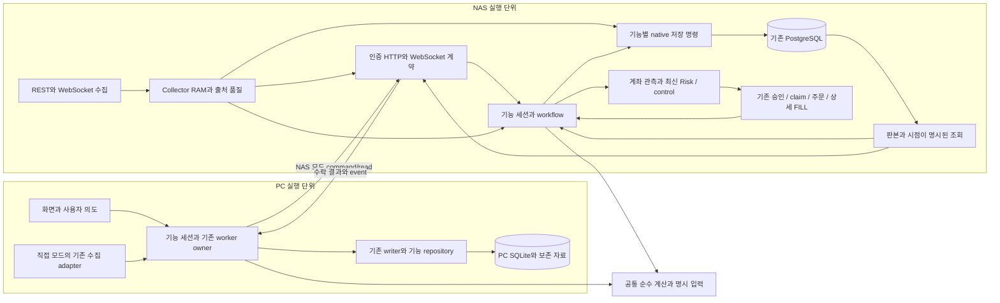
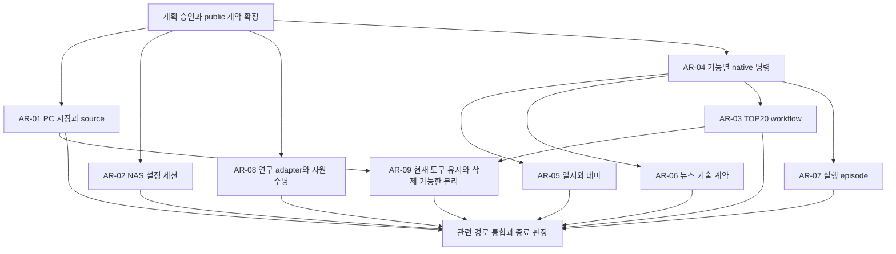

# 앱 전체 구조·품질 평가와 목표 구조·전환 계획

작성: 2026-10-23 · 제품 2.1.0 · **설계안 / 구현 승인 대기**

이번 작업은 PC 앱·NAS 서버·공통 로직·저장·통신·동기화 전체의 구조와 개발·검증·운영 품질 재평가다. 이전의 NAS 국소 개선만 진행·완료 영역 재평가 금지·전체 재설계 제외라는 범위는 이번 지시로 대체됐다. 과거 R3 수정·실패·검증 이력은 그대로 보존한다. 현재 클래스 구성, private 필드, 상태 배치는 보존 조건이 아니다. 기능·데이터 의미·안전·복구·필요한 호환 계약을 보존하면서 재사용·책임 이전·통합·부분 재작성을 선택한다.

첨부 지시문 7절과 후속 사용자 정정에 따라 **목표 구조와 전환 계획을 먼저 제시하고 승인 뒤 구현한다.** 이 문서는 구현 완료나 배포 증거가 아니다. 구현 착수 시 합의한 작업 묶음과 계약을 확정하며, 이후 발견을 이유로 범위를 자동 확대하지 않는다.

## 1. 기준 소스와 증거

| 구분 | 이번 기준과 한계 |
|---|---|
| 작업 소스 | 로컬 `main`, HEAD `2884ebaf22fa1fe292b682a305752073d566e780` + 기존 미커밋 변경 전부. 원격 HEAD·현재 NAS 배포는 이번에 조회하지 않음 |
| 실행 코드 지문 | 1,157파일, LF SHA-256 `28b645733feaa6b9aacffd83f3e615c76a0f25529b965e69b55d0a76573bf3a3`. 현재 제품 `src/kiwoom_monitor` 파일 목록은 394개이며 목록 개수는 정밀 검토 증거가 아님 |
| 직전 관련 실행 | 같은 코드 지문의 Runner 공개 계약 관련 149건, 7입력 DTO/순서 동일·DB 0→0, 당시 정적 검사 통과. [원문](../../data/diagnostics/r3-runner-public-20261023/verification.json) |
| 이전 비용 실측 | 뉴스 claim의 다른 소스 `92ce20cd…`: empty SQL 2→2, job 1개 3→2, 4개 6→2, 연결/COMMIT 각 1·반환/저장 동일. PC 격리 PG 2건 포함 89건. 현재 NAS 지연 개선율을 뜻하지 않음. [원문](../../data/diagnostics/r3-news-claim-20261023/verification.json) |
| 더 이전 실행 | 22차 통합·PG 필수 5개·operator 소유/lease·PC 회귀는 각각 당시 소스 이력. 이번 설계의 실행 검증이나 현재 전체 수락으로 합산하지 않음 |
| 이번 조사 | 8개 구조 영역과 추가 보안·관측·개발/운영 품질 경계의 본문·호출자·상태 변경·저장·소비·수명을 확인하고 root가 통합. 진단 전용/공통 안전의 교차 경계도 추가 확인. 앱·DB·유료 호출·새 녹화/리플레이 실행 없음. 사용자 첨부의 공개 설계 지침은 공식 웹 문서만 확인 |

이전 [AI Trading 설계](../AI_TRADING_SYSTEM_REDESIGN.md)의 공통 계산·입력·Risk·실행 경계는 재사용한다. 그 문서의 새로운 전략/연구 기능 개발 순서와 **현재 기능을 재구성하는 이 계획**은 구분한다. [R3 백로그](../../REFACTOR_BACKLOG.md)는 과거 문제·비용·F 상태의 정본이며, 남은 항목 수를 이번 구조 정리의 완료 기준으로 삼지 않는다.

### 1.1 앱에 적용할 품질 목표

품질을 클래스 배치만으로 판단하지 않는다. 현재 기능과 가까운 계획인 0B Shadow 개발에 다음 기준을 적용한다. 미확정 운영 SLA·허용 손실·RPO/RTO 수치는 개발자가 임의로 채우지 않는다.

| 품질 목표 | 이번 수락 기준 | 개선 근거와 남은 결정 |
|---|---|---|
| 정확성·안전 | 같은 수락 입력의 저장/계산 결과·출처/시점/단위 보존. UNKNOWN이나 gap을 성공으로 만들지 않음. FILL/최신 Risk/control/native 승인/중복 방지 유지 | 현재 fixture와 native 통합으로 확인. 실제 매매 규칙·불명 주문 재전송·손실 허용은 사용자 정책 |
| 변경 용이성 | 선택한 책임을 상태·호출·실패·복원과 함께 소유하고 무관한 owner 변경·private mutation을 줄임 | 대표 기능 추가 시나리오로 영향 설명. 파일 수나 속도만으로 판정하지 않음 |
| 비활성화·교체·제거 용이성 | 선택 기능의 코드·상태·작업·자료와 공통 기반의 의존을 구분. 해당 기능과 소수의 명시 등록/계약 변경으로 전환하고 무관한 내부 구현을 광범위하게 고치지 않음 | 대표 선택 기능의 진행 작업 종료·자료 보존·재시작·관련 회귀와 실제 변경 파급을 함께 확인. 모든 기능의 plugin/별도 process 전환은 요구하지 않음 |
| 가용성·복구 | 부분 성공·저장후 적용 대기·결과 불명을 구분하고 소유 작업의 실제 종료와 durable receipt로 close/재개 판단 | crash/ACK 손실/취소/재시작/restore 검증. 운영 중단·데이터 손실 허용은 별도 합의 |
| 진단 가능성 | 대표 PC 요청→NAS→worker→DB의 단계·시도·버전·원인/결과를 기존 기록으로 추적. 예외 없는 지연·stale·적체도 구분 | 기본은 적은 용량의 경계 기록, 상세 DB 진단은 기존 opt-in. 전 틱 기록·새 플랫폼은 불필요 |
| 성능·자원/비용 | 대표 동일 입력의 DB/I/O·지연/queue/CPU 등 필요한 지표와 결과 비교. 안전에 필요한 비용 유지 | 현재 운영값과 과거/격리값 분리. 필요한 증가는 이유와 함께 계약 갱신, 임의 임계값으로 금지하지 않음 |
| 보안·운영 | 기존 인증/비밀/권한/복원/release 격리 유지, URL/예외/로그/backup의 비밀 노출 방지 | 실제 설정·외부 공개/TLS·설치 helper는 미확인 시 그대로 표시. 새 SSO·권한 기반을 기본 도입하지 않음 |

### 1.2 14개 품질 영역의 현재 판정

`충분함`은 정한 범위와 검증까지 충족한 경우, `부분적으로 갖춤`은 기반은 있으나 전체 연결/수락이 남은 경우, `보완 필요`는 현재 코드나 절차의 구체적인 불일치가 확인된 경우다. `미확인`은 결함이라는 뜻이 아니며, `적용 불필요`는 앱 규모/기능상 제외 근거가 있는 기술에만 쓴다. 아래 판정은 현재 코드·기존 검증에 대한 것이며 현재 운영 전체 품질 인증이 아니다.

| 영역 | 현재 판정 | 확인한 기반 / 부족·미확인 / 목표 연결 |
|---|---|---|
| Q01 요구사항·기능 완성도 | 부분적으로 갖춤 | roadmap/OPEN_ITEMS/F 원장, 실제 research/Shadow/실행 연결 존재. 사용자 주도주 규칙·모델 지원/운영 수락은 미완성/정책 미정. 가까운 0B Shadow는 입력·출력·주문 없음부터 확정하며 계획 기능을 구현 완료로 계산하지 않음 |
| Q02 품질 목표 | 보완 필요 | 기능별 비용·안전/회귀·수명 기준은 있으나 과거 국소 범위가 앱 전체 종료 판단과 혼재. 이 문서의 품질 목표·대표 시나리오·승인 범위로 일관된 판정 마련. 운영 SLA/RPO/RTO 숫자는 미확인·별도 정책 |
| Q03 구조·상태 소유 | 보완 필요 | 기존 실질 owner와 public 계약 재사용. MainWindow/root/Runner/sync에 확인된 결합은 3~5절의 실제 상태/전이 단위로 재구성 |
| Q04 데이터 설계·보존 | 부분적으로 갖춤 | native transaction·불변 revision·원본/보존/동결 자료·no-op 기반. 일지 수동scope/ID·generic immutable import·테마 generation/복원 경계 보완. 과거 자료 임의 귀속/삭제 없음 |
| Q05 API·이벤트 계약 | 부분적으로 갖춤 | 인증/typed 요청·API fixture/expected revision·WS ACK 존재. 문구→업무 source 판정과 뉴스 판본 유실·일반 결과 상태 전달의 일관성 보완 |
| Q06 동시성·작업 수명 | 보완 필요 | shield/drain·account/Runtime fence·queued signal/writer 종료 기반. 중첩 producer·취소된 native wrapper·일부 child handle/setup cleanup 경계가 실제 종료를 충분히 표현하지 못함 |
| Q07 오류·재시도·복구 | 부분적으로 갖춤 | no-op/CAS/ACK-loss·claim retry·UNKNOWN/RECOVERY_REQUIRED·strict restore 존재. feature별 원인/단계/저장 receipt를 공통 경계 기록과 연결하고 빈 결과 fallback으로 숨는 범위를 변경 경로에서 확인 |
| Q08 로그·상태·장애 추적 | 부분적으로 갖춤 | KST 서버 일별 회전, DBWriterContext/call/parent/request IDs·단계계측·Collector 상시 pending/stale/실패 상태 존재. 일반 PC HTTP→NAS request context 연결, PC 보존/용량·공통 비밀 마스킹·sink 실패 확인은 보완 대상. 상세계측 off인 것을 상시 추적 성공으로 판단하지 않음 |
| Q09 성능·자원·비용 | 부분적으로 갖춤 | R3 source별 native 호출/반환행/ACK 비용과 기존 PG 지연·queue 계측 재사용. 최신 운영 병목 순위·장기 CPU/메모리/lock/WAL은 미확인. 새 진단 체계 없이 대표 전환별 재현 가능한 비용 비교 |
| Q10 보안·권한·비밀 | 부분적으로 갖춤 | 기존 bearer/credential 보안경계·암호화 vault·계좌 HMAC/lease·원본/비밀 배포 제외 존재. WS query token과 URL 기록·message shape 검증 보완. PC provider 키는 DPAPI, 별도 NAS bearer는 JSON 평문이므로 위협/백업 경계를 구분. 실제 유출/TLS·권한 배치/운영 로그는 미확인 |
| Q11 UX·실수 방지 | 부분적으로 갖춤 | saved/applied·지원/차단·재시작 필요 표시와 실패 pending 보존 존재. 화면 문구와 업무 전이 분리, 입력 판본/부분/불명 상태 표시·중복 클릭/늦은 응답·복원 권한을 실제 caller 연결에서 검증 |
| Q12 검사·리뷰·개발 환경 | 부분적으로 갖춤 | 가상환경/소스 지문/격리 worker·증분 선택·구조/비용/CI required gate 존재. 현재 dirty 누적 execution gate 미충족과 특정 연결 검사 공백을 보존. 새 구조 관련 검사·설계 영향 검토를 개발 중 수행, 전체 회귀 자동 확대 없음 |
| Q13 배포·호환·이전·백업 복원 | 부분적으로 갖춤 | immutable release/operator 격리·restore lease/before-image·Drive component hash/manifest-last·업데이트 rollback 존재. production Docker의 범위 지정 설치와 CI lock constraint가 달라 재빌드 재현성 보완. 실제 현행 배포/설치 helper/복원 수락은 미확인. 일지 독립복원·호환/전환 순서 명시 |
| Q14 운영·설계 문서·변경 관리 | 부분적으로 갖춤 | CURRENT_STATUS/OPEN_ITEMS/R3/F·guardrails·운영 명령/모델/검증 문서 존재. 현재/과거/목표를 구분하고 중요한 선택의 원인·대안/기각·계약·검증·재개 조건을 기존 정본에 함께 기록 |

**임시 도구의 위치(2026-10-23 최종 사용자 정정):** NAS 병목은 아직 해결되지 않았으므로 기존 녹화·리플레이·정밀 진단은 **현재 계속 유지·사용한다. 이번 재설계의 목표는 즉시 퇴역이 아니라, 필요할 때 도구를 삭제해도 제품 기능이 유지되도록 의존성을 분리하는 것**이다. 과거 뉴스 수집→NAS 적재와 대신증권(CREON) 자료 수집→NAS 적재도 일회성 생산 도구로 같은 경계를 적용한다. 도구 코드·설정·화면·쓰기 경로를 없애는 것과 이미 적재한 자료·출처·판본·검증 근거를 없애는 것은 별개다. 현존 도구·작업·자료는 지금 삭제하거나 중단하지 않는다. 앞선 AR-09의 '퇴역/제거' 표현을 즉시 삭제 지시로 해석하지 않는다.

**취소된 계획:** 자체 로컬 LLM 구축·학습·서빙과 이를 위한 전용 모델 작업자 구축은 진행하지 않는다(2026-10-23 사용자 정정). 목표 구조·선행조건·미완료 개발 목록에서 제외한다. 현재 사용 중인 뉴스 분석·외부 AI 호출·과거 결과/방법 비교 계약까지 폐기하거나 새로운 공급자로 자동 전환한다는 뜻은 아니다.

`적용 불필요`로 권장하는 것은 새 microservice/메시지 브로커/중앙 로그 플랫폼·대규모 APM·일반 다중 tenant/SSO 체계·전면 재작성이다. 이번 개인 PC/NAS 앱에서 현재 근거상 요구되지 않는다. 보안·로그·복원 같은 **영역 자체**를 불필요하다고 제외하지 않는다. scoped native claim/불변 저장·public DTO 등 기존에 충분히 검증한 경계는 해당 소스/범위에서 `충분함`으로 재사용하되 그 영역 전체를 일괄 충분으로 올리지 않는다.

기준 참고는 보안을 개발 과정에 통합하는 [NIST SSDF](https://csrc.nist.gov/pubs/sp/800/218/final), 필요한 경계의 문맥·민감정보 제외·기록 실패 검증을 다루는 [OWASP Logging](https://cheatsheetseries.owasp.org/cheatsheets/Logging_Cheat_Sheet.html), 지연·처리량·오류·포화를 함께 보는 [Google SRE](https://sre.google/sre-book/monitoring-distributed-systems/)다. 현재 앱의 판정 근거는 외부 체크리스트가 아니라 위 실제 코드/검증이며, 해당 문서의 모든 기술을 도입하거나 준수 인증을 선언하지 않는다.

## 2. 현재 전체 구조와 유지할 경계

현재 PC는 `bootstrap`이 실행 모드·client·repository를 조립하고, `MainWindow`가 시장 RAM과 화면을 함께 관리한다. `AppController`는 worker·timer·저장 pending·교체·종료를 소유한다. 뉴스·일지·연구는 별도 프로세스로 실행되며 각 로컬 자료와 NAS API를 소비한다.

NAS는 `create_app/lifespan`이 store·REST broker·Collector/Hub·TOP20·뉴스·Shadow·계좌 owner를 조립한다. PostgreSQL/SQLite의 native 구현과 transaction은 저장 계층에 있다. 다만 조립 함수 안에도 Shadow 설정의 상태 전이와 복구 판단이 있고, 일부 기능은 동일 자료의 현재값/판본/화면 projection을 서로 다르게 조립한다.

| 이미 역할이 확인된 경계 | 유지 이유와 개선 시 보존할 것 |
|---|---|
| REST broker / 공유 키·보정 시계 | 호출 제한·캐시·인증·시계 소유. 직접 WS와 fallback이 별도 토큰/시계를 만들지 않도록 유지 |
| Collector / Hub | REG ACK·출처 품질, 실제 0B→RAM/집계→pending/native 저장·실패 복원·live overlay의 연결. 틱마다 DB 재조회하는 구조로 바꾸지 않음 |
| 순수 집계·계산 | `MinuteTradeValueAggregator`, `Top20TradeValueCollector`, 시장/테마·연구 evaluator를 재사용. PC/NAS의 의미가 다른 상태까지 강제로 통합하지 않음 |
| AppController / 전용 writer / 작은 worker controller | 중복 실행·queued signal·pending 재시도·producer→signal→writer drain이라는 실제 수명 책임. 모두 제거하거나 하나의 전역 Manager로 합치지 않음 |
| native store / 기능별 SQL | 원자성·no-op·불변 충돌·CAS·claim·ACK 복구를 소유. QueryStore의 조립/기존 호환 역할과 좁은 소비 계약은 구분 |
| Runtime/Monitor/Supervisor/Execution | 상세 FILL·대사·계좌 cut·lease·최신 Risk/control·승인/claim/실제 전송의 서로 다른 권한. 판단 DTO를 주문 권한으로 승격하지 않음 |
| 뉴스 수집 / job / revision 저장 | source cursor, BODY/RULE/AI 실행, attempt CAS와 native revision 수명은 실제 책임. 개선한 claim CTE·정렬·두 phase·rollback 유지 |
| 원본·캐시·일지 보존·연구 입력 | NAS 운영 원본, PC 직접 수집 원본/캐시, 일지의 당시 보존본, 동결 연구 자료는 목적이 다름. 중복이라는 이유로 삭제하지 않음 |
| restore / credential / update / deploy | 자원 lease, 비밀·DB commit, 파일 원자 교체, 실행 release의 복구 의미가 다름. 하나의 범용 rollback으로 대체하지 않음 |

## 3. 실제 코드에서 남은 구조 문제

아래의 `코드 확인`은 본문과 연결을 확인했다는 뜻이다. 운영 장애 발생이나 현재 성능 비용까지 측정했다는 뜻은 아니다. 기존 R3와 겹치면 같은 근거에 연결하며 R3 신규 번호를 중복 생성하지 않는다.

| 원인 / 분류 | 현재 경로와 근거 | 목표와 판단 |
|---|---|---|
| PC 시장 상태와 화면의 공동 소유 / 유지보수성 | `presentation/main_window.py:_on_trade_tick`(2993), `_apply_ranking_view`(2579), history/gap/entry snapshot(3658,3933,4844); Controller의 ranking 응답이 화면 callback을 호출하고 그 뒤 구독/보완을 시작 | 가격·누적 기준·집계·coverage/recovery·당시 관측 입력은 시장 세션으로 함께 이전. UI는 값을 다시 소유하지 않고 투영만 표시. callback만 옮기는 분할은 불충분 |
| 표시 문구가 자료 권한을 결정 / 구조적 결함 위험 | `main_window.py:_on_realtime_status_changed`(1940)가 한국어 문장을 파싱해 active route·복구 조회·TOP20 허용을 결정. 실제 `test_nas_recovery_forces_current_top20_minute_history_reload`도 문장을 입력 | transport의 typed 출처/연결 전이를 정책 입력으로 사용. 문장은 결과 표시로만 유지. 실제 복구·full-code ACK·gap 기준은 유지 |
| 상위 worker 완료와 내부 producer 완료의 차이 / 수명 결함 후보 | Controller reload/close는 `requestInterruption`; `central_realtime_worker.py:run`(84)에는 nested fallback/validation 정리 `finally`가 없음. `stop`(265)의 정리를 우회할 수 있음 | CentralRealtimeWorker가 자식 실제 종료까지 소유. 기존 종료/교체 통합 경로에서 재현한 뒤 수정. 현재 운영 유출은 미재현 |
| NAS 조립부가 feature 세션 상태를 소유 / 유지보수성·잠금 결합 | `central_server/app.py:493–633`의 saved/applied/error/runtime/account 전이, routes(65–124)의 CAS/lock/owned task. 일반 AI/news/candidate와 `OperationalSettingsState.lock` 공유 | RAM 설정 세션으로 실제 상태+잠금+native 완료 합류+Runtime 수명 이전. root는 조립/최상위 수명. 공유 잠금의 운영 지연 규모는 미측정 |
| TOP20의 서로 다른 변경 이유와 수명 결합 / 유지보수성·성능 가설 | `autonomous_top20.py`가 ranking/cohort, 0B contribution, catalog/NXT/history, 장후 정산을 함께 소유. `_index_loop`(907)는 pending index·program 저장을 await한 뒤 sampling advance | live 순위/cohort는 함께 유지, reference 준비와 장후 workflow 분리. index pending/inflight/retry는 전용 저장 owner로 함께 이동. 지연→gap 영향은 통제 재현·비용 대조 후 확정 |
| generic 문서 쓰기에 숨은 업무 원자성 / 결합 | `database_documents.py:upsert_documents`의 theme snapshot, 기사 revision+BODY enqueue와 postcommit wake-up. caller가 같은 generic API를 원시 CRUD로 오해 가능 | 기능별 native 쓰기 명령으로 의미를 드러내고 동일 cursor/transaction helper 재사용. 서비스에서 따로 enqueue하는 방식은 원자성을 깨므로 채택하지 않음 |
| 테마 게시의 다중 원자 단위 / 데이터 계약 위험 | `infrastructure/central_content_sync.py:replace_themes`(109)가 profile/stock/metadata를 3개 HTTP/native 교체로 게시. Shadow는 metadata snapshot 소비 | 한 테마 판본을 한 native command로 게시하고 수락한 generation을 반환. 편집 원본과 서버 수락본을 분리. 현재 혼합 관측의 운영 발생률은 미측정 |
| 동기화가 자료별 소유 의미를 덮음 / 정합성 위험 | 일반 content pull은 theme dispatcher의 expected revision 없이 로컬 테마를 교체. journal generic merge는 불변 분석 revision·사용자 편집·실행 task를 timestamp UPSERT로 취급 | 테마 교체는 하나의 owner/CAS, 일지 import는 자료별 불변·사용자 편집·로컬 실행 소유 계약 적용. 원격 task 행 복제가 실행 권한이 되어서는 안 됨. 실제 운영 손실은 미관측 |
| 일지 수동 입력의 scope·revision 불일치 / 코드상 결함 | `journal_process.py:_setup_cycle_override_changed`(2084)가 scope/clock을 전달하지 않아 legacy 기본값 저장. preparation(196)은 선택 scope로 조회. revision inputs(255–272)은 override를 제외하지만 결과 selected_types는 영향을 받음 | UI→명시 scope/수동 입력→동결 분석→revision 저장을 한 계약으로 연결. 재현과 native 동일 ID 충돌 검증을 구현 첫 조건으로 둠. 기존 사용자 수정/과거 revision 삭제 금지 |
| 일지 복원의 writer·중앙 동기화 경계 / 복구 위험·정책 | 일지 child 중단과 DB 복원만으로 parent `EntrySnapshotWriter`의 접근·후속 원격 tombstone/재동기화를 조정하지 못함 | 기존 restore/lease 경계에서 대상 writer 입장 차단·drain·before-image·실제 교체를 한 작업으로 소유. 로컬 복원과 NAS 과거 자료 되감기는 다른 정책이며 자동 연동 금지 |
| 뉴스 원문과 분석 입력·현재 판본의 혼합 / 정합성·정책 | `ai_service.py:_prepare_events`와 `news_jobs.py:_run_ai`의 묶음/단일 BODY 입력 차이, 대표 기사 BODY로 저장 가능한 경로, mutable assessment와 최신 BODY 별도 조회, PC AI DTO의 판본 유실 | 원본 BODY와 분석 input bundle 구분, article/BODY/analysis IDs를 끝까지 운반. 현재 표시·재분석 정책은 별도 결정. 기존 R3-084와 통합 |
| 업무 시계 전달 누락 / 코드상 불일치·영향 미측정 | 기사 enqueue는 주입 `_now_provider`; `database_news_jobs.py:claim_news_jobs` 기본값과 일부 revision 시각은 `time()`. 같은 큐의 retry/stale 시계 출처가 다름 | 기존 키움 보정 시계를 같은 큐의 생산·claim·완료에 전달. epoch에 9시간 가감 금지. 실제 skew가 없는 환경의 비용/결과를 버그 재현으로 주장하지 않음 |
| Runner의 입력 해석·실행 세션 결합 / 유지보수성·안전 민감 | `mock_automation_runner.py:run_once`(2077)는 FILL→control→unfilled/protection→전략/clock→cursor/checkpoint를 직렬 소유. 생성자도 native 복원·listener 등록·입력 활성화를 수행 | 입력별 순수 adapter와 per-account/run execution episode를 구분. episode에는 FILL 투영/cursor·입력 복구·source·fixed decision·child·기한·보호·시계·checkpoint ACK를 함께 둔다. 연관 상태를 여러 Manager에 나누지 않음 |
| 연구·CLI·프로세스 진입점의 역방향 의존 / 유지보수성 | `research_process.py`가 `scripts.export_research_dataset`/`scripts.run_research` 본문을 import, ResearchDialog가 process 모듈에서 재사용 계약을 import | 재사용 실행/요청 계약은 src의 해당 기능으로 이동. CLI와 process는 인자·실행·exit만 담당. 계산/Paper/repository/subprocess/동결 입력 재사용 |
| 시작·교체·종료 자원의 불완전한 합류 / 수명 위험 | bootstrap의 일부 자원 시작이 최종 cleanup 구간보다 앞섬. child kill 후 실제 exit 확인과 source reuse 신원이 경로별로 다름 | 기존 bootstrap/feature process owner가 최초 획득부터 정리·실제 종료까지 책임. 저장 설정/현재 API 적용/전체 재시작 적용을 구분. 기존 ‘재시작 필요’ 정책을 몰래 hot reload로 변경하지 않음 |
| 기록 기반과 실제 경계 추적의 단절 / 진단·운영 부채 | `DBWriterContext`의 request/call/parent ID는 있으나 일반 HTTP client/app middleware에는 작업 ID 전달 연결 없음. `news_jobs.py:_run_body`는 URL 실패를 `except: continue`로 fallback하며 원인 정보가 남지 않는 경계 존재 | 기존 ID/context/logger·health를 연결하고 source fallback 원인과 결과를 함께 보존. 기본 기록과 opt-in 상세 진단은 분리. 새 플랫폼·매 틱 로그로 대체하지 않음 |
| 민감정보의 전송 호환과 기록 정책 불일치 / 보안 위험 | `realtime_routes.py:36`의 query token 호환, `server_logging.py:100`의 Uvicorn INFO, 로컬 설치 Uvicorn의 accepted/rejected URL 로그 경로를 확인. 일반 formatter에는 마스킹 없음 | 실제 token 없이 합성 fixture로 노출을 재현하고 경계/formatter에서 제거. 현재 header caller 유지, query 호환 제거는 전체 caller 확인 뒤 결정. 운영 유출이 발생했다고 단정하지 않음 |
| 검증 이미지와 production 재빌드 입력 차이 / 배포 재현성 | `deploy/synology/server.Dockerfile:48`은 서버 dependency 범위 설치, `tests/ci_runtime.Dockerfile`은 lock constraint 사용 | 기존 lock의 서버 subset/constraint 또는 실제 해석 dependency·image ID를 release 증거로 고정. NAS에 Windows/UI 패키지 추가·임의 버전 변경·httpx2 도입 없음. 현재 운영 이미지 mismatch라는 증거는 아님 |

`ForwardEvaluationRepository`의 일부 recovery/stop은 불변 append→현재 read→upsert가 여러 native 호출이다. recovery의 현재 caller는 Runtime guard로 직렬화되므로 즉시 결함으로 분류하지 않는다. STOP의 모든 caller 사이 순서 역전 가능성은 미재현 가설이다. 선택한 execution 전이의 동시성 검증에서만 확인하고, 이번 조사만으로 CAS나 저장 횟수 정책을 새로 만들지 않는다.

backend의 같은 문서 판정도 구분한다. SQLite 문서는 직렬화 TEXT, PG는 JSONB 비교이므로 key 순서만 바뀐 입력의 no-op 결과가 다를 수 있다. 이는 현재 구현 차이며 운영 병목이라는 증거가 아니다. AR-04에서 실제 변경하는 기능의 논리 결과·updated_at/receipt 의미를 검증하고 모든 codec을 일괄 교체하는 작업으로 확대하지 않는다.

## 4. 추천 목표 구조

**권장안은 기존 실행 단위와 원본을 재사용하는 기능별 재구성이다.** PC/NAS를 새 앱으로 전면 교체할 근거는 없다. 이미 유효한 계산·native 저장·복구·주문 경계가 있으므로, 책임이 잘못 놓인 세션·workflow·입출력 조립을 부분 교체하는 편이 안전하고 전환 효과를 검증하기 쉽다. 아래는 책임 배치이며 모든 칸마다 Controller/Service/Repository를 새로 만들라는 클래스 목록이 아니다.

### 4.1 책임·상태·접근 계약

| 기능 owner | 실제 소유 상태·수명 | 공개 경계 / 소유하지 않는 일 |
|---|---|---|
| PC 시장 세션 | 가격·누적 기준·분봉 집계·history coverage/gap 복구·TOP20 cohort·시장/테마 관측·source generation. 기존 순수 집계 재사용 | `accept_tick/ranking/history/source_transition`와 view/entry snapshot. QWidget·표 셀·서버 계좌·직접 SQL은 소유하지 않음 |
| 기존 AppController | worker/timer 생성·완료·queued signal, pending/dispatch/ACK/retry, runtime install·종료 순서 | 세션 입력·writer 명령·UI projection 연결. 시장 계산을 전부 옮겨 두 번째 MainWindow로 만들지 않음 |
| 기존 transport worker / controller | socket·구독 ACK·fallback/validation 자식·실제 종료. Qt 신호 adapter는 현행 controller | typed source transition과 기존 tick. 표시 문자열을 정책 입력으로 제공하지 않음 |
| NAS feed session / 시장 RAM / persistence | feed는 socket·구독 ACK·연결 generation·자식 수명, 시장 상태는 승인 receipt·품질/baseline·latest/봉 집계, persistence는 detached operation·pending/inflight·ACK/retry/close를 소유 | 현재 Collector의 구현을 책임 단위로 재구성하되 Collector 공개 경계는 원자 source transition·RAM+pending+inflight cut·retention·close를 조정. 상태 이동 없는 relay 3개를 만들지 않음. `accept`에는 DB I/O 없음 |
| TOP20 live owner | 순위 수락·membership/cohort·0B contribution·sampling 순서 | 불변 membership/index 결과와 subscription 요구. catalog/history/장후 장기 작업을 직접 관리하지 않음 |
| reference 준비 / 장후 workflow | 전자는 catalog/NXT/기준자료 readiness와 기존 per-stock/venue 이력 잠금, 후자는 거래일별 대상·진행·재시도·정산 | broker/native store의 기존 명령 소비. 필요 상태·수명이 있어 분리하며 별도 서비스 프로세스·범용 Queue는 만들지 않음 |
| RAM Shadow 설정 세션 | saved selection/revision, applied revision, error/closing, 선택 관측 계좌, current/failed runtime, mutation lock/owned task | load/status/update(expected revision)/publish/context/start/close. Runtime은 실제 Hub/계산/model slot/drain을 계속 소유. 주문·Risk owner 아님 |
| 뉴스 수집 / job runner | 공급자 cursor·budget·일정, claim한 attempt·입력 판본·실행·취소·완료 | 공통 입력 구성/분석 계산 재사용. native 원본과 AI bundle을 구분, latest 판본 선택은 일관된 조회 계약 사용. UI나 임의 별도 poller가 작업 owner가 되지 않음 |
| Runner execution episode / 입력 adapter | episode가 account/run/spec, FILL portfolio/cursor/seen IDs, 입력 cursor·복구, 원주문 anchor/child·source generation·기한·fixed decision·보호·session clock·checkpoint ACK를 일관되게 소유. adapter는 분봉 window 또는 0B 관측을 순수 kernel 입력으로 해석 | 기존 Runner를 episode로 재정의/부분 재작성 가능. 같은 직렬 loop·native gateway 재사용. scheduling shell은 wake/task/close만 소유하며 episode private 상태를 재조립하지 않음. 새 독립 clock loop·checkpoint writer 없음 |
| 일지 분석·보존 / 동기화 | 명시 account/canonical scope, 사용자 수동 입력, 동결 분석 입력·revision, 당시 보존본. sync owner는 수락/미전송 generation | UI는 의도와 표시, 기존 preparation/repository는 분석·보존. sync가 사용자 원본을 재계산하거나 오래된 자료로 조용히 덮지 않음 |
| 연구 workflow / 기존 process owner | 동결 spec/input/run/trial·claim과 결과 게시, child 실행/실제 종료 | 공통 계산/Paper·기존 repository 재사용. UI/CLI는 실행 진입점, 실계좌 자격증명이나 실제 주문 권한 없음 |
| native feature store | 키·revision·no-op/충돌·동일 transaction·ACK·원자 완료 | 좁은 실제 기능 명령을 직접 구현. full QueryStore는 root/기존 호환에 남기고 새 runtime에 무제한 저장 권한을 넘기지 않음 |

`PC 시장 세션`, `RAM 설정 세션`, `실행 episode`처럼 새 객체가 필요하다면 **상태와 전이·수명이 함께 이동할 때만** 만든다. 기존 큰 객체가 상태를 그대로 보유하고 새 객체가 그 private 필드를 수정하는 방식은 목표 구조에 미달한다. 독립 상태가 없는 계산·codec은 함수로 유지한다.

Collector 내부도 단순히 이름 세 개로 나누지 않는다. feed의 ACK된 source transition을 시장 상태에 먼저 반영하고, open RAM과 detached pending/inflight를 하나의 불변 cut으로 포착하는 호출은 같은 동기 전이로 남긴다. 그 뒤 native 저장만 별도 소유 작업으로 실행한다. 현재 TOP20 `MinuteTradeValueAggregator`와 native `MinuteBarAccumulator`는 venue·억/백만원 단위·누적 fallback/정산 의미가 달라 하나로 통합하지 않는다. 수락 receipt/정규화가 같음을 입증한 부분만 공유한다.

일지는 기존 `selected_types`를 결과에 보존한다는 계약을 유지하는 안을 추천한다. 수동 편집은 별도 사용자 상태로 저장하고, 분석은 해당 수동 상태의 명시 revision/hash까지 입력으로 고정한 새 분석 버전을 사용한다. 과거 v2 ID/시각/내용은 그대로 읽는다. setup/current 결과와 새 immutable revision의 최종 게시는 하나의 native 명령으로 처리한다. 이 명령이 `expected_manual_revision`을 확인하여 계산 중 편집이 바뀌면 과거 입력의 immutable 결과는 보존하되 current를 덮지 않도록 한다. 같은 내용 재저장은 receipt 시각만으로 새 분석 ID를 만들지 않는다. 사전 일봉/뉴스 보완 자료의 독립 보존을 거짓 원자 transaction에 포함하지 않으며, 출처가 입증되지 않은 기존 legacy 수동 행을 새 계좌에 자동 귀속시키지 않는다.

뉴스도 기사 원문 BODY와 여러 기사로 구성한 AI 입력은 별도 정체성을 갖는다. 기존 group 의미를 그대로 표현하는 입력 bundle을 고정하고, 결과가 참조한 article/BODY/analysis IDs를 PC까지 전달한다. job terminal CAS만으로 계산 중 부수 저장까지 보호됐다고 판단하지 않는다. 해당 native 완료 명령은 attempt가 여전히 유효한지와 어떤 결과가 공개되는지를 같은 저장 계약에서 확인해야 한다. 오래된 attempt가 만든 원본 이력 보존과 현재 판단 게시 권한은 구분한다.

### 4.2 저장·조회·동기화·오류 계약

1. NAS 모드의 시장/계좌 운영 원본은 기존 서버 store, PC 직접 모드는 기존 로컬 owner다. PC 화면 cache, 일지 당시 보존, 연구 동결 manifest는 역할을 명시한 복사본이다. NAS 공유 SQLite를 새로 직접 열지 않는다.
2. 고빈도 RAM 입력은 기존 source snapshot을 빌린다. DB의 최신 Risk/control·lease/승인·대사는 안전 목적의 fresh 조회이므로 RAM cache로 대체하지 않는다. 연구 봉·실시간 0B·초봉은 서로의 의무 중간 자료로 만들지 않는다.
3. 쓰기 API는 업무 결과와 실제 저장 receipt/revision을 반환한다. 문서+revision+job 등 현재 원자 업무는 같은 native cursor 안에서 유지한다. 외부 HTTP/비밀 파일/별도 DB까지 원자 transaction이라고 표현하지 않는다.
4. 테마 전체 게시처럼 하나의 업무 generation은 native 명령 하나로 수락한다. 기존 API가 분할 게시만 지원하면 새 명령을 추가하고 기존 caller를 전환한 뒤 옛 조립을 제거한다. 임시 호환은 실제 caller와 제거 조건을 기록한다.
5. 입력/응답은 기존 DTO를 우선 확장하여 source/venue/거래일, observed/available 시점, 단위, revision/hash, complete/partial/stale와 실제 ACK를 보존한다. `EMPTY`, `FAILED`, `UNSUPPORTED`, `APPLY_PENDING`을 빈 tuple 하나로 합치지 않는다. 모든 자료에 과대한 공통 envelope를 강제하지 않는다.
6. 업무 현재 시각은 기존 키움 보정 시계와 KST, timeout은 monotonic이다. 원래 발행/체결/봉 순간과 canonical UTC hash 경계는 보존한다. 시간을 얻기 위한 새 TR·poller는 없다.
7. source/API 교체는 기존 generation의 producer 정지→실제 내부 완료→queued 입력/저장 ACK→새 세션 install 순서를 따른다. 저장됐으나 적용 실패한 설정은 saved/applied로 구분한다. whole-app 재시작 적용을 무조건 hot reload로 바꾸지 않는다.
8. `close`는 새 입력 차단 후 이미 소유한 작업·native thread·저장 receipt까지 합류한다. 취소 요청·async wrapper 취소·kill 요청은 실제 종료 완료와 다르다. 저장 실패 pending을 보존하며 store/lease를 살아 있는 작업보다 먼저 닫지 않는다.

### 4.3 현재 구성의 처리 결정

| 처리 | 대상 | 구체적 근거 |
|---|---|---|
| 재사용 | 기존 broker/Collector/Hub·공통 집계·native store·Monitor/Runtime/gateway·restore/update/operator | 실제 성능·트랜잭션·인증·수명 경계가 있고 대체는 같은 안전 문제를 다시 구현하게 됨 |
| 개선 | 공개 source/runtime 계약, 기능별 native write, clock 전달, pinned revision·실행 결과, 자식 완료 | 현재 기능을 그대로 유지하면서 모호한 owner·유실된 판본·불완전한 완료 신호를 정리 |
| 상태와 책임 이전 | MainWindow 시장/복구/입력 조립, app Shadow selection, Runner execution episode | 서로 다른 이유로 바뀌는 상태와 제어가 UI/root/전략 처리에 섞임. 관련 caller·consumer·restore를 함께 이전 |
| 부분 교체 | 문자열 route 추론, dict/private runtime install/rollback, 테마 3단 게시, 일지 scope/revision 연결, research의 CLI 역의존 | 기존 구성 그대로는 공개 책임·원자성·입력 정체성을 표현하기 어려움. 대체 후 옛 분기/저장 조립/불필요 relay 제거 |
| 유지하며 판단 보류 | 뉴스 current 선택·유료 재분석, 동일 계좌 키 교체 뒤 AUTO 주문 관리·재개 | 구조 문제와 업무/안전 정책이 겹침. 기술 계약을 먼저 명확히 하되 정책을 임의 확정하지 않음 |
| 현재 유지·삭제 가능하게 분리 | 병목 조사용 recorder/replay/정밀 진단, 과거 뉴스·CREON 일회성 수집/적재의 전용 hook·UI/config/API/task/저장 | 현재 필요한 도구는 계속 작동시킨다. 공통 안전/자료 읽기·계약을 업무 owner에 두고 도구는 그 공개 경계만 소비. 향후 도구 구성 단위를 물리적으로 제외해도 정상 제품·기존 데이터 소비가 유지되게 검증 |
| 계획 취소 | 자체 로컬 LLM 구축·학습·서빙, 해당 목표만을 위한 모델 작업자 | 사용자 철회. 새 구조나 개발의 선행조건으로 남기지 않으며 현재 외부 AI·기존 자료는 별도 보존 |
| 채택하지 않음 | 전면 재작성, 새 microservice/event bus/공용 Manager/진단 체계, 모든 store 하나로 병합 | 현재 근거로 필요성 없음. 기존 안전 경계·데이터 이전 위험과 호환 비용이 효과보다 큼 |

### 4.4 코드 배치와 의존 방향

기능 owner는 해당 기능의 상태·전이·공개 자료형과 가까이 둔다. PC 시장 세션은 Qt를 요구하지 않는 application 모듈, RAM 설정 세션은 `central_server`의 해당 runtime 옆, native 업무 명령은 현재 기능별 `database_*` 구현, 연구 재사용 실행은 `application`/입력 adapter는 `infrastructure`에 둔다. 기존 `Runner`를 episode로 재정의할 수 있으므로 타입 하나를 더 만들기 위해 현재 Runner를 빈 relay로 남기지 않는다. Collector 분해도 기존 등록 planner·quality·minute accumulator를 재사용하며 필요한 새 모듈만 만든다.

| 호출·의존 경계 | 목표 규칙 |
|---|---|
| UI → PC 기능 owner | 사용자 command와 read projection만 사용. 표 셀에서 업무 입력을 역산하거나 owner private dict를 수정하지 않음 |
| application/domain 계산 | 명시 DTO·정책·시계/입력 cut 소비. Qt·HTTP·DB·process entry/CLI를 import하지 않음 |
| NAS route → 해당 세션/업무 owner | 인증·요청 검증/오류 표현 담당. 업무 CAS·mutation task/lock·복구 판단을 route와 root에 중복 배치하지 않음 |
| 기능 owner → 다른 기능 | 기존 snapshot/read/command·명시 callback 사용. source owner가 Shadow/뉴스/UI 구현을 import하지 않고 root에서 연결 |
| 기능 owner → native store | 실제 필요한 기능 command/reader만 소비. interface만 나눈 뒤 전체 store를 들여다보는 우회나 단순 runtime forwarding adapter를 추가하지 않음 |
| bootstrap/create_app | provider/clock/resource 생성·공개 연결·최상위 시작/종료. feature selection·뉴스 판본 선택·시장 복구·매매 전이를 해석하지 않음 |

예를 들어 source 전이는 `(generation, route, ACK/품질, 관측시점)`의 불변 값, 설정 갱신은 `update(expected_revision, changes) → saved/applied receipt`, 일지 준비는 명시 `scope/input cut/manual revision → 저장된 분석 결과`, native 쓰기는 현재 기능의 receipt를 반환하는 경계로 고정한다. 명칭은 새 프레임워크를 뜻하지 않으며 기존 DTO/반환 형식을 확장하는 방법을 우선한다. 이 계약을 확정한 뒤 각 owner의 caller와 소비자를 한 전환 안에서 바꾼다.

### 4.5 오류·추적·보안·운영의 공통 경계

기능 owner만 옮기고 장애를 추적할 연결이 없으면 목표 구조가 완성된 것이 아니다. 기본 기반은 기존 `logging_config`, `server_logging`, Collector의 가벼운 상태, job/run/attempt·저장 receipt다. `postgres_access.DBWriterContext`·`diagnostic_metrics` 등 상세 계측은 필요할 때 재사용할 수 있는 **선택적 조사 수단**이며 영구 핵심 의존성으로 만들지 않는다. 별도 로그 서비스·진단 DB·새 recorder/replay를 만들지 않는다.

| 경계 | 기본 기록/처리 계약 | 비용·보안·검증 |
|---|---|---|
| 사용자 의도·HTTP/child 진입 | 기존 request/job/run/selection revision과 논리 작업 ID를 연결. 없는 경우 진입점에서만 유한한 operation ID 부여. source/build·mode·적용 설정 revision·단계·attempt 전달 | 기존 PC→NAS client/header와 middleware의 누락을 보강하고 ContextVar/native thread에 연결. 외부 ID는 길이·형식을 검증하고 권한으로 사용하지 않음. 매 tick UUID/기록 생성 없음 |
| 인계·저장·완료 | owner의 accepted/start/native-ACK/applied/finished/cancel/retry/recovery를 필요한 업무 경계에서 기록. 저장 receipt·result state와 elapsed monotonic·관련 원본/판본 ID를 연결 | DB 결과 전체·기사 본문·고빈도 tick payload를 기록하지 않음. 기존 job attempt/업무 ID를 우선 사용하고 DB call/parent ID는 상세 조사 사용 시 연결. 같은 오류의 origin cause는 책임 경계 한 곳에서 보존 |
| 오류 공개 | 정상 EMPTY, 실패 FAILED, PARTIAL/STALE, UNSUPPORTED, 저장후 APPLY_PENDING, 결과 UNKNOWN을 기존 DTO/상태 코드에 명시. 원인 예외/chain은 내부 안전 문맥에 보존 | 사용자 메시지에 raw 예외·URL/DSN·키/토큰·계좌 비밀을 복사하지 않음. 기존 API 호환은 선택한 feature adapter에서 유지, 불필요한 공통 예외 프레임워크 없음 |
| 예외 없는 지연/멈춤 | 최근 수신/ACK·단계 시작/완료·현재 owned task·pending/inflight·실패/마지막 성공을 기존 status/health에서 확인 | Collector의 accepted0B age·waiting flushes·pending/failure 상태를 재사용. `oldest_record_at`은 queue 대기 시작 시각과 다르므로 혼용하지 않음. broker/news/native wait는 필요한 누락 경계만 연결 |
| 상세 성능 진단 | 기존 opt-in PG connect/worker/execute/fetch/commit·stage hook/lease와 bounded RAM을 그대로 사용 | 항상 상세 trace를 켜거나 주기적 전체 스캔하지 않음. 상세 진단이 꺼져 있거나 끝나지 않은 call은 원인 미확정으로 보고. 단순 에러 0건을 지연 없음으로 해석하지 않음 |
| 로그 보호·실패 | 공통 formatter/filter와 전송 경계에서 credential/header/query/DSN 민감정보와 CR/LF 주입을 제거. 일반 로그의 날짜·용량 한계/중복 요약·sink 실패 상태를 관리 | 서버 기존 KST 14일 회전은 재사용. PC 보존/byte cap은 실제 기록량·기존 정책을 확인해 일반 진단 로그에만 적용. 파일 오류를 같은 sink에 무한 재기록하지 않으며 비밀·필수 주문 원장과 별도 처리 |
| 인증/권한·호환 | 기존 bearer·credential 전용 trusted-peer/HTTPS·필드/용량 검증·vault·HMAC/lease 유지. 현재 WS query-token 호환은 실제 caller 확인 후 header 경로 우선 | `realtime_routes.py`의 query token과 Uvicorn URL 기록 연결을 먼저 안전하게 마스킹. 기존 인증을 없애거나 보안 실패를 빈 정상 응답으로 바꾸지 않음. 토큰이 없는 합성 fixture로 accepted/rejected 로그 경로 검증 |
| 배포/설정·복구 | 빌드/소스·실제 실행 release·설정 saved/applied·DB schema/호환을 구분. 외부 전송·DB commit·파일 commit 이후 복귀 의미를 각 owner가 보고 | 이전 키/DB/RAM으로 무조건 rollback하지 않음. 기존 배포·restore 절차/격리 operator 재사용. 생성된 backup과 실제 복원 수락을 구분 |

기본 로그/오류·상태·실제 완료 정보와 임시 진단은 다음처럼 구분한다.

| 구분 | 제품 수명과 의존성 | 제거/종료 조건 |
|---|---|---|
| 기본 업무 관측 | 필요한 시작/실패/저장/적용·마지막 성공·작업 완료를 기존 logger/status/receipt로 확인. 실제 주문/체결 원장과도 구분 | 앱의 정상 개발·운영에 필요한 최소 범위 유지. 모든 함수/SQL/tick 기록을 강제하지 않음 |
| 녹화기·NAS 진단기·상세 PG trace | 병목 미해결이므로 현재 유지·사용. 제품 기능은 도구 설치/활성 여부에 의존하지 않도록 재설계 | 이번 완료 조건은 도구의 정상 사용과 물리적 제외 시 제품 독립성이 모두 검증되는 것. 실제 퇴역 시점은 나중에 정하며 이력/원본 자료 폐기는 별도 정책 |
| 과거 뉴스·CREON 수집/적재 | 일회성 생산·전송·검증 작업의 수명/재시도/ledger는 도구에 둠. NAS 수락 자료·기존 연구/조회는 제품의 자료 계약을 소비 | producer/COM·수집 원본 코드·업로드 스크립트가 없어도 이미 수락한 기사/봉/출처·판본/연구 입력을 읽을 수 있어야 함. 현재 수집/적재 작업의 중단·자료 삭제는 하지 않음 |
| 고빈도 경로 비용 검사 | 기존 관련 native fixture의 호출/반환/저장 결과와 간단한 카운터 우선 | 진단 제품의 유지나 녹화/리플레이 실행을 회귀검사의 필수 선행조건으로 삼지 않음 |

현재 `diagnostic_replay_runtime`의 작업 helper가 production에서도 호출되는 것처럼 이름과 실제 수명 책임이 섞인 부분은 전환 시 구분한다. production native 작업의 실제 완료 합류는 해당 업무 owner가 진단 없이 보장해야 한다. 필요한 일반 수명 코드는 기존 업무 경계로 옮기고 진단 전용 capture/scheduling hook만 선택적으로 남긴다. recorder/진단 API를 빈 relay로 영구 보존하거나 새 진단기를 만들어 대체하지 않는다.

현재 DBWriterContext에는 request/call/parent ID가 있지만 일반 PC HTTP는 clock header만 보내고 app middleware도 clock만 응답하므로, 이 기반의 존재를 PC→NAS→worker→DB 전체 추적 완료로 볼 수 없다. 상세 PG metrics는 opt-in lease의 bounded RAM이며 상시 사건 원장이 아니다. 현재 source에서 producer를 확인하지 못한 과거 `connection-events` 파일을 신규 추적 기반으로 간주하지 않는다.

일반 로그 저장 실패 때문에 정상 RAM 수신·불필요한 재전송·동일 오류 폭주가 생기지 않아야 한다. 반면 필수 주문/승인/FILL/native 업무 원장의 영속화 실패는 기존 안전·UNKNOWN/복구 계약을 따라야 한다. 두 종류를 같은 “로그 실패 무시”로 처리하지 않는다. 새로운 로그 보존값이나 운용 경보 임계값을 정할 때는 해당 기록량과 사용자 허용 비용/손실을 먼저 구분한다.

PC NAS bearer의 평문 저장은 현재 사실이며 실유출 증거는 아니다. 기존 provider 키와 같은 보호 저장 경계 재사용을 추천하되 PC/계정 간 이동·기존 파일/backup 읽기·secret 참조 전환을 함께 설계한다. 서버 vault의 암호문과 master key를 모두 읽을 수 있는 계정까지 암호화로 보호된다고 주장하지 않는다. 일반 LAN HTTP·실제 TLS termination·역할 분리의 필요성은 설치 환경/위협 모델을 확인한 뒤 정하고 대규모 인증 체계를 선행 도입하지 않는다.

### 4.6 선택 기능의 수명과 제거 계약

**2026-10-23 사용자 추가 기준:** 확장뿐 아니라 비활성화·교체·제거가 쉬워야 한다. 이는 임시 진단/일회성 생산 도구만의 규칙이 아니라 실제 선택 기능 전반의 목표다. 다만 주문·상세 FILL·최신 Risk/control·원본/transaction·작업 종료 같은 공통 안전 처리를 편의를 위해 선택 기능으로 내려놓지는 않는다. 비활성화/삭제의 구조를 설계하는 것과 지금 실제 기능을 중단·제거할 권한은 구분한다.

| 선택 기능 | 해당 기능이 소유할 코드·상태·작업 | 전용 저장 자료와 남겨야 할 공통 계약 |
|---|---|---|
| 시장·테마 RAM Shadow | 선택/해석·model slot·saved/applied revision·current runtime·평가/기록 task·본인 Hub 구독/retention lease | 선택 문서·선택적 관측 결과/model receipt는 해당 기능 자료. 기존 Collector/Hub·시장 원본·계좌/Risk·공통 native 작업 합류는 기능 부재에서도 유지 |
| 외부 시장 자료 수집 | 공급 adapter·symbol/roll 설정·현재 수집/설정 적용 task·폴링·자기 pending/마지막 결과 | 기존 외부시장 관측/봉은 자료 계약에 따라 보존. 비활성화는 새 수집을 멈추며 지난 자료를 지우거나 신선한 값으로 표시하지 않음. 공통 broker/store/보정 시계와 국내 시장 수집 수명은 독립 |
| 뉴스 AI 공급 adapter | 해당 provider의 요청 구성·model 설정·진행 중 요청/attempt·일시 cache·provider 적용 세대 | 기사/BODY 원본·과거 분석 판본·usage/승인 receipt는 기존 reader로 유지. 공통 credential/vault·job claim/native 완료·다른 provider는 제거 대상이 아님. 자체 로컬 LLM 신규 구축은 취소 상태 |
| 병목 녹화·리플레이·정밀 진단 | capture 설정·observer/route/화면·session/task·전용 직렬화/보고/쓰기 | 현재 필요하므로 동작 보존. 전용 trace/report와 공통 gap 시각·task/native 합류·기본 상태를 분리. 코드 분리는 과거 trace/원본 삭제를 뜻하지 않음 |
| 과거 뉴스·CREON 일회성 수집/적재 | collector/COM·retry/진행 ledger·CLI/전용 설정·전송·적재 작업 | NAS에 수락한 데이터/출처·판본·단위/시각·manifest/hash는 독립 소비 계약. producer의 코드/설치가 없어도 조회/연구 가능해야 하며 진행 중 작업·적재 데이터는 지금 중단/삭제하지 않음 |

이 표의 owner/구성 단위는 기존 모듈·객체·명시 조립 지점으로 구현한다. 독립 process·plugin manifest·공용 feature registry·범용 Manager를 기능마다 만들지 않는다. 실제 caller·state writer·구독/작업 생성·저장·reader·복원·build/설정 등록을 해당 전환 묶음에서 확인하고, 필요 없어진 구형 연결은 함께 정리한다.

**공통 전환 계약**은 다음과 같다. 모든 기능에 같은 상태 enum이나 wrapper를 강제하지 않고 기존 상태/receipt로 의미를 표현한다.

1. 비활성화 요청은 해당 기능의 새 작업 입장만 막는다. 이미 수락한 입력·native 작업·저장 ACK는 기존 처리/복구 계약대로 합류한다. 단순 cancel 요청이나 async wrapper 완료를 실제 종료로 간주하지 않는다.
2. feature owner는 본인 구독/lease·timer·callback·task만 해제한다. 공유 Hub/broker/store나 다른 기능 작업을 닫지 않는다. 종료/저장 실패는 pending·적용 대기/복구 필요로 남기고 기능이 꺼졌다고 거짓 성공하지 않는다.
3. 비활성화는 재활성화 가능한 상태, 최종 `close`는 자원 종료로 구분한다. 예를 들어 현재 외부 collector의 settings disable은 `_stop` 후 재시작 가능하지만 최종 close는 `_shutdown`을 고정한다. 재활성화를 닫힌 객체에 강제로 적용하지 않고 기존 owner의 재개/교체 계약을 따른다.
4. 교체는 기존 공개 입력/반환·시점/판본/오류·저장/ACK 계약을 확인한 뒤 prepare→구 작업 drain→install/publish와 세대 fence를 적용한다. 늦은 구 결과는 원래 receipt를 보존하되 새 활성 상태를 덮지 않는다. DB/외부 전송 후에는 옛 RAM으로 무조건 rollback하지 않는다.
5. 실제 제거 시에는 해당 기능의 등록·화면/설정·route/client·전용 background work·전용 dependency/build 항목까지 정리한다. 구 설정이 남아 있어도 공통 기동을 깨거나 사라진 작업을 영구 재시도하지 않게 호환 경계를 명시한다. 기능 미지원/비활성 상태를 정상 0값이나 현재 결과로 위장하지 않는다.
6. 코드 제거는 데이터 삭제가 아니다. 잔여 자료는 기본 보존하고 계속 소비하는 reader/schema·과거 판본/출처 계약을 유지한다. archive/이전/삭제·tombstone·외부 동기화 전파는 별도 정책/승인으로 정한다. 필수 주문/체결·사용자 원본·불변 이력은 기능 중단에 딸려 삭제하지 않는다.
7. 재시작에서는 saved/active 상태와 종료/복구 receipt를 대조한다. 비활성/제거 기능의 작업이 자동 부활하지 않고, 필요한 계좌 대사/공통 복구·자료 조회는 계속 연결돼야 한다. 잔여 미완료 업무가 있으면 원인/수락 상태를 드러내며 완료를 꾸미지 않는다.

선택 기능 변경의 **허용 파급**은 해당 기능의 구현/자료·소수의 명시 조립/등록 지점·실제로 바뀐 public/API/UI/자료 호환 계약이다. 공통 계약이 그대로인데 Collector의 수집/분봉 산술·계좌 native gate·다른 기능 내부 cache를 광범위하게 수정해야 한다면 분리 목표에 미달한다. 처음 책임을 이전할 때 필요한 공통 경계 정리는 해당 AR에서 근거를 남기되, 이후 매 제거 때 같은 광범위한 수정을 반복하지 않게 한다. 파일 수/호출 깊이는 근거로 기록하고 임의 최대 개수로 판정하지 않는다.

## 5. 단계별 전환 계획

아래 `AR-01~09`는 이 설계의 전환 묶음이며 새 R3 결함 ID나 별도 상시 백로그가 아니다. 실행 상태·진행 기록은 [기존 R3 현재 작업](../../REFACTOR_BACKLOG.md#현재-작업과-이어가기)에 연결한다. 현재 전부 **승인 대기 / 제품 구현 미착수**다. 묶음 내부도 한 번에 전체 파일을 바꾸지 않고 기능이 연결된 절단면 단위로 통합한다.

| 묶음 / 권장 순서 | 현재 → 목표 / 변경 경계 | 선행·충돌 경계 | 완료 기준·검증·위험 |
|---|---|---|---|
| AR-01 PC 시장 세션·출처·실제 producer 수명 / 우선 | CentralRealtimeWorker 자식 종료·typed source 전이부터 재현/보강. 다음으로 MainWindow의 tick→집계/복구→writer 명령→관측 snapshot을 실제 세션으로 이전. UI 표시/타이머 투영은 남김 | 공통 source transition/DTO 계약 먼저 확정. AR-08 bootstrap install/close와 함수·수명 소유권 합의. AR-03의 NAS 입력 뜻과 충돌 없이 각 상태 독립 | 중첩 worker가 끝나기 전 교체/close 완료 없음. 같은 틱·rank·gap/recovery·entry snapshot 결과, late signal·writer 실패/재시도·no-writer 호환·숨김 화면·재시작 검증. GUI 문구 변경이 source 정책을 바꾸지 않음. 고위험: source 바꿈과 native late write |
| AR-02 NAS 설정 세션·root 조립 / 우선, AR-01과 독립 | app closure의 상태/준비/저장 settle/apply/retry/Runtime 교체를 RAM 설정 세션으로 이전. Runtime allocation 공개 연산. 일반 settings lock과 분리 | 기존 selection transaction·CAS·account callback/Runtime 게시 의미 동결. AR-07과 관측 callback 계약만 공유, 계좌 전이는 수정하지 않음 | no-op/CAS/명시 null/ACK 손실·저장후 적용실패·동일revision 재시도·반복취소·startup/close 최종 native 합류. app/route에 selection 업무 전이·private Runtime 접근이 남지 않음. 고위험: saved/applied·계좌 변경 fence |
| AR-03 NAS 수집·TOP20 workflow / 이후 | live TOP20와 기준자료/장후 상태·task, index pending/inflight/retry owner를 분리. Collector는 feed 승인·시장 materialization·native 저장 수명으로 부분 재구성하되 공개 원자 cut·Hub 계약은 재사용 | AR-02와 Collector 공용 API 변경 시 root 통합. AR-04 native 저장 계약 사용. 초기 index-loop 지연은 통제 재현 후 해결 범위 확정 | 동일 membership/cohort/지수·gap·retention·open+pending+inflight overlay·subscription ACK·중복저장 방지. 느린/실패 native 저장 중 RAM sampling·입력유실·outbox 크기/순서/close 확인. 비용·지연은 같은 입력/저장 결과로 대조. 고위험: cohort cut·재시도·최종 flush |
| AR-04 기능별 native 저장 명령 / 각 기능 전환에 선행 | aggregate를 다시 쪼개기보다 뉴스/테마/실행 등 실제 업무 transaction 명령을 현재 구현에 노출. generic API의 숨은 side effect·호출자 read/write/read 조립을 해당 범위에서 교체 | 기능별 native 함수/transaction owner는 한 agent만 수정. 뉴스는 AR-06, 테마/일지는 AR-05와 같은 branch에서 계약 합의 후 통합. 한 거대한 전역 선행 리팩토링으로 만들지 않음 | native SQLite/PG의 반환·row/order·no-op·immutable conflict·동시 claim/CAS·rollback·commit후 ACK 손실·wake failure. 필요한 안전 조회/COMMIT은 보존. 전체 snapshot/허용 I/O baseline 초기화 금지 |
| AR-05 일지·테마·동기화 authority / AR-04 해당 명령 뒤 | 일지 수동 scope/clock/revision 재현을 먼저 확정. 분석 입력/보존 책임을 기존 preparation/repository에 정리하고 UI는 command/표시. 테마 accepted snapshot 원자 게시, 일반 pull/import의 owner 우회를 제거. 복원은 모든 대상 writer 조정 | AR-01 entry snapshot의 외부 계약 보존. AR-04 테마 native command. 연구의 과거 입력/사용자 복기와 저장을 공동 변경하지 않음 | UI 선택→선택 scope 저장→분석→새revision→native조회/재열기→sync 소비. 수동 수정·구형scope/revision·불변 충돌·미전송delta·삭제/이름변경·동시편집·백업/Drive/NAS·복원 중 parent writer 확인. 고위험: 사용자 원본·identity |
| AR-06 뉴스 입력·판본·완료 / 기술 단계 우선, 정책 단계 조건부 | source BODY와 AI bundle 분리, pinned IDs/clock을 job→저장→API→PC projection에 전달. 일반 current 선택과 job 완료 공개를 명시. 기존 collect/job/process/native 저장 재사용 | AR-04 뉴스 command/claim 원자성. R3-084 표시/재분석 정책 전에는 현재 표시 의미를 바꾸지 않음. AR-05 content schema 소비와 합의 | 같은 입력의 manual/auto/direct 의미, article/BODY/input hash 보존, stale attempt·실패/rollback·중복/재시도·완료후 ACK 손실·exact BODY evidence·PC 캐시/백업/종료 검증. claim SQL/연결/COMMIT 계약 유지. 고위험: 원본 오표지·판단 판본·외부 유료 호출 |
| AR-07 Runner execution episode / 안전 계약 동결 뒤 | FILL 투영/cursor·입력 복구·원주문/보호/시계·고정결정·checkpoint ACK를 하나의 run episode로 재구성하고 입력별 전략 adapter와 구분. 생성/prepare-restore/listener attach/start/current 게시를 명시. 같은 loop/native gate 유지 | AR-02 관측 callback와 인터페이스만 합의. AR-04 실행 command는 같은 transaction 소유자와 단독 통합. R3-085 계좌/키교체 정책은 별도 차단 | FILL→control→unfilled source/management→protection→leader 또는 clock/bootstrap/frame/관측→checkpoint의 실제 분기 순서 유지. 고정 보호 EXIT/clock Decision 등 기존 경로별 durable-before-QUEUED, cancel 직전 재검증, ACK 손실·재시작·STOP/취소·close·UNKNOWN/중복전송 검증. 고위험: 실제 주문 수명·권한 |
| AR-08 연구·프로세스·시작/복구 / 독립 절단면 병렬 | reused research 실행/요청 계약을 src 기능으로 이전, CLI/process는 adapter. bootstrap 최초 자원 획득부터 정리 범위에 포함. process는 실제 종료 확인 후 handle/lease 반환; saved/active/restart 적용 구분 | AR-01 runtime swap/close와 충돌 함수 순차 통합. 연구 계산/저장과 NAS 주문은 독립. operator 보고기/권한 변경은 별도 승인 범위 | 같은 spec/input 결과·run identity/구형hash 호환·final/OOS 접근·lease·중복재시작·원자 trial·publish failure. setup 각 단계 예외·child start실패/취소/native 진행·kill후 실제 종료·부모 재시작. 고위험: 연구 이력/프로세스/restore |
| AR-09 임시 도구의 삭제 가능성·제품 독립성 / 현재 도구는 유지 | 병목 녹화/진단과 과거 뉴스·CREON 일회성 수집/적재를 별도 구성 단위로 분리. 공통 native 수명/Hub gap/구독·기본 상태/자료 reader는 제품 owner로 이전. 현재 도구 기능은 보존하고 향후 삭제 때 전용 호출/설정/UI/API/task/쓰기까지 함께 빠지도록 연결 정리 | AR-01 fallback, AR-03 Hub/Collector 수명, AR-04/06 수락 데이터/판본, AR-08 연구/작업 경계와 교차. app/store·operator/probe는 root 순차 통합. 현재 설치/운영 변경·도구 중단 없음 | 도구를 설치한 경우 현재 조사/수집/적재 계약 유지, 격리 환경에서 도구 구성 단위를 물리적으로 제외한 경우 정상 수집/저장/주문/FILL/Shadow·종료/복구와 이미 적재한 데이터 조회/연구 유지. 플래그 OFF만으로 수락하지 않음. 실제 도구·자료 삭제는 별도 시점/승인 |

### 5.1 병렬화와 통합

설계 승인 직후 AR-01 PC transport/시장, AR-02 NAS 설정 세션, AR-08 연구 adapter 이동은 서로 다른 상태·transaction을 소유하므로 병렬 착수가 가능하다. AR-05 일지 scope 재현도 해당 UI/repository와 AR-01의 frozen entry DTO를 수정하지 않으면 병렬 가능하다. 나머지는 기능별 native 명령과 public 계약을 먼저 확정하여 후속 투입한다. 동시 개수를 관례적으로 제한하지 않되 승인된 독립 경계 수만큼 실행하며 불필요한 agent를 만들지 않는다.

화살표는 계약 선행이며 모든 저장 영역을 먼저 통째로 리팩토링하라는 뜻이 아니다. AR-04의 뉴스·테마·실행 구현은 각 기능의 실제 transaction별로 진행한다. 같은 파일이어도 함수/상태/계약이 독립하면 병렬화할 수 있고, 다른 파일이어도 같은 owner·transaction·fixture 자원을 바꾸면 순차 통합한다. root만 공유 원장/F·계약/guardrail을 갱신하고, 합류 뒤 현재 소스의 관련 검증을 실행한다.

AR-07은 현재 별도 clock collection과 Runner checkpoint envelope를 곧바로 새 schema에 합치는 작업이 아니다. 통합 episode의 저장·복원 단위와 구형 두 문서의 호환 읽기를 명시하고, ACK 손실/재시작에서 고정 Decision·취소 시도·보호 상태·cursor가 같은 수락 상태로 복구되는지 검증한 뒤 전환한다. AR-05 독립 일지 복원은 `news.sqlite3`의 링크·기사/AI 근거와 sync baseline까지 확인해야 하며 journal 파일만 돌아온 것을 기능 전체 복원으로 수락하지 않는다.

**공통 품질의 첫 적용은 AR-02의 PC 선택→NAS 접수→native 저장→적용/응답 한 경로**를 추천한다. 여기서 작업/시도 연결, saved/applied 오류 상태, 비밀 제외, 로그 실패/취소/ACK 손실, 기본 기록과 opt-in 상세진단의 구분을 실제 fixture로 검증한다. 기존 logger/client/middleware/DB context를 보강할 뿐 별도 플랫폼을 만들지 않는다. WS URL 비밀 마스킹은 같은 기본 품질 배치에 넣되 구독/인증 의미는 보존한다. 공통 logging/client/middleware 파일은 root가 변경 소유권을 하나로 배정하고 AR-01/08과 순차 통합한다. 검증된 규칙만 각 AR에 적용하며 모든 기능에 강제로 DB/log/task를 추가하지 않는다.

AR-08의 delivery 검증에는 기존 production/CI 의존성 입력·소스 image/release 지문 정합성, 격리 backup→restore→조회/소비의 실제 결과를 포함한다. 실행이 승인되지 않은 이미지 build/운영 복원은 수행하지 않고 필요한 환경/승인과 미검증을 남긴다. 보안/기록 공통 변경은 해당 feature의 실제 authentication/WS/오류 응답·기존 `test_central_server_logging`·`test_postgres_access` context/sink 격리 검사와 연결한다.

### 5.2 AR-09의 실제 도구·의존·분리와 향후 삭제 범위

현재 필요한 NAS 병목 조사 도구를 없애는 단계가 아니다. **지금은 유지하면서 제품→도구 역의존을 끊고, 향후 구성 단위째 삭제할 수 있도록 만드는 단계**다. 현재 사용 여부/활성 capture session·수집 완료·운영 자료는 이번에 조회하지 않았다. 아래 표의 '제거'는 도구를 나중에 퇴역시킬 때 함께 제거할 전용 범위이며 이번 구현에서 당장 사용 기능을 지우라는 뜻이 아니다. 도구가 연결된 개발용 실행에서는 기존 동작을 유지하고, 도구 코드 자체가 없는 정상 제품 실행도 검증한다. 플래그만 끄거나 import 오류를 숨겨서 독립성을 대신하지 않는다.

| 도구/연결 | 현재 실제 용도·경로 | 이번 분리·향후 삭제 범위와 보존할 계약 |
|---|---|---|
| PC 병행 검증/녹화 | API 설정의 `parallel_validation_enabled`→client factory의 병행 REST, bootstrap의 `RealtimeValidationRecorder`/JSONL→CentralRealtimeWorker의 별도 local validation WS | 전용 UI/설정 저장·factory 인자·녹화 callback·validation child·직렬화/쓰기 제거. `_validation_worker`는 recorder에만 전달하며 실제 fallback과 별개다. fallback producer와 full-code upstream ACK·재연결·stop은 보존. AR-01과 같은 파일은 순차 통합 |
| NAS workload pause/측정 lease | compose가 `KIWOOM_DIAGNOSTIC_WORKLOAD_PATH`를 주입, `diagnostic_workloads.control_snapshot`이 JSON을 읽어 진단 pause/capture 판정, 업무 loop의 hook에서 소비 | 제품 loop의 진단 pause/decorator·반복 control 파일 읽기·전용 env/config/client/화면 제거. 기능 자체의 운영 설정/STOP/control은 진단 pause와 다른 계약이므로 보존 |
| store/REST/Hub 입력 capture | SQLite/PG store 생성자가 항상 `install_store_capture`를 호출해 native 공개 메서드 wrapper 설치. Hub publish도 항상 capture 함수/metadata wrapper를 거침 | normal store/REST/Hub에서 replay input/context/capture wrapper·전용 metadata·payload 쓰기 호출 제거. 비용 비교는 같은 native 결과/SQL/COMMIT와 wrapper/파일 접근 수로 검증. OFF 상태 오버헤드를 실제 운영 지연 수치로 확대하지 않음 |
| 정밀 PG trace·run 보고 | app가 read/control/run router를 등록하고 시작 interrupted trace 복구·종료 run/trace drain에 관여. 상세 metrics/trace/manifest/payload·report JSON/JSONL에 저장 | 현재 조사에 필요한 수단은 개발 전용 실행으로 격리하고 끝난 run scheduler/control/report API/UI·capture 저장 경로·build COPY 등 제거. 일반 오류/상태/최소 단계 시간은 작은 기본 경계에 유지하며 상세 시스템 복제 금지 |
| replay task/thread helper | Collector/TOP20/broker 등 production이 `diagnostic_replay_runtime.owned_create_task/owned_to_thread`를 import. 일반 실행은 plain asyncio로 내려가며 replay scope의 thread registry는 활성 replay에서만 동작 | 실제 생산자/worker/native 종료 합류는 업무 owner에서 명시 보장. replay scheduler/ContextVar/input routing·capture receipt는 제품에서 제거. helper 이름만 바꾸고 같은 진단 종속을 남기지 않음 |
| Hub wrapper의 공통 gap 안전 | `CapturedHubEvent.published_at`을 `RealtimeSubscriber.remember_drop`이 실제 유실 범위/거래일 판정에 사용 | 먼저 기존 보정 시계의 발행시각을 정상 event envelope로 옮겨 gap 범위/자정/불명 처리를 검증한 뒤 capture receipt/type 제거. dict wrapper를 통째로 삭제해 source 품질을 약화하지 않음 |
| 기본 연결 확인·resource UI | `ApiSettingsDialog._load_resource_document`가 진단 resources API를 일반 NAS 연결 확인에도 사용 | 연결/인증·최소 health/resource read는 정상 운영 계약으로 옮기고 필요한 UI만 유지. 녹화/세션/trace/보고 탭·전용 client는 제거. 일반 연결 버튼을 404로 남기지 않음 |
| operator 상태·시험/배포 입장 | `scripts/nas_operator.py:SNAPSHOT_CODE`가 health 외 workloads/trace/reports 세 진단 API를 요구하고 `idle`이 진단 drain을 검사 | 버전 있는 product-only 상태/실제 owner idle 계약을 먼저 지원. 구 helper 호환은 실제 caller·제거 조건/수락 release를 명시한 한시 경계로 둠. 설치 helper 변경은 별도 승인, 이를 거치기 전 진단 API만 먼저 없애지 않음 |
| 과거 자료·연구/안전 receipt | trace/run/validation JSONL, 기존 diagnostic 원본·manifest·결과와 연구 `research_replay`/EV `source_receipt` 등이 이름상 유사 | 과거 원본/증거는 자동 삭제하지 않음. 진짜 연구/Paper 재생·복구/상세 FILL·승인/lease·보존 receipt는 제품/연구 기능이므로 유지. “replay/receipt”라는 이름으로 일괄 삭제 금지 |
| 과거 뉴스의 일회성 수집·처리·NAS 적재 | `run_historical_news_*`, `import_historical_news_to_nas.py`는 명시 CLI에서 수집/로컬 ledger와 기존 `news_article` API 적재를 실행. `import_prepared_historical_news_to_nas.py`는 prepared DB를 읽고 기존 native 기사/BODY/RULE 완료 계약으로 적재 | 생산/전송·재시도/진행 UI·전용 import endpoint/task/ledger는 일회성 도구 단위에 격리. 도구가 native 계약을 소비하는 방향은 허용하고 제품 reader가 collector/CLI를 import하는 방향은 제거. 실시간 뉴스 수집/BODY/RULE/AI와 이미 적재한 기사/BODY/판단 revision·원본/출처/발행·가용시각·연구 소비 유지 |
| 대신증권(CREON)의 일회성 수집·NAS 게시 | `run_daishin_collector.ps1`→candidate collection/COM 수집·backfill, `publish_historical_daishin_raw_to_nas.py`는 원응답을 복사/검증하고 manifest/hash·기존 DB run 참조를 게시 | COM/수집기·probe/retry·전송 스크립트와 해당 설정/작업 상태는 도구 단위로 격리. NAS 조회/연구/재시작은 이 실행 코드나 CREON 설치를 요구하지 않음. 수락된 DB/원응답·provider/venue·단위/수정주가 기준·시각·manifest/hash는 자료 계약으로 보존 |

#### 일회성 producer와 남는 데이터의 계약

일회용인 것은 **자료를 만들고 옮기는 실행 도구**다. 수집한 과거 뉴스/대신 자료를 앱에서 쓰지 않겠다는 지시가 아니다. 이미 수락한 자료를 읽는 codec/schema·native read API·출처/품질 검증은 제품/자료 경계에 남긴다. 도구가 없어도 데이터 출처를 이름/ID로 표현할 수 있어야 하며, 현재 producer의 코드 파일이나 COM을 다시 실행해야만 읽거나 검증할 수 있는 결합은 제거한다. 수집 버전/hash는 당시 값을 자료/manifest에 보존하며 producer 삭제를 이유로 다시 계산하거나 정상 검증을 완화하지 않는다.

`HistoricalNewsArchiveReader`는 현재도 별도 봉인 자료를 읽는 소비 경계이며 collector/적재 CLI와 구분한다. 이 reader와 필요한 archive 검증/조회·연구용 입력은 보존한다. `historical_backfill.py`처럼 수집·정규화/자료 처리가 한 곳에 있는 경우에는 실제 reader caller가 필요한 작은 자료 계약만 기존 domain/infrastructure 경계로 옮기고, producer 전체를 공통 필수 모듈로 남기지 않는다. 공용 native 저장·중복 방지·불변 revision·완료/복구 helper를 단순히 도구에서 쓴다는 이유로 삭제하지 않는다.

구현 시 수집기→적재→저장→조회/연구의 실제 caller와 완료/미완료 작업을 확인하고 도구의 실행 ledger와 NAS 수락 receipt를 구분한다. collector/process/API/메뉴/설정/빌드 COPY·외부 절대경로·스케줄이 생산 도구 구성 단위에 들어가도록 정리한다. 현재 기록이나 경로의 존재만으로 수집/적재가 완료됐다고 판정하지 않는다. 운영 job·기존 schema/자료·원본/검증 manifest를 삭제하거나 중단하지 않는다.

이번 전환은 **정상 event/작업 완료/기본 상태·수락 데이터 계약 확보 → 제품→도구 역의존 제거 → 내부/외부 caller·operator의 공개 경계 전환 → 현재 도구 동작 보존 → 격리 복사본에서 도구 모듈·설정·UI/API·쓰기 구성 단위 제외 → 정상 기능·기존 자료 소비·오류/지연 검증** 순서다. 실제 도구 퇴역·원본/자료 삭제는 이 단계에 포함하지 않는다. 범용 plugin/event bus나 교체 진단 플랫폼을 만들지 않으며, 필요한 기존 주입/호출 경계를 재사용한다. 공통 native rollback·동시성·gap·ACK·lease·실제 worker 종료 assertion은 정상 경계에서 계속 보호한다.

R3-079의 과거 operator-owned/유효 lease 수락은 당시 replay 기능의 소스 이력이다. 퇴역으로 기능 자체가 없어지면 적용성 변경을 같은 ID와 실행/CI 원장에 기록한다. **도구 제거를 이유로 아직 쓰는 operator/worker/임시 PG 격리·lease 검사를 skip/완화하거나 일반 PG로 대체하지 않는다.** 필요한 공통 검사를 해당 정상 계약에 연결하고 전용 기능 검사 정리는 따로 설명한다. 기존 GitHub 전체 required 정책과 현재 변경의 관련 로컬 검사 원칙은 유지한다.

AR-09 완료는 **현재 필요한 도구 유지 + 도구가 없어도 제품/기존 자료 소비 독립**의 두 조건이다. 정상 제품 graph에 도구 내부 모듈/import/decorator/설정·worker·파일쓰기에 대한 필수 의존이 남지 않아야 한다. 도구의 명시적 연결은 해당 도구 구성 단위가 소유하고 삭제 시 그 연결도 함께 빠진다. 일반 수신·저장·주문/FILL·복구와 적재 데이터 조회/연구를 도구 부재에서 확인하고, 대표 오류/지연 단계는 기본 기록으로 확인한다. 운영 배치·기존 자료 정리나 병목 해결 완료를 뜻하지 않는다.

관련 검사에는 ① 현재 녹화/진단과 수집/적재가 설치된 구성의 계약 ② 격리 복사본에서 해당 코드/의존 패키지/전용 설정·등록을 물리적으로 제외한 구성의 기동·조회·저장·Shadow/연구·실패/취소/종료/재시작 ③ 기존 적재 fixture의 행/판본/출처·단위/수락 receipt 동일 ④ 일반 수신→DB/기본 상태와 대표 지연 단계의 최소 기록을 포함한다. 도구 OFF 플래그·가짜 import/DB 결과로 부재 검증을 대신하지 않으며 현재 운영 도구나 데이터에 삭제 실험을 하지 않는다. 이번에는 이 검증을 계획에만 반영하고 실행하지 않았다.

### 5.3 호환·전환·복귀

- 기존 caller를 새 owner의 동등한 공개 연산으로 한 경로씩 바꾼다. 같은 이벤트를 구·신 owner 양쪽에 넣어 상태를 이중 갱신하지 않는다. 순수 결과의 일회성 비교는 가능하나 운영 이중 실행을 기본 전환으로 만들지 않는다.
- schema/API를 유지하는 상태 이전을 우선한다. 새 필드/command가 필요하면 구형 row/read 호환, server/client 전환 순서, 마지막 caller 제거 조건을 함께 둔다. 데이터 삭제/재작성·실행 모드 제거는 이 계획의 자동 단계가 아니다.
- 책임 이전이 끝나면 옛 상태 dict·private mutation·relay·분기·전용 테스트 helper를 실제 소비자 확인 후 제거한다. 복구/과거 비교를 보호하는 검사를 단순 내부 구조 검사와 혼동하지 않는다.
- 저장 전 실패는 기존 owner 유지가 가능하다. 저장/외부 전송 뒤 실패는 이미 수락한 revision·원주문 receipt를 먼저 확인하고 `RECOVERY_REQUIRED`로 남긴다. 키·주문·미호환 schema를 옛 RAM 복사본으로 되돌리지 않는다.
- NAS 배포가 필요하면 승인된 source release·호환 DB·정리/복귀 조건을 별도 제시한다. 이번 설계나 구현 승인을 운영 배포 승인으로 해석하지 않는다.

## 6. 변경하기 쉬워지는지 판단할 대표 시나리오

| 시나리오 | 현재 확인한 변경 파급 | 목표 구조에서 바뀔 곳 / 바뀌지 않아야 할 곳 |
|---|---|---|
| 뉴스 공유 설정 하나 추가 | PC dialog/local 저장, shared mapping, NAS operational route/app 적용, job/AI, backup/sync를 각각 추적해야 함 | 뉴스의 설정 schema/effective revision·기존 설정 apply와 실제 소비자·화면/백업 mapping은 필요에 따라 변경. app의 unrelated selection 분기·시장/계좌 runtime·Collector는 변경하지 않음. 실제 새 설정 구현으로 시연할 필요 없음 |
| 분봉 저장 내부 구현 변경 | Collector pending/inflight·native bar SQL·PC writer/history fallback·live overlay·조회 품질을 함께 이해해야 함 | native bar command 내부와 동일 저장/overlay 계약 검사. 저장 receipt 형식이 같으면 시장 세션·UI·전략 계산을 수정하지 않음. 품질/시점 의미가 달라지면 해당 소비 계약도 명시 변경 |
| 일지 표시 변경 | 화면에 조회·보완·수동 override·revision 조립이 섞여 분석/보존 영향 확인 필요 | 동일 분석 read DTO의 표시만 바꾸면 UI/표시 검사. 분석 입력/수동 판정 자체를 바꾸면 preparation/revision·해당 저장/재열기 검사도 필요. 화면 편집을 NAS 수집 변경으로 전파하지 않음 |
| TOP20 장후 재시도 변경 | live ranking/cohort/index loop와 같은 서비스/task 집합 영향 | 장후 workflow의 해당 거래일 진행·재시도와 저장 검사. live sampling·프로그램 저장·계좌 owner는 변경하지 않음 |
| 미체결 관리 규칙 변경 | Runner의 cursor/FILL/protection/clock/checkpoint 전체 이해 필요 | execution episode의 명시 전이·동결 입력·해당 native gate/복구 검사. 전략 cursor나 UI DTO를 재작성하지 않음. 주문/안전 의미가 달라지면 해당 승인 정책은 별도 변경 |

### 6.1 가까운 예정 기능과 장애 조사 시나리오

| 수락 시나리오 | 기대하는 증거 / 통과 조건 | 이번 설계에서의 상태 |
|---|---|---|
| 0B 기반 Shadow에 승인된 판단 입력/조건을 연결 | 같은 기존 Collector source→명시 입력 adapter→공통 판단→주문 없는 결과→API/UI를 잇고 source/품질/정책 버전을 보존. 수정할 것은 해당 계산/입력 계약·등록/표시·관련 검사. 계좌 권한/필수 해상도·새 수집원·미정 매매 규칙을 만들지 않음 | 기능 추가의 변경 파급을 평가할 대표 시나리오. 사용자 전략의 미정 의미는 기존 로드맵대로 별도 확정, 지금 새 기능 구현 없음 |
| PC 설정 요청의 DB COMMIT 뒤 응답 손실 | 기존 관련 fixture/receipt에서 같은 작업·다음 시도·source/build·native ACK·saved/applied를 따라 “미저장”과 “저장됐으나 응답/적용 대기”를 구분. 재시도 중 duplicate 저장/작업 없음 | 현재 ACK-loss 검사를 재사용하고 기록 연결만 필요한 만큼 보강. 과거 로그에 ID가 없으면 사후 원인을 꾸며 채우지 않음 |
| 에러 없이 저장/작업이 지연됨 | 현재 source의 health/owned stage/pending/inflight·마지막 ACK, 켜져 있던 기존 DB stage 기록을 대조. queue/worker/DB execute/commit/미수신 중 구분할 수 있는 범위를 설명 | 기존 기록으로 판단 못 하면 정확한 미확인 단계만 보고. 새로운 녹화/리플레이/진단 플랫폼 없이 선택 경계의 fixture를 보강 |
| stale 뉴스 attempt/중복 클릭/늦은 UI 응답 | job/run/attempt와 pinned BODY·현재 선택 epoch를 따라 저장된 사실과 현재 표시를 구분. 오래된 attempt가 current를 덮지 않으며 유효한 보존 결과를 UI 취소로 버리지 않음 | AR-05/06의 native·소비 검증과 연결 |
| 로그 파일 쓰기 거절/용량 한계·악성 query/예외 | 실제 formatter/handler·API/WS 경계 fixture로 secret/CRLF가 출력되지 않고 sink 실패가 유한하게 관측됨을 확인. 정상 수신·필수 원장 실패 처리는 구분 | 기본 품질 첫 배치에 포함. 실제 운영 디스크를 채우거나 운영 토큰을 사용하지 않음 |
| 설정 교체/종료 중 native 작업·child가 살아 있음 | 기존 owned task/receipt·source generation/프로세스 identity와 실제 종료를 대조. 구 작업이 남았는데 새 owner/restore lease가 수락되지 않음 | AR-01/02/07/08의 실제 관련 수명 검사 |
| backup을 별도 경로에 복원하고 다시 소비 | before-image·schema/자료 범위·기사/뉴스 link·수동 복기·source/revision·sync 재개 조건을 확인. 파일 생성 성공과 복원 기능 연결 성공을 구분 | 기존 격리 restore/lease 검사 재사용. 운영 복원·중앙 자료 되감기는 별도 승인/정책 |

이는 모든 장애의 원인을 즉시 알아내겠다는 약속이 아니다. 합의한 대표 경로에서 무엇을 수락했고 어느 단계가 남았는지 안전한 기록으로 구분하며, 근거가 없는 원인은 미확정으로 남길 수 있어야 한다.

### 6.2 선택 기능 비활성화·교체·제거의 대표 검증

현재 코드를 읽어 영향 경계와 기존 검사를 선정하는 계획이며, 아래 동작을 이번 설계 정정에서 실행한 것은 아니다. 구현 후 정상·실패·취소·재시작의 같은 source/fixture에서 실제 결과와 변경 파급을 기록한다. 물리적 부재는 격리 복사본/패키지에서 전용 코드·등록/의존을 제외해 검증하며 단순 OFF 플래그나 가짜 module/DB로 대체하지 않는다.

| 시나리오 / 관련 AR·F | 현재 연결에서 확인한 경계 | 구현 후 수락 조건·무관한 변경 방지 |
|---|---|---|
| RAM Shadow 평가/기록 중 비활성화 후 재시작 / AR-02·F13/14/23/24 | 현재 selection save/apply는 app/route에 분산. Runtime.close는 마지막 수락 cut 포착→자기 Hub 구독 해제→owned close/native read·기록 합류를 수행 | 새 평가 입장 차단·마지막 저장/실패 pending·saved/applied·자기 retention/listener 정리 확인. 재시작 후 disabled이며 Collector/Hub·TOP20·계좌 대사/보호는 계속 작동. 변경은 설정 세션/runtime·표시 계약에 한정, 무관한 수집/주문 내부 수정 없음 |
| RAM Shadow 또는 외부 시장 선택 기능의 코드 제거 / AR-02/03/09·F07/09/13/24 | root는 선택 runtime/route/start/close와 general settings를 함께 연결. 외부 collector는 update의 가역 stop과 최종 close가 구분됨 | 전용 모듈·등록을 제외해도 app/기본 API 기동·0B→RAM→저장/조회·Shadow와 무관한 기능 유지. 남은 자료는 독립 reader로 읽고 과거 결과/노후 상태 구분. 기능의 조립/설정·UI/호환 범위 밖 native 산술/계좌 gate를 광범위하게 바꾸면 실패 |
| 지원 중인 뉴스 AI adapter 교체 / AR-06·F19/23/24 | 현재 provider/model 적용, credential 세대, 진행 request/job attempt·native 완료·PC 판본 소비가 연결됨 | 구 요청의 실제 종료/원래 receipt와 새 세대 게시·실패 복구를 확인. 과거 분석/기사/BODY/usage 유지, stale attempt가 새 current를 덮지 않음. provider adapter·명시 연결/계약 외 Collector·일지 원본/계좌 로직 변경 없음. 실제 유료 호출/운영 provider 전환은 실행하지 않음 |
| 현재 진단 도구 유지와 코드 부재 비교 / AR-09·F25 및 공통 F04/07/17/24 | store capture wrapper·Hub gap 시각·native helper·probe/operator와 도구 전용 기능의 결합 확인 | 설치 구성에서는 현재 조사 동작 유지, 제외 구성에서는 수신/저장/주문/FILL/종료·복구 유지. 기본 기록으로 오류/지연 단계 확인. 실제 운영 도구는 삭제/중단하지 않음 |
| 과거 뉴스/CREON producer 제거 뒤 데이터 소비·재시작 / AR-09·F19/20/21 | 일회성 CLI→API/native completion/원본 manifest와 별도 NAS archive reader | producer/COM·업로드 코드가 없는 구성에서 수락 fixture의 행/판본/출처·단위/시각·연구 결과 동일, backlog가 제거된 수집기를 자동 재실행하지 않음. 미완료 적재는 기존 ledger/receipt로 미완료 표시. 기존 데이터·실시간 뉴스/0B 기능 보존 |

각 시나리오는 기존 정상·실패/재시도·반복 취소·종료·저장후 ACK 손실·재시작·자료 보존 검사에서 변경된 owner/소비자만 선택한다. 예를 들어 RAM 선택의 기존 `test_candidate_monitor`/server 설정 검사, 외부 collector의 stop/update/close 검사, 뉴스 job/credential/판본 검사, 공통 AppController/Collector/native 저장 회귀를 재사용한다. 전체 로컬 회귀·운영 기능 비활성화·실제 코드/데이터 삭제는 자동 검증 절차에 넣지 않는다.

결과에는 **실제 바뀐 파일/함수·공개 계약·상태 owner·공유 transaction/수명, 비활성화/제거 전후 남은 작업/자료·재시작 상태, 관련 실행 결과와 미검증 환경**을 남긴다. 정상 결과만 맞고 무관한 기능 내부를 광범위하게 다시 고쳤다면 변경 용이성 수락은 별도 실패로 기록한다. 구현된 공개 경계가 목표를 충족하면 새 plugin/프로세스 구조를 요구하지 않는다.

파일 수·호출 깊이는 전후 보조 지표로 기록한다. 필수 API/UI/native 검사가 여러 파일에 있다는 이유만으로 실패로 판단하지 않으며, **무관한 owner 수정·private 접근·중복 상태·중복 정책**이 줄었는지를 판정한다. 속도가 변하지 않아도 이 조건과 외부 계약을 충족하면 구조 개선이다.

## 7. 검증·가드레일과 완료 기준

각 전환은 현재 소스를 동결하여 ① 보존할 입출력/상태 전이 ② 저장 결과·ACK ③ caller→처리→native 저장→재조회/소비 ④ 관련 실패·취소·교체·close/재시작 ⑤ 구조/비용을 별도로 판정한다. 기존 [증분 테스트 선택](../INCREMENTAL_TEST_REVIEW.md)의 관련 검사와 R3 비용 fixture를 우선 재사용한다. 구현 배치마다 관련 F01~F25, 실제 책임 계약, 수정한 정확한 guardrail 항목을 root가 갱신한다.

- PC 시장/수명: 기존 `test_main_window`, `test_app_controller`, `test_central_realtime_worker`, `test_planned_reconnect`, writer/history/entry·TOP20 관련 검사에서 변경한 caller와 native 결과를 선택한다. 중첩 child 종료는 기존 검사로 보장되지 않아 실제 fixture 보강이 필요하다.
- NAS 설정/시장: 기존 `test_candidate_monitor`의 no-op/CAS/ACK loss/apply retry/repeated cancellation/startup/close, `test_autonomous_top20`, `test_central_realtime_collector`, ProgramSnapshotWriter·market read 관련 native 검사. 느린 저장 중 sampling은 구조적 인과를 구분해 검증한다.
- 일지/뉴스/연구/실행: 각 실제 변경 범위의 기존 unit·API/contract·native 저장/복구 검사를 선택한다. 기존 assertion을 약화하거나 skip/가짜 DB로 대체하지 않는다. 직접 구현 layout만 보호하던 검사는 바꿀 수 있으나 기능/실패 계약은 같은 수준 이상으로 유지한다.
- PostgreSQL/lease: SQL·동시 claim·rollback을 PC 격리 PG로 검증할 수 있는 범위와 실제 `nas_operator_owned`/유효 lease가 필요한 검사를 구분한다. 후자는 승인된 기존 NAS 격리 operator 경로만 사용하며 일반 PG 결과로 대체하지 않는다. 운영 성능은 별도 수락이다.
- 구조: `python -m scripts.check_architecture --base-ref HEAD`와 기존 QueryStore 소비·증분 검토를 재사용한다. 새 private 접근/금지 의존/순환/I/O site 증가·비용/기능 연결 회귀를 확인한다. 필요한 책임 이전은 근거와 기존 항목 폐기까지 정확히 갱신하고 snapshot을 초기화하지 않는다.

**이번 구조 정리의 종료 조건**은 승인한 묶음에서 목표 owner가 상태·수명·전이를 실제 소유하고, 구형 연결/중복 상태가 제거되고, 저장/오류·재시작 계약과 관련 기능 연결이 검증되는 것이다. 구조 효과와 성능 효과를 따로 보고한다. 미검증 환경·임시 호환 코드의 제거 조건·사용 제한·보류 정책은 명시한다. 모든 잠재 최적화·R3 전 항목·실계좌 수락 완료를 종료 조건으로 만들지 않는다.

현재 필요한 NAS 병목 녹화/진단이나 일회성 수집/적재 도구를 실제로 삭제하는 것은 완료 조건이 아니다. **도구를 계속 쓸 수 있으면서, 격리 환경에서 그 코드를 물리적으로 제외해도 정상 제품과 수락 데이터 소비가 유지되는 구조**가 완료 조건이다. 취소된 자체 로컬 LLM 구축은 검증/종료의 선행조건에 포함하지 않는다.

선택 기능 전반에는 4.6절의 상태/작업/자료 소유와 6.2절의 대표 비활성화·교체·제거 검증을 적용한다. 진행 작업·native ACK/실패 pending이 남았는데 종료됐다고 판정하지 않고, 잔여 자료·재시작·기존 소비 기능과 실제 변경 파급까지 확인해야 한다. 이는 이번 구현 완료 기준이며 설계 문서 반영만으로 검증 완료로 올리지 않는다.

여기에 1.1절 품질 목표와 6.1절 대표 기능 추가·장애 조사·비밀/로그 실패·복원 시나리오의 승인 범위 통과를 포함한다. 기본 기록을 통해 결과/원인·미확인 단계를 설명할 수 있어야 하며, 문서·로그 항목·테스트 개수만 늘린 것은 충분하지 않다. **녹화기·NAS 진단기 유지/확장은 종료 조건이 아니며, 꺼진 상태에서도 핵심 기능/수명이 유지돼야 한다.** `미확인`인 운영 배치·부하·복구 목표를 로컬 정적/격리 검사 성공으로 바꾸지 않는다.

지금은 설계 단계이므로 새 구조의 기능/PG/성능 검증은 **미실행**이다. 이전 149건은 같은 실행 코드 지문의 공개 관측 변경 근거로만 유지한다. 누적 dirty 전체 실행 gate의 미충족/과거 실패도 그대로이며 이번 문서 작업으로 해결 또는 전체 PASS라고 바꾸지 않는다. 전체 로컬 회귀·새 GitHub 실행·commit/push·운영 DB·배포·실계좌·유료 호출은 각각 별도 명시 승인이 필요하다. 기존 GitHub 전체 CI 구성은 유지한다.

## 8. 기술적 추천과 사용자 정책 결정

| 구분 | 권장 기술적 처리 / 사용자에게 남는 결정 |
|---|---|
| 기술적으로 결정 가능 | 실제 세션/episode 상태 이전, typed source 전이, nested worker 완료, native 업무 명령, 시계 전달, scope/revision 입력 연결, CLI 의존 방향, 전체 자원 획득/정리. 클래스 분리 방법을 사용자에게 대신 결정하게 하지 않음 |
| 뉴스 current 표시 | 항상 article/BODY/analysis의 실제 판본과 pending을 운반하는 기술 계약을 먼저 확정. 최신 BODY+판단 대기 표시와 마지막 완결 pair 유지 중 어느 표시를 원할지는 사용자 정책. 새 BODY마다 유료 AI 재실행/실패시 이전 판단 사용 여부도 별도 결정 |
| 같은 계좌의 키 교체 뒤 AUTO | 계좌 identity·credential epoch·원주문 run/child·FILL/UNKNOWN을 잃지 않는 것이 기술 계약. 기존 실행 run을 이어 대사·취소 관리할지, flat/불확실 주문 해소 뒤 새 run을 허용할지와 AUTO 자동재개는 R3-085 정책. 현재 차단/원장 보존 유지 |
| PC/NAS 설정 적용 | 현행 로컬서버/NAS 전체 변경은 재시작 필요 안내를 유지하며 saved/active/pending을 분리하는 안 추천. 전체 hot reload가 꼭 필요하면 기능 정책 변경으로 별도 합의 |
| 다중 PC 편집 | CAS·accepted revision·미전송 변경 보존은 기술 계약. 사용자 수정 충돌의 자동 병합/우선권이 현재 계약에 없으면 임의 도입하지 않고 충돌을 명시 |
| 일지 복원과 중앙 동기화 | writer drain·before-image·자료 의존·불변 충돌 검증은 기술 계약. 즉시/다음 시작 복원, 로컬만 복원/NAS에도 승격, 원격 최신값·tombstone 처리/재동기화 재개 기준은 실제 사용자 복원 정책. cursor 초기화·원격 삭제로 임의 해결하지 않음 |
| 운용 품질·비용 목표 | 로그 위치/형식·작업 ID 전달·원인 보존·기본 비밀 마스킹·기존 검사 선정은 개발 담당자가 결정. 허용 손실/중단·복구 시점(RPO)/복구 시간(RTO)·유료 비용/실운영 경보 우선순위는 사용자 정책이며 미확정 수치를 꾸미지 않음 |
| 매매·자료 보존·운영 | 새 전략/승인/손실 허용/데이터 폐기/다운타임은 이번 구조 변경으로 결정하지 않음. 15% 조건검색은 계속 제거 상태이며 과거 schema/data는 유지 |

정책 미정 부분만 보류하고 독립적인 기술 전환까지 모두 멈출 필요는 없다. 다만 특정 정책을 전제로 한 current projection·AUTO activation을 기술 리팩토링에 숨겨 적용하지 않는다.

### 8.1 이후 개발에 적용할 완료 방식

기능 추가·비활성화·교체·제거와 버그 수정·성능 변경은 Git diff와 관련 기능 계약부터 시작해 **입력/상태 owner/저장·소비/오류·복구/진단·보안/관련 검사/문서**의 적용 여부와 근거를 확인한다. 선택 기능의 전용 작업/자료·공통 의존, 종료·잔여 자료·재시작/실제 변경 파급도 포함한다. 저장·로그가 필요 없는 순수 계산이면 그 이유만 남기고 불필요한 I/O를 만들지 않는다. 14개 영역의 전체 원장이나 모든 소스를 매 작업마다 다시 읽지 않는다.

구현 중 관련 검사를 먼저 선택하고 변경 절단면마다 피드백을 받는다. feature를 끝낸 뒤 한 번에 검사하는 절차로 미루지 않는다. 기존 증분 선택·환경 격리·source/ID/종료 evidence·CI required gate를 재사용하며, 전체 로컬 회귀나 새 검사 프레임워크를 기본 조건으로 추가하지 않는다. fixture TEMP 위치는 현재 실행기의 checkout 밖 격리 정책을 따르고 과거 작업별 TEMP 지침을 일괄 적용하지 않는다.

중요한 설계 변경은 이 정본/관련 기능 계약과 같은 R3 ID 또는 기존 기능 원장에 **문제·현행 근거→고른 대안/기각 이유→owner/데이터·실패·호환 영향→관련 검증→운영 미확인/복귀·재개 조건**을 짧게 남긴다. 매 함수마다 새 ADR 파일이나 관리 계층을 만들지 않는다. 여러 agent의 공통 계약·문서·통합은 root 한 곳에서 관리하고, 승인 후 기능 구현 중 발견한 별개 후보는 종료 기준을 막는 경우 외에는 후속으로 분리한다.

## 9. 검토 범위와 남은 확인

이번 평가는 파일 크기·AST 목록 대신 아래 실제 경로를 기준으로 했다. 기존 394모듈/77세부경로 감사 원장은 보존하지만, **이번에 394개 모든 함수 본문을 다시 전수 검토하거나 모든 분기를 실행했다고 주장하지 않는다.** 각 영역의 진입점·상태/저장·소비·수명 경계를 재평가한 구조 설계이며, 구현 시 변경되는 미검토 소비자만 추가 추적한다.

| 검토 영역 | 실제 본문·연결을 확인한 대표 경로 | 깊이/미확인 |
|---|---|---|
| PC 시장·화면 | bootstrap→MainWindow/AppController→ranking/0B→RAM/집계→MarketCacheWriter/EntrySnapshotWriter→history/entry/UI; central/direct worker→fallback/ACK→recovery/close | 핵심 body·기존 assertion 확인. 모든 widget와 direct transport/SQL 분기는 전수 검토 아님 |
| PC 일지·동기화 | journal UI→선택 scope/수동 override→TradeAnalysisPreparationService→revision/native 저장→재열기; content/theme/journal/settings/backup 소비 | 핵심 scope·보존·generation 경계. 모든 엑셀/OCR·과거 revision/Drive 외부 동작은 미실행 |
| NAS 시장 | app→broker/ingestor→Collector/Hub→TOP20 event/rank/index→pending/native store→live read/Shadow→close; reference/장후 task | 본문·큐/잠금/기존 저장 계약 확인. 현재 지연/CPU/PG WAL/lock·운영 수락 미측정 |
| NAS 조립·설정 | PC selection→client→route CAS/lock→app prepare/save/settle/apply→Runtime→account/theme/rank notification→live read/start/close | body/기존 no-op·ACK loss/취소 assertion 확인. 실제 PC/NAS 실행 미확인 |
| 저장·데이터 계약 | QueryStore/protocol→native document/news/theme/market/execution helpers→revision/job/snapshot→소비 | 핵심 transaction/side effect/권한/clock 경계. 모든 native SQL·backend·동시 caller 전수 검증 아님 |
| 판단·주문 | research/정책→Shadow/Runner→FILL/Risk/control→episode/native claim/gateway→checkpoint/restore/STOP/close | 실제 주요 전이와 기존 공개 계약 확인. 전략 의미·실계좌·모든 동시 branch 운영 수락 아님 |
| 뉴스·연구 | collect/source→BODY/RULE/AI→revision/current/evidence→PC; 연구 UI→process/scripts→고정 입력/Paper/repository→publication/cancel | 실제 입력 판본/실행·저장/소비 확인. 전체 archive finalization·모든 특수 study·유료 provider 미검증 |
| 공통 수명·운영/검사 | mode/restore lease→자원 시작→API/credential 교체→child 종료→cleanup; updater/NAS release/operator·CI 선택/required gates | 관련 본문·정적 구성 확인. 설치 operator/현재 release·원격 CI·복원/배포·실제 child hang 미실행 |
| 기본 품질·임시 도구 분리 | logger/handler→PC HTTP clock/작업 context→DBWriterContext/상세 opt-in, Collector health; WS query/auth→Uvicorn 기록, production/CI 설치, recorder factory→validation child, app 진단 router/수명→store capture/Hub gap→operator snapshot | 관련 본문·선택 assertion/실제 로컬 dependency 기록 경로 확인. 모든 diagnostics serializer/격리 replay/과거 trace 파일의 전수 검토는 아님. 설치 helper/현재 capture·민감정보 실유출·운영 부하 미확인 |
| 일회성 수집/적재·기존 자료 소비 | 과거 뉴스 import CLI→기존 news API/native completion·로컬 ledger, CREON launcher→수집 CLI·원응답 게시의 hash/manifest/DB run, NAS HistoricalNewsArchiveReader | 대표 진입/적재·게시 본문과 read 모듈 경계만 추가 확인. 전체 수집기/COM·적재 변환·모든 reader의 전이/도구 부재 실행 검증은 구현 후 범위이며 현재 완료로 올리지 않음 |

### 9.1 F01~F25와 이 계획의 대응

F 번호는 [기존 실제 연결 원장](../../REFACTOR_BACKLOG.md#기능별-실제-연결-원장)을 그대로 사용한다. 이번 구조 평가는 실행 결과가 아니므로 `정상 연결`로 일괄 승격하지 않는다.

| 기능 | 목표 구조/전환 묶음 | 이번 판정과 남은 증거 |
|---|---|---|
| F01 PC 시작, F23 교체, F24 종료 | AR-01/08 + NAS AR-02/07 | saved/active/restart·nested child·최초 자원 획득/실제 완료 재설계. 실제 시작/교체/종료 통합은 구현 후 필요 |
| F02 PC 순위, F04 수신, F05 로컬 저장, F06 가격/시총, F08 봉 복구 | AR-01, native 부분 AR-04 | UI 업무 상태·문구 의존·writer 우회를 정리. 기존 pending/ACK·history 품질/복구 동작 보존 |
| F03 NAS 순위, F07 NAS RAM/봉, F09 TOP20, F10 기준자료 | AR-03/04 | feed/RAM/persistence 원자 cut과 live/reference/day workflow 구분. 최근 잠금·중복 저장 개선 유지, 새 성능 효과 미측정 |
| F11 완료봉 Shadow, F12 0B 후보, F15 연구→판단 | AR-07/08, 계산은 재사용 | 공통 Family/core와 입력별 adapter. 서로 다른 해상도/가용시점·실행 계좌 상태를 혼합하지 않음 |
| F13 시장/테마 RAM Shadow, F14 포지션 | AR-02/03/07 | 설정 세션과 Runtime·계좌 관측 권한 구분. 현재 model 지원/주문 OFF 등 기존 제한 유지 |
| F16 주문/취소, F17 자동 모의/보호, F18 체결/잔고 | AR-07/04 | episode 복구 단위와 native gate/FILL/lease 유지. 키 교체·AUTO 정책과 운영 수락 미해결 |
| F19 뉴스, F20 장전 연구 입력 | AR-06, 연구 수명 AR-08, 일회성 producer 분리 AR-09 | source/BODY/bundle/판단 판본·시계·completion 정리. 과거 뉴스 수집/적재 도구 부재에서도 기존 archive·시점 검증/조회 유지. 자체 로컬 LLM 구축은 취소 |
| F21 연구 실행/재시작 | AR-08/09 | process/CLI 역의존·실행 소유 정리, final/OOS·run/claim·동결 입력 보존. CREON/과거 뉴스 producer가 없어도 수락한 연구 자료 소비 |
| F22 일지/뉴스·테마 동기화 | AR-05/06/04 | 수동 scope/revision·원본 교체·불변 import/restore 경계 추가 확인. 보존본·기존 delta/hidden rendering 성과 유지 |
| F25 진단/replay | AR-09 현재 도구 유지·삭제 가능한 분리 | 병목 미해결이므로 현존 도구를 계속 유지/사용. 공통 safety와 제품 역의존을 분리하고 도구 물리적 부재의 독립성은 구현 후 격리 검증. 이번 실행/삭제 없음 |

세부 조사 노트와 시작 지문은 로컬 `tmp/architecture-review-20261023/`에 보존한다. 이 문서의 판단·근거·전환 계획이 지속 관리 정본이며 임시 노트의 존재를 다음 작업의 필수 조건으로 삼지 않는다. 설계 승인 전 제품 변경은 없고, 다음 단계는 승인된 묶음의 상태/저장/public 계약 동결과 관련 검사 선정이다.

## 10. 이번 설계 단계의 확인 결과

**선택 기능 수명 기준 추가(2026-10-23):** 기능 추가와 동등하게 비활성화·교체·제거 용이성을 목표로 명시했다. 4.6절의 전용 소유/공통 의존·전환/자료 계약, 6.2절의 실제 연결을 근거로 한 대표 시나리오·허용 변경 파급·관련 회귀를 추가했다. 이는 설계/검증 계획이며 실제 기능 중단·교체·코드/데이터 삭제나 전환 검사는 수행하지 않았다. 현재 소스 불변/문서 검증은 `tmp/architecture-review-20261023/optional-lifecycle-verification.json`에 구분한다.

**후속 정책 정정(2026-10-23):** 병목 미해결로 현존 NAS 녹화/진단은 유지하며 AR-09는 즉시 퇴역에서 삭제 가능한 분리/독립성 검증으로 바로잡았다. 과거 뉴스·CREON 수집/적재도 일회성 producer로 포함했고 자체 로컬 LLM 구축은 취소했다. 관련 현재 지침·로드맵·미완료 표현을 갱신했으며 실제 제품 코드·도구·데이터는 삭제/중단하지 않았다. 아래 최초 문서 보존 검증은 그 당시 결과이며, 이번 정정의 제품 소스 불변/문서 검증은 별도 `tmp/architecture-review-20261023/portability-verification.json`에 구분한다.

- 제품·검사·배포/CI 코드 1,157파일의 raw/LF 지문과 HEAD는 시작 시점과 일치한다. 기존 미커밋 변경을 보존했다. 변경은 이 설계와 관련 문서의 현재 범위/정본 연결이며 guardrail·consumer baseline은 수정하지 않았다.
- 기존 문서의 본문/과거 검증·실패·R3 상태는 새 범위 삽입/현재→당시 라벨 변경만 역산했을 때 시작 bytes와 일치하는지 확인한다. 처음 깨끗했던 AI Trading 설계의 원문은 HEAD와 LF 정규화 대조한다. F01~F25는 계획 연결만 추가하고 실행 상태를 승격하지 않는다.
- 현재 코드의 구조 정적 검사와 QueryStore 소비 계약 검사 통과. 로컬 문서 링크/anchor·표 열·Q01~14/F01~25/AR-01~09 대응과 source 보존을 확인한다. 근거는 로컬 `tmp/architecture-review-20261023/verification.json`과 `consumers.json`에 둔다.
- 새 구조의 기능/성능·PG·운영 수락은 미실행이다. 기존 source별 실행 이력은 보존하며 이번 계획의 통과로 재사용하지 않는다. 제품 구현, 녹화/리플레이 실행·기존 자료 삭제, commit/push·GitHub CI·NAS 배포·운영 DB·실계좌·유료 호출·전체 로컬 회귀는 수행하지 않았다.
